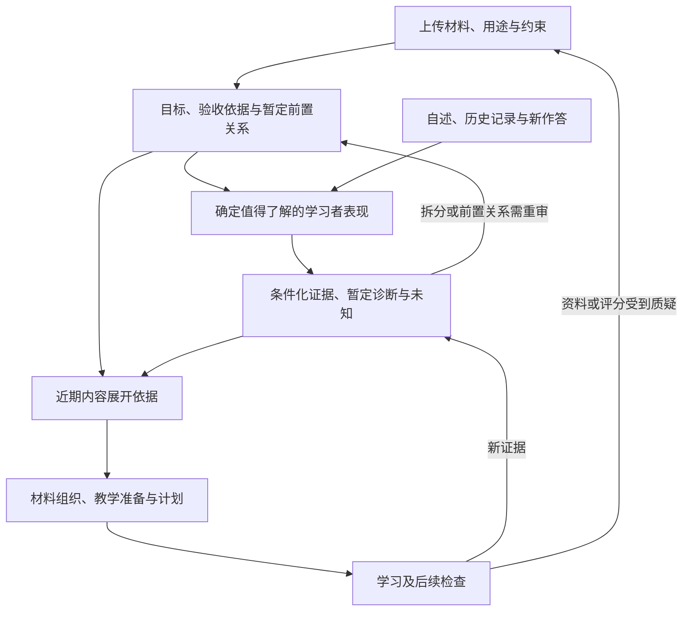

# AI 个人学习系统：工作包 2 与 3 联合顶层设计分析

日期：2026-09-27  
定位：为下一轮联合设计明确问题、边界与成果要求；以下建议可被进一步论证和修订，不是已冻结的详细规格。

**核心建议：把这轮工作组织为“课程目标、学习证据与内容展开依据”的联合设计。**它要让系统在收到材料后，能够说明希望学习者最终独立完成什么、目前有什么证据、哪些未知值得继续查，以及这些判断怎样改变后续内容。工作包 2 和 3 分别承担目标与证据两端，共同形成持续更新的决策依据。

**一、项目基础与本轮范围**

本轮通过并行全文阅读和交叉分析覆盖项目现有的 9 份文件。三份设计文件界定范围，六份研究和策略文件提供约束及候选方法。本轮没有重新核验全部外部论文；下面的系统组织建议属于设计推论，不代表整套方案已被实证验证。

| 文件 | 对本轮设计的主要作用 |
|---|---|
| [设计流程与工作包](<E:/文献资料/学习系统架构设计/docs/architecture/AI个人学习系统_设计流程与工作包.md>) | 工作包 2、3 的正式定义、交付物、通过条件及相邻工作包边界 |
| [整体学习流程与概念架构 v0](<E:/文献资料/学习系统架构设计/docs/architecture/AI个人学习系统_整体学习流程与概念架构_v0.md>) | 已确定目标、共同信息含义、课程到教学的交接、证据回流与纠错路径 |
| [原架构设计提示词](<E:/文献资料/学习系统架构设计/docs/prompts/AI个人学习系统_架构设计提示词_GPT6Astra.md>) | 原始需求与设计自由度；其“交付 v0”任务已经完成 |
| [Encoding 研究报告](<E:/文献资料/学习系统架构设计/docs/research/01_Encoding研究报告.md>) | 表征缺口、前置关系、局部诊断、支架与独立检查 |
| [Encoding 微操作与提问库](<E:/文献资料/学习系统架构设计/docs/research/02_Encoding微操作与提问库.md>) | 诊断和教学活动的候选资源，以及卡片共同约定 |
| [Encoding 策略库 JSON](<E:/文献资料/学习系统架构设计/docs/research/04_Encoding策略库.json>) | 60 个条目的实际结构；条件主要仍在正文中，尚非完整的执行规则 |
| [Post-Encoding 深度增量研究](<E:/文献资料/学习系统架构设计/docs/research/Post-Encoding-Dynamics-深度增量研究.md>) | 不同能力表现、即时与延迟证据、迁移、更新及回流 |
| [Retrieval × Integration 快速矩阵](<E:/文献资料/学习系统架构设计/docs/research/Retrieval-Integration-快速矩阵.md>) | 目标与任务的匹配参考，不是效果排名或固定权重 |
| [Post-Encoding 证据台账](<E:/文献资料/学习系统架构设计/docs/research/post-encoding证据台账与参考文献.md>) | 具体主张的支持范围、核查限制与外推边界 |

当前目录未提供真实待学课程、学习者作答记录，也没有 v0 链接的《AI个人学习系统_架构v0_检查记录.md》。其他文档提及的《深度研究.md》、Encoding研究与策略库.html 及原始 Post-Encoding baseline 也不在当前目录。它们不作为已读材料。这些缺失不妨碍设计规则，但不能据此生成真实个人诊断或声称已完成实际课程验证。现有学习科学报告是系统的设计依据，不能自动当作用户接下来要学习的课程，也不能用报告的复杂程度推断用户水平。

编号需要明确：**原工作包 2 对应 v0 的 B1；原工作包 3 对应 B2；材料与来源是原工作包 4，对应 B3。**本轮联合推进的是 B1 与 B2。v0 建议优先 B1，同时建立 B2/B3 最小约定；路线图本身允许并行和合并，因此联合深化 2、3 与现有方向一致。依据见[工作包定义](<E:/文献资料/学习系统架构设计/docs/architecture/AI个人学习系统_设计流程与工作包.md:111>)及 [v0 工作包映射](<E:/文献资料/学习系统架构设计/docs/architecture/AI个人学习系统_整体学习流程与概念架构_v0.md:386>)。

“收到材料并评估我，再决定后续材料如何展开”跨越几个责任范围。建议本轮完整设计 2、3，并把相邻工作的必要交接推进到能使用的程度：

| 范围 | 本轮需要说清 | 后续再展开 |
|---|---|---|
| 工作包 2：课程目标与验收 | 材料如何支持目标、目标粒度、前置关系、什么表现能支持什么判断 | 实际课程的完整题库和全部验收细则 |
| 工作包 3：学习证据与诊断 | 冷启动、证据条件、诊断、不确定性、判断更新和撤销 | 需要实际数据校准的参数及技术实现 |
| 工作包 4：材料与来源 | 目标与材料位置如何关联；资料缺失、内容冲突怎样限制判断；向材料组织提出什么需求 | 完整分段规则、检索与核验流程、材料生产体系 |
| 工作包 5—6：教学与策略 | 教学方接收哪些目标、缺口、帮助条件和待检查项，允许依据什么调整 | 具体教案、问答分支、策略组合与全部活动规格 |
| 工作包 7—8：计划与协作 | 范围取舍、复核需求和证据变化怎样交给后续规划；关键判断由谁负责 | 全局时间调度、完整授权规则和跨 Agent 协议 |

边界不应成为留下断点的理由：如果一个相邻问题直接影响“评估之后怎样展开”，本轮就应提出可用的暂定约定，同时标明归属。

**二、为什么两包适合一起设计**

工作包 2 建立判断所依据的目标，工作包 3 解释具体学习者的表现。若两者分别使用不同的知识单元和能力语言，后续就很难从“诊断结果”推出“下一步学什么”。

例如，材料中有一条公式，目标可能分别是准确恢复公式、解释适用条件、自主识别使用情境、完成推导或实施计算。学习者在公式已给出的情况下算对一道题，可以支持某种执行表现，却不足以支持自主选择公式。只有目标、任务和帮助条件相互对应，评价才有明确含义。

因此，本轮最重要的共同成果是建立可追溯关系：**材料与课程要求支持什么目标；某次表现支持目标的哪一部分；剩余缺口或未知会改变什么安排。**可以采用多种表示方式，不必提前确定知识图谱、固定量表或数据库。

同时要防止另一种混淆：学习者表现可以改变起点、支架、顺序、近期范围，也可以暴露目标拆分不合理；它不能让系统悄悄降低原有验收要求，并把较低标准下的表现计为原目标完成。改变目标本身应说明原因与影响，由用户保有决定权。此边界继承 [v0 的目标与范围约定](<E:/文献资料/学习系统架构设计/docs/architecture/AI个人学习系统_整体学习流程与概念架构_v0.md:15>)。

**三、材料分析应产出什么**

材料分析的价值在于为目标和决策提供依据。对文件做摘要、抽取目录，只完成了输入理解的一部分。

课程表主要提供主题和节奏，大纲提供范围，教材提供具体内容，作业与考核提供部分任务深度。个人笔记可反映接触内容和自述理解，但还需辨别作者与生成条件。任何一种材料都不能单独证明用户已经掌握了内容。工作包 2 已明确区分前四类输入，见[资料与能力目标](<E:/文献资料/学习系统架构设计/docs/architecture/AI个人学习系统_设计流程与工作包.md:115>)。

本轮需要模型决定：什么信息值得从材料中保留，才能支持目标界定、前置判断、验收与后续展开。一个有用的设计至少应能回答：

- 课程或材料实际涉及哪些对象、关系、条件和任务？哪些只是被提到，并未充分解释？
- 什么范围与深度有明确依据，什么只是系统根据目标提出的暂定建议？
- 哪些内容直接服务用户用途，哪些可先略过，哪些缺失会阻碍近期学习？
- 目标和评分能追溯到什么材料片段；材料不足或相互冲突时，哪些判断需要暂缓？

这里需要区分“学习材料的性质”与“学习者感到困难的原因”。符号密集、论证跳步可以通过材料分析发现；某一段是否对这个用户过难，还需要结合实际表现。把客观材料特征直接变成个人难度分数，会提前制造没有证据的结论。

对于整门课程，可以先形成粗略范围，临近学习的主题再逐步细化。这是值得论证的设计选择：它可能降低前期分析成本，也可能遗漏远处的重要前置。应由模型比较利弊，而非在提示词中强制采用。关键是明确当前规划覆盖到哪里，哪些部分仍暂定。

**四、能力目标、粒度和验收应怎样共同设计**

好的能力目标应能帮助决定教学和检查方式。“理解本章”通常太粗；把每句话都拆成独立知识点又容易丢失完整推理与综合应用。

建议以“拆开后是否需要不同证据、不同帮助或不同教学处理”判断是否值得细分，同时保留综合任务对整体能力的检查。背出每一步，不必然意味着能独立组织整段证明；各子技能分别通过，也不能直接推定综合任务通过。目标粒度可以随学习表现修订，既允许进一步拆分，也允许合并没有决策差异的小项。

验收设计应说明目标要求的表现、任务情境、允许使用的帮助，以及证据能支持的结论范围。无需现在把所有题目写出来，但必须能够解释怎样避免检验错对象：例如，检验方法选择时不能先告诉方法；检验关系理解时不能只分别问两个事实。

前置关系也应服务当前目标。需要分清真正不可缺的前提、能够提高效率的背景，以及可以随学随补的内容；这些区分是候选设计方式，不是固定分类要求。前置不足时应能找到有限补充范围及返回父目标的条件，不能不断展开成整个学科重学。[Encoding 报告的局部修复思路](<E:/文献资料/学习系统架构设计/docs/research/01_Encoding研究报告.md:240>)及[策略卡 S10](<E:/文献资料/学习系统架构设计/docs/research/02_Encoding微操作与提问库.md:208>)可作为依据。

跨学科可以共享目标、证据和修订的基本关系，但需保留正确性标准。数学关注前提和合法推导；AI 课程中的概念解释、代码行为和实验解释分别需要合适证据；金融模型有适用条件；政治课程需要区分事实、解释和价值判断。详细标准由真实目标决定。参见 [v0 学科差异](<E:/文献资料/学习系统架构设计/docs/architecture/AI个人学习系统_整体学习流程与概念架构_v0.md:339>)。

**五、个人评估应围绕近期决策逐步取得证据**

这轮要设计的学习者模型，应能解释“当前目标下，为什么下一步这样安排”。仅有背景问卷或全局能力评分，都不足以承担这个作用。

用户自述、任务表现、表现条件、诊断假设和当前帮助需要保持区别。自述“学过”可以影响起点任务的选择；在提示后完成可以支持相应条件下的表现；“可能是前置知识提取困难”仍然只是解释。这些信息即使放在同一份记录中，也不能互相替代。依据见[工作包 3](<E:/文献资料/学习系统架构设计/docs/architecture/AI个人学习系统_设计流程与工作包.md:134>)与 [v0 共享信息语义](<E:/文献资料/学习系统架构设计/docs/architecture/AI个人学习系统_整体学习流程与概念架构_v0.md:212>)。

冷启动首先面对的是：当前有哪些未知会改变近期学习安排？如果“直接进入应用”与“先看示范”会因某项前置能力是否可用而改变，那么取得一点相关表现就有价值。若某项遥远内容暂不影响近期学习，提前全面测查可能只增加负担。这是本轮应明确的判断原则，不必转化成固定题量或数学优化算法。

诊断任务的价值在于区分解释。一次失败可能来自知识缺失、符号不熟、条件误判、执行失误、疲劳或题目问题。系统应记录支持哪些解释、排除了什么、仍不知道什么，再决定补充证据或采用可修订的学习安排。并非每次都需要额外考试；一次正常学习活动也可能提供足够信息，但须如实保留提示和反馈条件。

诊断本身也可能提供线索或教会某一步。因此，后续表现需要记录此前受到什么影响，不能把经过提示后的进步全部解释为原有能力。这是由[报告对证据条件的区分](<E:/文献资料/学习系统架构设计/docs/research/01_Encoding研究报告.md:197>)推导出的设计要求。相似地，同一次表现被多个 Agent 阅读或总结，仍然只是一份表现证据。

还需说明何时停止诊断：当证据足以支持一个影响有限、可回退的近期安排时，可以开始学习，把剩余不确定性留给后续表现检验；若准备跳过关键基础、作出重要能力结论，或已有证据明显冲突，则可能需要更充分的复核。这里的停止原则属于设计建议，其具体规则应由模型论证。

即时独立表现、延迟保持和新情境表现应分别说明。未知不等于不会，一次未通过不代表整章能力清零，提示下成功也不是没有价值。Post-Encoding 报告 §3.1 的多维框架可帮助避免混淆，但原文明确称其为分析模型；不应因此强制每个知识点都填八维数值。参见[该框架的原有限定](<E:/文献资料/学习系统架构设计/docs/research/Post-Encoding-Dynamics-深度增量研究.md:66>)。

**六、将判断转成后续内容展开依据**

这部分决定联合设计是否真正闭合。仅输出课程能力清单和个人诊断报告，仍不足以指导后续教学。系统还应说明：基于这些判断，近期内容的范围、起点、重点、帮助和验证需求会怎样改变。

下面是概念关系图，表示信息依赖与回流，不是规定每次运行都走相同顺序，也不对应固定模块或 Agent：

“内容展开”不只是调整讲解长短。它可能影响是否进入当前主题、补哪一个前提、从哪个例子开始、突出什么条件、允许什么帮助、哪些部分可以减少重复，以及后续必须检查什么。下面列出差异，用来检验设计是否具有决策能力，不要求做成固定规则表。

| 已有表现或未知 | 值得考虑的展开变化 | 仍需保留的判断边界 |
|---|---|---|
| 对相关内容缺少任何表现记录 | 选择低负担的起点活动，边学边取得信息 | 不自动认定零基础 |
| 提供某个前提后能够推理 | 补充前提的恢复或准备，保留已有推理证据 | 不直接重教整章 |
| 公式可用，但不能自主判断何时使用 | 聚焦条件、方法识别及有差异的情境 | 更多同型计算不一定解决问题 |
| 只有在提示下才能完成 | 调整帮助并安排撤除帮助后的检查 | 当前成功受帮助条件限制 |
| 当前独立表现充分，缺少延迟证据 | 可以进入后续内容，同时交出保持检查需求 | 不宣告长期掌握 |
| 新情境失败 | 检查方法识别、关系映射、执行及新前置 | 不直接认定全部旧知识无效 |
| 原材料或评分可能有误 | 暂停受影响判断，核验依据并修订相关安排 | 不把系统错误归因于用户 |

建议后续教学方至少能理解：当前目标与范围、材料依据、已有表现及其条件、关键缺口或未知、近期安排的理由、待取得的证据，以及什么结果会促使重审。具体怎样组合为产物、由谁维护、是否需要结构化字段，由下一轮设计决定。

近期安排可以比较具体，远期安排保留条件与可修订性；这里仍需模型作出取舍。应避免两种失衡：一是只给“因材施教”的原则，执行者仍需重新猜测；二是冷启动时就生成整个学期的逐题脚本，后续证据无法改变它。

**七、反馈回流与纠错应成为本轮的一部分**

评估不是入学时的一次步骤。教学中、撤除帮助后、跨天恢复及新情境中的表现，都可能修订原判断。B1/B2 的共同依据应服务 Encoding 与 Post-Encoding，避免两边分别维护互不一致的目标和掌握结论。

需要设计的关键变化包括：新证据补充原判断；原诊断受到反证；旧证据与当前情境不再相符；资料或评分纠错导致派生判断失效；用户修改用途或主动纠正个人记录。修订应针对受影响范围，保留尚有效的证据和能力表现。

v0 已给出“材料或规则纠正→解释与任务→评分→能力判断→后续计划”的回查方向。本轮应把它落实为 2、3 能使用的更新规则，而不必提前建设通用自动传播系统。参见 [v0 纠错路径](<E:/文献资料/学习系统架构设计/docs/architecture/AI个人学习系统_整体学习流程与概念架构_v0.md:265>)。同样，新旧知识在不同条件下都可能有效，不能把所有更新理解为覆盖旧记录。

**八、用一个小情境检验设计深度**

以下延续 v0 的代数主题，是假设性纸上走查，不代表用户实际水平，也不是完整教案。

假设上传材料讨论方程的等价变形，近期目标是在实数范围内独立判断变形条件并保留解集。材料中出现约分，并不意味着目标应只设为“会约分”；能力与验收需覆盖条件检查和解集保持。对于方程 y²＝3y，核验锚点是 y(y－3)＝0，解为 0、3；直接除以 y 会漏掉零解。

| 假设观察 | 能支持的判断 | 对后续展开的影响 |
|---|---|---|
| 没有相关作答，只自述以前学过 | 有接触经历的自述，当前独立表现未知 | 可以选一个简短起点任务，无需直接安排全部基础重学 |
| 独立作答漏掉零解，AI 指出“检查 y＝0”后修正 | 已观察到提示后的修正；独立条件检查仍缺证据 | 聚焦变形条件与边界，后续用未暴露关键条件的新任务检查 |
| 能识别不能无条件除以 y，但暂时不会因式分解 | 已有部分条件辨析表现，执行前提仍待了解 | 局部补充所需操作，随后返回原目标；不撤销已有条件辨析证据 |
| 能独立处理新例并解释适用条件 | 支持当前范围内的独立表现 | 可以减少当下重复，另行提出延迟检查需求 |
| 参考答案只写 3，用户指出 0 也满足 | 题目评分依据出现问题 | 进入内容核验和判断修订路径，不给用户追加错误标签 |

这个例子的检验重点是：同一目标在不同证据下，后续安排是否有理由地发生变化。若换一种学习者表现，只改变“基础好/基础差”的文字标签而不改变安排，联合设计还不够具体；若每个分支都要求大规模追加测试，实际使用负担又可能过高。

还可以用不同性质的任务检查可迁移性。假设某门 AI 课程同时要求解释方法和完成一个程序，学习者能口头解释，却无法让程序满足任务要求。这支持保留相应的概念解释证据，并进一步区分实现规格理解、工具前置和程序执行中的问题；后续材料可能转向一个针对性示例或局部练习。若系统已演示完整实现，照着完成只能登记为相应帮助下的表现。此例同样是假设情境，说明联合设计可以容纳文字问答之外的产物，不代表已经验证教学收益。

**九、怎样判断下一轮设计已经足够深入**

本轮之后的设计交付应让人能够审查以下问题，呈现形式可以合并，不必分别写成多个文件：

- 课程材料怎样支持目标与验收，材料缺失时能形成什么暂定安排。
- 学习者状态的每个重要判断依赖什么表现、条件与依据；未知怎样表达。
- 哪些证据能区分不同困难，何时继续诊断、何时开始学习。
- 同一材料面对不同表现，会怎样改变近期内容与帮助；为什么。
- 新证据、目标变化和内容纠错怎样修订判断，怎样影响后续工作。
- 向材料、教学、计划和协作工作交出什么信息，关键判断由谁负责。

验收应关注这些关系是否可使用，而不是检查图中是否有足够多的框。少量贯通情境可以发现设计漏洞；它们不能证明真实学习收益。首期可以保持少量概念和记录，只要支持上述判断；更复杂的量表、算法、自动化与协作机制，应说明它们额外解决了什么问题。

**十、提示词应规定成果，给设计方法留出空间**

详细分析的作用是发现重要问题，不应全部复制成提示词的硬性要求。建议提示词保留本轮目标、项目输入、已确认约束、少量关键问题及可审查成果，把模块划分、表示方法、流程顺序和详略交给模型。

应继承的主要边界是：以实际文件为依据；区分目标、表现、诊断和教学安排；保留帮助与时间条件；能够承认未知并修订；保持用户对目标与投入的控制；区分设计走查和效果验证。提示词无需再为每一种错误规定分支，也不需要求固定数量的能力维度、题目、模块、Agent 或候选架构。

可以要求模型提出明确推荐、解释关键取舍，并允许挑战 v0 中标为设计假设的部分。这能同时避免两种结果：只有泛泛原则、没有决定；或完全照着已有分析填写表格、没有重新思考。

配套的[联合设计提示词](<E:/文献资料/学习系统架构设计/docs/prompts/AI个人学习系统_工作包2与3_联合设计提示词.md>)可单独交给有项目文件访问能力的模型使用。本分析可作背景参考；其中的图、表和示例均不应自动升级为下一轮设计的强制结构。
