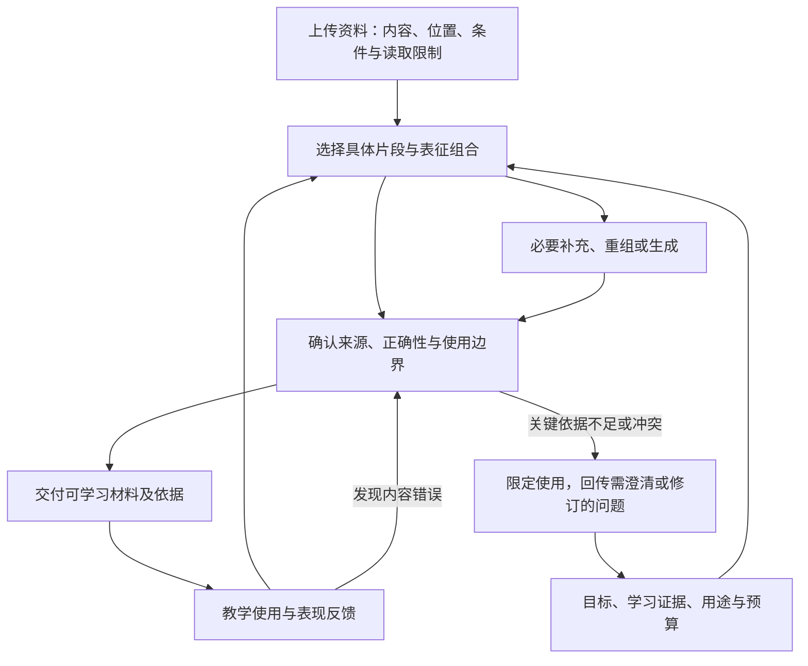

# AI 个人学习系统：工作包 4 顶层设计分析

日期：2026-09-27  
范围：工作包 4「材料选择、输入组织与生成内容核验」，对应架构 v0 的 B3  
性质：为后续正式设计提供分析与可讨论的建议；不冻结模块、字段或运行流程  
配套：[工作包 4 设计提示词](<E:/文献资料/学习系统架构设计/docs/prompts/AI个人学习系统_工作包4_设计提示词.md>)

**本工作包最重要的产出，是让 AI 能说明：针对当前学习目标和已有证据，你此刻值得学习哪些具体内容，用什么材料与表征承载，为什么这样选择，以及这些内容可以信到什么程度。**

文字、公式、例题、图示、模拟等是可选择、可组合的表达资源。真正需要设计的是它们与学习目标、知识关系、学习者证据和使用条件之间的联系。这里既要有材料适配的判断，也要有支撑教学和评分的内容依据。

## 一、项目依据与当前范围

本次对项目现有 13 份文件进行了分工阅读与交叉分析。架构、路线图和历史提示词用于确认任务边界；两组研究及实践库用于提炼材料设计约束；工作包 2、3 的三份现有文件仅用于理解待对齐接口。

以用户本轮说明为准：工作包 1 已完成，工作包 2、3 仍在设计，本轮聚焦工作包 4。目录中已有《工作包2与3_联合设计方案_v0》，其存在不代表其中的所有选择已获确认。本文不修改或重新设计 2、3，也不把它们的具体表单、状态分类、字段数量当成工作包 4 必须接受的接口。

主要依据如下：

| 项目依据 | 对本轮的直接要求 |
|---|---|
| [设计流程与工作包，工作包 4](<E:/文献资料/学习系统架构设计/docs/architecture/AI个人学习系统_设计流程与工作包.md:155>) | 选择落实到节、例题、图或视频片段；说明用途、前置、负担和可访问性；区分来源；核验生成内容；处理冲突、撤回和更新 |
| [架构 v0，课程与单次学习流程](<E:/文献资料/学习系统架构设计/docs/architecture/AI个人学习系统_整体学习流程与概念架构_v0.md:104>) | 材料服务有限目标；可视化说明关系与学习者任务；帮助历史影响后续证据含义 |
| [架构 v0，共享信息与责任](<E:/文献资料/学习系统架构设计/docs/architecture/AI个人学习系统_整体学习流程与概念架构_v0.md:213>) | 内容依据、实际表现、诊断和当前帮助保持区别；高层负责关键意图与争议，执行者有范围内调整权 |
| [架构 v0，内容纠错与记录恢复](<E:/文献资料/学习系统架构设计/docs/architecture/AI个人学习系统_整体学习流程与概念架构_v0.md:266>) | 材料纠正能回查解释、任务、评分、能力判断与计划；首期不建设通用知识图谱 |
| [Encoding 报告 §5](<E:/文献资料/学习系统架构设计/docs/research/01_Encoding研究报告.md:111>)、[微操作库](<E:/文献资料/学习系统架构设计/docs/research/02_Encoding微操作与提问库.md>) | 按知识结构和当前缺口选择支持；分段、例题、表征转换须保留条件与判据 |
| [Post-Encoding 报告 §5、§8、§9、§13](<E:/文献资料/学习系统架构设计/docs/research/Post-Encoding-Dynamics-深度增量研究.md>)、[快速矩阵](<E:/文献资料/学习系统架构设计/docs/research/Retrieval-Integration-快速矩阵.md>) | 不同目标需要不同恢复与加工内容；反馈不能只堆信息；没有通用最优顺序；练习与检验需区分 |
| [工作包 2、3 现有方案，十.1](<E:/文献资料/学习系统架构设计/docs/designs/AI个人学习系统_工作包2与3_联合设计方案_v0.md:507>) | 可参考的双向交接：目标及用途进入，材料位置、来源、支持范围、核验与纠正信息返回 |

本文使用「项目依据」「设计建议」「待验证假设」区分不同性质的判断。对研究的引用只代表项目文档已有的支持范围，本轮没有重新核验全部外部论文；两份研究的证据分级保持原意，不合并成一个分数。

当前没有真实待学课程及个人作答记录。学习科学报告是设计资源，不能自动视为用户下一门课程，也不能用其复杂度推断用户水平。其他文档提及但未提供的《深度研究.md》、Encoding HTML 及原始 Post-Encoding baseline 不作为已读材料。旧文档对缺失文件的描述也需按当前目录更新，例如架构 v0 检查记录现在已经存在。

## 二、先把本工作包的核心对象想清楚

「这是一页公式」只描述了外观。它可能介绍一个定义、证明一个关系、演示一个算法，或给出一道题的解答。同一页用于首次理解、临时查阅和独立验收，适用性也不同。

建议在概念上分清以下关系，但不要求各建一张表或一个模块：

| 需要辨认的对象 | 决定什么 | 典型误判 |
|---|---|---|
| 来源与具体位置 | 内容来自哪里、能否回看原文、适用哪个版本 | 把 AI 转述当成教材原文 |
| 内容及成立条件 | 片段表达什么命题、关系、程序或论证 | 只摘公式，遗漏定义域和前提 |
| 表征形式 | 用语言、符号、图、实例或操作怎样显露内容 | 认为有图一定更易理解 |
| 使用目的 | 是解释、示范、对照、练习、查阅还是评分参考 | 把看过的例题换标题后当成独立新题 |
| 当前使用条件 | 谁能看到什么，已有何种帮助，尚需谁完成判断 | 材料已给出关键解法，却仍按无提示能力评价 |

因此，一张 AI 生成的函数图同时有「AI 生成」的来源属性、「图形」的表征属性和「帮助比较变化趋势」的用途属性。这些属性不能挤在同一个互斥分类中。可靠性和适合度也需要分别判断：准确的论文可能不适合当前起点，易读的解释可能遗漏关键条件。

在产品体验上，用户最终得到的是一项有理由的学习安排：具体看哪里、关注什么、为何现在看、哪些辅助内容有必要、哪里仍有不确定性。内部可以更丰富，用户不必为每次阅读查看整份材料审计报告。

## 三、与工作包 2、3、5—8 怎样分工

工作包 4 可以与 2、3 并行推进。它需要了解目标和学习者证据的含义，不必等待两包的全部细节定稿。首要接口是「为了什么能力、在什么条件下、需要什么内容支持」，而非预先约定完整字段。

| 相邻工作 | 本工作包需要什么 | 本工作包负责交出或回传什么 |
|---|---|---|
| 2：目标与验收 | 当前目标、深度、前置、验收用途及允许帮助 | 哪些内容支持目标，哪里缺依据、缺例子或有冲突；可能需要修订范围的理由 |
| 3：学习证据与诊断 | 相关表现、帮助和材料暴露、暂定缺口、尚未区分的解释 | 材料本身的困难与错误线索、实际提供的内容、适配不确定性；供其更新判断 |
| 5：教学设计与执行 | 预期认知工作、活动用途和必要使用条件 | 可用片段、表征与生成材料、用途说明、帮助边界、核验依据；接收实际使用与失败反馈 |
| 6：策略使用 | 候选策略所需的材料及反馈条件 | 是否具备合格范例、对照案例、变式或参考依据；材料方面的替代选择与限制 |
| 7：持续计划 | 本轮范围、资源和时限 | 必要与可选材料、准备成本和预计学习负担、替代路径；不自行制定全局复习日历 |
| 8：协作与记录 | 授权、交接与修订约定 | 来源、版本、生成和核验依据、待处理争议及影响线索；不提前确定数据库和 Agent 名单 |

**材料与教学需要共同设计。**工作包 4 应主动判断一段原文、一组例子或一张图能支持什么工作，并提出适合的组合。工作包 5 负责把它们组织成实际互动，决定何时呈现、何时让用户尝试、怎样提示、反馈和返回。材料若只有文件位置而没有用途，后续教学仍需从头设计；材料若把所有问答与分支写死，又会侵入工作包 5。

例如，工作包 4 可以提出「使用两个仅在关键条件上不同的例题，并保留由学习者辨认差异的空间」，工作包 5 决定在本次互动中如何提出任务、获得什么回答后提供哪种帮助，工作包 6 论证为何采用这种策略及何时替换。它们共享教学意图，但承担不同判断。

工作包 4 也不应把「这段符号密集」直接写成「用户符号能力弱」。它可以报告材料特征和适配假设；是否构成学习者缺口由实际证据支持。材料不足时也不默默降低目标或评分要求，而是把限制回传给相应责任方。

## 四、内容理解与分段：保留足以正确使用的上下文

首先需要解决「系统是否正确读到了上传内容」。扫描识别、公式上下标、图例、表头、脚注、跨页推导或视频语音可能不完整。顶层设计要允许某些片段保持未读清或待核实，不能因成功生成摘要就认为材料已完整进入系统。具体解析工具与技术路线留待实现设计。

分段建议以当前学习任务所需的完整意义为依据。一个公式及其符号定义、条件和相关例子可能跨越数页；一个很长的章节也可能包含若干可以独立使用的局部内容。固定字数可以是后续技术手段，却不能替代学习范围的判断。

| 材料内容 | 切分和重组时值得保留的联系 |
|---|---|
| 定义、命题与公式 | 对象、符号、量词、条件、含义及适用范围 |
| 推导和证明 | 当前要证明什么、必要前提、步骤依赖、被省略的论证 |
| 例题和解法 | 题干、条件、方法选择点、解答；题目和答案可以分开展示，但保持关联 |
| 图表与模拟 | 坐标、单位、图例、变量映射、参数及近似条件 |
| 代码和实验 | 任务规格、必要环境条件、输入输出及结果解释的适用范围 |
| 论述与案例 | 主张、依据、论证关系、反对意见与适用情境 |

一个片段可以服务多个目标；一个目标也可能需要跨片段组合。这里不应预设「一段材料对应一个知识点」。内容足够支撑局部任务时可以继续；关键前提尚不清楚时，应补齐、缩小使用范围或暂缓相关判断。

【项目依据】微操作库 S02「整合呈现对应信息」、S03「语义分段与暂停」和 Encoding 报告 §5 支持关注关系与完整含义。【设计建议】保留原位置、片段关系和解析不确定性，是把这些约束落实到上传材料的办法；具体表示方式仍可调整。

## 五、选择材料：同时判断必要性、适配性和可用性

材料选择不能只有「相关度」。一份材料与主题相关，不代表对当前目标必要；一份材料内容正确，也不代表它适合此刻使用。

建议让每个重要选择都能解释四件事：它补足什么内容，为什么适合当前证据条件，使用它会增加什么负担，以及有无更简单的替代办法。这些问题可共同考虑，不需要转成统一加权评分。

选择应允许几种不同结果：直接使用原片段；重组原片段并补少量连接；寻找有明确用途的外部来源；生成局部桥接材料；暂不增加输入，转给教学或验收取得表现；因可靠性或可访问性不足而暂缓。

原材料已经清楚且合用时，直接阅读即可。某个难点只缺符号解释时，不必重写整章。需要不同视角时，可以引入补充来源，但要说明它补充哪一缺口，而非无限扩展书单。生成内容的价值在于补足当前任务所需的解释、例子或表征，不能因为容易生成就默认取代原始材料。

在困难原因不清楚时，选择需要保持可修订。例如，用户读不懂一段证明，可能是术语不熟、某条前提缺失、论证跳步，也可能是材料有误。工作包 4 可以提出对应的材料备选与依据；最有区分力的取证需求交给 3、5，不把某一种解释直接固化成长期推荐偏好。

负担包括阅读和操作时间，也包括新符号、新前置、跨资料切换、制作等待和核验成本。尚无个人数据时，只做有理由的估计或范围说明，保留后续修订。用户表达「更喜欢图」可以影响体验选择，但不能单独证明图形在当前目标上更有效。

可访问性要落实到能否打开、看清、操作，以及当前设备和环境能否使用。关键材料失效时提供替代或说明缺口；时间缩短时保留必要条件和可靠依据，移出可选拓展，而非靠删掉公式条件或跳过核验压缩篇幅。

## 六、文字、公式、例题、可视化分别承担什么

建议把媒体形式当作承载内容和认知工作的选择，而不设固定的「文字→公式→例题→可视化」流程。以下是设计时可讨论的适配关系，不是调度规则表。

| 候选形式 | 值得采用的理由 | 必须检查的限制 |
|---|---|---|
| 原文与短桥接说明 | 澄清概念、论证、符号或局部跳步；保持与原文的对应 | 简化是否改变了命题，是否隐藏关键条件或把争议写成定论 |
| 公式与局部推导 | 显露变量依赖、成立条件、推导合法性与程序结构 | 不把符号朗读当理解；保留定义域、单位和变形条件 |
| 正确例题、部分解答、反例或近邻对照 | 展示执行过程，暴露选择点或区分边界 | 例子是否真的表达目标关系；表面变化是否引入额外前置；答案是否提前完成了用户要做的工作 |
| 静态图、对应表、关系图 | 使结构、对齐关系或变量变化容易比较 | 图与公式是否一致，箭头是否错误暗示因果，图示是否越过自身证明能力 |
| 动态或交互可视化 | 需要观察参数变化、过程或反馈，且操作会显露目标关系 | 动态是否必要；操控和显示是否忠实；是否有需要用户预测、解释或修订的明确用途 |
| 代码、实验、数据或视频片段 | 目标涉及执行行为、观察过程或结果解释 | 输入条件、环境和时间范围是否清楚；运行成功能支持多大范围的结论 |

多种表征组合时，关键是相互对应。例如，同一变量在文字、公式和图中的含义应一致；删去的细节需要说明；示意图中的近似不能悄悄变成精确命题。一个抽象概念也未必需要全部形式，增加一种表征应有新增用途。

【项目依据】I06、I08、X03—X06、X10 等卡片具体涉及对应、类比边界、图式检查、公式与语言转换和压缩后的重建。其中 X05 关注变量依赖，X06 关注图与方程的对应和不变量，不能据此推出「任何公式都应配交互图」。这些卡片是设计综合资源，具体材料组合仍需验证。

对可视化，一个有用的顶层设计应能同时回答：显露什么关系、保留什么条件、用户需要完成什么、用什么后续表现判断是否有帮助。若一张完整图已经画出目标要求用户自己建立的关系，展示后取得的表现就需要按已有帮助理解。静态图足以解决问题时，动态制作的额外成本也应纳入取舍。

## 七、组织输入：把可学习的材料交给用户和教学方

材料选择的输出需要超越一串链接，但不必生成冗长教案。建议保留两种阅读视角：

- 用户视角：本次具体看什么、为何现在看、关注什么、哪些是必要内容、哪里可以按需展开，以及怎样回到原文或提出疑问。
- 教学与复核视角：材料支持的目标和范围、前置、来源、核验限制、可能提供的帮助、参考答案和后续使用条件。

这是信息用途的区分，不要求建设两个产品界面。概念层面可以用短文本、带标注的目录或其他形式表达；字段与界面在后续决定。

输入组织应保护几类必要联系：原文与补充说明、公式与条件、图与符号、题干与解答、当前内容与必要前置。同时，参考答案不应与学习者需独立完成的任务无区别地展开。教学时可以示范；承担独立检查时，则按目标的允许帮助范围处理可见材料。

**同一个资源既可以用于学习，也可以用于检索或检查，但实际用途和暴露条件需要明确。**保持测验可以合理地检索曾学内容；新情境应用则需要检查任务新颖性与方法暴露。不能机械禁止复用，也不能把所有复用都叫迁移。

对于复习，还需要决定是否立即重新提供完整内容。如果本次目的是观察独立恢复，完整讲解会改变检查条件；如果目的是开卷比较，则可提供原文支持关系加工。工作包 4 提供适用材料和可见性要求，实际先后与帮助调整交由教学设计。依据见 Post-Encoding 报告 §5、§9、§13 及快速矩阵的任务匹配说明。

## 八、生成与核验：对具体用途说明可靠性

需要区分三个问题：原材料有没有被忠实读出；转述或生成内容是否准确；它是否适合当前教学和评分用途。每个问题需要不同依据，不能用一个「可信分」替代。

来源可追溯是必要条件，不能单独证明正确。教材也可能有错误，生成内容也可能经严格推导获得可靠支持；真正要检查的是具体命题、推导、图形映射或答案的依据及适用范围。

| 对象 | 可以采用的核验依据示例 | 核验不能自动证明什么 |
|---|---|---|
| 原文摘录、简化和桥接解释 | 对照原位置、条件、术语；定位新增推断的依据 | 没遗漏关键信息不等于适合该学习者 |
| 公式、推导和答案 | 检查对象域与合法步骤；按需要使用独立推导、代入、反例或计算工具 | 若干数值算对不能代替一般性证明 |
| 图示和可视化 | 逐项核对变量映射、坐标、单位、关键情形和说明 | 视觉流畅或截图正确不能证明交互行为全都正确 |
| 代码和实验 | 对照任务规格，检查有代表性的输入、边界及环境条件 | 程序能运行不等于概念、实验结论和教学解释都成立 |
| 论述和开放题参考 | 核对事实来源、论证与适用条件，保留合理多解和竞争解释 | 与某个参考立场一致不等于理解正确 |

AI 生成的题目、解答和图若都来自同一次未经核验的推断，彼此吻合仍可能共享同一个错误。多个 Agent 同意也不能替代教材依据、推导或工具结果。核验方法应能发现与生成过程不同的错误来源，并明确其覆盖范围；不要求每项内容都交给多个模型投票。

核验力度可以随用途和错误后果变化。直接用于评分、关键定义、复杂推导、易误导图示或范围改变的内容需要相应依据；普通措辞变化不必引发全链重审。尚无可靠答案时，可以保留为待核实材料或限定范围使用，但不得据此作确定评分。已核验的局部内容仍可继续使用，不必因一处争议停止全部学习。

顶层设计还应说明谁可以制作、谁对可用性负责、何种变化必须重新核验。延续 v0，高层承担关键教学意图、重要来源和评分争议，执行者可在明确范围内制作和调整。具体人数、逐题审批和技术工具并非本轮预设答案。

## 九、来源冲突、撤回和版本更新怎样影响学习

材料冲突可能来自符号约定不同、前提不同、理论立场不同、时间或版本不同，也可能有一方确实错误。先确定是否在相同条件下谈同一主张，再决定能否合并、需要并列还是必须纠正。不能用更新时间或「更权威」标签自动覆盖所有内容。

当确认生成解释或评分依据错误时，应停止继续使用受影响内容，说明错误及有效替代，定位依赖它的任务和派生判断，再把影响交给负责评估和计划的工作包处理。已经看过错误解释的用户可能还需要修复活动，其必要性和效果由后续教学与证据判断。

建议沿用 v0 的最小回查关系：

**来源片段或规则变化 → 相关解释、例子和图 → 使用它们的任务与评分 → 需要复核的能力判断和计划。**

回查应按实质影响进行。来源修正了一个限定条件，就检查依赖该条件的使用；只修正页码或排版，不应清空整章学习证据。历史作答保留当时材料与帮助条件，错误评分可以撤销，新的评分与理由另行说明。当前设计不需要解决任意资料更新的全自动影响传播。

在多来源争议尚未解决时，工作包 4 应交出具体冲突、已核实部分、受影响用途和下一项所需依据。内容问题不能被转写成用户能力不足。高层暂不可用时，保留争议并继续不依赖争议的已授权活动。

## 十、一个适合展开的概念流程

下面是便于讨论的设计建议，表示信息关系；不是固定操作流水线，也不要求为每个方框建立 Agent。

材料审阅也可以反过来帮助 2、3 发现目标证据缺失、额外前置或题目问题；因此它不是只接收上游要求的被动仓库。纠错、目标变化与学习反馈都可能触发重选，而非上传完成时生成一份永久书单。

本轮正式设计最终需要交出的是一套可审查的选择、组织和核验判断，以及必要的交接与失败路径。可采用何种概念模型和文档结构，由设计模型论证。

## 十一、用少量情境检查是否真正有判断力

### 情境一：同一页代数材料，不同证据应改变材料选择

以下为假设情境。假设课程资料包含方程等价变形，近期目标是在实数范围内自主检查变形条件并保留解集。沿用 v0 的数学情境，只检查材料设计，不推断用户真实水平。

| 假设已有信息 | 工作包 4 可以提出的材料安排 | 需要保留的边界 |
|---|---|---|
| 符号含义未读清，规则理解尚未知 | 原文符号定义与对应公式相邻呈现，必要时补短释义 | 不能因读不清符号就认定不会推理；定义释义是否影响验收条件需说明 |
| 能看懂符号，但在除以变量时遗漏条件 | 选保留零解的已核验例题及一个条件对照，必要时给局部推导 | 对照应指向条件与解集；已展示的方法计入帮助历史 |
| 看过例题并能跟随完成，独立能力未知 | 提供可分开展示题干与答案的候选新任务，交教学方决定检查方式 | 暂不重复完整解答；任务是否合格由目标、暴露和评分依据共同确定 |
| 已有相应独立新题证据，本次需要延迟检查 | 可以不安排新增讲解，提供适用的检查材料与备用修复片段 | 延迟检索和新情境迁移用途分开；不把多读材料当成必经步骤 |

核验锚点：对 \(y^2=3y\)，因式分解得到 \(y(y-3)=0\)，实数解为 \(0,3\)；直接除以 \(y\) 会漏解。对原式 \((x^2-x)/x=0\)，原定义域排除 \(x=0\)，约分后解为 \(x=1\)。两者可以支撑对「变形条件」的比较，但正式使用仍需具体目标与前置。

若希望用函数图显示交点，图中应忠实对应方程和解，且用途是帮助观察；图不能替代一般代数规则的论证。若现有文字和推导已足够，图可以不制作。上述核验锚点属于设计审查材料，不应自动连同待独立作答的题目全部展示给学习者。

### 情境二：来源与图示冲突

假设原文明确给出条件，AI 简化解释漏掉该条件，配图又按简化解释生成。此时不能因为解释与图一致就确认原文有误。先回到原位置，核对条件和图中映射；确认错误后撤回相关解释与图，识别用它们制作的题目和评分，交给 3、5 处理受影响判断与修复。

这检验的是来源、生成、核验和纠错的连接。它不要求所有材料都先经历一次多 Agent 审批。

### 情境三：同样是补充材料，学科含义不同

数学任务需要保留定义域与推导合法性；AI 课程中一段概念解释未必足够支持实现任务，可能还需可核验的代码或实验材料；金融课程需要保留模型假设和数据时间；政治课程中的竞争解释可以并列，以事实与论证分别评估。工作包 4 应容纳这些差异，具体教学和评分标准仍由对应工作共同确定。

还可用「只能读清部分上传文件」「临时缩时」「补充链接失效」「用户认为图更难懂」「原材料更新」检查方案。选择少量真正能区分方案的情境即可，不需要为了覆盖清单生成大量演示。

## 十二、设计深度、首期范围与验证

本轮值得明确的事项包括：材料选择的依据与粒度；原文和生成内容的关系；各类表征怎样与学习用途对应；可靠性和适配性怎样分别判断；教学使用与答案暴露的边界；冲突、纠错和更新的去向；与其他工作包的最小交接。

暂可留待后续的事项包括：完整字段、具体检索和解析实现、统一难度分数、媒体选择权重、固定片段长度、可视化数量、精确核验阈值、全量素材库和完整多 Agent 编排。只有某项细节会实质改变方案可行性时才在本轮深入。

【设计建议】首期选一门课程的有限单元，准备能够支撑目标的原片段、必要的辅助内容与评分依据，保留位置、版本和使用记录，用人工辅助的方式处理局部纠错。首期不要求文字、公式、例题、视频、交互图全部出现，也不为整个学科提前生产材料。

设计是否完成，可从以下方面检查：

- 给出一个目标与相关证据，方案能落到具体内容，说明为什么选、什么情况下会换。
- 能保留关键条件、返回原文，并区分已有内容、补充解释和生成材料。
- 对例题、图和评分依据有可执行的核验思路，无法核实时有明确的使用限制。
- 材料在教学中实际显示了什么能被记录，后续评估不会忽略方法和答案暴露。
- 材料错误能够回查受影响用途，不把系统错误归因于学习者。
- 相邻工作能继续设计，且不依赖尚未确认的完整接口或技术方案。

这些条件只说明设计可审查。未来还需分别检验内容正确性、实际使用是否符合意图、学习结果及总成本。材料更短、页面更漂亮或用户感觉清楚，都不能单独证明独立表现、保持或迁移改善。可以在有限且尽量可比的内容上比较不同材料安排，具体方案交给后续验证工作；个人小样本与学习不可逆等限制需要保留。

## 十三、设计提示词应保留哪些约束与自由度

提示词需要明确本轮任务、可用资料、相邻边界和可审查的完成标准。它应把模型引向真正困难的判断：同一内容为什么需要不同输入，哪些生成值得做，可靠性怎样建立，错误怎样改变后续学习。

本文的概念区分、表格和流程均是供讨论的建议。配套提示词不要求逐项照搬，也不把每个问题变成一个模块。它不给定 Agent 数量、材料比例、字段清单、评分公式、唯一分段办法或固定教学顺序。

提示词允许模型挑战建议、合并问题、提出更简单的方案，但要求给出明确选择与理由，而不止罗列备选项。设计可以在假设情境上继续推进；不影响当前决策的未知留待后续，真实学习者情况保持未知。最终方案应该使用户能够检查：「为什么现在学这一部分、用这种形式、依据是什么、哪里还不确定、什么情况会改变安排」。
