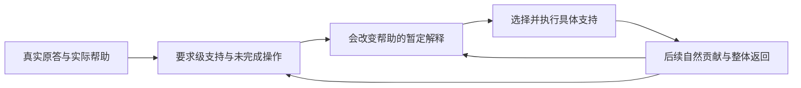

# 教学中认知状态评估与动态策略调整：当前能力分析

分析日期：2026-10-13，Asia/Shanghai。对象是工作区当前文件版本，包括人工文件教学入口、Agent／Skill规则、B3—B6运行实现、已保存的真实教学事件及最新BC备课。结论针对本次读取到的实现和记录，不把历史设计、测试夹具、备课审查或维护模拟当成真实学习效果。

**核心判断：系统已经具有教学回合内、任务范围内的条件化评估和局部策略适配能力，而且真实记录支持它曾经执行过；尚不能认定它已经具备自动持续运行、经过校准和效果验证的认知状态估计与策略优化能力。**

“有能力”和“能力可靠到什么程度”需要分别回答。当前最有根据的能力声明是：读取规则的模型能够根据原答、实际帮助和当前任务，对哪些操作已有支持、哪些仍未观察、哪些解释会影响帮助作暂定判断，并改变讲解、表示、示范、帮助程度和局部工作。程序为这些决定提供记录、条件检查、分支承载与恢复；专业判断仍主要由模型完成。

**一、这里应当评估哪一种“认知状态”**

认知状态不能直接等同于答题分数，也不能把学习者笼统分成“懂／不懂”。对本系统有操作价值的是：针对当前目标的某项操作，在已经提供的输入和帮助条件下，学习者目前能完成什么、卡在哪里、还有哪些合理解释，以及这些区别会怎样改变下一教学动作。

| 需要区分的方面 | 可用观察 | 对教学的实际意义 |
|---|---|---|
| 对象与符号对应 | 是否能指认同一变量、数据对象、条件或接口；自然语言与符号表现是否不同 | 补对象说明、单位或对应，避免把读取困难当作整个概念不会 |
| 关系和理由连接 | 是否能把已知前提接到结论，说明必要的中间连接 | 给可靠桥接或理由示范，保留其他已经可用的组件 |
| 条件和方法选用 | 是否能在未被题名、邻题或默认工具代选的条件下选择、拒用或说明信息不足 | 转到条件比较，避免继续重复已会的计算 |
| 操作执行 | 步骤、计算、代码或推导在哪里断裂 | 提供相应执行支持，而非自动重讲全部理论 |
| 整体组织 | 局部都能完成，是否能接成同一完整作品 | 回查接口、顺序和全局约束，避免无限向前置知识下钻 |
| 自主承担与帮助依赖 | 哪些操作由学习者完成，哪些已由教师、示范或工具提供 | 决定保留、恢复或撤去哪项支架，并限定能力结论 |
| 使用资格与证据边界 | 任务、参考、版本、暴露、资源和时间条件是否允许使用这份表现 | 防止把受帮助成功、参考争议或尚未观察误记成独立掌握或能力下降 |

这是本次分析提出的工作划分，不是新增的统一认知等级表。不同任务只需要其中相关部分。疲劳、情绪、动机和一般能力也可能影响学习，但当前代码和记录没有提供可靠的自动估计能力；现有规则明确禁止单凭慢答或中断诊断负荷、疲劳或认知能力。

现有实现已经包含任务范围内的学习者状态表示雏形：`Judgment`保存要求级支持及使用资格，`DiagnosticNote`保存暂定解释、替代解释和反证，`PerformanceEvent`保留原答和帮助顺序，当前状态文件定位未完成工作。它并非完全没有学习者模型；其主要不足是这些信息由模型和人工文件协议维护，尚未看到统一、自动更新且经过校准的认知工作视图。

作为比较，Corbett与Anderson的知识追踪研究维护每条知识规则的学习概率，并据此安排个体练习序列；这是另一种明确的状态估计方式。本系统不必先建立概率模型才能进行局部适配，也不能把未实现概率追踪等同于没有评估能力。[知识追踪原论文摘要](https://link.springer.com/article/10.1007/BF01099821)

**二、已有规则是否真正要求动态评估和调整**

答案是明确要求，而且已经接通正常教学入口，不只存在于远期架构。

| 已有位置 | 实际要求 | 能支持的判断 |
|---|---|---|
| [SK03入口](E:/文献资料/学习系统架构设计/personal-learning-suite/src/skills/learning-teaching/SKILL.md) | 已有可靠活动根据实际表现调整；含糊、未预期或支持后不符合判断的反应进入动态调整 | 动态适配是当前教学职责 |
| [Encoding动态调整](E:/文献资料/学习系统架构设计/personal-learning-suite/src/skills/learning-teaching/references/encoding.md:49) | 先核对象、条件及题面／参考；解释会改变帮助时才做有限诊断；依据新表现改变细节、条件覆盖、综合范围、表示和帮助程度 | 有从观察到具体教学动作的规则 |
| [SK04有限诊断](E:/文献资料/学习系统架构设计/personal-learning-suite/src/skills/learning-assessment/references/diagnosis-review.md:17) | 复用作品，保留合理解释和反证；只增加会改变当前决定的观察；反应不符合预测时修订解释 | 已要求诊断保持可修订，并有停止边界 |
| [证据规则](E:/文献资料/学习系统架构设计/personal-learning-suite/src/skills/learning-assessment/references/evidence-rules.md) | 区分原答和修订、实际帮助和自主贡献；支持与使用资格分开；局部正确不自动扩成整体支持 | 已有防止“答对即掌握”的证据约束 |
| [策略适配](E:/文献资料/学习系统架构设计/personal-learning-suite/src/skills/learning-strategies/references/selection-adaptation.md) | 按具体障碍选表示、前提供给、桥接、条件比较或整体接口检查；不用固定失败次数换卡；支架按具体组件渐隐 | 已有多种策略和对应的适用分支 |
| [AG0](E:/文献资料/学习系统架构设计/personal-learning-suite/src/agents/AG0-coach.md) | 当前入口根据真实回应执行普通可回退支持，重要判断接评估职责；反馈后沿原主线继续 | 普通适配可以在当轮执行，不必逐题会签 |

2026-10-11的[动态Encoding落实记录](E:/文献资料/学习系统架构设计/docs/implementation/AI个人学习系统_自由度分析与动态Encoding落实_2026-10-11.md)明确说明，本轮是现有能力显化和导航接通，没有另设诊断引擎；文件指导可由读取它们的模型采用，更新不会自动进入旧聊天上下文，运行代码也未因此改变。

特别值得保留的是有限诊断规则：不同解释若都需要同一项可靠帮助，就可以直接教。评估的目的应当是改变有价值的教学决定，不能为了生成一个认知标签，要求学习者持续完成额外小测。

**三、真实教学记录支持哪些已经发生的适配**

以下是对现有事件的分析索引。原答保留在原课程目录，本报告不复制个人原答正文。2026-10-04记录后来被用户排除出新轮次进度；这里仅用于证明系统历史上执行过某类动作，不用于恢复旧成绩或推断学习者当前能力。

| 记录 | 观察与状态判断 | 实际调整及后续证据 | 限制 |
|---|---|---|---|
| [轴比较事件](E:/文献资料/学习系统架构设计/learning/embodied-intelligence/sessions/2026-10-04-01/event-M0-axis-compare-001.md) | 正确运行输出没有伴随概念说明，学习者明确表示不理解；不能把输出正确解释成概念掌握 | 改成带身份、表头和颜色意义的具体说明；事件随后确认帮助已展示，并保存帮助下的正确读表修订；局部够用后回轴映射 | 只支持相应帮助下的工作，不证明自主实现、整体掌握或策略的因果收益 |
| [粒度调整事件](E:/文献资料/学习系统架构设计/learning/embodied-intelligence/sessions/2026-10-04-01/event-M0-rank-001.md)与[轴顺序事件](E:/文献资料/学习系统架构设计/learning/embodied-intelligence/sessions/2026-10-04-01/event-M0-axis-order-001.md) | 局部操作正确，同时出现对连续小问题和教学目的的质疑；这是交互方式反馈 | 停止基础语法与同类微型检查，转向视频张量语义、连贯解释及示范 | 这是响应明确反馈的节奏调整；不能据此声称系统提前准确估计了认知负荷 |
| [特征序列事件revision3](E:/文献资料/学习系统架构设计/learning/embodied-intelligence/sessions/2026-10-07-01/event-M0-feature-sequence-001.md) | 行定位与信息不足判断正确，随后求助暴露对象含义和两条路线未理解；保留局部正确，收窄整体理解结论 | 改用照片对象和完整路线说明；事件确认该解释后来已展示。后续修订显示视频分组有支持，但逐帧处理、置换、编码与信息保持仍混同，于是准备具体保序编码轨迹 | 最后一份轨迹说明在读取记录中仍标为prepared_for_final，没有其后原答；不能把准备记成展示或把该支持记成已经有效 |

这些记录足以反驳“系统只能按固定脚本教学、完全不看学习者”的判断。它已表现出：保留正确局部、根据后续证据收窄原判断、改变表征、补对象含义，以及停止不合适的微型检查。

它们也暴露出稳定性问题：若局部答对已足以区分某项操作，却直到学习者再次明确求助才发现整体理解不足，说明系统可能仍过度依赖局部正确和主动求助。历史上多次调整粒度，至少说明适配尚不能凭规则存在就视为稳定兑现。记录不能确定每次失配的全部原因，更不能由一个实例给出诊断准确率。

最新的[BC认知设计](E:/文献资料/学习系统架构设计/learning/embodied-intelligence/artifacts/bc-normal-20261013-01/design/design-v1.md)与[备用支持](E:/文献资料/学习系统架构设计/learning/embodied-intelligence/questions/backup/bc-normal-20261013-01/supports-v1.md)已经按对象、算术、机制连接、对照条件、标签来源及多解等差异准备不同帮助，并保留回同一作品的位置。它证明备课具备认知分支；文件明确只备课、未授课，因此不证明本阶段已经取得个体状态或适配效果。

**四、程序是否已经自动理解原答、诊断状态、选择策略**

当前程序主要承担可控承载和条件校验。接口名称中出现“诊断”“分支选择”不意味着程序已经完成相应的专业推断。

| 程序部件 | 读取到的实际行为 | 尚不能据此声称 |
|---|---|---|
| [评估程序](E:/文献资料/学习系统架构设计/personal-learning-suite/src/runtime/learning_assessment.py:539) | `inspect_diagnostic`接收已经写好的note与context，核观察、授权、预算、替代解释、不同安排分支、停止条件和引用；结果仍为tentative | 自行从原答生成原因诊断，或校准解释可信程度 |
| [C0反馈](E:/文献资料/学习系统架构设计/personal-learning-suite/src/runtime/learning_teaching.py:604) | 调用方传入branch_index和可定位观察，程序检查既有分支、参考与原答引用并记录事实 | 判断原答语义是否真的符合这一分支，以及自动生成合适的新任务 |
| [B4分支选择](E:/文献资料/学习系统架构设计/personal-learning-suite/src/runtime/learning_teaching_b4.py:267) | `_select`要求调用方提供branch_index；核原答中的观察位置后返回candidate，明确diagnostic_status=not_created、next_action_adopted=False | 自动识别障碍并选择教学路径；候选已自动执行或被采用 |
| [B4局部切换与返回](E:/文献资料/学习系统架构设计/personal-learning-suite/src/runtime/learning_teaching_b4.py:282) | 保留同一事件、父产物、预算与帮助；Post转Encoding要求供给前提后的实际反应；返回不足时指向接口重审或收束 | 局部工作成功等于整体成功，或程序证明了原因解释正确 |
| [策略资源](E:/文献资料/学习系统架构设计/personal-learning-suite/src/runtime/learning_strategies.py:85) | 索引与资源读取、配置与条件检查；索引返回ranking=None、executable=False | 64个策略包构成自动最优策略选择器 |
| [B5操作分派](E:/文献资料/学习系统架构设计/personal-learning-suite/src/runtime/entry_b5.py:202) | 依据显式operation和专业packet调用各服务；诊断路径仍传入已经准备好的note | 自然原答自动启动状态估计及后续教学闭环 |
| [B6宿主](E:/文献资料/学习系统架构设计/personal-learning-suite/src/runtime/network_b6.py) | 本地串行的虚构请求与角色能力承载 | 真实模型已经绑定、真实课程已经自动运行 |

现有人工文件教学能在这些程序之外由模型执行，所以“真实程序未绑定”并不否定已经发生的人工教学。它限制的是自动化、统一更新、可靠触发和可测运行保障的声明。

2026-10-13接入的[协调器](E:/文献资料/学习系统架构设计/personal-learning-suite/specs/coordinator-agent-guide.md:26)管理专业任务、固定版本、回执和采用意图。其当前指南明确专业结论由责任方给出，alerts不会自动注入正在推理的模型，学习事实仍由control/current/plan维护。协调任务状态的变化与学习者认知状态的变化是两种不同事件；增加协调器没有自动补上认知推断。

**五、“实时”目前成立到什么范围**

| 实时含义 | 当前证据判断 |
|---|---|
| 收到原答后，在下一教学回复中改变反馈和帮助 | 规则和真实事件均支持已经具备 |
| 同一作品进行中，依据新反应修订原解释并改路 | 已有局部实例；可执行性存在，覆盖和稳定性未验证 |
| 无需学习者反复说不理解，也能在自然任务中识别未被支持的整体连接 | 规则允许且要求关注剩余操作；尚缺稳定执行与准确性的系统验证 |
| 学习者操作期间持续采集行为并自动估计状态 | 在所查实现中未发现绑定的采集和估计链路 |
| 保证足够短的反馈延迟 | 未见实际延迟指标或保障；[交互规则](E:/文献资料/学习系统架构设计/learning/embodied-intelligence/INTERACTION.md)记录过等待问题，改善尚未测量 |

因此可以称为“教学回合内动态适配”，不宜称为“持续实时认知监测”。对于当前文字和代码作品教学，先把自然贡献后的更新做到稳定，可能比增加连续监控更有价值。这是依据现有任务形态作出的工程取舍，并非要求所有系统都采用同一种实时粒度。

**六、真正影响能力兑现的缺口**

**1. 状态事实有载体，当前工作视图仍较分散。**原答、条件化判断、暂定解释、MethodConfig、当前状态与断点分别承担不同事实，没有看到统一自动维护的“当前哪项操作已支持、哪项由AI代做、哪条连接未观察”的派生视图。接任模型可以依引用恢复，但恢复成本和正确性依赖实际读取与综合。解决方向是从现有对象生成短视图，而非再建一个并行个人状态库。

**2. 专业触发仍依赖模型注意到信号。**文字规则明确含糊、反证、父任务仍失败和支架依赖等触发，但缺少从自然原答到状态更新、动作选择的自动执行保障。代码能保证请求满足门禁，不能保证模型必定识别出该触发。规则更新也不会自动进入已有上下文。

**3. 诊断假说与动作效果之间的预期不够容易核查。**已有next_observation、local_sufficiency及反证要求，可表达“这项支持若合适，下一步应出现什么变化”。所查真实记录尚未形成可统计的统一闭环索引；末份帮助还可能只有准备状态。若只记录用了什么方法和答对了什么，就难以区分暂定解释是否被后续反证推翻、策略是否真正改变了剩余操作。

**4. 选法可解释，但没有验证其优于可行替代。**SK06已能把具体障碍接到候选方法，但程序不排序、不估计本次收益。当前没有足够的可比真实数据，证明某项适配比继续原路、直接解释或另一种表示更好。即便帮助后成功，帮助本身也可能提供了答案或新增教学，不能因此确定原失败的唯一原因。

**5. 撤支架和跨次更新有规则，未见稳定个体化验证。**按组件减少帮助、失败时恢复、保留已有支持都有规定；目前不足以认定系统能稳定决定何时撤哪项帮助，或自动辨别跨次访问失败、关系失效与条件变化。没有数字掌握概率不是首要问题，缺的是可回查更新与实际反应证据。

**6. 学习效果和服务延迟仍未完成相应验证。**接口测试与维护模拟能证明受控路径和规则可执行，不证明诊断准确、学习增益、保持或真实投入改善。前后表现更好也必须检查任务可比、帮助和练习影响。当前没有根据宣布疲劳识别、策略最优、长期效果或反馈速度已解决。

以上判断是对所查范围的缺口分析，不是对全部未知文件或全部聊天作穷尽否定。其中前三项应优先解决，因为它们直接影响现有能力能否在每次教学中被正确采用。

**七、沿现有架构补齐闭环的最小方案**

建议把一次适配明确成下面的过程，观察放在自然作答、作品修改、求助、支持后反应及回父任务这些有教学意义的位置；不为每个术语和微步骤增加测验。



每次只留下足以回查的短段落：当前哪项操作；原答观察与帮助条件；仍可能的解释；这次具体改变什么；预期出现什么可观察变化；后续实际发生什么；解释是否保留／修订，以及回原作品哪个位置。不需要每轮填满所有内部对象，也不要求生成一个准确到百分比的脑内状态。

| 所需含义 | 复用现有承载 | 执行责任 |
|---|---|---|
| 当前操作及原作品位置 | GoalSpec、ActivitySpec、ParentTask、SessionCheckpoint | AG1确定目标，AG0定位当前工作 |
| 观察、实际帮助和顺序 | PerformanceEvent及原件引用 | AG0保存发生事实 |
| 支持范围与使用限制 | Judgment或同义人工视图 | 常规评估由授权入口完成，重要判断由AG3职能承担 |
| 暂定解释、反证和下一观察 | DiagnosticNote或既有事件短段落 | 有必要才接有限诊断 |
| 支持的具体变化与停止／返回 | Activity分支、MethodConfig可调部分、局部够用条件 | AG0作普通可回退适配，关键设计回AG1 |
| 新材料专业可靠性 | 既有来源与用途核验 | 实质专业变化由AG2承担 |

例如计算结果正确而接口含义未被作品支持时，当前判断可以分别保留计算支持、标记接口连接未观察，选择对象对照而非追加同类算术；对象已经清楚而仍无法整合时，支持应转为整体连接。对比帮助后的自然作品，若结果与预期不同，就修订解释和材料。其价值来自动作真的随状态区别改变，而非写出了更多状态字段。

实施次序建议如下：

1. **先核现有闭环是否兑现。**在实际自然教学中，把观察、动作、后续反应和返回用既有事件串起来；维持单一主线，不改课程目标或增加固定题数。
2. **再生成当前认知工作短视图。**从已合法保存的记录派生，仅索引当前操作、条件和未完成连接；历史与原件仍为依据，删除与停用沿原规则处理。
3. **随后绑定真实执行链。**需要自动化时才接实际原答到模型评估、条件检查、动作采用、展示确认和持久保存；不把真实记录改标虚构绕过现有程序边界。
4. **取得可比数据后再考虑统计策略。**知识追踪或统计选法应服务明确任务及指标。DKT原论文将下一题正确率预测作为建模输出，也指出其模型需要较多训练数据；预测表现与证明某种教学动作更有效仍须分开。本项目当前更适合先把语义、帮助条件和实际更新做扎实。[DKT原论文，模型与讨论部分](https://papers.neurips.cc/paper_files/paper/2015/file/bac9162b47c56fc8a4d2a519803d51b3-Paper.pdf)

**八、怎样验证它确实具备所需能力**

首先验证能否按不同状态作不同动作。可用受控维护情境分别覆盖对象不清、允许前提暂不可用、前提已给但关系仍断、局部成功整体失败、教师参考有错，以及目标工作已够用。执行者应取得原始任务和观察，不先看到理想诊断；检查其支持是否真的不同、是否保留未知、是否尊重已有成功和返回位置。这一层验证的是识别和适配行为。

其次验证真实使用效果。在用户原有学习任务内复用自然作品，不另建必考题组；记录帮助具体代做了什么，剩余目标操作是否改善，同类无增量追问是否减少，整体工作是否得到承接，以及实际等待和学习投入。延迟或新情境只在原目标确实要求时观察。判断准确性需要相应独立依据，不能让同一模型的诊断与自评共同构成真值。

若要声称某种适配优于另一种，应设计合适的可比条件或对照，处理帮助、练习、任务差异和顺序影响。少量案例可证明可执行与揭示失配，不足以给出稳定优越性、诊断准确率或长期收益。

现有[有限验证规则](E:/文献资料/学习系统架构设计/personal-learning-suite/src/skills/personal-learning/references/verification.md:9)已经将内容用途、教学执行、真实学习和投入比较分开；可以沿此规则验证，不新增一套并行评价体系。

**九、本次核验与结论置信范围**

本次实际运行四组现有程序测试，全部通过：

| 测试组 | 数量 | 结果 | 本次可支持的范围 |
|---|---:|---|---|
| B3a评估 | 82 | 通过 | 条件化判断／诊断声明、帮助、引用和停止等受控行为 |
| B3b共同教学 | 52 | 通过 | 原答／帮助保存、反馈分支、父任务返回和预算恢复等行为 |
| B4教学专项 | 31 | 通过 | 候选分支、Encoding／Post切换、整体评审交接和恢复等行为 |
| B3c策略 | 47 | 通过 | 资源完整性、方法配置条件、帮助用途与复用等行为 |
| 合计 | 212 | 全部通过 | 程序承载与校验机制；不构成认知判断正确率或学习效果验证 |

复现命令从项目根执行，四行各自为一个测试组：

```powershell
python -B -X utf8 -m unittest discover -s personal-learning-suite/tests -p test_b3a_assessment.py
python -B -X utf8 -m unittest discover -s personal-learning-suite/tests -p test_b3b_teaching.py
python -B -X utf8 -m unittest discover -s personal-learning-suite/tests -p test_b4_teaching.py
python -B -X utf8 -m unittest discover -s personal-learning-suite/tests -p test_b3c_strategies.py
```

| 结论 | 证据性质与置信范围 |
|---|---|
| 当前规则要求根据真实表现动态适配 | 直接文件依据，置信高 |
| 真实历史中执行过局部评估及支持调整 | 原件引用与事件顺序支持，置信高；不扩成个体能力或因果效果结论 |
| 当前程序主要检查专业声明，未自行推断状态或最优选法 | 直接代码与契约依据，置信高，范围限所查程序 |
| 自动连续监测、诊断校准和稳定效果尚不能认定 | 所查范围缺相应实现或验证，不能用现有测试补足 |
| 优先补当前工作视图、触发与后续反应比较 | 基于以上缺口的架构建议，不是已实现事实 |

当前应当保留并用好已有的条件化评估、有限诊断、分支支持和整体返回机制。要把能力提升到稳定可验证的程度，重点是让每个有价值的状态区别对应具体动作，让后续真实反应能够推翻旧判断，并把这种更新跨回合可靠保存和恢复。
