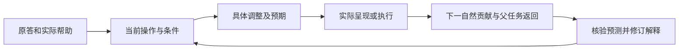

# 认知状态评估与动态教学：提升方案

分析日期：2026-10-14，Asia/Shanghai。依据当前工作区实际版本、人工文件学习记录、评估／教学／策略运行实现及已验证的原始研究。本文是改进建议，没有修改教学规则、运行代码、个人评价或学习安排。

**建议优先把已有条件化评估和动态适配做成稳定的“观察—状态—动作—后续反应—修订”闭环。近期最有价值的增量是操作级当前视图、调整前的可检验预期，以及后续自然作品对预期的核验。**

2026-10-13的[能力分析](E:/文献资料/学习系统架构设计/docs/analysis/AI个人学习系统_教学中认知状态评估与动态策略调整能力分析_2026-10-13.md)已经确认现有基础。本次重点是如何进一步提升，避免把已有能力重复列成新需求。

**一、当前基础决定了提升起点**

| 当前基础 | 已有证据 | 需要提升的部分 |
|---|---|---|
| 原答、提示、反馈、修订及独立样本追溯 | [共享契约](E:/文献资料/学习系统架构设计/personal-learning-suite/contracts/shared-contracts.md:30) | 跨回合容易取得最新、条件清楚的状态摘要 |
| 支持与使用资格双轴，操作级帮助解释 | [判断契约](E:/文献资料/学习系统架构设计/personal-learning-suite/contracts/shared-contracts.md:31) | 将分散判断对齐到当前仍需完成的操作和整体连接 |
| 暂定解释、替代解释、反证与有限诊断 | [诊断契约](E:/文献资料/学习系统架构设计/personal-learning-suite/contracts/shared-contracts.md:32) | 稳定记录调整前预期，随后比较实际反应并更新解释 |
| 调整表示、关系细节、条件覆盖、综合范围和帮助程度 | [Encoding规则](E:/文献资料/学习系统架构设计/personal-learning-suite/src/skills/learning-teaching/references/encoding.md:51) | 保证自然贡献后真正触发这些规则，留下实际执行与返回依据 |
| 真实文件教学中已有局部判断和帮助调整 | [特征序列事件](E:/文献资料/学习系统架构设计/learning/embodied-intelligence/sessions/2026-10-07-01/event-M0-feature-sequence-001.md:7) | 从个别成功执行提升到可重复、可检验的过程 |

程序与模型职责需要分清。[教学服务](E:/文献资料/学习系统架构设计/personal-learning-suite/src/runtime/learning_teaching.py:248)保存表现后仍明确返回未调用评估；[专项教学分支](E:/文献资料/学习系统架构设计/personal-learning-suite/src/runtime/learning_teaching_b4.py:271)由调用者提供；[评估服务](E:/文献资料/学习系统架构设计/personal-learning-suite/src/runtime/learning_assessment.py:402)明确把专业评分视为模型声明、未经程序语义验证。人工文件模式的模型能够按规则进行真实教学，当前程序主要提供承载与条件校验。

因此这里的“认知状态”应理解为：根据已有作品，对当前目标下哪些操作可用、需要什么帮助、还存在哪些解释作出的可修订判断。不能当成直接读取学习者脑内状态。

**二、七项提升及其实际作用**

**1．生成操作级的当前认知工作视图，减少每轮重新综合历史。**

从现有原答、事件、判断、诊断和断点生成一份简短派生视图，只覆盖当前目标需要的操作。例如对象／符号对应、关系连接、条件辨析、方法选择、执行、整体组织；不同目标选择相关项，不建立统一必测维度。

每项至少能回答：当前观察支持什么；在哪种任务和帮助条件下成立；哪些工作仍未观察；有什么反证或竞争解释；依据是哪份原答；下一步为什么需要改变。原件和正式判断仍为依据，视图可重新生成，不能成为第二套权威个人状态库。

| 视图内容 | 最小表示建议 | 作用 |
|---|---|---|
| 操作与情境 | 目标／判据版本、稳定操作标识、父作品位置、任务条件 | 避免跨任务把相同名称误当相同能力 |
| 观察和帮助 | 具体贡献、已提供或代做的工作、源事件／原答引用 | 区分帮助下可用与独立完成 |
| 证据状态 | 沿用support、eligibility；说明覆盖范围、冲突和未知 | 保留不确定性，避免总分掩盖缺口 |
| 当前解释与行动 | 有必要时的候选解释、动作依据、下一观察、返回点 | 让状态直接服务教学 |

稳定标识只帮助关联记录。跨任务是否可汇总，还要核情境、先修知识、复杂度和帮助是否相容；不能按同名操作自动平均。

有一项可先处理的小问题：[人工评价模板](E:/文献资料/学习系统架构设计/learning/embodied-intelligence/templates/judgment.md:9)的support枚举与[共享契约](E:/文献资料/学习系统架构设计/personal-learning-suite/contracts/shared-contracts.md:62)不一致。未来实现前应统一语义，把“部分支持”落实到具体操作和条件，避免模板与程序各自解释。

**2．提高自然任务的辨别力，减少依赖答对和主动求助。**

在主任务的关键连接处，预先明确什么表现能区分“对象没对应清楚”“关系尚未建立”“条件错用”“步骤执行出错”或“整体组织未接通”。先看已有作品；只有这些解释会导致不同教学动作时，才补最少的澄清、预测或对照。

题目应能观察真正需要的关系：仅复制刚展示的句式、按默认方法算对或照着示范改数字，可能不足以支持方法选择和整体理解。已有AG3反向审查可进一步落实为“该任务允许哪些短路完成路径、分别能支持哪些结论”的明确备注。

在确有决策价值的地方，可让学习者在反馈前标记不确定处或说明关键理由。学习者自报把握与系统对判断的可靠性必须分开；没有自报就保留未知。信心、解释长度、表达流畅度都不能单独确诊认知问题。

知识追踪研究发现，预测大量缺乏个体区分度的回答可能改善总体指标，却不足以准确反映个体知识差异。这支持重视证据辨别力；它没有证明“多做诊断题”必然提高学习收益。[区分度加权知识追踪原论文](https://arxiv.org/abs/2212.14695)

置信度反馈实验发现，低置信但正确的回答也可能从反馈中获得保持收益。其材料是一般知识选择题，不能据此认定高信心错误就是固定误概念。[Butler等，2008原论文](https://learninglab.psych.purdue.edu/downloads/2008/2008_Butler_Karpicke_Roediger_JEPLMC.pdf)

**3．把有限诊断落实成调整前的预测，允许后续反应推翻解释。**

已有DiagnosticNote包含next_observation、反证和分支，近期无需再创一套诊断对象。关键是关键调整发生前就说明：目前观察是什么；为何考虑这个解释；这次帮助改变什么；若合适，下一自然贡献应出现什么变化；什么结果会使解释不再成立。

不是每次都凑多个假说。若各种合理解释都需要同一种可靠补充，就直接教；已经有足够依据也直接调整。无法区分时保留未知。

反应不符预期时，同时检查诊断、教学材料、题面和目标负担，避免一律归因于学习者基础不足。帮助后的改善可以支持“当前工作恢复推进”，通常不能证明此前失败的唯一原因。

**4．让认知状态对应具体教学变量，改善策略选择质量。**

现有策略库和分支已经较丰富。应先明确这次调整哪个变量、改变后预期观察什么，再考虑新增策略。

| 观察支持的当前问题 | 优先考虑的调整 | 后续自然贡献看什么 |
|---|---|---|
| 对象、符号或接口指称不清 | 补明确对象、单位和对应；必要时用具体表征 | 是否能正确对应同一对象及其输入／输出 |
| 前提暂不可访问，给前提后推理可继续 | 在允许条件下提供前提，保留推理工作 | 是否能接通剩余关系；恢复能力另按目标判断 |
| 前提已给，仍断在关系连接 | 提供局部桥接、可跟踪示范或关系对照 | 是否能使用该连接，接回原作品 |
| 会执行但选法或条件错用 | 给必要边界、近邻情境或合法反例 | 是否能选择、拒用或说明信息不足 |
| 局部可用，整体仍失败 | 回完整作品检查接口、顺序、映射和约束 | 原整体连接是否恢复，而非只看局部小题 |
| 支架已代做目标工作 | 只减少相关支架，保留其他必要帮助 | 原被代做操作是否由学习者承担 |
| 题面或教师参考可能有错 | 核材料和判据，限制受影响用途 | 错误依据是否修复；不把疑误记为能力不足 |

这些是候选行动关系，不能机械套表。选择还应考虑用户请求、合法多解、剩余预算、材料可靠性和前序暴露。调整帮助、综合范围或内容呈现，不等于降低目标判据。

第一版可以比较少数可行候选的目标贡献、证据价值和成本，说明选择理由；不必生成虚假的精确收益分数。取得可比数据后，才考虑统计排序。

**5．让下一次自然贡献完成即时核验，并区分不同成功含义。**

建议把实际链条明确为：

每项关键调整应能区分：只是准备了材料、已经实际展示、取得了新反应、核验了预期、回到了原作品。帮助结束但尚无后续贡献，就保留“未观察”，不能报告调整已经有效。

同时分开：帮助下完成、目标条件下独立完成、整体作品成立、目标要求的保持或迁移。这些结论需要的证据不同。同题修订不是新独立样本；同一整体作品中不同操作受到的帮助也可以不同。

下一自然贡献主要检验即时反应。它可能受到模仿、重复尝试和任务变容易影响，不能直接证明策略因果优势或长期掌握。

原始实验显示，即时表现和延迟保持可能给出不同结论，因此不能只以本轮答对率评价长期学习策略；论文中的两天／一周不是通用最佳间隔。保持与迁移只在目标确实要求时追加观察，否则不形成额外学习债务。[Roediger与Karpicke，2006](https://pubmed.ncbi.nlm.nih.gov/16507066/)

**6．改善跨会话恢复，保留时间和条件变化。**

恢复时提供当前目标下仍有效的局部支持、最近相关帮助、未完成连接和未决解释。已有支持不因换模型或间隔一段时间自动清零；新的任务条件也不自动继承旧结论。

可将“历史上观察到的支持”和“未来使用时可能需要再次确认的风险”分开。长时间未用可以提示风险，不能直接记为不会或失败。必要的后续观察优先放入真实使用情境，避免每次恢复都全章重测。

**7．以诊断和教学净收益验证改进，控制过程成本。**

普通反馈沿当前AG0授权做轻量处理，关键争议、重要跳过、目标扩展或专业材料变化才接相应角色。不把每次原答变成多Agent会签，也不每轮生成完整报告。

时间要分别记录模型／工具等待、学习者阅读与作答、可观察的中断；未知保留未知。不能把回复间隔直接解释为认知负荷或疲劳，也不能简单从总时长减去模型等待就当成学习时间，活动可能重叠。

现有[交互节奏规则](E:/文献资料/学习系统架构设计/learning/embodied-intelligence/INTERACTION.md:3)已经针对长等待作了调整，但收益尚未测量。新的状态和核验机制必须同时检查是否增加等待、追问和中断。

**三、用现有特征序列记录说明提升会怎样发生**

真实事件曾出现：标签条件下行定位与信息不足判断正确，随后学习者仍求助于对象含义和整体路线；解释后，视频分组有支持，逐帧处理、置换、编码及信息保持仍存在混同。[实际事件](E:/文献资料/学习系统架构设计/learning/embodied-intelligence/sessions/2026-10-07-01/event-M0-feature-sequence-001.md:7)

改进后的状态视图应分开保留“给定标签下定位已有支持”“整体接口连接尚未完整观察”“帧身份与信息保留的关系仍需澄清”，而不是生成一个总体懂／不懂标签。

若各种解释都需要明确对象和模块契约，就先直接解释。已有足够前提后，若确需区分“顺序变化”和“编码丢失信息”的混同，可以沿原作品使用保序但丢弃某个颜色通道的具体对照。预期是学习者在后续自然说明中分别处理来源对应与信息保留；这是一项建议的可观察预期，并非已经取得的新表现。

如果仍未接通，重查表征、输入契约和整体接口，而不因短答正确就继续升级，也不自动增加基础语法题。用户只请求解释或暂停时，先满足该请求，不强加验证题。最后回同一完整作品中需要的连接。

**四、建议按三层推进**

| 层次 | 具体交付 | 完成标准 |
|---|---|---|
| P0：先稳定模型执行 | 统一记录语义；生成当前操作短视图；在关键调整前写可观察预期，随后核自然反应与返回 | 能回查观察、实际帮助、预期、反证和后续动作；普通正确反馈无需新增诊断题 |
| P1：再用程序保证闭环 | 真实事件适配、最新版本定位、派生视图更新、待核验动作提示，以及评估到反馈的受控串接 | 原答保存后不因漏调用而一直停在旧状态；材料准备与实际展示、新反应与效果报告可区分 |
| P2：数据合适后试统计模型 | 比较可解释基线、知识追踪和策略候选排序，保留人工覆盖与回退 | 在时间顺序留出的后续表现上验证预测和校准；策略收益另外用适当可比条件验证 |

P1应保留现有原件、判断和控制的来源关系。程序可以检查引用、条件及执行状态，不能因为链条完整就宣称语义诊断正确。当前虚构运行器也不能通过更改真实记录标志直接用于个人数据；需明确建设真实记录接入。

P2的前提不是“收集了一些回答”，而是事件语义稳定、相关情境覆盖充分、能够用后续独立表现核验。单用户事件相关性强，适应性选择还会改变各策略遇到的任务；平均正确率不能直接比较策略优劣。

AIED 2025对知识追踪的冷启动研究表明，交互稀少的新学习者仍有预测困难；结果来自ASSISTments数据集，不能直接证明某模型适用于本个人系统。近期应先完善证据与闭环，再决定是否引入复杂模型。[冷启动原论文](https://arxiv.org/abs/2505.21517)

**五、如何证明这些提升有用**

先做隐藏后续的前向回放：冻结教师材料与初答，执行者每次只能看到当时已有证据，给出当前解释和动作后，才揭示下一反应。检查是否过早推断整体掌握、是否保留合法解释、是否被反证及时修订、是否回父作品。诊断没有足够真值时保留未决，不能让同一模型的自评构成准确率依据。

再在实际自然学习中检查收益。保持同一目标与可比条件，记录有用的剩余操作是否完成、重复无增量追问是否减少、用户是否再次因相同卡点求助、整体连接是否恢复，以及实际等待和学习投入。保持／迁移只在目标要求时纳入。

| 指标 | 主要回答的问题 | 解释边界 |
|---|---|---|
| 过宽判断与漏识别 | 是否把局部或辅助成功误作整体／独立完成 | 应回原答、条件和合格复核，不以模型互相赞同计真值 |
| 预期核验与修订 | 新反应不符预期时是否调整解释和动作 | 反应改善也不能确诊唯一原因 |
| 剩余操作与整体返回 | 支持是否让主任务继续推进 | 不用局部小题数量代替整体成立 |
| 学习时间、等待及追问 | 改进是否造成更多成本和中断 | 未知时间不补零，重叠活动不重复计算 |
| 目标要求的后续独立表现 | 即时改善是否延续到必要的时间或情境 | 不统一追加闭卷、延迟或远迁移条件 |

若要声称某项策略优于另一项，应另设计可比条件，处理任务差异、帮助、练习和顺序影响。前向回放能够检验判断过程，真实个案能够揭示失配；它们都不能单独证明普遍因果收益。

本次进行了当前文件与代码的只读审查、三项并行分析、原始研究核查以及独立建议风险审查。没有重新运行程序测试，没有进行真实学习实验，没有更改既有学习事实。上述优先次序属于基于当前证据的设计判断，收益仍需按这里的验证方式观察。
