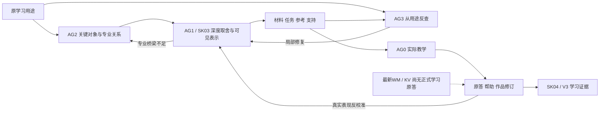

# WM 学习系统：最新备课成果、理解深度与结构问题

日期：2026-10-11，Asia/Shanghai。性质：备课与系统分析报告。未开展正式教学，未修改原备课、课程目标、真实学习状态或学习者原答。本报告结合三名只读审计子代理的独立分工；内容核查不是盲评，也不是教学效果实验。

## 1. 结论与审查范围

**现在的备课已经有实质深度，足以支持有限范围的机制学习、允许资料的条件判断和技术诊断，值得进入实际试学。它还不足以证明系统已经让学习者建立了充分理解，也不足以支持神经世界模型实现、训练与研究能力。**

不能再把当前问题笼统归为“没有学科分析、只有认知策略”。10月11日的通用修订，以及最新成品里的推导、反例、连续工作和回修，已经反驳这一说法。当前更值得关注的是：原用途怎样决定深度；专家理解怎样成为当前学习者可获得的输入；关键判断由谁完成；纸面模型怎样接到真实方法和实验证据；真实表现怎样反过来修改教学。

按 [LATEST_RECORDS.md](<E:/文献资料/学习系统架构设计/learning/embodied-intelligence/LATEST_RECORDS.md:3>)，最近提交其实是 KV Cache 与长上下文 r1；两份决策充分性 WM 备课列在上次提交中。本报告重点审查：

- [KV Cache 最新完整备课](<E:/文献资料/学习系统架构设计/learning/embodied-intelligence/artifacts/lesson-preparation/2026-10-11-transformer-kv-cache-r1/完整备课.md>)。
- [决策充分性 WM，10月11日 r1](<E:/文献资料/学习系统架构设计/learning/embodied-intelligence/artifacts/lesson-preparation/2026-10-11-decision-sufficient-r1/README.md>)。
- [决策充分性 WM，10月10日开始、11日完成](<E:/文献资料/学习系统架构设计/learning/embodied-intelligence/artifacts/preparation-tests/2026-10-10-decision-sufficient/README.md>)。

同时参考 RSSM 的实际质量审查、Flow Matching 的内容核查、最新真实学习事件、学科分析研究及工作底稿、Encoding/Post 设计和当前 Agent/Skill 规则。研究报告是设计依据，不是学习者已经获益的证据；作者自审结论没有直接替代本次的实际讲义、题面、参考及代码读取。

## 2. “深度、理解、足够”必须分别判断

| 要判断的事情 | 当前实际支撑 | 判断 |
|---|---|---|
| 备课内容是否解释机制、理由与条件 | 逐层缓存归纳、受限价值等价、信息冲突、随机评价、规划截断和反例 | 已有实质深度，超过定义与接口命名 |
| 材料是否让学习者看到中间连接 | 实际公式、数值、表、两层代码轨迹、连续任务与具体支持 | 核心路线已经形成；个体可理解性仍待试学 |
| 是否保留学习者关键工作 | WM T2/T5、KV预算选法与条件修订 | 有；各任务的自主程度不同，不能合并宣称掌握 |
| 是否讲清模型怎样从数据学出来 | 前一份 WM 有参数更新微轨迹；r1主要是训练目标摘要 | 深度不均，不能说新版全面更深 |
| 是否能独立实现或开展研究 | 主要为教师toy、有限核算、纸面实验设计；未有学生实现或真实WM实验 | 尚不足，需与机制/诊断用途分开 |
| 当前学习者是否已经理解 | 最新正式证据仍在 M0；新WM/KV只有备课，没有学习原答 | 不能确认 |
| 系统是否稳定有效、协作是否值得 | 有界行为试用、具体回修、文件与数值验证 | 可说明部分功能兑现；真实效果和协作净收益未验证 |

因此，“可以开始学”与“已经学懂”，“备课有依据”与“在真实模型上有效”，是不同的结论。也不能以未做范围外的GPU或神经训练实验，反过来否定当前机制备课的价值。

## 3. 最新 KV Cache：机制深度与条件判断已经较扎实

最有分量的内容不是优化方法数量，而是以下连接已经实际进入讲义和任务。

**第一，解释了多层缓存为什么成立。**讲义不是只说“旧token未变”，而是从固定token与位置、因果可见范围、逐位置运算推出旧状态逐层不变，再推出每层KV可复用。新Query仍须匹配当前可见Keys、重新softmax并混合Values。见 [材料第38行](<E:/文献资料/学习系统架构设计/learning/embodied-intelligence/questions/preparation-tests/transformer-kv-cache-20261011/visible/04-materials.md:38>)。一层算例与两层模型的身份也明确区分，没有用单层数值冒充跨层证明。

**第二，时间与对象关系清楚。**prefill的末位置logits预测首个生成token；“已选择该token”与“已经为它计算KV”分开。chunk mask用绝对位置对应矩形布局，前缀编辑则重审受影响后缀。见 [材料第56行](<E:/文献资料/学习系统架构设计/learning/embodied-intelligence/questions/preparation-tests/transformer-kv-cache-20261011/visible/04-materials.md:56>)。这些是会改变实现正确性的关系，不是额外名词。

**第三，容量、计算、读取与任务质量分开。**连续工作不只要求背容量式，而是计算两请求16GiB、合法共有前缀最多省1GiB、仍不能装进12GiB，再说明方案改变什么和还缺什么测量。见 [任务B](<E:/文献资料/学习系统架构设计/learning/embodied-intelligence/questions/preparation-tests/transformer-kv-cache-20261011/visible/05-continuous-work.md:19>)、[完整参考](<E:/文献资料/学习系统架构设计/learning/embodied-intelligence/questions/preparation-tests/transformer-kv-cache-20261011/teacher-reference/06-reference.md:19>)。分页、FlashAttention、头结构、量化、offload、滑窗与检索的不同作用都有边界。

**第四，审查实际改变了成品。**累计成本原先没有被题面承担，模型规格切换称呼不准，质量支持缺实际输入，时间线图容易误读；这些已经回修到题面、材料和图，不只留在自审建议中。见 [反向审查第83行](<E:/文献资料/学习系统架构设计/learning/embodied-intelligence/artifacts/lesson-preparation/2026-10-11-transformer-kv-cache-r1/07-reverse-review.md:83>)。

本次又用现有固定参数toy核了24组不同token序列与随机分块，完整/缓存路径的logits及逐层KV一致，最大logits差为0；标量Attention与8/15GiB容量亦一致。结果见 [数值交叉核查](kv-numerical-crosscheck.json)。两路径共用数值算子，因此这支持缓存与分块的一致性，不能独立认证整个Transformer实现，也不代表生产模型、GPU性能或学习效果。

专业对象与原始来源相容：[HF固定版本缓存说明](https://huggingface.co/docs/transformers/v4.57.1/cache_explanation)支持逐层追加与合法位置管理；[GQA原论文](https://arxiv.org/abs/2305.13245)讨论头结构转换与后续训练，而不是原MHA在运行时删头即可等价；[Lost in the Middle](https://arxiv.org/abs/2307.03172)研究特定模型/任务的位置敏感表现，不能泛化成所有模型的恒定失败规律。

本单元足够支持缓存机制、前缀合法性、预算和有依据的方案判断。实际生产API实现、RoPE扩展的完整机制、真实profiling及复杂长文本实测不在本次主目标内。它们尚未验证是范围边界；只有扩大目标时才成为必须补齐的内容。

## 4. 两份 WM：已经进入专业理解，但深度不是单调升级

10月11日 r1 的强项在于：把“预测准确性”和“决策充分性”之间的差别变成了会改变判断的实例。

- 总观测MSE低的模型，可能错在决定行动排序的位置变量；总MSE更高的模型反而选对动作。见 [实际对照](<E:/文献资料/学习系统架构设计/learning/embodied-intelligence/questions/visible/decision-sufficient-preparation-r1/materials.md:72>)。
- 奖励改变后，同一个z、a对应不同必要奖励输出；这是给定接口下的信息冲突，不能靠多训练几轮或只重训同输入奖励头解决。见 [信息冲突](<E:/文献资料/学习系统架构设计/learning/embodied-intelligence/questions/visible/decision-sufficient-preparation-r1/materials.md:96>)。
- 当前动作选对、候选评价保持、受限价值等价、Markov信息与历史充分性被分开。还给出函数集合不闭合的具体见证，避免由一次Bellman更新等价推出任意迭代都成立。见 [充分性与闭合性](<E:/文献资料/学习系统架构设计/learning/embodied-intelligence/questions/visible/decision-sufficient-preparation-r1/materials.md:104>)。
- 随机结果的均值不必足以评价非线性奖励；准确转移也不能补偿错误视界或末端价值。T2与T4要求对应计算和修正。见 [具体题面](<E:/文献资料/学习系统架构设计/learning/embodied-intelligence/questions/visible/decision-sufficient-preparation-r1/tasks.md:23>)。

这些内容说明当前AG2已经取得承重的专业关系，SK03也把它们转成可见输入。MuZero/TD-MPC2的组件、规划方式与训练目标有实际对应，不应说成只有技术名字。见 [真实方法接口](<E:/文献资料/学习系统架构设计/learning/embodied-intelligence/questions/visible/decision-sufficient-preparation-r1/materials.md:151>)。

但是，“真实方法接口有对应”不等于“训练机制充分展开”。**前一份WM比r1更具体地交出了数据→损失→梯度→参数→后果→回报→行动这条链。**它从两个转移监督定义动力学损失，令θ由0更新为1，将shortcut分数由1.8/1.8改成9/−5.4，再改变动作；之后用相同输入冲突解释为什么参数更新无法创造已删的信息。见 [前一份参数更新微轨迹](<E:/文献资料/学习系统架构设计/learning/embodied-intelligence/artifacts/preparation-tests/2026-10-10-decision-sufficient/03-learner-materials.md:118>)。它还展开了stop-gradient、EMA Q及真实目标与toy平方损失的区别，见 [原方法短视图](<E:/文献资料/学习系统架构设计/learning/embodied-intelligence/artifacts/preparation-tests/2026-10-10-decision-sufficient/03-learner-materials.md:339>)。

r1在这部分主要缩成文字摘要。对于“判断新部署要保留什么、先检验什么”的纸面用途，这种简化可以成立；对于“深入理解世界模型怎样被学出来”，仍不够。更合理的取舍是保留r1的新条件与诊断路线，按目标复用旧版训练微轨迹，而不是把日期较新的版本视为所有维度都更深。

两版都没有真实训练后的神经世界模型实验。WM r1代码主要核有限环境、评分与算术；教师检查不提供可学性、泛化误差或闭环效果证据。

## 5. 学习者剩余工作：有实质内容，但证据强度不相同

| 工作 | 实际由学习者承担什么 | 最多能支持什么 |
|---|---|---|
| WM T1 | 在已经完整示范的信息冲突上重建理由 | 有支持的解释和组织 |
| WM T2 | 新非线性评价下连接分布、收益、行动与修正 | 近期工具支持下的条件应用 |
| WM T3/T4 | 已给真值、候选及条件下重新计算与归因 | 明确模型规格内的专业推演 |
| WM T5 | 真值/probe/规划误差未知，选择有限实验、保留竞争解释、解释结果分支 | 较开放的技术诊断与证据设计 |
| KV A/B/C | 解释层间对象，计算预算并选方案，修订前缀/位置/窗口结论 | 允许资料与已教候选下的机制和条件判断 |

T5是重要增益：它没有给唯一原因、架构或实验顺序，信息不足仍要求形成可执行建议。题面见 [T5](<E:/文献资料/学习系统架构设计/learning/embodied-intelligence/questions/visible/decision-sufficient-preparation-r1/tasks.md:43>)，参考允许多路线并限制probe等证据的推断，见 [多路线参考](<E:/文献资料/学习系统架构设计/learning/embodied-intelligence/questions/teacher-reference/decision-sufficient-preparation-r1/reference.md:105>)。

同时，题目所处单元、近期示范、显式变化、候选名字和支持都提供了线索。当前成果不能直接证明无提示发现结构问题、广泛远迁移、独立实现或持久理解；查阅材料本身并不否定独立工作，关键仍是该项判断有没有被教师代做。

发现一处轻微一致性问题：T5 [题面第48行](<E:/文献资料/学习系统架构设计/learning/embodied-intelligence/questions/visible/decision-sufficient-preparation-r1/tasks.md:48>)已经给定新奖励/约束依赖区域状态，[参考第101行](<E:/文献资料/学习系统架构设计/learning/embodied-intelligence/questions/teacher-reference/decision-sufficient-preparation-r1/reference.md:101>)却又要求确认它是否影响reward/约束。应承接已给依赖，只保留“怎样影响当前候选结果或排序、必要历史是否进入接口”未知。特定旧动作对照仍可能没有区分力，这个边界应保留。它是题面与参考的局部事实同步问题，不是核心数学或主线阻塞。

## 6. 真实记录已暴露过的故障：局部答对不等于对象和机制已理解

最新正式学习证据发生在2026-10-08，归于2026-10-07会话，仍在M0视频接口→逐帧特征→序列组织；阶段R3/G0未裁定。见 [当前恢复点](<E:/文献资料/学习系统架构设计/learning/embodied-intelligence/sessions/2026-10-07-01/checkpoint.md:5>)。WM/KV这些最新包均未开展正式教学。

学习者能找到正确行、判断仅改shape不够、指出缺来源/顺序时无法恢复；随后却明确表示没理解两种恢复依据、两条路线、输入、组织和帧身份。照片帮助后，仍将逐帧编码、行置换、身份保持和信息不变混在一起。见 [原答](<E:/文献资料/学习系统架构设计/learning/embodied-intelligence/sessions/2026-10-07-01/raw/M0-feature-sequence-001-initial.txt:1>)、[求助](<E:/文献资料/学习系统架构设计/learning/embodied-intelligence/sessions/2026-10-07-01/raw/M0-feature-sequence-001-help-request.txt:1>)及 [修订](<E:/文献资料/学习系统架构设计/learning/embodied-intelligence/sessions/2026-10-07-01/raw/M0-feature-sequence-001-revision-001.txt:1>)。

事件自身准确承认：“教师将数个对象和关系压缩后即要求整体说明，需补足对象指称和模块输入契约”。见 [事件第8行](<E:/文献资料/学习系统架构设计/learning/embodied-intelligence/sessions/2026-10-07-01/event-M0-feature-sequence-001.md:8>)。这支持一个具体故障定位：

**专业内容及符号存在，但输入是什么、操作改变什么、输出供谁使用，没有稳定地成为学习者的对象关系。**例如布局改变、来源对应、特征编码和信息丢失应分别解释，不能合成一个“整理顺序”的故事。

这是AG2学科对象→SK03教学表示→AG0实际呈现/反馈之间的转换问题。它不证明学习者普遍基础弱，也不宜由一次回答诊断固定误概念。记录/评价层反而较可靠：它保存了帮助，保留局部正确，没有把教师运行或自述看懂记成整体掌握。

最新备课已经提供更明确的对象和轨迹，可以缓解同类问题；是否对这位学习者够用仍未观察。WM r1是按用户要求隔离测试，不能把它未跟随旧会话理解成违规跳级。正式采用时可以接回这一历史信号，调整第一条完整示范和材料节奏，无须先完成整套M0或全部RL前置课程。

## 7. 结构归因：哪些已修好，哪些仍靠实际兑现

| 结构 | 当前状态 | 具体问题及应该定位的层 |
|---|---|---|
| AG2专业研究 | 已补责任，最新材料实际有机制、条件、反例 | 若解释本身不成立/没查清，回AG2；不是继续增加策略卡 |
| AG1原用途与单元目标校准 | 已要求反查目标是否窄化用途 | 纸面诊断深度不能代替训练机制深度；需说明每次保留/暂缓哪些重要认识 |
| SK03/SK02教学转换 | 已有具体输入与连续作品，但真实M0曾失败 | 专家省略的一跳、对象指称、跨表征对应及帮助后返回，是主要已证风险 |
| SK03/AG3任务证据 | 已区别示范、重建和新判断，T5较开放 | 必须按不同自主程度解释证据；深参考不能代替学生实际工作 |
| 题面—教师参考 | 总体可靠，存在T5轻微措辞同步点 | 同一条件下给定事实与待核事项应一致，避免多要求验证已知前提 |
| AG0实际执行与反馈 | 有节奏规则，真实效果未测 | 说明、支持、等待和续接能否兑现，要从教学原件核；规则不等于行为 |
| SK04/V3/V4验证 | 设计已有，WM真实证据未到 | 未验证学习收益与协作增量；是执行与证据欠账，不能说设计忘了闭环 |
| runtime/manifest | 可靠承载结构声明与版本 | 不能由字段非空、覆盖集合或静态测试推出专业正确/深度 |

现行 [学科研究与教学转换流程](<E:/文献资料/学习系统架构设计/personal-learning-suite/src/skills/learning-teaching/references/disciplinary-to-teaching.md:7>)已经规定回问与修复进入实际成品；AG3亦先从原用途立问题再审成品。因此无需重建一套角色网络。

但 [学科研究报告第157行](<E:/文献资料/学习系统架构设计/docs/research/2026-10-10-disciplinary-analysis/研究报告.md:157>)区别学科、单元、活动三个尺度，[第194行](<E:/文献资料/学习系统架构设计/docs/research/2026-10-10-disciplinary-analysis/研究报告.md:194>)要求学科整体与代表任务互相校验。当前执行规则更集中在有限单元。**局部很深仍可能遗漏上层用途，这个风险目前主要靠专业方校准。**不必每课新建巨大图谱，但应说明该代表任务为何能承担本次目标，没覆盖的核心关系为何暂缓。

程序已经诚实返回 `professional_correctness="declared_not_proven"`，见 [运行候选](<E:/文献资料/学习系统架构设计/personal-learning-suite/src/runtime/learning_teaching_b4.py:247>)。人工文件学习也未绑定为正式程序教学。没有自动语义深度保证是当前能力边界，不是添一个布尔字段即可修好的问题。

一个需要警惕、尚非已证明的反馈模式是：学习关系不清→增加备课与核查→成品更厚且自审通过→若缺真实使用反馈，仍不知道桥梁是否够用。最新规则允许充分即保留、只重核受影响位置，已经提供阻止此循环的路径；下一步要实际采用。

图表示既有设计及证据位置，不表示下方闭环已经在最新WM/KV上完成。原 [验证方案](<E:/文献资料/学习系统架构设计/docs/designs/AI个人学习系统_工作包10_验证计划与设计收口_设计方案_v0.md:91>)已经分开V1内容、V2过程、V3学习者获益、V4协作增量。本次主要支撑V1及部分准备过程，不能越级报告V3/V4成功。

## 8. 最有价值的下一步

1. **保留成果，先验证教学转换。**正式选择一个WM单元后，用一条完整轨迹明确每个输入、操作、输出和消费者，再让同一作品承担关键连接。优先看学习者能否接回T2/T5或KV预算判断，卡点局部补桥。没有理由再整体重备全部单元。
2. **校准“深入理解”的用途。**若需要理解训练怎样塑造规划表示，复用前一份数据—梯度—行动微轨迹，并补明toy与真实训练目标的对应和差别；若只求部署诊断，允许保留现r1的简化。不要让“组件定位即可”默默代替更深机制目标。
3. **只修局部一致性与呈现。**T5参考承接已给区域依赖；需要观察条件更新时，先保存原方案，再呈现新条件。题面一次性泄露后续条件仍可支持两种条件的推理，但较难支持真实接收新信息后的修订过程。
4. **用新表现决定是否继续加复杂度。**保留初答、实际帮助及修订，分别说明哪些判断由学习者完成。需要更强自主诊断时，选少量没有直接指明根因的情境；无需把所有复述任务改成开放难题。保持/迁移只在相应目标需要时观察。
5. **把响应代价纳入判断。**已有等待数分钟、容易分心的反馈，见 [INTERACTION第3行](<E:/文献资料/学习系统架构设计/learning/embodied-intelligence/INTERACTION.md:3>)。新规则要求复用稳定上下文、减少重复文书；改善未测，实际教学要看普通反馈与续接是否流畅。文档齐全不能补偿用户无法持续使用。

这些建议没有自动启动新教学、排期或修改目标。内容与机制的有限正确性判断置信度较高；个体可理解性和教学效果缺直接证据，不能给掌握度百分比。

**现阶段的主要判断：备课已经从“规定应有深度”进到了“实际交出深内容”；接下来最关键的是把深内容稳定转成学习者理解，并用真实作品验证这一步。**
