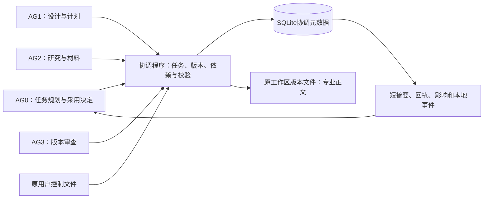

# 轻量级任务与产物协调器：功能与效果详细报告

**报告日期：2026-10-13**  
**当前版本：tac-complete/0.1.0**  
**适用工作区：learning/embodied-intelligence**  
**报告性质：基于实现、已保存验收证据与本次只读状态核对的现状评估。**

**同日任务状态修订：**按用户要求取消百分比接口及显示，工作摘要只区分running、submitted、blocked，并附实际产物或审查回执。最新[补充验收](../../maintenance/coordinator-task-status-20261013/validation.json)106项通过；首次完整功能验收104项保留为历史证据。登记待开始、等待期限、取消/失败等内部事实保留追溯，不误报为正在运行。

**同日日常接口优化：**新增[简短指南](../../personal-learning-suite/specs/coordinator-agent-guide.md)与日常程序，封装状态号、指纹、指针和回执匹配；[最新接口验收](../../maintenance/coordinator-agent-interface-20261013/validation.json)137项通过。实际只读快照已为revision 51、9项任务、13份版本；原章节的revision 19及4项任务是早先快照。优化内容、返回数据量及适用边界见第15节。

## 1. 当前结论

协调器已经实现原方案要求的任务登记、版本索引、固定输入快照、依赖记录、条件等待、候选预警、采用后影响检查、版本审查绑定、局部复核、AG0采用及短状态查询，并接入当前学习工作区的人工文件协议。

目前有两类效果得到实际证据支持：一类是自动检查和真实进程验证证明的版本一致性、冲突处理与失败恢复行为；另一类是当前真实目录中，历史备课版本登记和两份新增备课导航完成了提交、确认、审查、采用流程。试运行中，把v1审查意见用于v2的采用请求被程序拒绝，明确补核后才采用v2。

**当前可以确认：协调机制已具备可运行功能，能够在登记范围内阻止特定版本错配和不合格采用。当前不能确认：它已经降低了多少备课时间、模型上下文消耗或教学成本，也不能据此宣布学习效果改善。**

“已接入”指正式入口和角色协议已经要求实际调用协调工具，且这些工具已在真实目录运行。当前宿主仍是人工文件与工具调用模式，没有常驻后台调度服务、自动文件监视器或向正在推理的模型自动注入上下文的机制。

### 1.1 已保存验收结果

| 项目 | 结果 | 结果的适用范围 |
|---|---:|---|
| 协调器自动检查 | 104项通过；失败、错误、跳过均为0 | 包含前三批72项及本次32项；业务测试主要使用隔离的虚构数据 |
| 任务状态精简后的补充检查 | 106项通过；失败、错误、跳过均为0 | 移除百分比接口；验证三种工作状态与实际产物/审查回执 |
| 真实目录查询 | 9次通过 | 覆盖摘要、状态、事件收件、任务节点、当前输入、差异、操作回执、专业回执、恢复检查 |
| 历史版本登记 | 8个版本 | 显式登记已有BC备课原件，绑定原采用和相容性证据 |
| 新增真实备课导航 | 2个版本 | 当前维护模型顺序兼任专业职能，不是独立多人审查 |
| 旧审查用于新版 | 请求被拒绝 | 返回`receipt_version_mismatch`，随后补核再采用 |
| 框架指纹 | 127份登记通过 | 证明登记文件与验收所核内容一致，不证明专业内容正确 |
| 验收期间受保护文件 | 714份字节未变 | 是验收执行期间的保护检查；正式入口接入所做的已声明修改发生在验收前 |
| 共享契约与来源基线 | 通过 | 另含32个静态用例及19份来源检查，不应与104项协调检查混为同一计数 |
| 数据库完整性 | `ok` | 本地SQLite结构完整性检查 |

上述数据来自[完整验收JSON](../../maintenance/coordinator-completion-20261013/validation.json)、[测试原始输出](../../maintenance/coordinator-completion-20261013/test-output.txt)和[契约/来源检查](../../maintenance/coordinator-completion-20261013/shared-contract-check.json)。104项检查的该次保存运行时间为35.186秒，这是测试套件运行时间，不是备课耗时或协调器服务延迟。

### 1.2 本报告编写时的只读状态核对

| 指标 | 当前快照 |
|---|---:|
| 协调器状态序号 | 19 |
| 所绑定原控制修订 | 11 |
| 已登记产物版本 | 10 |
| 其中已采用 | 7 |
| 其中已替代 | 3 |
| 已登记任务 | 4，均为`submitted` |
| 新流程专业确认/审查回执 | 4 |
| 采用指针行数 | 8 |
| 待处理依赖影响 | 0 |
| 已登记文件异常 | 0 |
| 仍标记running的登记任务 | 0 |
| 当前维护消费游标之后的事件 | 0 |
| 实现源文件相对验收指纹的变化 | 0 |

7个已采用版本对应8行指针，是因为备课导航v2按两个范围采用。任务的`submitted`表示已提交产物或意见；最终采用另由产物指针和采用记录表达，不能把任务提交解释为学习完成。

这份快照只覆盖协调器已登记集合。零影响、零running任务不意味着整个项目所有Agent都已停止，也不意味着课程所有文件、学习安排和待办均已检查。初次快照证据另存于[报告核对记录](../../maintenance/coordinator-report-20261013/status-snapshot.json)，状态精简后的[当前核对记录](../../maintenance/coordinator-task-status-20261013/status-snapshot.json)另存。后续实时状态仍应通过程序查询。

## 2. 要解决的问题及设计目标

最初方案针对的具体问题是：上游已经生成MaterialUse-v3，部分下游审查仍对应v1，之后再补做局部核查。这个事例暴露了版本选择、输入依据和审查结论之间缺少可靠绑定。

协调器的目标是让各方能够确定以下事实：

- 哪个版本正在编辑，哪个已经提交，哪个满足核验要求，哪个被AG0正式采用。
- 当前任务开始时实际使用了哪些确切版本。
- 上游更新是否与本任务已声明的依赖范围相关。
- 哪些结果需要局部复核，哪些可以继续使用原输入。
- 某份审查意见对应哪个目标版本、内容指纹、依据、用途及范围。
- 最终采用是否满足全部必要确认和审查要求。

程序承担能确定的状态事实。学科关系、改动范围声明、相容性、教学充分性及最终取舍继续由现有专业职责承担。

因此，协调器提供的是“版本快照＋显式依赖＋条件等待＋发布后影响检查”的协作基础设施。它没有新增一个需要阅读全部上下文的调度模型，也没有把某份文件最后写入的时间当作可靠性证明。

## 3. 系统结构与责任分工

### 3.1 各部分承担什么

| 部分 | 负责的工作 | 需要继续由其他部分承担的工作 |
|---|---|---|
| AG0 | 分配任务、规定输入策略和审查政策、处置阻塞、决定最终采用 | 专业确认仍由相应职责提供 |
| AG1 | 目标、认知/教学设计、重要计划，以及本职责产物的确认和局部复核 | 不替代AG2的学科内容核验 |
| AG2 | 专业研究、材料及用途核验、相应版本提交和确认 | 不代称AG3审查或AG0采用已成立 |
| AG3 | 对确切目标与依据进行审查；明确新检查与结论继承范围 | 不自动把旧意见扩为新版本意见 |
| 协调程序 | 版本、快照、依赖、门禁、指针、事件、回执和短状态 | 不判断内容是否科学正确或教学充分 |
| 宿主工具调用 | 执行程序、取得快照与事件、在关键节点提供新上下文 | 不依靠磁盘变化自动唤醒模型 |

角色仍来自可信本地操作员的声明。程序能检查相应角色是否符合契约主责，但角色名称和会话令牌没有证明实际模型身份或独立性。当前真实试运行如实标记为同模型顺序兼任。

### 3.2 数据存在哪里



数据库位于当前工作区的`.coordinator/records.sqlite3`，维护任务、版本索引、草稿、输入依据、核验回执、相容记录、采用指针、操作回执、事件和消费游标。完整专业正文保存在原工作区的版本文件里。

实现使用Python与SQLite，主要依赖现有Python标准库和共享契约读取代码，不需要部署独立数据库服务或新增模型调用服务。专业写作、研究和审查期间不持续持有数据库写锁。

### 3.3 唯一状态来源

| 信息 | 当前维护来源 |
|---|---|
| 已登记产物的当前采用版本、任务、依赖、回执 | 协调SQLite数据库 |
| 实际用户控制 | `state/control.md` |
| 原控制的程序门禁投影 | `coordination/control.json`，绑定实际来源指纹 |
| 学习发生事实与断点 | `state/current.md`及原学习记录 |
| 当前学习安排 | `plan/current.md`及原计划正文 |
| 对象语义和专业主责 | 共享契约与原Agent规则 |
| 专业正文和生成时事实 | 原版本文件 |

协调器不会因任务完成而倒写“学习已发生”。原文件中生成时的“尚待审查”等表述保留其历史含义；判断登记集合的当前协调状态要查程序。派生摘要文件是报告或显示快照，不能成为另一份可独立修改的采用表。

## 4. 当前功能详解

### 4.1 任务登记、执行状态、实际回执与停止

AG0登记执行者、任务类型、用途、范围、输出类型、审查要求及输入策略。执行者通过开始操作明确接责，随后取得固定输入。

任务只报告`running`、`submitted`、`blocked`及实际提交回执，不填写百分比。`running`表示任务正在执行，尚无提交结果；`submitted`以实际产物或审查回执为依据；`blocked`说明阻塞原因和下一责任人。程序不解析角色消息猜完成，不把文件存在当作正式提交。失败、取消和有期限等待保留内部事实，工作摘要中说明相应阻塞原因。

产物提交回执包含操作号、确切id/revision、路径、内容指纹和验证结果；审查提交回执包含操作号、意见id、目标版本/指纹、依据签名、范围及结论。摘要可以直接定位这些事实。任务submitted和产物Adopted是不同状态，仍须经过独立采用检查。尚未开始的登记任务保留在详细元数据中，不误报为running。

等待失败、超时或上游阻塞时，下一责任交回请求者处理。程序不会擅自重新规划专业任务，也不会因等待结果消失就替换成任意旧版继续。

### 4.2 五种版本状态

| 状态 | 形成依据 | 下游如何使用 |
|---|---|---|
| Draft | 已登记修订，正文尚未完整提交 | 可跟踪基版、编辑路径、拟改范围；不作为正式输入 |
| Candidate | 正文完整、非空、指纹及指定结构检查通过 | 明确指定版本并声明暂定条件时可使用；采用指针保持 |
| Verified | 当前依据下适用的专业确认和必要AG3审查满足要求 | 可明确按用途使用；是否正式采用交AG0 |
| Adopted | AG0通过版本、依据、回执、范围和旧指针检查后采用 | 在已采用用途/范围内作为默认正式输入 |
| Superseded | 相应范围已被其他正式采用版本替代 | 保留追溯，明确历史任务或条件性使用才指定它 |

状态有范围限定。一个产物可以在M1已采用、在M3仍候选；`scope_states`会表达这种区别。整体标签不能扩大适用范围，Adopted也不代表永远有效：用户控制、新的专业反证或上游变化仍可能限制使用。

已替代版本保留记录，不会因为不再被指针选中就重新显示成待核验候选。取消草稿可能留下修订编号空位；空位不是已经发布但丢失的正文。

### 4.3 草稿修订与分支基版

登记草稿时分配稳定修订，并明确`base_ref`。多个任务可以同时基于v1修订，获得不同修订编号，不需要在专业工作期间持有全局锁。

假设v2基于v1改M3，v3也基于v1但改M1。程序沿实际基版比较v1→v3，只把M1作为已声明的变化；不能把中间编号v2的M3变化强行算入v3。v2→v3比较则需要考虑两个分支之间的差异。未知范围继续保守处理。

这解决了“数值上更新”与“实际从哪个版本修改”之间的区别。

### 4.4 固定输入与正式版本读取

当前提供三种输入策略：

| 策略 | 含义 | 适合的情况 |
|---|---|---|
| adopted | 开始时取该用途/范围的正式采用指针 | 使用当前已确认输入 |
| exact | 明确指定某个revision | 历史任务、确切审查对象或有条件使用候选 |
| after_task | 等指定生产任务的确切结果正式采用 | 必须依赖某次修订才能继续 |

`exact`指定的版本若不是当前采用版，必须声明`provisional_conditions`。程序不把暂定输入静默升级成正式输入。

任务开始时锁定实际版本、路径、字节指纹和直接/传递依据；修订任务还锁定编辑基版。`snapshot`返回对应字节，`current`按用途/范围采用指针取得正式输入。工作过程中出现新文件不会改写这份快照。

“固定快照”的当前实现依赖原版本路径与指纹。协调接口拒绝把已登记路径用作新版本；外部直接覆写则会导致读取和采用被拒绝。它没有提供操作系统级写保护，也不能凭指纹恢复被覆盖的原文。

### 4.5 依赖、候选预警与采用后影响检查

程序维护显式声明的输入以及已记录的传递依据，提供依赖边和影响列表。已登记但尚未开始的任务也能收到候选预警，其实际快照仍在开始时形成。

| 变化阶段 | 程序返回 | 对工作的影响 |
|---|---|---|
| 草稿正在修改 | 草稿、基版、拟改范围与任务状态 | 原采用版保持；确实需要新结果的任务显式等待 |
| 候选提交 | `candidate_warning`及受影响下游 | 提醒比较，不自动撤销旧采用版 |
| 新版正式采用 | 未处理依赖标为`recheck_required` | 相关结果需局部复核或修订后再确认/采用 |
| 审查期间出现新目标版本 | `review_target_warning` | 原审查仍绑定旧目标，AG0决定是否补核或另审 |
| 变化范围未知 | 保守判可能相关 | 不自动声明无影响 |
| 已明确范围不相交 | 不要求无关工作因这次变化复核 | 保留原输入继续工作 |

程序判断的是**已声明依赖和范围是否相关**，不会自动理解学科关系或识别未登记依赖。若专业方漏记依赖，或把实际改动范围声明错误，协调器无法单靠元数据发现全部问题。

### 4.6 条件等待、期限与责任交还

等待绑定已登记的上游任务、产物、用途、范围和有限期限。等待对象的候选出现后仍不会自动放行，必须是该确切结果正式采用。

上游失败、取消、阻塞、指定结果被后续版本替代或期限到达，会使相关等待明确阻塞并交回请求者。多层依赖中的失败可以在同一次提交中传播；旧采用指针保留，无关任务继续。

当前没有常驻时钟服务。无人调用工具时，程序不会在超时瞬间发消息；只读状态会呈现有效过期状态，刷新或下一次写操作将相应状态和事件落实。期限不会因重复开始而无限延长，也不会因上游很晚发布就自动恢复已超时的任务。

### 4.7 局部复核与依据继承

产物owner可以提供绑定确切旧版、新版、用途、范围和相容理由的局部复核。程序保留原始依据，不倒改旧任务“当时实际用过的版本”。如果变化要求修改正文，应创建新修订任务。

新的下游任务复用已做局部复核的上游时，会锁定明确确认的新来源，并保留`original_ref`与`inherited_recheck_id`定位。后续再更新相关来源，仍会重新触发检查。

复核相容性是专业声明。程序保证声明指向正确的对象和版本，不证明声明本身必然正确。

### 4.8 AG3审查绑定与补核

AG3开始时固定目标版本及依据，回执记录目标id/revision、目标内容指纹、依据签名、用途、范围、结论和理由。旧目标的意见可以保留为历史事实，不能直接用于新版。

补核明确区分：

- 本次直接检查范围。
- 从旧支持意见明确继承的范围。
- 继承所依赖的原回执与相容理由。

程序检查继承范围是否有原意见覆盖，并拒绝把继承部分登记成直接新检查。同一目标存在未处置的非支持意见时，相关采用受到阻止；新的明确处置不能被其他角色的“同意”或最后到达的消息替代。

`receipt`查询可让AG0核对具体审查绑定及其对确切目标的当前适用性。某份回执对自己的旧目标仍适用，不代表它适用于更高修订或已经构成最终采用。

### 4.9 验证、发布与整组采用

结构验证有三种配置：非空与指纹检查、增加UTF-8编码检查、读取共享契约的必需字段和对象身份检查。字段检查不是完整嵌套Schema，也不替代专业内容判断。

发布先完整写入并校验新版本，随后登记协调元数据。宿主允许时使用原子文件安装；受限文件系统可使用独占完整写入，写完、刷新、校验前该文件不会进入正式版本索引。

AG0采用需要明确成员、用途、范围、适用回执和预期旧指针。程序同时检查：

1. 指向的版本文件仍存在且指纹一致。
2. 相关输入已采用或满足拟采用集合的关系。
3. 专业主责确认及必要AG3审查覆盖所需范围。
4. 回执目标、内容、依据和用途与拟采用成员一致。
5. 没有尚未处置的冲突意见或相关依据变化。
6. 当前指针仍符合AG0原本作决定时的预期。

全部成员合格后，指针、整组记录、操作回执和事件在同一SQLite事务中提交。任何一项不合格都不会半采用其他成员。文件系统和数据库并不是跨介质事务；中断留下的未登记文件要显式检查，不能自动采用。

### 4.10 并发、重复请求与返回丢失

写操作使用`operation_id`和`expected_state_revision`。同一成功请求重试返回原回执，不重复创建版本或事件；同一操作号对应不同载荷会被拒绝。

采用另有`expected_pointers`。即使调用方刷新了全局状态序号，实际旧指针与原预期不同仍会阻止采用。需要新的专业判断时，应提交新的明确决定，而不是盲目换一个状态号重试。

SQLite短写事务串行化事实写入，专业生成、研究和审查保持可并行。这里仍使用保守的全局状态冲突检查，独立写操作可能因其他操作提交而需要重读；现有压力记录没有证明任意规模下都能保持低延迟。

提交成功但返回丢失时，`operation`可查询已保存回执；`commit_status_unknown`区分返回异常与确定未保存。一次查询没有看到提交，也不能据此断言原执行者已经停止。

### 4.11 本地事件、消费游标与短摘要

事件与相应事实同事务提交。事件按序号拉取；当前控制会过滤不可用内容。宿主收到上下文后显式确认游标，确认本身不再产生通知。同一操作重试不会新增重复事件。

AG0可以使用以下查询：

| 查询 | 用途 |
|---|---|
| brief | 短状态表、下一责任人和后续动作 |
| state | 任务、版本状态、回执、依赖边及影响列表 |
| boundary | 某任务的固定依据和当前影响 |
| current / snapshot | 正式采用输入或任务确切输入字节 |
| diff | 版本实际文本差异、指纹和声明变化范围 |
| receipt / operation | 专业意见绑定或提交是否已保存 |
| inbox / events | 增量协调事实 |
| recover | 数据库及已登记文件问题、显式扫描的未登记文件、仍标记running的任务 |

正在推理的模型不会因为事件落盘就自动知道变化。宿主需要在开始、候选提交、审查返回、最终采用四个节点及等待恢复时调用工具；关键节点操作本身再做校验。

### 4.12 控制门禁、历史登记与恢复

真实模式必须绑定外部控制来源。原控制来源指纹变化后，旧投影失效；不能根据旧的“无暂停”投影继续执行。暂停、删除和用途限制优先于相关读取、重试和采用。

历史登记由AG0对空索引显式执行。历史采用和相容性需要原文件、指纹、唯一文本锚点及说明，全部登记同事务成功或回滚。迁入的是已有事实，不生成新专业确认、独立审查或学习表现。

恢复检查报告数据库完整性、已登记文件缺失/变动、显式扫描目录的未登记文件及仍标记running的任务。它不会自动把任务判失败、恢复专业正文、删除文件、解除限制、重新审查或采用。

## 5. 对照最初方案的实现情况

| 原方案要求 | 当前实现 | 验证程度 |
|---|---|---|
| 任务状态：谁做什么、输入和执行情况 | 明确登记、接责、快照；running/submitted/blocked与实际产物回执 | 自动检查，真实目录任务已运行 |
| 版本索引与五种状态 | 稳定id/revision/路径/指纹及范围状态 | 自动检查，真实目录出现采用与替代 |
| 保留旧正式版，不追随最新写入 | 候选不更新指针，正式读取按用途/范围解析 | 自动检查及真实采用流程 |
| 开始时锁定输入 | 返回确切字节及指纹，编辑基版另锁定 | 自动检查及真实快照调用 |
| 依赖感知和条件等待 | 显式策略、具体生产任务、有限期限 | 隔离业务测试；不能当作真实全备课耗时证据 |
| 更新后影响检查 | 候选预警、采用后复核、直接/传递依赖 | 自动检查；历史登记范围保守 |
| 原子发布与冲突检测 | 完整文件验证及SQLite同事务采用 | 真实进程和故障检查 |
| AG3意见绑定版本 | 目标指纹、依据签名、范围、直接/继承区分 | 自动检查及真实导航v1/v2 |
| AG0短状态查询 | 摘要、影响、责任人、回执和差异 | 真实目录9类查询通过 |
| 程序事实管理，不增调度Agent | 明确操作与回执驱动 | 实现已成立；专业职责仍需实际履行 |
| 不建立全局任务等待锁 | 条件等待与短写事务分离 | 隔离并发和无关范围测试 |
| 不复制一套学习状态 | 明确协调字段与外部控制/学习事实边界 | 入口协议、门禁和保护检查 |
| 宿主通知与关键节点检查 | 正式入口接入工具、增量事件与确认游标 | 工具链已运行；不是全宿主自动拦截 |

原方案第一版的功能已落实为可调用机制。保证成立的前提是相关任务和产物进入该机制，并准确声明依赖、范围及专业结论。程序无法约束一个完全绕开入口的外部写入者作出的自然语言声称。

## 6. 用原M3修订场景说明实际行为

以下是对原方案的流程说明，相关行为由隔离测试覆盖，**不是当前真实BC目录已经发生过一次M3教学设计修订的声明**。

| 步骤 | 专业工作 | 协调程序行为 |
|---|---|---|
| 1 | AG1准备从设计v1修订M3 | 登记基版、草稿和拟改范围；v1采用指针保持 |
| 2 | AG2继续做M1材料 | 若依赖范围明确不相关，按原采用输入开始并固定快照 |
| 3 | AG2必须依据新M3设计制作另一份材料 | 指定after_task和期限，只等待该修订任务结果 |
| 4 | AG3先分析原学习用途 | 可以独立推进，不因设计草稿存在而全部等待 |
| 5 | AG1完整提交v2 | 成为候选，提供受影响下游预警；不自动切换正式输入 |
| 6 | AG3审查v2及其依据 | 锁定确切目标并记录版本意见 |
| 7 | AG0采用v2 | 检查适用回执和预期旧指针，相关下游需要复核 |
| 8 | AG2原任务基于v1进行到一半 | 保留v1快照，不把后半段悄悄改成v2 |
| 9 | AG2提交相关结果 | 结果可保存候选，确认/采用前处理相关依据变化 |
| 10 | 期间又出现v3 | v2审查保留为v2事实；用于v3需明确比较、补核或重审 |

这套机制把“等待谁”与“哪些工作继续”分开，也把“正在写的新版本”与“已可靠采用的版本”分开。

## 7. 当前真实目录中的实施与结果

### 7.1 登记了什么

历史登记包括来源说明v1/v2、专业研究v1/v2、目标v1、认知设计v1、材料用途v3和最终安排v2，共8个版本。原目标和认知设计引用旧专业依据的事实保留；原文中明确的v1→v2定位相容说明被单独登记，没有重写成“当时已经使用v2”。

当前正式采用集合如下：

| 产物 | 当前版本 | 采用来源与用途 |
|---|---|---|
| BC专业来源说明 | v2 | 原有限备课采用证据；teaching / BC-first-stage |
| BC专业研究 | v2 | 原有限备课采用证据；teaching / BC-first-stage |
| 第一阶段目标 | v1 | 原有限备课采用证据，保留原依据及相容声明 |
| 第一阶段认知设计 | v1 | 原有限备课采用证据，保留原依据及相容声明 |
| 第一阶段材料用途 | v3 | 原有限备课采用证据 |
| 第一阶段最终安排 | v2 | 原收口与采用证据；不冒称原AG3直接审查过安排v2 |
| 新备课协作导航 | v2 | 本次新流程确认、审查与采用；preparation_navigation |

前三个已替代版本是来源说明v1、专业研究v1和新协作导航v1。所有正文保留追溯。

### 7.2 新流程怎样验证

本次创建协作导航v1，实际取得固定输入，完整提交后由AG2职能确认、AG3职能审查，AG0再采用。随后创建v2，新增原审查读取范围和限制说明，原版本路由保持。

关键检查是：采用v2时故意提供v1审查回执，程序因版本不一致拒绝提交。之后明确直接检查新增的`review-boundaries`范围，并继承未变的`version-routing`范围；形成绑定v2的回执后，AG0才正式采用v2。

这证明当前工具链在真实目录中执行了版本绑定和采用门禁。新增产物限于备课导航，不能把这次核对扩大为原学科内容重新通过、独立论文复核或教学效果提升。

完整记录见[实际接入轨迹](../../learning/embodied-intelligence/coordination/integration-trace.json)，新增原件见[导航v1](../../learning/embodied-intelligence/artifacts/coordinator-integration/bc-preparation-navigation-v1.md)和[导航v2](../../learning/embodied-intelligence/artifacts/coordinator-integration/bc-preparation-navigation-v2.md)。

### 7.3 接入范围

AGENTS、MODEL_ENTRY、FRAMEWORK及四个角色的正式入口已接入协调协议。当前登记集合主要是BC备课及协作导航，没有把所有旧学习记录迁入数据库。普通原答、反馈和未登记档案继续按原人工协议处理。

真实目录目前以`BC-first-stage`作为历史集合的保守整体范围。M1/M3等更细的管理价值取决于后续专业任务明确登记稳定范围和依赖；不能从“功能支持细粒度”推导为“当前所有旧文件已经有细粒度依赖”。

## 8. 功能效果、潜在收益及尚未证明的结论

| 方面 | 已观察或已验证的效果 | 仍待测量或验证的部分 |
|---|---|---|
| 版本错配防止 | 旧审查用于新版本被拒绝；当前输入按采用指针解析 | 实际协作中错配频率下降多少 |
| 输入一致性 | 固定快照保持；变更后相关结果需处理 | 是否减少真实整份重做及返工时长 |
| 并行工作 | 无关范围继续；只等待具体依赖 | 多角色备课总耗时是否下降 |
| 局部复核 | 可记录变化范围、确切相容性和结论继承 | 专业人员是否真的减少无效重读 |
| AG0事实查询 | 可直接得到当前7项采用状态、4项任务的submitted状态及实际回执和影响 | 上下文用量、调用次数、阅读时间是否下降 |
| 状态可靠性 | 重复请求不重复提交，冲突保留旧指针 | 长期持续使用、不同文件系统及更高负载表现 |
| 可追溯性 | 目标、依据、审查和采用有明确定位 | 跨完整真实备课链的持续覆盖率 |
| 教学质量 | 没有本次学习者效果证据 | 理解、任务表现、反馈质量及学习耗时变化 |

协调器本身不调用LLM，因此不会新增一个专门调度模型的推理开销。但角色需要登记、读取快照、处理预警和确认事件，这些动作可能增加工具调用与局部上下文。现在没有成本对照，不能称“零协调成本”或宣布模型消耗下降。

短摘要和局部影响定位有减少事实搜索的潜力；其净收益取决于登记成本、范围精度、预警数量、专业判断质量，以及宿主是否可靠地把查询结果提供给执行者。

## 9. 并发与故障证据

前三批可靠性检查与本次功能检查采用真实本地进程执行，业务内容为明确虚构的隔离文件。不能把“虚构业务数据”误读成“并发和进程退出也只是口头模拟”。

| 情境 | 已验证行为 | 证据范围 |
|---|---|---|
| 两个采用者竞争同一指针 | 一个提交，另一个冲突；刷新状态号仍不能绕过原指针预期 | 前期真实进程验收 |
| 四个进程重复同一提交 | 只产生一个逻辑提交、一个版本及相应事件 | 前期真实进程验收 |
| 八个进程各登记八项事实 | 64项逻辑提交全部保留；该次共125次尝试 | 表明有冲突重试开销，不是吞吐能力承诺 |
| 整组采用中途有并发读取 | 提交前读旧1/1，提交后读新2/2 | 未见半组新旧混合 |
| 候选插入后或指针写到一半硬退出 | 未提交事务回滚，旧采用版保留 | 本地SQLite及实际进程情境 |
| 提交成功但返回丢失 | 查询到原回执，重试不重复提交 | 不以返回异常判断一定未保存 |
| 新版协调器两个候选并行提交 | 保持已分配不同修订，冲突后明确重试，原采用指针保持 | 本次新增自动检查 |
| 文件安装后、索引提交前硬退出 | 未登记文件可被恢复检查发现，未被自动采用 | 本次实际子进程检查 |
| 旧工作区扩展升级中途退出 | 保留旧指针，可显式继续升级 | 前期与本次兼容检查 |

具体原始观测见[第三批可靠性记录](../../maintenance/coordinator-batch3-20261013/validation.json)及[本次测试输出](../../maintenance/coordinator-completion-20261013/test-output.txt)。这些证据不覆盖断电、磁盘损坏、所有网络文件系统、长期高负载或恶意同时覆写。

## 10. 当前边界和剩余风险

### 10.1 依赖和范围仍需准确声明

程序无法自动读懂“认知设计的某句话改变了哪种学科关系”。粗粒度声明会产生更多保守复核；错误地声明不相关，可能漏掉实际影响。首版采取未知范围保守处理，专业方仍需负责声明质量。

### 10.2 入口调用不是全宿主自动拦截

正式协议已接入，关键节点调用会校验。但程序没有拦截所有聊天、文件保存或外部模型行为，也不会自动发现并接管未登记工作。绕开程序的文件写入不会自动变成正式提交或采用；相关执行者的自然语言声称仍须查记录。

### 10.3 身份与独立性没有被认证

当前使用可信操作员角色声明。角色权限检查不等于宿主模型身份认证、权限隔离、盲审或独立评审。当前真实导航核验由同一维护模型顺序兼任，不应作为多个独立意见的证据。

### 10.4 核验回执不证明内容必然正确

程序检查回执的版本、依据和范围，专业人员负责其判断。错误但格式合格的专业结论，不能靠状态机自动纠正。历史证据锚点存在也不等于程序已经理解其采用含义。

### 10.5 文件与数据库仍有分离边界

版本正文保留在原路径。直接覆写会触发拒绝，但无法从哈希重建。文件完整安装与数据库提交之间可能有未登记文件；恢复需有依据地处置，不能自动采用或删除。

### 10.6 恢复与控制不覆盖全部外部状态

running只是登记状态，不是进程存活证明。暂停/删除门禁及事件过滤不等于删除文件、外部副本或聊天上下文。超时在工具调用时落实；没有后台通知服务。

### 10.7 并发策略有保守开销

全局状态序号会让部分互不相关的事实写入发生冲突重试。当前测试验证了有界情境下的一致性，没有证明大规模性能。专业采用不能通过自动重试改变原判断。

### 10.8 成效证据仍限于协调层和导航试运行

尚未以新的完整真实备课作为对照，从专业研究、认知设计、材料生产到真实多角色审查连续测量协作收益；没有学习者教学效果实验。当前“零影响”是登记集合状态，不是整门课程无问题的证明。

## 11. 日常使用和异常处置

### 11.1 四个关键节点

1. **开始**：AG0登记清晰职责、输入策略和审查政策；执行者开始并取得固定快照。
2. **提交**：写新路径、完整验证、登记候选，读取输入问题和受影响下游。
3. **审查返回**：针对明确版本返回意见；新版需补核时明确新检查与继承范围。
4. **采用**：AG0核对当前版本、依据、回执、范围和预期指针，再由程序一次提交。

各执行上下文在这些节点及等待恢复时读取本地事件，取得上下文后确认消费游标。稳定已读依据可复用，不能用“所有文件都再读一遍”替代相关性检查。

### 11.2 常见异常

| 提示或情境 | 正确处置方向 |
|---|---|
| 候选预警 | 看声明范围与版本差异；原采用版保持 |
| 输入需要复核 | owner局部确认相容或另建修订，重新取得适用回执 |
| 审查版本不匹配 | 使用针对目标版本的意见，或明确补核/重审 |
| 状态号冲突 | 重读状态并核原操作意图，不能盲目重试专业采用 |
| 指针冲突 | 核新采用事实，作新的明确决定 |
| 控制投影失效 | 重读实际控制，刷新投影后再操作 |
| 返回丢失 | 先查原operation，保留原操作号 |
| 文件缺失或变动 | 保持不可用，寻找可信原件或重新生成/核验 |
| 等待超时/上游失败 | AG0重新安排或停止相关任务，无关工作继续 |
| 发现未登记文件 | 显式核对归属和完整性，不自动采用或删除 |

### 11.3 当前可直接使用的查询

以项目根目录为工作目录，查看短摘要：

```powershell
python -B -X utf8 personal-learning-suite/scripts/coordinate_preparation.py --workspace learning/embodied-intelligence --role AG0 brief
```

读取当前BC准备入口：

```powershell
python -B -X utf8 personal-learning-suite/scripts/coordinate_preparation.py --workspace learning/embodied-intelligence --role AG0 current --artifact-id EMB-P-BC-CLOSED-LOOP-20261012 --intended-use teaching --scope BC-first-stage
```

核对新导航v2审查回执：

```powershell
python -B -X utf8 personal-learning-suite/scripts/coordinate_preparation.py --workspace learning/embodied-intelligence --role AG0 receipt --receipt-id bc-navigation-review-v2
```

正式入口说明见[COORDINATION](../../learning/embodied-intelligence/COORDINATION.md)，完整操作字段见[协调协议](../../personal-learning-suite/specs/coordinator-protocol.md)。这些查询不启动新授课或实验。

## 12. 如何继续验证实际收益

后续应先选有限的真实备课过程，记录现有机制的实际使用，再决定是否增加调度算法、语义分析或界面。下列是建议的观察口径，不是已实现的自动效果统计。

| 指标 | 建议记录方式 | 避免误解 |
|---|---|---|
| 错版采用拦截 | 记录请求、拒绝原因及后续修正 | 拦截次数不等于相同次数的真实教学事故 |
| 未绑定/绕入口结果 | 记录正式流程外提交及如何处理 | 未登记结果不能从文件存在自动补记完成 |
| 局部复核工作量 | 区分实际新读范围、继承范围及改正文范围 | 声称继承不等于已经节省实际阅读时间 |
| 无关任务阻塞 | 记录等待原因、依赖与可继续工作 | 仅有范围不相交不说明总耗时一定下降 |
| AG0协调负担 | 记录事实查询、额外消息、文件读取量与工具调用 | 需同时计入登记和处理预警的新增开销 |
| 返回丢失与重试 | 记录同操作号恢复、冲突重读和重复版本 | 事实幂等成功不代表专业重复判断成本为零 |
| 总备课耗时 | 区分专业工作、等待、协调和返工 | 不能把不同难度单元直接作对照 |
| 模型/系统成本 | 记录实际上下文量、工具调用、推理与本地工作 | 程序不调用LLM不等于Agent整体成本降低 |
| 教学效果 | 在真实学习发生后按原目标和帮助条件记录表现 | 准备充分、导航可用和学习达成分别成立 |

一轮有限真实使用可以验证协议是否好用、范围声明是否够细、预警是否可操作。若要判断净收益，应有可比任务或充分记录其难度、角色能力与投入差异；当前同模型顺序兼任的导航试运行不能作为独立多Agent协作对照。

## 13. 当前完成程度的准确表述

从功能实现看，原方案的第一版协调能力已经完成：状态、版本、快照、依赖、等待、检查、审查绑定、采用和查询都有实际程序机制。

从接入看，当前人工文件工作区和角色入口已接入，真实目录调用已通过；未登记课程记录仍走原协议，其他宿主没有自动获得相同能力。

从效果看，已有证据支持登记范围内的版本一致性和错误采用拦截，以及本地并发/恢复情境的正确行为。实际时间、上下文、专业质量与教学收益仍需继续测量。

因此，当前可以把它用作备课协作的可靠状态基础，但应持续准确登记依赖和范围，保持专业判断责任，并通过实际使用证据评价收益。

## 14. 证据与资料索引

| 资料 | 用途 |
|---|---|
| [完整功能验收JSON](../../maintenance/coordinator-completion-20261013/validation.json) | 当前版本、104项检查、真实查询、保护与限制 |
| [任务状态精简补充验收](../../maintenance/coordinator-task-status-20261013/validation.json) | 106项检查、三种工作状态和实际回执 |
| [测试原始输出](../../maintenance/coordinator-completion-20261013/test-output.txt) | 逐项用例与该次运行结果 |
| [真实查询轨迹](../../maintenance/coordinator-completion-20261013/cli-transcript.json) | 9类实际目录查询 |
| [本报告只读核对快照](../../maintenance/coordinator-report-20261013/status-snapshot.json) | 报告编写时的登记集合状态与指纹核对 |
| [真实接入操作轨迹](../../learning/embodied-intelligence/coordination/integration-trace.json) | 历史登记、新导航、旧审查拒绝及补核采用 |
| [第三批进程/故障观测](../../maintenance/coordinator-batch3-20261013/validation.json) | 并发、重复请求、硬退出与旧版保护 |
| [完整文件协议](../../personal-learning-suite/specs/coordinator-protocol.md) | 状态、字段、操作、门禁及宿主使用 |
| [实际学习入口](../../learning/embodied-intelligence/COORDINATION.md) | 本工作区的职责与调用方法 |
| [实施记录](../implementation/AI个人学习系统_任务与产物协调器_原方案完整实现与接入_2026-10-13.md) | 原方案实现对照与部署位置 |
| [状态与影响实现](../../personal-learning-suite/src/coordinator/complete.py) | 生命周期、快照继承、影响和查询 |
| [可靠性实现](../../personal-learning-suite/src/coordinator/reliability.py) | 等待、事务事件、冲突与恢复 |
| [发布实现](../../personal-learning-suite/src/coordinator/publication.py) | 完整版本安装及索引提交边界 |

本报告初版引用已保存104项检查并核对当时源指纹。随后按用户要求精简任务状态，重新执行106项检查并保存新的实现源指纹和只读快照；初版验收及原始快照保留，不倒改。取消百分比和更新查询视图没有改变真实采用指针、专业结论或学习事实。

## 15. 日常接口优化：把程序复杂性封装起来

这次优化处理Agent日常接触的界面。原版本、依赖、审查、冲突、事务和恢复机制继续执行，日常默认返回当前角色需要的任务、实际回执、相关变化和待决定事项。四个Agent的协调段落及学习入口已改为先读简短指南，完整内部协议在需要详细证据、特殊审查或恢复时读取。

### 15.1 日常操作

| 入口 | 提供什么 | Agent仍负责什么 |
|---|---|---|
| desk | 默认最多12项，按角色及可选任务过滤；三种工作状态、实际回执、影响及待决定事项 | 选择专业工作和后续安排 |
| alerts | 新版本/异常提示，角色、本人任务、依赖及下一责任人过滤，保留消费游标 | 接收到当前上下文后明确ack |
| inputs | 已验证的固定正文及明确修订基版；非文本给确切路径 | 专业阅读与生产，不将最新文件替换当前快照 |
| do | 明确意图转成冻结请求并提交，程序填写状态号、操作号、指纹和采用旧指针 | 登记范围、用途、输入、是否审查；填写专业结论及理由；决定采用哪些已交付任务 |
| saved | 通过原ticket或原意图文件查询历史提交回执 | 区分实际已提交与当前仍可用 |
| inspect | 按需完整任务证据；特殊差异/意见仍可用原技术入口 | 有具体问题时再展开内部信息 |

prepare/apply是可选的具体决定预览方式。正常do无需新增人类确认步骤。产物负责人、必要AG3意见和AG0最终采用仍是原流程中的不同决定，程序不代填专业判断，也不自动把较高版本号声明为有效版本。

任务摘要和日常提交结果只使用running、submitted、blocked。未开始的登记任务给出开始动作；失败、取消和有期限等待说明阻塞原因。submitted附实际文件或审查意见回执，采用状态作为产物事实另行表达。

### 15.2 简化没有削弱校验

准备时在数据库保存点中运行原动作的资格校验，再回滚预览写入；准备请求不会提交任务、回执、采用指针或事件。实际执行在同一写事务内核对冻结的控制和提交正文，保留全局状态冲突、采用旧指针、版本/依据/用途/范围绑定及提交前复核。

采用意图选择确切已交付任务的结果；程序可以收集适用的支持意见，全部未处置专业冲突仍经过原门禁。旧版审查不能用于新版，没有充分确认或必要AG3审查仍拒绝采用。专业结论、继承范围、相容性和冲突处置须明确提供。

已经提交成功的响应由原提交回执生成，后续当前状态查询失败不会掩盖提交事实。状态或控制变化后，旧请求不自动刷新；原操作是否已经保存通过saved按当前控制查询。

### 15.3 返回信息丢失时的恢复

相同角色、同一意图文件路径和相同规范化JSON内容，do复用持久关联的原ticket。关联完整保存后才执行业务动作；相同请求并发执行由原operation_id和写事务保证一次逻辑提交。整份返回信息丢失后，可以用saved --intent-file查询原提交，无需模型事先记住内部操作号。

当控制变化或原决定已过期，重复do仍提交原冻结请求并报告拒绝，不重新编译为新决定。确实重新考虑后，可以显式prepare新决定或使用新的意图文件。关联文件不完整时明确失败，不自动生成替代操作；身份及文件系统边界仍是可信本地操作员模式。

### 15.4 已核对的效果与边界

[最新验收](../../maintenance/coordinator-agent-interface-20261013/validation.json)包括原106项检查及31项日常接口检查，137项通过，失败、错误、跳过均为0。新检查覆盖日常闭环、版本/意见冲突、固定输入、角色过滤、预览回滚、冻结条件竞态、确认丢失、整份回执丢失恢复及真实CLI调用。

实际学习目录进行了8次只读日常CLI查询，130份框架指纹和入口链接通过；验收期间真实数据库和3071份受保护的学习文件及早先验收文件字节未变。查询时登记集合为revision 51，9项任务、13份版本，未解决影响0。此集合已有后续备课记录，本次优化只核对其接口与保存状态，专业内容和学习成效依各自证据评价。

[返回数据计数](../../maintenance/coordinator-agent-interface-20261013/returned-view-sizes.json)以无额外空白、保留中文的规范JSON字符数比较：同一任务完整边界为6454字符，日常摘要为605字符；全登记状态100857字符，日常desk为4695字符。日常指南2759字符，内部协议5393字符。较短返回来自默认省略内部证据和限制查询范围，详细证据仍可按需取得。

这些计数证明日常返回信息已经收敛，不代表整个模型上下文、耗时或费用的变化；没有据此声称学习效果改善。宿主仍须在关键节点调用工具并取得提示，正在推理的模型不会因磁盘更新自动获得新上下文。
