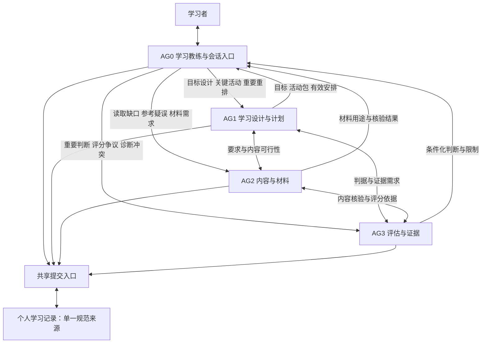
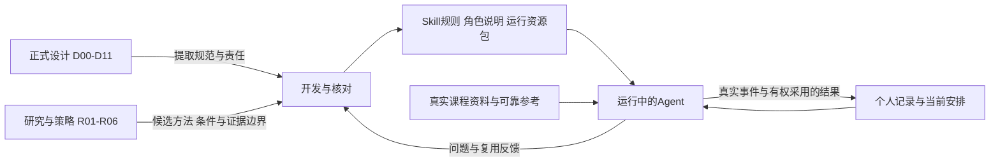
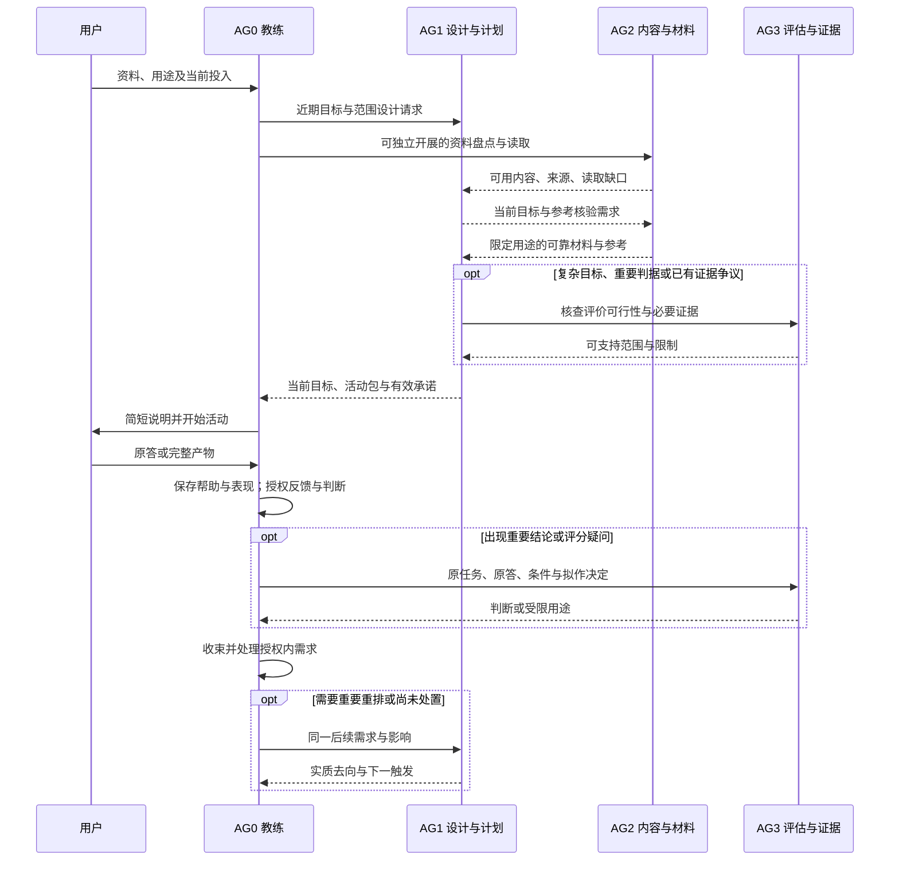
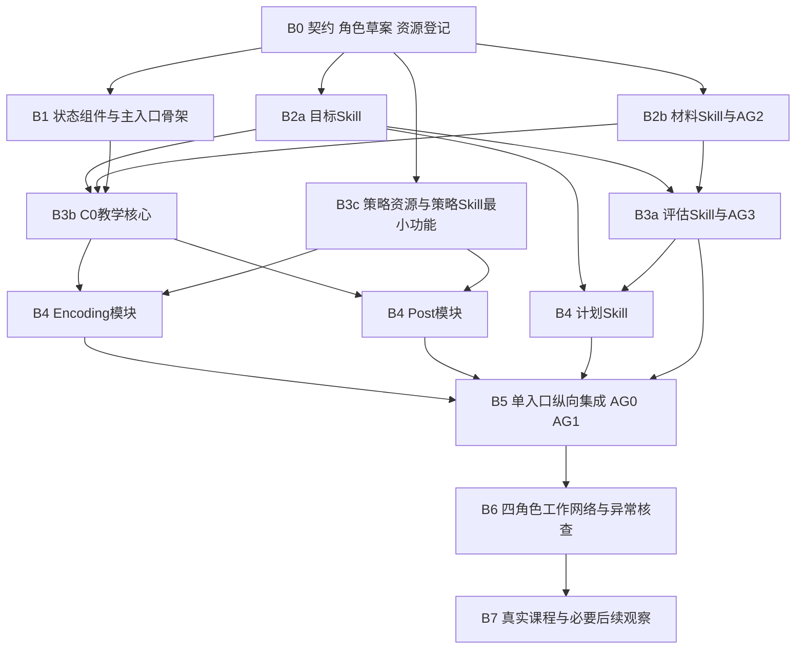

# AI 个人学习系统：Agent 与 Skill 工作网络及实施路线 v0

日期：2026-10-02  
状态：网络划分、接口与实施设计；尚未创建、安装或运行下述 Agent／Skill。  
承接：[Skill 架构设计 v0](<E:/文献资料/学习系统架构设计/docs/architecture/AI个人学习系统_Skill架构设计_v0.md>)、[整体学习流程与概念架构 v1](<E:/文献资料/学习系统架构设计/docs/architecture/AI个人学习系统_整体学习流程与概念架构_v1.md>)。

**本版推荐：4 个逻辑 Agent、7 个 Skill、1 套共享记录与提交组件。** 用户主要通过 `personal-learning` 进入；专业工作由六个专业 Skill 支持。Encoding 与 Post-Encoding 是同一个教学 Skill 的两个专项模块，与 C0 共用活动规格、原答、帮助记录和父任务，不另设两个常驻 Agent。

四个 Agent 分别是：**学习教练与会话入口、学习设计与计划、内容与材料、评估与证据。** 四个角色不意味着四个模型永久在线，也不意味着每一题都要跨四个角色。日常教学主要由教练在既有授权内完成；其他角色在准备、重要变更或复核时被调用。

本版特别区分三种依赖：**开发者编写 Agent／Skill 时应读的设计依据；Agent 运行时应加载的精简规则与策略资源；当前课程的真实资料和学习记录。** 它们可以相互引用，不能互相代替。

## 一、对上一版架构作出的细化与修订

### 1. 保留什么，改变什么

| 项目 | 上一版 | 本版采用 |
|---|---|---|
| 用户入口 | 一个主 Skill | 保留一个默认学习入口 `personal-learning` |
| Skill 包装 | 主要作为一个包内的专业工作流 | 将六个有稳定产物、可独立测试且被不同角色复用的工作流设计为专业 Skill；与主入口共七个 |
| Agent 数量 | 按需少量承担者，未冻结数量 | 明确四个逻辑角色及各自权限，实例数量按任务需要决定 |
| Encoding／Post | 同一教学回路的专项规则 | 保留；分别设计和测试模块，不增加独立 Agent 或独立掌握度 |
| 策略资源 | 只继承 v1 的最小策略边界 | 本轮正式纳入工作包 6 和项目中的六份策略／研究资源，设计资源转译与加载路径 |
| 状态与采用 | 单一有效记录、明确责任、受控提交 | 保留；专业 Skill 不各建数据库或复习队列 |

“从一个包变为七个 Skill”是本版针对明确分工、复用和独立验收提出的**实现设计修订**，并非已经测得单包性能不足。上一版第四节的单包目录、第十六节的拆分建议，涉及本轮包装时以本版的显式方案为准；其他学习、证据和用户控制规则继续适用。上一版文件保留原文作为设计历史。

七个 Skill 应先作为一个兼容版本的套件实现和交付。若宿主对多 Skill 路由支持不佳，可以把相同专业契约打包成一个主 Skill 的内部模块，维持四角色和同一数据接口；该部署形态的物理 Skill 数量为一，不能仍称已安装七个。首选开发目标仍是本版列出的七包方案，是否压缩由实际集成测试决定。

### 2. 为什么是四个 Agent、七个 Skill

- **把教练与关键设计分开**：主要交互需要连续、低等待；目标、复杂活动与资源取舍适合按需投入更强能力。
- **把内容核验与能力判断分开**：前者回答材料或参考是否成立，后者回答原答在什么条件下支持什么。错误参考和错误评分可分别定位。
- **目标、关键教学设计与计划先由同一角色承担**：三者频繁协调近期范围，首期合并能减少往返；角色内部仍保留不同决定的责任。
- **Skill 按可复用工作划分**：教学 Skill 被设计者和教练共用；评估 Skill 被常规评分和重要复核共用；计划 Skill 被正式规划和授权缩时共用。一角色不对应一个 Skill。
- **策略配置单列 Skill，暂不单列 Agent**：它有跨次选择、组合和维护产物，但没有必要每次教学都发起独立协作。

若后续真实计划工作持续阻塞关键教学设计，可以从设计角色拆出计划 Agent，形成五角色而仍是七个 Skill。资源有限时可兼任角色，但须说明哪些职责由同一实例承担，不能把自己换角色复述一次称为独立核验。

## 二、文档与资源编号：先建立共同索引

下列编号只用于本文和后续开发任务单，不替换原文件名。正式方案约束系统行为；研究与实践库提供方法候选及依据边界。本文未重新核验这些文件所引用的外部论文。

### 1. 正式设计依据

| 编号 | 文件 | 主要用途 |
|---|---|---|
| D00 | [整体学习流程与概念架构 v1](<E:/文献资料/学习系统架构设计/docs/architecture/AI个人学习系统_整体学习流程与概念架构_v1.md>) | 当前统一语义、权限、生效、纠错和首期范围 |
| D01 | [Skill 架构设计 v0](<E:/文献资料/学习系统架构设计/docs/architecture/AI个人学习系统_Skill架构设计_v0.md>) | 记录契约、持久化、加载、宿主边界；包装按本版细化 |
| D02 | [工作包 2 与 3 联合设计](<E:/文献资料/学习系统架构设计/docs/designs/AI个人学习系统_工作包2与3_联合设计方案_v0.md>) | 目标与判据、证据、诊断、近期展开 |
| D03 | [工作包 4](<E:/文献资料/学习系统架构设计/docs/designs/AI个人学习系统_工作包4_设计方案_v0.md>) | 来源片段、材料用途、核验和错误传播 |
| D04 | [工作包 5／C0](<E:/文献资料/学习系统架构设计/docs/designs/AI个人学习系统_工作包5_C0共同教学框架_设计方案_v0.md>) | 共同教学回路、活动规格、帮助、反馈与收束 |
| D05 | [工作包 5／Encoding](<E:/文献资料/学习系统架构设计/docs/designs/AI个人学习系统_工作包5_Encoding_设计方案_v0.md>) | 关系建构、动态展开、复杂整体与局部返回 |
| D06 | [工作包 5／Post-Encoding](<E:/文献资料/学习系统架构设计/docs/designs/AI个人学习系统_工作包5_Post-Encoding_设计方案_v0.md>) | 恢复、整合、选用、更新和时间条件 |
| D07 | [工作包 6／策略使用规则](<E:/文献资料/学习系统架构设计/docs/designs/AI个人学习系统_工作包6_策略使用规则_设计方案_v0.md>) | 选法、适配、组合、替换、复用及与教学／计划的边界 |
| D08 | [工作包 7／长期计划与学习连续性](<E:/文献资料/学习系统架构设计/docs/designs/AI个人学习系统_工作包7_长期计划与学习连续性_设计方案_v0.md>) | 需求处置、资源竞争、滚动承诺与恢复 |
| D09 | [工作包 8／多 Agent 协作与共享状态](<E:/文献资料/学习系统架构设计/docs/designs/AI个人学习系统_工作包8_多Agent协作与共享状态_设计方案_v0.md>) | 委派、接责、专业采用、执行权和迟到结果 |
| D10 | [工作包 9／跨学科用户体验与异常场景](<E:/文献资料/学习系统架构设计/docs/designs/AI个人学习系统_工作包9_跨学科用户体验与异常场景_设计方案_v0.md>) | 学科差异、用户操作、组合异常 |
| D11 | [工作包 10／验证计划与设计收口](<E:/文献资料/学习系统架构设计/docs/designs/AI个人学习系统_工作包10_验证计划与设计收口_设计方案_v0.md>) | V1—V4、B10-01—12、首期实例和实施顺序 |

### 2. 策略与研究资源

| 编号 | 文件 | 实际结构和定位 |
|---|---|---|
| R01 | [Encoding 研究报告](<E:/文献资料/学习系统架构设计/docs/research/01_Encoding研究报告.md>) | 结构属性、选择与顺序、证据边界；第 17 节及后续来源分组提供研究出处 |
| R02 | [Encoding 微操作与提问库](<E:/文献资料/学习系统架构设计/docs/research/02_Encoding微操作与提问库.md>) | v2.0；60 张卡、卡片完整正文、文首共用约定与末尾增例／停止规则 |
| R03 | [Encoding 策略库 JSON](<E:/文献资料/学习系统架构设计/docs/research/04_Encoding策略库.json>) | v2.0；60 张卡的检索载体，含正文和证据 ID；不是已结构化的调度算法 |
| R04 | [Retrieval × Integration 快速矩阵](<E:/文献资料/学习系统架构设计/docs/research/Retrieval-Integration-快速矩阵.md>) | 7×7 非互斥匹配、结果倒推、六种组合和使用边界；没有稳定策略 ID |
| R05 | [Post-Encoding Dynamics 深度增量研究](<E:/文献资料/学习系统架构设计/docs/research/Post-Encoding-Dynamics-深度增量研究.md>) | 15 节研究综合，解释操作、结果、反馈、顺序和机制边界 |
| R06 | [Post-Encoding 证据台账与参考文献](<E:/文献资料/学习系统架构设计/docs/research/post-encoding证据台账与参考文献.md>) | E01—E49 文献条目，含核查程度及外推限制；这些是文献编号，不是操作卡编号 |

D07 中“工作包 7 尚未形成”等文字是历史阶段说明，不作为本次缺失依赖。研究报告中的算法、推荐数量或间隔如果与后续正式方案不一致，按 D00 的统一规则及相应专项执行，不将早期研究建议升级成硬流程。

## 三、推荐工作网络

### 1. Agent 网络



图中提交箭头表示提交有权限的结果，不表示四方可以任意并行覆写同一文件。正式写入经一个受控串行入口；当前显示、输出和保存能力以真实宿主为准。

专业角色可以直接交换已授权的核验问题，避免让教练反复转述；这不产生它们面向学习者的新发言权。涉及用户选择时汇总回 AG0，保持一个教学入口。

### 2. 七个 Skill

| 编号 | Skill 名称 | 核心任务 | 稳定交付物 |
|---|---|---|---|
| SK00 | `personal-learning` | 用户入口、当前上下文、路由、会话控制、交接及记录控制 | 当前工作上下文、工作单、展示与收束、保存／控制结果 |
| SK01 | `learning-goals` | 课程粗地图、近期目标、判据、前置及版本 | `GoalSpec`、证据要求、目标版本兼容说明 |
| SK02 | `learning-materials` | 资料读取、片段与用途、生成材料及参考核验 | `SourceFragment`、`MaterialUse`、用途核验与限制 |
| SK03 | `learning-teaching` | 共同教学、Encoding、Post-Encoding、活动设计与执行 | `ActivitySpec`、父产物、实际表现与帮助、教学后续需求 |
| SK04 | `learning-assessment` | 任务资格、评分、条件化判断、有限诊断和重要复核 | 评分理由、`Judgment`、暂定诊断、受限用途与补证需求 |
| SK05 | `learning-planning` | 需求实质处置、预算、滚动承诺、积压和恢复范围 | `LearningNeed` 去向、`PlanCommitment`、下一触发 |
| SK06 | `learning-strategies` | 同一教学工作的选法、组合、适配、替换与跨次维护 | 带条件的 `MethodConfig`、替代差异、复用／停用意见 |

**不另计 Skill 的内容**：共用契约、记录脚本、策略资源索引、领域判据、Agent 角色说明、测试夹具。它们是被上述 Skill 使用的资源或工具。已有 PDF、绘图、编程等外部工具／Skill 按实际需要调用，不计入本系统七个领域 Skill。

### 3. Agent—Skill 使用矩阵

“主责”表示承担该类专业决定；“授权执行”表示在现行规则和许可范围内使用，不取得全部决定权；“按需”表示出现相应工作才加载；“—”表示通常只接收结果与读取契约，不加载该 Skill 执行流程。

| Agent | SK00 入口 | SK01 目标 | SK02 材料 | SK03 教学 | SK04 评估 | SK05 计划 | SK06 策略 |
|---|---|---|---|---|---|---|---|
| AG0 教练 | 主责 | — | 按需使用已核验材料的等价安排 | 主责执行；授权内局部设计 | 授权常规评分与有限判断 | 授权范围内收束、缩时和滚动调整 | 按需选用已核对且当前可用的配置或作授权内适配 |
| AG1 设计与计划 | 读取共享接口 | 主责 | — | 主责关键设计 | 读取当前判断，不自行改判 | 主责 | 主责配置设计与维护 |
| AG2 内容与材料 | 读取共享接口 | 读取目标并提出内容影响 | 主责 | 读取活动的内容与展示需求 | — | — | 按需核查配置的内容与资源前提 |
| AG3 评估与证据 | 读取共享接口 | 读取判据并提出修订建议 | 读取参考和核验记录 | 读取任务与实际事件 | 主责 | 读取计划用途并提供证据约束 | 按需审查证据用途与暴露影响 |

读取其他角色的 `GoalSpec`、活动、判据或方法配置，不等于调用其 Skill 重新设计。矩阵中的跨角色复用也不自动触发子 Agent；同一实例可以加载多个 Skill 完成已获授权的工作。

## 四、四个 Agent 的责任说明

### AG0：学习教练与会话入口

**工作目标：**在当前有效目标、材料、判断与资源范围内，让用户完成真实学习工作，保留可继续的记录。

| 项目 | 规定 |
|---|---|
| 何时运行 | 用户进入、继续、作答、请求帮助、调整本次投入或控制记录时 |
| 主要输入 | 当前限制与执行权；目标／判据；活动包；材料用途；当前判断；父产物、帮助与断点；本次投入 |
| 可直接决定 | 提问与呈现、授权提示、可靠等价例、必要反馈、局部 Encoding／Post 切换、有限修复、收束；授权内常规评分与缩范围 |
| 必须交出 | 实际题面与原答、帮助及发生顺序、实际资源／相关时间、评分依据或待复核、父任务位置、停止原因与同一后续需求 |
| 不可决定 | 暗降正式目标、把参考争议判为用户错误、越过重要复核、扩大预算、宣称未知条件已满足 |
| 升级对象 | 目标／关键活动／重要计划→AG1；来源／参考→AG2；评分／能力／诊断→AG3 |

AG0 负责发起记录提交和组织用户输出，不因此拥有所有专业结论的裁决权。它收到 AG3 的有依据判断后，核对当前限制和版本再展示；发现冲突可退回具体问题，不能自行把结论改成更乐观版本。

### AG1：学习设计与计划

**工作目标：**把用户用途、课程要求、可靠内容和当前证据转换成可执行、可收束的目标、教学活动和投入安排。

| 项目 | 规定 |
|---|---|
| 何时调用 | 新课程／正式目标变化；复杂教学准备；当前设计无法推进；跨目标取舍或重要重排；有价值的方法复用维护 |
| 主要输入 | 用户用途与约束、内容核验、当前证据、课程粗地图、待处理需求、策略候选和完整成本 |
| 拥有的专业决定 | 目标与判据；关键教学设计；方法配置；需求处置与唯一有效安排，分别保存责任范围 |
| 必须交出 | 够用的 `GoalSpec`、`ActivitySpec`、可靠参考需求、关键学习者工作、表现分支、授权与停止条件，以及可执行承诺／明确暂缓 |
| 不可决定 | 以排期证明达成；为预算便利覆盖判据；用自己生成的参考代替核验；替 AG3 擅改能力判断 |
| 无法完成时 | 返回缺失依据、当前可用子范围、未覆盖影响和下一触发，不无限要求 AG0 再问用户 |

AG1 的目标、教学和计划是三个职能，可在同一实例内完成，但写入时标出正在行使哪种授权。无需把一个内部决定伪装成三次独立会签。长期计划不要求 AG1 每轮在线，普通调整由 AG0 在明确权限内完成。

### AG2：内容与材料

**工作目标：**提供能定位、能核验且适合当前用途的内容和材料安排。

| 项目 | 规定 |
|---|---|
| 何时调用 | 首次资料进入、读取缺口、关键参考准备、实质变式、新解法或内容疑误 |
| 主要输入 | 近期目标、内容问题、材料原件与定位、活动用途、允许输入与不可提前代做的操作 |
| 拥有的专业决定 | 来源读取范围、材料正确性及用途核验、内容疑误更正和直接依赖影响 |
| 必须交出 | 来源片段及模态读取缺口；当前输入／备用帮助／教师参考分区；核验锚点、条件、多解与限制；必要替代 |
| 不可决定 | 用户已经理解、目标通过、正式投入安排；把研究支持某方法当本题答案正确的依据 |
| 无法完成时 | 指明缺的是公式、图表、来源、推导、测试还是专业能力；限定教学／评价用途，返回可靠可用部分 |

AG2 可以核验教学设计中的内容，也可以指出材料会泄露方法；活动具体展示与实际暴露仍由 AG0 记录，证据用途最终按 SK04 解释。

### AG3：评估与证据

**工作目标：**根据原任务、原答、真实帮助和判据，维护有范围的能力支持与诊断。

| 项目 | 规定 |
|---|---|
| 何时调用 | 重要跳过、复杂完整产物结论、非标准解、评分异议、相反证据、删除影响、重大诊断或结论扩展 |
| 主要输入 | 原任务、原答与修订、帮助／接触时序、允许资源、目标判据、内容核验和拟作决定 |
| 拥有的专业决定 | 重要评分和复核；条件化判断、使用资格、反证与待查；有限诊断规则及常规评分授权 |
| 必须交出 | 要求级别的支持范围、双轴状态、依据、未支持部分、诊断替代解释、会改变决定的必要补证或“不追加检查” |
| 不可决定 | 以多模型投票判真伪；按摘要补造原答；把同题修订当新独立样本；直接排一套额外复习 |
| 无法完成时 | 限制具体用途，指出需要 AG2 核验内容或 AG1 澄清判据的部分；保留其他有效支持 |

常规评分可以授予 AG0：限定判据、任务范围、可支持的结论和升级信号，AG0 据此直接记录；不要求每个答案等待 AG3。形式上使用 SK04 或自报 `review` 模式不会自动取得重要复核权。

能力配置沿用整体方案：AG0 的主要交互优先由胜任的中等能力资源承担；AG1 的关键目标／教学设计、AG3 的重要复核使用足够的高能力资源；AG2 按材料和核验难度选择能力与工具。复杂内容是否可靠仍取决于来源、推导、测试或适当专业核验，不能仅凭所用模型级别认定。模型名称、数量、等待与费用在首期实例中落实。

## 五、七个 Skill 的详细边界与加载入口

### 1. 通用调用契约

每个 Skill 接收当前工作目的、调用者职责与授权、对象及版本引用、范围、资源、限制和必要上下文；返回结果、依据、未处理部分、限制、需要的下一项决定及其责任。

结果可以是已获授权的正式专业结果，也可以是候选提案。调用成功只表示工作返回，不等于专业采用或计划已经生效。所有 Skill 使用同一个共享契约版本和同一学习工作区。

### 2. Skill 规格表

| Skill | 输入 → 输出 | 运行模式与触发 | 不负责的事 |
|---|---|---|---|
| SK00 | 用户请求＋当前状态 → 当前上下文／工作单／控制与呈现结果 | 开始、继续、交接、暂停、纠错入口、导出删除 | 不重写专业目标或评分，不以路由者身份越权 |
| SK01 | 用途＋课程要求＋内容依据＋约束 → 目标、判据、前置及版本 | 初次设计／变更／澄清；先粗地图再近期细化 | 不判学习者掌握，不强制完整冷启动测评 |
| SK02 | 原资料＋目标＋用途 → 片段、材料安排与核验 | 读取／准备／核验／纠错；可靠旧依据可按用途复用 | 不自建教学计划，核验通过不等于任务未泄题 |
| SK03 | 有效目标＋活动／设计需求＋材料＋证据＋预算 → 活动及实际过程 | `design`、`execute`、`adapt`；按内容功能切 Encoding／Post | 不自建能力分数或复习队列，不固定遍历专项 |
| SK04 | 任务＋原答＋真实条件＋判据＋内容依据 → 评分／条件化判断／有限诊断 | 授权常规评价／重要复核／诊断／重评 | 不以统计次数自动判掌握，不将缺证一律变加题 |
| SK05 | 需求＋证据限制＋成本＋共享预算 → 实质去向与当前承诺 | 首期范围、滚动调整、积压清理、恢复、重要重排 | 不降低目标，不把待接责说成已安排 |
| SK06 | 当前教学工作＋资源与帮助条件 → 方法配置／替代／维护决定 | 有真实选法差异、重复适配或复用维护价值时 | 不重新诊断用户、不替教学设计具体内容正确性、不安排日期 |

模式名称仅帮助路由，权限由实际角色绑定与任务授权决定。可见性、文件写入和模型调用须由宿主真实能力落实；七份 `SKILL.md` 本身不构成访问控制系统。

### 3. SK03 的内部结构

```text
learning-teaching/
  SKILL.md
  references/
    teaching-core.md       # C0：活动、帮助、反馈、停止、父任务、交付
    encoding.md            # 需要建立／修订哪些关系、条件、操作
    post-encoding.md       # 需要恢复、整合、选用或更新哪些内容
    activity-contract.md   # 活动规格和与共用对象的引用，不另建状态
```

使用 SK03 时先读取其入口和当前必要的 C0 约束；只有当前内容功能需要时加载 Encoding 或 Post。两模块可以在同一活动里往返，始终引用同一个父任务和帮助历史。

AG1 使用 `design` 形成可执行活动；AG0 使用 `execute/adapt` 执行和局部调整。相同 Skill 支持不同权限范围，避免写出一套“设计版教学规则”和一套互相漂移的“教练版教学规则”。

### 4. SK03 与 SK06 的接口

**SK03 决定本次让学习者做什么、如何实际执行；SK06 提供完成同一工作的可复用方法和限制。** 已有可靠活动时直接执行，不先遍历策略库。

SK06 输出 `MethodConfig` 至少包括：工作类型与适用条件；来源版本／ID；必须保留的操作和反馈；可调整部分；组合、替代和不等效处；成本及可中断性；停止、回退和复用限制。SK03 再落实实际学科对象、题面、参考、允许输入和判据。

同一角色本地读取规则可以完成这次调用；不要求发消息给“策略 Agent”。SK06 退出配置不等于 SK03 必须停止教学；SK05 停排一次活动也不意味着删除原始策略。

## 六、设计时读什么，运行时读什么

### 1. 三层资料网络



日常运行应主要读取精简运行规则与当前任务资源。出现未覆盖配置、资源冲突、重要核验或规则维护时才回查相关原文；不要求四个 Agent 每次把十八份文档全部读一遍。

精简运行规则不是只有标题和几句话的摘要：必须保留会改变当前决定的适用、排除、反馈、证据和停止条件。复杂整体任务所需的参考不能因为“按需加载”被截断。

### 2. 每个 Agent 的设计与运行资料表

所有角色的编写者先读本版及 D00 的共同语义，再读 D01 的记录／宿主边界、D09 的职责／采用规则。下表列各角色还需要的专项依据。

| Agent | 设计与编写时必读 | 设计时按问题回查 | 正常运行读取 | 异常／维护时读取 |
|---|---|---|---|---|
| AG0 | D04；D05／D06 的工作选择、帮助、返回和收束；D08 恢复与授权；D10 用户操作 | D02 证据条件；D03 展示用途；D07 本地适配；D11 相应行为案例 | SK00、SK03 当前模块；授权 SK04／SK05 规则；当前活动包、原答帮助、有效状态；实际采用卡及共用规则 | 对应 Skill 的复核分支；受影响原事件、原材料；必要时相关原文，不加载无关全库 |
| AG1 | D02 目标部分；D04、D05、D06；D07；D08 | R01／R05 对应研究边界、R02／R03 选中卡、R04 方法方向、R06 相关证据；D03 可评审要求 | SK01、SK03 设计模式、SK05；有需要时 SK06；近期目标、参考、判断、预算与待处理需求 | 当前配置的完整来源、反证、成本及版本变化；D11 的保留／简化规则 |
| AG2 | D03；D02 的目标来源与判据；D04 的可见／备用／参考分区；D10 领域正确性 | D05／D06 中复杂参考与任务条件；相关策略资源的内容需求 | SK02、当前领域核验规则；原课程片段、目标用途、任务及来源版本 | 争议内容原文、推导／测试、依赖链；若争议是研究主张，再查 R01／R05／R06 对应条目 |
| AG3 | D02 证据与诊断；D04 帮助和评价；D06 时间与检查；D03 评价资格；D10／D11 | D05 的整体评审；D07 方法用途；涉及方法效果时查相关研究条目 | SK04；原题、原答、帮助、判据、核验依据、拟作结论；重要复核先看原始依据 | 评分冲突、删除剩余依据、参考修订及受影响判断；不会默认先读教学者结论 |

“Agent 设计时参考某文档”指开发者用它定义职责、输入、退出和测试，**不意味着把整份文档固定写进 Agent 系统提示词**。角色说明保持简短，教学规则集中在 Skill，策略正文集中在资源层。

### 3. 每个 Skill 的编写参考清单

共同必读：本版、D00、D01 的相关契约；所有涉及交接的 Skill 读 D09，涉及用户控制的分支读 D10，验收引用 D11。

| Skill／模块 | 专项必读及重点 | 策略／研究在编写时的作用 | 运行时固定或条件加载 |
|---|---|---|---|
| SK00 | D00 第一、三、五、六、九节；D01 第四、九至十一节；D08 恢复；D09／D10 | 不需要完整卡库 | 共同协议＋会话路由；异常时加载对应控制规则 |
| SK01 | D02 第三至五、八至十节；D03 来源与要求纠错 | 研究不是定义课程目标的替代物；通常不读全库 | 目标模板、版本规则、当前课程要求与内容依据 |
| SK02 | D03 第三至十节；D04 第二、四节；D10 学科差异 | 只核所用方法对材料和反馈的要求；资源提取须保留原约束 | 材料规则＋实际来源片段＋用途对应核验办法 |
| SK03／C0 | D04 第二至八节；D02 证据条件；D08 连续性 | 不把任一策略库流程替换 C0 | 当前活动契约、帮助、反馈、停止与父任务规则 |
| SK03／Encoding | D05 全文，重点第二至六、八节；D04；D07 第二至八节 | R01 第二、四至十一、十四至十六节；R02 文首文尾；R03 结构；所用卡完整正文 | `encoding.md`＋已采用配置及完整约束；未覆盖时读取相关卡和研究段落 |
| SK03／Post | D06 全文，重点第二至八节；D04；D07 双向返回与时间规则 | R04 完整导航；R05 第三至十三节相关边界；R06 与采用主张对应条目 | `post-encoding.md`＋当前恢复／整合／选用／更新配置及时间、接触事实 |
| SK04 | D02 第五至九节；D04 第四至七节；D06 第七节；D11 第三、六、八节 | 研究只能帮助解释方法边界，不能替任务评分参考 | 证据与诊断规则；实际判据、原答、帮助、来源；按需专业核验 |
| SK05 | D08 全文；D00 第四至六节；D07 第二、八、十二节 | 不从研究建议直接生成固定复习间隔或效果权重 | 计划与恢复规则、资源、需求、目标必要时间条件及已有授权 |
| SK06 | D07 全文；D05／D06 专项；D04 活动契约；D08 成本和需求 | R01—R06 的结构、所用正文与证据限制；保留原 ID 并区分文献号 | 索引导航→选中项完整正文＋共用约束→必要证据回查；不全量载入 |

测试某 Skill 的编写者还需查看 D11 中对应 B10 案例；无需把所有研究文献都放进测试上下文。设计文档中的阅读声明也是历史事实，不能复制成新 Skill 的“已经核验”声明。

## 七、策略资源怎样从原文变成运行资源

### 1. 当前已核对的资源事实

| 项目 | 本轮核对结果 | 实现含义 |
|---|---|---|
| Encoding 数量 | R02／R03 为 O、S、R、D、I、X 六类，各 10 卡，共 60 卡 | 分类只用于检索，不是六阶段或六 Agent |
| JSON 字段 | 每卡为 `id`、`name`、`category`、`content_markdown`、`template_status`、`evidence_ids` | 不能把它当已有前置、预算、停止、评分字段的数据库 |
| 内容位置 | 大部分前置、风险、深化及验收在 `content_markdown` | 命中卡名后必须读取正文，不能只凭标题派任务 |
| 文档级规则 | R02 文首共同约定和末尾“添加例子与停止的规则”不在单卡 JSON 中 | 单卡包必须附带适用的共用规则 |
| 两载体关系 | ID、名称和操作内容对应；部分研究引用链接和压缩写法不同 | JSON 与 Markdown 是同一资源的载体，不计为两份独立证据；未来实质冲突要标出并限制使用 |
| 证据标记 | 60 卡模板均标 H 设计综合；R09 的 `evidence_ids` 为空 | 不声称 60 种具体问法均经实验验证；不补造 R09 引用 |
| JSON 来源索引 | 46 个来源键，主要提供定位链接 | 不能代替研究环境、核查深度和外推边界 |
| Post 资源形态 | R04 为矩阵、R05 为研究综合、R06 为 E01—E49 文献台账 | 不存在可直接冒充的 Post 策略 JSON 或 P01 卡库 |

### 2. 建议建立四类运行资源

以下均为待实现的资源，不是新 Skill：

| 运行资源 | 从哪里形成 | 保留什么 | 谁主要使用 |
|---|---|---|---|
| `strategy-index` | R03 元数据、R04 功能导航、D07 的候选映射 | 稳定资源键、名称、工作类型、正文位置、版本；标签注明是原字段还是新增整理 | SK06；SK03 需要新配置时 |
| `encoding-card-bundle` | R02／R03 中选中卡＋文首文尾规则 | 完整操作正文、适用与排除、反馈与证据限制、来源 ID | AG1 设计、AG0 执行；AG2／AG3 按问题核查 |
| `post-method-note` | D06 的活动语义＋R04 导航＋R05 对应段落＋R06 相关条目 | 具体功能、前提、分支、时间／暴露限制、来源定位和不确定性 | AG1、AG0；按需 AG3 |
| `method-config` | 合法运行资源＋当前工作条件＋经过审查的适配 | 采用哪些部分、组合理由、必须保留条件、替代与停止、成本、复用限制 | SK03、SK05；由 SK06 维护跨次适用性 |

首期可以为 60 卡建立一个轻量索引，但只为真实实例需要的少量卡核对并形成运行包。**索引覆盖不等于全部卡已编译、已适配或已验证。** 未编译项仍可以按需回原文核对，不能仅凭索引就执行。

Post 自定义资源键可采用 `post/retrieve-relation`、`post/select-method`、`post/conditional-update` 等有含义的名称，并注明“本套件新增”。它们必须指向 D06／R04／R05 的具体章节；R06 的 E29 等只进入 `evidence_refs`。D06 的 P1—P5 也只是原方案验收覆盖编号，不能当策略 ID。

### 3. 资源转译流程

```text
登记原文件及版本
→ 识别正式规范、方法正文、研究证据的不同用途
→ 抽取导航与选中项的完整必要约束
→ 对照 D00／专项方案处理冲突和过时说明
→ 人工／Agent 按原文核对转译结果
→ 形成带出处与使用限制的运行资源
→ 用虚构任务检查其是否能正确实例化
→ 发布兼容版本，运行中记录实际采用的修订
```

资源登记保存 `source_id`、项目相对位置、声明版本、定位、必要的文件指纹及转译版本。文件指纹用于检测资源变化，不证明内容可靠；个人记录删除也不通过指纹留下可重建内容。

运行资源的最小条目可表达为：

```text
resource_key / source_refs / resource_revision
intended_work / prerequisites / exclusions
required_learner_operations / help_and_feedback_constraints
stop_or_return_conditions / evidence_limits
original_claim_status / local_adaptations / review_status
```

这些结构化字段是本版新增整理，原文没有的值不得自动推断为已知。抽取不到的条件回原文核对或保持未知；不能靠生成器补全成“已核验方法”。

### 4. 必须保留的几项冲突处理

R01 第 6、11 节等位置提出的操作数量、诊断与后续检查建议，受 D00／D04／D05 的后续规则约束：不固定每次选两三项，不强迫先诊断，不为所有目标安排统一的延迟检查。

R04／R05 对顺序和组合提供候选与研究边界，不能编译成“先检索才能整合”。R05 的知识状态分析维度也不转成测得的脑内数值；“巩固完成”“再巩固窗口已打开”不进入运行状态。

R02 的卡片完整训练设想不自动成为课程额外目标。只借用 S07 或 X02 的某一部分时，记录实际借用部分；是否要求新的独立表现、延迟或迁移由 `GoalSpec` 决定。

研究资源中存在指向旧 `outputs` 位置的本地链接。发布运行资源时映射到当前项目或套件可解析位置，保留原定位来源；不能把旧路径复制成另一台机器必须存在的依赖，也不能将修链接解释为重新核验论文。

### 5. 运行时的读取次序

1. 先读当前教学工作和已有效的活动／方法配置，判断是否真的需要重新选法。
2. 有选法需要时读索引和相关适配规则，定位实际候选；不固定候选数量。
3. 读候选的完整正文及共用约束，明确不同候选保留或损失什么。
4. 内容有问题回 AG2；证据条件有问题按 SK04 处理；重要设计或配置维护回 AG1。
5. 在实际课程内容中完成任务化和必要核验后，AG0 执行；记录采用版本、实际帮助与结果。
6. 新条件、失配、实质版本变化或有复用价值的反馈出现时再调用 SK06；稳定有效配置直接复用。

AG0 不必在每题前读研究论文或全部台账。用户询问效果依据、设计者拟采用新的强主张、发现文献冲突或准备重要维护时，才回查对应证据条目；需核验新的外部事实时另作来源核验，并准确报告读取程度。

### 6. 两条具体的设计—运行依赖示例

**Encoding 中的 X02「约束补全与支架撤除」。**编写者先读 D05 的动态展开和局部返回、D04 的活动与帮助契约、D07 的适配边界，再读 R02／R03 的 X02 正文和 R02 共用约束。需要解释研究支持范围时，沿 X02 的 RR06 回查 R01 对应条目；RR06 不作为本题答案的核验依据。

资源包保留 X02 的先验／可靠推理前提、仍可见的规则与选项、线索撤除的作用，以及与 S07 的区别。AG1 用它设计当前内容的理由链任务，AG2 核内容，AG0 读取实际活动包和采用部分执行，SK04 按帮助解释表现。若目标仅需当前有支持条件下的局部工作，不强制追加卡片完整训练设想；若目标要求独立理由链，则相应未观察条件仍保留。引用两张卡仍可只有一个表现事件。

**Post 中的“是否先检索再生成”。**编写者先读 D06 的功能顺序规则和 D07 的组合边界，再用 R04 定位 R05 第 9 节，核对 R06 中 E29—E31 等相关条目的条件与限制。形成的运行说明应写成条件化选择：本次是否需要无提示表现；哪些前提已可用；生成是否允许查阅；前项是否会泄露后项关键工作。

AG1／AG0 运行时读取这份方法说明和当前目标、帮助条件，不按 E29 的标题固化全系统顺序，也不把 E31 的未发现稳定差异说成任何顺序普遍等效。上述是本地资料之间的追溯示例，不表示本轮重新核验了这些论文。

## 八、Agent 之间交付什么，怎样才算完成

### 1. 六类核心交付包

交付包是逻辑视图，可以只包含已有对象引用和少量新增信息，不复制整份个人档案。

| 包 | 发送 → 接收 | 最小内容 | 接收方需要返回什么 |
|---|---|---|---|
| P-Goal | AG1 → AG2／AG3／AG0 | 目标、判据、前置、允许资源、用途、版本、未知；要求来源与内容依据分别引用 | 材料是否支持；评价能否观察；当前教学还缺哪项必要输入 |
| P-Material | AG2 → AG1／AG0／AG3 | 来源片段、实际读清范围、用途核验、可见／备用／参考分区、多解与限制 | 是否匹配当前工作、是否代做关键操作、实际用到哪部分 |
| P-Activity | AG1 → AG0 | 可执行题面、关键学习者工作、可靠参考、重要分支、权限、停止、父任务和预算引用 | 接受可执行范围，或明确缺题面／参考／反馈／权限的部分 |
| P-Performance | AG0 → AG3，常规授权可本地处理 | 实际任务、原答与修订、帮助及时间、资源／接触、反证、拟作结论 | 有范围判断、待查原因、可直接复用原答或必要补证 |
| P-Need | AG0／AG3 → AG1 | 同一目标尚需工作、必要条件、不做影响、父任务、可用证据；SK06 可附成本与替代 | 安排／部分／合并／暂缓／不再投入／关闭／退回；未覆盖和下次触发 |
| P-Change | 任一发现者 → 有关责任方 | 变化对象与版本、依据、立即限制、直接依赖、待核范围和恢复条件 | 各责任方的实际处理结果及仍受限部分 |

提出、接责、专业采用、计划处置分别记录；同人可以一条短记录完成，不强制四张表。教学已收束但需求未接责时保留未决责任和触发，不能将整条链标为完成。

### 2. 工作单建议字段

```text
work_order_id / operation_id / requester / assignee
decision_needed / scope / output_contract
goal_and_criteria_refs / material_refs / event_refs
current_restrictions / basis_revisions / execution_epoch
authority_scope / shared_budget_ref
stop_condition / return_owner / next_trigger
```

结果中补充 `handled_scope`、`unhandled_scope`、`result_refs`、`limitations`、`adoption_needed` 和下一责任。权限字段是授权记录，不是自报即可生效的通行证；无法验证身份和写入隔离的宿主采用单入口顺序执行。

### 3. 一条结果的生效顺序

**先查删除／暂停／停用，再查授权与范围，再查目标、判据、材料、帮助、预算和版本兼容，最后由相应责任采用。** 只有改变承诺、采用依据或可执行范围时才要求计划整合；普通原答追加和授权反馈不等计划批准。

旧版本结果允许部分复用，合法新事实可留；失效决定不能覆写新安排。收到消息不算接责，接责不算排期，排期不算学习发生，学习发生不算目标达成。

### 4. 记录与交付的最低依赖

除 D01 已有链条外，此处明确：**目标、前置和判据须同时引用要求来源与相关内容依据**。这样内容错误进入判据时才能追到要求路径；只有课程要求引用不够。

有限诊断的预算、停止原因和不同观察对应的安排，可以引用 `ActivitySpec`，不另建一套表；但不能在 `DiagnosticNote` 中只留一个原因标签。

## 九、正常工作流程：哪些每次做，哪些按需做

### 流程 A：新课程进入和第一段学习



资料盘点与用途整理可以并行；最终目标和活动不能在必要内容未核清时被标为正式就绪。已有可靠目标、材料或真实作业直接复用；不强制所有新课程都经过重要复核分支。

### 流程 B：普通 Encoding 活动

AG0 加载 SK03/C0 和 Encoding 模块，读取当前活动与实际需要的卡包。按已核验题面开展关系、条件或操作工作；保留初答、提示与修订；提供可靠反馈并让学习者使用支持完成下一步。新表现只改变当前需要改变的分支。

已有规格够用时不调用 AG1；内容无实质变化时不要求 AG2 每轮再核验；授权评分足够时不要求 AG3 每轮回执。只有超出权限或依据发生变化才升级。

### 流程 C：Post → 局部 Encoding → 父任务

1. AG0 读取原目标、帮助与接触历史，先明确要观察恢复、关系整合、自主选用还是更新。
2. 保存初始表现。提供允许前提后能继续的，只限制被帮助替代的操作，不整章重学。
3. 有证据表明关系连接仍有障碍时，保留父任务、卡点、局部够用条件和预算，加载 Encoding 模块。
4. 修复够用即回同一父任务，局部和整体表现分开解释。
5. 原诊断遭反证、整体仍失败或需要新关键设计时交 AG3／AG1；材料疑误交 AG2。
6. 收束后只提交目标内真正必要的同一需求，不分别生成 Encoding 和 Post 两条复习债务。

模块切换不切换面向用户执行者，也不重置暴露或样本数。这是保持二者处于同一 SK03 的主要理由。

### 流程 D：长期计划与恢复

AG0 进入时先读限制、当前承诺、目标判据、有效判断、材料用途、父产物和帮助断点。当前预算变化可在 SK05 已授权范围内缩减承诺；跨目标竞争、期限或正式范围取舍交 AG1。

没有结束摘要时，从最后可信事实恢复，不重新测整章。已有自然任务提供所需证据时，由证据职能确认后减少投入。目标要求延迟而实际时间／接触条件未满足时保留未完成，不靠即时加题填补。

### 流程 E：策略维护

AG0 在活动记录中留下实际配置、变化、帮助和结果引用；只在复用、失配或明显成本问题值得处理时交 AG1 使用 SK06。AG1 可保留、调整、合并、暂停用途、退出当前个人配置或保持未知；能力判断仍由证据职能维护。

个人使用分析保存在个人工作区，服从删除。可分发的通用方法资源只能接收不包含个人原答、经历或可重建信息的规范修订；不得默认把每次学习记录同步进策略库。

运行中，AG1 可以在权限内维护本人的方法配置；涉及修改通用 Skill 指令、Agent 角色文件或套件资源时，先形成维护提案，再由开发维护流程核对、测试和发布。学习过程不自动重写已安装 Skill。这里的开发维护者是构建阶段的责任，不额外计作第五个常驻学习 Agent。

## 十、异常工作网络和暂停边界

| 触发 | 先做什么 | 谁处理什么 | 何时恢复 |
|---|---|---|---|
| 用户质疑题目／参考 | AG0 停止受影响的确定评分并保存原答 | AG2 核内容；AG1 核目标判据是否受污染；AG3 重评；AG0 修复已发生误导 | 材料、历史判断、教学影响、计划分别满足恢复条件 |
| 同条件相反评分 | 限制相应判断用途 | AG3 看原答与判据，必要时 AG2 核参考 | 有依据裁定或有限保留；不投票／平均 |
| 帮助意外展示 | 记录真实暴露，保留帮助前原答 | AG0 调整教学；证据职能收窄结论 | 依实际条件继续；另有必要才补合格观察 |
| 用户缩时 | 停止新增展开并保留必要收束 | AG0 授权内重排；超范围交 AG1 | 有效承诺相容；正式目标未暗改 |
| 删除部分证据 | 先停用，清理可控原件与派生件，终止受影响任务 | AG3 按剩余依据保留／收窄／撤销；AG1 调整依赖用途；AG0 报告范围 | 只使用当前合法依据，不从摘要或迟到结果恢复 |
| 旧执行者／旧版本回传 | 先控制新提示展示，校验执行权和删除限制 | 当前有权维护者检查兼容并采用合法部分 | 唯一入口确认，旧决定不覆盖当前安排 |
| 高能力角色不可用 | 继续有据、授权且预算允许的工作或收束 | 发送方保留未决责任与下一触发 | 对应角色接责或合法改派；不无限委派 |

展示、提交、删除和角色隔离继承 D01 的实现边界：宿主不能拦截旧 Agent 发言时，不允许同一活动并行面向用户；共用可写文件系统时，不把角色提示词写成技术权限保证。

删除也覆盖策略使用分析、候选结果、临时资源包和验证摘录。受影响内容已进入 Agent 上下文时，终止该任务并以剩余合法资料建立后续上下文；磁盘删除不等于宿主会话历史已经清除。

## 十一、实现目录、共享资源和发布方式

### 1. 开发源目录

以下为下一阶段建议创建的结构，本次只交付设计文档，不创建空目录或安装文件。

```text
learning-system/
  design/
    source-map.md                  # D/R定位、规范冲突与转译决定
    agent-specs/                   # AG0—AG3的设计说明和验收场景
    skill-specs/                   # SK00—SK06的输入输出、依赖和测试
  src/
    shared/
      core-contracts.md            # 对象、专业责任、授权、采用与控制
      source-registry.json         # 源版本与当前定位
      resource-manifest.json       # 已核对运行资源及位置
    skills/
      personal-learning/
      learning-goals/
      learning-materials/
      learning-teaching/
      learning-assessment/
      learning-planning/
      learning-strategies/
    agents/
      tutor.md
      designer-planner.md
      materials.md
      evaluator.md
    resources/
      encoding/                    # 索引、共用约束和实际采用卡
      post/                        # 有出处的方法说明，不伪造原卡号
    runtime/
      learning_store.py            # 共享记录与串行提交，不是第八个Skill
  tests/
    fixtures/                      # 明确虚构的学习事件与权限情境
    scenarios/                     # 正常、纠错、删除、接管与资源边界
  dist/                            # 通过核查后才生成的发布套件
```

个人学习工作区继续使用 D01 第十节的独立位置，不能放进上述可分发资源目录。

### 2. 发布时如何保证共享而可用

开发态共用契约只有一份权威源。发布工具可把必要共用规则生成到各 Skill 的 `references/shared-contracts.md`，记录同一协议版本；这些是生成副本，不允许分别手工维护。更新共用规则时重新构建受影响 Skill 并检查版本一致性。

较大的策略正文与共享脚本保留一份套件资源，由发布清单定位。每个依赖它们的 Skill 明确声明资源名与兼容版本，启动时解析真实路径。若宿主要求每个 Skill 完全自包含，可在构建时复制实际需要的资源并标版本，仍以开发源为唯一维护处。

依赖缺失时返回缺失能力与可用范围：已有可靠活动可直接教学，没有合格策略卡也不强制中断；但不能为了绕过缺失依赖而读取未知旧版文件、猜造参考或声称已通过核验。

这些发布机制需要实际开发与验证。`agents/openai.yaml` 仅是 Skill 界面元数据，不等于四个运行 Agent 的配置；`src/agents/*.md` 是角色规格，须由宿主适配器真正加载并绑定工具和权限。

### 3. 发现与调用

默认通过 `personal-learning` 进入完整学习流程。其他 Skill 的描述分别聚焦目标设计、材料核验、教学、评估、计划和策略配置，避免都宣称“处理一切学习问题”。

保持宿主正常发现方式，不因专业 Skill 属于后台用途就擅自改成仅显式调用。用户直接调用某专业 Skill 时，完成其限定任务并读取共同控制规则；没有当前课程或执行授权时，输出候选设计／分析，而非偷偷开启学习会话、改正式计划或追加记录。

调用 Skill 是加载并执行相应指导，不自动启动另一个 Agent。要启动 AG1／AG2／AG3，SK00 根据工作单使用宿主实际提供的委派能力。宿主不支持时可顺序兼任，但不能假装已得到独立复核或后台回执。

## 十二、先设计和实现什么：按依赖推进

### 1. 总体次序

**先固定共同契约和角色边界，再实现底层专业 Skill，随后贯通教学与证据，最后接通多 Agent。** 四个 Agent 的职责在开头一起设计，运行绑定则逐个启用；不能等 Agent 全部写完后才发现它们的交付物互不兼容。



图中依赖表示接口和当前必要能力，不要求完成整本学科资料或全量策略库才进入下一步。真实课程的选定与可靠材料准备可从 B0 起并行推进；没有真实课程时先用虚构记录开发，但不能将其算作真实试用。

### 2. 分批交付清单

| 批次 | 先设计／实现的内容 | 主要必读资料 | 交付与进入下一步的条件 |
|---|---|---|---|
| B0：规范与资源基线 | 四角色草案、七 Skill 契约、共享对象与授权；登记 D/R；首期实例输入清单 | 本版、D00／D01／D09／D11；D02—D08 接口；R02／R03 结构和 R04 | 共用对象不冲突；来源身份清楚；设计与运行依赖可定位；不填虚构个人数据 |
| B1：保存与入口骨架 | 共享记录组件；SK00 的开始／恢复／路由骨架、暂停、限制、记录控制接口；AG0 运行外壳 | D01 第六、九至十一节；D00／D08／D09 | 虚构事件可保存、读取、限制和清理；旧状态提交不覆盖；骨架不声称会教学 |
| B2a：目标 | SK01；AG1 的目标职能 | D02 第三至五、八至十节；D03 要求来源 | 给定资料与用途能产出可检验目标、合法判据、版本与未决项 |
| B2b：内容 | SK02；AG2 完整角色 | D03；D04 第二、四节；D10 领域差异 | 能区分读取、正确性、用途与实际展示；复杂任务整体参考有核验路径 |
| B3a：证据 | SK04；AG3 完整角色；常规评分授权模板 | D02 第五至九节、D04、D06 第七节、D11 | 同一原答在不同帮助条件下产生恰当的有限判断；不自动制造测验 |
| B3b：教学共同核心 | SK03 的 C0 模块及活动契约，先使用已核验的简单任务 | D04、D02、D08 | 能保存初答／帮助／修订、按分支反馈、收束和保留父任务 |
| B3c：策略资源 | R03 轻索引，R02 共用约束；少量已核对卡包；Post 方法导航；SK06 最小选法／适配 | D07；R01—R06 相关部分；D05／D06 | 不丢关键约束、不把文献号当卡号；无合适卡仍有可靠直接教学路径 |
| B4：教学专项与计划 | SK03/Encoding、SK03/Post；SK05；AG1 的关键教学设计与计划职能 | 各专项见第六节；D08；D07 边界 | 双向返回保持父任务与帮助；计划实质处置；高级目标整体可审、简单目标可结束 |
| B5：单入口纵向集成 | 完成 AG0、AG1 和 SK00；顺序调用已完成的专业能力 | D00／D01、本版流程；D10／D11 | 从目标到原答、判断、需求、恢复跑通；未决与限制真实可见 |
| B6：工作网络 | 绑定四角色的实际宿主、工作单、接责、结果采用、可控后台委派与接管 | D09、D01 第九至十一节；本版接口 | 旧执行者不能继续同一活动展示；删除不复活；不能保证就保留串行范围 |
| B7：有限真实试用 | 实例化真实目标、参考与资源，正常学习及目标内后续使用；必要时比较组织增量 | D11，实际课程与合法个人记录 | 分开报告 V1—V4；不足保持未知；据结果决定保留、合并或扩展 |

这不是每批都做完所有细节才往下走的瀑布流程。每个批次先完成一个可验证的有限切片：例如 B2 有当前主题的目标和参考后，B3 即可开发；不要求先建全课程目标图谱。

### 3. 可以并行与必须顺序的工作

| 可并行 | 前提 |
|---|---|
| 目标 Skill 与材料 Skill 的通用实现 | 已共享 `GoalSpec`、`SourceFragment`、`MaterialUse` 契约；实例结果仍需相互核对 |
| 评估规则与 C0 执行核心 | 共用活动、帮助、表现和判断接口已确定；不能各造一套事件模型 |
| Encoding 与 Post 模块编写 | C0 与父任务／时间契约已经可用；共用测试覆盖双向返回 |
| 策略索引整理与存储组件实现 | 分开文件责任；资源层不包含个人学习记录 |
| 资料盘点与用途整理 | 不依赖彼此最终结论的部分先推进 |

必须顺序成立的关系包括：实际帮助发生后才能按该条件解释表现；专业采用后才能据其改变承诺；当前限制检查后才能展示或提交；资源正文核对后才可发布为已核对配置；目标必要时间条件具备后才可声称取得相应后续证据。

### 4. 首期不需要增加的角色和组件

不单设 Encoding Agent、Post Agent、策略推荐 Agent、长期记忆 Agent、调度 Agent 或用户画像 Agent。状态读写由共享程序及各专业责任协作完成；日历／提醒属于需要时接入的宿主能力，不是第八个学习 Skill。

SK06 的全库自动化排名、复杂成本算法、自动研究更新与全量卡片实验可延后。首期先证明少量配置能被正确读取、实例化、记录和退出，再判断独立策略 Skill 的维护价值。

## 十三、下一阶段开发任务单应怎样写

### 1. 每个 Skill 的任务单

```text
要实现的Skill／模块与版本：
当前负责的决定及不负责的决定：
必读正式方案及章节：
按需策略／研究来源及定位：
输入对象、输出对象、责任与采用方式：
常规路径、无需额外工作的短路径、异常和停止：
必须保留的原文约束与新增实现选择：
运行时读取哪些文件，何时回查原文：
需要哪些真实工具／脚本能力，缺失时如何限制：
允许修改的文件及共享接口版本：
虚构测试输入、可观察通过条件和交付清单：
```

测试“短路径”是为了验证已有证据充分时能结束、已有活动可靠时能直接执行、已有原答足够时能重评，防止 Skill 为展示能力制造额外步骤。

### 2. 每个 Agent 的任务单

```text
角色与当前职责：
可用Skill及各自模式／权限：
必须取得的输入及最小上下文：
可以作出的决定与须交其他角色的决定：
标准交付物、接责与返回对象：
实际可用工具、正式写入和用户展示权限：
失败、超预算、高层不可用、删除和接管时如何处理：
设计时必读资料与运行资源清单：
宿主绑定方式及尚未验证的能力：
独立场景与集成场景：
```

Agent 任务单规定职责、能力与交接；Skill 任务单规定如何完成一种工作；资源任务单规定需要加载的内容和出处。三者分工可辨，避免把整套教学方法、所有库卡和存储实现都塞进角色提示词。

### 3. 推荐首先下发的三项开发工作

| 顺序 | 可直接开始的任务 | 交付 |
|---|---|---|
| 1 | 根据 D00／D01／D09 和本版冻结共用对象、授权及交付接口；登记来源；写四角色与七 Skill 的短任务单 | 共用契约、来源清单、边界说明与虚构验收夹具 |
| 2 | 在契约稳定部分实现共享记录组件与 SK00 骨架；同时完成 SK01／SK02 的设计与有限实现 | 一个可保存、恢复、限制的虚构学习空间；可核查目标和材料包 |
| 3 | 将 SK04 与 SK03/C0 接到同一事件和引用上，再加入有限 Encoding／Post 和策略资源 | 第一条可解释的教学→原答帮助→判断→收束恢复路径 |

之后完成 SK05、AG1／AG0 集成及 B6 多 Agent 采用。不要先写四份长 Agent 提示词再倒推数据契约，也不先把全部 60 卡变为自动选择规则。

## 十四、验收网络而不只验收文件

### 1. 专业与资源检查

| 检查 | 应观察到的结果 |
|---|---|
| 普通教学 | AG0 能在已授权范围直接完成，不为每个答案调用三方审批 |
| 同一 Skill 跨角色 | AG1 用 SK03 设计、AG0 用 SK03 执行时共用规格和记录；权限仍不同 |
| S07＋X02 | 合并同一关键补全时只产生一份实际表现，保留借用部分和真实帮助 |
| R09 空证据字段 | 保留设计综合性质，不补造论文、不自动禁用；仍需内容和用途核验 |
| Post 选法 | 从目标与当前工作选择，矩阵不当评分器，不固定检索在先 |
| 策略版本变化 | 影响分析定位实际配置，历史事件保留当时版本；实质冲突先限制相关用途 |
| 研究旧建议 | 后续正式规范优先，不出现固定两三卡、统一复习间隔或生物机制状态 |
| 快速索引命中 | 命中后能读到完整必要约束；只有卡名时不声称已具备执行配置 |

### 2. 网络与状态检查

沿用 D11 的 B10-01—12，另明确以下网络检查：

- 接责但未处理时，用户不会看到“已安排”；无人接责由发送方跟进，保留跨会话入口。
- 目标／参考错误分别到达 AG1／AG2／AG3，原答足够时直接重评；四类恢复结果可分开完成。
- AG0 的常规评分授权外出现新合法解，能保留原答并升级，不按参考路径机械判错。
- 删除发生后，未提交工作单、候选结果、运行资源中的个人摘录和迟到结果不会恢复已删内容。
- AG0 接管后只有当前执行入口可展示；宿主无法保证时并行展示功能不启用。
- 多角色同时准备不复制总预算；相同 `operation_id` 重试不重复计证或创建需求。
- 缺摘要、资源包缺失或工具失败时，限制相应结论并继续有据范围，不编造完成。

每个实际测试注明宿主、Skill／资源／协议版本、原始输出、检查者及通过／失败／未执行／无法判定。**本版没有执行这些运行测试。** 文档、卡库结构核对只说明设计输入可定位，不等于工作网络已运行。

### 3. 是否值得保留四角色和七 Skill

按 D11 的 V4 比较必要质量、完整投入、等待、重复索答、恢复成本和维护负担。先比较合格的简化组织与本网络的具体增量，不将同一内容第二遍学习归因于新增角色。

若材料与评价分工没有独有价值却增加等待，可让同一承担者兼任 AG2／AG3；若 SK06 没有减少失配或重复准备，可把稳定配置直接并入 SK03。保留原职责与出处，不把组织简化解释为取消核验。

如果四角色确实减少重要错误且额外负担可接受，再考虑把 AG1 的计划工作独立出来。人数、包数和调用量本身都不是成功指标。

## 十五、本轮可执行的设计结论

本版已经确定下一阶段的**首选开发目标**：四角色、七 Skill、共用协议与记录组件；默认一个用户入口，日常本地执行，关键设计和复核按需调用。明确了每个角色的 Skill 使用范围、六类交付包、正常和异常流程，以及逐批实施依赖。

Encoding 实现者需要直接依据 D05、D04、D07，并在具体方法上核对 R01／R02／R03；运行时加载的是 Encoding 规则与当次实际采用的卡片约束。Post 实现者依据 D06、D04、D07，并借 R04／R05／R06 形成有出处的方法说明；运行时同样按当前工作选择资源，不把研究全文常驻装入上下文。

真实课程、具体模型、实际记录目录、可用核验工具和预算仍需在首期实例化时落实。它们影响运行配置和可用范围，不改变本文已经可用于下发开发任务的角色、Skill、资源与接口划分。
