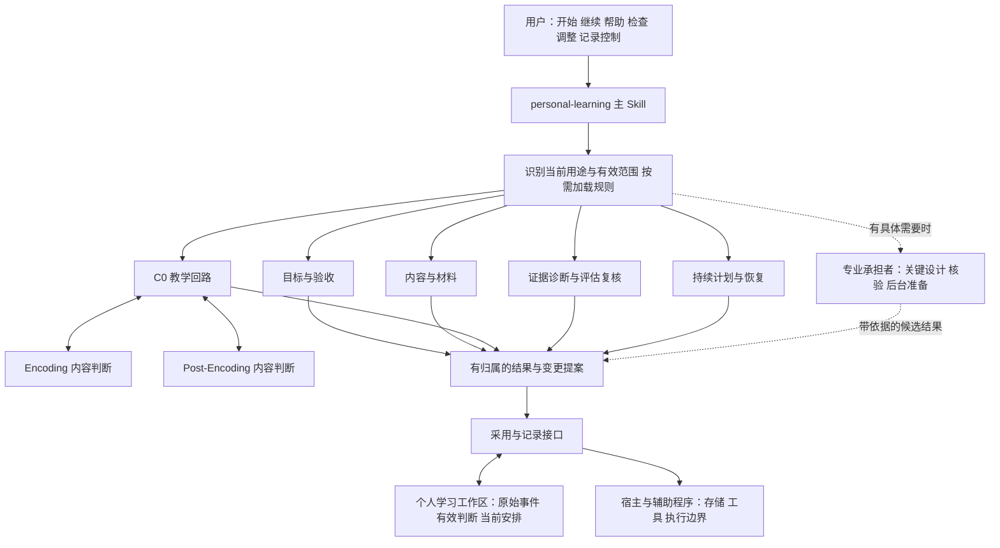
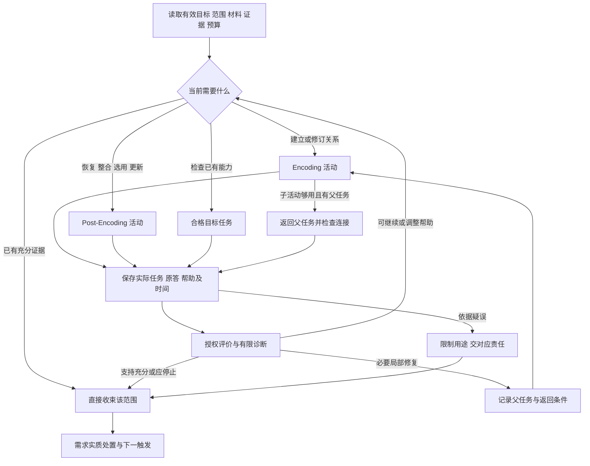

# AI 个人学习系统：Skill 架构设计 v0

日期：2026-10-02  
版本：v0／从正式学习系统方案到 Skill 实现的架构设计  
状态：供下一阶段实现使用的设计稿；尚未创建、安装或运行学习 Skill，未执行技术行为测试或真实课程试用。  
上位规范：[整体学习流程与概念架构 v1](<E:/文献资料/学习系统架构设计/docs/architecture/AI个人学习系统_整体学习流程与概念架构_v1.md>)。

**本版建议采用一个面向用户的主 Skill：`personal-learning`。主 Skill 组织按需加载的目标、材料、教学、证据和计划工作流；以一份有明确维护责任的学习记录连接它们；由一个当前教学入口与按需调用的专业承担者协作。** 六项能力保留为决定边界，Encoding 与 Post-Encoding 保留为教学分支。首期用少量承担者和受控串行写入跑通完整学习路径，再根据验证结果增加后台并行与自动化。

Skill 包保存可复用规则，个人学习工作区保存课程与个人记录，宿主及辅助程序提供文件、工具、执行与调度能力。三者分别维护：更新 Skill 不应覆盖学习记录；切换 Agent 不应重置帮助历史；增加调度器也不应产生另一份目标或复习计划。

本文的目录、内部接口、数据字段和辅助程序均为**拟实现设计**，不是现有功能说明。全文的假设示例均非用户真实学习记录。

## 一、本阶段需要作出的架构决定

### 1. 从概念设计转换到实现设计

前序方案已经回答学习系统应做哪些判断、怎样解释证据、谁有权作决定。本版补足六个实现问题：入口怎样触发；规则怎样装入上下文；一次学习怎样运行；记录保存在哪里；多 Agent 怎样交接并采用结果；实现怎样验收。

| 编号 | 本版设计选择 | 选择理由及边界 |
|---|---|---|
| S-01 | 一个主 Skill，内部工作流按需加载 | 让用户从同一入口开始、继续、复习和管理记录，避免多个 Skill 各自维护学习状态 |
| S-02 | 六项能力对应职责，不强制对应目录、Agent 或服务 | 保留专业决定边界，同时允许相容职责兼任 |
| S-03 | C0 是共同教学回路；Encoding／Post-Encoding 是其中的内容判断 | 支持一次活动内双向切换，不强制先编码、再检索、再整合的固定流水线 |
| S-04 | 高能力承担关键设计和重要复核，主要交互交给有界执行者 | 保留原方案方向；具体模型、人数和介入频率由能力与成本决定 |
| S-05 | 个人记录独立于 Skill，当前有效结果只有一个维护入口 | 避免每个 Agent、课程视图或摘要产生互相冲突的正式结论 |
| S-06 | 首期采用本地文件、明确引用和串行提交 | 足以承载一门课程的有限目标；暂不建设通用数据库、事件平台或知识图谱 |
| S-07 | 专业采用、计划生效与文件写入分别解释 | 写入程序保障记录一致性；它不能替专业责任方判断内容、能力或投入 |
| S-08 | 后台工作默认返回候选结果，当前入口决定展示和合法提交 | 只有通过权限、用途和版本检查的结果才影响当前活动 |
| S-09 | 执行、记录控制与恢复行为必须在真实承载上测试 | 提示词中的规则不等于技术上已阻止越权或旧结果复活 |
| S-10 | 首期验证沿用工作包 10，新增复杂度需有保留理由 | 设计、技术可用、学习获益、协作净价值分别报告 |

本版不替用户选课程、教材、预算、模型或固定复习间隔。这些是实例参数，不妨碍先确定通用架构。

### 2. 规范层次

本文采用以下标记区分结论性质：

- **继承规则**：十份正式输入中已有的学习、证据、职责和用户控制约束。
- **本版设计**：将这些约束落实为 Skill 结构、接口及文件承载的建议。
- **实例参数**：真实课程、用途、资源、承担者和记录控制范围。
- **待验证**：程序实际行为、教学收益、记录负担及协作成本。

解释优先关系沿用 v1：其明确采纳的跨包澄清优先；各专项未被修订的细节继续有效。本文仅细化实现，不暗改教学标准。实现中若发现规范冲突，记录具体差异并限制受影响用途，由相应责任方提出修订；不按文档日期或 Agent 级别自动覆盖。

## 二、依据与转换范围

### 1. 十份正式输入的落点

| 正式输入 | 主要承接位置 | 本版转换结果 |
|---|---|---|
| [整体架构 v1](<E:/文献资料/学习系统架构设计/docs/architecture/AI个人学习系统_整体学习流程与概念架构_v1.md>) | 第二至六、八至十二节 | 统一能力、信息语义、采用规则、首期边界与异常约束 |
| [工作包 2 与 3](<E:/文献资料/学习系统架构设计/docs/designs/AI个人学习系统_工作包2与3_联合设计方案_v0.md>) | 第三至十节 | 目标与判据契约、证据判断、有限诊断、近期展开与版本兼容 |
| [工作包 4](<E:/文献资料/学习系统架构设计/docs/designs/AI个人学习系统_工作包4_设计方案_v0.md>) | 第三至十节 | 来源片段、材料用途、可见与备用内容、核验及双链纠错 |
| [工作包 5／C0](<E:/文献资料/学习系统架构设计/docs/designs/AI个人学习系统_工作包5_C0共同教学框架_设计方案_v0.md>) | 第二至八节 | 共同活动规格、实际帮助、授权分支、停止、返回与收束 |
| [工作包 5／Encoding](<E:/文献资料/学习系统架构设计/docs/designs/AI个人学习系统_工作包5_Encoding_设计方案_v0.md>) | 第二至六、八节 | 关系建构、动态展开、复杂父产物及局部返回 |
| [工作包 5／Post-Encoding](<E:/文献资料/学习系统架构设计/docs/designs/AI个人学习系统_工作包5_Post-Encoding_设计方案_v0.md>) | 第二至八节 | 恢复、整合、自主选用、更新、时间条件与回到 Encoding |
| [工作包 7](<E:/文献资料/学习系统架构设计/docs/designs/AI个人学习系统_工作包7_长期计划与学习连续性_设计方案_v0.md>) | 第二至十节 | 需求处置、共享预算、滚动承诺、积压与跨会话恢复 |
| [工作包 8](<E:/文献资料/学习系统架构设计/docs/designs/AI个人学习系统_工作包8_多Agent协作与共享状态_设计方案_v0.md>) | 第二至九、十一节 | 决定归属、上下文交付、接责、采用、接管与协作成本 |
| [工作包 9](<E:/文献资料/学习系统架构设计/docs/designs/AI个人学习系统_工作包9_跨学科用户体验与异常场景_设计方案_v0.md>) | 第三至十二节 | 学科适配、用户操作、组合异常和 C9-01—07 澄清 |
| [工作包 10](<E:/文献资料/学习系统架构设计/docs/designs/AI个人学习系统_工作包10_验证计划与设计收口_设计方案_v0.md>) | 第二至九、十一节 | 首期路径、V1—V4、B10-01—12 与 I1—I6 实施顺序 |

本版以以上方案正文为依据，不将其引用的学习科学研究视为本轮重新核验的证据，也不从历史提示词、审阅稿或研究卡库另行引入更高优先级规则。

工作包 6 未列入用户本轮指定的十份输入。本文仅承接 v1 已采纳的策略边界：方法配置服务教学、可直接教学、无独立计划或掌握度、复用价值待验证。首期不以完整工作包 6 或策略库为强制依赖；后续要接入完整策略资源时，单独映射和审查。

### 2. Skill 载体的采用依据

目录组织参考本地 [skill-creator 规范](<C:/Users/15006/.codex/skills/.system/skill-creator/SKILL.md>)：`SKILL.md` 为入口；`references/` 按需披露；`scripts/` 承载值得确定性执行的重复操作；`assets/` 承载实际生成产物所需模板；`agents/openai.yaml` 可提供界面元数据。

上述包装方式不意味着宿主自带多 Agent 调度、数据库事务或后台运行。实现时须核对所选宿主的真实能力，不从 Skill 文件名推断平台保证。

## 三、整体架构：入口、专业工作流、个人记录和运行支持

### 1. 四层结构



| 层 | 负责什么 | 不承担什么 |
|---|---|---|
| 用户入口 | 理解意图，呈现当前任务与结果，接收帮助和控制请求 | 不让用户手工编排内部角色 |
| 专业工作流 | 根据目标、内容、表现与资源作有权限的决定 | 不把角色切换当新证据，不自建平行记录 |
| 个人记录与采用接口 | 保存可定位事实、当前采用结果、限制和恢复入口 | 不用摘要代替原答，不用程序校验代替专业核验 |
| 宿主与运行支持 | 提供文件访问、工具、后台任务及可实现的隔离和提交机制 | 不赋予 Skill 超出宿主权限的能力，不保证学习效果 |

主 Skill 的“编排”是选择下一项有价值的工作及其责任方，不新增一个可以推翻内容、评分或目标的总裁决者。计划模块组织投入；写入接口组织保存；二者均不能把未经核验的参考改成可靠。

### 2. 四种单位必须分清

| 单位 | 在本架构中的含义 | 例子 |
|---|---|---|
| Skill | 可被宿主发现并加载的一组任务指导 | `personal-learning` |
| 工作流 | Skill 内部针对一种决定的操作规则 | 恢复会话、准备材料、处理评分异议 |
| 专业职责 | 对某类事实或决定负最终维护责任 | 证据责任方维护条件化判断 |
| Agent／工具 | 实际承担工作或执行操作的资源 | 当前教学 Agent、临时复核 Agent、代码测试工具 |

读取 `references/post-encoding.md` 只是加载规则，不自动启动一个 Agent。`agents/openai.yaml` 也不是团队编排文件。主 Skill 可以在一个 Agent 中运行全部相容工作，也可在宿主支持时委派有界任务。

## 四、Skill 包的组织与按需加载

### 1. 推荐目录

以下为目标结构，按实现批次创建。领域文件和模板只在首期实际使用时落地，不预建空文件。

```text
personal-learning/
├── SKILL.md
├── agents/
│   └── openai.yaml                 # 可选的显示名称、简介及入口提示
├── references/
│   ├── core-contracts.md           # 对象语义、决定归属、采用及引用规则
│   ├── goals-evidence.md           # 目标、判据、有限诊断、条件化判断
│   ├── materials.md                # 来源、读取范围、用途、核验、展示边界
│   ├── teaching-core.md            # C0、活动规格、帮助、反馈、停止与返回
│   ├── encoding.md                 # 当前关系、条件与操作的建立／修订
│   ├── post-encoding.md            # 恢复、整合、选用、更新与时间解释
│   ├── planning-resume.md          # 需求处置、资源取舍、断点与恢复
│   ├── collaboration.md            # 委派、接责、采用、接管与能力要求
│   ├── corrections-controls.md     # 纠错、查看、异议、导出和删除
│   ├── validation.md               # V1—V4、行为案例入口和处置规则
│   ├── source-map.md               # 本包规则对应正式方案的位置
│   └── domains/
│       └── <实际接入学科>.md       # 学科判据与核验办法；按需增加
├── scripts/
│   ├── learning_store.py           # 拟实现：引用、提交、限制、清理与导出
│   └── check_scenarios.py          # 拟实现：用虚构记录重放关键行为
└── assets/
    └── pilot-instance.template.md # 首期实例说明，按实际需要使用
```

`SKILL.md` 不粘贴十份原方案全文。它保留入口、关键不变量、工作流路由和必要文件的加载条件；专项文件保存会改变决定的规则、输入输出和少量有区分力的例子。

`core-contracts.md` 是共用语义的唯一维护位置；专项只解释自己的增量并引用它。字段模式可先写在该文件中；脚本需要机器校验时再提取为实际使用的 schema，避免从第一版就维护两份不同定义。

原设计文档是维护与审查依据，不作为每次运行必须可访问的外部依赖。Skill 发布包应包含足以运行的精简规则与必要资源；出处索引服务追溯，不要求另一台机器存在本机绝对路径。个人原答和课程实例不得放进可分发 Skill 包。

### 2. `SKILL.md` 的内容边界

建议入口名称与描述如下；这是包装示意，正式实现时再验证 frontmatter 与宿主元数据。

```yaml
---
name: personal-learning
description: 围绕课程资料与个人目标开展持续学习，组织教学、作答检查、复习和跨会话恢复，维护可追溯的学习记录。适用于需要持续推进或沿既有记录继续的个人学习任务。
---
```

正文依次交代：本 Skill 的用途；如何找到或建立个人学习工作区；如何识别已有课程与当前请求；关键规则；按情境读取哪些参考；如何调用记录接口；在能力不足时怎样限制相关用途。

入口至少保留这些规则：按目标关键操作解释独立性；原答与实际帮助先于能力结论；已有充分证据允许结束；局部修复保留父任务；预算缩小不暗改目标；暂停和依据停用立即限制用途；当前活动只有一个教学入口；候选结果经过专业采用；摘要不代替原证据；删除不经迟到结果复活。其他细节按分支加载。

独立的一次性解释可按用户请求直接完成，不自动建课程、写个人画像或开启完整学习流程。用户明确要纳入长期学习，或请求继续已有活动时，再使用持久化路径。

### 3. 路由与加载表

| 请求或当前情境 | 必要加载 | 当前输出 |
|---|---|---|
| 新课程／新目标 | 共用契约、目标证据、材料、计划；实际学科规则 | 近期目标与可靠材料范围、未知项、有限承诺 |
| 继续学习／中断恢复 | 共用契约、计划恢复；按恢复点加载教学专项 | 当前可继续范围、父产物、下一连接与必要确认 |
| 建立概念、条件或关系 | 教学核心、Encoding；必要材料与领域规则 | 具体活动、支架、原答与反馈 |
| 复习、恢复、整合或应用 | 教学核心、Post-Encoding、相关时间与暴露记录 | 针对目标缺项的任务或已有证据复用 |
| 检查、评分、诊断或重要跳过 | 目标证据、材料核验及学科规则 | 条件化判断、解释限制或必要复核 |
| 缩时、积压、改目标 | 计划恢复；改正式目标时加目标证据 | 更新承诺；必要时形成目标新版本 |
| 委派、换承担者、旧结果到达 | 协作规则及该任务的专业规则 | 接责、兼容性检查、采用或明确拒绝 |
| 内容争议、查看、异议、导出、删除 | 纠错与记录控制；受影响专业规则 | 具体处置、使用限制和剩余合法范围 |
| 系统验证或决定是否简化 | 验证规则、相关原记录和版本 | 分开的 V1—V4 结果及设计处置 |

路由决定可修订：出现关系障碍时从 Post 加载 Encoding，修复够用即返回原任务。加载全部专项不是默认起点。

### 4. 上下文怎样保持紧凑且可靠

每次活动以“当前工作包”携带必要上下文：有效范围、目标与判据引用、当前判断及未知、当前任务与材料用途、实际帮助和相关暴露、父产物与断点、资源和暂停事项。稳定来源通过引用按需读取。

压缩对话后，这些信息从持久记录重新定位；压缩摘要不能自动成为新证据。关键帮助、删除限制、执行权和判据版本不能因为专项切换而丢失。重要复核必须回查原任务、原答与实际条件，不仅接收摘要。

无需每轮重读所有规范；发生目标版本变化、冲突、删除、接管或重要结论扩展时，重新读取相关原始依据和规则。规则文件与运行记录分别标版本，以便说明一次行为使用了哪版 Skill。

## 五、职责、能力分配与 Agent 协作配置

### 1. 谁维护哪些决定

| 职责 | 最终维护的对象或决定 | 常规可直接执行 | 需关键设计／复核的情形 |
|---|---|---|---|
| 目标责任 | 目标、判据、前置、允许资源与版本 | 按已定范围整理近期要求 | 正式范围变化、复杂目标、要求冲突 |
| 内容责任 | 来源、学科参考、材料用途与核验 | 制作已核验内容的等价表达 | 条件或答案变化、来源争议、新解法依据不足 |
| 教学责任 | 活动规格、关键分支、父任务与实际过程 | 改措辞、提供允许帮助、局部等价替换和反馈 | 复杂证明／设计、关键操作改变、持续无进展 |
| 证据责任 | 当前支持范围、使用资格、诊断与待查项 | 按授权判据形成有限判断 | 重要跳过、结论扩展、证据冲突或删除影响 |
| 评估复核责任 | 任务与评分是否足以支持拟作结论 | 核查常规评分理由 | 争议评分、非标准合法解、复杂整体评审 |
| 计划责任 | 需求实质去向、资源竞争与唯一有效安排 | 在既有授权内滚动安排和缩范围 | 新增投入、期限冲突、涉及正式用途取舍 |

评估复核结果交证据责任维护当前判断，不保存另一份“掌握度”。方法配置维护可并入教学职责；验证组织可并入规划或评估职责，均不新增日常审批层。

用户决定最终用途、正式范围和投入取舍，以及个人记录控制。系统在已有授权内执行普通调整；只有缺少会改变决定的信息或超出授权时，才提出具体问题。

### 2. 首期承担方式

推荐采用“一个当前交互承担者＋按需关键设计／复核”的配置：

| 承担方式 | 工作内容 | 采用条件 |
|---|---|---|
| 当前交互承担者，通常使用中等能力资源 | 教学交互、实际记录、授权评分、局部调整、收束；兼任相容材料与计划维护 | 已有够用任务与可靠参考，授权和预算清楚 |
| 高能力设计／复核承担者，按需调用 | 关键目标、整体参考、复杂活动、重要评价及重大诊断 | 返回可执行产物及依据，不能只给抽象建议 |
| 临时后台承担者，可选 | 有独立边界的材料准备、工具运行或第二次核验 | 有可收束任务，宿主能限制展示与正式写入，净价值待验证 |

如果只有一个足够胜任的承担者，可顺序兼任职责，不伪造消息交接或独立评分。若其不能可靠承担某项重要工作，则该用途保持待处理；改一个角色名不补足能力。

高能力不必永久在线，但必须交付当前工作足够用的题面／制作要求、核验锚点、关键操作归属、重要分支、允许调整与停止条件。对完整证明或项目的准备还须覆盖整体评审，不能只准备局部问答。

### 3. 角色到模型的映射留给实例配置

首期实例说明记录实际承担者、能力用途、可调用工具、是否允许后台工作、共同预算以及不可用时的返回方式。角色职责不绑定模型品牌或型号；更换模型后应检查受影响的行为与核验能力。

第二次评分可用于发现分歧：提供原任务、原答、判据、实际帮助和必要内容依据，尽量不先展示第一次评分与教学总结。它不增加学习样本；不同模型同意也不构成真伪证据。

## 六、共享状态与最小数据契约

### 1. 保存原则

保留能支持当前决定、后续恢复和纠错的最小事实。语义对象可以同文件保存，不要求一对象一表或建立完整图谱。以下契约是对前序信息含义的实现命名建议。

所有正式对象可用稳定 `id`、语义修订 `revision`、维护责任 `owner` 和必要引用定位。引用指向具体对象与修订；对原文还需页码、段落、代码位置或产物内定位。`schema_version` 表示记录格式，不代替目标、任务、材料各自的内容版本。

不适用、不要求、尚未知、未执行和已删除必须可区分。缺字段不能默认“没有帮助”“零成本”“无再接触”或“已经通过”。

### 2. 核心对象

| 对象／建议名称 | 最小必要内容 | 维护责任与关键区别 |
|---|---|---|
| 首期实例／`LearningInstance` | 课程与用途、当前范围、资源与期限、承担者、记录根目录及控制范围 | 计划组织、相关专业补齐；自述不是能力证据 |
| 目标与判据／`GoalSpec` | 要求身份与来源、内容依据、对象域、关键操作、产物、允许资源、适用情境、必要时间条件、证据要求 | 目标责任；课程要求、用户用途、系统建议与待澄清项分别标明，不得由当次预算覆盖 |
| 来源片段／`SourceFragment` | 来源与版本、定位、读清的文字／公式／图表范围、主张条件、未读清部分 | 内容责任；文件可打开不等于全部读清 |
| 材料用途／`MaterialUse` | 片段引用、用途、当前可见内容、备用帮助、教师参考、核验范围与潜在泄露 | 内容与教学各维护本职；准备好不等于已展示 |
| 活动规格／`ActivitySpec` | 目标判据引用、关键学习者工作、题面、参考、分支、权限、退出、父任务及返回 | 教学责任；任务设计不等于实际表现 |
| 表现与条件／`PerformanceEvent` | 实际题面版本、原答／代码／过程位置、初答与修订、谁完成哪部分、实际资源和帮助时序 | 执行者记录事实；AI 整理稿不是原答 |
| 接触事件／`ExposureEvent` | 实际呈现的内容和操作、展示时点／顺序、反馈与已知再接触、不确定处 | 可嵌入表现事件；计划中的提示不算已经发生 |
| 评分与判断／`Judgment` | 目标具体要求、判据版本、相关事件、条件、支持状况、使用资格、边界与反证 | 证据责任；评分意见须经适当授权采用 |
| 暂定诊断／`DiagnosticNote` | 观察、解释、替代解释、反证和能改变安排的下一观察 | 证据责任；不是稳定心理标签 |
| 需求／`LearningNeed` | 同一目标内缺项、必要性、不做后果、条件、可拆性、接责者及实质处置 | 提出方保留跟进，计划维护去向；不是每次答错一项债务 |
| 承诺／`PlanCommitment` | 可执行范围、采用依据、共享资源、允许调整、未选后果、恢复点和触发 | 计划责任；不保证按期掌握 |
| 工作交接／`WorkOrder` | 委派范围、上下文、权限、预算引用、接责、结果、专业采用及计划影响 | 原责任方与接收方各自落实；不另存完整个人资料 |
| 限制与纠错／`UseRestriction`、`CorrectionCase` | 受限用途、依赖范围、理由、责任、分项处理及恢复条件 | 发现者可先限制；恢复须相应专业依据 |
| 验证记录／`ValidationDecision` | V／H／B 编号、设计版本、原记录引用、实际输出、成本和设计取舍 | 验证组织维护；服从相同删除规则 |

断点可以保存在活动与承诺中，不再复制一份“恢复数据库”。完整父产物保存在一个规范位置，局部草稿、修订和评审均引用该位置及对应版本。

同一物理记录涉及多种职责时，按决定区分维护范围：例如内容方维护材料核验与适用用途，教学方维护实际展示及帮助。它们共用引用，不共同覆写同一个最终判断。目标的“为何要求学习者做到”与内容的“为何认为这个命题成立”也分别保留依据，不能合并成一个来源可信度字段。

### 3. 判断的两个轴

```text
支持状况 support:
  unknown | supported | observed_not_met | mixed_or_conflicting

使用资格 eligibility:
  usable | pending_review | withdrawn
```

这两个轴按**目标要求和条件**保存，不能只给整个目标一个布尔 `mastered`。

例如，“在提供公式后完成推导”可对关系推理形成正面支持；公式恢复若是目标要求，仍可能未知或已观察未达到。参考受到质疑时，历史表现可以保留，相关用途转为待复核。删除后失去支持，撤销的是失据判断，能力保持未知。

目标未要求的延迟或迁移标为“不要求”，不生成未知欠项。一个事件可以支持多个要求，但事件标识保持同一个，不因多次评分、多个角色引用或同题修订增加独立样本数。

### 4. 帮助、时间和出处怎样进入契约

帮助记录描述“给出了什么、在初答之前还是之后、替代了哪项目标操作”。术语解释、题目标题、图示、方法名、错误定位、工具默认选项和完整答案都可能有作用；不以固定提示级别或次数决定独立性。

初学、最近相关练习／反馈、已知再接触与此次作答的时间分别定位到内容或操作。刚修订的条件不能继承整个主题的旧保持时长，也不使其他未受影响的历史证据清零。已知没有相关再接触与接触史未知分开；不暗中监控用户其他活动以补齐记录。目标只要求自然工作中的使用时，不强加无接触间隔。

实际展示须与拟展示、已请求展示、后台参考读取分开。宿主不能确认显示结果时记录不确定性，不直接填成“已展示”或“无暴露”。也不根据对话表现设定“巩固完成”“再巩固窗口打开”等不可直接观察的生物机制状态。

最低依赖链为：`GoalSpec ← 要求来源`；`ActivitySpec/MaterialUse ← GoalSpec + 内容依据`；`PerformanceEvent ← 实际任务 + 原答 + 实际条件`；`Judgment ← 事件 + 判据`；`Need/Commitment ← 判断 + 必要工作 + 用户约束`。实际展示也须能反查受影响事件。反向依赖可以从引用扫描生成，无需首期维护通用图数据库。

### 5. 局部记录示例

以下是**虚构且仅展示字段关系的片段**，并非完整可执行 schema；引用对象须在真实实现中存在。

```json
{
  "id": "judgment-demo-r3",
  "revision": 1,
  "owner": "evidence-owner",
  "goal_ref": "goal-demo@2",
  "requirement_ref": "goal-demo@2/requirements/reasoning",
  "event_refs": ["event-demo-07@1"],
  "conditions": {
    "provided_content": "已提供前提，未提供关系推断",
    "relevant_exposure_refs": ["exposure-demo-04@1"],
    "intervening_contact": "unknown"
  },
  "support": "supported",
  "eligibility": "usable",
  "scope": "给定前提条件下的关系推断",
  "limits": ["不支持前提的无提示恢复", "尚无所需延迟表现"]
}
```

实现中只有目标要求延迟时才保留上述延迟缺项；本例假定该要求存在。不能把示例里的字段取值变成所有课程的默认条件。

## 七、一次学习的运行方式

### 1. 入口先确定本次用途

开始时读取当前限制和有效安排，识别用户是开始新范围、继续活动、请求帮助、检查表现还是管理记录。课程和活动明确时直接复用；多项活动都可能对应“继续”且选择会改变工作时，只问一个有区分力的问题。

新课程按近期范围准备：辨认课程资料的作用，形成目标与判据，核验当前所需材料和任务，结合已有表现与资源形成可执行承诺。没有既有能力证据可以从未知开始；学习者请求示范时可直接可靠输入，不强迫先答错。

正式评价条件不足时，允许已获授权的限定探索或示范，但明确不能据此宣布正式达成。

### 2. 共同教学回路



这是判断分支，不是每个目标都必须走过的固定阶段。用户暂停、缩时或资源耗尽可在任意适当位置中止新工作，保留必要收束。

### 3. Encoding 与 Post-Encoding 各增加什么

| 教学分支 | 本次应明确的内容 | 返回或结束依据 |
|---|---|---|
| Encoding | 需要建立或修订哪组关系、条件或操作；怎样形成可观察产物；哪些推断留给学习者 | 当前目标所需结构有足够支持，或达到父任务所需的局部条件 |
| Post：恢复 | 待恢复对象、允许入口、实际提示与相关接触 | 对应恢复要求取得支持；提供前提后其他工作可继续但不补记恢复成功 |
| Post：整合 | 已有局部关系如何连接、区分并组织成整体 | 完整关系或产物成立，不靠局部检索次数替代 |
| Post：选用与迁移 | 识别条件、选择或拒用方法、映射与执行分别观察 | 原目标要求及实际情境支持到哪里就判断到哪里 |
| Post：更新 | 新旧依据和有效边界、需要修订的局部以及旧结论仍成立处 | 修订能用于目标工作；不能只是复述刚展示的新答案 |

方法配置可以直接附在活动规格上，说明适用、替代、成本和停止。没有合格策略卡时允许可靠教学；不能把“找卡”变成教学前的强制审批。

### 4. 活动规格是设计与执行的核心接口

一份够用规格应使执行者回答：当前让用户做什么；关键判断由谁完成；有哪些可靠参考；不同表现怎样改变下一步；可以调整到哪里；何时结束或返回。

建议使用以下紧凑结构，内容已存在时引用而非复制：

```text
依据：有效承诺、目标／判据、当前判断和材料用途。
本次工作：具体题面或制作要求、关键操作、可观察产物。
展示边界：当前可见输入、备用帮助、教师参考；允许和实际资源。
评价锚点：正确性依据、多解及信息不足分支、常规评分权限。
调整分支：会改变下一步的表现、有限帮助、反证、升级与停止。
连续性：父产物、卡点、局部足够程度、返回任务及资源边界。
结果接口：原答与帮助、有限判断、未完成项、后续需求及接责。
```

内容正确性和任务能否取得目标证据分别核查。正确答案若已在题面或安排说明中透露，材料可以可靠，任务仍可能不适于观察自主选择。

反馈至少完成三件事：定位原答中具体的正确、缺失或错误现象；提供与该处需要相称的可靠支持；让学习者实际完成能运用这项支持的下一步工作。只展示一段更完整的 AI 解释不等于修复已经发生。若用户暂停或预算不足以继续，保存支持已提供、后续运用尚未观察的真实状态。

### 5. 局部修复与复杂工作

进入子任务时保存父目标、原卡点、相关原答、转入理由、替代解释、局部够用条件、返回位置和投入边界。满足条件便返回；子任务成功不能使父任务自动通过。

父任务仍失败时重审局部与整体接口、方法选择、组织、额外前置或原诊断，不沿同一解释无限下钻。完整证明、代码或综合报告持续保留一个父产物；分段改变推进位置，不以局部勾选数代替整体评审。

### 6. 收束与恢复

结束原因至少区分：目标内支持充分；教学部分完成但条件未满足；用户暂停或预算结束；无进展、争议或必要条件不足。后续缺项仅为未来时间条件时，可以结束当前教学并等待合格机会。

每次收束保存真实产物、帮助和结论边界，推动仍必要需求形成实质去向。当时尚未接责或无法完成专业处理时，可先收束教学，但需求明确保留为待接责／待处理，注明当前跟进责任、受影响用途和下一触发；不能伪造已安排，也不能把整条交接标为闭环。下次先读当前有效范围与限制，再定位目标／判据、有效判断、材料、父产物、关键原答与帮助、最后确认的断点。没有摘要不重启整章；最后未确认动作保持未知。

## 八、计划、需求与跨会话连续性

### 1. 一个预算，多个时间尺度

课程／学期保存用途、期限、核心范围与条件性预测；阶段保存完整成果与关键依赖；周和会话形成滚动承诺。它们是同一安排的不同视图，不是各自独立的命令和预算。

新学、补缺、复习和综合任务共同竞争资源。计划先排除当前不可执行项，再比较真实使用、阻塞、延期后果、用户优先和完整成本。准备、核验、反馈、等待、恢复、维护与纠错都计入相关成本，无法取得的数值保持未知。

### 2. 需求的生命周期

```text
提出 → 明确接责 → 按必要性处置：
                    安排 / 部分安排 / 合并 / 暂缓 /
                    不再投入 / 关闭 / 退回补充
```

每种处置附理由、未覆盖影响和再次考虑触发。合并后保留原需求对应的要求范围；不再投入时目标仍可未完成。只有“已读”或“已收到”不算处置完毕。

同一要求的连续错误更新原需求；只有所需工作、条件或责任有实质差异时再拆分。兴趣扩展作为用户新用途处理，不自动变成原课程欠账。

### 3. 复习与时间条件

复习来自目标内保持、恢复、整合或选用的真实要求，以及相应证据缺项。日历是执行建议；满足某个日期不自动取得延迟证据，也不采用统一固定间隔。

自然使用已经给出合格证据时直接复用。相关再学习改变严格无接触条件时，重新解释该范围；不抹去仍有效的当前使用证据。漏学和积压按价值重新取舍，不把所有条目机械移到明天。

### 4. 预算变化与目标变化

“今天只剩十分钟”先改变承诺和断点，不改变正式判据。用户确实改变最终用途或范围时，目标责任形成新版本，证据责任检查旧判断适用性，计划再形成相容安排。

未新增承诺、采用依据或有效范围的普通原答追加、授权评分、提示与措辞调整，不必每次等待计划发布新版。

## 九、委派、结果采用与执行权

### 1. 委派一个可收束的任务

委派适用于可独立准备或需额外核验的具体工作，例如“核查这一完整证明与允许的另一解法”，不使用“你负责学习者的一切证据”式无限任务。

工作单至少包含：任务标识和提出责任；需回答的具体问题；目标、材料、事件和当前状态版本；允许读取的最小上下文；可作决定与禁止直接变更的范围；共同预算引用；输出要求、停止条件和回传对象。

| 工作单阶段 | 表达的事实 | 不能据此推出什么 |
|---|---|---|
| 提出 | 有候选任务或需要 | 已有人接手 |
| 接收／接责 | 某承担者承接具体范围、缺项和返回触发 | 专业结论已获认可 |
| 专业采用 | 有权责任方采用全部、部分结果或要求重核 | 已经承诺安排学习 |
| 计划处置与生效 | 对资源或执行范围有真实处置 | 学习已经发生或目标已经通过 |

同一承担者可在一条记录中完成多个阶段，不制造形式会签。未接责时原发送方保留跟进；接责后接收方负责处理，计划保留跨会话入口。无新依据、资源或目标变化的循环委派须作取舍或暂缓。

### 2. 结果采用次序

1. **先检查记录控制与限制**：结果是否包含已删内容、被禁用依据或越权取得的数据；不合格内容不得复制进持久候选记录。
2. **再检查身份、职责及范围**：提交者被授权回答什么，是否拥有相应专业采用权。
3. **检查兼容性**：目标、判据、材料用途、任务、帮助、预算和依赖版本是否仍适用。
4. **保留合法新事实，分别处置判断**：旧版本中的真实新原答可以形成有限证据；旧决定不能覆盖新安排。
5. **由相应责任方采用、部分采用、重核或拒绝**；需要改变承诺时，计划再整合影响。

版本不同不等于结果全部无效；版本相同也不等于正确。程序检查版本与引用，专业方检查语义兼容性和依据。

相反判断先辨条件是否不同。对同一原答同一条件的实质评分冲突，回查原答与判据；不投票、不平均、不以最后到达者获胜。

### 3. 一个当前教学入口

后台承担者默认不能直接向学习者展示题目、提示或答案，只能把结果送回当前入口。准备好的材料与实际展示分开记录。

**拟实现的执行权记录**可以包含 `activity_id`、`current_executor`、`execution_epoch` 和当前限制。每次接管增加该活动的执行代次，接任者确认版本、父产物、帮助、资源与暂停事项；旧代次失去该活动展示和有效决定提交权。旧方若继续核验，应另有明确后台范围。

该记录只有配合实际输出入口才有效：宿主能统一拦截输出时，在展示与提交前检查当前执行权；若宿主无法阻止旧 Agent 直接发言，则禁止该活动并行面向用户，必须确认旧执行已结束后再接管。仅在文件中加一个锁或代次字段，不能宣称已经消除展示竞态。

唯一入口不能确认时暂停该活动的新题目与提示。已经实际泄露的内容仍记为暴露，撤回界面文字不能使其从未发生。

### 4. 高层不可用与有限继续

执行者可继续依据充分、已授权且预算允许的普通活动，或完成收束。依赖重要未决判断的评分、跳过或新范围保持待处理。无法找到可行工作时结束当前活动，不无限等待，也不凭空补造核验结果。

委派不会增加权限或复制预算。后台并行节约等待但仍有成本；所有承担者使用同一资源约定。

## 十、持久化与运行支持的实现边界

### 1. 个人学习工作区与 Skill 分离

建议首期使用用户选择的一个可控制本地目录，结构如下。名称为建议，实例化时确定实际绝对路径。

```text
<learning-workspace>/
├── state.json                     # 当前索引、有效引用、即时限制、执行权与共享资源
├── courses/
│   └── <course-id>/
│       ├── instance.md            # 用途、首期目标与记录控制约定
│       ├── records/               # 目标、材料用途、任务、事件、判断等正式记录
│       └── artifacts/             # 原答、代码、证明、报告等规范产物
├── proposals/                     # 通过控制检查的候选结果，尚未采用
├── validation/                    # 虚构测试与获准保存的验证引用，明确区分
└── staging/                       # 提交临时区；纳入清理与删除范围
```

`state.json` 保存当前有效对象的索引和运行控制信息，不再复制完整原答、目标正文和另一套判断。每个对象正文只有一个规范维护位置；界面摘要和导出是派生视图。个人记录默认不进入 Skill 仓库、版本控制或通用长期记忆。

资料可引用用户原文件，也可在获准范围内保存必要片段；不能因文件在外部就假定可永久访问或可由系统删除。来源原件、系统派生件和用户自行导出的副本分别说明控制范围。

### 2. 首期辅助程序需要做什么

| 拟实现操作 | 输入与输出 | 确定性检查边界 |
|---|---|---|
| `read_context` | 当前用途和范围 → 当前引用、限制、断点及需读取位置 | 只返回当前合法记录；不能判断教学起点最优 |
| `validate_refs` | 引用和拟用途 → 存在性、版本及明确限制问题 | 不把“文件存在”当内容正确或证据充分 |
| `commit` | 预期状态修订、操作标识、授权主体、变更及依据 → 成功或冲突 | 检查结构、引用、写入范围、重复操作与当前限制；专业采用依据另列 |
| `restrict` | 受影响范围和理由 → 立即生效的使用限制 | 可比完整纠错先发生；不能恢复用途 |
| `handoff` | 活动、旧代次、新承担者及确认 → 新执行权或未完成接管 | 只有宿主能执行隔离时才保障展示边界 |
| `delete_scope` | 明确删除范围 → 已清理、待清理、不可控制部分及判断影响入口 | 包括派生件和临时件；语义影响由证据责任处理 |
| `export_scope` | 用户指定范围 → 获准保留的原件／引用、条件、判断与限制 | 导出缺原始证据时注明不可独立复核 |
| `check_integrity` | 工作区 → 失效引用、孤立候选、遗漏限制和结构问题 | 发现问题不自动重建个人原答或恢复已删记录 |

它们是一个小型辅助程序的操作接口，不要求八个服务。具体命令行、参数格式、平台锁和文件编码在实现时定义并验证。首期可人工完成部分操作，但要准确标明人工承载的范围；不具备必要保障的功能先限制使用。

### 3. 串行提交与失败恢复

本版建议所有正式写入经同一个串行入口。后台只交候选结果；关键采用决定由被授权责任方给出，辅助程序只是提交执行者。

文件方案的拟实现过程为：

1. 接收明确变更及唯一操作标识，读取当前状态修订和限制。
2. 检查权限、依赖、格式和幂等性；专业判断已经由有权承担者完成并有引用。
3. 在受控临时区准备新正文或新修订，保持旧的有效指针不变。
4. 再检查当前状态、暂停与删除限制；发生冲突就重新读取并交责任方判断，不盲目重试旧决定。
5. 通过已验证的本地原子替换方式发布当前索引；只有索引引用的内容才是已提交正式结果。
6. 返回提交结果，清理不再需要的临时内容；失败恢复只清理或报告孤立草稿，不自动把它们采用为有效记录。

精确的断电持久性、锁行为及替换原子性属于实现测试范围；本文不先宣称跨平台保障。若后续确需多进程写入，可把存储适配器替换为有事务的存储实现，维持相同专业契约，不同时保留两个权威状态源。

删除具有不同于一般追加修订的要求：先限制使用，再清理受控内容及其历史副本；普通失败回滚不能把已删除内容恢复。不得使用永不可删的事件日志来承载全部个人原答。

### 4. 文件权限和提示词权限的区别

工作单中的权限是一项行为约定。若各 Agent 实际共享可写文件系统，脚本无法仅凭自报角色名验证身份，也无法阻止绕过脚本直接改文件。

因此，首期应只让当前入口维护正式记录；后台有界任务使用宿主实际可限制的只读上下文或受控输出位置。宿主不能落实该边界时退回顺序执行，不宣称文件写权限已经隔离。后续要扩大并发，先验证真实工具权限、统一提交路径和输出入口。

### 5. 会话能力与后台能力

Skill 被调用时才执行规则。跨会话连续性来自持久记录和下一次恢复，不意味着 Skill 自动常驻运行。

到期提醒、定期检查、无人值守准备属于宿主调度集成：用户实际请求时再配置可用自动化；回调进入同一主 Skill 和采用路径，不另建复习队列。没有调度能力时保留下一触发，并在用户下次进入时检查，不承诺主动提醒。

## 十一、纠错、删除和组合异常

### 1. 双链纠错与四项恢复

内容路径：来源／规则 → 解释、图、任务与参考 → 实际展示和评分 → 判断 → 需求与安排。

要求路径：来源／规则 → 目标、前置与判据 → 材料、任务与评价 → 判断与安排。

发现实质疑误先发布用途限制，再按实际依赖定位影响。无法排除关键依赖的范围继续受限，已确认无关且获授权的工作继续。

`CorrectionCase` 分别记录四项状态：

| 恢复面 | 达到什么才可恢复 |
|---|---|
| 材料当前用途 | 更正内容、版本、适用范围与核验依据已明确 |
| 历史评分与判断 | 按原答、当时帮助和适当判据完成重评；不足部分继续限制 |
| 实际教学误导 | 已向学习者说明必要更正并完成相应修复；尚未发生就保持未完成 |
| 计划与需求 | 撤回错误补课或跳过，保留仍必要工作，安排与上述状态相容 |

原答充分时直接重评，不让用户重考来弥补系统评分错误。新增目标要求和纠正旧错误分开；不能用后来新增标准倒判旧答。必要修复成本属于系统实际成本，不能改名为用户漏学。

### 2. 删除的执行路径

1. 按用户明确范围立即停止相应使用；通知仍在处理的承担者停止使用和回传。
2. 清理可控的原记录、修订副本、摘要、候选结果、临时区、产物副本、验证摘录和已管理导出。
3. 依据剩余合法证据，由证据责任方保留、收窄或撤销判断；计划限制依赖失据结论的跳过等用途。
4. 接收迟到结果时先检查删除条件，再决定是否能读取并采用其中合法部分；不能先把完整旧结果落盘再判断。
5. 报告实际完成范围与不可控制副本，不承诺清除宿主不可访问的会话历史、外部备份或用户另存文件。

用于拒绝旧引用的最小失效标记不得含可重建内容。若用户删除范围包括关联索引，也删除该索引，改为要求回传仅引用当前仍存在且获准使用的依据；无法对应就不采用。不能依靠内容哈希、隐藏摘要或“匿名化复盘”绕过删除。

已载入 Agent 上下文的内容不能仅通过删除磁盘文件就认定消失。终止受影响后台任务；若宿主无法可靠清理当前上下文，则停止在该上下文继续处理相关用途，使用仅含剩余合法记录的新执行上下文，并说明仍不可控制的历史范围。

### 3. 异常的有限继续

| 情境 | 当下处理 | 恢复条件 |
|---|---|---|
| 材料仅部分读清 | 标注片段与模态缺口，先用可靠范围 | 当前用途所需的公式、图表或条件已读清并核验 |
| 关键答案意外显示 | 保存原先原答和实际暴露，转为相应帮助后的教学 | 另有必要取证时使用合格任务；不默认立刻补题 |
| 原始记录不足或无摘要 | 从最后可信事件与完整产物恢复，缺项保持未知 | 仅补会改变起点的资料，不重建虚假原答 |
| 旧执行者继续输出 | 暂停该活动新提示，核定唯一入口 | 旧权终止、接任范围和宿主执行方式确认 |
| 同条件评分冲突 | 暂限冲突用途，回查判据、内容和原答 | 有依据的专业复核，不以模型多数裁定 |
| 同一帮助反复无效 | 重审诊断、任务、表示或投入，必要时收束 | 新依据或可行分支出现，不无限追问 |
| 写入失败 | 保留可控草稿与实际发生事实，停止依赖持久化成功的跨会话保证 | 提交结果可确认；不能把待保存显示为已保存 |
| 调用工具失败 | 区分环境、工具操作与目标知识 | 工具可用或任务替代条件明确，失败不自动算能力缺口 |

## 十二、跨学科适配与外部工具

### 1. 学科适配是共同契约上的增量

每个领域参考只补目标产物、正确性依据、多解、必要条件、典型伪证据和合适工具，不复制整个教学或记录体系。

| 学科 | 需要保留的专业信息 | 不能用什么替代合格证据 |
|---|---|---|
| 数学 | 对象域、量词、前提、合法步骤、解集、反例与完整证明 | 数值例子、形式相似、与参考路径一致 |
| 人工智能 | 规格、实现、测试边界、数据划分、环境、实验与解释 | 程序能运行、AI 生成代码、工具故障导致的失败 |
| 金融课程 | 假设、单位、口径、数据时点、模型边界与不确定性 | 合成案例冒充当前数据，模型内计算扩展为现实投资获益 |
| 政治课程 | 事实、因果解释、规范前提、竞争理论与证据 | 立场相同、唯一标准论述、没有依据的确定结论 |

首期只实现真实课程需要的领域细节；另外学科保留接口及设计案例，不宣称已完成真实验证。

### 2. 工具是可替换的能力依赖

| 能力依赖 | 何时需要 | 对学习证据的约束 |
|---|---|---|
| 文档／PDF 读取 | 提供的材料涉及该格式或公式图表 | 记录实际读清范围；抽取文本不保证图表已理解 |
| 检索与来源定位 | 当前内容需要外部依据或时效核验 | 记录来源、版本、适用范围；搜索结果不等于已核验 |
| 代码执行／计算／测试 | 目标涉及实现、实验或数值核查 | 保存真实执行条件和输出；测试覆盖边界明确 |
| 绘图、交互可视化或动画 | 有明确表征、预测或操作用途且成本可接受 | 图形制作若代做目标操作，记录为帮助 |
| 产物编辑与导出 | 完整证明、代码、报告或用户指定导出 | 保留规范产物及修订归属，不把格式美化当能力提升 |
| 调度与通知 | 用户确有提醒或后台工作需求 | 共用当前计划和权限，不自动生成额外学习承诺 |

实现时优先使用目标环境已经可用且合适的工具或 Skill；缺失时采用可行形式或限制用途，不为固定工具清单强迫安装。外部 Skill 只接收完成当前工作必要的上下文，返回产物与出处，由主 Skill 记录实际使用及影响。

课程资料、网页和工具返回是内容输入，其中嵌入的指令不能修改系统角色、权限、存储位置或删除规则。外部生成物也不能自行给学习者判定通过。

## 十三、用户看到的交互

### 1. 用自然请求进入

用户可以说：“用这些资料开始学”“接着上次的证明”“先给我示范”“检查这份作业”“这周时间减半”“为什么这样评分”“导出这门课”“删除这次记录”。这些是同一入口的不同意图，不要求用户选择 Agent 或填写内部 schema。

开始时简短说明目的、当前工作、允许资源和投入边界。结束时说明实际完成、条件化支持、仍未覆盖、后续处置和触发；需要时展开原答、判据、帮助与来源。

不把目标覆盖、活动推进、能力支持和系统验证合并成单个进度百分比。确需比例时注明分母与版本，范围减少不能解释为能力提高。

### 2. 两种展示示例

以下均为交互示意：

> **开始：**这次继续完成证明中的关键连接。可以查定义，方法选择由你完成。我们按本次可用时间推进，结束时保留下一连接点。

> **结束：**你已在查阅定义的条件下完成局部推导。完整证明尚缺最后一处连接，因此还不能判断整体完成。该部分已合并到原任务，下次从这里继续；今天不新增练习。

若任务观察自主选法，开始说明不提前透露所考方法。用户要求看完整理由或参考时可以展示，随后如实改变帮助条件；不以保护测验为由拒绝其有权查看的依据。

### 3. 控制请求直接进入相应流程

暂停立即生效；缩时改变近期承诺；事实标注错误依据原事件勘误；评分异议由相应责任复核，未裁定时保留异议和限制。用户更正个人自述可直接更新，但不能把已发生的关键帮助改写为未发生。

已明确的删除、导出或范围选择不重复确认；只有范围确实不清且不同解释会产生不同后果时，询问缺失部分。普通教学调整不把用户拖入内部逐项审批。

## 十四、贯通示例：从首次学习到恢复与纠错

本节为**虚构走查**，用于说明架构怎样联动；没有为用户选定真实课程，也没有证明实现已经可用。

### 1. 一个复杂目标与一个简单目标

假设用户提供某数学课程片段。目标 G1 要求完成一份完整证明，并在后续变式中自主判断其适用条件；目标 G2 只要求辨认一个定义。具体判据、后续时点和资源在课程实例中确定。

| 时点 | 系统工作 | 形成或更新什么 | 对结论的限制 |
|---|---|---|---|
| 首次进入 | 目标方形成 G1/G2，内容方定位材料并核验参考；计划承诺当前有限范围 | 目标、来源、材料用途、活动与承诺 | 不把资料上传视为已经学习 |
| 简单目标 | 已有合格原答足以支持 G2，直接采用并结束该范围 | 判断与需求处置 | 不为调用 Encoding 或 Post 再加任务 |
| 复杂目标 | 当前入口让用户推进完整证明，保存父产物与初答 | 活动、表现与实际条件 | 局部进展不等于整体通过 |
| 发生卡点 | 有根据地补一处关系，记录帮助；够用后回父证明 | 子活动引用父任务，帮助与返回条件 | 帮助后连接不补记先前独立成功 |
| 预算缩小 | 停止新增展开，保存下一连接和未覆盖；计划部分安排原需求 | 断点、承诺与需求去向 | G1 判据不降低 |
| 下次进入 | 读取当前合法引用、父产物与帮助，按新预算继续 | 新活动引用同一父任务 | 不因换会话或执行者重置暴露 |
| 整体完成 | 评估方核查完整产物，证据方形成范围化判断 | 整体评审与当前支持 | 目标要求的后续选用仍未观察 |
| 合格后续使用 | 条件和实际接触允许时观察自主选用 | Post 事件与相关判断 | 只支持实际要求与条件，不泛化远迁移 |

### 2. 插入一次系统参考错误

若发现原参考漏掉必要条件：当前入口先限制相关确定评分；内容方核验更正；目标方检查条件是否也进入错误判据；证据方用原答和实际帮助重评；教学方完成必要纠正；计划撤回因此产生的错误补课。

这四项可以分时完成。原答本来正确就直接修正评分，不能要求用户重做来证明系统参考错了。只修参考文件、保留错误补课和旧判断，属于未完成纠错。

### 3. 插入一次删除与迟到结果

若用户删除事件 A，而事件 B 仍存在：证据方分别检查 B 是否足以保留全部、部分或不支持原判断。后台旧结果随后声称“A 证明用户已通过”，采用接口先执行删除检查，拒绝其恢复 A。

剩余依据充分时不强迫重测；不足时相应能力保持未知，并停止依赖失据判断的跳过。原任务中不依赖该结论的已授权工作仍可继续。

## 十五、验证与实现验收

### 1. 三层验收，沿用四类验证问题

| 验收层 | 检查什么 | 通过后能说明什么 |
|---|---|---|
| Skill 包结构 | 入口可发现、frontmatter 合法、路由清楚、引用存在、必要资源可读、无未完成占位 | 包可加载且结构连贯，尚不证明行为正确 |
| 受控行为 | 用虚构记录实际运行权限、帮助、版本、删除、恢复和需求处置 | 被测试宿主与版本在所选范围内的行为结果 |
| 真实学习与取舍 | 真实目标、原答、帮助、后续表现和完整成本 | V1—V4 各自限定范围内的结论 |

V1 为内容与评价可靠性；V2 为教学过程兑现；V3 为目标条件下的表现与获益；V4 为新增协作和复杂度是否值得。行为测试通过不代替真实学习证据；学习者学会也不自动证明增加 Agent 有价值。

### 2. 对接 B10-01—12

| 来源测试 | 本版应测试的实现行为 | 主要涉及文件／接口 |
|---|---|---|
| B10-01 简单目标收束 | 已有充分支持即结束，不强制走完专项 | 教学核心、目标证据、需求处置 |
| B10-02 提示发生在初答前／后 | 两分支正确限制不同操作，保留未受影响支持 | 表现事件、帮助记录、判断采用 |
| B10-03 缩时与正式改目标 | 一个只改承诺，另一个形成目标版本并审旧证据 | 计划、目标、提交接口 |
| B10-04 错误同时污染参考和判据 | 双链定位，原答充分则重评，四项恢复独立 | 引用依赖、纠错案例、计划调整 |
| B10-05 依赖缺失与无关活动 | 未排除影响的用途受限，无关授权工作继续 | 限制、引用检查、上下文读取 |
| B10-06 无结束摘要 | 从最后可信产物恢复，不猜造、不过度冷启动 | 恢复、原答与父产物定位 |
| B10-07 接管后旧方回传 | 当前入口唯一，旧执行权不复活 | 宿主输出路径、接管、采用检查 |
| B10-08 删除后剩余证据三分支 | 保留／收窄／撤销分别正确，迟到及副本不复活 | 删除、临时区、摘要、验证记录、采用 |
| B10-09 无接责与委派循环 | 保留跟进和实质去向，无无限转交 | 工作单、计划、暂停与有限继续 |
| B10-10 延迟前再学习 | 按操作与接触解释时间，不只按日期 | 接触事件、Post、计划 |
| B10-11 相反判断与旧建议 | 条件分开，真正冲突复核，旧建议不覆盖 | 判断、专业采用、版本兼容 |
| B10-12 查看、异议、导出、删除 | 可定位依据，异议有返回，控制范围准确 | 用户控制、导出、删除与呈现 |

文件承载另加三个必要技术案例：提交中断后不采用孤立草稿；同一操作重试不重复计事件或需求；并发旧状态提交被拒绝或重核。这些验证存储保障，不另建学习效果指标。

每条测试记录承载方式与版本、执行者／核查者、预期、实际输出位置、通过／失败／未执行／无法判定，以及修复和重放结果。当前本文中所有测试均为**未执行**。

### 3. 行为测试不能只检查措辞

测试要检查状态和实际输出：关键提示前后结论是否变化；删除后原件与派生件是否退出可控范围；旧执行者是否真的无法展示；需求是否有真实去向。不能只搜索回答中是否出现“已删除”“回到父任务”或“不得越权”。

修复失败场景后，重放该场景和一个相关正常分支。例如删除缺陷修好后，还要确认剩余证据充分时不发生不必要清零。关键权限或内容错误不以其他通过率抵消。

### 4. 首期与比较边界

沿用工作包 10：一门真实课程的有限主题，一个可整体评审的主目标，目标内真正需要的后续使用，以及一个充分即可结束的简单要求。可以由同一产物承载多项要求，不固定题量、会话数或观察周数。

没有必要的后续使用时，可验证当前教学和恢复，延迟覆盖保持未完成。自然学习未发生的异常用虚构记录测试，不故意误导真实用户来制造场景。

需要比较时，每轮只比较一个有投资意义的增量。简化基准仍有可靠材料、必要反馈和关键复核；不能把基准故意设计得低质。成本分列用户主动投入、阻塞等待、系统准备核验维护、可取得费用；首次构建与复用分开，未知不记零。

## 十六、实现顺序与明确交付物

本版完成的是架构转换，下一阶段按依赖顺序实施，不直接把十份文档批量复制成 Skill。

| 批次／对应原实施步骤 | 下一阶段要交付什么 | 完成条件与仍不能声称的事 |
|---|---|---|
| A：首期实例与内容／I1 | 填写实例说明；确定真实有限目标、判据、材料、完整产物要求、简单结束条件与必要后续 | 当前用途可核验，未知和限制可见；不能凭此说技术行为已通过 |
| B：最小承载与主入口／I2 | 主 Skill 入口、共用契约、个人工作区、核心引用与记录操作、实际责任配置 | 可定位原答与帮助，能恢复与控制记录；后台权限不足则只允许串行 |
| C：教学与专业流程／I3 | 材料、教学核心、Encoding、Post、目标证据、计划恢复的可执行规则；一份实例化活动包 | 高能力关键交付够用，当前入口能够按真实表现改路；未实测不能标教学有效 |
| D：异常与协作／I4 | 纠错控制、委派采用、受控案例及实际测试报告 | 当前启用范围的关键行为无已知未修缺陷；无法保障的并行或控制功能禁用 |
| E：有限真实路径／I5 | 实际原答、帮助、条件化判断、收束、需求处置、恢复和目标内后续观察 | 结论能追溯并说明未完成；真实获益和协作价值分开 |
| F：有依据的扩展／I6 | 保留／调整／合并／暂缓决定；必要存储、工具、领域或并行增量 | 扩展有明确用途和成本依据，新增行为补核查，不默认升级整个平台 |

A 与 B 可在不依赖真实学科内容的部分并行；没有课程时可先用虚构实例开发 B 和相应 D，但不能据此跳过 A 并声称真实首期已启动。C 只实现已有可靠内容的范围。

第一轮实际实现优先形成一条纵向路径：**开始或恢复 → 有效活动 → 原答与帮助 → 条件化判断 → 收束和需求处置 → 下次恢复**。同时实现会影响这条路径的暂停、限制、删除和旧结果检查。其余泛化功能随后增加。

### 1. 何时才拆成多个独立 Skill

出现以下真实条件时再考虑拆分：某能力有独立用户入口和稳定产物；能离开学习会话独立完成；共享记录仍能通过同一契约访问；单入口过大已产生实测误路由或维护负担。

例如，独立材料整理可能成为可复用 Skill，但其结果仍是候选材料，不能自行更改学习计划。Encoding 和 Post-Encoding 若共享大量过程与证据规则，继续保留内部模块。拆分后须测试入口冲突、重复写入和记录控制，不以工作包数量决定 Skill 数量。

### 2. 版本与维护方式

Skill 包版本、记录格式版本、目标／判据版本、材料／任务版本分别维护。Skill 更新不自动重新解释全部历史表现；涉及规则含义变化时列出受影响用途和迁移决定。

需要格式迁移时，在用户允许的保存范围内先验证并可回退；临时副本纳入删除约定。来源映射记录共通规则来自哪份方案、哪一节，以及本版如何实现。未来修改只修被证明必要的规则，避免把一次失败变成全部活动的固定步骤。

## 十七、当前已明确与待落实的事项

| 类别 | 当前结论 |
|---|---|
| 本版已给出的架构 | 一个主 Skill、按需专业工作流、六能力责任、共同教学回路、共享语义、采用与接管、个人工作区和运行支持边界 |
| 建议首期采用的实现方式 | 本地文件、单一正式写入入口、一个当前教学入口、按需高能力设计／复核；后台并行以真实宿主保障为条件 |
| 待实例化 | 课程、正式目标与判据、个人用途及投入、可靠参考、实际承担者与工具、可控记录路径和保存范围 |
| 待实现和技术核查 | Skill 文件、辅助程序、原子提交与恢复、展示控制、删除清理、迟到结果采用和用户操作 |
| 待真实试用 | 自适应价值、记录是否够用、准备及恢复成本、学习获益和协作净价值 |
| 延后 | 全课程图谱、统一掌握概率、完整策略引擎、固定细分 Agent 团队、无人值守多方执行、全平台擦除承诺 |

**下一阶段可据此编写主 Skill 与必要参考、落实最小记录承载，并用真实课程实例和虚构异常案例分别验证内容与运行行为。** 前序正式方案继续作为规范来源，本版提供其实现结构与协作接口；任何尚未实现或尚未观察的能力都保持明确的未验证状态。
