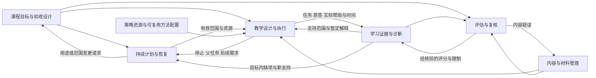
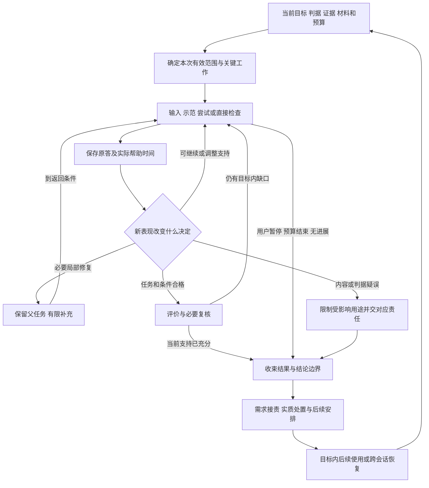

# AI 个人学习系统：整体学习流程与概念架构 v1

日期：2026-10-01  
整合复核：2026-10-02  
版本：v1／工作包 9—10 设计收口版  
状态：统一概念规范；真实课程尚待实例化，技术行为、学习收益与协作净价值尚未验证。  
配套：[工作包 9：跨学科、用户体验与异常场景](<E:/文献资料/学习系统架构设计/docs/designs/AI个人学习系统_工作包9_跨学科用户体验与异常场景_设计方案_v0.md>)；[工作包 10：验证计划与设计收口](<E:/文献资料/学习系统架构设计/docs/designs/AI个人学习系统_工作包10_验证计划与设计收口_设计方案_v0.md>)。

**v1 的核心安排是：以目标和判据约束教学，以真实作答及帮助条件支持有限结论，以一个当前有效安排协调投入；内容、目标、证据或用户授权发生变化时，立即限制受影响用途，由原责任方完成相应修订。** Encoding、Post-Encoding、策略使用和多 Agent 协作共同服务这条路径，不分别建立目标、掌握度或复习队列。

本版实际给出可用于下一阶段的流程、责任、接口、异常路径和首期范围。它整合前序方案，并通过第十二节明确哪些约定被采纳或澄清。旧文件保留历史原文；未被本版明确改动的专业细节，继续按其方案正文使用。本版不表示系统已经部署、真实回执已经发生或学习效果已经成立。

## 一、目标、依据与当前生效规则

### 1. 保留的目标与边界

- 面向个人长期课程学习，能够容纳数学、人工智能、金融、政治等不同学科的产物与评价依据。
- 从课程资料及个人用途形成可检验的能力要求，结合阅读、示范、问答、推导、代码、实验与论证等合适工作。
- 保留高能力 Agent 负责整体规划、关键教学设计和重要评估，中等能力 Agent 承担主要交互、制作与有界执行的方向；职责可兼任，不锁定数量或型号。
- 继承用户已确认的取舍：时间不足时独立掌握优先，必要时缩小覆盖范围。有限预算允许停止，停止不能写成达成；改变正式用途、最终范围或投入由用户决定。
- 高理论上限、动态实际深度。目标要求完整证明、实现或综合论证时必须能够审查整体；简单目标已有充分证据时直接结束。
- 学习成效根据目标条件下的真实表现判断；课程覆盖、教学进展、计划执行、能力支持和系统验证状态分别呈现。

“独立”指目标中的关键判断由学习者完成。目标可以允许教材、文档、计算器或其他工具；工具若代做目标操作，则据实限制相应结论。没有掌握证据时保持未知，不推断一般认知能力、人格或固定学习类型。

### 2. 依据的范围与性质

本版依据设计路线图、架构 v0、工作包 2—8 的方案正文、工作包 10 的分析与设计提示词，以及同期工作包 9—10 的设计整合。未读取其他工作包的设计提示词、顶层设计分析、审阅评估、检查记录或研究原文；不把前序方案引述研究视为本轮重新核验。

| 规范层次 | 本版采用方式 |
|---|---|
| 用户已确定的目标与控制权 | 作为约束保留；真实使用中的后续明确选择可以改变个人范围与投入 |
| 前序方案正文 | 继承专业规则和职责，不复制其历史阅读声明或旧阶段待办 |
| 工作包 9 的 C9-01—C9-07 | 在第十二节逐项采纳为跨包澄清；其场景用于设计审查，不算学习效果证据 |
| 工作包 10 | 负责首期统一取舍、验证计划、设计处置和后续实施依赖；本版提供统一架构正文 |
| 本轮设计决定 | 生效优先、接口压缩和首期组合等属于可被实际证据修订的规范 |
| 尚待回答的经验问题 | 自适应教学、材料与策略复用、最小记录和分层协作的净价值仍待试用 |

### 3. 文档与运行结果按什么顺序生效

**文档解释规则：**本版明确采纳或澄清的跨包规则，以本版为准；专业细节按对应方案正文；架构 v0 和路线图作为历史基线与设计范围。工作包编号、写作日期或摘要长短不构成专业判断的权威顺序。工作包 6 中“工作包 7 尚未形成”、早期方案中“下一轮设计 C0”等说明仅反映写作时点；当前已有工作包 7、8 及本轮 9、10，不再把这些历史说明作为缺失依赖。

**运行生效规则：**每次采用结果时核对下列关系，不实行简单的“最新消息覆盖一切”。

1. 用户已生效的暂停、投入变化和记录删除，以及已确认或有实质疑误的依据停用，先限制受影响使用。暂停信息不必等完整新版计划发布。
2. 目标、判据、材料用途、条件化判断分别采用有权责任方维护的当前有效结果；一个职能的结果不能覆盖另一职能的权限。
3. 计划责任方把专业依据、用户资源与授权相容的范围维护为唯一有效安排；已准备、已接收或被建议采用的内容都不自动构成承诺。
4. 执行者在有效范围及既有授权内直接适应教学。普通提示、措辞、常规评价或局部等价替换，不必等待计划方每次发布新版。
5. 旧稿、并行建议和迟到结果先核对删除限制、版本与条件兼容性，再由有权责任方采用、部分采用、重核或拒绝；原答中的新事实可保留，旧决定不得覆写当前安排。

若文档或运行结果仍存在影响当前用途的实质冲突，先限定该用途，并由相关专业责任方形成带依据和影响范围的修订。已确认不受影响的工作继续；不得凭最新日期、角色级别或多模型一致消除冲突。

## 二、六项能力及其关系

本版保留 v0 的六项能力。它们是决定与信息的边界，可以由同一承担者兼任，不要求六个服务、六个 Agent 或六套记录。

| 能力 | 负责的核心决定 | 接收 → 交出 | 专业细节来源 |
|---|---|---|---|
| 课程目标与验收设计 | 学什么、要独立完成什么、哪些条件足以支持结论 | 课程要求、个人用途、内容与约束 → 目标、判据、前置及版本关系 | 工作包 2／3 的目标部分 |
| 内容与材料管理 | 哪些内容成立、材料对当前用途能提供什么 | 目标、实际困难、来源 → 可定位片段、使用安排、核验与用途限制 | 工作包 4 |
| 学习证据与诊断 | 实际做了什么、支持到哪里、还可能怎样解释 | 原答、帮助、时间、任务与评分依据 → 条件化判断、诊断与待查项 | 工作包 2／3 的证据部分 |
| 教学设计与执行 | 当前由学习者完成什么、怎样帮助、何时换路或停止 | 有效范围、目标、证据、材料与方法 → 活动、产物、实际帮助、停止与返回信息 | C0、Encoding、Post-Encoding、工作包 6 |
| 评估与复核 | 任务与评分能否支撑拟作结论，重大分歧如何裁定 | 原任务、原答、实际条件、判据与内容依据 → 评分、复核结果、受限结论与补证需求 | 工作包 2／3、4、C0、8 |
| 持续计划与恢复 | 哪些必要工作现在值得投入、如何跨时段继续 | 目标、证据、需求、成本、期限与用户约束 → 需求去向、有效承诺、恢复范围 | 工作包 7 |

评估与复核不另存第二份掌握度：授权评分和重要复核的结果交给学习证据能力，后者维护当前支持范围。教学方维护实际任务、原答与帮助；证据方维护解释。角色合并时仍须能够辨认这两类责任。

工作包 8 的授权、交接、采用版本、删除和接管规则贯穿全图；来源追溯、用户控制、成本和验证同样横贯，不增加日常逐项审批层。Encoding 与 Post-Encoding 是教学能力的两组内容判断，工作包 6 是选法与复用规则；三者均不拥有平行计划或独立能力结论。

## 三、统一信息语义与最小追溯

### 1. 哪些对象必须分开

以下信息可以合并显示或共用文件，但含义不能合并。稳定标识、修订关系和必要引用即可支持首期人工追溯，不预设数据库字段和全领域图谱。

| 对象 | 必须表达的含义 | 不得被当成什么 |
|---|---|---|
| 目标与判据 | 要求来源、对象域、关键操作、产物、允许资源、适用情境、必要时间条件与版本 | 章节标题、学习者现状或当次预算 |
| 内容依据 | 来源及版本、读清范围、定义与条件、核验方式和适用边界 | 用户已经理解的证据；研究支持也不代替本题答案依据 |
| 材料使用安排 | 当前用途、可见输入、备用帮助、教师参考、负担和潜在泄露 | 独立于当前计划的另一份命令 |
| 任务／活动 | 本次要求、题面版本、关键工作归属、判据、分支、授权和退出 | 已经发生的学习或已合格的能力证据 |
| 原始表现事件 | 原答、过程、代码或完整产物；初答与修订；谁完成哪部分 | AI 整理稿、诊断标签或通过结论 |
| 实际条件 | 提示及显示时点、允许和实际资源、同题／方法暴露、事件和相关学习反馈时间 | 统一提示次数、默认无帮助或默认无再接触 |
| 评分与条件化判断 | 按哪个判据、对哪个要求、在什么条件下支持什么；原证据可回查 | 全章总分、永久掌握或其他领域能力 |
| 暂定诊断 | 观察、解释、反证、仍未排除的原因和能改变安排的观察 | 已确认的心理机制或稳定个人标签 |
| 教学进展 | 已呈现、已练、局部修订、父任务完成位置、停止原因 | 目标达成或已经排定后续检查 |
| 学习需求及处理结果 | 目标内尚需工作、必要性、条件、接责者、实质去向和再次考虑条件 | 每次答错形成的新债务；收到消息不等于安排 |
| 计划承诺 | 当前可执行范围、投入边界、允许调整、未入选后果和恢复点 | 按期掌握保证；排期不能使无效依据复活 |
| 系统验证记录 | 设计问题、真实观察、解释限制、成本及修订决定 | 用户能力标签；验证目的不豁免个人记录控制 |

### 2. 证据支持状况与使用资格是两个维度

支持状况使用“未知、已有支持、已观察到未达到、混合或冲突”；每项均附目标要求与条件。使用资格另说“可使用、待复核、已撤销”，并限定到用途和范围。例如，某次表现有正面支持，但参考受到质疑，则该正面历史观察仍存在，其用于重要跳过的资格待复核。未知不等于失败，待复核不等于能力下降。

目标未要求的延迟或迁移写“不要求”或不展开；目标要求而尚无证据的才写“未知”。以前成功、今天在其他条件下失败可以并存；条件不可比时先分范围，不机械平均，也不只保留最后一次。

一项事件可支持恢复、选择、推理等不同要求，但仍是一份表现。重复评分、多个 Agent 总结、同题修订和同一产物跨表引用，都不增加独立学习样本。

### 3. 帮助与时间按具体操作解释

帮助包括题面说明、术语释义、公式或前提供给、方法选择提示、错误定位、步骤与完整解答。实际影响由目标决定：允许查阅的前提可以不破坏关系推理的独立性；同一前提若正是待恢复对象，给出它便改变恢复证据。界面标题、邻题顺序、工具默认选项和“为何选此题”的解释也可能提示方法。

保留任务与初答、提示或反馈、修订、后续任务之间的关键顺序，以及能解释结论的事件时间和相关学习／练习／反馈时间。不逐句计时。期间接触未知就是未知，不记成没有接触；刚看过答案后隐藏、换 Agent 或换文件名都不重置暴露。

同一综合产物内不同关系可有不同历史。昨天只修订了一个条件，不使全部旧证据清零；但也不能用最初学习日期声称该新条件已经保持很久。必要的延迟由目标决定，日历建议不升级为统一硬间隔。

### 4. 最小追溯链

首期至少能双向定位：**目标与判据版本 ← 要求和内容依据；材料／任务 ← 所用依据与用途；表现 ← 实际任务、原答和帮助时间；判断 ← 相关表现与判据；需求及承诺 ← 判断、必要工作和用户约束。** 实际教学暴露也要能沿材料或任务找到受影响事件。

摘要只帮助找到这些依据，不替代它们。缺少原答或帮助会限制相关结论；没有结束摘要时可从已有可信事件恢复。删除改变可追溯范围，不能为补齐链条保留影子证据。

## 四、从课程到跨会话的完整流程

### 1. 课程进入与近期准备

先辨认课程表、大纲、正文、作业、解答和用户用途各能证明什么，建立课程粗地图和关键最终任务；只把近期要执行的范围细化为目标、判据、允许资源和必要前置。课程顺序是线索，不自动等同必要依赖。

已有真实作业和条件清楚的产物优先复用；缺基础信息时，只补会改变入口的有限观察。自述陌生或希望先示范，可以直接从可靠输入开始，不强制完整测评或先答错。

材料方与教学方共同准备：内容能否成立、当前形式是否代做关键操作、任务和参考是否足以评价、必要反馈能否兑现。只准备当前用途所需内容；复杂目标仍须具备整体核验依据，不能以分段准备长期回避整体评审。

计划方在预算和既有授权内接收可行范围。资料仅缺远期部分不妨碍当前启动；正式判据缺失时可开展已授权的限定探索和可靠示范，但不能承诺或宣布正式通过。

### 2. 单次活动的判断回路

图表示分支关系，不是所有学习的固定步骤。初始活动已经满足证据条件时，直接采用其原答；不为走流程重复练习。用户请求帮助时可以转为教学，保留帮助前原答，并改变此后相应证据用途。

每项活动要说清“依据什么、学习者完成什么、怎样看结果、什么会改变下一步、何时停止”。执行者根据可靠内容与授权调整表达和局部支架；主要诊断受反证、整体要求不清或参考不能支持新解法时升级相应责任方。

### 3. 局部修复与完整目标

局部展开前保留父目标、卡点、相关原答、转入理由、替代解释、足够程度、返回任务和投入边界。达到父任务需要的局部条件便返回，不把整个学科列成前置。

局部成功不自动通过父任务。父任务仍失败时重审接口、方法选择、整体组织、额外前置或原诊断；已有局部支持保留，不沿同一解释无限下钻。完整证明、代码或综合报告保留连续父产物，分段改变推进位置，不能将局部勾选数变成整体成绩。

Encoding 负责当前结构的建立或修订，Post-Encoding 负责后续恢复、协调、选用与检验；二者可在一次活动中往返。提供前提后能推理不必全部重学；提供前提仍有明确关系障碍时再局部重建。帮助历史连续，返回成功不能补记先前独立成功。

### 4. 四种结束与后续需求

| 结束原因 | 当下结果 | 后续处理 |
|---|---|---|
| 当前目标内所需支持充分 | 引用有效判断与实际条件，停止该范围重复投入 | 仅跟进目标内真正还需的时间或情境条件 |
| 教学部分完成，验收条件未满足 | 保留帮助后进展，说明尚未观察什么 | 同一目标需求进入计划取舍，不立刻默认加题 |
| 用户暂停或预算结束 | 保存产物、未完成连接、帮助、停止点 | 收缩或重定近期承诺，原目标标准不变 |
| 无进展、依据争议或条件不足 | 保存反证、受限用途、可行替代与责任方 | 重审对应问题；继续无关已授权工作或收束 |

当剩余缺项仅是尚未具备的未来条件时，本次也可以结束；没有必要用即时加题等待时间。简单目标无需额外证明、机制或迁移来证明系统“足够深入”。

### 5. 跨时段安排与恢复

学期／课程保存用途、期限、核心范围与条件性预测；阶段保存完整成果和关键依赖；周与会话在同一资源约定内作滚动承诺。不同课程不能各占一份重复预算。

新学、补缺、复习与综合任务共同竞争资源。先核可执行性，再根据真实使用、阻塞、延期后果、用户优先和总成本取舍。准备、核验、学习、反馈、等待、恢复和维护都算成本；延期或移出需求不等于节省完成同目标的成本。

漏学、缩时或积压发生后，按必要性作安排、部分安排、合并、暂缓、不再投入或关闭；保留仍有效目标的未覆盖要求与下一触发。不能把所有任务移到明天，不能通过关需求提高“掌握率”。

恢复先读当前有效范围和限制、目标／判据、有效判断与材料用途，再看原答位置、实际帮助时间、父产物、停止原因和未决责任。本次预算变化后重新承诺投入。无摘要时从最后确认的事件恢复，最后未记录的动作保持未知；仅对会改变起点的缺项作有限确认，不重复全套冷启动。

## 五、责任、授权与协作配置

### 1. 关键决定的最终归属

| 决定或动作 | 当前负责的职能 | 可直接处理与升级边界 |
|---|---|---|
| 最终用途、正式范围、期限取舍、投入与记录控制 | 用户 | 系统沿已有授权执行普通调整；需要新增投入或正式目标取舍时提供具体影响与选项 |
| 目标、判据、关键前置和允许资源 | 目标责任方，由高能力承担关键判断 | 维护版本关系；教学分段和计划停排不能暗改目标 |
| 关键参考、材料正确性及用途 | 内容责任方 | 常规制作核验可授权；实质条件、答案或用途变化重核 |
| 重要能力判断、重大诊断、重要跳过与评分争议 | 评估／证据责任方，高能力承担关键复核 | 先看原答、条件、判据，再看摘要；常规评分按既有规则授权 |
| 关键活动、复杂论证、方法构造和重要分支 | 教学责任方，由高能力完成关键设计 | 交出可执行任务、可靠锚点、不可代做工作、反馈和停止；中等能力执行者做有界调整 |
| 可复用方法配置与维护 | 策略责任职能 | 提供适用、替代、成本和复用依据；本轮换法仍由教学方决定 |
| 需求实质去向、资源竞争与唯一有效安排 | 计划责任方 | 在用户及专业约束内决定；不覆盖评分、内容或目标要求 |
| 委派、接管、限制通知与采用检查 | 原决定方和当前计划责任方共同落实协作规则 | 明确谁接责；不新设可覆盖专业决定的协调审批方 |

任何发现者都可立即暂停实质疑误依赖的用途并报告；这不是最终判错权。高层暂不可用时，中等能力执行者可继续依据充分、授权和预算允许的活动；越权或依赖争议的决定保持待处理，无可行工作就收束。

### 2. 分层方向与可简化的承担方式

首期用尽可能少的承担者覆盖职责：主要交互由中等能力执行者负责，高能力投入关键目标、整体参考、关键活动与重要判断；相容的材料、计划、证据维护可兼任，调用可以是按需准备和复核，不要求高能力永久在线。

是否拆分依据专业核验需求、并行准备价值、等待和总成本；是否合并依据重复索答、重复评分与维护负担。合并不得取消真实的依据核验，也不能让执行者通过换角色把生成答案当成独立证明。具体比较按工作包 10 的 V4 进行。

### 3. 一项活动只有一个当前面向用户执行入口

后台准备可以并行，面向同一学习活动的提问、提示与任务展示由一位当前执行者组织。接管者确认版本、未完成工作、预算、权限和暂停事项；该范围的旧执行者同时结束面向用户的执行权。若旧执行者继续后台核验，明确其保留范围。

不能确认唯一入口时，暂停该活动的新提示和任务展示，保留产物，先明确接任。委派权限不得超过原权限，预算不能每委派一次复制一份。无新依据、资源或目标变化的请求反复绕回时，由原责任方作取舍或暂缓，不继续无限转交。

## 六、交接、专业采用与计划生效

### 1. 核心接口

| 交接 | 必须交出的内容 | 接收方的返回及失败去向 |
|---|---|---|
| 课程与证据 → 教学准备 | 目标／判据、关键前置、原答与帮助、当前支持、未知、有效范围 | 教学方给出当前工作及关键分支；缺项只退回影响本用途的部分 |
| 内容 ↔ 教学 | 具体片段、用途、可见输入、备用帮助、参考、核验及泄露风险；教学方回实际展示和困难 | 内容方给出可用范围或待核限制；教学方确认关键工作与证据用途 |
| 教学 → 证据／评估 | 任务、原答、实际资源帮助及时间、常规评分、反证、未观察部分 | 按判据形成范围化结论与使用资格；必要时核查内容或目标，不自动增加测验 |
| 教学 ↔ 策略 | 当前工作、材料与资源、实际结果；候选配置、适配和替代、停止与复用依据 | 教学方决定本次执行；策略方维护复用。无合格卡可直接采用可靠教学，不经过选卡审批 |
| 教学及策略 → 计划 | 同一目标需求、必要性和不做后果、不可变条件、成本／可拆性、父任务及恢复点 | 计划方安排、部分安排、合并、暂缓、退出或退回补充；需说明未覆盖及再次考虑条件 |
| 计划 → 执行／恢复 | 唯一有效范围、资源与授权、采用依据、暂停事项、下一位置 | 执行者确认当前可做部分；不相容时先停受影响用途，再返回原因与可行替代 |
| 变更发起方 → 相关责任方 | 哪项依据变化、直接依赖、立即限制、待重审范围、恢复条件 | 每方回本职处理结果，计划方整合承诺；未知依赖仍列受限，不能按发送成功算完成 |

教学需求可以直接到计划，策略方按需要补配置；策略使用不是固定转发层。有效安排中的材料视图、教学展开视图和周计划可分别展示，但它们不持有相互独立的预算与指挥权。

### 2. 四个容易混同的阶段

**提出**只说明有一项建议或需求；**接收／接手**说明谁承接哪部分、缺什么、何时或什么触发后处理；**专业采用**说明有权责任方认可哪项依据或判断；**计划处置与生效**说明实际安排、暂缓或退出，以及可执行范围。实质处置可以是“不安排且保留影响”，不必最终都变成排期。

同一人可以连续完成这些决定，也无需伪造一轮消息往返；但不能从“已读”“已生成”“建议采用”推出“已安排”。未接责由发送方跟进；明确接责后由接收者处理，计划方保留跨会话入口。用户不需要逐个催 Agent。

### 3. 有效范围的成立与局部适应

某范围可执行需要其当前用途所需的目标和判据、可用材料与核验、适用证据、资源及授权相容。准备不足的正式检查只能保留候选；可执行的限定教学或准备工作可以单独承诺。

专业结果仅在改变承诺、采用依据或有效范围时要求计划方整合更新。普通原答追加、授权常规评分、措辞和局部帮助直接进入原记录，不因“最终维护者唯一”而逐次等待。实际帮助永远如实记录，计划或高层批准不能把已经给出的关键判断改为未发生。

## 七、跨学科适配与用户体验

### 1. 共用流程，不共用一个学科评分模板

| 学科 | 目标与内容中保留什么 | 评价产物及失败返回 |
|---|---|---|
| 数学 | 对象域、量词、前提、合法步骤、解集、一般论证与合理多解 | 看完整推导、合法反例与整体证明；类比和数值不能替代一般性，失败先区分条件、连接与执行 |
| 人工智能 | 概念、规格、实现、实验设计、实际结果与解释分别有依据；保留环境、工具和数据条件 | 看代码行为、测试、实验记录及解释；能运行不自动通过所有要求，工具失败不直接归因知识不足 |
| 金融课程 | 模型假设、口径、单位、时间、适用情境和不确定性 | 看条件选择、计算与解释；模型计算和现实判断分开，历史或合成数据不冒充当前市场依据 |
| 政治课程 | 事实主张、因果解释、规范前提、竞争理论与来源分别处理 | 看论证、反证与证据边界；有依据的不同结论可成立，信息不足可以是合格结果，立场一致不作能力标准 |

领域和产物变化进入同一目标—材料—证据—安排链。跨学科纸上可表示，不等于四学科真实效果已验证；实际任务仍须落实其对应的可靠来源和核验能力。

### 2. 用户能理解和改变当前活动

开始时简短显示本次目的、需要完成的工作、允许资源和投入边界。收束时说明真实完成、条件化支持、未做后果和下一触发；内部引用可展开查看，常规交互不要求用户填写完整状态表。

用户可以要求示范、换形式、缩时、暂停、继续探索、质疑题目或评分。普通请求按已有授权处理；请求示范改变后续帮助条件，暂停立即生效，兴趣扩展不自动成为原目标欠账。

解释活动理由也要保护任务用途：检查自主选法时可说明“这次观察你如何自行选择并说明依据”，不提前说出所考方法。用户要求立即查看完整理由或参考时可以展示，并如实转为相应帮助后的教学；透明性通过正确安排展示时机实现，不靠隐藏其有权查看的依据。

记录负担只依据实际操作和用户主动反馈调整；反应慢、短答、少点击和中断不能直接推断认知负荷或动机。不同责任者不得让用户重复提交系统已合法保存且可定位的同一产物。

查看可展开当前目标、任务、原答、实际帮助、评分理由、依据与计划限制。纠正个人自述可直接更新；事实勘误依据原始事件修正并保留理由；评分或诊断异议由相应责任方复核，未裁定时可保留异议。用户希望某次算独立，不能抹去确已发生的关键帮助；记录确实把提示先后写反时，则应纠正并重评受影响结论。

导出按用户指定课程、目标或记录范围提供仍获准保留的原答或产物位置、实际帮助与时间、当前判断及限制、计划与未决项。原始证据未随导出提供时，说明只是摘要、不能独立复核；不附带无关个人记录，不回填已删除内容。删除与可控副本的处理见第九节。

## 八、系统纠错：两条传播路径，分别恢复

### 1. 两条路径按实际依赖衔接

**内容路径：来源／规则 → 解释、图、题目与参考 → 实际使用和评分 → 条件化判断 → 跳过、补缺与计划。**

**要求路径：来源／规则 → 目标、前置与验收判据 → 相应材料、任务和评价 → 条件化判断与计划。**

并非每次材料修正都改目标；仅当错误进入要求才走第二条。新增目标要求与纠正旧错误分开，不能用后来的新要求倒判历史原答当时错误。

### 2. 从发现到恢复的处理

| 时点 | 责任与动作 | 得到什么结果才可继续相关用途 |
|---|---|---|
| 发现实质疑误 | 执行者或发现者定位内容、版本与用途，暂停受影响教学和确定评分；通知计划与专业方 | 不依赖争议的已授权活动可继续；尚未裁定不先给用户记错 |
| 核查依据和影响 | 内容方以来源、推导、测试或专业复核确认更正；各方追查直接依赖；目标方检查要求是否受污染 | 更正依据与适用范围明确；找不到依赖不等于无影响，无法排除关键依赖的用途继续受限 |
| 历史重评 | 评估／证据方按原答、当时帮助及更正判据重评，保留版本关系 | 原答充分就直接修正；不足才补对应结论需要的证据，不默认重考 |
| 教学影响修复 | 教学方说明系统错误、正确依据与仍成立旧边界；确有误导时作必要修复 | 不能只改后台参考；未实际发生的修复不写完成，也不把系统损失写成用户欠课 |
| 计划调整 | 计划方撤回错误补课或跳过，安排仍必要工作并计入真实修复成本 | 新安排与专业结果、用户资源相容，当前执行者已收到限制与可用范围 |

恢复分别确认：材料在当前用途下可靠；历史评分与判断完成相应重审；已发生的教学误导得到必要处理；安排与上述结果相容。它们可以分时完成。材料恢复不能自动恢复旧判断，原答重评也不能冒充学习者已经接受纠正教学；只恢复其依赖条件确已满足的具体用途。

拼写、定位等无实质变化可局部维护，不撤销全部证据；新旧规则在不同情境各自有效时保留条件化共存，不一律覆盖。

## 九、删除、迟到结果与异常恢复

### 1. 删除优先于一般追溯要求

按用户指定范围先停止使用个人内容，再清理可控制的原记录、摘要、派生产物和活动副本，并通知仍在处理的执行者停止使用与回传。学科参考可以保留，但不得藏入个人原答、经历或被删暴露历史。验证记录、策略复盘与计划备注同样遵守删除。

| 删除后剩余合法依据 | 证据方的处理 | 计划和教学的处理 |
|---|---|---|
| 独立足以支持原范围 | 保留判断并更新引用 | 原安排可继续，不因删除自动补测 |
| 只支持原结论一部分 | 收窄范围，缺失部分保持未知 | 保留有效工作，仅暂停依赖失据部分的重要用途；必要补证按目标价值取舍 |
| 无足够支持 | 撤销失据判断，能力保持未知 | 停止依赖它的跳过；可带未知继续不依赖该结论的授权活动 |

不得从旧摘要、缓存式笔记、个人画像或迟到回传恢复已删内容。为阻止旧引用再用所需的最少失效标记不能携带可重建内容；若删除也包括关联索引，不保留该索引，改为要求结果能对应当前仍存在且获准使用的依据，无法对应就不采用。

实际副本、备份及用户已自行导出的外部文件能否控制，进入实现核查并准确说明完成范围；本概念规范不虚称能永久擦除所有外部副本。

### 2. 迟到、旧版和相反结果

接收结果先检查删除或停用，再检查目标、判据、材料用途、帮助、证据和预算兼容性。旧版不一律丢弃：相容内容可复用；新原答可形成有限证据；不相容的旧建议不得重新开启已关闭需求、恢复旧执行权或覆盖新承诺。

相反结果先看是否针对不同条件。开卷推理已有支持与无提示选择未知可以并存；同一条件同一原答确有评分冲突，则交评估方核对内容与判据，不平均、不投票。复核未决只限制相关用途，真实反证仍保留。

### 3. 异常的最小继续路径

| 异常 | 即时行动 | 恢复条件及责任 |
|---|---|---|
| 基础不足或同错反复 | 有理由地有限补前置；无新增信息则重审诊断、任务与反馈 | 教学／证据方保留父任务与反证，达到返回条件即回整体 |
| 提示下会、独立不会或答案意外展示 | 保留帮助前后产物，限制受影响的独立解释 | 另有目标内必要取证时使用合格任务；没有合格任务可先收束 |
| 临时缩时或复习积压 | 停止新工作、保留必要收束，重定近期承诺 | 计划方给真实去向，正式目标变更另由用户和目标方处理 |
| 无人接责或高层不可用 | 原发送方保留跟进入口；继续无关已授权工作或结束 | 有能力且有权限的承担者明确接手，否则重要决定保持待处理 |
| 突然中断，无结束摘要 | 从当前有效安排、最后确认事件和完整产物恢复，不猜补最后操作 | 仅补影响起点的缺项；计划重定投入，执行者确认权限与下一连接 |
| 帮助标注争议 | 依据可回查事件作事实勘误；无依据则保留异议与条件不明 | 证据方重新限定解释，不能选择更方便的叙述或要求用户接受旧摘要 |
| 旧执行者仍试图继续 | 暂停同一活动新提示展示，明确唯一入口 | 有权责任方完成接管；旧结果仅进入采用检查 |

上述行为可先用虚构记录演练，不需故意误导真实学习者或删除其重要证据。纸上路径明确与实现确实阻止旧执行是两种结论。

## 十、完整而狭窄的首期

### 1. 本轮统一采用的范围

选择一门真实课程的有限主题，优先以一个完整论证、实现或综合分析主目标承载深层工作，并尽量由其同一产物的真实后续使用承担保持或自主选用观察；再选择同课程中一个充分证据即可结束的简单目标。它们是要覆盖的决策差异，不是三个固定作业或固定题量。

路径覆盖：**资料 → 目标与判据 → 材料核验 → 教学 → 目标条件下检查 → 目标内后续使用／延迟回访 → 计划修订。** 必要的 Post → Encoding → 父任务返回优先在自然学习中观察；没有出现时只作虚构记录演练。跨课程竞争也可受控演练，不为测试另开课程。

没有真实后续使用或保持要求时，可有限启动当前教学，但延迟环节尚未覆盖，不声称完整首期验证结束；只有简单目标或高级参考未就绪时，高上限未覆盖，待真实需要及可靠资源出现后再扩展。大目标可跨次推进，但完整产物未满足要求前保持未完成。

### 2. 本期必须做、可人工做和可以延后

| 必须实际保留的能力 | 首期承载方式 | 可以延后的复杂度 |
|---|---|---|
| 当前目标、可靠材料、关键工作、原答帮助、有效判断、需求与计划闭环 | 相互引用的少量文档和短记录，人工定位与核验 | 全课程知识图谱、全量个人画像、统一掌握概率 |
| 复杂父产物完整评审，简单目标合理结束 | 可直接评审证明、代码或报告，必要时合适工具辅助 | 通用自动评分器、专门长任务平台 |
| 唯一当前执行、版本采用、受限继续、双链纠错与删除 | 受控单入口和显式交接，人工清理可控副本 | 无人值守多方并行、自动纠错传播、全平台擦除承诺 |
| 少量有用方法及可复用理由 | 方法配置附在活动规格中 | 全部策略机器化、复杂算法调度、固定细分 Agent 团队 |
| 真实投入、等待、恢复、核验与维护成本 | 粗记录加来源明确的估计，未知分列 | 每轮精密计费和完整遥测；未有价值的丰富媒体 |

人工辅助不免除语义与行为要求。若当前承载无法阻止旧执行或违规采用被删依据，先限制对应并行范围，不把保证留到自动化以后。

### 3. 实例化前需要落实什么

只补会改变首期选择的输入：实际课程片段和代表任务；用户用途、必要期限与允许资源；本次及近期投入与等待边界；已有相关表现和已知暴露；当前任务的可靠参考及核验能力；具体责任承担者和记录控制范围。个人基础可从未知开始，费用或用时无法取得则保持未知；不发明教材、预算、水平、模型名单或数值阈值。

这些输入填入一份首期实例说明即可。正式开跑取决于当前用途的必要条件是否落实，不要求全部远期信息齐全；限定探索和正式验收分别说明。

## 十一、验证状态与后续实施依赖

工作包 10 的 V1—V4 分别回答内容与评价、过程兑现、目标条件下的学习获益、协作与复杂度价值。本版不另建第二套验证计划。将表现变化归因于预定教学设计，需要相关内容与过程条件成立；执行偏离时，仍按实际条件保留合格的学习表现证据，不能把归因受限写成能力证据全部失效。学习者取得支持也不自动说明新增协作值得。

| 当前可以确认的设计结果 | 尚不能据此确认的事情 | 后续所需依据 |
|---|---|---|
| 统一流程、对象含义、责任与异常返回已给出 | 软件已经保障执行权、通知和删除 | 在所选承载上执行虚构记录的受控行为检查 |
| 四学科可以按各自正确性要求接入共同接口 | 四学科实际教学均有效或自动评分可靠 | 真实任务、原答、参考核验和限定范围的使用证据 |
| 首期已作范围与简化选择 | 用户已选定课程、投入或开展试用 | 首期实例说明与相应用户约束 |
| 有获得与修订证据的办法 | 自适应优于合理简单教学，多 Agent 有净收益 | 合格简化对照、可解释的新任务与目标内后续表现、全程成本 |

后续顺序是：先实例化目标与可评审内容；落实最小记录、责任和用户控制；在选定承载上核查关键行为；跑有限真实路径；按目标取得后续证据；依据结果决定哪些功能保留、调整、合并、退出或暂缓；再对确有价值的重复工作增加自动化。模型选型、运行提示词、存储、工具和界面围绕这些要求详细设计，不先锁定完整技术栈。

任一内容或能力判断发现实质疑误，立即修复受影响范围；不用等试用阶段统一结束。缺比较条件时可作有限实践选择，比较优势保持未知，不重复教授同一内容制造对照。个人样本、顺序、内容难度、中间接触、实际投入和检查本身的学习作用必须限制结论。

## 十二、从 v0 到 v1 的采纳与澄清记录

### 1. 前序方案的整合对应

| 来源与关键位置 | v1 处置 | 对使用者的实际影响 |
|---|---|---|
| [架构 v0](<E:/文献资料/学习系统架构设计/docs/architecture/AI个人学习系统_整体学习流程与概念架构_v0.md>)第一至三节 | 保留六能力、三个尺度、高能力与中等能力协作、用户取舍；由本版给当前有效接口 | 不按工作包编号建模块或固定 Agent，不继续执行历史阶段待办 |
| [2／3 方案](<E:/文献资料/学习系统架构设计/docs/designs/AI个人学习系统_工作包2与3_联合设计方案_v0.md>)第四至十节 | 采纳目标版本、双轴判断、有限诊断、展开单与依赖；澄清普通更新无需等待计划发布 | 正式目标、支持范围、使用资格、局部适应与承诺相互可辨 |
| [工作包 4](<E:/文献资料/学习系统架构设计/docs/designs/AI个人学习系统_工作包4_设计方案_v0.md>)第三、第七至十节 | 采纳片段／使用安排、用途核验、实际展示与双链纠错 | 材料正确不自动获准本轮执行；参考修好不自动恢复旧能力结论 |
| [C0](<E:/文献资料/学习系统架构设计/docs/designs/AI个人学习系统_工作包5_C0共同教学框架_设计方案_v0.md>)第二至八节 | 采纳共同活动、帮助时间线、停止与恢复；统一到六能力接口 | Encoding／Post 不另设评分与记录体系，所有收束保留真实原因 |
| [Encoding](<E:/文献资料/学习系统架构设计/docs/designs/AI个人学习系统_工作包5_Encoding_设计方案_v0.md>)第三至六、第八节；[Post-Encoding](<E:/文献资料/学习系统架构设计/docs/designs/AI个人学习系统_工作包5_Post-Encoding_设计方案_v0.md>)第二至八节 | 保留高上限与动态深度、完整父任务、双向返回和条件化时间 | 深目标整体可审，简单目标可结束；恢复失败不自动全章重学 |
| [工作包 6](<E:/文献资料/学习系统架构设计/docs/designs/AI个人学习系统_工作包6_策略使用规则_设计方案_v0.md>)第二、第十一至十四节 | 保留方法配置增量，校正后续包已形成的时点；首期情境按真实需要取舍 | 6 不作 5→7 的审批层，不把首期建议相加成必修活动套餐 |
| [工作包 7](<E:/文献资料/学习系统架构设计/docs/designs/AI个人学习系统_工作包7_长期计划与学习连续性_设计方案_v0.md>)第二至十节 | 采纳滚动承诺、需求实质去向、时间条件与日历分开、有限恢复 | 不再投入不等于目标达成，延期不虚报节约，简单目标不会形成无限复习债务 |
| [工作包 8](<E:/文献资料/学习系统架构设计/docs/designs/AI个人学习系统_工作包8_多Agent协作与共享状态_设计方案_v0.md>)第二至九节 | 采纳责任、接责、版本、执行权、删除和迟到；嵌入六能力而不另增管理层 | 接任范围和旧权终止可检查，原答可追加但失效决定不复活 |
| 工作包 9 和工作包 10 | 采纳下表澄清和统一首期；验证分四类且可推动简化 | 设计完成、技术可用、学习有效与协作值得分别报告 |

### 2. 工作包 9 澄清的正式采用

以下 C9 项均以“继承基础上的跨包澄清”采用，不宣称前序完全没有这些规则。工作包 9 保留场景与发现依据，本版给出统一生效位置。

| 编号 | 本版采用的规范 | 生效位置 |
|---|---|---|
| C9-01 | 帮助按关键操作解释；向用户说明选题理由不得意外代做待评价判断，展示后按实际暴露解释 | 第三节第 3 项、第七节第 2 项 |
| C9-02 | 近期承诺收缩与正式目标版本改变分开；低投入可以留下未完成，不能暗降标准 | 第一节、第四节第 4—5 项、第六节 |
| C9-03 | 提出、接收接手、专业采用和计划处置分开；真正闭环要有实质去向，非必须排期 | 第六节第 2—3 项 |
| C9-04 | 按实际依赖双链纠错；材料、历史判断、教学影响分别恢复，计划随后相容；未查明依赖不当无影响 | 第八节 |
| C9-05 | 以最小可信事实恢复，证据支持与使用资格分开；摘要不完整不触发全套重复 | 第三节第 2—4 项、第四节第 5 项、第九节 |
| C9-06 | 旧版、迟到、相反结果先核兼容性；新事实可留而失效决定不可覆写当前；删除内容不得复活 | 第一节第 3 项、第五节第 3 项、第九节 |
| C9-07 | 目标内证据充分即可正常收束；深目标保留关键综合工作与整体评审，首期不冻结活动清单 | 第四节第 3—4 项、第十节 |

### 3. 未提前采纳的效果承诺与技术选择

自适应比简单教学更好、复杂表征必然增益、方法配置一定省时、分层协作一定便宜、最小摘要总能恢复，均保持待验证；不转成 v1 的事实承诺。四学科全量试用、固定最佳间隔、固定升级次数、统一掌握分数、自动全量传播和永久清除外部副本不在本轮冻结。

修订 v1 时记录具体规则、观察或反证、影响范围、取舍理由与生效条件；先处理有明确后果的缺陷，再决定是否增加复杂度。原始学习表现按当时条件保留，用户删除优先；设计版本变化不能把未执行演练写成运行成功，也不能把未知收益改名为已验证。
