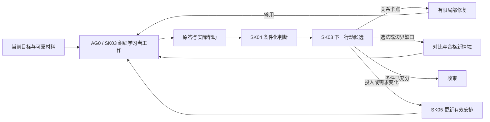

# AI 个人学习系统：Skill 与 Agent 设计综合审计及补强路线

日期：2026-10-04（Asia/Shanghai）。性质：基于工作区的修复前审计与实施建议，不替换现有规范。下文缺陷复现与代码行号保留审计时状态，不代表真实学习已验证。

后续实施状态（2026-10-04）：**F01—F04 已修复，新增 29 项行为测试，全集 483 项通过**；原失败探针和历史报告保留。R01 已核实合法历史读取与当前用途限制，正式历史重评／跨版本支持迁移仍待实现。修复内容、当前能力与验证见[实施记录](AI个人学习系统_架构审计修复实施记录_2026-10-04.md)。

**总体判断：学习与证据的概念架构已经比较完整，B0—B6 已形成可运行的开发控制骨架，B7 完成了真实试用的准备与报告切片。当前仍未形成绑定真实模型、课程和个人记录的动态教学系统。理论深度的设计有明确承接，实际深广调整还需要模型执行、任务生成与核验、反馈采用和真实学习证据接通。**

这里的缺口不是要重新设计全部系统。应保留现有四角色、七 Skill、同一记录来源和目标标准，优先修复已有执行缺陷，随后把一个真实主题上的教学闭环落实。

## 1. 审计依据与结论边界

主要依据为用户指定的三份架构文件：[整体学习流程与概念架构 v1](<E:/文献资料/学习系统架构设计/docs/architecture/AI个人学习系统_整体学习流程与概念架构_v1.md>)、[Skill 架构设计 v0](<E:/文献资料/学习系统架构设计/docs/architecture/AI个人学习系统_Skill架构设计_v0.md>)、[Agent 与 Skill 工作网络及实施路线 v0](<E:/文献资料/学习系统架构设计/docs/architecture/AI个人学习系统_Agent与Skill工作网络及实施路线_v0.md>)，以及工作包 2—10、B0—B7 的相关方案、当前 Skill／Agent 文件、合同、Python 服务、测试与验证记录。三个独立审查分支分别检查基础与证据、教学与计划、集成与验证。

本轮重新执行全部现有 unittest：**454 项通过，运行器用时 78.038 秒**。结果见[本轮基线记录](<E:/文献资料/学习系统架构设计/personal-learning-suite/validation/architecture-audit-2026-10-04/baseline-test-result.json>)。另外开展隔离的虚构输入探测，发现现有回归未覆盖的预算和待采用结果问题。这些探测支持有限软件行为结论，不支持真实学习收益结论。

本报告严格分开四类事实：规范写明了什么；软件实际检查和保存了什么；宿主及模型真正执行了什么；学习者最终独立完成了什么。文件指纹一致、字段通过、程序返回 completed、四个角色绑定或多个模型一致，都不能替代最后一类证据。

## 2. 目前进行到哪一步

| 范围 | 当前可确认的成果 | 距离用户目标的剩余部分 |
|---|---|---|
| B0：共用规范、来源和资源基线 | 对象、决定责任、授权、来源登记与静态检查已建立 | 细化表示仍有跨服务漂移；来源登记不证明学科真伪 |
| B1：保存与控制 | SQLite、版本冲突、精确引用、限制、删除和恢复已有开发实现 | 真实模型上下文、聊天历史和外部副本的边界仍须落实 |
| B2a：目标 | 目标、判据、前置与版本的候选检查及提交接口已有 | 课程粗地图主要是候选视图；从真实课程形成目标仍由专业承担者完成 |
| B2b：材料 | 读取范围、模态、内容与用途核验、泄露风险和纠错路径已承载 | 专业核验及可靠参考仍需实际发生；与 B2a 来源表示需收敛 |
| B3a：证据与评估 | 原答、实际帮助、时间条件、双轴判断、授权及重要复核检查已有 | 程序不评分学科内容，真实 AG3 评审尚未绑定 |
| B3b：C0 | 初答、帮助、修订、反馈、父任务、断点及收束可以保存 | 观察的教学解释和下一步仍主要依赖调用者提供 |
| B3c：策略 | 60 卡轻索引，S07／X02／R09 完整资源与四份 Post 条件说明已转译 | 索引不等于全部卡可执行；适配收益与复用收益尚未验证 |
| B4：教学专项和计划 | Encoding／Post 切换、局部栈、整体义务、已有证据复用、需求处置与共用预算已有有限实现 | 选择分支、局部够用、内容正确性和成本仍以专业声明为主；发现检查点预算丢失 |
| B5：纵向入口 | 显式步骤可串接目标、材料、教学、评估和计划，失败保留真实前缀 | 自然请求尚不能直接形成并执行合格教学决策 |
| B6：四角色工作网络 | 本地串行能力对象、接责、返回、采用、执行代次与展示门已有 | 规则加载未接到真实模型调用；发现同工作单多个结果的待办遗漏 |
| B7：试用准备与验证 | 只读 preflight／report，V1—V4 分层引用检查及 B10 软件切片索引已有 | 真实课程试用尚未开始；完整 B10、学习增益和协作净价值仍未验证 |

这些边界已经在[当前 README](<E:/文献资料/学习系统架构设计/personal-learning-suite/README.md:3>)中明确说明。[B7 交付说明](<E:/文献资料/学习系统架构设计/docs/implementation/AI个人学习系统_B7有限真实试用与验证工具_v0.md:47>)也明确 `can_start_automated=false`。B7 接受 real 类型的只读输入，并不会解除 B1—B6 的虚构写入门。

因而目前最准确的阶段描述是：**学习规范与开发承载已经推进到 B7 准备切片，真实教学应用层和真实验证仍待完成。**

## 3. 已有设计中值得保留的部分

**深度由目标要求约束。** v1 明确保留完整证明、实现和综合论证的整体审查；Encoding 方案区分目标所需深度与当次展开深度。这避免只靠局部正确累加宣称整体掌握，也允许可靠简单目标及时结束。[v1 的局部与完整目标规则](<E:/文献资料/学习系统架构设计/docs/architecture/AI个人学习系统_整体学习流程与概念架构_v1.md:170>)已经给出这一原则。

**知识建构与后续使用可以往返。** Encoding 与 Post 共享父产物、帮助历史和预算。提供允许引用的前提后能够继续推理，和连关系都无法建立，是两种不同情况；只有后者才有局部重建理由。修复够用即返回整体，这一设计适合深度随实际表现变化。

**证据解释细于总分。** 已有支持／未知／未达到／冲突，与可使用／待复核／撤销分开；帮助按被代做的操作解释；初答与修订保留顺序。它能容纳“能实现但不会证明”“开卷能推理但自主选法未知”等实际差异。

**长期资源只有一份有效安排。** SK05 负责需求去向，SK03 和 SK06 不另建复习队列。缩时收缩当次承诺，正式目标标准仍保留。接责、专业采用和安排生效分开，防止待办被悄悄解释为已经完成。

**纠错覆盖教学后果。** 材料恢复、历史重评、教学误导修复与计划恢复分别处理；系统错误不变成学习者的能力缺陷。对理论与现实环境变化并存的学习，这个结构很重要。

**四角色七 Skill 的职责基本合理。** AG0 执行、AG1 设计和计划、AG2 内容、AG3 证据，各有不同决定归属。路线文件对早期单包包装的细化已经记录在 implementation-decisions，不应把“一主入口、七专业 Skill”误报为架构冲突。需要减少的是重复载入、重复声明和无收益会签；当前没有证据要求再增加一个“深度 Agent”“广度 Agent”或“总裁决 Agent”。

## 4. 需要先处理的具体问题

优先级用于安排本次后续开发：P1 是进入真实受控路径前应处理的执行缺陷；P2 是接口整合或动态质量问题。下面均给出实际影响与验证边界。

### F01／P1：检查点累计用时没有进入恢复与继续执行的预算依据

复现使用现有 B4 虚构夹具和临时 SQLite：预算 5 分钟；保存初答时累计 1 分钟；保存 checkpoint 时声明累计 5 分钟。检查点提交成功，但只写了 SessionCheckpoint，PerformanceEvent 的累计用时仍是 1。随后 resume 返回 1 分钟，open 仍 ready，新的帮助仍 committed。

代码位置：[learning_teaching.py:643](<E:/文献资料/学习系统架构设计/personal-learning-suite/src/runtime/learning_teaching.py:643>)至检查点构造，以及[恢复返回:728](<E:/文献资料/学习系统架构设计/personal-learning-suite/src/runtime/learning_teaching.py:728>)。关闭活动会更新事件累计用时，普通 checkpoint 却没有同样更新；计划支出下界主要读取事件中的用时。

影响：用户投入在检查点与事件之间出现矛盾，恢复可能继续使用旧额度。这直接损害资源边界，也会扭曲对学习效率的评价。

最小修复：检查点与事件的累计用时在同一事务中更新，检查点引用更新后的精确事件修订；恢复与计划读取同一有效支出依据。达到预算后只允许必要收束，新的教学展开需重新承诺预算。覆盖 checkpoint→resume→open／help，以及后续计划不能重领旧额度。无须为此建设完整计时平台。

证据：[探测脚本](<E:/文献资料/学习系统架构设计/personal-learning-suite/validation/architecture-audit-2026-10-04/probe_checkpoint_budget.py>)、[实际结果](<E:/文献资料/学习系统架构设计/personal-learning-suite/validation/architecture-audit-2026-10-04/checkpoint-budget-result.json>)。

### F02／P1：同一工作单多个结果时，未采用的新结果可能从待办中消失

B6 允许对同一已接责工作单再次 run，提供不同的 result_id 和 operation_id。`pending()` 却按 work_order_id 把全部 WorkResult 压成单值；记录按 ID 排序，因此选中的结果由结果 ID 字典序决定。[network_b6.py:733](<E:/文献资料/学习系统架构设计/personal-learning-suite/src/runtime/network_b6.py:733>)是具体聚合点。

复现：先生成 `FIX-z-old-adopted-result` 并采用；再对同工作单生成 `FIX-a-new-candidate-result`，新结果保存成功且仍是 candidate，pending 却返回空列表。

影响：新专业意见尚未采用，待处理责任却没有显示。它不会自动证明错误结论已生效，但会让真实纠错或下一步重审被遗漏。

最小修复：明确一个工作单是否允许多次结果。如果允许，保存结果的先后／替代关系并展示全部仍需处理的结果；如果不允许，终态工作单拒绝再次独立运行，由新工作单承接新问题。任何方案都不能按字符串 ID 判断最新或有效结果。补正反两种 ID 排列、重复运行、旧结果采用后新结果仍候选的检查。

证据：[探测脚本](<E:/文献资料/学习系统架构设计/personal-learning-suite/validation/architecture-audit-2026-10-04/probe_network_pending.py>)、[实际结果](<E:/文献资料/学习系统架构设计/personal-learning-suite/validation/architecture-audit-2026-10-04/network-pending-result.json>)。

### F03／P2：B2a 和 B2b 对 SourceFragment 的细化表示没有收敛

B2a 接受 `read_scope`／`verification` 为单个 Fact；B2b 材料服务要求 text／formula／figure 的模态 Fact 和内容核验结构。公有入口复现中，B5 `goal.sources_submit` 与 `goal.submit` 都保存成功，沿用来源形状的材料阶段返回 `modality_facts_required`，没有发生状态变更。[learning_goals.py:161](<E:/文献资料/学习系统架构设计/personal-learning-suite/src/runtime/learning_goals.py:161>)与[learning_materials.py:115](<E:/文献资料/学习系统架构设计/personal-learning-suite/src/runtime/learning_materials.py:115>)体现差异。

这证明存在表示和阶段衔接缺口，**不证明未核验来源应直接用于教学**。材料阶段要求更充分核验是合理的，系统应明确需要补什么专业信息，以及怎样合法转为新的来源修订。

最小整合：在共用契约中固定来源读取与核验的细化形状；按实际读清和核验结果，由 AG2 显式补齐模态事实并形成可追溯修订。适配不能把 unknown 自动升级为已读清或已核验。增加原始来源→目标→材料的贯通验收，避免三个独立夹具各自通过却没有同源互通。

证据：[探测脚本](<E:/文献资料/学习系统架构设计/personal-learning-suite/validation/architecture-audit-2026-10-04/probe_source_contract.py>)、[实际结果](<E:/文献资料/学习系统架构设计/personal-learning-suite/validation/architecture-audit-2026-10-04/source-contract-result.json>)。

### F04／P2：同一旧观察可以反复支持嵌套展开

隔离探测中，用同一旧修订、同一 quote、同一 operations 交替进入 Post／Encoding，六次均 committed，局部栈达到六层，学习者响应仍只有初答和一次修订。[learning_teaching_b4.py:314](<E:/文献资料/学习系统架构设计/personal-learning-suite/src/runtime/learning_teaching_b4.py:314>)检查了局部范围与文字存在，[观察检查:322](<E:/文献资料/学习系统架构设计/personal-learning-suite/src/runtime/learning_teaching_b4.py:322>)却没有要求相对当前局部进入点的新依据；返回分支才检查进入后的新反应。

影响：系统保留了父任务，但仍能无新增信息地继续下钻；未知时长尤其不能阻止这种重复。它不把局部成功自动升成整体掌握，却会增加无收益的教学和维护开销。

最小修复：同卡点、同操作、同响应点的再次展开，需要进入后的新表现或具体新增任务／条件依据；没有新依据就重审诊断、换路、暂缓或收束。不要用统一递归层数或统一答错次数替代这一判断。此问题有实际探测与代码证据，本轮没有另保存独立脚本。

### R01／待查：合法历史引用与“必须最新”的使用条件应进一步分开

现有新提交与评估路径多处要求依赖为最新修订。最小探测中，原判断可检查；仅给 GoalSpec 增加等价说明并升修订、保持判据不变后，原答检查返回 `stale_assessment_dependency`。但本轮未完成带正式兼容采用回执的端到端历史重评，不能据此断言全部合法历史重评都会失败。

应补一组有实际专业采用的情境：等价说明变化、正式判据变化、纠正旧要求、原条件历史重评。分别明确历史有效、当前可用、待重核、不可迁移。当前用途的保守限制应保留；读取原任务与原答的历史资格也不能被“不是最新”一律抹掉。

## 5. 最大的产品缺口：从真实观察到下一活动的决定尚未接通

目前 B5 的 `execute` 逐项运行调用方已给出的 steps；只有 intent 时返回 `needs_input`，要求 explicit_professional_steps。[entry_b5.py:289](<E:/文献资料/学习系统架构设计/personal-learning-suite/src/runtime/entry_b5.py:289>)与[步骤遍历:301](<E:/文献资料/学习系统架构设计/personal-learning-suite/src/runtime/entry_b5.py:301>)可以直接定位。B6 加载角色与 Skill 文本，并调用原有专业检查服务；加载文本本身没有启动模型。

B4 并非完全没有分支能力：它能检查引用观察、保留局部栈、提供返回建议。但是 `select_branch` 仍接收调用者给定的 branch_index，再检查 quote 是否可定位。[learning_teaching_b4.py:267](<E:/文献资料/学习系统架构设计/personal-learning-suite/src/runtime/learning_teaching_b4.py:267>)并不判断这个观察是否真的支持该分支。

因此，目前已经接通的是“决定提交后的检查、执行与保存”，尚未接通的是“根据真实作答形成有依据的教学决定”。这个职责应由胜任模型承担；不需要让标准库程序自动理解证明或诊断知识。

最小接通方式是在现有 AG0／SK03 中形成一个短的下一行动候选，使用既有对象引用：

| 必须表达的内容 | 用途 |
|---|---|
| 相关目标要求、原答位置、帮助和当前判断 | 防止只凭总体印象决定 |
| 本次具体卡点与仍可能的其他解释 | 区分回忆、关系、选法、组织、执行和环境问题 |
| 建议行动及为什么会改变当前决定 | 继续、示范、撤提示、局部补缺、对比、整合、迁移、更新、收束或升级 |
| 保留的关键学习者工作 | 避免教师通过帮助代做拟评价操作 |
| 返回条件、停止条件和可用预算 | 防止无限深入或无限加题 |
| 需要的材料／参考，以及谁核验或采用 | 使候选能真正成为可执行 ActivitySpec |

这是 ActivitySpec、DiagnosticNote 和现有交接的候选视图，**不增加第二套掌握状态、计划或独立诊断库**。普通可靠调整由 AG0 直接在授权内完成；新的整体任务或关键分支交 AG1；材料疑误交 AG2；重要结论或诊断争议交 AG3。用户请求完整示范时仍可提供，按实际帮助重新限制相应证据。

## 6. 深度与广度怎样真正动态变化

“高理论上限”和“每次讲得很深”是两件事。目标可以要求完整理论理解，当前会话却只补一条关键连接；补完后返回整体产物，整体仍须按原标准评审。反过来，调用接口已经能用，也不能取消目标明确要求的证明或机制解释。

同样，广度不只是多读几个章节。它包括必要内容覆盖、相近概念的辨别、不同方法的选择、跨表示连接，以及目标要求的情境变化。需要围绕具体缺项扩展，保留当前主线。

| 实际观察 | 合理调整 | 必须保持的边界 |
|---|---|---|
| 某个定义或引理恢复失败，给出允许前提后能继续推理 | 修复目标内恢复缺项，继续父任务 | 不把整段推理判为不会，不默认重学全章 |
| 前提已提供，仍不能解释关键关系 | 深入这一关系或必要前置 | 保留父任务、反证、够用条件和返回连接 |
| 局部都能做，完整证明或实现仍失败 | 检查接口、组织与约束组合 | 不继续默认向更底层挖掘 |
| 会执行一种方法，但自主选择错误 | 扩展少量有区分力的比较或混合情境 | 包含应使用、应拒用及依据不足的情形，避免题目标题泄法 |
| 新情境失败而原情境成功 | 判断变了哪些条件，再作必要迁移或更新 | 换数值、换文件名不自动等于迁移 |
| 有合格独立产物且目标条件充分 | 收束该范围；必要时推进其他目标 | 不为显示“深入”额外加题 |
| 用户临时缩时 | 缩本次覆盖或保留未完成 | 正式标准不暗降；理论总目标仍可跨会话完成 |
| 用户产生目标外兴趣 | 提供授权范围内的有限探索并保留返回点 | 不自动生成原课程欠账或改变正式验收 |

这些原则在 Encoding、Post 和 v1 中大部分已经存在。本轮建议补的是**实际决策接口与行为验证**。不建议建立全领域知识图谱、统一深度分数或固定难度阶梯。

广度选择可以先用很小的课程索引：主题／对象、对应目标要求、关键关系、必要前置、对比方法、完整任务与真实使用。通过既有 GoalSpec、Judgment、LearningNeed 和 PlanCommitment 生成当前覆盖视图。正式要求、能力支持、教学进展、暂缓和兴趣探索分别显示，课程索引不成为另一份权威掌握数据库。前置关系要有目标依据，不能由教材顺序或模型联想无限扩张。

## 7. 理论与实际动态需要共用一个任务，而非互不相干的两套课程

建议每个复杂目标尽量保留一个连续主产物，把目标内的理论论证与实际使用联系起来。并非所有主题都需要代码、实验或外部新闻；实际形式取决于目标。

以优化主题为示意：同一目标可要求说明成立条件、完成必要推导、实现算法、检查行为并解释失败边界。若实现失败来自公式推导，局部回到理论；若来自库接口或环境版本，先处理环境；若某种方法在新条件下失效，辨认被破坏的假设。示意并不是用户已经选定的课程或正式任务清单。

对依赖变化环境的主题，SK02／AG2 至少保存当前任务需要的来源版本或时间、环境／数据条件、适用范围与核验结果；代码、实验、测试和报告以 ArtifactRef 保留。来源更新后，由现有双链纠错流程区分内容变化、任务变化和目标变化。历史条件下正确的表现不能因今天接口变化而倒判为当时错误。

目前已有来源、材料、原件和变化通知的承载，尚未绑定真实工具、环境与新鲜度检查。这是实践动态的主要补强点。它可以按当前活动需要核验，不必立即引入持续后台监控。事实更新也不自动形成复习债务：只有影响目标内使用才交现有需求与计划处理。

理论深度的验收也应具体：需要完整证明时评审完整论证，需要实现时检查规格与行为，需要现实解释时审查假设与证据边界。漂亮解释、正确选择题、代码能跑和历史数据拟合，各自只能支持相应范围。

## 8. 需要补充什么，整合到哪里

| 补强内容 | 现有归属 | 最小交付 |
|---|---|---|
| 根据原答决定深度、广度与帮助 | AG0／SK03；关键设计交 AG1 | 上述下一行动候选、可执行任务与分支采用 |
| 近期主题地图与覆盖视图 | SK01，联结 SK04／SK05 | 小规模有来源索引与派生视图，不复制掌握状态 |
| 复杂完整任务与合格变式 | SK03 设计，SK02 内容核验，SK04 评价 | 一个连续父产物、可靠整体参考、目标内新情境与用途检查 |
| 提示撤去后的关键工作 | SK03／SK04 | 真实帮助顺序、未泄露的必要任务；不补记先前独立成功 |
| 环境、来源和数据更新 | SK02／AG2，沿已有纠错与计划流程 | 任务所需版本快照、实际工具产物、变化影响与合法恢复 |
| 后续条件如何再次进入会话 | SK05／SK00 | next_trigger 在进入／恢复时真正检查；按需增加调度 |
| 真实模型与工具宿主 | B6 当前串行宿主的真实适配 | 实际承担者、权限、展示门、可控记录与失败返回 |
| 学习成效与组织收益 | B7，沿工作包 10 | 原答、新任务、目标内后续表现、限制与全程成本 |

整合时还应做三件小事：

1. 共用语义仍由 shared-contracts 唯一维护，把真正跨服务的嵌套表示一起收敛；源自同一规范的机器检查可以复用，不维护彼此不同的“源”“用时”“当前结果”解释。
2. 当前入口统一经过相同教学与预算门。B5 已使用 SpecializedTeachingService，不能把它误报为仍绕过 B4；旧独立 C0 CLI 的较窄开发范围应明确，并在真实路径启用前限制不适用调用。
3. 形成一份当前能力清单，区分开发 API、宿主实接、安装包、真实试用和未覆盖条件。旧批次说明保留历史，当前状态集中引用，降低维护者误读早期状态段落的成本。

七份 Skill 仍依赖套件目录中的 contracts、resources 和 runtime，目前不是独立安装包。发布时需确定共享依赖的随包方式和版本核查，保证换到另一工作区仍能运行；无需在本轮审计中安装或扩大真实权限。

## 9. 能否保证高效、深入且动态的学习

当前能够支持的判断是：**架构方向能承载这一目标，现有实现尚不能保证其实际兑现；真实学习效果也不能由架构或测试次数保证。** 可以先建立可验证的过程约束：任务与标准相容、内容可靠、帮助真实、深广调整有依据、预算与执行权有效、整体产物可审、未完成不伪装完成。

学习效率应看：在相同目标条件下，学习者获得哪些新增独立支持，付出了多少用户时间、等待、系统准备核验维护和费用。不能用对话更短、覆盖更多标题、关掉更多需求或调用更少模型直接代替。对于初次构建与后续复用，要分别报告成本；未知成本继续未知。

外部研究与本系统的验证边界相符：

- Dunlosky 等的综述对练习测试和分散练习给出较强的效用评价，但不为所有任务规定统一间隔或强制步骤。它支持目标内的恢复与后续观察，不能证明本套件的具体配置有效。[原文](https://journals.sagepub.com/doi/10.1177/1529100612453266)。
- Bastani 等在高中数学随机试验中观察到，普通生成式 AI 可提高有 AI 时的练习表现，同时损害撤去 AI 后的表现；带教学约束的条件缓解了这一负面效应。这说明帮助后做对与独立学会必须分开，不能直接推广为所有课程或当前模型的必然结果。[原研究](https://doi.org/10.1073/pnas.2422633122)。
- Kestin 等的大学物理试验报告了结构化 AI 辅导的学习收益；设计使用专家准备的具体任务、可靠解答和交互结构。作者也明确未假定其在复杂综合和高阶判断等所有情境中均占优。本系统不能把这类外部结果直接作为完整证明、跨领域迁移或长期保持已验证的依据。[原研究与限制](https://www.nature.com/articles/s41598-025-97652-6)。

本轮只定向核查了上述研究来约束效果陈述，没有重新系统核验本地全部 Encoding／Post 研究或策略卡证据。

## 10. 建议的实施次序与验收

先完成 F01 和 F02 的修复，以及 F03 的来源表示整合；同步把 F04 的无新信息展开门纳入教学调用。每项修复使用对应负向探测与现有回归，补上跨模块返回后的检查。R01 先作为有正式兼容采用的专项情境核查，再决定是否修改历史引用规则。

随后完成 B7 所需的最小真实承载：选择真实课程的有限主题、正式用途与标准、允许资源、近期投入、可靠参考、实际模型承担者和可控个人记录范围。先保留单入口串行，绑定真实模型对内容和教学的专业判断；不要直接把 synthetic_only 改为 false 当作上线。

真实应用层的首项验收应是：用户说“继续”后，系统能从当前目标、限制、父产物、帮助和预算定位起点；根据新作答提出并实际执行一项合格下一动作；不要求用户手工编排完整 JSON 步骤。对准备、候选、展示、已保存和已采用分别记录。

然后运行一个完整复杂目标及同课程一个可及时结束的简单要求，尽量复用同一产物的后续使用。若自然出现卡点，观察 Post→局部 Encoding→父任务；没有出现就在虚构记录中测试，不能故意制造真实错误。只有简单任务可靠时可以有限启动，高理论上限仍标未覆盖。

最低验收集合如下，各项按实际目标适用，不成为每次学习的固定套餐：

| 验收情境 | 通过依据 |
|---|---|
| 简单目标已充分 | 正常结束，无无用途追加任务或逐题多方会签 |
| 复杂任务局部修复 | 有新依据、有限范围、局部够用后返回；完整产物仍单独评审 |
| 局部成功但整体失败 | 重审连接、选择、组织或原解释，保留已有支持 |
| 提示下正确、关键操作独立性不足 | 条件化判断；目标内有需要时采用合格任务，无法取证保持未知 |
| 目标内方法选择与广度 | 对比或混合情境能辨别应选、应拒用和依据不足，题面不预告答案 |
| 实际环境变化 | 分清内容、工具与用户操作；保留历史条件，沿影响范围修订 |
| 预算缩小或检查点耗尽 | 停新展开，真实保存及恢复同一支出，不领取旧额度 |
| 同工作单多个候选 | 全部待处理范围仍可见，有权采用与明确替代关系 |
| 中断恢复、删除与迟到结果 | 起点合法可定位，缺失不补造，旧执行权与被删依据不复活 |
| 目标要求的后续保持或使用 | 有真实时间、接触和情境依据；即时换题不能代替未发生条件 |

最后分别报告 V1 内容与评价、V2 过程兑现、V3 目标表现与学习变化、V4 组织与复杂度价值。没有可比起点只报告当前支持；没有合格比较只报告实际成本和选择理由。个人少量样本、学习顺序、任务难度、中间接触和检查本身的学习作用都限制结论。四角色是否值得长期保留，依据真实核验价值与全程成本决定，允许兼任或合并。

后续开发的核心应是：**让已有规范进入一次真实、完整、可追溯的教学决定，再用真实表现修订深度、广度和安排。** 当前不需要重新铺开全部工作包，也不宜继续把主要投入放在增加通用规则数量上。
