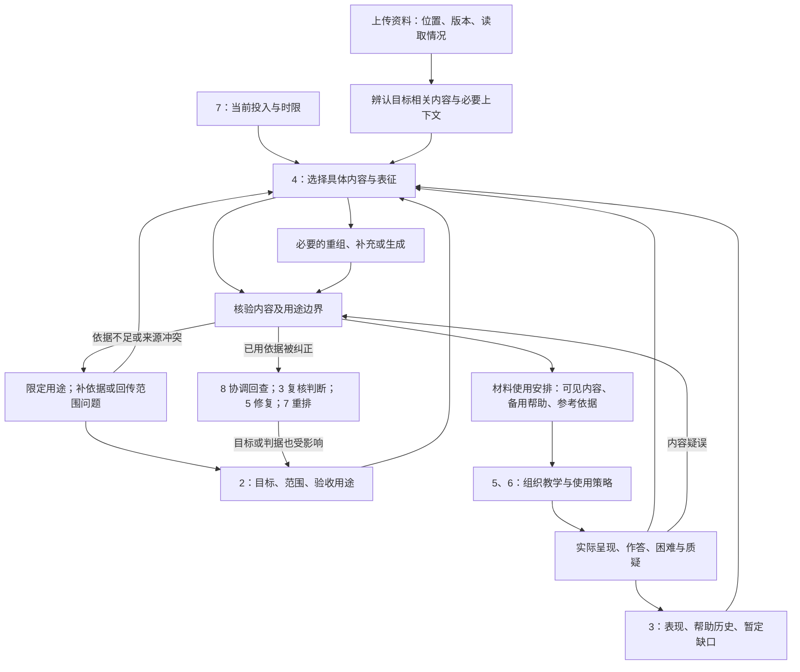

# AI 个人学习系统：工作包 4 设计方案 v0

日期：2026-09-28  
对应：阶段 B／B3「材料选择、输入组织与生成内容核验」  
状态：经本轮审阅修订的顶层设计基线，供工作包 5、6 继续展开；尚未经过真实课程试用  
主要起点：[设计提示词](<E:/文献资料/学习系统架构设计/docs/prompts/AI个人学习系统_工作包4_设计提示词.md>)、[顶层设计分析](<E:/文献资料/学习系统架构设计/docs/analysis/AI个人学习系统_工作包4_顶层设计分析.md>)

## 一、本方案作出的选择

**工作包 4 的交付单位是一项“有依据的材料使用安排”：针对当前目标，选定具体内容及其必要上下文，组织适合的表达形式，说明学习者仍需完成什么，并限定这些材料可以用于何种教学或评价。**

这一安排可以很小：一段原文加符号注释、一组条件对照、一个可核验的局部推导。它也可以得出“现在不增加讲解，先取得一次相应表现”的结论。系统不以材料数量、媒体丰富程度或生成篇幅作为完成标准。

本版确定六项选择：

| 选择 | 在系统中的实际含义 |
|---|---|
| 先确定要支持的学习工作，再选内容和形式 | “理解公式”“推导公式”“自主选择公式”会得到不同材料，即使来自同一页 |
| 保留来源片段与使用安排两个层次 | 原文位置和条件可以复用；本次为什么使用、提供多少帮助、是否适合检查，需要重新判断 |
| 先检查已有材料是否足够，按缺口补充 | 原文、重组、外部补充、局部生成、暂不增加输入均可成为正式结果 |
| 核验结论限定到内容、版本和用途 | “这张图能说明某种趋势”不等于“它证明一般结论”，也不自动成为评分依据 |
| 学习材料与教学共同准备，实际呈现单独记录 | 工作包 4 提供用途、条件和可选支持；工作包 5 决定逐轮呈现，实际帮助回到工作包 3 |
| 错误与更新按依赖回查 | 暂停受影响材料，定位任务及评分；历史作答保留，能力判断和计划由相应责任方复核 |

以上均为**【设计】**，在现有架构边界内细化 B3，不改变工作包划分。高能力 Agent 负责关键内容选择、教学意图和争议处置；中等能力 Agent 在授权范围内制作、核验和调整。首期不把这些职责固定成独立 Agent 或软件模块。

### 1. 依据和阅读范围

本轮以用户当前要求为准，阅读工作包 4 的提示词与分析、整体学习流程与概念架构、设计流程与工作包，并结合 Encoding 研究报告、Post-Encoding 研究报告及其证据台账、研究综合性质的快速矩阵；工作包 2、3 的现有分析、提示词与方案用于接口对齐。没有读取微操作与提问库、Encoding 策略库、架构设计提示词、检查记录及供人审阅的可视化文件，也不把其他文件对这些资料的转引当作本轮独立核验。

文中采用三种性质标记：

- **【依据】**：项目既定约束，或研究报告在其原有限制下支持的结论。引用项目报告不表示本轮重查了外部论文。
- **【设计】**：本方案据此作出的规则、责任和处理选择；未特别注明的规范性安排均属此类。
- **【假设】**：需要真实使用验证的收益判断；情境中的课程内容和学习表现也明确按假设处理。

Encoding 的 E1／E2／H 与 Post-Encoding 的 Strong／Moderate／Preliminary／Contested 保持原意，不换算成统一可信分。学习科学依据说明“为什么可能这样安排”，学科来源、推导和检验说明“这道题或这段内容为什么正确”；两者不能互相替代。

关键边界来自[流程：工作包 4—6](<E:/文献资料/学习系统架构设计/docs/architecture/AI个人学习系统_设计流程与工作包.md:155>)及[架构：课程与单次学习](<E:/文献资料/学习系统架构设计/docs/architecture/AI个人学习系统_整体学习流程与概念架构_v0.md:104>)。后续承接更新（2026-09-28）：与工作包 2、3 的共同接口见[2—4 交接对齐说明](<E:/文献资料/学习系统架构设计/docs/designs/AI个人学习系统_工作包2至4_交接对齐说明.md>)，内部字段和状态分类仍不冻结。

### 2. 本轮解决到哪里

本版决定选择、组织、核验、使用和纠错的判断规则，提供可交接的语义和情境走查。实际课程、学习者基础、预算均未知，因此不编造教材页码、个人画像或学习成效。缺失信息不阻碍本轮设计；它们会在首次真实材料准备时决定目标范围、核验方式和可承诺的投入。

## 二、B3 在整体学习流程中的位置

B3 同时服务课程准备、当次教学和跨天恢复。课程开始时形成有限的内容地图；一次学习前选择近期材料；学习中响应新的困难和疑问；跨天重新检查材料版本、已有暴露和本次用途。上传时产生的书单不能作为永久安排。

图中的核验也会发生在读取、生成和反馈过程中，不是只在最后签一次“通过”。若材料已经足够而缺少独立表现，可以直接交出检查所需的合格内容与备用修复材料；学习者不必再阅读一轮讲解。

**共同设计的边界：**B3 必须主动提出“这组材料支持什么工作、为何适用、提供了什么帮助”。工作包 5 将其变成具体互动，工作包 6 决定策略的采用、组合与退出。若双方发现输入已经完成了本来要让学习者做的判断，应修改材料的可见部分或活动用途，不能各自交付后才处理矛盾。

## 三、用两个层次组织内容，保留必要的区别

### 1. 来源片段：保存内容成立的上下文

来源片段是能够定位、回看并判断含义的一段内容，可能是一段文字，也可能跨页包括命题、定义和证明；不等同于固定字数的文本块。只为当前和近期目标建立必要联系。

对片段至少能回答：来自哪个来源和版本、定位到哪里、读到了什么和哪里没读清、表达了什么主张或程序、成立条件是什么、需要联系哪段定义或依据。文件名与页码可以定位；视频需时间段；网页需实际页面与访问时的版本信息。稳定标识帮助跨版本回查，但不把本轮变成存储结构设计。

### 2. 材料使用安排：说明为什么此时这样用

一次使用安排把若干片段、生成内容和当前目的联系起来，应能回答五个问题：

1. **为什么现在学习这些内容？**对应哪个目标、哪项证据缺口或待区分的解释。
2. **为什么采用这些形式？**各部分显露什么关系，额外形式增加了什么价值和负担。
3. **学习者完成什么？**哪些信息已给出，哪些解释、推导、选择或核查留给学习者。
4. **可靠依据在哪里？**哪些内容已核验、以什么方式、适用于什么范围；哪些仍未知。
5. **什么会改变安排？**什么反馈会触发补前置、换形式、撤除输入、重新核验或收缩范围。

这是交接所需的最小语义，不是要求建立五张表，也不要求用户每次填写完整表单。同一已核验片段可被不同安排复用，适配判断和暴露条件随使用而变化。

### 3. 不能合并的几类信息

| 区别 | 正确处理 | 合并后的问题 |
|---|---|---|
| 来源身份／表达形式／使用目的 | AI 生成、曲线图、用于观察参数变化可以同时成立 | “可视化”无法说明来源和可靠程度 |
| 忠实读出／内容正确／当前适合 | 分别说明读取依据、学科依据和适配理由 | 把“摘自教材”当作内容绝对正确或一定适合 |
| 内容提供／实际呈现／掌握证据 | 制作完成、展示过、学习者做出了什么分别记录 | 将准备过或讲过写成已经掌握 |
| 例子正确／题目合格／评分可用 | 分别核查例子、任务条件和参考能否支持评价 | 一道算得对的题也可能有歧义或已泄露解法 |
| 内容依赖／个人学习证据 | 共享学科依据；个人作答及帮助条件由证据工作管理 | 材料库反向生成未经证实的个人画像 |

沿用[架构：共享信息语义](<E:/文献资料/学习系统架构设计/docs/architecture/AI个人学习系统_整体学习流程与概念架构_v0.md:213>)。首期只维护“片段—派生材料—使用任务”的必要回查联系，不建设覆盖整个学科的知识图谱。

## 四、上传材料如何成为可用内容

### 1. 先做范围辨认，再精读近期所需部分

接收课程资料时先区分课程表、大纲、正文、作业、解答和考核要求，记录可访问范围与缺失处，形成粗略目录。目录提供候选内容，不直接推出用户必须学的全部内容。根据工作包 2 的近期目标，再精读相关片段及其必要前后文；涉及关键依赖时向前补读。

这种渐进准备避免在目标未定时重写整本教材，代价是后来发现额外依赖时需要补读。若材料本身高度连贯、局部阅读无法理解，则扩大阅读范围并说明原因。不能把局部完成处理宣称为整份资料已被核验。

### 2. 读取状态限定到片段和模态

文字成功抽取不意味着公式、图表、脚注和附件已读清。扫描图的负号、指数、条件符号，表格的表头与单位，跨页证明的假设，都可能决定内容含义。

| 读取情况 | 对当前安排的影响 |
|---|---|
| 正文、条件和关联图表可核对 | 进入内容理解与用途核验；尚不直接代表学科结论正确 |
| 局部不清但不影响目标内容 | 标明未覆盖范围，使用不依赖它的部分 |
| 缺失可能改变命题或答案 | 暂停相关事实讲授和评分参考；回看原件、寻找同版本可核文本或请求补齐必要页 |
| 只有摘要、目录或他人转述 | 可作为寻找线索或暂定范围，不能冒充已读全文 |

如果需要继续，可改用一个独立可核验的等价目标材料，但明确其来源和范围；不能让 AI 补写缺页后仍标为教材原文。补充来源解决的是内容缺口，不一定解决原教材具体写法的争议。

### 3. 按完整意义分段，按当前任务组合

| 内容类型 | 一个可用范围须保留的关系 |
|---|---|
| 定义、公式和命题 | 对象域、符号、量词、条件、结论；必要的术语来源 |
| 推导和证明 | 所求结论、前提、合法步骤、调用的结果；有意省略部分及其用途 |
| 例题与解答 | 完整题干、限制、方法选择点、解答与核验依据；展示时可分开 |
| 图表与模拟 | 坐标、单位、图例、变量映射、参数范围、近似及模型假设 |
| 代码与实验 | 规格、输入输出、必要环境、数据与实验条件、结论可支持的范围 |
| 论述与案例 | 主张、证据、推理、情境、竞争解释；事实与价值判断的区别 |

一个学习范围可以跨数个片段，也可以只用一节中的一个条件对照。**最小范围是足够正确地完成当前任务的范围，不是最短文字。**若相关信息必须来回翻页，优先相邻呈现或提供明确对应；重组时保留原位置和重组身份。

前置关系只展开到本次必要程度：必须使用的符号和规则补足；可暂时作为已给条件或黑箱的内容予以标明；课程全局前置由工作包 2 决定。若教学中发现所谓黑箱恰好是目标要自主完成的内容，则回传修改，不能靠隐藏依赖降低要求。

【依据】Encoding 关于连贯分段的证据有特定材料范围，也提示学习时间可能增加，不能推出“越碎越好”；见[Encoding：OS09](<E:/文献资料/学习系统架构设计/docs/research/01_Encoding研究报告.md:449>)。以上来源定位、读取限制和按目标逐步展开属于本方案的实现前设计。

## 五、材料选择：先决定需要支持什么，再决定增加什么

### 1. 从一个明确的用途出发

使用安排开始前，从 2、3、5、7 取得当前目标及深度、本次用途、相关表现和帮助历史、主要未知、资源约束。不要求完整学习者画像。资料缺少时按影响处理：

- 目标尚模糊：可提供候选内容范围与差异，回传 2 确定；不据此宣称覆盖了验收要求。
- 学习证据不足：保持“起点未知”，提出低负担且能区分原因的取证需求给 3、5；也可先提供必要定向材料，不让学习者无依据猜测。
- 内容可靠性不足：先补依据或改用已核验范围；新增诊断问答不能代替内容核验。
- 预算不明确：给出必要部分与可选部分及负担来源；实际承诺范围前再取得最少约束。

若本次是观察独立恢复或方法选择，先协调材料可见范围，避免为了选材料提前给出要检查的答案。若本次是开卷比较，提供前提本身可以是合理输入，不必为了形式上的闭卷增加困难。

### 2. 选择规则及其先后关系

先排除不能支持当前用途、缺少该用途必需依据或当前不可访问的候选；再比较它们对当前学习工作的贡献与总负担。主张尚未核实的内容可以作为明确标注的待核查或比较对象，不能据此作为事实定论、正确范例或确定评分参考。内容正确性、必要条件和用途边界不参与“画面更好看可抵消”的加权排序。

对剩余候选作四项判断：

| 判断 | 要回答的问题 | 影响选择的证据 |
|---|---|---|
| 必要性 | 它解决哪个具体关系、条件、执行或取证缺口？ | 目标规格、任务要求、目前缺少的证据 |
| 适配性 | 它需要的前置是否可用；会不会代替目标认知工作？ | 原始表现与帮助条件、已知材料困难、暂定诊断 |
| 增量价值 | 比已有材料多解决什么；是否只是换一种说法？ | 原文与候选的具体差异，而非形式偏好本身 |
| 总负担 | 阅读、操作、前置补足、资料切换、制作和核验是否值得？ | 已有用时或有理由的估计；未知项保持未知 |

在能够完成同一工作的候选中，默认采用需要较少新增前置和维护的组合。没有足够证据分出优劣时，可以按可访问性与用户偏好选一个可逆方案，写明改选信号；不制造精确“最适配分”。

### 3. 六种正式结果

| 结果 | 何时采用 | 必须说明 |
|---|---|---|
| 直接用原材料 | 原片段完整、可读且足以支持当前工作 | 具体位置、关注点、前置与用途 |
| 重组原材料 | 信息齐全，但分散、指代不清或切换成本高 | 哪些内容移到一起，是否新增连接判断 |
| 补局部桥接说明 | 符号、术语、一步推导或对应关系缺少连接 | 补的是哪处；哪些是解释，哪些是新增命题 |
| 引入外部来源 | 原材料缺关键依据、合格例子或必要视角 | 所补缺口、来源及版本、与原材料的关系 |
| 生成局部材料 | 需要特定条件对照、变式、可视化或任务，且有核验办法 | 目标关系、保留条件、变化维度、验证依据和用途 |
| 暂不新增或暂缓相关部分 | 已有输入足够而缺表现；或关键依据／预算不足 | 下一项取证或补依据工作，以及可继续的范围 |

“原材料优先”是先检查是否已经足够，不是教材质量不佳时仍强制逐句阅读。外部检索与生成应围绕一个已知缺口展开：取得足以支撑该用途的依据便停止扩展；继续查找将超出本轮预算时，交付限制和替代路径，不无限积累书单。

### 4. 不把不确定困难固化为偏好

同一次“看不懂”可能是读取有误、术语陌生、前提缺少、关系跳步或材料错误。B3 可以先核查材料，提出不同补充候选；3、5 用有区分力的表现判断原因。若符号释义后仍不能推理，不持续增加同类释义，应回传这一反证。

用户偏好图示可以影响形式选择；一次使用反馈也能提示图是否难读。它们不能单独证明用户具有固定的“视觉学习类型”。理解感、速度和停留时长可作为体验信息，独立表现另行取得。

## 六、输入怎样组织，哪些表征值得制作

### 1. 让每种形式承担明确工作

| 形式 | 采用理由与学习者工作 | 组织和核验重点 | 不足以支持的判断 |
|---|---|---|---|
| 原文与短解释 | 理解术语、辨认主张、补局部连接；学习者解释其含义或边界 | 解释与原句对应，保留量词、前提及争议 | 流畅复述不自动证明能应用 |
| 公式与推导 | 识别依赖、验证步骤、重建论证 | 变量含义、对象域、单位、变形条件；标明省略步骤 | 符号朗读或数值代入不等于一般证明 |
| 完整／部分例题 | 观察程序结构，或由学习者补方法选择和关键步骤 | 范例正确；题干、解答与选择点关联但可分开显示 | 跟随示范成功不等于独立选择方法 |
| 对照、反例、变式 | 区分适用条件、辨认相似问题的差异 | 明确变化与不变维度，控制无关前置，核查边界 | 换数字不自动成为新情境迁移 |
| 静态图、表、关系图 | 显露对应、结构、变化或比较；学习者解释或补关系 | 图例、变量、方向、尺度；区分关系箭头与因果箭头 | 图示直觉不能替代证明或因果证据 |
| 动态／交互图 | 动态变化或可控操作能更清楚显露目标关系，且收益值得额外成本 | 模型、合法输入范围、边界行为与文字／公式一致 | 有动画或可拖动不能证明理解改善 |
| 代码、实验、数据或视频 | 目标要求执行、观察或解释结果 | 规格、环境、数据条件；精确片段和可操作方式 | 运行成功或观看完成不代表全部目标达成 |

选择多种表征时，明确每一种是重复表达、补充信息，还是引入新假设，同时检查它分别支持什么观察、计算、解释或转换任务。信息等价不代表教学功能重复：公式与图可以描述同一关系，却显露不同特征，其对应和转换本身也可以是学习目标。保留变量、条件和尺度的对应；近似图、类比及简化模型明确哪些关系不能沿用。报告关于多表征的框架性支持见[Encoding：U01](<E:/文献资料/学习系统架构设计/docs/research/01_Encoding研究报告.md:536>)，不支持“形式越多越有效”。

可视化至少有一项可检查的教学意图，例如观察哪个变量改变、辨认哪条条件、比较哪种预测；同时说明不用它是否也能完成。静态表达足够时优先使用静态表达。若为学习者自主建图的目标提供完整答案图，则应调整展示时机或把该表现解释为有帮助条件下的表现。

### 2. 一项安排的三个阅读部分

**当前学习入口**呈现本次要看或操作的内容、需要完成的工作和必要限制。采用理由按用途说明；会泄露待检查的方法、诊断特征或答案的部分，留在教学依据中，作答后再向学习者解释。核心片段相邻组织，避免学习者自行在多个全文之间寻找对应。必要内容、按需展开与暂缓拓展清楚区分。

**备用支持**包括符号释义、局部推导、完整例题、错误边界说明等，只在相应需要下使用。它们不构成每次必须走完的序列。工作包 5 可在授权内换用或跳过，并记录实际提供了什么。

**教学与评价依据**保留原位置、核验说明、题目与答案关联、评分支持范围、可能泄露的判断和重选条件。此部分不自动与学习者当前任务同时展开；若用户要求查看，允许转为教学并如实改变后续证据解释。

这三部分是呈现用途的区别，不要求三个独立界面或三套重复内容。

### 3. 内容足够时停止增加输入

一项安排准备到以下程度即可交付：能定位目标所需内容，能解释关键条件，具有用途所需依据，学习者仍有明确工作，且失败时有下一步。全量摘要、每个知识点的图、所有可能反例和完整题库不属于默认准备要求。

若学习者在当前条件下已有相应证据，下一步可仅准备延迟检查或新情境任务及备用材料。若提供了大量输入仍无进展，先检查材料与诊断是否适配，不把继续生成作为默认响应。使用安排的收益仍是【假设】，须通过后续表现与投入来判断。

## 七、生成与核验：把“可以相信什么”说具体

### 1. 生成前先确定用途和核验办法

生成请求应先说明目标关系、原有依据、不可改变的条件、可以变化的部分、由学习者完成的工作及预期用途。例如生成变式时，先规定需保持的数学结构或实验规格，再检查实际变式是否仍满足；不能因请求写了“只改一个条件”，就认定结果确实如此。

先判断是否存在可行的核验路径，再投入较多制作：有原始依据可对照，有明确规则可推导，有任务规格可测试，或有事实材料与论证标准可复核。局部生成可以与核验迭代；核验未完成的产物保持候选，不凭“已经做出来”取得使用资格。

对原文转述，新增推断须单独标明；对新例题，题目、参考答案及其成立依据一起准备但分开呈现；对可视化，先明确内容与映射，再检查实际图或交互成品。核过公式不意味着据其生成的图也已经核过。

### 2. 不同对象需要不同依据

| 核验对象 | 最少要解决的正确性问题 | 可采用的依据／检验 | 必须保留的局限 |
|---|---|---|---|
| 摘录、翻译、简化解释 | 是否忠实；条件、量词、立场或结论强度有无改变 | 回看原位置，逐项比较关键术语与限定；新增推断另找依据 | 忠实不代表原文无误；好读不代表适合所有人 |
| 公式、推导、证明 | 定义域、前提和步骤是否合法，是否完整覆盖结论 | 已核规则、独立推导、代入、边界与反例检查；适用时用计算工具 | 有限算例不能证明全称命题；工具结果也须解释假设 |
| 例题、变式和参考解答 | 题干是否充分、可解且无歧义；答案是否完整；是否存在其他合法解 | 从题干重新求解，与依据核对；测试边界和异常情形；开放题列合理解法范围 | 生成答案不能独自证明题目有效；不同方法得同一答案仍可能共享遗漏 |
| 静态图、表和关系图 | 数据、坐标、单位、方向、标注与源内容是否一致 | 对照源数据／公式／主张；核查关键点和说明；检查视觉上是否误导 | 示意关系不能自动支持精确数值或因果结论 |
| 动态图和模拟 | 每种允许操作是否仍满足模型及约束 | 核查映射、起点、端点、特殊状态、参数变化及静态回退；对照模型结果 | 只看一张截图或正常参数不能覆盖所有合法输入 |
| 代码和实验材料 | 实现是否符合规格，实验能否支持所述解释 | 官方规格或课程要求、代表性与边界测试、可复现条件、预期结果与观察对照 | 代码可运行不等于算法正确；一次实验不等于一般结论 |
| 事实、论述和开放题参考 | 来源是否支持所引主张；事实、解释、价值前提是否区分 | 与适用时间和语境的原始来源核对；检查推理与竞争解释 | 多个转载不构成独立佐证；立场相同不能替代理解判据 |

核验方式应针对可能出错的地方。例如，生成解答用了除法，检查零值和定义域；图示来自某方程，直接比较其关键取值和边界；政治案例存在因果争议，检查证据是否足以排除竞争解释。所有对象都多问一个模型，不一定增加有效核验。

**核验的独立性主要指能发现不同来源的错误。**同一 Agent 可以生成后依据原文、独立推导或测试复核；不同 Agent 若只重复同一错误答案，也不能成为独立依据。重要争议可增加高层或领域复核，但模型一致意见不替代学科证据。[架构：核验与分工](<E:/文献资料/学习系统架构设计/docs/architecture/AI个人学习系统_整体学习流程与概念架构_v0.md:256>)。

### 3. 使用结论限定到版本、范围和用途

每项重要材料的核验说明至少表达：“检查了什么、依据在哪里、支持到什么范围、未检查什么、因此可以怎样用”。保留核验者责任和所核版本，不用一个总可信分压平这些区别。

可用自然语言表达四种结果；以下是语义区别，不冻结状态字段：

| 结果 | 使用安排 |
|---|---|
| 所述用途已有足够依据 | 在对应版本、条件与用途下使用；不能外推到更强结论 |
| 只有局部或特定用途有依据 | 例如可用于观察某范围内趋势，但不能作一般性证明；明确允许部分 |
| 关键内容待核实 | 不能作事实定论、正确范例或确定评分参考；可作为明确标注的待检验主张，前提是活动本身不需要把它当真 |
| 已确认有误或有实质疑误需隔离 | 停止受影响的正常使用和确定评分，提供替代；进入回查或争议处理 |

“限定用途”不能成为绕过核验的标签。若不确定部分正是任务必须依赖的前提，就暂停该任务或改变范围。若要把已知错误用作辨错材料，需要重新设计用途，另备可靠纠正依据，并保护后续证据解释；不能直接把误生成产物标成“教学反例”继续发放。

### 4. 核验投入与更改范围相称

关键定义、条件、复杂推导、生成题及评分参考应在首次使用前完成所需检查。常规摘录不必重证整本教材，但要核对截取是否改变含义；出现实质疑误时再扩大核验。

已核验材料可以复用。调整字体或不影响含义的措辞通常只需检查对应呈现；但标题、着色或答案折叠方式若泄露方法，仍会改变检查用途。改变定义域、关键假设、答案、图形映射、数据版本或目标用途时，重核受影响部分。复用过去核验结果的前提是依赖与适用范围没有改变，而非文件名相同。

预算不足时，优先复用合格原文、简单例子或静态表达，减少待制作内容。无法在预算内取得必要依据，交付未满足项和范围建议；不以跳过关键核验换取表面完成。

### 5. 学科差异进入核验依据

| 学科 | 重点保留 | 不能代替正确性依据的东西 |
|---|---|---|
| 数学 | 定义域、量词、等价方向、全部解、证明条件 | 好懂的类比、曲线看起来如此、几个数值成立 |
| 人工智能 | 概念、实现、实验和推断各自的依据；软件／数据／实验条件 | 单次运行、单一示例输出、概念解释流畅 |
| 金融 | 模型假设、数据时间、量纲和适用情境；区分教材模型与现实推断 | 未注明时间的数据、忽略假设的公式、事后吻合 |
| 政治 | 事实来源、论证、因果识别限制、价值前提与竞争理论 | 单一权威立场、多个转载、一份标准答案的措辞 |

这里规定课程材料的核查方法，不作任何现实投资或政治事实判断。实际使用涉及会变化的信息时，应核对当时有效来源；静态课程模型的学习可以保留其历史适用范围。

## 八、学习、提示、参考答案与验收怎样衔接

### 1. B3 声明潜在帮助，执行方记录实际帮助

材料准备时说明它给出了哪些信息，以及可能代替哪项目标操作；执行方记录在初答前、作答中或反馈后实际呈现了什么、用户还得到什么额外帮助。工作包 3 据此解释表现。

| 材料提供的内容 | 可能产生的影响 |
|---|---|
| 术语澄清、排版调整、文字转语音 | 可能仅改善可访问性，也可能解释了目标要求学习者辨认的含义；须按目标判断 |
| 事实、公式或必要前提 | 对开卷推理可能是允许资源；对自主恢复这些内容的任务则是帮助 |
| 方法名称、条件位置、关系箭头、步骤提示 | 可能代替方法选择、条件检查或关系建立，哪怕没有给出最终答案 |
| 部分／完整解答、解释反馈 | 限定随后表现的证据范围；可以继续教学，但不能追认为此前未受帮助 |

**独立不等于闭卷。**某目标允许查公式、文档或使用计算器，只要目标要求的关键判断仍由学习者完成。提示影响由目标与实际内容共同决定，不给每种媒体预设固定“帮助等级”。这与[工作包 2、3：表现条件与帮助](<E:/文献资料/学习系统架构设计/docs/designs/AI个人学习系统_工作包2与3_联合设计方案_v0.md:289>)兼容。

计划隐藏的答案如果已经显示，按实际显示处理。能够打开某文件不等于已经阅读；没有显示记录也不能证明用户从未见过。来源于用户自述、实际呈现记录或无法确认的暴露分别标明，未知会限制验收结论。B3 提供相关材料关联，评估方决定这些不确定性如何影响证据。

### 2. 参考可靠与验收合格是两道不同判断

检查从准备到形成结论需要满足以下条件：

1. 工作包 2：任务要求的操作与目标、判据及允许资源一致。
2. 工作包 4：题干和参考依据可靠、条件充分、存在可接受的答案或论证范围。
3. 工作包 3、5 与评估责任方：实际暴露、可见材料、任务变化和原始表现支持所需结论。

这些是责任分工，不要求每题三次审批。常规任务可按既有授权处理，缺任一关键条件时则不能宣称取得了相应验收证据。

评分参考可以是一条推导、可执行检验或开放题的论证标准，不必只有单一标准答案。B3 保证其内容支撑与边界；工作包 2 确定哪些表现重要；评估方依据原答判断，不能仅检查与参考措辞是否一致。

### 3. 相同材料复用时重新判断用途

保持检查可以要求恢复学过的内容，复用本身合理；同题再做也可用于修复，但需注明熟悉度。关系或应用目标要求未练任务时，审查是否只是换数字、换措辞，是否已经暴露对应方法，或引入了新的领域前置。

“新题”由它相对已有暴露改变了什么来说明，不能由生成日期来保证。目标关系、表面情境、条件、表示方式和提示的变化按需要记录，不计算一个通用迁移距离。

解释延迟表现时，还需交接原学习、上次相关练习、期间再次接触、实际提示／答案反馈及本次检查的时间。分别辨认初学到检索、检索到反馈、反馈到后测、相邻练习的间隔；3 解释中间再学习或提示如何改变证据，7 统一安排时间。不能把“学过一周但刚看完解答后的成功”直接称为一周独立保持，也不把任何接触都机械地视为全部重新计时。此处依据为[Post-Encoding：时间间隔的区分](<E:/文献资料/学习系统架构设计/docs/research/Post-Encoding-Dynamics-深度增量研究.md:190>)，不规定通用最优间隔。

【依据】Post-Encoding 对提取、关系和迁移的测量要求见[报告 §13](<E:/文献资料/学习系统架构设计/docs/research/Post-Encoding-Dynamics-深度增量研究.md:400>)；相关任务的局部结果不能推出统一最佳顺序。答案分开呈现是保护特定测量条件的设计，并非“所有学习都必须先答后看”的规定；报告中的反例见[证据台账 E21](<E:/文献资料/学习系统架构设计/docs/research/post-encoding证据台账与参考文献.md:135>)。

## 九、与相邻工作包的最小交接和责任

### 1. 双向接口

| 对接方 | 向 B3 提供 | B3 交出或返回 | 接收后需要作出的判断 |
|---|---|---|---|
| 2：目标与验收 | 当前目标／版本、内容深度、目标操作、判据方向、必要前置与允许资源 | 内容覆盖、具体依据、未覆盖与冲突；额外前置、候选任务及参考支持范围 | 是否修改目标范围或前置；是否满足验收内容要求 |
| 3：证据与诊断 | 相关原始表现或可回查位置、帮助与暴露、暂定缺口及替代解释 | 材料特征与可能误导处、实际材料版本、待区分的原因；错误所影响的依据；配合 5 提供再次接触和帮助的时间 | 如何解释表现、需要什么取证、哪些既有判断待复核 |
| 5：教学设计与执行 | 活动意图、学习者不可代做的工作、当前用途、实际使用与困难反馈 | 当前入口、备用支持、内容依据、使用限制、潜在泄露和改选信号 | 如何呈现、提问、反馈、撤除帮助；实际提供了什么 |
| 6：策略使用 | 候选策略需要的案例、对照、变式、反馈与判据条件 | 材料是否满足启用条件、可行替代及限制 | 启用、调整或放弃该策略；不因库里有就使用 |
| 7：持续计划 | 本轮目标范围、时限、可投入资源、恢复需求 | 必要／可选内容、准备与核验成本、学习负担估计、未满足项和替代路径；与延迟检查有关的再次接触和帮助时间 | 如何取舍新学、补缺和检验；是否重定范围 |
| 8：协作与记录 | 当前责任人、授权、交接和修订规则 | 版本、依据、核验、直接依赖、纠错事项及待接收结果 | 如何保证有人接收、避免覆盖冲突、恢复后从哪里继续 |

与 2、3 的内容交接符合其当前方案的[材料接口](<E:/文献资料/学习系统架构设计/docs/designs/AI个人学习系统_工作包2与3_联合设计方案_v0.md:521>)。本版补充用途、认知工作、潜在帮助和实际使用的区别，不强制采用其展开单、记录类型或状态名称。

**材料使用安排是当前有效学习安排中的内容供给部分。**核验通过只说明材料在所述版本、条件和用途下具有相应依据；纳入本轮执行还须与当前目标及判据版本、实际帮助条件、预算和活动意图一致，由当前学习安排的责任方按授权接收，教学执行据此使用。目标、用途或预算发生实质变化时，重新确认受影响的材料选择、可见范围与投入；内容本身未变且原核验仍适用时可复用核验结果。B3 的候选或旧安排不独立指挥教学，范围内的常规等价替换仍可依既有授权完成，无需逐项增加审批。

一次交接需获得可理解的处理结果：已接收且满足当前用途、缺少哪些必要信息、或暂缓及原因。轻量记录即可，不增加无意义签批。没有落实的必要材料仍是候选；无关的远期缺项不阻止本轮可行活动。

### 2. 谁可以决定什么

| 决定 | 默认责任与权限 |
|---|---|
| 选择关键内容、主要表征、关键例题／图示意图 | 高层负责；可沿已明确目标和条件授权执行者做局部选择 |
| 摘录、重组、释义、已界定范围内制作与常规核验 | 中层可直接执行，保留来源、核验结果与调整理由 |
| 使用同用途的等价替代、可访问性调整 | 在依据、目标工作和允许帮助不变时，可范围内调整；发生实质变化则重新检查 |
| 发现疑误后临时停用受影响内容 | 执行者立即执行并报告，不等待高层在线；无关活动可以继续 |
| 处理重要来源、定义或评分争议，确定影响范围 | 高层责任方依据来源、推导、检验裁定；缺依据则保留未知，不能靠职级宣告正确 |
| 改变目标、验收要求、重要能力结论或全局计划 | 分别交 2、3／评估、7 的责任方；B3 提供影响与建议 |

不默认每个产物都做多 Agent 投票。高层主要投入那些错误后果大、内容依据存在冲突、授权不足或需要改变范围的判断。其不可用时，中层使用已授权且不依赖争议的材料，保存暂停事项。

### 3. 反馈必须能改变下一次安排

| 后续信息 | B3 的材料调整 | 需要协同的判断 |
|---|---|---|
| 提供符号释义后能继续，但关系仍未解释 | 保留释义，改查关系或前提；不重复生成更多同义说明 | 3、5 区分材料障碍与关系缺口 |
| 给出前提后能推理 | 可准备前提查阅支持与单独恢复任务 | 2、3 判断当前目标是否要求自主恢复前提 |
| 完整范例后会做，撤去方法提示失败 | 保留方法暴露历史，准备能区分选择与执行的候选材料 | 5、6 安排帮助变化，3 限定结论 |
| 原情境会，新情境失败 | 核查新背景前置及结构变化，再选择边界对照或补背景 | 3、5 防止把背景问题直接归为迁移失败 |
| 图示增加困惑或使用成本 | 退回文字／表格／静态形式，核对是否映射有误 | 5 区分可访问性与概念问题 |
| 已有独立证据，本轮只缺延迟表现 | 暂不新增讲解，提供合格检查内容和备用修复依据 | 7 统一安排时间，3 解释延迟表现 |
| 相同材料反复无助或成本过高 | 检查正确性、适配假设和诊断，提出替换或停止 | 高层及 3、5、7 决定如何缩小或改变安排 |

上述调整属于条件化设计，不是已验证的自动推荐算法。不将学习者一次失败写成材料永久无效，也不将一次成功写成固定媒体偏好。

## 十、来源冲突、错误与版本变化的处理

### 1. 先判断冲突是否发生在同一主张和条件下

| 冲突类型 | 处理 |
|---|---|
| 符号、术语或单位约定不同 | 明确对应，在不改变含义的条件下转换；保留原约定 |
| 定义域、模型假设或情境不同 | 分别保留适用条件；必要时用对照说明，不强行合成一个无条件结论 |
| 时间、数据、软件或理论版本不同 | 选择与当前目标相匹配的版本，说明旧版本仍适用的范围 |
| 事实或推导在同条件下相互矛盾 | 回到原始依据并独立核验；无法裁定时暂停依赖争议的评分和定论 |
| 因果解释、理论或规范立场不同 | 区分共同事实与竞争解释、价值前提，按目标并列和评价论证 |
| 课程参考与学科正确性冲突 | 分别说明课程评分要求与学科依据；交目标／评估责任方处理，不能把明知错误写成事实 |

来源身份、出版时间或多个来源重复同一说法，都不能单独解决上述所有冲突。用户质疑题目或答案也是正式核验入口，不能因其答案与参考不同就先判学习者错误。

### 2. 从疑误到恢复的闭环

1. **定位并隔离。**指明内容、版本、疑误和受影响用途。对实质疑误先暂停相关正常使用和确定评分，标记已使用处待查；同步通知评估、计划和执行责任方，涉及目标或验收标准时同时通知工作包 2，限制或暂停依赖争议依据的确定判断及当前安排，不等重评完成。无关且依据充分的活动继续，不预先认定全部历史结论错误。
2. **建立更正依据。**重读来源、重推、测试或补充来源；给出具体改动、成立范围及仍未解决部分。无法裁定则保留争议。
3. **回查直接依赖。**B3 回查其生成、接收、引用或分发的相关解释、图、题目、答案及已知使用任务，说明依赖的是哪一条件；其他责任方补充各自的直接依赖。8 协调接收与处理回报，不因内容来自外部就退出回查。
4. **重审目标与验收标准。**若错误已进入目标命题、目标深度、前置要求或验收判据，工作包 2 的责任方依据更正内容审查并修订目标及判据版本，说明受影响范围；B3 提供依据和建议，不自行改目标。相关任务和材料按修订后的要求重新匹配。未受影响的目标无需改动；用户需要决定的范围与投入变化仍交用户决定。
5. **复核派生判断。**3／评估方重看当时原答、帮助和原判据，并结合更正依据及目标／判据版本变化，决定重评、撤销或限制结论；7 调整因此产生的错误补课、错误跳过及后续范围。区分纠正错误标准与后来新增目标要求，不用新要求倒推原作答当时未达标；旧证据对新目标的支持范围另行判断。
6. **修复教学影响。**5 向学习者清楚说明系统错误和替代解释。历史重评优先复用原答，只有原答不足时才为该结论补证；若错误教学已经影响学习者，另行安排必要的纠正与检查，并说明其目的，不把系统错误变成用户重复考试的默认负担。
7. **确认恢复条件。**更正版本完成相应用途核验，受影响的目标及判据已完成必要重审，材料与当前有效学习安排重新对齐，且受影响任务和接收责任已明确，相关用途才恢复。材料恢复可用不自动恢复旧评分或能力结论。

依赖链沿用[架构：内容纠错与记录恢复](<E:/文献资料/学习系统架构设计/docs/architecture/AI个人学习系统_整体学习流程与概念架构_v0.md:266>)，与[2、3：错误回查](<E:/文献资料/学习系统架构设计/docs/designs/AI个人学习系统_工作包2与3_联合设计方案_v0.md:485>)衔接：

**来源／规则 → 派生解释、图和任务参考 → 使用事件与评分 → 能力判断 → 跳过、补缺和计划。**

若目标或判据本身依赖错误依据，另有一条回查分支：**来源／规则 → 目标及验收标准 → 相应任务、材料与评价 → 能力判断和当前学习安排。**两条路径按实际依赖衔接，无关目标不因材料纠错而重写。

历史原答和当时帮助条件不被悄悄改写。旧评分保留其失效或修订说明，当前结论另行更新。错误出在题目时，不能继续将对应失败当作用户能力不足；更正答案也不能凭空补出用户未曾展示的推理能力。

### 3. 更新不是全部清零

只改定位或错别字，检查可读性与引用即可；若改变条件、结论、答案或任务可见性，重查直接受影响范围。旧版本在历史情境仍正确时保留，不用新版本覆盖全部记录。

外部链接失效时，先看能否访问已保存的合法副本或其他可核出处，以及时效是否影响当前用途；不可访问不必然使数学结论变错，但可能使核验不可复查。此时说明限制，决定补来源或暂停相关用途，不能假称已重新核验。

首期用稳定内容标识、版本和必要引用即可人工辅助回查。找不到完整依赖链时，界定有依据的受影响范围，并列出尚无法排除的依赖；不能排除关键依赖的任务暂缓确定评分及能力结论，已能确认无关的活动继续。向评估方报告遗漏风险，不能把“没有找到”当成“没有影响”。

### 4. 中断、删除和交接

恢复时读取当前目标、最近使用的材料版本、实际帮助、停用项、未解决内容问题和返回位置。旧草稿未完成核验时仍是候选，换 Agent 不会自动使其生效。

个人作答与内容依据分开维护。用户删除个人记录时，B3 可继续保留不含个人信息的学科材料，但不能留下一份影子作答或不可追溯的个人暴露结论。删除后由评估方重审依赖关系：剩余独立证据仍充分的结论保留，覆盖不足则收窄，失去依据则撤销，并同步修订材料安排。记录保留、导出与删除的具体实现交工作包 8。

## 十一、用有区分力的情境走查设计

以下是**纸上设计情境**。学习者表现、课程上传情况和错误事件均是假设，不是用户真实记录。数学内容使用项目架构已有锚点或明确标注的原创例子，并在本节给出推导，不虚构课程教材位置。所有公开展示的题目、方法和答案均不能随后直接当成用户未见过的独立验收材料。

### 情境一：同一组代数内容，目标和证据改变输入

可定位的设计资源是[架构中的代数条件与核验锚点](<E:/文献资料/学习系统架构设计/docs/architecture/AI个人学习系统_整体学习流程与概念架构_v0.md:298>)：消去因子需要条件；求解方程时保留原定义域与全部解。这里把它作为走查用的内容依据，不把架构文档当作真实课程教材。

| 假设目标／已有信息 | 本次选择及理由 | 学习者需完成什么 | 什么反馈会改变安排 |
|---|---|---|---|
| 目标只要求准确陈述非零因子的消去规则，尚无表现 | 选规则与符号定义；完整解方程的例题暂不加入，避免超出目标 | 用明确条件陈述规则，并区分未作保证的范围 | 若能陈述却把零因子推断为结论必错，补一组反向边界例 |
| 目标是保留解集；相关作答尚不清楚是否读懂符号 | 先核查材料读取和符号，提供必要定义；向 3、5 提出区分符号与规则困难的取证需求 | 在不代给解法的前提下表达题意或指出不明符号 | 符号澄清后仍错误变形，改用条件对照；不继续加术语释义 |
| 符号、因式分解与零积性质可用，也理解分式定义域和合法约分，但曾直接除以变量漏解 | 选原规则、一个完整正确例及一个原定义域排除零值的对照，配短条件说明；不必制作图 | 比较两例何时能消去，说明定义域与解集的关系 | 能跟随却不能自主检查条件，减少重复示范，准备方法选择取证 |
| 已能跟随同例与提示完成，自主检查未知 | 暂不重发完整推导；准备经过核验且未练的候选任务，核查标题与题干是否泄露方法；原规则作备用支持 | 在约定允许资源下选择变形并说明条件 | 请求提示后可转回教学，实际提示进入记录；不能继续称无提示验收 |
| 已有相应独立证据，本次只缺延迟保持 | 不增加新讲解；准备延迟恢复／应用内容，并保留备用修复片段 | 恢复必要规则或在约定任务中使用 | 若失败，区分规则访问与推理困难，再决定补原文还是补关系 |

这组分支体现材料数量和形式确实会变化。完整范例是特定复杂程序起点的候选，条件对照服务边界缺口，独立证据不足时可以暂停讲解。关于范例的研究支持及外推限制见[Encoding：OS07、OS10](<E:/文献资料/学习系统架构设计/docs/research/01_Encoding研究报告.md:447>)；上述自适应分支整体属于【设计】。

第三行可交付如下具体安排，供后续教学展开。本例的变量均在实数范围内。两例比较还需要零积性质、分式分母非零及合法约分；若这些前置未知，应先取得必要信息或提供最小说明并记录帮助，不能把新增分式困难单独解释为原来的消去条件缺口。

| 项目 | 本例内容 |
|---|---|
| 为什么现在看 | 假设已有证据指向消去条件遗漏，需要比较“原式允许零值”和“原式排除零值”的区别 |
| 必要输入 | 原规则；例 A：\(y^2=3y\)；例 B：\((x^2-x)/x=0\)，并保留各自定义域和正确推导 |
| AI 桥接说明 | “变形后的表达式仍受原定义域约束。若拟除去的因子可能为零，需要检查该情况，不能直接丢弃。”此句明确标为生成说明，核验依据如下 |
| 为什么采用文字＋公式＋对照 | 当前缺口是条件与解集的关系；短说明保留原则，两个式子暴露区别；图示尚无必需的新增用途 |
| 学习者的工作 | 比较两例的合法操作，说明为什么零值的地位不同；允许不同合法解法。由于方法已展示，这次比较属于有输入支持的学习 |
| 核验依据 | A：移项得 \(y(y-3)=0\)，故 \(y=0\) 或 \(y=3\)，两者均满足原式；B 原式要求 \(x\ne0\)，约分后 \(x-1=0\)，唯一解为 \(x=1\)，代回成立 |
| 备用／不做 | 因式分解、零积性质、分式定义域或约分若确为必要前置缺口，补相应局部材料再返回，注明已经提供的前提；不默认重教整章或增加交互图 |
| 后续变化 | 若比较成功，自主调用仍未知，交 5 准备适用的新任务；若把结论改成“永远不能除以变量”，返回 B 的适用条件 |

推导说明了答案的完整性，代回只检查候选解确实满足；不能仅用代回几个数就声称证明全部解。该细节也示范了不同核验手段的支持范围。

### 情境二：解释、图和答案相互吻合，却共同漏掉零解

假设系统把 \(y^2=3y\) 直接除以 \(y\)，生成“唯一解为 3”的解释；对应图示只标出非零交点；评分参考也只接受 3。三个生成物的一致来自同一个遗漏，不能彼此证明正确。

处置按本设计展开：

- **内容核验：**依据因式分解及代入发现 \(y=0\) 也是解。若使用图说明方程，相关图形必须包含与零解对应的交点；只修正文字仍不足。
- **即时停用：**暂停该解释、图和参考答案的受影响用途，同步限制依赖它们的确定判断及当前安排；不停止不依赖它们的其他代数活动。
- **依赖回查：**找到使用这套材料的题目、提示和评分，送评估方检查。如果此前学习者明确写出两个解却被判错，可据已有原答重评，毋须默认再考一次。
- **目标重审：**若“可无条件除以变量”也进入了目标命题或验收判据，通知 2 修订相应版本，重新匹配任务与材料，再按更正依据复核判断；若目标本就要求保留解集，则保持该目标，只纠正受影响材料与评价。
- **结论边界：**若原答只有“3”，可能是跟随错误输入，也可能有其他原因。更正参考后不能直接认定该用户独立掌握；是否需要新证据由 3／评估方判断。
- **教学修复：**说明系统漏解，提供正确条件关系；必要时检查当前理解是否受到错误教学影响。后续既检查可能为零的情况，也保留原定义域排除零值的正确旧情境，防止形成相反误解。
- **恢复：**更正后的解释、图和答案分别完成核验；相应评分／判断的处理有责任方接收。未复核的旧结论不因材料修好而自动恢复。

若错误仅是来源页码写错且命题、任务和呈现均未变，则修正定位并确认可回查，不进入整组能力判断撤销。这与实质条件错误产生不同处理。

### 情境三：同样要补材料，不同学科与用途产生不同交付

| 假设需求 | B3 具体安排 | 可靠性与后续边界 |
|---|---|---|
| AI 课程目标是实现并解释某算法，现有材料只有概念说明 | 保留目标相关概念，补算法规格、输入输出条件和可核验的小型实例；若学习者需自主实现，不先展开完整实现，必要时提供局部骨架 | 先依据规格取得测试或可手工核算的预期；独立检查概念、代码行为和实验解释，不能用“能运行”同时通过三者 |
| 金融课程对比模型结果，上传的两份材料使用不同时间数据或不同假设 | 将数据日期、单位与模型条件并排；先判断差异能否由条件解释；若目标是学习公式，可用标明假设的教学数据，不冒充当前市场数据 | 当前事实需要当时有效来源；旧教材例子在原条件下可以保留。模型计算正确不自动支持现实决策 |
| 政治课程比较两个对同一事件的解释 | 分离可核事实、因果解释和价值前提，选能代表实质分歧的片段；整理争议及来源，不合成为单一“正确故事” | 共同事实若待核查，暂停依赖它的确定评分；仍可比较论证结构。评分按证据与推理，允许有依据的不同结论 |

这三种交付分别需要规格与测试、条件与时间、证据与论证，不能都变成“生成一篇更简单的解释”。表中没有使用未经核查的具体行业事实；正式任务仍须结合真实资料落实到位置与依据。

### 情境四：材料只读清一部分，用户临时缩时并中断

假设本轮拟学习两个关系，其中一个依赖扫描材料中未读清的限定条件，另一个有完整可核文本。此前准备了一个较费时的交互演示，用户又缩短本轮时间。

本版给出的处理是：隔离依赖模糊条件的部分，说明需要补哪处；继续完整可核的关系。删除本轮可选演示，使用原片段和足够的简单表达，保留必要学习者工作与检验。若仍无法完成原承诺范围，向 7 提交明确的缩小建议，由相应责任方与用户决定；不把两项都标为完成，也不删掉关键条件或核验来赶进度。

中断时保存已显示的材料及帮助、已完成范围、待核片段、停用原因和返回位置。恢复时检查版本、实际暴露和新的预算，再确定本轮用途；不能因上次“材料已准备”就直接开始评分，也不默认重新讲所有已用材料。

此例检验的不是系统能否自动修复所有坏扫描，而是依据不全和投入变化时，能否保留一条诚实、可继续的学习路径。

### 情境五：公式与图信息等价，但表征转换正是目标

**【假设情境／原创数学例】**当前目标是在实数范围内，将二次函数的代数表达与图像特征对应起来，并能依据图像的关键点重建表达式。假设已有表现说明学习者能代入求值、求根和配方，也能使用直角坐标系，但仍会把顶点式中的平移方向与图中顶点位置对应错。若配方或读坐标本身尚不可用，应先区分这些前置问题，不能直接诊断为转换困难。

本次使用 \(f(x)=x^2-4x+3=(x-2)^2-1\)。两种公式和图像描述同一函数：一般式便于代数计算，顶点式显露位置关系，图像把对称、极值与零点放在同一空间中观察。目标要求跨表征对应，仅增加文字释义无法提供同样的图像阅读与建构任务，因此值得准备图示及转换材料。这一选择由目标和假设表现支持，不表示已证明该安排对用户有效。

| 材料与用途 | 本次具体安排 | 学习者仍需完成的工作／呈现边界 |
|---|---|---|
| 当前入口：公式与坐标底图 | 提供一般式和有标注、等间距刻度的空白坐标框；允许纸上作图，不要求额外软件 | 转成顶点式，预测顶点、对称轴和零点，将计算结果映射到坐标，再画出草图；此时不同时展开完整答案图 |
| 反馈支持：经核验的静态曲线 | 准备同一函数的完整图，横向显示 \([-1,5]\)，纵向显示 \([-2,9]\)，清楚标注轴与刻度；关键点标注可按用途显示 | 将自己的预测与曲线比较，定位哪项代数—坐标对应需要修订。已经展示的关键点及顶点式记作帮助，随后照图说对不算独立转换 |
| 关系对应：按需展开的局部连接 | 将 \((x-2)^2\ge0\)、取等条件 \(x=2\) 与图中最低点联系；将 \(f(x)=0\) 的解与横轴交点联系 | 解释为何是 \((2,-1)\)，而非 \((-2,-1)\)；说明图中交点与方程解为何对应，不只抄坐标 |
| 反向转换候选 | 另备只给足够图像信息、隐藏公式的任务，明确限定为二次函数；题目和参考按第七节核验 | 从关键点恢复参数并检查其他点。当前完整示范已暴露后，应使用符合目标变化要求的未练材料检查自主转换，不能把本例遮住公式立即再做当作新的独立证据 |

**核验锚点。**展开顶点式可回到一般式；平方非负且仅在 \(x=2\) 时为零，故最低点为 \((2,-1)\)，对称轴为 \(x=2\)。由 \((x-2)^2=1\) 得零点 \(x=1,3\)；\(f(0)=f(4)=3\)，\(f(-1)=f(5)=8\)。这些结果既约束绘图，也给出参考依据。完整曲线须按该函数生成并检查关键点、对称性、坐标映射与刻度，不能只连几个锚点就当作精确抛物线。显示窗口不是定义域；窗口外仍遵循同一函数，不能因截断宣称函数有最大值。

反向任务的图像信息须足以确定参数。例如给出顶点 \((2,-1)\) 与点 \((0,3)\)，则由 \(3=a(0-2)^2-1\) 得 \(a=1\)，可恢复原函数。若只给对称轴 \(x=2\) 与两个零点 \(1,3\)，则 \(a(x-1)(x-3)\) 中的非零参数 \(a\) 仍未唯一确定，不能按唯一答案 \(a=1\) 评分。

**何时换安排。**若错误源于坐标读取，先补坐标对应；若计算正确但不能解释图与式，保留双表征，增加由学习者完成的映射或反向转换；若已经能在符合条件的新任务中独立转换，则停止重复完整示范。首期静态图足以支持本目标；只有后续目标确实需要比较参数连续变化，且预期观察价值值得操作与核验成本时，再考虑交互图。预算下降时先移出可选动态或装饰；图式转换仍是当前目标时，至少保留必要的图像读写任务，不能仅留公式却声称目标已覆盖。

这个情境检验的是：**同一信息可以承担不同教学功能，新增表征的理由可以是使关系可观察、可操作和可转换，而不必是新增事实。**其映射与核验要求沿用第六、七节，实际展示顺序与帮助调整由工作包 5 决定。

## 十二、首期怎么落地，怎样判断值得保留

### 1. 首期范围

选择一门真实课程的有限单元，采用可读且便于回查的材料，覆盖“进入资料—选择输入—核验—教学使用—反馈—纠错／后续重选”。扫描识别困难可人工辅助，动态可视化或复杂外部检索只在该单元确有需要时引入。

首期至少应能提供以下成果，允许合并在一份简单记录里：

| 成果 | 最小完成程度 |
|---|---|
| 目标相关材料范围 | 能定位近期所需片段、版本、条件、必要联系和读取缺口 |
| 一项可使用的材料安排 | 选择有理由、输入与学习者工作对应、必要与可选部分区分、负担有说明 |
| 内容及评价支持依据 | 关键解释、例题／任务参考和图示有适合用途的核验，未知部分没有被冒充为事实 |
| 实际使用与返回信息 | 知道呈现了什么、何时提供帮助、哪些反馈会重选；由相应方保存表现 |
| 一次纠错回查演练 | 从一处内容变化找到相关材料、使用任务和待复核判断，并明确责任和恢复条件 |

首期不预建全课程知识图谱、全媒体素材库、统一难度分数或精确学习者模型；不以覆盖所有策略为前置，也不为每题增加多 Agent 审批。哪些环节值得自动化，由实际使用中的反复成本和错误来决定。

### 2. 四类验证分别进行

| 验证对象 | 首期可以怎样检查 | 不能因此宣布什么 |
|---|---|---|
| 内容正确性 | 选关键命题、生成变式、图和参考解答复核；植入或回放一处条件遗漏，检查能否隔离和追溯 | 几项样例正确不代表整个材料生成系统可靠 |
| 用途落实 | 用实际呈现和学习者产物检查：目标工作由谁完成、帮助是否记录、验收前是否泄露 | 按规定展示不等于学习已经改善 |
| 学习结果 | 按目标分别观察减少帮助后的表现、延迟保持、边界选择、适当的新情境应用及错误复发 | 用户觉得清楚、输出变长或即时顺畅不等于长期掌握 |
| 总投入 | 比较准备、核验、学习、等待和维护成本，并观察可访问性与主观负担 | 单次更快不代表所有目标更有效或更省成本 |

【假设】与“可靠原文＋必要教学”这一简单做法相比，有目的地补桥接、对照或表征，可能减少某些内容上的错误与反复解释。用有限且尽量匹配的单元逐项比较，保持目标、时间和反馈机会尽量可比，不同时加入许多形式后归因于某一项。不把同一内容已经学过后的再学习当作全新基线。

【假设】保留用途和直接依赖，可能减少错用、重复核验及纠错成本；先检查实际能否定位错误和完成交接，再判断是否值得增加自动维护。个人样本小、难度差异和学习不可逆等限制保留，不能据少数案例宣布因果收益。

依据与边界见[Encoding：验证建议](<E:/文献资料/学习系统架构设计/docs/research/01_Encoding研究报告.md:401>)、[架构：四类验证](<E:/文献资料/学习系统架构设计/docs/architecture/AI个人学习系统_整体学习流程与概念架构_v0.md:351>)。B3 提供材料侧观察和待验证假设，整体试用方案由工作包 9、10 统筹。

### 3. 保留、修改与简化的规则

材料能支持目标且成本可接受时保留；只改善表达但未改善所需表现，检查用途、诊断和对比条件；输入已代做关键判断，调整帮助和呈现。多种形式是否删减，依据教学功能是否重复、额外观察或转换价值是否值得其阅读、操作与核验负担决定。公式与图即使信息等价，也可能分别支持计算、观察和表征转换，应保留有明确用途的组合；只有功能也重复且额外负担不值得时，才合并或删减。复杂交互没有可观察价值却持续增加核验成本时，退回能够保留目标工作的简单形式。

出现实质内容错误立即暂停相关用途，完成纠错后再决定恢复。一次失败不证明某种形式永久无效，但也不能以“理论上有效”为由无限追加相同材料。用户选择更少投入时，诚实保留未证明的部分。

### 4. 当前未知、需要补充的时点和归属

| 未知 | 何时影响决定 | 谁补充或决定 |
|---|---|---|
| 真实课程、近期单元及考核要求 | 首次选择具体内容与深度前 | 用户提供必要资料，2 与 4 辨认范围 |
| 相关表现、允许资源和已有暴露 | 决定输入多少、能否独立检查前 | 3、5 结合局部表现和用户自述，不全面测评后才开始 |
| 设备、可访问性、时间与费用约束 | 制作或承诺本轮范围前 | 用户表达约束，4 估计材料成本，7 取舍 |
| 关键来源、答案或评分的争议 | 依赖该内容进行教学或评分前 | 内容／评估责任方补证据；无解时限定用途 |
| 首期表现与成本 | 决定自动化、表征默认和分工细化前 | 4—8 提供运行信息，9、10 统筹验证 |

这些未知不要求现在全面访谈。只有会改变当前关键决定的信息，才在相应时点补齐。

## 十三、本版取舍、证据索引与后续交付

### 1. 主要取舍为何成立

| 本版选择 | 理由 | 代价与保留的不确定性 |
|---|---|---|
| 以当前用途组织材料，保留可复用来源片段 | 同一内容在学习、查阅和验收时具有不同条件 | 每次使用要判断适配；首期用短说明控制记录负担 |
| 近期精读与按需补足 | 避免未定目标时处理全课程，支持渐进准备 | 可能后来发现依赖而返工；高度连贯内容需要扩大范围 |
| 合格范围内采用较少新增内容的组合 | 保护时间、前置与核验预算，让新增形式有理由 | 可能错过某些更好的表达；允许按反馈替换，不宣称简单形式普遍更有效 |
| 按对象和用途核验 | 数学、代码、数据和论证的正确性依据不同 | 不能靠单一自动评分完成，需要部分领域复核 |
| 将实际暴露与准备材料分开 | 使后续能力判断能反映真正帮助条件 | 需要执行方记住关键呈现；未知暴露会限制结论 |
| 人工辅助的局部依赖回查 | 在首期即可处理系统自身错误，与架构一致 | 覆盖不完整时需人工扩大查找，自动化程度有待成本验证 |

本版没有要求修改架构 v0 的主能力或工作包归属。它把 B3 的“内容与材料管理”展开为主动的选择、组织、核验和回查规则；今后若真实运行发现交接重复，可以合并记录和责任实现，但仍保留内容依据、学习者表现、帮助条件与能力判断的区别。

### 2. 关键出处与支持范围

下表是设计追溯索引，引用项目文件内的可定位位置；不是本轮新做的外部文献综述。

| 项目出处 | 本版使用的内容 | 支持边界 |
|---|---|---|
| [工作包4提示词：核心问题与边界](<E:/文献资料/学习系统架构设计/docs/prompts/AI个人学习系统_工作包4_设计提示词.md:26>) | 具体材料、主动适配、可靠性、相邻接口与设计层级 | 项目任务约束，不是学习成效证据 |
| [工作包4顶层分析：选择与核验](<E:/文献资料/学习系统架构设计/docs/analysis/AI个人学习系统_工作包4_顶层设计分析.md:90>) | 形式、用途、可靠性与适配分开；补充、暂缓和更新 | 作为可质疑建议；本版增加用途限定、交接责任和恢复条件 |
| [设计流程：工作包4](<E:/文献资料/学习系统架构设计/docs/architecture/AI个人学习系统_设计流程与工作包.md:155>) | 材料粒度、版本、生成核验、教学用途 | 确定交付边界；不规定 Agent、字段和技术实现 |
| [架构：单次学习与共享语义](<E:/文献资料/学习系统架构设计/docs/architecture/AI个人学习系统_整体学习流程与概念架构_v0.md:117>) | 缺口驱动、学习者工作、独立条件、返回与共享依据 | 既有架构选择，本版保持衔接 |
| [架构：责任与内容纠错](<E:/文献资料/学习系统架构设计/docs/architecture/AI个人学习系统_整体学习流程与概念架构_v0.md:240>) | 有界制作、高层关键介入、局部回查 | 责任设计；多 Agent 收益仍待验证 |
| [2、3方案：材料与其他工作包接口](<E:/文献资料/学习系统架构设计/docs/designs/AI个人学习系统_工作包2与3_联合设计方案_v0.md:507>) | 目标、依据、暴露、版本、纠错和接收结果 | 共同接口按交接对齐说明承接，不冻结内部表单和分类 |
| [Encoding：范例与分段 OS07—OS10](<E:/文献资料/学习系统架构设计/docs/research/01_Encoding研究报告.md:447>) | 正确范例、支持条件、连贯分段 | 有 E1／E2 的局部构件支持；不能推出全领域固定序列 |
| [Encoding：多表征 U01](<E:/文献资料/学习系统架构设计/docs/research/01_Encoding研究报告.md:536>) | 形式、功能、学习者任务与转换成本 | H 框架依据；具体选择规则不是已验证量表 |
| [Post-Encoding：反馈类型](<E:/文献资料/学习系统架构设计/docs/research/Post-Encoding-Dynamics-深度增量研究.md:237>) | 反馈材料对应答案、关系、边界、条件问题 | 各类支持强度不同，不存在本版声称的统一反馈排名 |
| [Post-Encoding：组合与顺序](<E:/文献资料/学习系统架构设计/docs/research/Post-Encoding-Dynamics-深度增量研究.md:283>) | 不固定先检索后生成；学习与检查条件分开 | 完整链主要 Preliminary／推断，固定最佳顺序为 Contested |
| [Post-Encoding：测量与材料检查](<E:/文献资料/学习系统架构设计/docs/research/Post-Encoding-Dynamics-深度增量研究.md:400>) | 前提、方法提示、关系、条件、来源与迁移分别检查 | 研究设计建议；本版的使用权限和记录机制是设计推论 |
| [证据台账：E19—E25](<E:/文献资料/学习系统架构设计/docs/research/post-encoding证据台账与参考文献.md:123>) | 解释反馈、分类先后、延迟反馈和反驳文本的边界 | 保留具体对照、任务和核验深度，不扩成通用教学定律 |
| [Retrieval × Integration 快速矩阵](<E:/文献资料/学习系统架构设计/docs/research/Retrieval-Integration-快速矩阵.md>) | 材料须匹配希望恢复或加工的内容 | 研究综合的任务匹配参考，符号不作为权重或效果排名 |

### 3. 本设计的审查标准与后续承接

| 审查问题 | 本版提供的设计依据 | 尚需实际检查的部分 |
|---|---|---|
| 能否落到具体内容，而非书单？ | 第四、五节的片段与选择规则；情境一的具体输入安排 | 真实课程的定位、解析及覆盖 |
| 相同主题能否因目标、证据改变安排？ | 情境一的不同分支，第九节的反馈重选 | 实际适配是否准确、是否减少无效输入 |
| 能否说明形式和学习者工作？ | 第六节、情境一的完整使用安排及情境五的图式转换 | 执行是否保留工作，新增形式的教学功能是否值得负担 |
| 是否摆脱生成答案自证？ | 第七节的对象核验；情境二的共同漏解检查 | 实际核验能发现哪些错误、成本多少 |
| 依据不足仍有去向吗？ | 第四、五、七节的限定用途；情境四 | 缺资料时真实课程还能推进多少 |
| 错误能否影响到该影响的判断？ | 第十节含目标／判据重审的回查与恢复，情境二 | 实际记录能否定位依赖，接收者是否完成复核 |
| 后续工作是否可以展开？ | 第九节的语义接口与责任；本节下面的承接要求 | 各工作包对齐和贯通试用 |

交给工作包 5 的是：如何把当前入口、备用支持和可靠依据组织为逐轮互动；何时提供或撤去材料；使用后留下什么表现和实际帮助记录。交给工作包 6 的是：将策略所需材料、反馈和判据与本方案的使用条件对应起来，不从策略名称直接生成活动。

交给工作包 7 的是：把准备、核验、学习与检验纳入同一资源取舍，明确缩时、暂缓和恢复。交给工作包 8 的是：落实内容责任、版本、实际呈现、纠错接收和必要记录；具体存储、工具、权限与自动化以后再选。

本版完成的是这些判断与接口的可审查设计。能否提高独立表现、保持与应用，仍由真实课程、实际使用和后续验证决定。

后续承接更新（2026-09-28）：按[2—4 交接对齐说明](<E:/文献资料/学习系统架构设计/docs/designs/AI个人学习系统_工作包2至4_交接对齐说明.md>)，使用[工作包 5／C0 共同教学框架提示词](<E:/文献资料/学习系统架构设计/docs/prompts/AI个人学习系统_工作包5_C0共同教学框架_设计提示词.md>)继续设计具体活动、交互、反馈与调整；本方案继续维护材料侧依据和用途限制。
