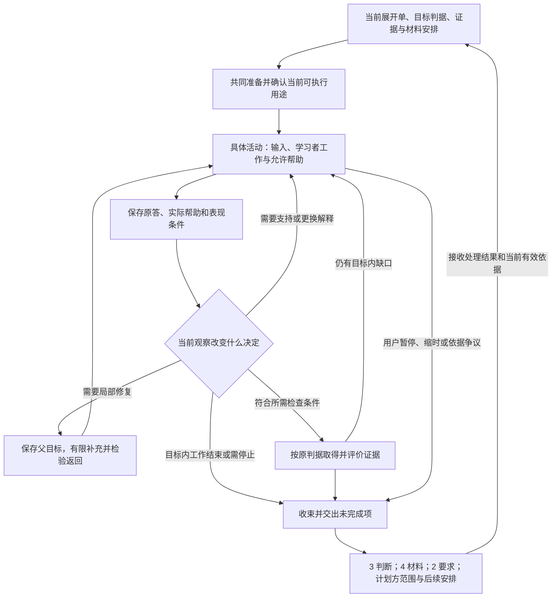

# AI 个人学习系统：工作包 5／C0 共同教学框架设计方案 v0

日期：2026-09-28  
阶段：C0，共同教学框架  
状态：可供后续专项设计和有限活动试用的设计基线；尚未经过真实教学验证。

修订：已依据 [C0 审阅评估](<E:/文献资料/学习系统架构设计/docs/reviews/AI个人学习系统_工作包5_C0共同教学框架_审阅评估.md>)完成局部修订，处理说明见文末。

**C0 把当前有效的目标、表现判断与材料条件，转成学习者确实需要完成的工作，并规定怎样根据实际表现改变教学、限定结论和完成交接。**它维护学习活动的组织规则；目标与判据仍由工作包 2 维护，证据与判断由 3 维护，材料及其用途由 4 维护，近期承诺范围由计划责任方维护。

本轮交付共同准备、活动规格、输入与帮助、反馈、检查、调整、收束与恢复的规则，以及用于审查这些规则的有限情境。Encoding 和 Post-Encoding 是未来使用方；本文不展开二者的专项方案、子工作包、策略序列或提示词。工作包 6 的策略调度、7 的全局时间安排、8 的完整协作实现也保留原归属。

## 一、依据、未知与本版关键选择

### 1. 怎样读本文

以下简称均指项目内实际文件；引用同时注明章节，供回查。

| 简称 | 文件与本轮主要使用位置 |
|---|---|
| 交接 | [工作包 2—4 交接对齐说明](<E:/文献资料/学习系统架构设计/docs/designs/AI个人学习系统_工作包2至4_交接对齐说明.md>)，第二至五节 |
| 任务 | [C0 设计提示词](<E:/文献资料/学习系统架构设计/docs/prompts/AI个人学习系统_工作包5_C0共同教学框架_设计提示词.md>)，第三至五节 |
| 2／3 | [工作包 2／3 联合方案](<E:/文献资料/学习系统架构设计/docs/designs/AI个人学习系统_工作包2与3_联合设计方案_v0.md>)，第四至十节 |
| 4 | [工作包 4 方案](<E:/文献资料/学习系统架构设计/docs/designs/AI个人学习系统_工作包4_设计方案_v0.md>)，第三、六至十节 |
| 架构 | [整体架构 v0](<E:/文献资料/学习系统架构设计/docs/architecture/AI个人学习系统_整体学习流程与概念架构_v0.md>)，第二至五节 |
| 路线 | [设计流程与工作包](<E:/文献资料/学习系统架构设计/docs/architecture/AI个人学习系统_设计流程与工作包.md>)，工作包 5—10 |
| 总要求 | [架构设计提示词](<E:/文献资料/学习系统架构设计/docs/prompts/AI个人学习系统_架构设计提示词_GPT6Astra.md>)，第 1—9 节及末尾后续阶段说明 |
| EN | [Encoding 研究报告](<E:/文献资料/学习系统架构设计/docs/research/01_Encoding研究报告.md>)，第 2、9—11、15 节 |
| PE | [Post-Encoding 深度增量研究](<E:/文献资料/学习系统架构设计/docs/research/Post-Encoding-Dynamics-深度增量研究.md>)，与任务、反馈、证据和验证有关的章节，见第十一节 |
| PE 台账 | [Post-Encoding 证据台账](<E:/文献资料/学习系统架构设计/docs/research/post-encoding证据台账与参考文献.md>)，见第十一节的具体条目 |

**【继承】**表示当前项目已约定的规则；**【设计】**表示本版把依据转成的操作规范；**【待验证】**表示需要实际试用的收益或参数假设。除明确标注的继承内容外，本文的活动组织、分支、记录模板和试用办法均为设计推论。研究报告的引用保留原边界，不表示本轮重新核验外部论文，也不证明本方案有效。

真实课程、个人基础、材料包、帮助历史和预算尚未提供。本版可以确定共同规则；真实活动开始前，须按第二节补齐当前用途必需的信息。所有案例、任务标识、版本、回答和接收结果都是假设，不能写入用户的实际学习记录。

### 2. 五项关键选择

| 本版选择 | 为什么这样选择 | 替代办法、代价与验证 |
|---|---|---|
| 围绕“学习者关键工作”组织活动 | 同一材料可以支持阅读、练习或检查；只有说明谁完成关键判断，才能解释表现 | 固定教学序列准备较省事，但可能与基础失配；本版增加少量准备判断，试用时比较是否减少无效互动 |
| 把活动用途与证据用途分别写清 | 一次尝试可以既促进学习又产生证据；帮助会改变后续证据含义 | 全部学习与检查分开较易管理，却可能重复提问；共用活动须保存时间线，不能重复计证 |
| 只预先设计会改变下一步的关键分支 | 高层交出具体问题、反馈锚点和分支理由，执行者才有据可依 | 逐轮脚本难以适应；仅给抽象目标又容易偏移。本版保留局部表达与节奏自由，代价是授权边界需可审查 |
| 共同准备以“当前用途可执行”为结束条件 | 材料与活动互相约束，要求一方先交完整成品会形成等待 | 一次性备齐全部材料会增加浪费；有限准备可能中途补充，但不得临时使用未经核验的评分依据 |
| 以实际接收与处理结果完成交接 | “建议后续检查”尚未改变任何安排 | 每次都签批负担过高；本版只保留影响判断、范围和恢复的回执，可由同一责任者在一份记录内完成 |

【继承依据】交接第二至五节；2／3 第五至八、十节；4 第六至九节；架构第三节。上述组织方式的收益属于【待验证】。

### 3. 与现有版本的关系

本版未发现需要先修改上游才能继续的实质冲突。旧架构中“下一轮优先完成 B1”的阶段安排已经由当前交接文件更新；本轮按 C0 的任务深度推进。关于结束后的检查，采用 2／3 第五节与 C0 提示词第四部分第 4 项的限定：**只追踪目标内要求的证据**；系统层面的长期学习愿景，不自动给每项活动追加保持和迁移要求。

本版新增的是活动规范与执行判断，不修改上游目标、判据或判断类别。后续若实例化发现它们有缺陷，按第七节提出带影响范围的修订请求，由原责任方处理。

## 二、共同准备：从已有依据到可以开始

### 1. 先确定本次需要解决的决定

教学方先用一句话写明意图：“依据哪项表现或未知，本次让学习者完成什么，以便决定接下来继续、帮助、检查还是收束。”同时引用当前展开单的有效范围、目标与判据版本。尚无个人表现时写“起点未知”，不要为了填完整而虚构缺口。

例如，“给定方法后能算，但未见自主选择，因此先观察其选择过程”，与“关键概念尚无可靠输入，因此先提供定义和示范”，应产生不同入口。若两种入口都合理，选择成本较低、能随表现转换的一种，并保留不确定性。

### 2. 不同缺项对不同用途产生不同限制

| 信息状态 | 当前可以做什么 | 当前受限用途与处理方 |
|---|---|---|
| 有可识别目标工作、可靠内容和资源边界；个人基础未知 | 用短任务或可靠输入开始，观察后选分支 | 不把未知基础写成诊断；由 3 接收表现 |
| 学习方向明确，但正式判据尚未落实 | 开展明确限定的探索、阅读或示范，保存原始产物 | 不作正式通过判断；2 补齐判据，计划方限定承诺 |
| 某项参考或答案有疑误 | 使用不依赖它且已合格的部分，必要时换材料 | 暂停争议用途及确定评分，4 核验；若影响要求，交 2 |
| 当前必要材料已落实，远期材料未齐 | 启动当前有效范围 | 远期保持候选，计划方接收未满足项 |
| 既有帮助或同题暴露不清 | 学习活动可继续；记录已知与缺失条件 | 不声称这份表现满足未暴露要求；3 限定解释，教学方另选满足条件的任务或暂缓相应结论 |
| 预算或允许工具会改变任务可行性，却尚不清楚 | 先澄清本次必要边界，或开展已授权、可随时收束的有限活动 | 不承诺完整验收、额外费用或超出范围的补课 |
| 连目标工作或内容正确性都无法辨明 | 整理缺项、核验来源、提出可审查的替代 | 暂不开展依赖未知内容的正式教学与评价 |

“允许带着未知开始”指用途受到恰当限制，不是把必要条件默认为满足。正式检查之前，目标、判据、任务、参考、资源和暴露条件必须支持拟作的结论。

### 3. 材料与活动怎样共同准备

1. **教学方提出暂定意图。**给出目标工作、候选任务形式、要保留给学习者的判断、可能需要的帮助、检查用途和本次预算边界。已有材料也可先由 4 提出用途建议。
2. **4 返回可行性。**指出可定位内容及版本、可靠性和限制；当前输入能给什么、备用支持会代做什么；参考与候选检查是否落实；缺哪些内容或新增前置。
3. **教学方完成必要取舍。**材料已经解释核心方法时，可把它用于示范，再另备合格检查；材料难读但内容足够时，先解决读取障碍；只有无法承担当前功能时才请求补充。能通过合适活动产生所需工作时，不继续堆叠输入。
4. **把结果落到当前安排。**教学方维护活动，4 维护材料用途；计划方据可行性维护展开单的有效范围。范围内的已授权落实直接进行，实质增减承诺才返回计划方。

当目标与判据相容、当前必要材料及核验已落实、关键工作与帮助关系明确、资源和授权足够时，本轮准备结束。不要求准备所有可能分支；未备好的分支应有暂停或返回路径。若继续往返没有获得会改变选择的新信息，教学方汇总“缺项—影响用途—可行替代—责任方”，请对应方作取舍，不重复索要完整方案。

### 4. 入口选择要能说明理由

| 已有依据或观察 | 合理入口 | 执行时观察什么、怎样改变 |
|---|---|---|
| 尚无关键定义、例子或任务表征 | 直接阅读、解释或示范，并安排一个学习者要完成的对应工作 | 能否使用输入解决局部问题；若只复述，检查关键关系是否仍由 AI 完成 |
| 有相关表现，缺少目标条件下的证据 | 先作目标工作或短检查 | 条件满足时直接保留证据，避免重复讲解；暴露缺口后转教学 |
| 不确定是读取障碍还是概念困难 | 在不泄露目标关系的前提下改写符号或输入形式，观察同一操作 | 形式改变解决困难时不扩大为概念补课；形式本身就是目标时，承认这是有帮助表现 |
| 用户明确要求解释或完整示范 | 在授权内提供，事先说明本次转为教学 | 保存初答和展示时点；之后通过另一合格任务观察尚需的自主工作 |
| 题目可能有缺陷或标准不清 | 先确认题意与依据 | 不用连续追问弥补系统题目缺陷 |

【依据与限度】交接第四节；2／3 第七、八节；4 第五、六节；EN 第 9—11 节。先讲或先试均为有条件的选择，不设固定输入输出比、通用提示阶梯或统一轮数。

## 三、共同框架：活动、表现和后续决定怎样连接

图中是判断关系，没有规定每次学习必须先问、再提示、再检查。原始活动若已满足证据条件，可以直接进入评价；可以输入后开始，也可以从未完成位置恢复。任何节点发生依据失效，立即停用受影响部分。

【设计】活动记录只需表达三种不同信息：**计划如何做、实际发生什么、接收方如何处理。**三者可写在同一短记录中，共用原答和材料引用。教学记录允许保存常规评分及其依据，但“当前能力支持到哪里”引用 3 的结果，不另维护一个掌握等级。

## 四、活动规格：让执行者知道具体做什么

### 1. 一份可复用的轻量规格

以下为信息含义模板，不是数据库字段；有上游引用的内容不重复抄写。只填写会影响当前执行与解释的内容。

| 项目 | 需要写到什么程度 |
|---|---|
| 依据与意图 | 引用展开单有效范围、目标和判据版本、相关原答与判断；说明本活动要解决的缺口或未知、用途，以及此次能支持的结论 |
| 学习者工作与产物 | 具体要选择、推导、实现、解释、预测或转换什么；留下哪些可观察产物；哪些判断必须由学习者完成 |
| 任务与实际入口 | 可直接使用的题面、数据、输入片段或制作要求及版本；怎样呈现；区分学习者可见内容、备用帮助、教学与评分参考 |
| 资源与帮助边界 | 目标允许什么工具和资料；可调用的帮助分别影响什么操作；当前禁止提前展示什么；既有暴露与不确定处 |
| 反馈与评价依据 | 正确性依据、判据对应的关键观察、多解和信息不足的处理；哪些部分可常规评价，哪些须复核 |
| 表现分支 | 哪些可区分的表现改变下一步；对应哪项支持或小检查；支持后看什么；何种反证使原解释失去优先性 |
| 调整与退出 | 执行者可改什么；哪些变化须返回谁；当前完成、无进展、预算停止、争议、用户暂停的条件；有子任务时注明父目标和返回位置 |
| 结果与接收 | 指向实际任务、原答、事件发生时间、相关学习／练习／反馈时间、帮助时间线与评分；列目标内未支持项、材料问题、后续需求；责任方返回处理结果或保持待接收 |

高层教学责任方至少落实关键任务、参考锚点、关键工作归属、重要分支和授权范围；对有多解、容易泄露方法或诊断分歧大的部分，给出具体设计。执行者可以据已有规格生成常规措辞和局部变化；改变学科内容、适用条件或关键操作的生成物，仍要接受 4 的相应用途核验。

### 2. 任务合格与学习者答得好分别判断

在发布任务前，教学方检查以下问题；内容核验依靠 4 的依据，目标匹配依靠 2 的要求。

| 检查面 | 判断办法 | 不满足时怎样处理 |
|---|---|---|
| 是否真的调用目标操作 | 将目标关键操作逐一对应到产物；试想不做该操作，是否也能靠抄写、猜选项或按步骤机械完成 | 改题或降低这道题能支持的结论，不能把完成率当作目标达成 |
| 输入是否代做工作 | 检查题干、例子、标题、配色、编号、图形标记、默认选项与折叠位置；确认有没有已经给出所评价的方法或关系 | 明确作为有帮助学习活动，或重新准备合格检查 |
| 是否混入新前置 | 检查符号、工具操作、数据读取、学科步骤；区分目标必要前置与题面偶然负担 | 换形式、提供允许的局部支持，或把前置作为有限检查；不要把失败直接归到父目标 |
| 参考是否可靠且可评分 | 核对定义、条件、推导、测试或来源；允许等价解、多种有依据论证和正确的“信息不足” | 依据不足则不确定评分；交 4，必要时交 2 |
| 是否满足证据条件 | 检查允许资源、暴露历史、任务与训练关系、所需间隔及情境；事先明确哪些维度被改变 | 不满足的部分不能作为该结论证据；保留可支持的其他部分 |

任务形式随目标选择。让学习者操作可视化时，预先写明要观察的预测、调参理由、图式转换或解释；画面移动和“看懂了”不能代替这些产物。目标若是从公式自主构图，完整图就是实质帮助；目标若是解释图中关系，提供图则可能是允许输入。

【继承依据】2／3 第五节、第六节第 3 项；4 第六节、第七节、第八节；交接第二、五节。具体审查表为本版设计。

## 五、输入、帮助与反馈：每一步都应改变下一步的依据

### 1. 一次反馈至少落实三件事

指出原答中可定位的现象；给出有依据且与该现象相称的信息或支持；留下一个学习者可以完成的修订、比较、说明或操作，以观察问题是否改变。若只是简单事实错误，直接给正确事实并作有限使用即可，不强加整套诊断。若目标是方法选择，直接报答案通常无法解释其选择出了什么问题。

反馈之前先做与风险相称的题目和参考检查。参考与原答不一致是需要解释的现象，不自动说明学习者有缺口；对已有可靠依据的普通题，也无需每轮重新启动完整核验。

### 2. 同样“答错”，下一步可以不同

| 可观察现象与尚存解释 | 能改变下一步的少量证据 | 合理反馈或支持，以及后续观察 |
|---|---|---|
| 关键事实写错或想不起；可能是访问困难、未学或条件混淆 | 提供该事实后，看能否完成原来需要的推理；这已经是有帮助条件 | 给可靠事实与必要条件；能继续则保留推理表现，不把整个主题清零；不能继续再检查关系 |
| 步骤断裂；可能是不理解关系、符号负担或执行失误 | 让其指出第一处无法说明的连接，或用较易读取但关系相同的表达 | 解释该连接或示范必要步骤；让学习者完成剩余连接，再在减少帮助时观察目标工作 |
| 答案对但条件遗漏；可能是表达省略、规则过度概括或偶合 | 检查一个成立条件改变的情境，或要求说明原步骤为何合法 | 对比成立与失效的条件；反馈同时保留原来仍成立的范围，防止学成反向过度规则 |
| 给定方法能做，自主选择失败 | 在不新增关键前置的任务中观察其识别线索和选择理由 | 必要时比较方法适用条件；AI 若给出方法，后续只评价相应执行，选择仍待合格检查 |
| 文字解释尚可，图、代码或符号操作困难 | 改变一种表征或工具条件，观察关键关系是否保留 | 支持读取或接口，避免立刻扩展概念补课；若转换本身是目标，则记录相应帮助 |
| 用户结论有依据但不符合参考，或提出反例 | 回看题干、参考和原答，核验冲突点 | 暂停争议评分，必要时更正题目；不能要求用户不断改到错误参考一致 |
| 重复反馈后仍在同一点失败，或负担明显增大 | 询问本次困难和意愿，检查前一次支持是否真的被用上、诊断是否遭到反证 | 换解释、换活动或收束；不自动加深追问，也不由慢答推断一般能力或疲劳 |

小检查只在结果会改变下一步时追加。若不同可能答案都会导致同一种必要解释，通常直接提供解释更节省负担。没有新增信息、原解释已有反证或局部补充超出预算时，停止沿原路径追加诊断。

### 3. 帮助按影响的操作记录

计划可以列出定义说明、符号解释、关系线索、方法提示、局部示范或完整解答，但不把它们排成普适的低到高等级。同一句话对不同目标的影响不同：给公式可能保留计算工作，却已经完成公式选择；给坐标轴含义可能只降低读取负担，也可能正好提示目标关系。

实际记录至少保留与结论有关的顺序：**初始任务及可见输入 → 初答 → 提示或反馈的内容与时点 → 修订 → 后续任务及作答**。每项活动／表现事件沿用 2／3 第六节的发生时间记录，并引用或记录初学、最近相关练习／反馈及此次作答的时间；不能只保留先后顺序而省略这些时间依据。同一活动内部的提示与修订可主要按先后记录，只有具体时距影响解释时才增加更细时间信息或计算间隔。可复用已有事件时间，无需逐句计时或要求用户重复填写。

备用解答未展示时不计暴露；用户自行查看资料或调用工具时，记录已知情况及信息来源。无法获知的外部接触时间或期间再学习保持未知，不能记成“没有接触”，也不能事后猜补时间。这些记录不意味着所有活动都要增加延迟验收。

用户请求直接解释或答案时，在授权内满足，并说明之后哪项表现仍需检查。意外提前展示同样按已发生处理：保留展示前的原答，取消受影响片段原拟的独立解释，选择合适后续活动。隐藏答案、换措辞或更换 Agent 均不重置暴露历史。

### 4. 何时减少帮助、何时给出更完整解释

减少某项帮助的理由，应是学习者已经承担了它原先替代的工作，或下一步确实需要观察该工作能否自主完成。每次减少帮助都应知道在观察什么；若失败，区分“当前可继续教学”和“已形成无帮助证据”。减少帮助本身不是通过标准。

若学习者缺少可用概念、反复猜测、负担上升、或明确希望先看示范，可直接给足必要支持，随后保留要由其完成的工作。示范已经完成全部目标操作时，此段产物只能体现观看、复述或帮助后执行，不能强称仍然保留了独立目标工作。

反馈时机由用途决定：需要观察连续推理时，可以先保存完整尝试再反馈；已确认的错误正成为下一步错误依据时，应及时纠正；检查用途事先要求不介入时，先完成所需记录，用户请求帮助则转教学。不存在通用的“越快越好”或“必须先挣扎若干轮”。

【依据与限度】2／3 第六、七节；4 第八节；EN 第 9—11 节；PE 与台账的反馈依据见第十一节。上述分支是共同教学决策，不是某个专项的完整策略调度。

## 六、检查与判断：把教学进展交回证据体系

### 1. 不同表现支持什么

| 实际表现 | 可以据实记录 | 不能自动推出 |
|---|---|---|
| 阅读或听完解释，自述理解 | 已接触的内容、感受、提出的问题 | 能独立完成目标工作 |
| 提示或反馈后修正 | 在具体帮助下完成哪些工作、能否运用所给信息 | 提示前已经会、无提示能选择同一方法 |
| 减少帮助后完成练习 | 该练习条件下所保留操作的表现 | 自动满足目标要求的新任务、延迟或情境条件 |
| 在目标允许的资源与暴露条件下完成关键操作 | 按原判据对应的条件化证据 | 更宽范围、永久保持或未检查的迁移能力 |

**独立是目标关键操作由学习者完成。**允许的教材、计算器、编译器或资料可以存在；若工具直接完成了目标操作，必须据实改变解释。开卷目标不被 C0 改成闭卷，目标要求的工具使用也不应为了“纯独立”被剥夺。

### 2. 从原答到判断的路径

1. 执行者保存实际任务版本、关键原答或产物、事件发生时间、相关学习／练习／反馈时间、可见材料、帮助和再接触背景；将缺失条件明确标出，已有信息可用引用交接。
2. 先判断任务和参考是否支持本用途，再依原判据作授权内的常规评分；区分观察、评分和原因假说。原答存在的部分不因后续帮助而失效，后续修订也不回写成初答。
3. 向 3 提交原答引用、判据对应、帮助影响和不确定性。3 维护条件化判断及诊断，教学记录引用处理结果。
4. 涉及重要跳过、扩大能力结论或相互冲突证据时，交相应评估责任方复核。内容／来源疑误先交 4 核验，目标或判据解释争议交 2，评估责任方据处理结果复核受影响判断；复核先看原答、条件和判据，再看教学总结。常规且已授权的评价无需逐题升级。

同一表现兼有学习和检查用途时只记录一次，分别说明用途。若初始活动已具备目标要求的条件，可以直接供判断使用；如果任务新颖性、暴露或资源条件不符合，不能在答对后追认合格。多 Agent 同意评分不替代内容核验。

### 3. 当前什么时候可以结束

活动完成由本次约定工作与退出条件决定；目标判断由目标内证据要求决定。两者可在不同时间结束。

| 当前结束原因 | 应交出的结果 | 后续决定 |
|---|---|---|
| 本活动预定工作已完成 | 完成的操作、帮助条件及产物 | 若目标内还需其他条件的证据，提出相应需求；不自动追加目标外要求 |
| 所需证据已取得并完成授权评价或复核 | 3 的条件化判断及适用范围 | 计划方据此调整安排；不是永久掌握声明 |
| 时间结束或用户暂停 | 已完成部分、未支持部分、父目标与恢复位置 | 计划方接收范围变化；未完成不计通过 |
| 材料疑误、条件缺失或评分争议 | 原答、受限结论和待处理原因 | 先核验或补足条件，保留其他有效活动 |
| 当前路径无进展或用户负担不可接受 | 已尝试的支持、实际反应、诊断反证 | 重审解释、活动或范围；不能无限追问 |

【继承依据】2／3 第五节、第六节第 4—5 项、第九、十节；交接第三至五节。当前学习可以继续，保持或更宽范围能力仍可保持未知。

## 七、调整、异常与恢复权限

### 1. 按改变了什么决定处理路径

| 触发信息或变化 | 执行者当下可以做什么 | 返回谁、什么条件下恢复或生效 |
|---|---|---|
| 句式、字号、表达形式造成读取困难 | 在授权内改写或调整呈现；检查改变是否提示了方法，记录实质帮助 | 若内容和关键操作未变，可继续；改变关系表达、目标操作或用途时，4 核验相应用途，必要时 2 检查目标匹配，3 限定证据 |
| 需要局部提示或完整示范 | 在允许范围内切换教学，保存帮助前后产物 | 3 解释帮助影响；恢复目标所需检查前，重新确认任务与暴露条件 |
| 原材料不可访问，但有候选等价材料 | 采用已核验、用途相符且授权内的替代；不要只凭主题相同判为等价 | 4 维护替代版本及用途；范围未变可直接继续，否则计划方更新有效范围 |
| 想生成任务变式 | 在授权内制作，核对关键操作、条件、解答、额外前置及训练关系 | 4 核验受影响内容；改变目标要求交 2。只换数值或措辞不自动构成目标需要的新情境 |
| 疑似必要前置不可用 | 保存原答、父目标、转入理由、替代解释和返回条件；作有限检查或支持 | 3 维护诊断，2 仅在依赖关系受影响时修改前置，4 补材料；超出范围或预算交计划方 |
| 局部补充成功，但父任务仍失败 | 检查综合组织、方法识别、新题额外前置或原诊断，不再沿原解释自动下钻 | 教学责任方重设活动，3 重审诊断；没有有依据且在预算内的路径则收束并交计划方 |
| 目标、判据、允许资源或最终用途需要改变 | 暂停依赖争议标准的确定结论，提交具体理由与受影响证据 | 2 维护新版本，3 重审旧证据，计划方合并范围；超出既有授权的用途、承诺或投入由用户决定 |
| 内容、题目、答案、评分存在实质疑误 | 立即停用受影响部分，保留当时原答和已展示内容；继续合格替代活动 | 4 核验内容，2 检查目标／判据，3 重评，教学方修复教学影响，计划方重排；见下节 |
| 预算缩小或用户要求缩时 | 先保护必要收束，减少可选新内容、合并重复活动；可保存未完成检查 | 计划方返回缩小、延期或暂缓的有效范围；不能改低标准后通过，也不默认全部顺延到明天 |
| 用户要求换方式、暂停、质疑评分或纠正记录 | 普通变化按授权处理；暂停即保存当前可恢复位置；争议按依据核查 | 用户陈述与原答核对，3 修订相关判断；原始记录的勘误留下理由 |
| 用户删除个人证据 | 按用户控制要求删除，不从遗留副本恢复已删除内容；复核完成前限制受影响用途，不牵连无关活动 | 3 重审所有依赖该证据的判断：剩余证据充分则保留并更新引用，覆盖不足则收窄，失去依据则撤销；同步更新个人摘要，计划方据结果调整受影响安排 |
| 高层暂不可用或交接未回应 | 继续不依赖争议且在既有授权内的活动，保存待处理事项 | 指定原责任方接收；超授权的目标变化、重大判断、重要跳过或范围承诺等待处理 |

“等价替换”须同时保持当前目标操作、适用条件、难度所需前置与证据用途；材料内容正确只是其中一项。呈现变化虽然不改文字，也可能改变独立条件。

### 2. 局部修复要带着父目标返回

进入局部修复前，记录“为何这一点可能阻碍父任务、补到什么程度足够、用什么父目标工作检验、允许投入到哪里”。不要求把所有知识展开为前置树；可伴随提供的事实或允许使用的工具，不必变成额外课程目标。

局部表现达到父任务所需程度后，返回关键工作。原题可用于修订和确认反馈被理解；如果需要独立证据而原题答案已暴露，另用合格任务。回到父目标仍失败时，应区分子技能可用与综合工作尚未完成，保留已有证据，重审解释或收束。实例化时必须有有限修复预算，但 C0 不设全学科统一分钟数、题量或连续失败阈值。

### 3. 内容纠错沿两条路径回查

**路径一：内容 → 材料／任务／参考 → 评分与判断 → 安排。**  
**路径二：内容 → 目标／验收标准 → 任务、评价与安排。**

执行者先隔离相关用途；4 确认更正及影响范围，2 确认错误是否进入要求，3 用原答和当时条件重评。原答足够时直接重评；不足时只补相应结论需要的证据，不默认全章重学或重考。若已错误地教给用户，应说明具体更正、仍成立的边界，并观察必要的修订；修改后台参考不能替代教学修复。

恢复时分别回答：材料在当前版本及用途下是否可靠；已发生的错误教学是否得到必要纠正；原评分与能力判断是否已经重审。三者可以分时完成，不能互相替代。计划方据处理结果维护当前安排；内容重新可用不会自动恢复旧能力结论。

【继承依据】交接第五节；2／3 第四、第七、第九、十节；4 第七、九、十节；架构第三节第 5 项。这里细化执行入口，不改变专业决定归属。

### 4. 删除证据后的三种结果

以下是对 2／3 第九节既有规则的简短走查。判断原先引用 A、B，用户删除 A；3 依据仍然存在且可回查的 B 及其他相关条件重审，不以“还有一条记录”代替充分性判断。

| 剩余支持 | 判断与引用如何处理 | 当前安排如何改变 |
|---|---|---|
| B 单独仍满足原结论的范围与证据条件 | 保留该范围的判断，更新为有效证据引用，不继续引用 A | 不因删除 A 自动补测或重复教学 |
| B 只支持原结论的一部分 | 收窄到有充分支持的范围，明确失去支持的部分 | 只有目标内且影响下一步的证据缺口才交计划方取舍，不清零已获支持的部分 |
| 没有剩余有效证据支持原判断 | 撤销失去依据的判断，相关能力保持未知；未知不等于能力下降或答错 | 允许开展不依赖该判断的已授权活动；重要跳过等用途暂停，必要补证由计划方承接 |

三种结果都不恢复用户已删除的内容，不用旧摘要或其他副本替代已删除原证据；复核引用与个人摘要也应随之更新。这是判断维护的区别，不新增审批或存储系统。

## 八、共同收束与交接：留下结果，也留下处理结果

### 1. 收束只保留下一步确实需要的信息

可以直接在第四节的活动记录尾部追加如下短模板：

> 本轮实际完成：任务／版本、关键产物与原答位置。  
> 表现及条件：初答、关键帮助、修订和检查分别显示什么；事件发生时间及相关学习／练习／反馈时间引用，期间再接触是否已知；评分与 3 的判断引用；哪些条件不清。  
> 目标内未完成：尚未支持的要求、原因和所需证据；目标未要求的事项不加入欠账。  
> 异常与恢复：材料或评分问题、父目标、停止原因、下一可执行位置及不得恢复的用途。  
> 交接处理：需求、接收责任方、所依据版本、返回的处理结果；尚未接收或尚未安排的部分。

对用户的收束应简洁，例如：“今天在提示后补全了漏掉的情况；新任务中的自主判断还未检查。已因缩时结束，下次先确认范围，再从这项检查继续。”不要把内部交接表全部变成用户要填写的表单。

### 2. 各方必须返回什么

| 接收方 | 本轮交出 | 返回的信息与闭环条件 |
|---|---|---|
| 3／评估责任方 | 任务、原答、事件发生时间与相关学习／反馈时间、帮助顺序、再接触背景、评分依据、诊断反证和条件缺失 | 按现有规则给出结论范围与证据状况、使用限制、修订诊断或补证要求；不能只回复“已理解” |
| 4／材料责任方 | 实际版本和用途、使用困难、额外前置、潜在错误或实际泄露 | 保留、替换、补充、限定用途或隔离及其依据；说明哪些活动受影响 |
| 2／目标责任方 | 目标、前置、判据或资源条件存在的问题及影响 | 是否修订及新版本、旧证据适用关系；未修改时给出相应说明 |
| 计划责任方 | 完成与未完成范围、预算变化、父目标返回结果、后续检查需求 | 已安排、延期、收缩或暂缓及影响；维护唯一当前有效展开单，指明下一次从哪里继续 |

不涉及某方专业决定的活动可直接引用其有效依据，无需例行发起一次空交接。角色合并时也要能辨认是哪类决定；不必为此增加 Agent。

提出需求、接收需求、安排执行是三件事。发出后若未获处理结果，写“待接收”或“已接收待处理”，列明责任方及影响；不能写成“已安排”。现阶段由教学责任方在收束时汇总这些未决项，计划责任方承接跨会话连续性；尚未细化工作包 7／8 不意味着无人负责。当前课程活动仍可收束，交接未闭环部分则保持可见。

### 3. 下次恢复检查什么

读取当前有效的展开单、目标／判据、材料用途和 3 的判断；核对上次停止原因、原答位置、事件发生时间、相关学习／练习／反馈时间、实际帮助、已知再接触和父目标返回点。新版本或撤销信息优先于旧摘要，仍保留的历史作答按其当时条件解释。

若发生个人证据删除，读取删除后经 3 复核的当前判断及其剩余证据引用；复核未完成时限制受影响用途，不能直接沿用旧摘要。剩余证据充分的判断可以继续使用，部分支持则限于收窄后的范围，失去依据则采用撤销后的结果。旧摘要不能替代已删除原证据，也不能从遗留副本恢复内容。关键时间或帮助条件缺失时明确标注未知，只限制依赖这些条件的结论。

随后检查本次时间与意愿是否改变有效范围，选择已经准备好的下一项工作，或按第二节补齐必要条件。无需为了恢复再做完整冷启动；也不能仅凭“上次通过”跳过目标内尚未完成的检查。接收方确认的是依据和执行位置，不是重新宣布独立性。

【依据】交接第三至五节；2／3 第八至十节；4 第九、十节；路线工作包 7／8。回执形式和共享记录的实现留给后续，不影响当前责任生效。

## 九、贯通检查：用有限假设检验规则能否执行

以下均为**假设设计走查**。数学任务的参考可由给出的代数推导核查；AI 案例使用自包含任务规格。它们不是用户真实原答，也不是正式题库。读过本文的人已经见到题面和参考；未来若将同类活动用于真实检查，须另备符合目标暴露条件的任务。

### 1. 数学：一份填好的活动规格

**假设上游依据。**目标 G-M v1：在实数方程的常见乘除变形中保留解集，并说明关键步骤的成立条件。判据 K-M v1 要求判断不能遗漏零因子情形，也不能把原定义域排除的值纳入解集；关键条件错误不能由最终数值碰巧正确抵消。允许草稿及一般运算规则资料，不提供当前题的解法或针对性方法提醒；计算器可核算数值，但不能代替条件判断。当前目标内验收需覆盖上述两类情形；未要求本轮证明延迟保持或跨学科迁移。这是假设的目标约定，不是 C0 对所有数学目标的规定。

展开单 P-M v1 的有效范围只包含本轮“零因子消去”的教学与当前条件下检查；定义域情形列为目标内后续需求。3 的判断 J-M v1：已有给定变形方法后的计算表现；自主选择和零因子条件未知。一般乘法、移项及提取公因式的执行已有证据，零积性质是否可用尚不清楚；不能因这些局部操作可用而预先认定能独立组织求解。计划假设本次可用 15 分钟，其中局部检查与补充最多使用 4 分钟；这些数值只检验有限预算如何生效。

材料安排 M-M v1 包含：

- 当前题 T0：“在实数范围内解方程 `x² = 3x`，写出变形依据和解集。”
- 备用支持 H1：零积性质的具体数值例；H2：T0 完整解答。两者初始均不展示。
- 教学参考 R0：`x²−3x=x(x−3)=0`，解为 `0、3`；代回均成立。若直接除以 x，必须另外处理 x=0；不能无条件消去。
- 候选返回任务 T1：“在实数范围内解 `(u+1)(u−3)=2(u−3)`，写出依据和解集。”参考 R1：移项得到 `(u−1)(u−3)=0`，解为 `1、3`；直接消去 `u−3` 会遗漏 `3`。

本例把 R0／R1 的推导作为纸上核验锚点，并假设 4 已确认对应内容与用途；真实教学仍需落实 4 的正式材料安排与来源。T1 只改变因子位置和需要识别的零因子，最多支持这一有限变式，不能称为广泛迁移。

| 规格项目 | 本例填入的决定 |
|---|---|
| 依据与意图 | 引用 P-M／G-M／K-M／J-M／M-M v1；观察能否自主保留消去时可能丢失的解，必要时转教学 |
| 关键工作与产物 | 学习者选择变形、处理除数为零的情形，产出解集和理由；AI 不预先标出应保留哪个因子或哪个解 |
| 当前入口 | 只呈现 T0 的完整题面；不加“别丢零解”之类标题，不给因式分解步骤；H1／H2／R0／R1 均留作教师参考或备用 |
| 允许帮助 | 可澄清任务格式；必要时提供零积性质或完整解答，但该时点之后按有帮助教学解释；用户可直接请求示范 |
| 反馈与评价 | 解集是否完整、关键变形是否合法及说明是否充分；合法分情况讨论与因式分解都接受；按 K-M 评价，不要求复述标准措辞 |
| 初答合格分支 | 原答已自主处理零情形则保存证据；本活动不重复示范，当前有限范围可收束，剩余目标要求交计划方 |
| 遗漏分支 | 先保存原答；结合理由区分条件遗漏、零积性质不可用或表达省略；需要时作有限检查，再决定提供哪项支持 |
| 局部修复分支 | 父目标为 G-M 的零因子条件判断；补到能正确应用零积性质即返回。T0 若已暴露解法，用 T1 观察相应关键工作 |
| 退出与授权 | 达到本活动工作、预算停止、用户暂停、依据争议或无进展均可收束；可调整语句和使用备用支持，不可把只得一个解改判为完整，也不可扩成整个因式分解单元 |
| 结果与接收 | 3 接原答／帮助／检查记录；4 接实际使用与困难；计划方接未完成检查和剩余目标范围；没有目标变更则引用 G-M／K-M，不另发变更请求给 2 |

### 2. 同一活动的完整假设轨迹

| 时点与实际事件 | 当前解释及教学决定 | 保存与返回 |
|---|---|---|
| 准备：教学提出观察消去条件的意图；4 返回 T0、H1、H2、T1 的用途与参考；计划方确认 P-M v1 的有限范围 | 必要材料和授权齐备，开始 T0；完整解答已准备但未展示 | 记录采用版本及初始可见题面；不计 H1／H2 暴露 |
| 初答 A0：“两边除以 x，x=3，解集为 {3}。” | 可见变形遗漏了 x=0；可能是未检查除数条件，也可能对零因子情形不熟，暂不定为基础缺失 | 原答完整保存；可按 K-M 记录本题不完整，原因判断保持暂定 |
| 小检查：“已知 ab=0，关于 a、b 的取值能确定什么？”用户答：“a 和 b 都要是 0。” | 此检查已经提示零乘积方向，不能再将随后的 T0 表现视作无提示；回答为零积性质误解提供局部证据 | 记录题面、原答和提示功能，交 3；尚不足以推断整个代数基础薄弱 |
| 调用 H1，展示 `0×5=0`、`7×0=0`，说明乘积为零至少有一个因子为零；让用户判断并说明 `(v−1)(v+2)=0` | 用户答“v=1 或 v=−2，两个因子不必同时为零”；当前局部支架已可用，停止继续下钻 | 这是帮助后应用，保存 H1 的内容及产物；父目标仍未完成 |
| 用户要求 T0 的完整解法，执行者展示 H2／R0 | 用户修订为“{0,3}；除以 x 只保留 x≠0 的情形，还应检查 x=0” | 初答不覆盖；新回答表示完整示范后能说明本题遗漏原因，不支持本题原先自主完成 |
| 时间临时缩短，已无足够时间做 T1 | 结束当前教学，不降低 K-M；T1 没有展示 | 3 保留 T0 初答未满足判据和帮助后修订，后续自主表现未检；4 据执行记录返回 H1／H2 保留，引用 T1 未展示的记录；计划方返回 P-M v2：本次承诺收束，T1 延期、定义域情形仍未安排 |
| 下次恢复：读取 P-M v2、J-M 的最新结果和暴露记录；确认本次时间，计划方使 T1 成为本次有效安排 | 假设学习者报告期间未接触相关题目，系统记录保留该信息来源；实际间隔照实记，不把恢复当作抹去既有学习 | 执行者知道 T0／H1／H2 已见，T1 在已知记录中未展示。该次用途为有限变式中的当前检查，未预设为延迟保持验收 |
| 呈现 T1，不附相关步骤；用户答：“移到左边得 (u−3)(u−1)=0，所以 u=3 或 1。直接除以 u−3 要另外检查 u=3。” | 在约定资源条件下自主处理了这个因子的零值；不因曾学习该规则而否定一切新表现，也不因一个变式成功扩大结论 | 按 K-M 记录 T1 的有效表现，3 返回 J-M 新版本：有限变式中的条件判断获得支持；定义域为目标内未检项，更宽泛化仅是解释边界，不另增待办 |
| 最终交接 | 当前有限活动收束，目标 G-M 整体尚有定义域要求 | 计划方返回：当前零因子活动完成，定义域需求已接收但暂未安排，须另行确定有效范围；4 无新增疑误并保留材料；2 的目标／判据版本不变 |

这条轨迹中的“已接收”“延期”等均是假设接收结果，用于检验接口完整性。真实执行若尚无回应，必须按第八节保留为待接收或待处理。

**时间记录走查。**另给这条轨迹一组模拟时间：早先相关学习为 9 月 27 日 19:00，T0 初答为 9 月 28 日 14:00，H2 的相关反馈为 9 月 28 日 14:08，T1 检查为 10 月 1 日 14:08，各自关联相应事件。这样可以区分原学习到检查与最近反馈到检查，后者为 72 小时；不会把更早的学习日期直接当作未复习保持时长。若期间接触无法确认，照实标未知，保留 T1 当次表现，但不据此确认需要排除近期再学习的保持结论。实际记录使用完整日期及必要的时间信息，以上日期只用于走查，并未给此目标新增延迟验收要求。

### 3. 改变基础或表现，活动必须随之改变

| 与主轨迹不同的观察 | 应改变什么 | 不应发生什么 |
|---|---|---|
| T0 初答已合法分情况并给出完整解集 | 保存这份证据，按活动规格直接收束当前范围；目标内其他要求由计划接收 | 为走完固定流程再讲 H1／H2 |
| 学习者明确说从未接触零积性质，且现有资料支持这一教学起点 | 可直接用可靠解释和示范，再让其应用；自主检查另备 | 强迫先猜若干轮，以失败数量当作诊断价值 |
| 小检查中能准确说明零积性质，但 T0 初答漏条件 | 优先观察其对变形条件的选择与执行，提供相应反馈 | 因原答错就补整个乘法基础 |
| H1 后局部题成功，但 T1 又直接消去因子 | 保留局部成功；考虑条件识别或综合组织问题，按预算换活动或请教学方重设 | 宣布父目标已修复，或不断向更低级算术下钻 |
| 展示界面提前露出 T1 参考 | 记录暴露并改变 T1 的证据用途；另备核验合格任务或收束未检项 | 隐藏答案后继续称 T1 为未暴露检查 |

### 4. 材料错误与疑似前置缺口同时出现

另一假设任务 T2：“在实数范围内解 `(t²−4)/(t−2)=0`。”错误参考 R2 v0 写“约分得到 t+2=0，但 t=2 也使分子为零，因此解为 −2、2”。学习者原答：“原式要求 t≠2；在此定义域内约分为 t+2，故解集为 {−2}。”执行者却按错误参考判为“漏解，可能不会求分子零点”。

用户质疑后，立即暂停这个评分与诊断。4 核验：t=2 时原式无定义，t=−2 时分母非零且原式为 0，故学习者原答正确。4 隔离 R2 v0，改为正确参考，并回查受它影响的任务；2 确认 G-M／K-M 已要求保留定义域、未被错误污染，因此无需改目标。3 直接依据原答撤销“漏解”评分及相关缺口推断，记录相应条件下的有效表现，**无需重考来修复这个历史结论**。

教学方另向学习者纠正先前错误反馈，说明“分子为零仍须分母非零”的边界；是否还需一个小应用，由已发生的误导及当前产物决定，不自动让用户重新做整题。计划方撤回由错误诊断引起的补课安排。这分别完成了材料纠正、教学影响处理和判断重评。

若回查发现另一目标的判据也采纳了“只要分子为零就算解”，则第二条路径必须启动：2 修订该目标判据，3 重审其相关证据，教学和计划据新要求调整；不能只改 R2 就结束。

### 5. 另一学科：AI 课程中的指标实现

**自包含假设目标 G-A v1：**根据给定二分类定义，自主实现正类精确率，并用构造数据核查边界。允许查语言语法和运行测试，方法实现与测试用例选择由学习者完成；课程对“没有预测为正的样本”明确约定返回 `None`，不将这一约定声称为所有库的统一标准。

材料给出：真阳性是预测为正且实际为正，假阳性是预测为正而实际为负；正类精确率为真阳性占预测为正样本的比例。任务输入为等长的 0／1 预测与真实标签序列；空序列属于无预测为正情形。学习者提交函数及能检验普通情况、无预测为正、空输入的自建测试。关键工作是把定义落实为计数、分母和边界处理；完整代码属于备用帮助，不能在评价实现前展示。

假设学习者代码把分母写成“实际为正的样本数”。执行者先保存代码，再给数据：真实标签 `[1,1,0]`、预测 `[1,0,0]`。此时真阳性为 1、假阳性为 0，按目标定义精确率为 1；旧代码会得到 1/2。这个反例帮助定位了分母问题，也提供了测试设计，因此修订后不能宣称“该测试由学习者自主设计”。

下一步依表现分支：若口头定义正确却代码分母写错，聚焦实现对应关系；若定义也混淆，先比较两个比例各以什么集合为分母；若只是不熟语法，提供语法帮助并记录影响。修订后让学习者完成规格内尚未展示的测试设计与边界处理。全部关键原答、失败、帮助和修订都交 3；3 仅对满足相应条件的部分作该类结论，不筛掉不成功的表现。一个测试通过不能证明全部实现正确，流畅解释也不能替代代码行为。

教学方负责把目标落实为题目和活动规格，4 核验题目内容、参考实现与测试依据；执行者记录实际代码版本、运行输入输出和帮助；3 分开解释概念、实现与测试设计；若额外扩到完整机器学习评估课程，交计划方处理范围。共同框架仍然适用，而学科正确性落实为定义、代码行为与规格一致性。

### 6. 其他学科只增加正确性约束

| 学科 | 进入同一活动规格的内容 | 共用规则如何保持 |
|---|---|---|
| 金融课程 | 模型假设、数据时间、适用情境与不确定性；区分课堂计算与真实决策用途 | 能代公式不能自动支持模型选择；情境变化先检查假设与材料版本，再解释表现，不把课程得分当投资成效 |
| 政治课程 | 可定位事实来源、因果解释、竞争理论与价值前提；允许有依据的多种论证 | 反馈指出证据或推理缺口，不把立场一致当掌握；来源冲突先核验与限定结论 |

以上为学科接口检查，不提供真实金融建议或政治事实判断，也不为每门学科复制另一套框架。

### 7. 正常推进：可靠输入之后完成关系工作

**假设范围。**当前活动目标是根据给定线性表达式比较两个量的变化关系，判据要求说明相同变化量与固定差异，并给出依据；不要求本次从记忆恢复系数定义。假设代入、减法和分配律已有可用证据。4 提供已核验的输入：在 `y=ax+b` 中，x 每增加 1，y 改变 a；x=0 时 y=b。教学方选择先呈现这些可靠定义，再让学习者完成关系判断，不先制造一次失败。

| 关键片段 | 学习者工作与观察 | 帮助、评价和下一步 |
|---|---|---|
| 展示 `f(x)=2x+1`、`g(x)=2x+4`，并给 x=0、1 的值表；任务是说明同一输入变化时两个输出有什么关系，以及这种关系是否只在表中成立 | 假设学习者答：“两者每增加一个 x 都增加 2，g 总比 f 大 3；因为 g(x)−f(x)=3，所以不只对表中两个点成立。” | 输入提供定义和值表，未给出两式之间的比较结论或差式；记录为这些支持下由学习者完成关系判断与说明，不声称其自主制作了值表或恢复了定义 |
| 按参考核对推导，确认目标关系和依据都已出现 | 不再追加纠错诊断；学习者已展示了预定关系工作 | 反馈确认具体成立的关系与理由，下一步减少值表和系数释义，观察能否继续自行组织比较 |
| 只呈现 `p(s)=3s−2`、`q(s)=3s+5`，要求比较并给出依据，保留草稿这一允许资源 | 假设学习者自行得到“每增加一个 s 两者都增加 3，q−p=7”，并用两式相减说明固定差异 | 这是减少当前支架后的练习表现；系数定义和上一组解法已学过且仍记入暴露历史。此题主要换参数，不把它标成新情境迁移，也不自动满足另有未练任务要求的正式验收 |
| 当前约定的学习与减少支架练习完成 | 收束，交出两项产物、事件时间、输入与反馈条件 | 3 返回各条件下支持范围；计划方确认本活动完成，只有目标内尚需的其他证据才另作安排。若减少支架后失败，再按实际障碍进入第五节分支 |

这里核查的是共同规格能否服务于顺利推进的活动，以及帮助减少后怎样限定证据；不据此规定正常学习都必须经过这几个步骤，也不展开 Encoding 专项设计。

## 十、当前通过标准、有限试用与简化条件

### 1. 本版设计何时算交付完成

| 设计检查 | 本文落点 | 当前结论 |
|---|---|---|
| 从上游依据能确定活动用途与当前可执行范围 | 第二节、第三节 | 规则已给出；真实课程的必要输入仍待实例化 |
| 可从目标看出具体题目、关键工作、帮助、反馈与分支 | 第四、五节及第九节第 1—3 项 | 有填好规格及不同表现的路径；未要求逐轮固定脚本 |
| 实际帮助能够改变证据解释，且原答可回查 | 第五、六节及数学完整轨迹 | 已覆盖示范、局部支架、意外暴露和恢复 |
| 删除证据与时间记录不因轻量化而失真 | 第五节第 3 项、第七节第 4 项、第八节恢复及第九节时间走查 | 剩余支持对应保留／收窄／撤销；事件时间与相关反馈时间保留，未知接触不当作未接触 |
| 普通调整与重大变化各有责任、停止与恢复条件 | 第七节及材料错误情境 | 两条纠错路径和三种恢复条件已区分 |
| 收束后知道哪些已接收、哪些尚未安排 | 第八节及完整轨迹最后两行 | 给出回执与悬而未决项规则，不把建议当作安排 |
| 另一学科能保留自己的产物和正确性依据 | 第九节第 5—6 项 | 已作纸上接口检查，未验证真实跨学科效果 |
| 正常输入与关系加工不必先转为纠错 | 第九节第 7 项 | 已补顺利完成和减少支架的短走查，结论限定为实际支持下的关系工作 |
| 为下一轮留下明确依赖，未展开专项 | 第十二节 | 可继续专项设计；不等于可直接运行完整学习系统 |

这些是结构与责任的设计检查，不是学习成效验收。真实试用之前还要落实当前课程目标、材料核验、授权与预算，不能凭本文的假设接收记录视为已准备好课程。

### 2. 首期用四类证据分别检验

先选一门课程的有限目标，准备可靠材料、活动规格、关键原答记录和真实接收责任方，跑通一条实际活动及必要后续。只使用为此确有需要的活动，不先调度全部策略库。

| 要验证的问题 | 小规模怎么查 | 什么结果不能替代它 |
|---|---|---|
| 内容与任务正确 | 对照依据检查题面、参考、条件和代表性边界；用数学推导或按规格的测试核查；有争议先修复 | 多 Agent 一致、文本流畅或学习者没有提出异议 |
| 教学意图落实 | 从一份实际记录复原：谁完成关键操作，实际帮助是否匹配记录，分支有何根据，局部修复是否返回 | 对话轮数、满意度、活动全部完成 |
| 学习结果 | 按目标分别看帮助后修订、减少帮助后的合格任务、目标所需的延迟或情境表现；记录提示依赖、关键错误复发和负担 | 纸上示例、一次答对、原题重做或产物更漂亮 |
| 协调成本 | 记录准备、等待、重复提问、交接遗漏、维护负担及可获得的费用；检查关键接收结果 | 角色数量和交接文档数量 |

如需要检验自适应分支是否值得，选先验和难度尽量接近的有限单元，在材料、允许时间和反馈机会尽量相同的条件下，比较本版有条件调整与合理的简单教学安排。预先确定依据哪些目标表现作判断，不把已学过同一内容的第二次学习当全新对照。

协作价值另作比较：保持目标、材料、任务和判据相近，对比分层协作与同一执行者兼任相容责任的简化方式；不要同时更换全部教学策略。个人样本、顺序、题目差异和学习不可逆限制因果解释；初期结果用于发现失败与调整设计，不能据少数案例宣布系统有效。

### 3. 哪些现象应促使简化或改变

| 观察到的现象 | 处理方向 |
|---|---|
| 某些记录项在多次审查中不影响教学、判断或恢复 | 合并或删减这些项，保留目标、原答、帮助及关键处理依据 |
| 每次分支都产生相同动作，或小检查没有改变选择 | 简化为直接支持，去掉无用诊断；仍保留必要证据条件 |
| 为等待高层反复中断普通互动 | 在核验与目标边界内扩大常规授权；重要变化仍保留复核 |
| 多个责任者重复索取同一原答、作同一种核验 | 复用同一证据或合并相容责任，保留真正独立核验所需的依据 |
| 复杂活动增加负担，却无可观察的目标收益 | 检查内容、任务和执行后，试用较简单形式；不凭一个失败永久否定策略 |
| 新增材料、可视化或帮助持续代做目标工作 | 限制该用途，重设计学习者工作与后续检查；画面或解释质量不能补偿这个缺陷 |
| 回执经常缺失，后续需求积压而没有范围取舍 | 减少无效交接，明确计划承接与取舍；不靠不断增加提醒或待办解决 |
| 同类内容错误或证据误判反复出现 | 暂停受影响用途，核验并修复责任边界，再考虑恢复 |

### 4. 当前待验证项及补齐时点

- 【待验证】有限分支是否比简单安排更有效；重点看独立目标表现与用户负担，不以分支数量衡量智能程度。
- 【待验证】活动规格能否让不同执行者保持关键意图；重点看原答、提示与评分是否发生含义变化。
- 【待验证】有限准备与差异化回执是否减少等待，且没有漏掉材料或目标更新。
- 【待验证】局部修复是否改善父目标表现，何种情况下应更早重审综合要求。
- 真实课程与当前目标：首次实例化前由 2／计划责任方落实；必要材料和参考由 4 落实。
- 个人起点、帮助历史、单次预算：只补足会改变当前选择的部分；由 3 与计划责任方承接，不先做全量画像。
- 具体数值预算、授权粒度与重要复核边界：实例化时按错误后果、用户投入和已获授权明确；全局默认值与实现后续设计。

## 十一、研究依据与外推边界

本文使用项目报告对研究的归纳，未重新核验其外部论文。非必要的操作卡、JSON 和快速矩阵未用于本版活动选择，因此没有凭名称推断卡片内容，也没有为形式完整安排全部策略。

| 共同设计选择 | 可定位的项目研究依据 | 该依据没有证明什么 |
|---|---|---|
| 先明确当前目标、可靠材料、局部表现和预算；未知保持未知 | EN 第 6、11 节 | 不证明某套固定准备表或个人诊断已经有效 |
| 根据前提与任务选择输入、尝试及支架，不强制先猜 | EN 第 9、10 节；PE 第 2 节；PE 台账 E21 | 不推出先讲总优于先试，也不否定所有自主尝试的价值 |
| 反馈信息与目标偏差相配，留下运用反馈的工作 | PE 第 8.1 节；PE 台账 E19、E23、E24；EN 第 10 节 | 新推断或近迁移的收益不能直接扩成长期保持、远迁移或内部模型重组 |
| 反馈时机根据任务用途与错误传播风险选择 | PE 第 8.3 节；PE 台账 E22 | 不存在由这些材料确立的统一最佳反馈延迟 |
| 帮助后表现、当前独立表现、目标所需的时间与情境证据分别解释 | EN 第 7、11、15 节；PE 第 13.1 节 | 一次成功不证明稳定掌握；不能用行为改变证明某种神经机制已发生 |
| 局部修复后返回父目标，持续失败重审诊断 | EN 第 9、11 节 | 小检查不能准确还原脑内表征；子任务通过不等于综合目标已达成 |
| 组合与顺序只作为条件化设计，需比较成本和结果 | PE 第 2 节；PE 台账 E29—E33；EN 第 9、15 节 | 更多活动不等于协同；顺序规律不直接证明整套多 Agent 教学有效 |

EN 第 2 节使用 **E1／E2／H**：分别表示聚合证据、情境实证、设计推论或理论及微操作／调度规则。PE 第 1 节使用 **Strong／Moderate／Preliminary／Contested**，评价具体命题的证据强度；还分别标注直接／间接／理论推断的证据路径，以及 L／C／A 和复杂任务附加标记 X 的场景。两者不机械换算。PE 台账的 E19 等是条目编号，与 EN 的 E1／E2 等级无关。

例如，PE 台账 E19 归纳的解释反馈优势有任务与指标范围；E23 对纠错与近迁移的结果不等于已经取得延迟或远迁移证据；E22 不支持统一的即时或延迟反馈胜者。台账开头还说明部分来源仅核查摘要，“全文关键段”不等于逐字全文审查。这些限制应随引用保留。

**本框架是在上述研究约束下形成的共同教学设计综合。各构件的证据范围不同，框架整体、具体分支及复杂协作的净收益仍待验证。**

## 十二、交给下一步设计的准备包

### 1. Encoding 与 Post-Encoding 共同接收什么

两者接收同一套已明确的设计接口，不各自复制目标、诊断、反馈和评分体系：

| 可直接引用的共同约定 | 本文位置 | 下一步设计需要补充的内容类型 |
|---|---|---|
| 从展开单和材料条件形成当前可执行用途 | 第二、三节 | 各自活动的具体使用条件及学科内容，保持同一有效范围来源 |
| 轻量活动规格与任务资格检查 | 第四节 | 将专项活动写成可执行实例，落实关键工作、产物和依据 |
| 实际帮助、反馈与表现分支的表达办法 | 第五节 | 针对其具体任务提出分支及理由；超出共同规则的需求明确提出修订 |
| 独立性、证据用途、常规评价与重要复核 | 第六节 | 引用目标所需条件，说明专项产物能支持什么，不另设通用掌握阈值 |
| 局部调整、父目标返回、纠错和用户控制 | 第七节 | 给出相关活动的有限返回点；目标或材料变化沿原责任处理 |
| 收束、接收结果与跨会话恢复 | 第八节 | 交出实际表现、目标内未支持项和明确接收方，保留完整暴露背景 |
| 设计走查与试用边界 | 第九至十一节 | 用专项的有限情境检查是否能执行，区分设计通过与实际学习效果 |

本轮到此为止；不预先决定两个专项的内部步骤、操作组合、退出阈值或专用提示词。后续设计如发现共同规则不足，提交“具体情境—现规则无法处理的决定—建议修订—影响范围”，在 C0 集中更新后再引用。

### 2. 其他工作包现在需要接收什么

| 接收方 | C0 给出的需求 | 仍由对方设计的事项 |
|---|---|---|
| 6／策略使用 | 目标缺口、必需操作、输入与帮助影响、反馈保障、替换和停止原因；使用策略资源时保留其具体条目引用 | 策略选择、组合、相互干扰与专项替换规则；本版不提供全量调度 |
| 7／持续计划 | 目标内未完成范围、检查条件、父目标返回位置、优先理由、资源变化及接收结果 | 跨时间预算竞争、具体日期／间隔、积压与范围取舍；需求提出不等于排程 |
| 8／协作与记录 | 专业决定归属、关键原答与帮助可回查、普通授权／升级、版本冲突与用户记录控制要求 | 实际 Agent 配置、共享记录实现、通知和存储机制；不另改专业判断权 |
| 2—4／共同依据 | 实例化中发现的目标／前置／判据问题、诊断反证、材料功能和核验问题 | 由对应责任方修订原有产出，计划方整合有效范围 |

这些是设计交接要求，不声称对应工作包或运行责任者已经实际接收。当前共同框架已足以支持下一轮专项设计；首期真实活动仍须按第二节完成必要输入与用途核验。

## 附记：本次审阅意见处理

依据 2026-09-28 的 [C0 审阅评估](<E:/文献资料/学习系统架构设计/docs/reviews/AI个人学习系统_工作包5_C0共同教学框架_审阅评估.md>)核对上游原文后，采纳两项修正及一项非阻塞完善建议。

| 意见与判断 | 本次修改 | 检查结果 |
|---|---|---|
| 删除证据规则存在表述偏差，应修正 | 第七节区分剩余证据充分、部分支持、失去依据；第八节同步恢复规则，并要求更新引用和摘要 | 与 2／3 第九节相符；三种情况产生保留、收窄、撤销的不同结果，均不得恢复已删除内容 |
| 时间记录简化容易被误读，应澄清 | 第四至六节和第八节明确事件发生时间、相关学习／练习／反馈时间与再接触背景；内部顺序不要求逐句计时 | 与 2／3 第六节、4 第八节相符；第九节模拟记录能区分原学习、最近反馈和此次检查，未知再接触保持未知 |
| 示例偏重纠错，可有限补充 | 第九节增加可靠输入、关系比较、减少支架及收束的正常推进走查 | 保留学习者的关系工作，区分支持下表现与减少支架练习，不把参数变式当作迁移证据 |

此次局部修订不改变上游决定归属，不展开 Encoding／Post-Encoding 专项；审阅报告保留为修订前快照。以上检查仍是文本一致性和假设情境走查，不代表真实教学效果验证。
