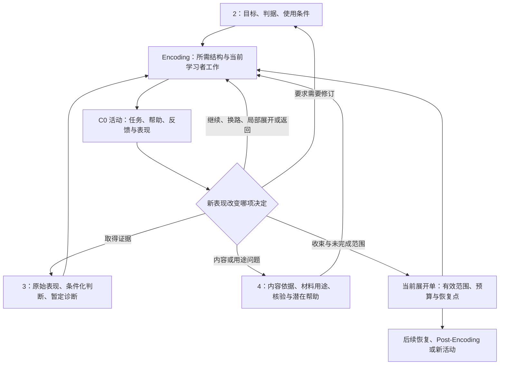

# AI 个人学习系统：工作包 5／Encoding 设计方案 v0

日期：2026-09-29  
状态：专项设计基线，可用于后续深化与有限试用；尚未验证真实学习收益。  
原则：**高理论上限、动态实际深度。目标决定最终需要做到什么，内容决定哪些推理成立，学习者证据决定现在需要做什么，资源决定本次能承诺完成多少。**

Encoding 的职责，是把前置工作包已经确定的目标、内容和条件化证据，转成能够帮助学习者建立、使用和修订知识表征的具体活动。系统应能支持严密证明、复杂机制、跨层推演、条件变化下的模型修订和方法构造；实际教学只展开当前目标和证据所要求的部分。

这里有一个关键区分：**目标要求深，不意味着每次都从头讲深；本次学得少，也不意味着原目标可以降低标准。**已有充分证据时可以直接进入复杂任务；必要前置尚缺时可以先完成一个局部，但原有深层要求仍然保留。简单目标可以用简单活动完整达成。

## 一、本版的核心选择与依据

### 1. Encoding 增加的是内容层面的教学判断

工作包 2 维护目标与验收，3 维护表现证据与诊断，4 维护内容和材料用途，C0 维护活动组织、帮助、反馈和交接。Encoding 在这些基础上补足三项判断：

1. **为了完成目标，学习者究竟要建立或修订什么关系、条件或操作结构。**例如，会代入公式、会选择公式、会证明公式成立，需要承担不同的工作。
2. **当前怎样让学习者承担这项工作。**具体比较什么、补哪一步、哪些条件应改变、AI 给出哪些部分，以及为什么这样安排。
3. **新表现怎样改变展开范围。**何时继续当前关系，何时补局部前置、撤去某项帮助、返回整体，或结束本轮。

这些判断可由现有教学责任方承担，不要求新增独立 Agent、数据库或状态机。本版采用“目标所需的表征工作”组织理由，沿用 C0 承载活动，以策略卡提供候选方法。它比卡片串联多了一层内容判断，也比构建完整个人知识模型轻得多。

与现有设计流程的 E1—E5 对齐：第二至四节落实本次理解目标与内容结构，第五节结合第四节落实入口、支架和建构任务，第六节落实修订与局部返回，第六、八节落实收束与交接。它们是设计责任的覆盖关系，不是每次教学必须依次执行的五步。

### 2. 依据范围与主张性质

本文的“继承”指现有方案中的约定；“设计”指本版提出的组织与教学规则；“待验证”指真实学习效果、调节尺度和成本收益。除明确继承的内容和可校核的学科推导外，本版的选择规则、活动组合及案例均属设计。

| 项目资料 | 本版实际使用的位置与用途 |
|---|---|
| [Encoding 顶层设计分析](<E:/文献资料/学习系统架构设计/docs/analysis/AI个人学习系统_工作包5_Encoding_顶层设计分析.md>) | 第二至七节：专项定位、设计单位、内容选择与边界；作为可调整的讨论依据 |
| [Encoding 设计提示词](<E:/文献资料/学习系统架构设计/docs/prompts/AI个人学习系统_工作包5_Encoding_设计提示词.md>) | 本轮交付范围与质量要求；结合用户本轮补充原则使用 |
| [Encoding 研究报告](<E:/文献资料/学习系统架构设计/docs/research/01_Encoding研究报告.md>)，简称 EN | 第 1—2、4—11、14—16 节：结构属性、帮助、动态展开与证据边界 |
| [微操作与提问库](<E:/文献资料/学习系统架构设计/docs/research/02_Encoding微操作与提问库.md>)，简称卡库 | S05—S10、D01—D05、X01—X10 等相关条目及首尾共同约定：任务实例化资源 |
| [Encoding 策略 JSON](<E:/文献资料/学习系统架构设计/docs/research/04_Encoding策略库.json>) | v2.0，60 条操作；核查其真实字段和正文承载范围 |
| [工作包 2／3 联合方案](<E:/文献资料/学习系统架构设计/docs/designs/AI个人学习系统_工作包2与3_联合设计方案_v0.md>)，简称 2／3 | 第四至十节相关部分：目标、判据、条件化证据、诊断、近期展开与版本维护 |
| [工作包 4 方案](<E:/文献资料/学习系统架构设计/docs/designs/AI个人学习系统_工作包4_设计方案_v0.md>)，简称 4 | 材料功能、用途核验、帮助暴露和执行交接的相关部分 |
| [2—4 交接对齐说明](<E:/文献资料/学习系统架构设计/docs/designs/AI个人学习系统_工作包2至4_交接对齐说明.md>)，简称交接 | 第二至五节：唯一当前展开单、有效范围、工作归属与纠错路径 |
| [C0 共同教学框架](<E:/文献资料/学习系统架构设计/docs/designs/AI个人学习系统_工作包5_C0共同教学框架_设计方案_v0.md>) | 第二至八、十、十二节：活动规格、帮助记录、证据用途、调整、收束及专项接口 |
| [整体架构 v0](<E:/文献资料/学习系统架构设计/docs/architecture/AI个人学习系统_整体学习流程与概念架构_v0.md>)、[设计流程与工作包](<E:/文献资料/学习系统架构设计/docs/architecture/AI个人学习系统_设计流程与工作包.md>) | 系统位置与工作包 5—8 的责任边界 |
| [Post-Encoding 研究](<E:/文献资料/学习系统架构设计/docs/research/Post-Encoding-Dynamics-深度增量研究.md>)，简称 PE；[证据台账](<E:/文献资料/学习系统架构设计/docs/research/post-encoding证据台账与参考文献.md>)；[快速矩阵](<E:/文献资料/学习系统架构设计/docs/research/Retrieval-Integration-快速矩阵.md>) | PE 第 3.1—3.2、7.3、8.1 节，台账 E01、E19—E21 及矩阵的操作边界：恢复与重新建构的衔接 |

按本轮范围，未读取其他工作包的设计提示词、顶层设计分析或审阅报告，未读取人审可视化目录。引用现有方案中出现的相关术语，不表示继续追读其链接文件。

本版依据项目研究的归纳，没有重新检索或核验外部论文。策略家族研究、具体任务的学科正确性、整套系统的学习收益分别处理；不把项目研究中的效应量或方法建议升级为本方案的效果保证。真实课程、个人起点和预算尚未提供，下文案例均为假设，不构成用户学习记录。

## 二、设计单位：目标中的一项可用结构

### 1. 从“学一个知识点”落实为可工作的关系

Encoding 的最小设计单位是：**为完成当前目标，学习者需要能够使用的一组关系、条件或操作，以及它支持的判断。**它可以很小，也可以是一段不可拆散的综合工作。

例如，“认识加权平均”仍不够具体；“根据总量与个数构造总体平均，并知道何时可以直接平均两个组均值”已经能决定材料、活动和检查。证明题的单位可能是一处前提到结论的连接；综合设计的单位可能是几个模块之间的约束与取舍。

只有当拆分会改变材料、支架、诊断或任务安排时才拆。若多个小项始终一起使用，就保留为一个整体工作。拆开的部分需要重新组合使用时，整体任务本身保留独立要求，不能用局部通过的数量替代。

### 2. 分开四类对象，允许多种正确表示

| 对象 | 表达什么 | 在现有体系中的位置 |
|---|---|---|
| 内容的参考结构 | 在指定对象域、假设和依据下，哪些关系与推论成立；哪些尚不确定 | 引用 4 的内容依据；Encoding 只选择当前教学所需部分 |
| 目标要求 | 学习者需在何种条件下完成哪些工作，达到什么判据 | 引用 2，不另立 Encoding 掌握标准 |
| 关于学习者的解释 | 某项表现可能反映怎样的缺口、已有能力或替代解释 | 作为诊断线索交给 3；不是对脑内模型的直接读取 |
| 外部产物与支架 | 当时实际看到、生成、修改或使用的解释、图、式子、代码等 | 由 C0 活动记录保存；注明内容和关键判断的来源 |

参考结构不是学习者必须逐字复现的标准答案。不同证明、等价公式、不同但正确的图与实现，都可支持同一目标。评价关注它们保留了什么、能够合法推出什么。比较两份产物前，先区分表达差异、假设差异和真实错误。

对开放研究问题，参考结构可以是一组有依据的竞争解释、已知约束和未知项；不能由 AI 补成唯一真相。此时目标可以要求构造可检验假说、评估证据或说明不可辨识性，而不要求得出尚无依据的确定答案。

【依据】EN 第 1、4—5、8 节；卡库 X04、X06、X07；2／3 的目标、证据、诊断区分。

## 三、高理论上限：系统应能支持哪些深层工作

“高上限”落实为能力覆盖与可继续展开的结构，不设统一层级、最高卡片数、追问轮数或递归深度。下面各项可以独立需要，也可以组合；不是从第一行升级到最后一行的教学阶梯。

| 系统应能支持的工作 | 达到较高要求时，学习者实际做什么 | 必须具备的依据或限制 |
|---|---|---|
| 精确理解与条件辨析 | 明确对象域、量词、必要／充分条件、背景条件组合；区分不成立、未证实和信息不足 | 定义型、概率型、约定型内容分别处理；合法反例不能破坏其他前提 |
| 机制与动态推演 | 解释中介及接口；区分即时、过渡与长期变化；在模型内推演干预、反事实和跨层影响 | 明确因果依据、保持项、时间和系统边界；未知机制不编造 |
| 形式化与论证 | 从前提出发完成合法推导、证明一般命题、构造反例、检查程序不变量与终止条件 | 例证不替代证明，运行成功不自动证明一般正确性；允许不同合法路线 |
| 多表征建构与核查 | 在语言、图、式子、数据或程序之间转换；解释保留、丢失和新增的信息 | 区分等价改写、新测量与新假设；工具绘制不能替代目标要求的映射判断 |
| 抽象、条件化与迁移 | 提取有边界的共同结构；在无方法提示的新问题中识别、拒用、组合或修订规则 | 变化的情境、表示、线索和领域前置分别说明；不默认远迁移成立 |
| 模型评议与方法构造 | 区分竞争模型，识别不可辨识方向；设计有鉴别力的观测、惩罚、算法或解释；回应反证 | 评价由目标给定的正确性、适用范围和取舍标准决定；“新颖”与“正确”分别核验 |
| 综合与功能性压缩 | 将局部知识组织成可恢复的整体；用较简洁结构支持复杂使用，并在边界变化时重新展开 | 压缩不得丢失目标必要条件；局部正确后仍须检验接口和整体表现 |

支持这些工作，至少要求系统能够准备可靠的深层参考、接受长链或多种解法的产物、对关键节点作有依据的反馈，并跨活动保留尚未完成的复杂工作。不能因为当前执行模型方便处理短问答，就把目标改写为识记和复述。

**高上限不等于所有学科都已具备同样的可靠实施能力。**某项目标需要的原始材料、证明核验、模拟工具或专业评审尚缺时，记为该目标的实施条件未满足，由 4 等责任方补齐或提出可行范围；不能让模型的流畅解释填补可靠性空白。复杂参考可以分段准备，但当前要教授和评价的部分必须有依据。

### 深层工作如何按需准备

先准备当前任务需要的参考结构、关键正确性依据及可能改变下一步的分支。若目标本身要求完整证明或系统设计，就须掌握足以审查整体的依据；按需准备不能成为把复杂整体永远拆碎的理由。

对于暂不展开的部分，保留有用的接口：输入、输出、成立条件、当前可依赖的性质，以及内部未知。出现以下任一情形时，才需要展开相应内部关系：

- 目标明确要求解释、证明、修改或比较该内部结构。
- 接口无法支持当前目标判断，或适用条件发生变化。
- 学习者表现暴露了与内部关系有关的障碍，且该解释仍有根据。

不设跨学科统一展开上限，但每次展开有局部范围与资源边界。较深的学习可以分多次完成，每次留下父任务与下一连接点。系统需要能走得深，也需要知道现在为何走到这里。

【依据与限度】EN 第 5、7—8、14 节提供结构属性与检查候选；表中对形式论证、方法构造及深层参考准备的组织是本版设计，不是经验证的统一深度量表。

## 四、动态实际深度：继承要求，选择当前工作

### 1. 把三种“深度”分开

| 需要分开的含义 | 由什么决定 | 可以怎样改变 |
|---|---|---|
| **目标要求的深度** | 2 的能力目标、判据和使用条件 | 发现目标问题或用户改变意图时，由原责任方修订；不能由教学方随预算自行降标 |
| **教学需要的展开程度** | 内容结构、3 的证据与暂定诊断、已有材料和实际帮助 | 随新表现增加、减少、换方向；同一目标下不同学习者可以有不同路径 |
| **本次承诺完成的范围** | 当前展开单的有效范围、预算、意愿及资源 | 分段、缩覆盖、延期或暂停；保留目标内尚未完成项 |

某人已能证明一般结论但不会选择使用情境，当前可以只做条件辨析；某人目标只是按规定操作，就可以暂时保留底层证明黑箱。前者的活动短不代表目标浅，后者的理论潜力高也不要求现在展开。

### 2. 以一份可引用的工作说明连接前置产出

复杂目标可用下表核对，简单目标用一两句话表达即可。它是 C0 活动准备的内容说明，不新增独立档案或必填表单。

| 继承的依据 | Encoding 在本活动中的转译 | 防止什么误用 |
|---|---|---|
| 2 的当前目标、判据、允许资源及必要前置 | 指出目标中必须由学习者完成的关系判断、推导或操作 | 用教材章节深度、AI 偏好或策略卡验收替代目标 |
| 3 的原答、条件化判断及诊断解释 | 标出已有支持、尚未支持、未知和仍需区分的解释；引用原记录 | 把未测当不会，把提示后正确当自主形成，把旧题成功当新条件证据 |
| 4 的内容片段、用途、参考与核验范围 | 选可支撑当前任务的结构，识别材料潜在帮助；结合 C0 实际呈现记录区分已展示与备用内容 | 把“准备好／已采用／已展示”混用；默认难材料就要求深学习 |
| 唯一当前展开单的有效范围 | 确认本次要完成的目标部分、可用预算、允许调整和返回位置 | 另建一份 Encoding 计划，与当前承诺冲突 |
| C0 的实际帮助与历史条件 | 决定可以保留给学习者的工作，以及产物可支持的结论 | 隐藏答案或更换 Agent 后重置暴露历史 |

对深层目标，可在内部列出少量“要求—已有支持—当前任务—仍待支持”的对应行。要求继承 2，支持状态引用 3，当前任务落在 C0，未完成范围回到计划方；不另计算一个 Encoding 深度分数。

### 3. 动态选择的实际规则

先确认本次用途与必要条件，再提出当前工作。**入口不要求先有错误诊断**：没有相关经验时，可以先解释和示范；已有充分证据时，可以直接进入目标难度；起点未知但不妨碍输入时，可以边学边观察。

每次有值得关注的新表现，重新检查它改变的是哪一部分：

| 观察或已知要求 | 当前选择 | 改变选择的依据 |
|---|---|---|
| 关键概念尚无可靠输入，或学习者明确希望先看示范 | 给定义、例子、正确示范或部分结构，再留下可完成的关系工作 | 能使用所给信息时继续；仍不识别对象时补必要组件 |
| 已有相关证据，但目标关键条件未覆盖 | 直接做目标工作或有限检查 | 条件合格时复用证据；失败后再按具体关系调整 |
| 目标明确要求证明、综合或模型构造 | 安排相应工作，即使尚未出现错误 | 不能因常规题答对就省掉目标要求；已有对应证据则不重复 |
| 正确关系已可用，帮助还在代做目标操作 | 有针对性地撤去该帮助，或进入更完整的目标任务 | 观察原来由帮助承担的那一步；失败不抹掉其他已获支持部分 |
| 在相近条件下误用规则 | 对齐条件、合法近例／非例，必要时提供替代解释 | 新判断是否使用条件；若只是读题或符号问题，停止扩大概念补课 |
| 局部能做，整体不能 | 检查接口、选择、顺序和综合组织 | 优先检验局部如何接入父任务，不沿同一前置链无限下钻 |
| 同一支持反复无效，或已有反证 | 重审任务、参考、诊断与方法，换路或收束 | 不把“还没学会”当继续加深同一解释的充分理由 |
| 目标内所需工作已有充分证据 | 收束或进入当前计划中的下一目标 | 不为了显示系统能力添加目标外证明、机制或远迁移 |
| 用户希望继续探索目标之外的问题 | 保留为探索意图，按授权与计划处理 | 不把兴趣扩展自动写成原目标欠账或新的通过门槛 |

追加一项操作前，至少能说清：它处理哪项目标内工作或必要障碍，为什么当前证据值得这样做，以及出现什么表现后返回、换路或停止。若几种可能回答都只会导致同一种必要解释，通常直接给解释，不额外安排诊断。

这是一套可审查的定性选择规则。没有学习者数据时，不伪造“深度需求 0.8”“能力差距 60%”或收益权重；有数据后也须先证明估计对当前决定有用。

### 4. 调整要分方向，避免只会加题和加难

可能需要增加的是关系细节、条件覆盖、综合范围、形式严谨性，或自主承担的操作；也可能需要减少无关细节、恢复支持、换一种表示。它们可以分别变化。

例如，证明目标较高而符号读取困难时，可保留证明要求、提供符号解释；识别目标已经达成时，可以结束而不追加机制；模型修订目标需要长链论证时，可以维持一个高要求任务，分段完成，毋须切成大量低层问答。

答得慢、文字短或不愿画图，不直接等于理解浅。负担判断综合丢失条件、前置操作、对支持的反应及学习者自述，保持内容特异性。

### 5. 预算不足时，缩范围而不悄悄降标

保留收束时间，优先减少重复练习、目标外扩展和当前不必要的材料；必要工作无法完成时，选择可以独立结束的子范围或保存中间状态。由计划方接收未完成要求及恢复点。不可将“完成证明”改成“听懂解释”后宣称原目标达成。

若学习者正式改变目标，例如从研究方法改为先完成一次工具使用，返回 2 和计划方更新目标与范围，再让 3 判断旧证据在新要求下的适用性。这是目标变更，与同一目标下的动态教学调整不同。

【继承依据】交接第二至五节；2／3 的第五至八、十节；C0 第二、五至八节。以上内容层面的选择与展开规则为本版设计。

## 五、把选择变成有内容的学习活动

### 1. 沿用 C0，只补足三项专项内容

C0 第四节已有活动规格，无须复制一套表。本专项要求其中的意图、任务、反馈与分支至少能回答三个内容问题：

- **所需结构：**当前要建立、区分或修订哪项关系，它支持哪个目标判断？
- **合法操作：**本任务改变什么、保持什么、允许新增什么；学习者要承担哪项关键工作？
- **分支依据：**哪种具体表现会使系统继续、增加帮助、换操作、展开局部或返回整体？

简单事实只需准确对应及使用，未必有复杂变换。完整证明可以要求一个连贯产物，未必逐步填空。任务形式服从所需工作。

### 2. 从卡片到任务，需要完成内容实例化

当前 JSON 的字段为 `id`、`name`、`category`、`content_markdown`、`template_status`、`evidence_ids`。适用条件、约束与多数验收说明在正文中；Markdown 首尾还有共同规则。它能提供检索入口和原始资源，尚不是可直接执行的决策规则库。

采用一张卡或重新组合方法时，教学方完成以下内容准备，结果写入已有活动规格：

| 需要落实的内容 | 实际要检查什么 |
|---|---|
| 对象与依据 | 具体题面、数据、定义域、合法条件和可靠参考；候选结构不能来自未经核验的流畅补写 |
| 认知操作 | 此处比较是找共同关系、辨边界还是选方法；推导是在补理由还是复现已展示答案 |
| 变化与保持 | 案例改变会不会连带破坏其他条件；跨表示时有没有新增假设；题目是否混入额外前置 |
| AI 与学习者的分工 | 当前可见输入、备用帮助、教师参考分开；指出谁完成目标关键判断 |
| 可接受产物 | 正确推导、合法多解、有依据的拒用或“信息不足”；不以字数、图形相似度和术语覆盖评分 |
| 关键分支 | 只预备会改变下一步的差异；未准备分支有补材料、暂停或回交路径 |

实例化后分别确认：学科内容正确、任务确实调用目标操作、拟作证据解释符合条件。三者合格才有理由执行；是否带来更好的学习还需真实试用。

卡号只作来源与复用索引。S07 与 X02 若都对应同一次关键补全，就合并为一个活动；目标需要连续复杂论证时，也不受“一次只能两三张卡”限制。卡库的“新例、撤提示、延迟”等验收建议，按目标需要采用，不提升为全系统统一门槛。

### 3. 帮助是否合适，看它替代了哪项工作

| AI 提供的内容 | 可以保留给学习者的工作 | 证据解释的限制 |
|---|---|---|
| 可靠定义与示范 | 根据定义判断新对象、解释示范中未代做的连接 | 不能据观看或复述认定自主建构 |
| 给定节点、变量或部分证明 | 选择关系、补合法理由、检查条件并完成剩余推理 | 给出的部分不算学习者独立生成 |
| 候选模型或有错解答 | 找到真正分歧、构造检验、定位并修正错误 | 已提供候选时，不自动证明能自行提出候选 |
| 工具生成的图、数值解或代码结果 | 解释对应、预测变化、检验边界，或评价实现 | 若构图、计算或实现本身是目标，这些输出属于实质帮助 |
| 完整解释 | 建立可用基础，随后承担目标内仍需的工作 | 当下没有留下目标关键工作时，如实记录教学输入 |

同一活动可以同时促进学习和提供证据；按 C0 保存原答与帮助时间线，不重复计证。允许工具、开卷或协作的目标，按原资源条件评价；“关键工作自主完成”不一律等于完全无资料。

### 4. 反馈应落到推断或操作的变化

对关系错误，指出原答中的具体连接、正确依据以及需要重新完成的判断；对事实或约定错误，直接纠正即可，不强求解释其深层原因。对正确答案但理由未观察到的情况，只在目标需要且会影响下一步时补充观察。

模型修订活动优先看“哪处关系或条件改变了，依据是什么，因此哪个判断改变了”。普通初学不必先制造错误模型，也不要求所有活动都有初稿、修订稿和新题三件套。

如果学习者提出可靠反例或另一条合法解法，先检查参考；高能力的表现可能是合理拒绝系统预设。参考存在实质疑误时，立即停用依赖它的教学用途与确定评分，并交 4 核验；依据充分的其他部分可以继续。不能把用户改到与错误答案一致。

【依据】C0 第四至六节；EN 第 9—11、14 节；卡库 S05—S10、D01—D05、X01—X07、X10。

## 六、局部展开、检查与收束

### 1. 局部展开必须带着父任务

进入必要前置或内部结构前，保留四件事：父任务卡在哪里；为何该局部可能影响它；补到什么程度足够；如何返回及本次最多投入到哪里。这个上限由当前任务、预算和授权确定，不设通用题数。

局部达到所需程度后，立即回到相应父工作，观察连接是否恢复。原题可以用于修订；若需目标条件下的新证据而原答案已暴露，则另用合格任务。

如果局部成功但父任务仍失败，保留局部证据，重新区分综合组织、方法选择、额外前置或原诊断有误。不得把每次失败都解释为“还要往更底层学”。反过来，目标明确需要跨层说明时，也不能因一个黑箱接口可用就结束深层要求。

### 2. 证据随目标工作变化，不统一测“理解很深”

| 目标工作 | 有辨别力的表现 | 不足以单独支持的表现 |
|---|---|---|
| 准确辨认或使用约定 | 在要求的语境中对应正确，区分易混项 | 能讲一个与目标无关的复杂故事 |
| 条件与类别判断 | 依据条件接受、拒绝或指出信息不足 | 只认典型外形或按题目标签选择 |
| 关系与机制使用 | 在给定模型与条件下解释或预测，未知处界限明确 | 复述结论、堆中介名词或箭头 |
| 一般证明或程序论证 | 前提、关键连接和结论合法；覆盖目标要求的对象域或分支 | 若干算例成功、工具跑通或复述范例 |
| 多表征转换 | 关键对应成立，并能识别遗漏和新增假设 | AI 生成正确图后自述看懂 |
| 抽象与方法选择 | 在规定的变化中识别结构，拒用不适用规则 | 只在已给方法名的练习中执行 |
| 综合设计或模型修订 | 整体符合约束，局部接口可解释，能回应目标内的边界或反证 | 各小题都正确、产物完整或新颖 |

表中是任务选择方向，具体通过判据引用 2。Encoding 可按授权给常规评分与内容分析，3 维护“证据支持到哪里”的条件化判断。不能以一次产物断言真实内部表征已经完全改变。

深度要求、独立条件、时间间隔、情境变化和执行成本分开记录。撤去材料不能消除刚才的暴露，改数值不必然满足自主选择或迁移条件；目标未要求延迟或跨情境证据时，不自动新增这些欠账。

### 3. 结束原因必须可辨认

| 结束原因 | 本轮留下什么 | 对原目标的含义 |
|---|---|---|
| 当前活动工作完成 | 实际产物、所需帮助和剩余要求 | 可以结束活动；不自动表示目标全达成 |
| 目标内所需证据已有充分支持 | 引用 3 的判断及适用条件 | 当前范围可收束；没有永久掌握声明 |
| 预算结束或用户暂停 | 已完成部分、未完成部分、父任务及恢复点 | 原标准保留，范围交计划方处理 |
| 当前方法无进展 | 尝试、反应、已有反证与尚可行替代 | 重审路径，不靠继续加深维持互动 |
| 材料或判据存在争议 | 原答、已展示内容、受限用途及责任方 | 立即停用依赖争议依据的活动／材料用途及确定评分；继续依据充分的其他部分，交对应责任方核验 |

【继承依据】C0 第五至八节；EN 第 7—11 节。内容性返回判断是本版补充，共同记录、权限、纠错和用户控制仍沿用 C0。

## 七、假设情境：深度怎样真正随要求和表现改变

以下是设计演练。题面与参考用于审查活动，不能把本文教师参考直接展示后，再将相同题目视为未暴露检查。时间、帮助和原答在真实执行时记录，本文不虚构真实回执。

### 情境 A：没有错误模型，也能开始建构

**假设目标。**根据两组人数与组内平均分，求合并平均并说明人数在计算中的作用；允许计算器。目标不要求概率理论或一般加权估计。起点未知；4 提供可靠的平均数定义及示例。

**实际入口。**可以直接解释“平均＝总分／人数”，用一组 10 人、平均 70 分示范总分为 700。随后给出 20 人平均 60、30 人平均 80，要求学习者建立合并总分与人数的对应。

AI 已提供定义和一次总分计算；学习者仍要连接“每组总分—合并总分—合并人数”，完成 `(20×60＋30×80)／50＝72`。这里形成的是从局部均值到总体量的关系，不必先生成全套个人模型。

| 实际表现 | 下一步与深度变化 |
|---|---|
| 能连接总分与人数并解释权重 | 按目标条件观察剩余工作即可，不追加一般统计推导 |
| 写出 70，理由是两个平均直接相加除二 | 对照 20／30 人与相同人数的情境，观察是否忽略组规模；不是重新讲全章 |
| 不明白为何 `20×60` 是总分 | 用人数更少且可枚举的例子建立这一步，随后返回合并问题 |
| 关系解释正确，只是算术失误 | 在允许计算器条件下核对，不因运算失误展开概念补课 |

如果随后需要目标条件下的独立关系表现，可给未展示过的两组数据，例如 8 人平均 50、12 人平均 75，总体平均为 65；不再给出总分计算骨架。它支持同类关系使用，不据此声称跨领域迁移。若初始任务已经满足目标证据条件，直接复用，不为凑流程重复测。

**极简对照。**若目标仅是在一份自定义表中将 `S` 读作“已提交”、`R` 读作“需修改”，可靠映射与必要辨认即可。系统无需为这些约定编造机制，也不因具备高阶能力而延长活动。

### 情境 B：同一个特征，背景条件改变判断

**假设目标。**在非退化简单平面四边形范围，根据已知条件判断能否确定为矩形。允许使用矩形定义及平行四边形内角关系；要求区分“不是矩形”与“信息不足”。已有证据显示学习者会复述矩形定义，但一次判断中把“有一个直角”当作充分条件。该表现提示条件混淆，尚不能排除省略题意。

**具体任务。**先给两个条件说明：“一个四边形至少有一个直角”与“一个平行四边形至少有一个直角”，让学习者分别判断是否足以确定为矩形，并指出依据。

教师参考：前者信息不足，符合条件的矩形与非矩形都存在；后者足够，邻角互补、对角相等可推出其余三个角也是直角。前者的一个合法非矩形见证是按顺序连接 `(0,0)、(2,0)、(3,1)、(0,1)`；它简单、非退化，有直角但不是矩形。教师准备见证不等于必须提前展示。

AI 可以给条件表、几何定义或允许使用的定理；关键条件选择与推论由学习者承担。若 AI 已给出两种判定及理由，本轮转为讲解，后续证据必须承认这项帮助。

| 观察到的差异 | 有内容的调整 |
|---|---|
| 能正确区分两组条件 | 在目标要求的独立呈现条件下观察即可，不自动追到欧氏几何公理 |
| 说第一组“一定不是矩形” | 用满足已知条件的矩形与非矩形对照，处理“未能确定”与“已经否定”的区别 |
| 知道第二组结论，但不会利用平行条件 | 若目标只要求依法判断，可提供允许的内角定理并让其完成连接；若目标要求证明该定理，则另按该要求展开 |
| 只在并排提示下能答，单独遇题仍按外形判断 | 取消比较标题，换合法图形朝向与条件组合，观察自主识别；不重复让其背同一句结论 |

本例调用 D02—D04 的设计意图，但活动对象、背景条件、反例合法性和可接受的“不确定”答案均已具体落实。若目标变为证明某个几何定理，应由上游明确新的证明要求，不能悄悄把当前分类任务扩成证明课程。

### 情境 C：高级目标需要证明与方法设计，不能停在会算

**假设目标。**对 `A∈ℝ^(m×n)`、`b∈ℝ^m`、`x∈ℝ^n`、`λ>0` 及对称半正定矩阵 `Q∈ℝ^(n×n)`，判断并论证二次目标

`F(x)＝||Ax−b||²＋λxᵀQx`

何时有唯一极小解，并利用这个判断构造或评议惩罚项。允许查基础线性代数性质，数值工具可辅助核查；核心论证和构造理由必须由学习者完成。已有证据支持其完成标准 `Q＝I` 的计算，但没有一般唯一性条件的证据。

**本目标所需结构。**数据项限制哪些方向，惩罚项限制哪些方向，二者合起来是否仍留下不改变目标值的方向。这是当前 Encoding 的核心连接。SVD、统计泛化、概率解释和所有正则化方法都不是本次默认范围。

**教师参考与正确性锚点。**令 `H＝AᵀA＋λQ`。对于任意 `v`，

`vᵀHv＝||Av||²＋λvᵀQv`。

由于 `Q` 对称半正定，`vᵀQv＝0` 等价于 `Qv＝0`。因此 `H` 正定当且仅当 `ker(A)∩ker(Q)＝{0}`。正定时严格凸，唯一极小解为 `H⁻¹Aᵀb`。

若有非零公共核方向 `v`，则对任意 `t`，`F(x＋tv)＝F(x)`。极小解在本设定中存在：将目标写为堆叠矩阵 `[A; √λQ^(1/2)]` 与向量 `[b; 0]` 的有限维最小二乘问题即可。因此存在非零公共核方向时，极小解不唯一。得到一般判据：

**唯一极小解存在 ⇔ `ker(A)∩ker(Q)＝{0}`。**

此结论依赖本例的实数、半正定和正 `λ` 条件。若目标改成不定惩罚或其他损失，需重新分析，不能直接套用。

**活动安排。**先提供模型及问题，不直接展示上述教师参考。学习者尝试说明“`λ>0` 是否已经足够保证唯一”。如果现有知识足够，可直接完成一般论证；如果只有计算公式，就围绕未受约束方向展开。以下变式只在能提供所需帮助或辨别信息时选用，不要求逐项做完。

取 `A＝[[1,1],[2,2]]`、`b＝(1,2)ᵀ`，令 `s＝x₁＋x₂`、`d＝x₁−x₂`，则数据项是 `5(s−1)²`：

| 惩罚矩阵 | 目标函数的对应部分 | 教师参考：结论与理由 |
|---|---|---|
| `Q＝I` | 惩罚为 `λ(s²＋d²)/2` | 唯一，`x₁＝x₂＝5/(10＋λ)`；两个方向都受约束 |
| `Q＝[[1,−1],[−1,1]]` | 惩罚为 `λd²` | 唯一，`x₁＝x₂＝1/2`；惩罚限制数据项未限制的差方向 |
| `Q＝[[1,1],[1,1]]` | 惩罚为 `λs²` | 不唯一，`s＝5/(5＋λ)`、`d` 任意；惩罚没有补上未约束方向 |

学习者的关键工作是解释为什么两个非零半正定惩罚带来不同唯一性，进而建立一般条件；单纯把三组数算对不足以满足目标。也可以由学习者构造合法矩阵，系统再核验，接受等价解。

| 新表现 | 动态展开与返回 |
|---|---|
| 已直接给出正确一般证明并构造合法例子 | 按目标判据核查，跳过教学对照；高目标不要求长教学 |
| 不认识核空间符号，但能说明“哪些变化不改变数据项” | 提供术语对应，保留论证要求；这项符号帮助不等于代做唯一性推理 |
| 会代公式，却认为“加了任何正则就唯一” | 用后两种惩罚对照，定位未约束方向；再返回一般判据 |
| 卡在“半正定且二次型为零为何等价于落在核空间” | 若该性质已是允许引用前置，提供可靠引理；若本目标要求证明它，局部用特征分解展开，再返回唯一性论证 |
| 局部会求两个核，但不能说明唯一性 | 检查从共同方向到函数不变／严格凸的连接，不继续扩展更多矩阵计算 |
| 原判据已会用，条件改为不定 `Q` 后仍原样套用 | 若这种边界属于目标，转入新假设下的有界性与曲率分析；否则记录探索意图，不增加原目标门槛 |

**检验返回。**如需未暴露的应用证据，可另备 `A＝[1,0]、b＝2`，比较 `Q＝[[1,−1],[−1,1]]` 与 `Q＝diag(1,0)`。前者唯一解为 `(2,2)`；后者为 `x₁＝2/(1＋λ)`、`x₂` 任意。学习者须利用共同未约束方向解释，并完成目标中尚未获得证据的一般论证或构造工作。新例只能补其对应部分，不能用实例成功替代证明。

**范围对照。**若上游目标仅是按给定标准岭回归公式完成一次计算，矩阵正定性与一般判据可以作为可靠黑箱，教学停在公式条件、输入对应与使用。若上游仍是本例的证明和设计目标，而时间只够算一道题，只记录当前计算表现，保留证明与构造未完成；不能把目标解释成“其实会用就够了”。

本例说明系统能够组织更深的 Encoding 所需工作，不说明一个例子已证明系统达到所有领域的专家水平。其代数结论可以核验；上述教学路线的效果仍待验证。

### 情境 D：后续恢复失败，不自动从头重新 Encoding

假设某次后续任务中学习者无法写出加权平均公式。提供平均数定义和相关数量后，其能自行恢复总量关系并正确构造计算。这份表现支持“在这些输入下关系工作可用”，访问困难是候选解释；不能由此确定其唯一原因，也不能认定闭卷要求已经满足。

此时不必重讲整套结构。若目标要求独立恢复，交 Post-Encoding 与计划方安排相应工作；若目标本来允许查公式，就按原条件继续。如果提供前提后仍把组均值直接平均，则出现重新建立权重关系的理由，返回情境 A 的具体连接。

本例按“当前需要恢复还是建立／修订什么”划分工作，不按第一次／第二次接触划分。两类活动可以在同一会话连续发生，证据只记录一次，帮助历史连续保留。

## 八、与各工作包衔接及最小记录

箭头表示决定之间的依赖，不规定每轮必须经过所有责任方。已有依据有效、调整在授权内时，直接继续。

常规措辞、已核验的等价材料、局部支架及授权内评分可直接调整；涉及跳过必要前置、重要能力结论、重大诊断变化或承诺范围改变时，由既有目标、评估或计划责任方处理，不因活动变短或准备进入高难任务而扩大执行权限。实际展示与帮助由 C0 执行记录保存，3 解释其证据影响，4 提供材料的潜在帮助与用途依据。

### 1. 各方接收什么，不重复建设什么

| 对接方 | Encoding 交出／请求的内容 | 本专项保留的边界 |
|---|---|---|
| 2：目标与验收 | 发现的目标歧义、必要前置、判据覆盖缺口及影响；提出具体修订建议 | 不把教学细分自动升级为正式子目标，不自行改变最终要求 |
| 3：证据与诊断 | 原答、目标对应、帮助影响、条件缺失、内容层面的候选解释与反证 | 不建立新的掌握等级；观察、评分、诊断分别说明 |
| 4：内容与材料 | 所需关系、合法变式、教师参考、备用支架、实际用途问题 | 活动意图由教学方落实，材料内容与用途核验沿用 4；准备好不等于已经展示 |
| C0 | 将具体结构、学习者工作和分支落实为其活动规格 | 帮助、检查、权限、纠错、收束、恢复仍只有一套共同规则 |
| Post-Encoding | 尚需恢复或保持的目标内容、关系／条件工作、真实帮助与表现历史 | 提取失败不自动等于重建失败；重新建构也不消除后续检查条件 |
| 6：策略使用 | 为什么选／换／停某项操作，使用条件、结果与成本，卡片来源 | 本版提供局部选择理由，不设计全库排序、跨策略长期优化和全局调度 |
| 7：持续计划 | 目标内未完成项、预算冲突、局部与父任务状态、下一可执行工作 | 需求提出不等于已经排程，不在本专项另设复习日历 |
| 8：协作与记录 | 哪些决定需要高能力模型或内容核验，哪些可由执行者局部调整，引用与回执要求 | 不预设 Agent 数量、存储字段或通信机制；相容责任可以合并 |

高能力模型优先承担复杂目标的结构分析、关键参考论证、方法构造、跨层整合及诊断冲突；执行者承担已经明确边界内的呈现、局部帮助、记录和常规评价。这是能力分配依据，不冻结模型名单。多模型一致不能替代学科核验。

### 2. 不另存一份“学习者脑内模型”

在 C0 记录中复用现有引用，只额外保留会改变后续教学的内容说明：

> **当前意图：**哪项目标工作需要建立或修订，依据哪份内容与表现。  
> **实际活动：**题面及版本、学习者产物，AI 提供与学习者完成的关键部分。  
> **调整理由：**什么表现改变了下一步；若局部展开，父任务、接口和返回结果是什么。  
> **结论与后续：**引用 3 的判断；目标内尚未支持项、结束原因、恢复点及接收处理结果。

发生时间、相关初学／练习／反馈时间、实际材料可见性、帮助先后及已知再接触，沿用 C0 第五、八节记录。未知接触保持未知；不要求逐句计时，也不删除会影响证据解释的时间信息。

内容或判据更新、证据冲突、个人记录删除等，沿 C0 第七节和上游维护流程复核。剩余证据充分则保留判断，部分支持则收窄，失去依据则撤销；不利用旧摘要绕过证据删除。此处继承共同规则，不新增 Encoding 专用审批流程。

### 3. 跨会话恢复与交接闭环

恢复时先读取当前有效目标、展开单、材料用途和 3 的判断，再看上次结束原因、原答与帮助历史、局部返回点。已发生的完整示范不会因换会话而消失；目标或参考版本变化也不能被旧摘要覆盖。

若上次因预算结束，仅继续尚未完成的范围；若因依据争议停止，等待受影响用途核验；若因方法无进展停止，先处理诊断反证或替代路径。上次完成的局部工作不必重做，但仍未完成的整体要求不能凭“局部已通过”跳过。

向其他责任方提出需求后，沿 C0 区分待接收、已接收待处理与已经安排。本文给出的是设计交接契约，不声称相关运行责任方已经实际接收本方案。

## 九、关键取舍与本版复杂度边界

| 本版取舍 | 采用理由 | 何时需要调整 |
|---|---|---|
| 保留高能力范围，按需实例化深层结构 | 简单目标负担小，复杂目标仍有合法展开路径 | 若准备不足持续妨碍高目标，应增加该类参考和验证能力，而非统一压浅目标 |
| 以目标工作组织，而非策略目录驱动 | 可解释同一策略为何用于不同内容、同一目标为何采用不同入口 | 若某类任务已高度稳定，可固化轻量模板，仍保留依据和退出条件 |
| 内容参考可以深，学习者当前任务可以局部 | 允许高目标分段学习，也避免新手一次承担全部结构 | 局部成功却整体无改善时，重新审查拆分和接口 |
| 用条件化表现驱动变化，不维护统一深度分数 | 防止把字数、题量、图大小或无帮助程度混成深度 | 后续量化仅在任务内有清楚测量含义且确有价值时引入 |
| 常规路径轻量，复杂决定显式写理由 | 保障简单活动效率，同时使高要求任务可审查 | 若记录项长期不影响决策则合并；若复杂判断不可复原则补充必要依据 |
| 卡库作为资源，暂不全量规则化 | 60 张卡尚未具备完整执行字段，本阶段先验证实际任务 | 6／8 若发现人工转译反复出错，再讨论结构化条件与实现 |

本版不要求建完整领域知识图谱、全量个人诊断、固定认知流水线或递归课程树。需要逐步补齐的是能支持真实目标的内容参考、合格任务与可靠反馈，而不是更多模块名称。

## 十、怎样检验这套设计值得采用

### 1. 先检查设计是否兑现用户原则

| 检查问题 | 本版可定位的落实 | 实施时的失败信号 |
|---|---|---|
| 目标需要时能否支持深层工作 | 第三节能力范围；情境 C 的一般证明、变式与构造 | 只提供名词解释或练习计算，无法承接目标要求的论证 |
| 实际安排是否继承前置工作 | 第四节的目标／证据／材料／范围转译 | 相同材料无论目标和起点如何都执行同一深度 |
| 能否正常开始，而不必先找错 | 第四节入口；情境 A | 起点未知就强迫生成完整模型，或反复诊断不开始教学 |
| 动态变化是否有具体内容 | 第四至六节；三个主要情境的分支 | 只会追加“为什么”，不能解释新增操作针对哪项关系 |
| 深入后能否回到目标 | 第六节；情境 C 的核空间局部与返回 | 子技能不断增加，父任务长期没有进展 |
| 简单目标是否真正允许结束 | 第四节收束规则；情境 A 的约定对照 | 每个术语都被追加机制、迁移和证明 |
| 时间不足是否保留原标准 | 第四节第 5 项；情境 C 的范围对照 | 把看懂解释记为完成证明，把未完成记为通过 |
| 输出与证据是否区分 | 第五至六、八节 | AI 完成关键判断，记录却写成学习者独立能力 |

上述纸上情境只能检查结构和逻辑，不能证明学习收益，也未覆盖所有学科与用户状态。

### 2. 有限试用同时验证高上限与自适应价值

首期选择少量真实目标，至少让试用包含一种确需深层论证或综合的目标，以及一种简单活动即可达成的目标。否则只在浅任务上试用，无法检验高上限；只挑复杂任务，也无法检验系统能否适时停止。

在真实试用前，补齐当前目标与判据、可靠参考、允许资源、必要帮助历史、单次预算和实际接收责任。参考或判据尚未完备时，可做限定探索，不声称正式通过。

分别观察四类结果：

- **内容与任务质量：**参考、变式、反例、证明和边界是否正确，是否确实调用目标工作。
- **学习表现：**按原判据记录目标条件下的表现；将帮助后成功、独立操作、目标所需的延迟与情境变化分开。
- **适应是否有用：**分支是否改变了必要工作；局部补充能否改善父任务；已有证据能否减少重复教学；简单目标是否及时结束。
- **成本与连续性：**准备时间、学习时间、主观负担、无效追问、重复核验，以及未完成工作是否可恢复。

如需比较动态设计与更简单的安排，使用难度和先验尽量相近的不同单元，尽量保持时间、材料可靠性和反馈机会相当；一次主要改变一项设计。对照应是合理的直接解释、示范和练习，不是刻意较差的教学。个人试用受内容差异、顺序和学习不可逆影响，只用于改进个人系统，不据此宣称普遍因果优势。

若动态选择持续增加成本却没有目标表现收益，先删除无区分力的诊断和重复操作；若复杂任务始终被降为短问答，补强内容参考与整体活动；若深度增长只反映在产物长度上，回查关键工作归属与证据条件。调整方向由具体失败决定。

### 3. 下一步必须保留的未知

| 未知 | 影响什么决定 | 在哪里处理 |
|---|---|---|
| 真实课程的目标深度与验收条件 | 哪些深层工作必须完成 | 首次实例化时由 2／计划方落实 |
| 当前内容的个人表现与帮助历史 | 入口、支架、是否需要补证 | 由 3 提供已有证据，缺项只作必要观察 |
| 深层参考、变式和核验能力 | 当前可以可靠教授、评价到哪里 | 4 与教学责任方共同准备；必要时补专业资源 |
| 单次预算、可持续负担与探索意愿 | 本次范围、分段与停止点 | 计划方与 C0 活动落实，不伪造通用数值阈值 |
| 动态展开是否比简单安排更有效 | 保留哪些分支和记录 | 有限试用检验，6 后续承接策略优化 |
| 复杂判断如何分工最划算 | 何时需要高能力模型与独立核验 | 8 后续设计；以质量与实际成本决定 |

本版已形成 Encoding 专项的定位、可支持的深层工作、继承与动态选择规则、任务实例化办法、内容性分支、返回与收束方式，以及可审查的假设情境。进入真实教学时，以前置工作包的当前有效产出实例化这些判断；不把本方案直接当作所有课程的固定教学脚本。
