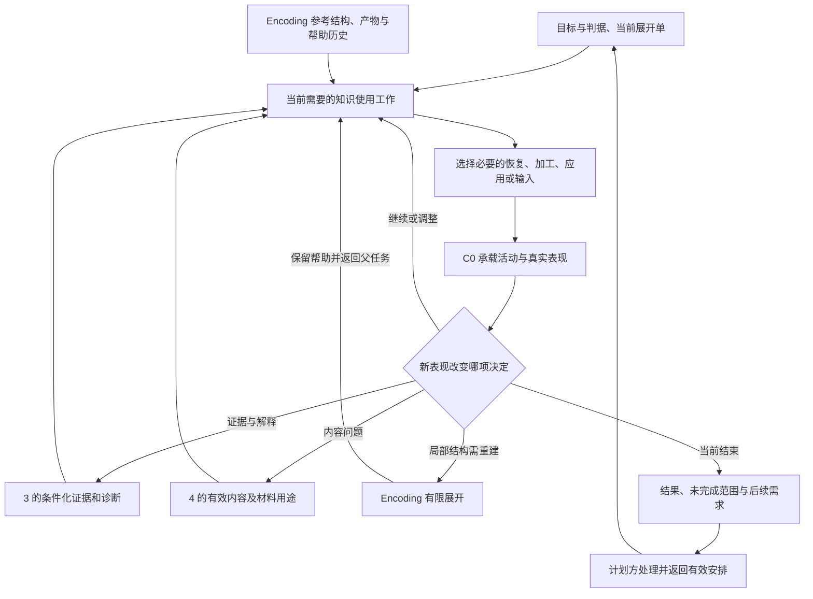

# AI 个人学习系统：工作包 5／Post-Encoding 设计方案 v0

日期：2026-09-29  
状态：可评审、可继续深化的专项设计基线；尚未验证真实学习收益。  
原则：**承接 Encoding 的理论上限，继承前序的实际成果；目标规定需要达到的可用性，内容约束合法的恢复、推理和更新，学习者证据决定当前活动，资源决定本次范围。**

Post-Encoding 负责使已经接触、建立或修订过的知识，在目标需要的时间、线索、资源和情境中可靠可用。它需要支持准确恢复、关系重建、区分与整合、自主选用、复杂应用和持续更新。实际活动可以只是一次短恢复，也可以是一段跨会话完成的证明、方法构造或模型修订。

**系统有能力做多深、目标要求做到多深、当前需要教多深，以及本次能完成多少，是四个不同问题。**复杂目标不能被压成背诵和熟练套题；简单目标也不因系统具备高阶能力而增加不必要的证明、整合和迁移任务。已有合格证据可以直接复用，没有必要把 Encoding 的学习过程再走一遍。

## 一、核心选择、阅读范围与依据性质

### 1. 围绕“目标内的知识使用要求及其证据”组织

本版的设计单位是：**一项已有目标要求，在指定条件下需要学习者自主完成的知识使用工作。**例如，“一周后能恢复两个状态码的含义”“面对没有方法提示的数据，自行决定怎样合并均值”“在允许查基础引理的条件下重建一般证明并构造方法”。它可以引用 Encoding 的同一组关系、条件与操作，不另立一套知识点分割。

Post-Encoding 在 C0 之上增加四项内容判断：

1. 这次需要恢复哪些内容，哪些可以查阅或直接提供，哪些关系必须重新组织或区分。
2. 当前缺的是访问、准确性、关系使用、适用条件、整体协调，还是仅缺目标条件下的证据；据此选什么实际工作。
3. 新信息如何接入旧结构，哪些旧关系应保留、限定、修正或暂时悬置。
4. 哪些表现需跨时间、线索或情境再观察，以及这些需求如何改变后续教学。

这四项是专业判断，不要求四个模块或四个 Agent。检索、解释、比较、示范、应用是候选操作；P1—P5 用作覆盖检查；八维状态与检索矩阵用作发现遗漏的参考，均不直接转成必填分数或固定活动循环。

选择这一组织方式的代价是：必须把目标、任务和证据对齐，不能只调取策略名称。为控制成本，简单活动允许一句工作说明；只有会改变下一步的分歧才展开诊断，已经有效的材料和判断直接引用。其自适应收益仍须试用检验。

### 2. 实际阅读与引用范围

| 简称 | 项目内依据 | 本版用途 |
|---|---|---|
| 分析 | [Post-Encoding 顶层设计分析](<E:/文献资料/学习系统架构设计/docs/analysis/AI个人学习系统_工作包5_Post-Encoding_顶层设计分析.md>) | 定位、候选组织方式、关键取舍与失败情境；作为可调整的讨论稿 |
| 提示词 | [Post-Encoding 设计提示词](<E:/文献资料/学习系统架构设计/docs/prompts/AI个人学习系统_工作包5_Post-Encoding_设计提示词.md>) | 本次完整中文设计的范围及交付要求 |
| 架构 | [整体学习流程与概念架构 v0](<E:/文献资料/学习系统架构设计/docs/architecture/AI个人学习系统_整体学习流程与概念架构_v0.md>) | 课程、会话与跨天三个尺度；专业责任与独立掌握原则 |
| 2／3 | [工作包 2 与 3 联合方案](<E:/文献资料/学习系统架构设计/docs/designs/AI个人学习系统_工作包2与3_联合设计方案_v0.md>) | 目标、判据、条件化证据、诊断及近期展开 |
| 4 | [工作包 4 方案](<E:/文献资料/学习系统架构设计/docs/designs/AI个人学习系统_工作包4_设计方案_v0.md>) | 来源、材料用途、参考核验、帮助暴露及内容版本 |
| C0 | [共同教学框架方案](<E:/文献资料/学习系统架构设计/docs/designs/AI个人学习系统_工作包5_C0共同教学框架_设计方案_v0.md>) | 活动规格、实际帮助、反馈、权限、评价、收束与恢复 |
| Encoding | [Encoding 方案](<E:/文献资料/学习系统架构设计/docs/designs/AI个人学习系统_工作包5_Encoding_设计方案_v0.md>) | 可用结构、高理论上限、动态展开、局部返回及既有成果 |
| 路线 | [设计流程与工作包](<E:/文献资料/学习系统架构设计/docs/architecture/AI个人学习系统_设计流程与工作包.md>) | P1—P5 覆盖及工作包 5—8 的边界 |
| PE | [Post-Encoding 深度增量研究](<E:/文献资料/学习系统架构设计/docs/research/Post-Encoding-Dynamics-深度增量研究.md>) | 恢复内容、关系加工、反馈、组合、更新、时间与测量 |
| 矩阵 | [Retrieval–Integration 快速矩阵](<E:/文献资料/学习系统架构设计/docs/research/Retrieval-Integration-快速矩阵.md>) | 操作与目标匹配、候选组合的前提及边界 |
| 台账 | [Post-Encoding 证据台账](<E:/文献资料/学习系统架构设计/docs/research/post-encoding证据台账与参考文献.md>) | 具体研究主张、情境、访问深度与外推限制 |

按用户要求，未读取其他工作包的设计提示词、顶层设计分析、审阅报告或人审可视化，也未沿已读方案的链接追读这些文件。Encoding 的继承依据是其设计方案；未追加读取 Encoding 研究、操作库及策略 JSON。研究中的旧绝对路径以本项目对应副本为准；未取得的 baseline 不视为已读。

**【继承】**表示已有方案的约定；**【研究支持】**表示项目研究及台账在相应范围内支持的判断；**【设计】**表示本版提出的组织、选择与转接办法；**【待验证】**表示学习收益、适应效果与成本假设。除明确继承或注明研究支持的部分外，本文规则和案例均属设计。

本轮未重新检索外部论文，研究评级沿用项目材料，不将局部研究提升为整套系统的效果保证。没有实际课程、个人表现或预算输入，所有案例均为自包含的假设走查，不是用户记录。

## 二、继承前序成果：先判断还缺什么，再决定做什么

### 1. 用同一份有效依据进入活动

| 已有产出 | Post-Encoding 如何使用 | 不能发生的替换 |
|---|---|---|
| 2 的目标、判据、使用情境、保持要求、允许资源 | 决定必须恢复／选用／推理的内容及所需证据条件 | 用统一复习等级、题数或“高级策略”替代原判据 |
| 3 的原答、条件化判断、暂定诊断与反证 | 区分已有支持、目标内未支持、未知和相互冲突的部分 | 把未测写成不会，把一次失败扩成整个结构失效 |
| 4 的内容依据、版本、材料用途及核验范围 | 确认当前知识仍然成立；准备实际题面、反馈和备用帮助 | 把同主题材料当作等价任务，把参考正确当作验收合格 |
| Encoding 选择的参考结构及工作范围 | 沿用对象、条件、关系、操作、父任务与可靠黑箱接口 | 重新设计整套知识结构，或把参考结构当成学习者已有能力 |
| Encoding 中学习者的实际产物、成功与困难、帮助记录 | 识别已经由学习者完成的工作和仍被 AI 代做的部分 | 用最终整理稿覆盖原答，把 AI 的证明归到学习者名下 |
| Encoding 的未完成项、局部返回点和结束原因 | 从未完成的连接继续；识别应恢复、应重建还是应检查 | 仅因进入“复习阶段”就宣布 Encoding 已全部完成 |
| C0 的事件时间、实际暴露与再接触背景 | 限定此次任务能支持的独立性和时间性结论 | 换题标题、换会话、隐藏答案后重置暴露历史 |
| 计划方维护的唯一当前展开单 | 约束本次承诺、预算、可调整范围和恢复位置 | 建立独立复习计划，或把提出的需求写成已经排程 |

引用已有产出即可，不要求 Encoding 另填完整交接表。若只有“已学过”摘要而无关键原答，沿用可确认的内容输入，相关能力保持未知；仅补会改变当前决定的观察。帮助历史不清可以继续教学，但不能假定符合未暴露检查条件。

### 2. 一项 Encoding 成果在后续有四种不同用途

- **内容依据：**可靠的定义、推导、关系图、程序规格与成立条件，可用于准备任务和核验反馈。
- **学习者证据：**原答及其实际条件，只支持当时确实完成的工作；是否可用于当前决策由 3 判断。
- **可用支架：**此前图式、笔记或推导可再次提供；提供后记为当前输入，影响其代做的目标操作。
- **后续工作线索：**未恢复内容、易混条件、尚缺的整体任务或时间性证据，可形成当前活动或计划需求。

同一份证明可以同时有这些用途，但含义不同。学习者能在给定引理下完成证明，后续就可以直接从该证明层面的工作继续；是否需要独立恢复引理，取决于目标允许的资源，不能由“长期掌握”四字自动增加背诵要求。

### 3. 深度连续，工作可以双向切换

Encoding 侧重建立或修订可用结构；Post-Encoding 侧重让已有内容在后续条件下恢复、协调、选用和接受检验。一次任务可以兼有两类工作，没有必须先取得“Encoding 毕业证”的入口。

例如，给出已经允许查阅的引理后，学习者能继续长链论证，就保留其推理表现；若仍不能解释关键连接，才有局部重建理由。重建时继续使用同一目标、原答和帮助历史；完成后返回原来的后续任务。重建成功不能补记此前未提示恢复成功，也不能补齐尚未发生的延迟证据。

【继承依据】2／3 第四至十节；4 第三、六至十节；C0 第二、四至八、十二节；Encoding 第二、四、六、八节。上表中的专项转译为本版设计。

## 三、高理论上限：后续学习应能承接完整的目标工作

### 1. 上限覆盖什么

| Encoding 已能建立的工作 | Post-Encoding 在目标需要时应能支持的后续工作 | 相应证据要求 |
|---|---|---|
| 精确概念、命题、条件与来源 | 从合理入口恢复必要内容，辨认缺失条件、竞争答案和版本 | 准确恢复、合法拒用、来源与推断分清；不靠文字相似度 |
| 多步关系、因果机制与层级 | 恢复关键约束，重建机制链，推演干预、条件变化及跨层影响 | 推演符合明确模型；方向、接口和边界正确，不以故事流畅代替 |
| 一般证明、形式论证与程序不变量 | 重新组织合法论证，发现反例，检查程序及适用域 | 覆盖目标要求的量词、分支与条件；允许不同合法路线 |
| 多表征结构 | 在新表示中识别同一关系，构造映射并检查信息损失 | 学习者完成目标要求的转换；工具生成物不能代算这份能力 |
| 抽象与条件化结构 | 在没有方法名提示的任务中自主选择、拒绝、组合或修订方法 | 分清识别、源知识访问、映射与执行；说明实际改变的情境 |
| 模型评议与方法构造 | 评议竞争模型、设计有鉴别力的检验或算法，并回应反证 | 区分事实、假设、预测和规范取舍；新颖性不代替正确性 |
| 综合组织与功能性压缩 | 从少量关键关系重新展开整体，跨活动完成长任务 | 整体约束和局部接口有效；不能只数局部通过项 |

这里的“恢复”不要求逐字复现以前的产物。目标认可现场重建时，另一条正确证明也是合格工作；目标要求快速可用时，还须在其时间条件下观察。准确性、时间成本和论证深度分开判断，不能把短答等同浅，也不能把慢答等同不会。

上表是对系统能力覆盖的设计承诺，不是所有领域的实施能力已经完备。复杂目标需要可靠的参考论证、足以核验多解的资源、适合长产物的活动组织，以及跨会话恢复能力。缺少其中某项时，说明该目标的实施条件尚缺并交 4／计划方处理，保留目标要求；不能用模型生成得流畅来替代核验，也不能把目标悄悄降成解释术语。

### 2. 实际展开不沿单一难度阶梯

四种约束分开处理：

| 问题 | 决定来源 | 调整方式 |
|---|---|---|
| 系统能支持什么 | 专项能力与可靠资源 | 补参考、核验与复杂活动能力，不设统一认知上限 |
| 当前目标必须做到什么 | 2 的有效目标及证据要求 | 有正式目标变更才改变；教学预算不能自行降标 |
| 现在需要展开什么 | 内容、3 的证据、实际帮助与任务需要 | 增加或减少关系细节、线索、条件变化、整体范围或自主操作 |
| 本次能承诺做多少 | 当前展开单、时间、意愿及资源 | 分段、缩覆盖、延期或暂停，保留目标内未完成项 |

例如，已经能证明但不能自主选方法的人，可以只做短的选择任务；公式暂时取不出却能依定义构造关系的人，可以只处理恢复入口；局部都正确但整体论证断裂的人，需要回到整体协调，不一定需要更多基础题。

**深目标可以有短活动，浅目标可以完整结束，难活动可以分次完成。**这些安排均以已有证据和原标准为依据。

【依据与边界】继承 Encoding 第三至六节的上限与动态深度。PE §4—6、§11—13 提供任务匹配和测量边界；其中复杂证明、方法构造与跨会话活动的组织是本版设计，不能据检索研究宣称其收益已经确证。

## 四、从当前需要到一次活动：动态选择原则

### 1. 开始前形成一句有内容的工作说明

> 针对目标中的哪项工作，沿用哪些已获支持的结构；此次需要恢复或加工什么，给学习者哪些允许输入，留下什么关键操作；何种表现会使我们继续、帮助、返回 Encoding 或收束。

简单目标不必展开此句的全部部分。复杂目标可以把“要求—已有支持—当前任务—仍待支持”列成少量对应行，引用 2／3 和 C0 原记录，不另存“Post-Encoding 掌握度”。

准备仅到当前用途可执行：题面、参考、关键操作、实际可见输入及必要分支须明确。直接使用已有证据、从后续任务开始、先输入或示范、开卷加工都可以；不强制先闭卷失败，也不强制先复习整章。

### 2. 新表现怎样改变下一步

下表是可修订的选择依据，不是由一次回答确定认知原因的自动规则。先检查已有依据中可见的任务、参考或资源失配；有具体疑点时优先核验，再解释为学习者缺口，不要求每次穷尽排除。仅在区分结果会改变安排时补小检查。

| 当前依据或表现 | 优先考虑的活动 | 需要观察什么，何时换路 |
|---|---|---|
| 已有证据满足当前目标工作及条件，且无相关反证 | 复用判断，结束本范围或进入计划中的下一项 | 不为启动专项而重测；版本、用途或条件改变时再审适用性 |
| 尚缺目标条件下的证据，但相关内容已有基础 | 直接给合格目标任务 | 成功即留下对应证据；失败保存初答后转教学，不必补完所有基础再试 |
| 暂时想不起事实／公式／前提 | 视目标给恢复线索或可靠内容，再观察剩余工作 | 提供内容后能推理只支持该条件下推理；若允许查阅可继续，若要求恢复则保留其缺口 |
| 部分内容可用，某连接缺失 | 只补缺失元素或连接，要求完成原关系 | 完成后返回整体；若供给前提仍失败，考虑关系重建、表示障碍等 |
| 所需内容未学、来源不可靠，或学习者请求示范 | 可靠输入／示范／开卷比较 | 尚未编码的猜测不解释为旧知识恢复；输入后观察目标相关工作 |
| 会执行，未给方法名时不会选 | 不同适用情形的选择与拒用，必要时比较诊断条件 | 先保留未提示表现，再给方法观察执行；提示后的执行不补记自主选择 |
| 单项关系可用，整体推断不成立 | 整体重建、关键接口对齐或缺失约束检查 | 不机械增加单项检索；局部成功但整体无改进时重审拆分 |
| 换情境失败或误用表面相似例 | 区分访问、角色映射、条件辨认与新增前置 | 找到会改变活动的一处差异；先处理题目额外负担，不立即诊断“不会迁移” |
| 旧错误再现，新旧版本混用 | 比较内容依据、旧答案出现的线索及有效情境 | 错误范围明确才修订；正确旧场景仍需保留，不一律覆盖旧知识 |
| 答案正确但依据错误，或正确理由尚未观察 | 目标需要时补关键理由或诊断性变式 | 只对目标必要部分取证；不能因缺解释就否定一个仅要求识别的目标 |
| 同一帮助反复无效、已有反证或负担增大 | 换表征、改任务、重审诊断或收束 | 停止无新增信息的追问；慢、短、不愿画图不直接作为浅层学习证据 |

### 3. 活动顺序由功能决定

当无提示表现本身是所需证据时，先保存它，再提供会改变关键操作的线索。这个顺序保护证据含义，不代表“所有教学必须先检索”。若目标仅是比较关系，双方前提可直接给出；若目标要求实际工作中查资料，查阅本身可以属于合法任务。

组合第二项操作前，要说明它增加了哪项尚未完成的工作。例如，检索后比较用于辨别条件；比较后独立选用用于观察原由并排材料承担的选择；复杂解题本身已恢复并运用全部必要关系时，不再例行加一次概念图或总结。

现有材料不足以确定统一的最佳顺序、检索成功率或提示阶梯。默认选择当前前提下可执行、成本相称并能随表现改路的安排。工作包 6 后续可以沉淀稳定模板与跨策略选择规则，本专项已经把局部教学理由落实到任务，不能只写“调用策略”。

【研究支持】PE §7.3、§8—9、§11；台账 E19—E24、E29—E35。固定 R→G 优势存在冲突，比较／生成可开卷有效；表中分支及成本选择为设计推论。

## 五、专项活动：把恢复、整合和应用做在所需内容上

以下是可直接进入 C0 活动规格的工作类型，不是所有目标都要完成的菜单。每次只选当前需要的工作，并明确它承担教学、诊断或验收中的什么用途。

### 1. 恢复：确定恢复对象与合法入口

先明确目标需要的是名称、命题、适用条件、关系连接、程序、源例，还是整个论证。复杂问题不必全文回忆：可以从关键不变量、接口或条件重建，但压缩不能丢失目标必要信息。

例如，加权平均的恢复对象可能是“总量可加、个数可加、总体均值是合并总量除以合并个数”，而非公式的视觉形状。证明目标的恢复对象可能是前提到结论的合法连接；如果可以从允许引理重新推得结论，不强求复现原证明顺序。

提示按其实际作用选择：语境线索帮助进入内容；给定义补前提；给方法名完成选择；给中间式可能同时代做关系推导。没有统一由浅到深的提示阶梯。无提示输出有误时保存原答，提供足以继续的可靠支持，不把连续猜测当作有益检索。

若目标只要求查阅后应用，直接查阅即可，不单独制造闭卷要求；若要求从不同业务入口恢复同一事实，才改变合理线索。目标没有速度要求时，作答时间主要帮助解释负担，不成为隐藏评分标准。

### 2. 关系整合：同时处理连接、区分与整体组织

关系工作需要足够可用的前提；这些前提可以来自记忆或允许材料，也可以在恢复与连接交替进行时按需补足，不要求先逐项测过。让学习者完成真正需要的运算：连接、排序、角色映射、条件限定、预测或反例检验。若关系的两端都没恢复，不能仅以“讲不清关系”断定关系未建立。

| 所需变化 | 具体活动设计 | 后续最有区分力的观察 |
|---|---|---|
| 补一处桥接关系 | 给出或恢复两端事实，让学习者说明连接及成立条件 | 换一种合法入口后能否形成该连接；必要时提供前提区分访问与推理 |
| 区分相似概念 | 比较只在诊断条件上不同的实例，分类并解释竞争项为何不适用 | 离开并排对照后能否按条件判断；不把忘记另一概念当作分化 |
| 提取有边界的共同结构 | 对齐不同表面的实例，再加入表面相似但结构不同的对象 | 能否接受真正同构项并拒绝诱饵，而非只会说一句宽泛总结 |
| 协调整体关系 | 重建目标需要的依赖、约束和接口，完成整段推断 | 单项已知时整体是否成立；不能用局部正确率代替综合表现 |
| 检查机制或因果层级 | 在明确的模型与保持条件下预测一处变化，并解释作用路径 | 区分模型推论、已观察事实与仍未知机制；不奖励自洽但无依据的故事 |

整合成果可以是简短判断、式子、代码或整体论证，不要求生成概念图。图只有在帮助完成目标关系工作时才使用。关系越多并不当然越好；错误绑定、来源混淆、遗漏禁用条件，都可能伴随更连贯的输出。

### 3. 自主选用与迁移：把识别、映射和执行分别看清

目标要求自主选用时，任务初始呈现应不代做方法选择。检查题面之外的标题、所在题组、连续任务、可见笔记、刚发生的讲解及工具默认设置。需要更广的方法选择证据时，使用合理的混合任务，其中包含应选该法、应选其他法、不能据现有信息决定的情况；不是仅把同一种题换背景。

一次失败可以通过最少必要帮助缩小范围：先保存未提示选择，再视需要提示源知识或方法，观察角色映射与执行。按实际提供的信息限定被代做的部分：给源例不支持自主源知识选择，仍可支持由学习者完成的映射、条件判断和执行；部分映射支架也只限制它实际覆盖的操作。诊断步骤本身产生学习，后续成功不能倒算为先前独立完成。

每次声称迁移，都说明三件事：**改变了什么，保持了什么，是否引入了新的前置。**换数字主要是参数变化；从群体均值到速度问题可能改变分母量，不能把“也是平均数”当作结构相同。某次映射成功，只支持实际观察到的变化范围，不证明广泛远迁移。

### 4. 反馈：修复目标需要的那一层

| 当前偏差 | 反馈应提供的内容 | 留给学习者的必要工作 |
|---|---|---|
| 单一事实或符号映射错误 | 可靠纠正，必要的语境或区分 | 有限使用或恢复；不强加长篇原因分析 |
| 缺前提或局部连接 | 补缺失前提，或指出哪一步缺少依据 | 在已给支持下完成剩余连接及父任务 |
| 适用条件混淆 | 诊断性差异、有效例与合法非例 | 判断何时成立、何时拒用、何时信息不足 |
| 方法选择错误 | 当前问题与方法条件的对应，必要时对照替代法 | 在合格后续任务中承担原被帮助代做的选择 |
| 模型与证据冲突 | 明确原预测、冲突证据、可工作的修订或竞争解释 | 用修订后关系重新预测，并保留证据仍不能决定的部分 |

高置信错误和低置信正确可影响反馈重点，但不要求每轮报置信分，也不形成固定人格分类。反馈的深度依错误层级与目标而定；AI 解释得充分，不能替代学习者运用反馈的表现。

目标需要观察连续推理时，可先收完整尝试再反馈；错误已成为后续推理前提时，宜及时纠正并承认后段帮助条件。用户要求答案时正常转教学。没有由研究确立的统一即时／延迟反馈胜者，也没有必须挣扎到固定轮数的要求。

【研究支持】PE §4—8、§9.4、§13；台账 E06—E15、E18—E24、E35、E40—E41。比较、解释及具体学科任务有局部证据；上述任务实例化、帮助分解及后续选择属于设计。矩阵符号不换算成效果权重。

## 六、知识更新与局部重新 Encoding

### 1. 先确定哪一类变化有依据

| 更新原因 | 当前处理 | 应保留什么 |
|---|---|---|
| 原事实、推导或系统参考错误 | 交 4 核验；停用受影响内容和确定评分，纠正错误教学 | 当时原答、暴露与受影响范围；学习者可能原本就是正确的 |
| 旧规则过度概括 | 给可靠边界与能工作的修订，安排目标需要的重新判断 | 旧规则仍然正确的特例；不能把过度肯定改成一律否定 |
| 新旧版本分别适用于不同情境 | 标明版本、来源与使用条件，训练必要的版本选择 | 历史版本及其合法适用域，不全量覆盖 |
| 新内容可以接入旧结构 | 沿已有接口加入必要关系，检查是否改变原有约束 | 已有效的结构及证据，不为了“更新”制造冲突 |
| 多种解释目前都与证据相容 | 比较预测和鉴别条件，说明需要什么新证据 | 不确定性与竞争解释，不由 AI 指定唯一真相 |
| 目标增加了新的要求 | 由 2 更新目标，3 重审旧证据适用范围，计划方更新范围 | 原目标下仍成立的历史表现；新要求不能倒推旧表现为错 |

对真正的误解，学习者应看清“原来据什么判断、哪条证据改变了哪处关系、因此哪项新判断不同”。不是每项纠错都要重建完整模型。简单事实改正可以简单处理；只有目标要求持久修订、旧错有复发证据或后续使用依赖这项区别时，才提出对应的跨时间／线索检查。

### 2. 更新成功应能排除哪些假象

在相关目标内，选择能区分以下情况的任务：新答案被记住但旧条件仍混用；只背会一个反例但一般规则未改变；禁止了错误使用却也禁止了合法使用；新叙述更连贯却混入未给事实。

需要时同时观察新情境、容易引出旧错误的线索，以及旧规则仍成立的情境。复发是新的条件化表现，应使 3 重审稳定性或适用范围，但不抹掉过去真实发生的成功。没有复发证据，也不能声称旧痕迹已删除。

### 3. 返回 Encoding 的最小范围

当已有结构需要新建或修订，或者供给必要前提后仍有明确关系障碍，可以在同一活动中切换为局部 Encoding。开始时保留：父任务停在哪里；为何这处结构可能阻碍它；已有可保留证据；补到什么程度足够；怎样返回；本次资源边界。

例如，在总体均值任务中已给每组总量与人数，学习者仍把组均值直接平均，需要定位总量合并、个数对应或题意中的哪处连接有问题。若原答进一步显示其已正确合并总量，却把分母取成组数，就可只重建“总体平均的分母是全部个体数”这处关系。能据此完成父任务所需连接就返回，不追加一整章统计学。若完整公式查阅本就允许，能正确取用与代入后不再强制背公式。

返回结果分开解释：局部在帮助下可用；父任务是否恢复；原目标所需的自主选择或延迟证据是否仍缺。父任务失败而局部成功时，保留局部证据，改查整体组织、映射、题目负担或原诊断；不能自动继续下钻。

### 4. 系统纠错与学习者更新分开完成

沿用 C0 的两条回查路径：内容错误可经材料／任务／参考影响评分与安排，也可先污染目标／判据。4 修正内容，2 检查要求，3 用历史原答及当时条件重评，教学方修复已发生的误导，计划方撤回或调整由误判导致的工作。

原答足以证明学习者当时正确时，直接修正历史判断，无需让其重新考试。若错误解释已经展示，另行处理教学影响；材料恢复可靠、教学影响修复、判断重评是三项不同结果，不互相代替。

【继承】C0 第七、八节；Encoding 第五、六、八节；2／3 第九节；4 第十节。【研究支持及边界】PE §7.3、§8、§10.3、§13；台账 E25—E26、E38、E49 支持有条件的更新与测量视角，不证明统一的图式重构或可控再巩固流程。

## 七、时间与证据：教学进展、当前可用和持久可用分别成立

### 1. 检查应对应原目标声称的能力

| 需要支持的结论 | 合适的观察 | 不能单独替代它的表现 |
|---|---|---|
| 在规定入口准确恢复 | 目标条件下恢复所需事实、条件或关系 | 看见答案后复述；只认固定卡片外形 |
| 在允许输入下形成关系 | 给定合格前提后作出正确连接或论证 | 前提各自答对，或者 AI 画好全部关系 |
| 自主选用、映射并执行 | 不泄露方法的任务中完成相关工作 | 给方法后的执行，或只换数字的同题 |
| 区分边界与抽象结构 | 目标范围内的正例、近邻非例及结构变化 | 背定义；只识别全部具有同一表面线索的练习 |
| 一般论证或方法构造 | 完整合法论证、构造理由及目标要求的边界检验 | 若干算例、工具跑通、公式回忆 |
| 更新后选择可靠 | 正确使用新信息，区分仍有效旧场景；需要时观察旧错复发 | 即时改答，或只熟悉一个反例 |
| 在目标时段保持可用 | 相应延迟与再接触条件下的实际表现 | 即时流畅、已经过夜、完成了计划中的复习次数 |

检查条件可以在一个合格任务中兼有；同一原答只有一份证据，不因同时涉及恢复、选择、推理而计成三次独立成功。多个 Agent 重评同一答案也不增加独立观察。

学习目的下的帮助后成功可以很有价值。它既不自动完成更宽的验收，也不需要被归为“没有学会”。3 继续维护原有“结论范围＋证据状况”，Post-Encoding 只提供表现与解释线索。

### 2. 时间按相关工作和事件解释

C0 记录发生时间、相关学习／练习／反馈时间及已知再接触。本专项在需要解释时区分：初始 Encoding 至恢复、恢复至反馈、反馈至后测、相邻练习之间的间隔。不是每次都新增四个字段；已有事件引用能够复原关系即可。

不同关系可能有不同历史。一个月前学过整个主题、昨天只修订了一项条件，今天完成综合任务时：旧有部分可保留自己的历史，新修订条件只能据昨天以来的实际情况解释。既不能把整段能力都标为“一个月保持”，也不能把全部旧证据归零。

**具体时间走查（假设）：**9 月 1 日建立总体均值关系；9 月 20 日完成一次无提示的同类任务；9 月 28 日观看完整解答并修订“两个均值总能直接平均”的说法；9 月 29 日在新题答对。此次距离初学 28 天，距离该次反馈 1 天。它支持实际资源条件下的当前表现，并可描述为该次反馈后 1 天的表现；不能称为“28 天无再学习保持”或证明新修订保持了 28 天。9 月 20 日原答的有效部分仍保留；若它与后来的错误冲突，交 3 按任务与条件重审。

已知接触注明内容、时间和信息来源；未知接触写未知。近期看到材料只影响其实际提供的信息和拟作结论，不机械重置所有计时，也不使随后所有自主工作无效。若原目标要求一段无相关再学习的间隔，这段条件被破坏时，保留当前表现并另提合格检查需求；若目标本就允许持续使用中的保持，则按该条件解释。

### 3. 跨时间检验会反过来影响学习

延迟检查失败时，先保存此次表现，再提供必要教学；其后的成功带有新的帮助与时间背景。一次检查也可能强化知识，后续结果应承认其间已经发生练习，不能把多次后测都当作未受干预的自然保持。

已有目标条件下的充分证据时，可减少重复投入。日期过去不会自动把能力判为衰退；近期有同条件可靠使用记录时，也可以复用，不另造一场测验。判断时效由目标的实际使用要求、变化与相关反证决定。

保持未知可以与后续学习并存。只限制需要以保持为前提的重要决定，不一律堵住新内容。目标没有要求持久性或更广迁移时，将它们作为结论边界即可，不追加必修欠账。

### 4. Consolidation 与 Reconsolidation 的位置

系统支持合理分布练习与未来观察，允许离线过程参与变化；“巩固完成”不是可从睡眠或时间经过直接读取的节点。也不设置“已打开再巩固窗口”“旧记忆已擦除”等状态。

可靠更新与后续检查可以依据可观察表现运行，无须先确认特定神经机制。睡眠参与记忆巩固的研究支持宏观认识，不据此制定定向重放、固定小时窗口或每次睡眠自动抽象的教学承诺。

【继承】2／3 第五、六、九节；C0 第五、六、八节。【研究支持】PE §6、§8.3、§10、§13；台账 E01、E22、E42—E49。具体时间解释、任务对应和取舍是本版设计；未知条件不补写成事实。

## 八、收束、后续需求与共同接口

### 1. 当前活动为什么结束

| 结束原因 | 保留的结果 | 下一步归属 |
|---|---|---|
| 目标内当前所需证据充分 | 原答与 3 的条件化判断，注明范围 | 计划方据此减少或结束相应投入，无须追加目标外活动 |
| 本次教学工作完成，另有目标内证据未满足 | 已完成工作、帮助背景、尚缺的具体条件 | 提出必要后续需求；不将本次活动完成写成目标全通过 |
| 预算结束或用户暂停 | 已完成部分、父任务、未完成连接、下次恢复点 | 计划方取舍分段、延期或范围；不自动全部移至明天 |
| 当前方法无进展 | 实际尝试、反应、诊断反证与可行替代 | 教学方重审路径，3 重审解释，计划方处理范围 |
| 内容、条件或评分存在争议 | 原答、实际暴露、受影响用途及责任方 | 立即限制受影响部分，沿原责任核验；不牵连无关工作 |

### 2. 给持续计划的是可执行需求

复杂需求应足以回答以下问题，简单需求可以一两句话表达：

| 信息含义 | 需要交出的内容 |
|---|---|
| 要完成什么 | 原目标要求及已有支持，具体要恢复、选择、整合或检验的工作 |
| 为什么需要 | 目标的保持期限／使用时点、尚缺证据、错误复发或版本变化；优先理由及不做的影响 |
| 在什么条件下做 | 允许资源、不能被提前提供的关键操作、所需任务变化、与最近相关帮助的时间关系 |
| 什么已经发生 | 相关原答、实际帮助和接触时间；拟用题是否已经展示；未知条件 |
| 怎么接回当前工作 | 已备材料与备用支持、父任务位置、成功／失败后值得采取的路径、可拆分范围 |
| 由谁处理到哪一步 | 接收责任、待接收／已接收待处理／已安排等实际结果；未安排部分的影响 |

教学方可以建议与目标相称的检查时窗或触发条件并说明理由，例如“在下一次需要自主选用此方法之前补足选择证据”；没有依据时不填伪精确天数。7 决定日期、预算竞争、合并与积压，可能将该需求与真实使用合并。不能把提出需求、得到接收和排入计划混为一件事。

多个需求来自同一缺口时，合并能共同满足条件的工作；若同一任务可以提供目标所需的恢复与应用证据，无需安排两次。但不能为节省时间把要求不同的线索、工具或延迟条件写成已被同一表现覆盖。

### 3. 接口只补充专项语义

| 对接方 | 本专项的增量 | 保持原归属 |
|---|---|---|
| 2／目标与验收 | 发现的适用域、深度、前置或使用条件问题 | 正式目标与判据版本由 2 维护；教学拆分不自动成为新目标 |
| 3／证据与诊断 | 恢复对象、关键关系、选择／映射／执行的实际表现及替代解释 | 结论范围、证据状况和诊断由 3 维护；常规授权评价沿 C0 |
| 4／内容材料 | 针对恢复入口、近邻区分、变式、更新和反馈的具体任务需求 | 来源、版本、内容及用途核验由 4 维护；实际展示由执行方记录 |
| C0 | 当前恢复与加工的内容、按表现换路的理由、时间性需求 | 活动、帮助、评价权限、纠错、收束与恢复共用原规则 |
| Encoding | 从后续使用暴露出的具体结构问题；返回后父任务及未满足条件 | 只重建必要部分，继续引用同一目标与历史证据 |
| 6／策略使用 | 实际操作、适用条件、变换理由、失败与成本 | 后续设计全库选择、组合与优化，不把本版写成完整策略引擎 |
| 7／持续计划 | 上述后续需求、优先理由、可拆范围和恢复点 | 全局日期、预算、积压与承诺由计划方维护 |
| 8／协作记录 | 深层参考核验、复杂判断、长任务连续性和必要引用 | 实际模型、Agent、存储与通信后续决定，不新增专业判断权 |

本版未发现必须先修改上游才能执行的冲突；只在现有 C0 活动与交接中补充“要恢复／加工什么、返回后要保留什么、后续在何种条件下检验”的含义。若实例化暴露共同规则不足，提交具体情境、无法作出的决定、建议修订及影响，在原方案集中更新，不悄悄生成平行规则。

### 4. 跨会话恢复无需重新冷启动

读取当前有效目标、展开单、材料用途和 3 的判断，再引用上次原答、帮助、相关时间及停止位置。已经会的部分直接沿用；曾看完整证明的事实仍保留；未展示的候选题继续按真实暴露状态处理。若上次停在依据争议，受影响用途须先恢复可靠性；若停在无进展，先处理反证或换路，不能原样重启同一追问。

目标或内容更新只重审受影响部分。用户删除证据时沿 C0 处理：剩余支持充分则保留并更新引用，部分支持则收窄，失去依据则撤销；不从旧摘要恢复被删内容，不把撤销依据误写成能力下降。

图示为依赖与回路，不是每次要走遍的流程。常规活动在既有授权内直接继续；只有改变相应专业决定才返回对应责任方。

## 九、贯通情境：同一原则如何产生不同的教学工作

以下全部是假设设计走查。题面、学习者回答、时间和接收结果只用于审查方案。本文展示教师参考后，读者已接触这些内容；真实检查须另备符合目标暴露条件的任务。不能把纸上参考或模拟接收写入个人学习记录。

### 情境 A：简单目标确实可以简单结束

**假设继承。**目标是在约定的延迟时点，面对一张自定义业务表，准确说明 `S＝已提交`、`R＝需修改`；要求直接恢复两项含义，不要求来源机制、速度或跨领域迁移。Encoding 已提供可靠映射并记录当时表现。此次检查的时间、资源和再接触条件符合该目标要求。

**当前任务。**只呈现含 S、R 的两行记录，请学习者解释其状态。假设两项均正确，3 依据任务和条件给出该范围获得支持的判断。本次结束，不再安排概念图、推演原因或额外迁移；系统具有高上限不改变这个决定。

如果只恢复 S，保留 S 的表现；直接纠正 R 并作必要使用即可。若目标仍需要 R 在延迟条件下的恢复，把该项交计划方，不重做全部 Encoding。若后来业务表版本改变，先处理内容版本，不把旧映射的正确回忆直接解释为记忆错误。

**本例检查的是：**是否能复用已有条件，是否按缺口缩小范围，是否允许专项没有复杂整合也完整收束。

### 情境 B：加权平均——理解成果已在，后续缺口可以不同

#### B1. 继承与当前任务

**假设上游目标。**在课程规定的群体汇总问题中，根据给定数据自主确定合并方式、计算并说明依据，允许计算器；关键工作包括辨认分母与权重，不能靠题目指定公式。另有目标要求的后续保持检查。Encoding 已建立“组内总量＝人数×均值；总体均值＝总量之和／人数之和”，记录显示学习者曾在给定定义下完成关系构造；无方法提示的选择与后续保持尚无充分证据。

**学习者初始可见任务：**“甲组 20 人，平均得分 60；乙组 30 人，平均得分 80。现要给出全体 50 人的平均得分，请计算并说明数据如何使用。”呈现中不加“加权平均练习”标题，不给公式或计算骨架。

**教师参考：**总分 `20×60＋30×80＝3600`，人数 `50`，均值 `72`。公式是合法表达之一；直接从总量构造也是正确路线。题目本身仍是熟悉结构，尤其紧接加权平均教学时，成功最多支持该上下文中的应用，不能据此声称广泛自主识别。

| 假设表现 | 下一步及其理由 | 保留／仍缺的证据 |
|---|---|---|
| “公式忘了，但合并总分是 3600，除以 50 得 72” | 按目标判据确认关系与计算；不因说出“忘了”就重新讲解 | 目标不要求独立背公式，原任务可形成有效表现；若目标另有快速公式恢复要求，只保留那一项未满足 |
| 无法开始，给出平均数定义后自行构造出 72 | 定义已经成为帮助；需要时练不同合法入口的恢复 | 关系在给定定义下可用；原先为何失败仍有多种解释，未提示选择证据未补齐 |
| “两个均值平均，结果 70” | 保存原答；若已有理由足够，可直接对照不等人数和等人数情形 | 处理权重条件，不重讲全部平均数；系统提供的对照本身是帮助 |
| 已给两组总分与人数仍坚持 70 | 局部返回 Encoding，重建合并总量与总体个数的关系 | 补到能完成父任务就返回；不能以局部跟做直接宣告自主汇总 |
| 总量与人数关系正确，算成 73 | 允许计算器核算，检查算术即可 | 不把执行失误扩大为概念浅或整合失败 |

#### B2. 真正观察方法选择，需要改变任务环境

若上游确实要求辨认不同汇总任务，就准备一个不标方法的混合问题组，在适合该证据用途的后续时点使用。不能先展示以下教师对照，再把同组作答视为无提示选择。

| 学习者任务 | 教师核验与目标关系 |
|---|---|
| 两个互不重叠群体分别有 8 人、12 人，平均得分 50、75，求全体平均 | 总量 `400＋900＝1300`，除以 20 得 65；仍需以个体数为分母 |
| 课程明文规定两门科目各占总评一半，某人的成绩为 60、80，求总评 | 按规定权重得到 70；此处权重来自评分约定，不取决于参加两门课的人数 |
| 只知道两个班平均分 60、80，不知道人数；要求唯一确定全部学生的平均分 | 一般信息不足；可说明均值依人数比例而变。直接断言 70 不成立，也不能断言“绝不可能为 70” |

三个任务同有“平均／汇总”的表面线索，但要辨认的是分母及权重来源，不能只学成“看到两个均值就加权”或“直接平均永远不对”。如果学习者已经有相应合格选择证据，不再必做此组。

这些仍主要属于目标范围内的条件化应用，不包装成远迁移。若希望加入“等距离两段行程平均速度”，需先确认总路程、总时间和单位是可用前置；否则新失败不能直接归到平均数结构。只有原目标包含该应用范围才安排。

#### B3. 一个有结束与恢复的假设轨迹

初答 70 后，系统给出总量比较与等人数对照，学习者修订出 72，并说明“人数不同时，两组对总分的贡献不能等同”。这支持帮助后的条件修订。此时预算结束，原目标不降低，另备的混合任务未展示。

教学方向 3 交出初答与修订、展示内容及时点，向计划方提出“在未预告方法的混合汇总任务中补选择证据”的需求，并说明尚缺目标规定的保持条件。假设计划方只接收尚未安排，则如实保留该状态，不能对用户说“明天已安排”。下次在有效安排确定后，优先从未完成工作继续；无新增反证时不重讲已修订关系，也不因换会话抹去对照的帮助历史。

### 情境 C：承接 Encoding 的一般证明，进一步完成可靠选用和方法构造

#### C1. 哪些要求来自目标，哪些成果可以直接继承

沿用 Encoding 第七节情境 C 的内容域：

`F(x)＝||Ax−b||²＋λxᵀQx`，其中 `A∈ℝ^(m×n)`、`b∈ℝ^m`、`x∈ℝ^n`、`λ>0`、`Q` 对称半正定。

**本例假设的上游高级目标**包括：在规定后续时点能够合法重建一般唯一性论证；在给定应用约束下自行选择并构造惩罚；论证所构造惩罚的秩为何不能再降低。允许查基础线性代数性质及用数值工具核查，关键判据选择、论证和构造由学习者承担。“最小秩”是本例明确增加到上游目标的要求，不声称它已经包含在原 Encoding 案例的全部验收中。

假设已有 Encoding 记录表明：AI 给出过二次型分解；学习者据此前提完成了公共核与唯一性的连接，并分析过 `Q＝I` 及两个二维例子。它支持这些帮助条件下的结构工作，不能预先支持后续无提示判据选择、完整重建或最小秩构造。真实实施以实际原答替换这个假设。

| 目标工作 | 可沿用的成果 | 当前不应重复或越过什么 |
|---|---|---|
| 重建唯一性一般论证 | 正定性、共同未约束方向及存在性的参考结构，实际帮助历史 | 不重新从最基本矩阵运算讲起；也不将此前教师给出的关键等式算成自主恢复 |
| 根据新矩阵构造惩罚 | 一般判据和已知合法例子可作为可恢复资源 | 新任务应由学习者判断要限制哪些方向，不直接标注“请求公共核” |
| 证明最小秩 | 已有核空间工具与一般唯一性关系 | 尚缺的构造／下界证明必须完成，不能用数值可逆替代 |

#### C2. 可执行的学习者任务与教师核验

**学习者任务：**给定

`A＝[[1,1,0],[0,1,1]]`，`λ>0`，`b∈ℝ²`。

为 `F` 选择一个对称半正定的 `Q`，使每个 `b` 都有唯一极小解，并使 `Q` 的秩尽可能小。说明选择理由，证明唯一性及最小性；可以用数值工具检查具体例子，但论证应适用于所述全部 `b`。最后说明对一般 `A`，最低需要多大的惩罚秩。

初始题面不提供公共核判据、核空间向量或投影矩阵。允许资源中的基础引理与目标定理分开；若查阅材料实际给出目标判据，则按查阅后的应用解释，不记录为从记忆自主恢复该判据。

**教师参考一：继承的一般判据。**令 `H＝AᵀA＋λQ`，对任意 `v` 有

`vᵀHv＝||Av||²＋λvᵀQv`。

在对称半正定假设下，`vᵀQv＝0 ⇔ Qv＝0`，所以 `H` 正定当且仅当 `ker(A)∩ker(Q)＝{0}`。有限维目标可写成堆叠矩阵 `[A;√λ Q^(1/2)]` 的最小二乘，极小解存在。公共核为零时唯一；有非零公共核方向时，沿该方向移动不改变目标值，故不唯一。合法等价证明均接受。

**教师参考二：具体构造。**本题 `ker(A)＝span{n}`，`n＝(1,−1,1)ᵀ`。可取

`Q＝nnᵀ／3`。

它对称半正定且秩为 1，在 `span{n}` 上没有非零核方向，因此满足唯一性。`Q＝0` 时，`A` 有非零核，解不唯一，故最低秩为 1。另一合法最小秩解是 `Q＝diag(1,0,0)`，因为任何非零 `tn` 的第一分量均非零；不要求学习者复制投影形式。

反之，令 `u＝(1,1,0)ᵀ`，取 `Q＝uuᵀ` 虽也半正定且秩为 1，但 `uᵀn＝0`，未限制原来的自由方向，不能保证唯一。这一反例检查的是方向覆盖，不仅是记住“低秩正则”。

**教师参考三：一般最低秩。**设 `k＝dim ker(A)`。若 `rank(Q)<k`，`Q` 限制在 `ker(A)` 上的线性映射不可能单射，存在非零公共核方向，所以唯一性失败。若 `N` 的列是 `ker(A)` 的一组正交基，取 `Q＝NNᵀ`，其秩为 `k` 且公共核为零。因此在本例允许自由选择任意半正定惩罚的条件下，最低秩为 `dim ker(A)`；满列秩时允许 `Q＝0`，最低秩为 0。

这个结论不自动满足另有的稀疏性、成本、统计偏差或特定参数不得惩罚等设计要求。若原目标包含那些约束，须再论证可行性与取舍，不能把本构造宣称为普遍最优正则化。

#### C3. 深目标如何按当前表现改变展开量

| 假设表现 | 当前教学工作 | 不应误记的结论 |
|---|---|---|
| 直接给出合法一般论证、最小秩构造和下界 | 依据原判据核验，复用同一任务证据，跳过预备练习 | 高目标不要求长教学；无需再用多个提示题“证明学过” |
| 不记得判据，但自行从二次型与未约束方向推得 | 接受现场重建；按目标时间条件判断是否足够 | 不能因没背出原句而判失败；也不强说其已储存完整证明 |
| 提供二次型等式后才能继续论证 | 保留其后独立完成的连接；若恢复该等式属目标，再提相应工作 | 这次帮助后的证明不补记全程独立重建；不清零已有论证能力 |
| 会背公共核条件，选了 `Q＝uuᵀ` 却未检查方向 | 保存构造，再要求检验候选是否真的限制剩余自由度；必要时给出反例方向 | 背判据可用不等于会构造；AI 给出的方向是实质帮助 |
| 能算 `ker(A)`，不能连接到惩罚的作用 | 只重建“哪些变化使两项代价都不变”的关系，然后返回原构造 | 不追加更多核空间计算来掩盖关系缺口 |
| 构造正确，只用数值特征值证明一般最小性 | 保留构造与数值检查，补一般下界论证 | 若干运行结果不能替代对全部 `b` 和一般 `A` 的证明 |
| 全部相关工作已有证据，只是延迟条件尚缺 | 结束当前高阶教学，提交目标要求的后续检查 | 不为等待时间重新讲证明；即时成功不补足未来证据 |

其中针对候选的追问已经提示了诊断方向；它可以用于教学，不能当作未提示构造。整个题面也明确给出二次目标，因此主要观察这一模型族内的判据使用与构造，**不证明能在任意真实问题中自行发现应该使用正则化**。更广的建模选择只有原目标要求时才另用合格任务。

#### C4. 条件变化时，旧结论应被正确限定

若上游目标进一步包括仿射约束下的模型调整，可加入下面分支；原目标没有这一要求时，到 C3 即可结束相应教学。

取 `A＝[1,0]`、`Q＝diag(1,0)`、`b＝2`，并将可行域改为 `x₂＝3`。在整个 `ℝ²` 上公共核非零；但约束后

`F(x)＝(x₁−2)²＋λx₁²`，唯一解为 `(2／(1＋λ),3)`。

学习者若仅依据旧判据断言“不唯一”，应比较旧定理的定义域与当前可行方向。设可行集为非空仿射集 `x₀＋D`，`D` 是线性子空间，在同样半正定条件下，唯一性判据变为

`ker(A)∩ker(Q)∩D＝{0}`。

原因是只需在可行方向上严格凸；非零共同可行核方向仍使目标不变。存在性可由令 `x＝x₀＋Uz` 后的有限维最小二乘得到，其中 `U` 为 `D` 的基矩阵。无自由方向时可行集只有一点，也自然唯一。

这里需要的变化是加入可行域条件，保留原无约束结论。不能教成“公共核判据是错的”，也不能只背本例答案就宣称会做全部约束优化。若卡在子空间参数化而这属于允许引用前置，可提供它再让学习者完成关键推理；若目标要求自主建立参数化，则明确记录帮助并保留该项要求。

**范围对照。**同一内容，如果上游只要求按给定岭回归公式算一次，Post-Encoding 就围绕输入、条件和计算检查，跳过上述证明、最小秩及约束扩展。若上游确实要求本例高级能力，而当前只够完成具体构造，就保留一般下界，以及仅在上游已纳入时的约束分支未完成，交计划方分段；不能把本次算对作为完整目标通过。

### 情境 D：新旧版本都有效，更新不能只覆盖旧答案

**自包含规格。**假设课程有一个教学用接口 `mean(values, version)`：输入是有限实数列表；非空时两个版本均返回算术平均。v1 对空列表返回 `0`，v2 对空列表返回 `None`。这完全是本案例设定，不描述任何实际软件库。目标允许查阅两版规格，要求按版本正确使用、实现分支并自行设计边界测试。

Encoding 的既有证据只支持 v1 的实现与空输入处理。新版本材料经 4 核验后，教学输入提供两版完整规格；因此后续不要求闭卷记版本。学习者仍需完成按版本选择行为、修改实现和设计测试。

假设学习者将所有空列表都改为返回 `None`。问题是更新过度：v1 的合法行为被误删。反馈指向版本条件及仍受支持的旧约定，让其修复分支。随后需要的测试至少应覆盖两版空输入与非空共有行为；若系统先给出完整测试清单，则这些测试不能记为学习者自行设计。

后续合格任务可以让学习者处理另一组调用或设计未展示的边界组合。版本未指定且没有默认规则时，正确行为是指出信息不足，不以“总选最新”代替条件判断。若目标包括长期维护能力，再在目标规定的后续条件下观察旧分支是否错误侵入新版本、正确旧分支是否仍保留。

如果经核验发现 v2 参考误写了返回值，则先暂停该用途。已有用户实现若恰好符合正确规格，3 可据原代码直接重评；系统需要另行纠正已经给出的错误解释，不要求学习者再做一套题来替系统修复历史评分。

本例的有效更新是版本选择与实现准确；不能由此宣称旧记忆痕迹被覆盖或再巩固已经完成。

## 十、关键研究主张与设计外推的边界

本表让关键选择可回查，并不重做文献综述。Strong／Moderate／Preliminary／Contested 沿用 PE 对具体命题的评级；E01 等是台账条目编号。L 为受控实验室／在线场景，C 为课堂，A 为真实教育实施，X 是复杂任务附加标记。复杂实验材料不自动构成长期真实课程证据。

| 本版采用的依据 | 项目定位及支持范围 | 对设计的实际约束 |
|---|---|---|
| 检索与间隔支持目标保持，可信反馈有价值 | PE §5.1、§6、§13.2；台账 E01—E05、E24。保持及课堂平均收益有 Strong 支持；与主动精细加工相比的优势较小且受比较条件影响 | 保留恢复与后续检查能力，不声称检索优于一切替代，也不从事实保持推出复杂理解 |
| 目标所需关系与条件应进入活动 | PE §4—5、§9.2；E09、E14、E35。原理与条件检索有局部学科证据，Moderate；事实与高阶结果可以分离 | 深目标安排证明、关系和应用工作；不把所有“为什么”或长解释当作同一有效操作 |
| 比较、变式与反馈应匹配所需变化 | PE §5.2—5.5、§8、§13；E06—E07、E11、E13、E19—E20。局部 Moderate 至 Moderate–Strong；检索的独立增量未总被分离 | 允许开卷比较和直接输入；匹配是设计依据，不能由矩阵符号推算收益 |
| 先尝试不是获得解释收益的普遍前提 | PE §8.2；E21。六项复杂概念实验中分类尝试无稳定优势，解释信息总体有益 | 允许先示范／观察；不推出所有检索都不必做，也不取消目标所需的独立证据 |
| 固定顺序与组合协同未获普遍支持 | PE §9；E29—E34。特定配置支持 R→G，其他研究未见稳定顺序差异；条件互补 Moderate，固定最佳顺序 Contested | 逐项说明组合增加的工作；未显著不同不等于普遍等效，更多时间不等于超加成协同 |
| 整体推理与迁移必须单独看 | PE §5.5、§9.4、§11.2；E08、E12、E15、E18。前提检索有负向关系推理反例；数学平均检索优势证据有限，类比与变式结果受条件影响 | 单项恢复不能保证整体；高级案例是能力与逻辑走查，不宣称已证实最优教学效果 |
| 反馈的作用随信息和指标不同 | PE §7.3、§8；E19、E22—E26。解释可支持新推断，具体错因支架有即时纠错及近迁移证据；反馈时机结果混合 | 简单错可简单改；复杂错需匹配信息；不能把即时近迁移写成长期远迁移，也不设统一延迟 |
| 更新可以保留新旧内容并改进选择 | PE §7.3、§10.3、§13；E25、E38、E49。新关联改善、旧侵入减少有 L 直接证据；整体图式重构与教育再巩固外推有限 | 检查版本、条件及复发；不声称旧痕迹擦除，不把全部旧规则禁用 |
| 巩固影响后续表现，但不能据时间判定其完成 | PE §10；E42—E49。睡眠参与巩固有 Strong 宏观支持；特定抽象方向有不同结果，E47 为预印本 | 不设自动完成节点、固定可塑窗口或定向睡眠干预；以行为表现限定结论 |
| 八维与完整操作循环是分析综合 | PE §3、§12—13；矩阵读法及三个使用边界 | 作为遗漏检查，不构造已验证量表；操作、行为、候选机制与内部状态分开 |

台账部分条目仅核查摘要，“全文关键段”也不等于逐字审计全文。引用时保留这些边界。研究组件的支持、案例学科推导的正确性、动态教学规则的收益和整套 AI 协作的有效性，是四类不同问题；本版只完成设计及有限逻辑走查。

## 十一、首期实施与验证：同时检查高上限和适时停止

### 1. 首期按真实目标实例化，不先建完整策略引擎

至少选择一种需要论证或综合的真实目标，以及一种简单恢复即可完成的目标；必要时加入一个确有混淆或版本更新的单元。数量不是固定配额，目的是避免只在简单任务上试用，却宣称验证了高上限；也避免只选复杂任务，看不到能否节省无必要工作。

每个试用目标先落实有效要求与判据、可靠参考、Encoding 实际成果与帮助历史、当前证据、单次预算和真实接收责任。缺少个人表现时从未知开始；缺少高级参考时先补可靠实施条件；目标证据条件未定时可以限定探索，不能正式宣布达成。

执行可以先由一个教学责任者兼任相容工作，沿现有 C0 短记录保存必要信息。复杂内容交有相应能力的核验者或工具，不能以增加 Agent 数量代替学科正确性。证明、长代码或综合报告应能作为完整产物评审，不为适应聊天轮次强行切碎。

### 2. 四类验证分别进行

| 验证对象 | 观察什么 | 什么不能替代它 |
|---|---|---|
| 内容与任务可靠 | 正确性、假设、版本、合法反例与等价解；任务是否泄露关键方法或混入新前置 | 模型一致、参考很长、答案看起来专业 |
| 继承与适应落实 | 能否从上游定位本次要求；已会部分是否复用；分支是否改变必要工作；局部修复是否返回父任务 | 方案字段填全、走遍策略、追问轮数多 |
| 学习与证据结果 | 按原判据分别观察帮助后修订、目标条件下自主工作、所需延迟与情境表现、错误复发 | 满意度、即时答对率、活动完成、产物更漂亮 |
| 成本与持续性 | 准备和学习用时、重复教学、无效诊断、负担、待办增长及跨会话恢复 | 单纯减少字数、只算模型调用费用、把任务延期当节省 |

如果比较动态路径与简单安排，选难度与先验尽量相近的不同单元，尽量保持内容质量、允许时间和反馈机会相当；对照应是合理的解释、示范和练习。优先只改变一项设计，不同时替换材料、模型、时间和任务难度。个人样本、顺序及学习不可逆限制因果解释；不能将同内容第二遍表现提高全归于新路径。

学习者的自然使用若已提供合格证据，可以复用；不为实验整齐强迫增加目标外负担。试用设计通过与学习收益出现分开记录。

### 3. 哪些失败应促使修改或简化

| 失败信号 | 具体调整 |
|---|---|
| 深层 Encoding 之后只剩术语回忆，无法审查完整证明／设计 | 补强深层参考与目标任务，保持整体产物；不增加更多低层小测来替代 |
| 同一材料不论目标与证据都走同一套活动 | 回到当前使用要求，删除无目标内理由的操作 |
| 小诊断无论答什么都导向同一支持 | 改为直接输入或示范，删除没有决策价值的提问 |
| 局部反复通过，整体仍无进展 | 重审拆分、接口、选择和原诊断；不要继续沿前置链加深 |
| 活动很顺利，但标题、提示或工具已完成目标操作 | 重新设计任务或限定证据；保留教学价值，撤回不成立的能力扩展 |
| 延迟成功总受近端提示影响 | 改善时间与暴露条件的记录和任务安排；不能靠把题目换个名字解决 |
| 更新后只会拒绝旧规则，合法旧情境也失败 | 补条件化区分和有效旧场景，不继续强化全面禁用 |
| 成本持续增长，却无目标表现收益 | 删除冗余组合、记录和诊断，保留可靠输入、必要操作及证据条件 |
| 后续需求不断积压或无接收结果 | 合并同源需求，明确优先和范围取舍，由计划方处理；不无限生成复习债务 |
| 参考错误或判断误升反复发生 | 限制受影响用途，修复内容／评价依据及责任交接，再恢复 |

### 4. 设计验收与 P1—P5 覆盖

| 应通过的设计检查 | 本文落点 | 当前可作的结论 |
|---|---|---|
| P1：说明恢复对象、任务、提示及其证据影响 | 第二、四、五、七节；情境 A、B、C | 规则与具体活动已经给出；不是统一提示阶梯 |
| P2：包含连接、区分、抽象、自主选用和目标所需迁移 | 第三、五节；情境 B、C | 可支持复杂工作，实际由目标选取；不保证远迁移 |
| P3：处理错误修复、模型与版本更新 | 第六节；情境 C4、D | 有保留有效旧知识与系统纠错路径；不宣称痕迹覆盖 |
| P4：解释组合、换路与返回 Encoding 的理由 | 第四至六节；情境 B、C3 | 不是固定循环；具体分支的净收益仍待验证 |
| P5：把时间与后续检验落入教学需求 | 第七、八节；情境 B3 | 时间条件与接收结果可辨；未替 7 制定全局日历 |
| 深度与继承在同一案例中改变实际工作量 | 第二、三节；情境 C 的继承表与范围对照 | 纸上体现高目标保留、局部展开和简单路径；尚非真实教学效果 |
| 帮助、内容错误与资源不足不导致误判 | 第五至八节；情境 B、D | 共同语义连续；真实实施仍需记录和核验质量 |

### 5. 留给后续工作的明确未知

真实目标的使用时点和保持要求由 2／计划方落实；实际原答与帮助历史由 3 和 C0 承接；复杂任务的参考及多解核验能力由 4 与教学方准备；全局时间竞争由 7 设计；策略库条件化与成本优化由 6 处理；模型分工、共享记录与跨会话实现由 8 处理。

本版没有为未知填入通用成功率、深度分、固定间隔、题数或递归轮数。首期可直接使用现有目标、Encoding 产物、C0 活动记录和计划接收机制，验证必要的恢复、加工、应用与后续检查；观察到明确问题后，再补有决策价值的结构。
