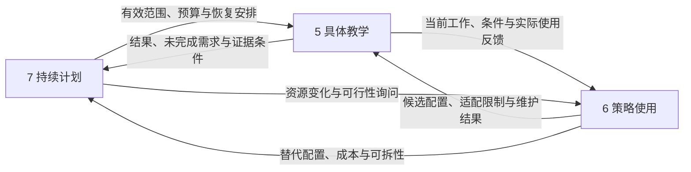

# AI 个人学习系统：工作包 6／策略使用规则设计方案 v0

日期：2026-09-30；本次修订：工作包 5—6—7 边界与连续性修复，沿用本文件。  
状态：设计基线，含实践库核对、条件化使用规范、任务实例与纸上走查；尚未经过真实学习试用。工作包 7 的独立方案尚未形成，相关接口为依据路线图提出的待对齐契约。  
本包回答：**面对工作包 5 已明确的教学工作与工作包 7 给定的资源条件，哪些方法配置适用，为什么选这一种、怎样合法适配，以及实际结果应怎样改进下次选法。**

核心选择：把实践库用作候选方法与约束的来源，在已有教学活动中留下可审查的选择理由。目标与证据决定要做什么，方法负责帮助完成它；方法名称、卡片数量和使用次数不构成学习结果。本包延续 Encoding 与 Post-Encoding 的“高理论上限、动态实际深度”：允许完整证明、模型构造和综合任务，也允许简单目标直接完成。

**5 对本次教学工作与执行负责，6 对可复用的选法、组合、适配与维护规则负责，7 对跨目标、跨会话的投入承诺与连续安排负责。**6 可以参与生成具体任务方案，但任务由 5 结合内容、证据和实际帮助确认后执行。6 的核心产出是带条件的方法配置及其使用依据，使教学方能复用经验、区分替代方法、避免重复与失配，并向计划方说明可行范围和代价。

## 一、依据范围与实践库核对

### 1. 本次实际使用的五份资料

| 简称 | 文件及使用位置 | 在本包中的作用 |
|---|---|---|
| 路线图 | [设计流程与工作包](../architecture/AI个人学习系统_设计流程与工作包.md)，工作包 6、检查点及通用设计模板 | 确定选择、组合、任务化、替换、退出和复盘的交付范围 |
| 策略 JSON | [Encoding 策略库](../research/04_Encoding策略库.json)，v2.0，60 个条目及来源索引 | 保留真实 ID、名称、分类、正文约束和证据标注 |
| 微操作库 | [Encoding 微操作与提问库](../research/02_Encoding微操作与提问库.md)，v2.0，各卡及文档首尾共同约定 | 补齐共同执行规则、比较目的、追加例子和停止要求 |
| Encoding | [工作包 5／Encoding 设计方案](AI个人学习系统_工作包5_Encoding_设计方案_v0.md)，第二至六、八至十节 | 继承目标工作、合法任务、帮助、局部返回与专项交接 |
| Post-Encoding | [工作包 5／Post-Encoding 设计方案](AI个人学习系统_工作包5_Post-Encoding_设计方案_v0.md)，第二至八、十一节及相关案例 | 继承恢复、关系加工、选用、更新、时间证据及持续计划接口 |

未读取项目中的提示词文档、设计分析文档、研究报告、快速矩阵、证据台账、审阅文件、人审可视化，也未沿上述文件中的链接追读其他方案或外部论文。涉及工作包 2／3／4、C0、8 的约定，通过两份已读教学方案所陈述的接口继承；工作包 7 的定位依据路线图及这两份方案的计划交接说明。本包不声称已直接复核其他上游文件。

本次修复直接依据路线图中工作包 5、6、7 的定义及两份教学方案的交接说明。项目文件清单中未发现工作包 7 独立设计方案，因此本包写清自己提供与需要接收的信息，不声称工作包 7 已实现或接受这些接口；待其形成时核对同一契约，不另建一份计划规则。

下文区分三种依据：**继承约定**来自上述资料；**本包设计**是本次提出的选择与使用规范；**待验证假设**涉及教学净收益、适配准确度和成本。案例均为自包含假设或已有方案内容的教学实例化，不是用户的学习记录。

### 2. 核对结果及其设计后果

| 核对项 | 实际结果 | 使用规则 |
|---|---|---|
| 数量与分类 | 两库均为 60 卡；O／S／R／D／I／X 六类各 10 卡；ID、名称对应 | 分类是查找入口，不是六步教学流程或六级能力 |
| JSON 顶层 | `version`、`research_date`、`status`、`operations`、`sources` | 引用库版本；不能把研究日期当成每条结论的核验日期 |
| 每卡字段 | `id`、`name`、`category`、`content_markdown`、`template_status`、`evidence_ids` | 前置、风险、深化任务和验收多数在正文中，不能只按名称匹配 |
| 两库一致性 | 未见实质正文冲突；部分引用在 JSON 中简写，在 Markdown 中展开为链接；深化任务和约束段对应 | 同一卡的两种载体不构成两份独立研究证据；本包引用 ID 即可关联 |
| 共同规则 | 文档级执行约定及“添加例子与停止的规则”位于 Markdown 首尾 | 使用某张 JSON 卡时也要携带这些规则，不能只提取单条正文 |
| 模板与来源 | 60 卡的 `template_status` 均标 H 设计综合；`sources` 有 46 个来源键；R09 的 `evidence_ids` 为空，其正文明确为设计推论 | 引用数量不作为效果排序；空引用不自动补文献，也不直接等于不可用 |
| 参数槽 | `[变量]`、`[目标事实]` 等是待实例化的任务参数；未见空正文或待补占位标记 | 模板本身不直接呈现为任务，须替换对象、条件、参考与判据 |

本次核对只证明项目内的结构与文本对应，没有重新核验来源论文。卡库的 E1／E2／H 是研究依据标记，与路线图的 Encoding 子工作包 E1—E5 不同；也不与 Post-Encoding 方案引用的研究评级合成统一分数。家族证据不能直接证明某个中文问法、组合顺序或本系统有效。

## 二、设计单位、职责与最小输入

### 1. 选的是“当前需要完成的工作”

一次选择的输入单位是：**5 依据有效目标与证据明确的、学习者当前需要完成、修订或接受检查的一项具体工作。**例如“根据个体数合并两组均值”，比“做一次深加工”更能决定用什么方法。它也可以是不可拆散的整体证明或设计产物。6 可以发现这项工作表达不清并要求补足会影响选法的信息，但不自行重写目标或认定学习者缺口。

需要分别处理四种起点：已有表现支持某项具体障碍；有目标内要求尚未被观察；初学尚无可靠输入；已有证据足够。只有第一种可以直接称为已有证据支持的缺口。后三种不能被统一记成“能力不足”。没有错误模型也能安排建构，没有卡片也能给可靠解释，有充分证据可以不再安排活动。

### 2. 三个工作包各自对什么负责

| 工作包 | 主问题与拥有的决定 | 主要产物 | 从相邻工作包取得什么 |
|---|---|---|---|
| 5：具体教学 | 当前要建立／恢复／修订什么；学习者承担什么操作；具体题面、呈现、反馈、局部转接与活动收束 | C0 活动规格与实际执行记录，Encoding／Post-Encoding 的内容判断，目标内后续需求 | 6 的可用方法与适配限制；7 的有效范围、预算、恢复位置和安排 |
| 6：策略使用 | 哪些方法匹配同一工作；如何区分、组合、适配、替换与退出某配置；哪些经验可复用 | 条件化选择规则、可复用方法配置、适配检查、实际使用的复盘与维护意见 | 5 的工作说明和实际结果；7 的资源限制、安排变化与运行成本信息 |
| 7：持续计划 | 多个目标及新学、补缺、复习之间如何竞争资源；何时做、承诺多少、延期或放弃什么、怎样恢复 | 唯一有效计划／当前展开单、需求处理结果和下一次安排 | 5 的未完成工作、证据条件与恢复点；6 的方法可行范围、替代配置、成本及可拆性说明 |

正式目标仍由 2 维护，条件化能力判断与诊断由 3 维护，内容来源及用途核验由 4 维护，协作实现由 8 落实。5、6、7 均引用这些依据，不另设掌握等级。5 的常规评价继续遵循既有授权。

同一教学责任者可以兼任多个职责，但须能区分是在作教学决定、维护策略规则，还是更新计划承诺。这里的调用可以只是读取和应用规则，无须跨 Agent 通信或新增审批。5 已有可靠配置时直接使用；无适合库卡时也可依教学方案直接设计，并将有复用价值的经验交给 6。

### 3. 6 的核心增量：带条件的方法配置

6 将分散卡片和实际使用经验组织成以下可复用信息；可附在原卡或现有活动模板上，不要求新建一套档案：

| 配置要素 | 6 要明确的内容 | 5 实例化时要完成的工作 |
|---|---|---|
| 工作与适用条件 | 处理什么变化、需要哪些前置、何时不用；与近邻方法差别何在 | 将其对照当前内容和原答，确认匹配，而非按策略名认定缺口 |
| 必须保留的条件与可调整部分 | 关键操作、必要反馈、成立条件及证据限制；可更换的对象、表示、材料和支持方式 | 生成具体题面与参考；改变关键条件时重新检查用途及可作结论 |
| 组合与替代 | 哪些工作可合并，怎样避免相互泄露线索；替代后保留或损失什么 | 选择当前配置并记录理由，依据现场表现继续、切换或退出 |
| 资源与中断特征 | 准备／执行／反馈成本及估计依据；可暂停位置、恢复代价、可拆范围 | 确认本次内容能否在实际条件下执行，保存具体父任务和中间产物 |
| 使用与维护依据 | 来源和版本、适用范围内的结果、失败条件、何时复核或暂停复用 | 交回实际执行差异和原记录引用，不将“建议过”算作“执行过” |

例如 S07 与 X02 的差别、何时合并、填空线索如何影响结果解释，可以跨多个内容单元复用；本次究竟缺少哪一步推导、给什么提示、是否转回 Encoding，仍由 5 决定。某配置可在较短时段完成的判断可供 7 参考；是否值得挤占另一目标的时间，由 7 决定。

### 4. 容易重叠的决定怎样划界

| 容易混同的事项 | 5 的职责 | 6 的职责 | 7 的职责 |
|---|---|---|---|
| 换方法 | 根据本次表现决定实际换用，保留帮助与原答 | 提供替代条件、损失与检查要求，维护跨次使用规则 | 仅在影响承诺范围／资源时重排，不规定每轮必须换哪张卡 |
| 停止 | 结束当前方法或活动，解释已做与未做 | 区分某配置应退出、可保留或应限制复用 | 决定相应需求继续安排、暂缓、合并或不再投入；不据停排判断已掌握 |
| 组合 | 确认同一具体任务能否保留所需认知工作与证据 | 判断方法功能重叠、干扰、可相容条件 | 合并会话或需求的安排，不能据排在一起认定教学和证据已等效 |
| 时间与成本 | 说明实际暴露、反馈、未完成位置及教学／证据时间要求 | 说明配置成本、不可中断段、可替代形式及估计不确定性 | 决定日期、时间窗口和跨目标投入；安排变化交回作适配检查 |
| 长期优化 | 产生实际教学结果并处理具体失败 | 据结果改善可复用配置，限制或恢复某方法用途 | 据持续使用、完成情况与延期后果调整资源，不把策略使用次数当掌握度 |

### 5. 开始时只取会改变决定的信息

沿用同一有效目标、唯一当前展开单及原记录，至少能够说明：

- **要做什么：**当前目标片段、判据、允许资源及尚未完成的要求。
- **已有何据：**原答与实际条件、已有支持、未知、反证；没有原答时如实保留限制。
- **能用什么：**可靠内容、必要前置、已备参考、材料用途，以及已展示的答案和帮助。
- **本次边界：**可用预算、用户意愿、允许调整范围；若是局部修复，还包括父任务与返回点。

目标不明确时可以进行限定的教学或探索，不能正式宣告达成；缺可靠参考时先补参考，不能靠选卡补齐正确性；起点未知但不影响输入时直接输入；仅当不同诊断结果会改变安排时，才补一项有区分力的观察。

## 三、从当前需要到可审查的选择

### 1. 判断顺序与候选准入

以下是决定之间的依赖，不要求每轮重新填表。依据仍有效时直接复用。

其中“当前还有什么必要工作”由 5 依据上游判断给出；6 检查候选配置对这项工作的适配性，返回理由及限制；5 确认当前任务后执行。遇到范围或预算不相容时，先检查 7 已授权的调整余量，超出余量才提出计划变更，不能由 6 自行增加学习投入。

| 判断 | 必须能回答的问题 | 不满足时的处理 |
|---|---|---|
| 当前还有必要工作吗 | 已有证据是否已覆盖本次要求；是否有相关反证或版本变化 | 已满足则结束或进入已安排的下一项，不为了调用策略再测 |
| 方法是否对准工作 | 它会改变哪项关系、条件、恢复、选择或执行表现 | 说不清变化就不选；仅因“更深入／更生动”不足以入选 |
| 前置和材料是否可用 | 学习者能使用必要对象吗；案例、变式和参考是否合法 | 可补的最小前置纳入任务并标明帮助；关键条件未知则待核查，不能默认满足 |
| 反馈是否有保障 | 错误如何被可靠纠正；复杂产物是否能核验；必要讲解能否兑现 | 预测、发明、误概念反驳等缺后续反馈时不启动该配置；改直接输入或暂缓 |
| 任务能否保留关键工作 | 输入、标题、工具或前一题是否已经代做拟观察的操作 | 可以保留教学用途，但不能按原独立证据解释；必要时换题或改变本次用途 |
| 资源是否足够 | 准备、作答、反馈、必要修订与收束是否可在当前承诺内完成 | 缩成可完整结束的子范围、保存可核查的整体中间状态、换低成本等效配置，或交计划方处理；不删掉必要反馈后照常启动 |

准入结论分为“当前可用”“补齐指定条件后可用”“本次不适用”。这是针对任务实例的判断，不是给某卡永久贴标签。未知不按通过处理；可以在教学用途下继续的未知，也不能被扩大为验收合格。

对必须保持整体性的证明或设计，可以把本次承诺定为推进到一个可核查的中间状态，预留必要反馈与收束，保存尚未完成的论证和恢复点。整体可跨会话继续，不要求拆成一串可独立通过的小题；整体要求完成前不宣告目标达成。

### 2. 合格候选之间怎样取舍

先按所需工作、现有前置与材料寻找候选；无需遍历全库。只展开会改变选择的近邻差异，记录一个实际考虑过的替代及不选理由即可；不存在真实竞争时不强造替代方案，也不强制固定候选数量。

取舍依次考虑：

1. **是否直接覆盖当前未完成工作。**会算但不会选方法，优先提供选择与拒用机会；增加计算量通常不对准缺口。
2. **是否具有可解释的结果。**本次若要区分竞争解释，任务结果须能影响判断；不能区分时修改诊断任务，所有结果都指向同一种必要支持时通常直接给支持。以输入、建构或练习为主的活动按目标工作与反馈判断，不额外要求其承担诊断责任。
3. **是否复用可靠内容和有效产物。**相同目标工作可由一个完整任务完成时，避免换表示、补前置、重做材料带来的额外成本。
4. **在保持要求的前提下，哪种配置成本与负担相称。**用户偏好可用于同样合格的选项之间，也可改变呈现形式；不能据此忽略目标本来要求的构图、证明或实现能力。

不能把证据条目数、家族评级、卡号、输出长度或主观“深度”合成为效用总分。候选之间无可靠优劣依据时，说明选择依据是材料可用、执行成本或试用便利，并保留可替换性，不声称已找到最优策略。

### 3. 选择理由的最小表达

简单活动用一句话；有争议或组合活动再展开：

> 因为【原答／目标尚缺条件】表明本次需要【具体工作】，在【前置与可靠材料】可用的情况下采用【实际方法、来源 ID】；它相对【实际替代】更直接处理【差异】。保留给学习者【关键操作】，观察【表现】；出现【结果】后结束，出现【另一结果】后调整。

这是工作说明，不是要求逐字朗读的提示词。对用户只需解释有用的理由，例如：“你已能计算，这次只检查人数不同时该怎样合并。”完整审查信息留在活动记录中。

## 四、缺口与候选方法的条件化映射

下表提供查找方向，所有行仍须经过第三节准入。卡片的实际名字与约束以原库为准；没有卡号的活动按两份教学方案的工作类型直接实例化。

表中“缺口”“前置”“恢复或重建”都是 5 引用或解释具体证据后给出的选法输入；表中分支是供 5 使用的候选规则，不凭一次匹配自行形成诊断、启动补课或增加计划需求。

| 当前目标工作与可见依据 | 候选方法 | 前置、材料及排除条件 | 检查什么，结果不符怎样改路 |
|---|---|---|---|
| 事实尚未输入或读前需聚焦 | 可靠输入；需要定向时 O01；需要一个落点时 I01 | 有准确短材料和可核对答案；不把无先验猜测当恢复失败 | 只观察目标事实或对应关系；已足够即停，不推广为整章理解 |
| 术语／符号使目标工作无法开始 | S01，必要时 S02／S03 | 能定位必需组件；不先补整个领域 | 熟悉表述可做而符号失败，先补符号映射；局部可用后回父任务 |
| 新手无法组织步骤，但有可靠路线 | S05 → 按需要 S07／X02 | 有正确范例且可定位关键步骤；不以观看作为执行证据 | 看步骤执行用 S07，看理由链用 X02；重合时一次完成，失败定位具体组件 |
| 支架还在代做本应自主完成的部分 | S08 或针对卡片的撤支持安排 | 已有相应组件表现；不能按题数全部撤除 | 只观察被撤去支持的工作；失败可恢复相应帮助，其他支持不清零 |
| 已知内容之间缺一处合法连接 | R02；理由链需要约束时 X02 | 两端知识足够可用，共享原则确实成立；类比不能代替证明 | 连接有何依据、能推出什么；提供前提仍失败才考虑局部重建 |
| 联合条件、必要充分条件或边界混淆 | R04、D02、D04／D06 | 规则可靠，案例变化合法；单因素无法隔离时承认联合变化 | 接受、拒绝和信息不足分别有据；误差只是读题时不扩成概念重教 |
| 将观察关联直接写成因果 | R05；需要比较具体预测时 O05 | 有可理解的竞争解释，能说明证据范围；无鉴别数据允许未定 | 区分观察、模型推论与待得证据；不能因提出实验就宣布已证因果 |
| 明确的错误命题持续支配判断 | D08；确有预测冲突与暂定模型时 X09 | 原错误有原答支持，替代解释与反馈可靠 | 在变式中实际改变推断，保留旧规则合法域；只改答案则继续有限修复 |
| 表面相似导致错用或漏用 | D03、I09；结构对应需要展开时 D01／I08 | 候选规则已可用，源例确实熟悉；陌生源域先换源例或补最小背景 | 查角色、关系、条件和禁止迁移项；分别记录错用、漏用及新增前置 |
| 会执行，不能自主选择／拒用方法 | D09／D10，配合无方法提示的目标任务 | 方法可跟踪；不让题组标题、邻题或工具默认代选 | 无提示选择与提示后执行分别记录；不能用更熟练的执行补记自主选择 |
| 局部正确，整体推断仍失败 | S09；需要压缩重建且局部已可靠时 X10 | 已有局部结构可引用；不机械增加单项检索 | 检验接口和整体结果；局部成功但整体仍错，重审组织或诊断，避免无限下钻 |
| 图、式、语言各自可用但对应失真 | X05／X06；图确需审计时 X04 | 定义域、单位、坐标、固定条件、时间尺度明确 | 说明保留、丢失、新增的信息；自动作图后看懂不能替代目标映射 |
| 需要抽象或主动构造合法实例 | X07、I10；有近例基础且目标需要跨情境时 I04 | 案例可比，结构可靠，目标要求明确；开放生成缺前置时给半成品 | 检查条件、合法非例与证明范围；若只要求应用，不额外添加构造要求 |
| 后续恢复暂时失败 | Post-Encoding 的恢复／必要支持；提供前提后按需要 R02 等 | 先区分未学、访问困难与结构问题；恢复内容可为事实、关系或完整论证 | 支持后可推理不代表先前自主恢复；允许查阅的目标可直接继续 |
| 新旧版本或规则需要条件化更新 | Post-Encoding 的更新；D01／D02、D06 按需辅助 | 两版依据与合法域可核验；参考错误先走系统纠错 | 同时保留应更新处和仍正确旧情境；不能“永远选最新”或一律禁旧 |
| 当前表现已有支持，只缺目标规定的延迟条件 | 结束当前教学，提出后续检查需求 | 时间、暴露与目标保持要求可引用 | 不能靠再做一张卡补足未来证据；由 7 安排合格时点 |

六类卡不承担所有功能。直接讲解、合法查阅、整体目标任务、延迟检查和终止活动，都可以没有对应卡号。记录“无直接对应卡；依据某方案某节”，不可为凑库覆盖伪造 `P01` 等 ID，也不可把使用 X10 自动解释为已完成持久保持。

## 五、组合、顺序与相互干扰

### 1. 合并按学习者工作判断

两张卡指向相同材料、相同关键操作和同一可观察变化时，合并为一次活动。可以保留多个来源 ID，并注明各自借用的部分，但只有一份原答和一次事件。例如 S07＋X02 都要求补全同一处有理由的推导，就不安排两次相同填空；D01 与 I08 若落实为同一次角色映射，也不额外复制表格。

同名卡也可能服务不同工作，不能仅按 ID 去重。例如一次 R04 检查模型假设，另一次 R04 检查模型输出是否足以作某项判断；只有后者属于尚未完成的目标要求时才保留。合并不得掩盖不同允许资源、线索、整体性或时间条件。

### 2. 第二项操作必须增加什么

| 条件化组合 | 后项增加的必要工作 | 可跳过、合并或停止的条件 |
|---|---|---|
| S05 → S07／X02 → 目标任务 | 从可见范例转为局部承担，再观察目标要求的独立工作 | 原有证据已支持的环节跳过；整体任务已覆盖关键连接时不另做补全 |
| D02／D01 → D10 的独立判断部分 | 去掉并排对照所提供的线索，观察条件能否主动调用 | 若目标只要求并排比较，不强加混合选用验收 |
| I01 → I02／D03 → X07 | 从实例落点到排除偶然特征，再形成有边界的概括 | 已有可靠规则且只缺一个应用时，直接实例化，不固定先归纳后规则 |
| O05／O08 → 可靠解释 → X09 | 利用真实分歧定位修订，并观察新模型如何改变判断 | 没有旧模型不制造误解；没有可兑现反馈不启动冲突活动 |
| 后续恢复 → 比较／应用 | 先获得目标所需恢复表现，再加工仍未完成的关系 | 恢复不是目标且材料允许查阅时，直接开卷加工；复杂任务已同时完成时合并 |
| S09 → 整体任务；或已可靠整体 → X10 | 前者检查接口是否可用，后者检查压缩能否支持重建 | 不把组装必经化；能直接完整证明者直接完成，不先拆散 |
| Post 目标任务 → 局部 Encoding → 原父任务 | 修复有证据定位的结构，再检验它能否接回原任务 | 只是访问问题、算术失误或题意问题时不重建整段结构 |

以上为可复用配置，不是已经验证的最佳顺序。活动可以重叠、交替或整合。复杂工作可以一次保留完整产物，不受统一卡数限制；每次投入仍受当前范围和预算约束。

### 3. 组合之前要排除的干扰

| 干扰 | 处理办法 |
|---|---|
| 先给方法名／完整模型，再声称测自主选择或恢复 | 所需的初始表现先保存；已发生暴露就限定结论或另提合格检查，隐藏答案不能撤销历史 |
| 同时改变数据、表示、情境和前置，无法解释错误来源 | 如果目的是诊断，收缩到会改变判断的差异；若目标本来是综合适应，可保留复杂变化，但不从失败直接归因单一缺口 |
| 比较太多候选而学习者尚不能跟踪任何一个 | 先提供必要解释，减少同时呈现范围；不以“辨析更深”为由持续加候选 |
| 连续题都暗示同一种方法 | 教学可以这样组织；要支持更广自主选择时另用不泄露方法的合格情境，并保留近端线索限制 |
| 错误预测没有反馈、反馈未回应初始尝试 | 补齐可靠纠正及对应关系；兑现不了就不采用该组合 |
| 压缩、类比或可视化省略必要条件 | 回到原参考核查；只保留合法映射，恢复目标不可丢失的信息 |
| 多卡造成重复原答、重复计证或无用途产物 | 以实际认知工作合并，删去不能改变下一步的重复活动与记录 |

## 六、从通用卡片到可执行任务

### 1. 实例化规格

**具体任务仍属于 5 的活动设计。**6 提供可复用的适配要求，可以辅助生成候选题面、变式与反馈分支；5 对照内容依据、实际帮助和目标要求确认后，写入同一份 C0 活动规格。内容核验仍由 4 的规则约束。已有题面满足要求时复用，不为证明 6 已参与而重新生成。

| 要素 | 6 提供的适配要求 | 5 落实的具体内容 |
|---|---|---|
| 用途及目标 | 方法能服务的工作类型及适用限制 | 教学／诊断／检查用途，目标与判据、本次范围、预期变化 |
| 来源与改动 | 库版本、卡 ID、可合并部分、变更后的检查项 | 实际选用与未执行候选，删减、改顺序或新增方法的理由 |
| 内容与材料 | 方法需要的案例、对照、参考及反馈条件 | 对象、题面、数据、定义域、版本、合法答案及核验依据 |
| 变化与保持 | 哪些结构与条件必须保留，哪些变化会增加前置或改变用途 | 本题实际改变和保持什么；新前置是否已满足 |
| 工作分配 | 哪种帮助会代做哪项目标操作 | 可见材料、工具、已知暴露、教师参考、备用帮助及学习者工作 |
| 产物与判据 | 方法产物可支持及不能支持的变化 | 引用原目标判据，接受合法多解、拒用与信息不足 |
| 反馈与分支 | 可复用的替换、停止条件及必要纠正 | 内容特定反馈、实际帮助、局部返回与活动收束 |
| 结果与去向 | 使用配置与预期不符时应回传什么 | 原答引用、实际结果、剩余要求、成本与后续需求，提交 7 并接收处理结果 |

执行前分别核查三件事：内容与参考是否正确；任务是否确实需要学习者完成目标操作；预定证据解释是否符合真实条件。库里有研究引用不替代这三项核查，正确教师参考也不能证明题目没有泄露关键方法。

### 2. 帮助按作用记录

“给了一点提示”不够具体。记录它给出了对象定义、候选规则、选择方向、关键等式、角色映射还是完整答案。允许给足以继续的支持；不要求按固定三级提示逐层试。S10 原卡中的阶梯是候选配置，实际采用时仍须按具体卡点和作用调整。

帮助前后的表现分开解释，原始尝试保留。用户要求示范或答案时可转教学，不能为了保持测评外观拒绝必要帮助；转教学后的成功按新条件记录。同一任务支持多项目标工作时复用原答，不将其算成多次独立成功。

### 3. 卡片验收与课程验收的关系

卡片的“新例、撤提示、延迟、反例”等要求，首先约束它所声称的学习变化。如果本次只借用示范或比较部分，就写明实际配置与完成范围，不称整条卡片目标已完成。是否还需独立、迁移或延迟证据，由正式目标决定。

例如 I01 的典型例可以完成一次概念输入，但不能据此声称跨例概括；目标只要求在给定例中标注角色时，可以结束这一目标，无需为满足卡片完整训练设想另造目标外欠账。目标要求自主方法选择时，则不能因某卡的并排比较已经做完而省掉该项要求。

## 七、无进展时怎样替换和回退

### 1. 先判断什么没有进展

本节规定 6 应提供的失败识别与替代规则，实际观察、反馈和转接由 5 执行。退出一个配置不等于结束整个活动；5 可以在当前授权范围内改用另一配置。活动停止后是否继续投入，由 7 处理计划；诊断与能力结论仍回到 3。

进展依据是目标相关工作是否发生可观察变化，例如更少依赖某处帮助、正确加入一项条件、接通原来断裂的推理。答得更长、重复正确词语、连续作答或信心提高不能单独算进展。

不设统一“失败两次就换卡”或“一直做到答对”。新反证、明显失配或用户负担已经足以改变决定时，应立即调整；仍有明确未完成连接且当前方法产生有用变化时可以继续。没有新增信息的重复追问应停止。

| 信号 | 先保留／区分什么 | 调整及返回规则 |
|---|---|---|
| 说不出组件，或只在陌生符号下失败 | 概念、符号、题意是备选解释 | 必要时 S01／换表述；只补当前必需项，达到接口要求即回父任务 |
| 暂时想不起，给允许前提后即可继续 | 帮助前恢复失败与帮助后推理成功 | 继续允许资源下的工作；只在恢复本属目标时保留恢复缺口，不自动回整章 Encoding |
| 前提已可用，仍接错关系 | 具体连接及其条件，避免宽泛诊断 | 用 R02／X02 等重建最小关系，再回原任务检查；修复成功不补记此前独立成功 |
| 填空正确，去掉邻近线索就失败 | 可能是局部线索依赖，未直接证明整体不懂 | 改成缺少相邻答案线索的等效任务，必要时保留其他支架；不原样多做填空 |
| 局部皆对，整体仍错 | 局部证据保留，检查接口、选择与组织 | S09 或整体任务重构；不无限寻找更底层前置 |
| 同类帮助不再改变关键表现 | 实际尝试、反应及对原诊断的反证 | 换表征、给正确范例、改诊断或收束；换措辞但关键工作相同不算真正换方法 |
| 丢失条件、前置操作断裂、用户报告疲惫 | 负担可能来自内容、呈现、工具或当前状态 | 减少同时工作项、整合材料、恢复局部帮助、换产物形式或暂停；慢、短答不直接等于低能力 |
| 用户指出题错、合法多解被判错 | 原答、题面、参考版本及实际暴露 | 暂停受影响教学用途和确定评分，交 4／相应责任核验；不让学习者重复证明来修复系统错误 |
| 目标或条件变了 | 旧版本下仍有效的表现与新要求分开 | 由原责任方更新要求／依据；重审受影响配置，不把新增要求倒算为旧表现错误 |

### 2. 局部返回契约

每次转入前置或局部 Encoding，保留：父任务卡点；为何该局部有关；已有支持；补到何程度足够；返回位置；当前投入边界。局部可用后回到父工作，分别判断局部结果、父任务结果及原目标仍缺的条件。

替换时先保存旧配置与停止理由，再说明新配置改变的实质维度：内容范围、表示、线索、学习者操作、反馈或任务条件。不能删除旧失败，也不能把补讲后的成功全部归给最后一张卡。返回父任务后仍失败时重审连接与诊断，必要时停止；不能用无穷子任务维持互动。

## 八、退出、收束与后续需求

以下活动结束原因继承工作包 5，供 6 解释某配置为何结束、是否值得复用。**5 汇总一次真实活动的结果并形成目标内后续需求；6 补充方法的可行条件、替代与成本；7 决定如何安排。**不因一张卡退出就创建一条独立待办，也不让 5、6 分别提交同一缺口的重复需求。

| 结束原因 | 需要留下的结果 | 可以说什么及后续归属 |
|---|---|---|
| 当前目标范围证据充分 | 原答引用、判据、实际条件、3 的有效判断 | 当前范围已有支持；停止重复投入，不宣称永久掌握 |
| 本次教学完成，目标内证据仍不足 | 实际完成的工作、帮助、尚缺的独立／整体／时间等条件 | 已完成这次教学；只为目标内缺项提出后续需求 |
| 预算用完或用户暂停 | 已完成部分、未完成连接、父任务、下次可执行起点 | 本次停止不等于不会或达成；7 处理分段、缩范围或取舍 |
| 方法无进展或诊断可疑 | 旧配置、反应、反证、未解决项及可行替代 | 暂停当前方法；教学方／3 重审，不自动标成学习者能力低 |
| 材料、规则或评分依据争议 | 受影响用途、版本、原答、已发生误导 | 限制依赖争议依据的结论；其他有据部分可继续，沿原责任纠错 |
| 条件未知，暂时无法作所需判断 | 未知来自何处、限制哪项结论、可采取的补充观察 | 可以继续不依赖该结论的教学；没有必要观察条件时不强行判通过或不通过 |

**证据不足不是默认加题指令。**若缺的是尚未发生的时间条件，结束当前教学；若原答足够、参考改正后即可重评，直接重评；若拟增加的问题无法改变下一步，删去。目标未要求长期保持或更广迁移时，写清结论边界即可，不产生必修债务。

后续需求要可执行：由 5 提供目标及尚缺工作、必要理由、允许资源与不得提前代做的操作、所需情境／时间条件、已发生的帮助与接触、材料与父任务位置；6 按需附上可替代配置、成本、可拆性及成功／失败分支。5 区分影响目标或证据成立的必要条件与可协商的教学建议时窗；6 不把库中的建议间隔升级为硬性期限。7 在这些条件下决定投入与安排。接收状态区分“待接收”“已接收待处理”“已安排”；只有真实回执支持后者时才这样表述。延后、合并或不再投入也应有明确处理结果，不应长期停留在“已接收”而无去向。

多个需求可由同一任务满足时提出合并建议，但不同线索、资源或延迟条件不能因合并而视作全部满足。预算结束时优先保存真正可恢复的工作点，不把全部未完成卡片自动移到明天。

## 九、最小记录：让下一次选择能够复盘

### 1. 分开资源、使用决定、实际活动与效果解释

| 对象 | 保留什么 | 不能混同什么 |
|---|---|---|
| 原始策略资源 | 库版本、ID、原卡约束和来源标记；无卡活动引用方案位置 | 名称相同不保证配置相同；文献来源不是本次活动结果 |
| 本次使用决定 | 目标工作、选择依据、实际考虑的替代、组合或改动、预期可观察变化 | 计划调用不等于实际执行；候选不能算已用过 |
| 实际活动与表现 | 任务版本、原答引用、实际执行的操作、帮助及时间、材料暴露、调整和停止原因 | 最终整理稿不能覆盖初答；同一原答不重复存成多个独立成功 |
| 使用结果与维护意见 | 哪项变化出现／未出现／未观察，实施偏差、条件限制、成本及下次建议 | 学习者的当前表现与策略的因果效果分开；由 3 维护能力判断 |

这些是信息含义，不预设四张数据库表。简单活动将来源 ID 和理由附在 C0 现有记录即可；复杂组合只有在改变后续选择时才补充细节。正式能力结论、原答和时间事件以原记录为准，本包保存引用及策略使用语义。

记录归属保持唯一：5／C0 维护实际活动、帮助与原始产物，6 维护可复用配置及基于原记录的使用分析，7 维护计划承诺与需求处理状态。活动记录中的“已安排”引用 7 的有效结果，策略复盘中的“成功”引用实际证据，三方不各自维护一份可能冲突的事实。

### 2. 一次使用最少可追溯到什么

> **目标与依据：**当前要求、原答和允许资源；为什么值得安排这项工作。  
> **配置与来源：**实际采用的库版本／ID 或无卡来源；合并、删减和替换；未执行候选另列。  
> **实际条件与结果：**任务／原答引用、谁完成关键操作、实际帮助、相关时间与接触、按目标判据的结果范围。  
> **结束与后续：**原因、父任务返回结果、仍缺要求、接收处理状态。  
> **成本与复用：**有记录的准备、学习、反馈与核验时间；明显负担或额外资源；哪些配置可复用、哪些需改。

成本可引用现有时间与资源记录；无法取得精确值时写粗略估计及其来源或“未知”，不补造数字。成本包含准备和核验，不能只算对话轮数；延期工作也不能被当作已节省。简单稳定任务不为复盘而强制逐句计时或保存无用途的全部对话。

时间按相关内容引用初学、练习、帮助／反馈、已知再接触及检查事件。一个月前学过主题、昨天才修订的条件，不能称该条件已保持一个月；同一综合任务的不同关系可以有不同历史。一处新帮助只限制其实际提供信息所影响的操作与结论，不重置全主题时间；未知接触记未知，不将未知默认为没有接触。

一张卡在不同目标、允许资源、前置与任务配置下的结果分别保留。短期内只记录“该配置在这些条件下出现何种结果”，不建立“此人不适合某策略”的稳定标签。

## 十、代表性任务实例与分支

以下案例展示从选择理由到题面、参考、反馈、停止和记录的完整转换。教师参考单独标出，真实执行时按活动用途决定何时展示。各分支是假设，不表示这些答题行为已经发生。

案例中的目标工作、具体题面、反馈和活动收束属于 5；方法对比、合并、适配限制和使用复盘体现 6 的增量；后续日期与投入属于 7。完整呈现案例是为了检查合作能否成立，不把这些职责全部划入 6。

### 案例 A：事实目标可以简单完成，也可以不调用卡片

**目标与材料。**假设课程规定：“本课程用符号 τ 表示一次任务允许的总时长。”目标只要求在课程语境中准确说明 τ 的含义，无推导、速度或长期保持要求。材料就是这条已确认的课程约定。

**选择。**初次输入且用户希望直接了解时，展示约定并做一次目标内对应即可，记录为无直接对应卡的可靠输入。若读前确需聚焦该事实，可采用 O01「目标事实缺口」：“读这句话前，你认为 τ 在本课程表示什么？不知道可写未知；随后按原句核对。”不选 X07，因为此处没有需要从多例归纳的规则；不选 D08，因为未知不是错误信念。

**检查与反馈。**读前未知是合法起点。展示后复述只支持接触后的对应；若要观察当前未看原句的准确说明，可以在移开材料后提问并注明刚刚接触过。答案需明确“本课程”“任务允许的总时长”，不要求推测 τ 在其他学科中的含义。答成“已经使用的时长”时直接澄清约定；无需长篇分析误概念。

**停止与记录。**按实际条件记录对应成功、教学输入及 O01 是否真正采用。满足这个简单目标即结束；不添加证明、迁移或延迟必修项。不能把本次表现写成一般符号能力或持久记忆。

### 案例 B：同一均值主题，初学与条件误用选择不同

**假设目标。**能够依据人数与组均值计算总体均值，并判断何时可直接平均组均值；允许计算工具，关键数量对应与方法理由由学习者完成。两组都非空，量纲相同，成员不重叠，各组均值指同一指标的算术平均。

**分支 B1：没有可靠基础。**先提供一个完整正确示范：10 人均值 80，30 人均值 60，总量分别为 800、1800，总体均值为 `2600／40＝65`。采用 S05「正确范例追踪」与 I01「简洁典型例落地」合成一个活动：学习者指出每个数对应人数、总量还是均值，解释分母为什么是 40。二者来源可并列，不能算两次独立表现。不选 D08，不把尚未学过解释成错误模型。

随后如只缺“总量对应人数”的连接，给必要上下文，让学习者完成关键一步；实际配置借用 S07／X02，合并一次记录。新手若连乘法所代表的总量都不明确，只补当前对应关系，再回到原合并任务。

**分支 B2：会算，却主张两个均值总能直接平均。**保存这一原命题，采用 D02「最小对 / 单因素隔离」与 R04「必要、充分、促成、背景条件分离」。给出同样的两个均值 80、60，比较人数分别为 10／10 和 10／30 的情形。改变组人数，保持组均值与指标含义；由定义构造合法聚合数据，不要求逐个个体保持不变。学习者计算结果、指出变化的理由，并判断“人数相同”是否是唯一可行条件。

**教师参考。**对正人数 `n₁,n₂` 和组均值 `m₁,m₂`，总体均值为

`M＝(n₁m₁＋n₂m₂)／(n₁＋n₂)`。

`M＝(m₁＋m₂)／2` 当且仅当 `(n₁−n₂)(m₁−m₂)＝0`，即人数相同或两组均值相同。本例前者为 70、后者为 65。若目标只要求条件判断，可以提供等式关系再要求应用；若一般推导本身属于目标，则由学习者承担，不能把参考展开提前展示后仍称自主推导。

**反馈。**只把 70 改成 65 还不足以支持条件判断；需要指出总量与人数如何决定结果。只记“人数不等绝不能直接平均”时，再用均值相同的合法特例修正过度否定。若公式选择、总量和分母均正确，仅算术错，则纠正计算，不重讲整个均值概念。

**目标内检查。**在不附方法标签的任务中要求处理：15 人均值 80、45 人均值 64 的总体均值；两组人数不同但均值都为 70 的情形；只知两个不同组均值而缺人数的情形。教师参考依次为 68、70、信息不足。它们用于观察数量对应及条件判断，不因题面未写方法名就声称广泛自主方法选择：刚完成均值教学的上下文仍是线索。如目标要求跨方法选用，另需合格混合任务。

**结束。**条件与计算的当前证据达到要求即停；不因使用两类卡再补一轮重复比较。若只完成有帮助的关系工作，按该范围记录，保留目标内未观察的部分。

### 案例 C：Post → 局部 Encoding → 父任务，且预算突然缩短

**目标与入口。**沿用 B 的数量关系，假设当前目标要求在后续任务中自行构造总体均值关系。已知之前的教学包含完整公式示范，因此后续记录保留该暴露；不能说从未见过公式。当前题为：20 人均值 90，60 人均值 70，求总体均值并说明理由。教师参考为 `(1800＋4200)／80＝75`。

**初始活动。**直接给目标任务，不先复习全部公式；来源为 Post-Encoding 恢复与应用规范，可不挂卡。四种假设表现对应不同路径：

| 初答或必要支持后的表现 | 选择与理由 | 可作的结果解释 |
|---|---|---|
| 不记得公式名称，但自行合并总量并除以人数，得到 75 | 直接核验并结束此工作，不补背诵 | 合法重建与使用成立；没有必要因未逐字回忆公式判失败 |
| 想不起，得到“每组总量＝人数×均值”后完成 | 继续必要工作；记录这条支持 | 支持后的构造成立；不回填帮助前自主恢复成功 |
| 已给 1800、4200 和人数，仍用总量除以组数 2 | 转局部 Encoding，用 X05 的数量含义说明，必要时 X02 约束理由链 | 只修复“总量对应全部个体数”这处连接，不重教整章 |
| 正确写出 6000／80，算成其他数 | 修正计算，保留正确结构选择 | 计算失误不支持结构缺失诊断 |

**局部任务。**明确父任务停在分母。提供“总体均值表示每个人平均对应的量”这一可靠定义，学习者说明为何 2 对应组数、80 对应人数，并据此重新完成父任务。给定义是实质输入；其后的理由链仍可观察，但不记成全程无帮助。

**返回与退出。**原题可用于修订；目标需新的自主证据时另用合格任务。局部理由正确但父任务仍失败，就检查人数对应、题意或整体组织，不自动下钻更多基础。假设此时用户只剩收束时间，立即保存局部和父任务结果，停止追加策略；原目标要求不降低。

**本例的最小使用记录（假设）。**

| 项目 | 示例记录 |
|---|---|
| 选择依据 | 当前任务中提供总量后，分母仍取组数；备选解释含数量对应与题意理解 |
| 实际配置 | 初始无卡目标任务；修复借用库 v2.0 的 X05、X02，合成一次数量关系说明；未执行的 S05 仅列为备选 |
| 原答及帮助 | 先提供两组总量 1800、4200 及人数 20、60，学习者仍将 6000 除以 2；再给总体均值定义后，学习者解释分母 80 并改成 75；真实运行中引用原事件，不以此假设替代 |
| 结果 | 已提供总量及人数时，分母连接仍失败；给定定义后局部理由与父题修订成功。此记录未包含完整的帮助前独立产物，故该项表现未完整观察；新的自主检查未做 |
| 结束 | 预算结束；未完成项为目标条件下的新任务，不是“再做 X02” |
| 后续 | 在需要使用该关系前补合格观察，保留最近帮助背景；交计划方，假设当前待接收，不能声称已排明天 |
| 成本与维护 | 精确用时未知；只记录预算中断及准备可复用；本次不足以证明 X02 优于完整范例 |

跨会话恢复从未完成观察或父任务连接继续，沿用帮助历史。若下一次只缺目标规定的延迟条件，则待合格时间观察，不靠重复本题“刷出保持”。

**本例的三方连续处理。**以下为设计走查，不表示计划方已经实际接收：

1. **5 明确需求。**当前已完成给定定义下的局部修复和父题修订，尚缺目标条件下的自主构造。提交这一项工作，附原答、帮助背景与恢复点，不提交“再做 X02”作为任务目标。
2. **6 提供可复用配置及本次限制。**候选甲是直接给一个合格的新任务，出现明确关系障碍才转局部支持；候选乙是先给公式再应用。甲可观察本目标需要的自主构造；乙可以继续教学，却不能等效替代这项检查。可以更换数字和叙事情境，必须保留总量与人数的对应、必要反馈以及帮助前后分开的记录。成本尚未知时说明未知，不虚设通用分钟数。
3. **7 返回资源安排。**假设计划方建议与下一次课程练习合并，并给出更短的可用时段。5 核查该练习是否保留未提示构造的条件，6 检查是否仍容纳候选甲所需的作答、反馈和收束。若符合，在原需求上更新安排，不另建一条策略待办。
4. **不相容时如实回交。**若合并练习预先给出公式，5 说明它只能支持给定公式后的应用，6 说明乙与甲的证据用途不等效。7 可以改用不泄露公式的任务、另留合适时段，或决定暂缓／不再投入并保留未满足项；不能把较短活动记成原目标通过。
5. **执行结果返回。**5 在有效安排下执行并交回实际结果；3 更新证据判断，7 据此关闭或重排原需求，6 更新该配置的实际成本和适用经验。若只因时段不够而未执行，6 记录资源不适配，不能据此判定方法教学无效。

### 案例 D：高级证明与构造保持整体，不受卡片粒度限制

**继承范围。**沿用两份方案的二次目标：

`F(x)＝||Ax−b||²＋λxᵀQx`，`λ>0`，`Q` 对称半正定。

假设上游目标要求说明唯一性条件，并为给定 `A` 构造最低秩的合法 `Q`；允许查基础线性代数性质，判据连接、构造和最小性论证由学习者完成。既往已有范例与部分论证，实际帮助范围按原记录继承。

**学习者任务。**给定 `A＝[1,0]`、任意实数 `b`，选一个对称半正定 `2×2` 矩阵 `Q`，使每个 `b` 都对应唯一极小解，且 `Q` 的秩尽可能小。论证选择与最小性，再解释条件为何不能只写“Q 的秩大于零”。初始题面不提供核空间判据、候选矩阵或反例方向。

**选择理由。**这是构造与论证目标，先给完整任务。它借用 I10「受约束新例生成与验证」中的受约束生成与核验思想，但最低秩证明来自上游目标，不声称 I10 已覆盖或验证这一高级教学。学习者若能直接完成，不先安排 O 类预测、S 类补全或概念图。若只在判据连接处卡住，才选 R02；需要给关键等式后补理由时可借 X02。仅重复核空间计算不能处理关系缺口。

**教师参考。**可取 `Q＝diag(0,1)`，此时 `F(x)＝(x₁−b)²＋λx₂²`，唯一极小解为 `(b,0)`，`rank(Q)＝1`。秩为 0 的半正定矩阵只能是零矩阵，此时 `x₂` 不受限制，故秩 1 最小。`Q＝diag(1,0)` 虽也是秩 1，却留下 `x₂` 方向，不能保证唯一。

一般判据为 `ker(A)∩ker(Q)＝{0}`：`vᵀ(AᵀA＋λQ)v＝||Av||²＋λvᵀQv`；半正定下两项同时为零等价于公共核方向。无非零公共核时二次型正定；有公共核时沿该方向目标不变。极小解存在性可由堆叠矩阵的有限维最小二乘得到。允许其他合法构造和等价证明，例如在此任务中只惩罚一条对第二坐标非零敏感的方向，也可能有效，须逐一验证。

**分支与反馈。**如果学习者选了 `diag(1,0)`，先保存构造，再观察其如何检验候选；必要时指出未受约束方向，但给出方向后不能说该方向由其自主发现。构造正确却只用数值特征值说明全部情况时，保留数值检查，补目标要求的一般理由。若局部计算与证明均已满足，结束；不因为目标高级而追加目标之外的正则化理论。

**范围控制。**本例证明了给定 A 的最小秩，没有自动覆盖一般 A 的最低秩公式；若原目标还包含后者，该要求保留另行完成。时间不足时保存构造、已完成论证及目标内尚未完成部分；只有原目标包含一般 A 时，才保留相应一般化要求。不把会代入改写为构造目标通过。整个任务产生一份产物，多个来源 ID 不增加独立证据次数。

### 案例 E：跨情境使用，比较支持与自主选择分开

**目标与依据。**假设目标要求在给定关系中识别是否成正比例并说明条件。定义采用实数域上的 `y＝kx`，其中 k 为固定常数；案例只讨论给定定义域内的关系，不从表达式推出未经支持的因果机制。已有证据表明学习者会处理 `y＝2x`，却按故事是否相似选择方法。

**材料与选择。**提供同一设备按使用时长收费的两个规则：`y＝2x` 与 `y＝2x＋10`，x 的单位是小时，y 的单位是元；另给一个自包含材料模型：同种均匀材料的密度固定为 `3 g/cm³`，体积 x 与质量 y 满足 `y＝3x`，单位分别为 cm³ 与 g。这里按叙事情境与实体区分表面：前两例同为设备收费，第三例是材料质量；目标结构则按固定倍数关系判断。选择 I09「反类比配对 / 表面诱饵」，需要时合并 D01 的角色对齐；不选 I08 为每个对象再加一个陌生类比，也不只用 I04 把场景变远。这样可分别观察表面相似的错用与表面不同的漏用。

**学习者任务。**说明哪些关系可用同一种“按固定倍数随数量变化”的规则，逐一给依据，指出不适用关系中多出的成分。教师参考为第一、三例满足，第二例因固定项 10 不满足。数据、规则和单位均在题内给定，不依赖真实市场价格。

**帮助与分支。**若并排比较后能够正确判断，再只在目标需要时进入不带“正比例”标签的混合任务，按 D10 的独立判断思想组织；学习者自行选择规则、拒用或报告信息不足。近期题组仍可能提示方法，因此当次最多支持实际线索条件下的选择；更广自主选用应在合格情境中观察。若“密度固定”本身未理解，先补该前置或按目标改用直接给定关系的任务；不能归因于广泛迁移失败。

**可接受边界。**后续题若只给“购买量增加时总价上升”而未给函数或固定单价，正确结论可以是信息不足，不能推出正比例。若目标只要求函数类别判断，到此即可；不能附加宏观经济或物理因果推断。停止依据是目标内判据与证据，而不是走遍四种卡。

### 案例 F：版本更新保留合法旧分支，系统错误另行纠正

**自包含规格。**沿用 Post-Encoding 中的教学用接口，不描述任何真实软件库：`mean(values, version)` 接收有限实数列表；非空时两版均返回算术平均；空列表时 v1 返回 `0`，v2 返回 `None`。目标允许查两版规格，要求正确选择版本行为、实现分支并自行设计边界测试。

**假设缺口与选择。**用户把两版空列表都改成 `None`。选择 Post-Encoding 的条件化更新，借 D01／D02 对齐相同输入下的版本差异、D06 处理版本未知的情形；不选事实闭卷恢复，因为允许查阅；也不把 v1 的旧规则全部反驳。原答已能定位问题，不另问一串诊断题。

**学习者任务。**给两版完整规格及用户原实现，让其改正版本分支，说明保留了哪项旧行为，并自行设计能够检验两版差异与共有行为的测试。未指定版本且无默认规则时，应指出缺失信息，不默认取最新。

**教师参考与反馈。**评分参考覆盖两版空输入、两版非空均值以及目标规定的版本选择条件，接受其他能覆盖同一要求的测试。教师不先显示完整测试清单；如果后来提供清单，则只支持据给定测试执行或修复，不能支持独立测试设计。原实现错误只在特定分支时保留其他有效代码与证据。

**系统纠错分支。**若后来发现系统把 v2 参考误写为 `0`，立即停止该用途与确定评分；修正参考后用历史原代码重评。原代码已经正确时不要求用户重做来证明。若错误解释已经展示，另行修复教学影响；由误判产生的补课需求也须回交计划方撤回或调整。内容恢复、历史重评和误导修复分别确认。

**结束与保持。**当前规定条件下实现与测试工作得到支持即可结束本轮；仅当原目标要求长期维护或已有旧错复发证据时才提出对应后续检查，不声称完成旧记忆覆盖。

## 十一、策略复用、修改与停用

本节维护的是方法配置的可用性与复用依据。6 退出某配置时说明替代方法和影响范围；正在执行的活动由 5 按教学与内容安全规则处理，受影响的既有安排由 7 调整。7 因时间竞争放弃某次投入，不等于 6 应删除该策略；5 在一次任务中选了不同方法，也不自动形成全局配置更新。

### 1. 先定位配置问题，再谈策略是否有效

复盘沿以下问题缩小范围：目标与判据是否明确；材料与参考是否可靠；前置与帮助是否符合原配置；学习者是否实际承担关键工作；检查是否提供了所需证据；当前结果是否受预算、暴露或其他改变影响。只复核与问题相关的部分，不把每次活动变成全套审计。

例如 D10 使用后独立判断未改善，可能是第二阶段从未执行，也可能是题组继续提供了分类线索，或学习者尚无规则基础。没有区分这些情况前，不能把结果汇总成“D10 对此人无效”。同理，给了完整答案后的正确率上升不能证明该策略优于较少帮助。

### 2. 对具体配置作维护决定

| 决定 | 适用理由 | 需要保留的说明 |
|---|---|---|
| 保留／复用 | 条件匹配，任务可靠，已有目标相关变化，成本可接受 | 适用范围和证据限制；复用时重新确认目标、材料、前置与暴露是否仍相容 |
| 调整 | 作用方向合适，但题面、帮助、表示或检查条件有缺陷 | 改了什么，预期影响哪项表现；旧结果不能与新版无条件合并 |
| 合并 | 两配置实际完成同一工作，或同一任务能满足相容要求 | 保留来源与不同用途，去除重复任务；不增加独立证据数 |
| 暂停某用途 | 参考失效、前置不满足、无法反馈，或已有失配反证 | 停用的具体版本、用途与恢复条件；不因此禁用全库其他情境 |
| 退出当前个人配置 | 在相近条件下多次出现无收益、高成本或更简方法已足够 | 观察条件、替代配置和解释限制；不宣布该策略普遍无效，不删除原始卡库 |
| 保持未知 | 有效观察不足、条件不可比或结果受多项变化影响 | 缺什么依据；只有会影响未来选择且成本合理时才补观察 |

单次重大内容错误足以暂停受影响用途，不必凑满失败次数。偏好或成本也可以成为更换配置的充分实践理由，无需先证明其教学因果效果为零。相反，几次成功也只支持有限复用，不支持统一最佳方法排名。

库版本或卡片正文变化后，检查改变的是措辞、适用条件、反馈还是验收。实质变化需要复核受影响的活动配置；历史记录仍保留当时版本，不能用新版说明覆盖旧执行。JSON 与 Markdown 日后出现冲突时，先标出冲突和影响；仅对不冲突部分继续使用，不默选一个载体为永远权威。

### 3. 有限比较怎样帮助维护

需要比较时，选先验与难度尽量相近的目标单元，保持内容正确性、允许时间、反馈机会和检查条件相称，优先只改变一项配置。观察目标条件下的表现、提示依赖、必要的延迟或情境证据，以及准备、学习、核验和后续积压成本。

先做 A 再做 B 后答对，不能全归因 B；同一内容的第二遍有顺序和学习累积影响。个人样本有限，可用比较支持“下次优先试哪种配置”的实践决定，不能报告未经支持的因果排名或普遍收益。自然任务已提供合格证据时可复用，不为试验额外制造目标外学习负担。

只有反复出现的人工转译错误或检索成本足以影响教学时，才讨论将适用条件、排除条件、检查和返回规则结构化。结构化字段须保留原文位置与版本，自动抽取结果需要核对；不能把本包的条件表直接当作已验证调度算法。

## 十二、工作包接口与责任闭环

### 1. 直接合作，不设置固定串行关卡

箭头表示信息依赖，不要求一次活动走遍所有箭头。5 可以直接将后续需求交给 7；7 可在排程前询问 6 的方法成本。6 不成为教学与计划之间的必经转发层。已有有效配置与授权时，5 在本地应用规则即可。

### 2. 5 ↔ 6：从教学需要到实际使用反馈

| 方向 | 最小交接内容 | 接收方负责作出的决定 |
|---|---|---|
| 5 → 6：需要选法或适配 | 具体工作与用途；目标／证据／材料引用；实际帮助及必要前置；当前资源边界；只需补充会影响选择的未知项 | 6 返回合格候选、选用理由与限制；信息不足时只指出影响哪项选择，不重复冷启动诊断 |
| 6 → 5：返回配置 | 采用／替代理由；必须保留的操作与反馈；可调整部分；来源版本；组合、替换和退出条件；资源及可中断性 | 5 确认当前题面、参考、帮助与证据用途，接受、局部调整或说明不适用；无需新增批准步骤 |
| 5 → 6：使用反馈 | 实际采用与未采用部分、改动理由、原答及帮助引用、返回父任务结果、成本和结束原因 | 6 决定继续复用、调整、合并、限制用途或保持未知；不另改学习者能力结论 |
| 6 → 5：配置变化 | 改变了哪些条件、受影响用途、替代及恢复条件；不只发送一个新版本号 | 5 检查当前活动是否受影响；可兼容变更沿用，有实质冲突则换路或暂停受影响部分 |

5 对候选的现场调整，在原目标、证据用途、资源和授权范围内可以直接进行并留痕。若改变了配置中必须保留的条件，例如删去纠正反馈或提前给出方法名，需重查其用途与结论，不能继续按旧配置名称声称获得同样结果；这不要求等待 6 批准才能给学习者必要帮助。

### 3. 5＋6 ↔ 7：需求、可行方案和安排相互衔接

同一目标内后续工作沿用同一需求引用。5 提供教学事实与证据约束，6 的方法信息附在这份需求上；7 保留其处理状态。以下是本包要求能够传递的语义，不规定通信格式、字段名称或调度算法。

| 交接部分 | 提供者及内容 | 接收方可以据此作什么决定 |
|---|---|---|
| 工作与必要性 | 5：尚缺的目标工作、已有支持、不做的影响、父任务及恢复点 | 7 与其他目标比较优先级；不能只收到卡号或“需要复习” |
| 不可悄悄改变的条件 | 5：目标规定的资源、关键自主操作、整体性、时间／使用条件；区分必要条件与建议 | 7 在约束内安排；若无法满足，明确提出范围或目标变更，由相应责任处理 |
| 可协商的实现方式 | 6：候选方法、适配范围、成本估计及依据、可中断点、恢复代价、合并可能与不等效处 | 7 选择可负担方案或提出新的资源条件；不能把低成本视为自动等效 |
| 处理结果与有效安排 | 7：接收／待处理／已安排，或明确的延期、合并、不再投入；适用范围、预算、恢复位置与变更理由 | 5 据有效安排继续；6 仅对受变化影响的配置重查，不重新设计全部路径 |
| 再适配结果 | 5：新安排是否仍保留内容与证据要求；6：配置是否仍可执行、有哪些替代和代价 | 7 确认相容安排，或承担资源取舍；不可行时保留未满足要求，不伪记通过 |
| 执行后的反馈 | 5／C0：实际完成、帮助、未完成与成本；3：条件化判断；6：配置适配问题 | 7 关闭、减少、保留或重排同一需求，6 更新复用依据；同一结果不生成重复待办 |

7 的不再投入或延期是计划取舍；只有相应目标正式改变或被撤回时，才改变目标要求。未被满足的要求可以保留为明确未覆盖，而无需永远占据活动队列。6 对方法可行性的建议不构成新的预算承诺，7 对时段的安排也不构成教学已完成。

### 4. 变更与拒绝要有明确去向

| 新情况 | 本包要求的处理路径 | 何时可继续 |
|---|---|---|
| 7 缩短预算或改变连续时段 | 6 提供可缩减的重复工作、可暂停位置或替代；5 检查关键教学／证据要求。无合格方案则回交 7，保留未满足项 | 已授权的范围内可直接收缩；超出时采用新的有效安排；用户暂停立即生效 |
| 7 将检查与开卷练习合并 | 5 检查资源与线索是否相容；6 说明哪些配置仍适用、哪些证据用途被改变 | 合并满足原条件，或明确转为教学并保留原检查需求；不能仅因主题相同就视为等效 |
| 6 认为预算下没有可行配置 | 返回受限原因、可行前提与代价，不自行扩大投入，也不无限要求更多资源 | 7 给出可行安排、暂缓或取舍；无新增条件时不重复同一请求 |
| 5 发现候选与内容不相容 | 给出具体冲突，按教学依据改用可靠方法并反馈 6；影响预算时同步 7 | 授权范围内直接继续；库中暂无合格卡不是教学中断的充分理由 |
| 6 暂停已排程配置的某用途 | 通知 5 受影响条件与替代，同时向 7 提供资源影响；事实仍引用同一版本记录 | 5 确认替代能执行，7 仅在承诺变化时重排；不牵连未受影响任务 |
| 目标、材料或证据条件更新 | 按 2／3／4 的有效结果，由 5 重查当前工作，6 重查受影响配置，7 重查安排与需求 | 冲突解决后恢复相应用途，不把旧摘要当当前依据 |

这里规定拒绝与回传的理由，不规定固定协商轮数。没有新增证据、资源或目标变化时，不重复往返；保留不可行原因与当前取舍。新的调整权限由既有授权决定，不因工作包边界清晰而增加逐轮人工审批。

### 5. 原记录连续，其他责任保持原归属

5 向 3 提交实际表现和备选解释，6 补充配置适配信息；3 更新诊断与条件化判断。5 向 4 提出具体题面与参考需求，6 补充方法所需的对照和变式条件。目标冲突交 2，授权及记录实现交 8；6 的规则与案例交 9／10 贯通检验。各方可直接提出发现的问题，但不越权改写专业结论。

恢复时，7 给出有效安排与恢复范围，5 读取当前目标、内容用途、条件化判断、上次原答和帮助，以及停止原因和父任务位置；6 只在配置过期、出现失配或资源变化影响方法时重新适配。已经完成的工作直接引用，无进展后不原样重开，参考争议未解除时不恢复受影响用途。用户删除证据后，不从策略摘要重建被删个人内容；依据变化引起的结论收窄与能力下降分开处理。

## 十三、设计验收与纸上走查

### 1. 工作包 6 交付项覆盖

| 路线图要求 | 本方案落实位置 | 可审查问题 |
|---|---|---|
| 目标、缺口与方法匹配 | 第二至四节；案例 A—F | 同一主题因证据不同，是否能说明为何选不同方法或不选卡 |
| 前置、材料与反馈保障 | 第三、六节；案例 B、D、F | 配置是否具备执行条件；缺可靠反馈是否有退出路径 |
| 重复、组合与干扰 | 第五节；案例 B、E | 后一项是否增加必要工作；是否重复计证或提前代做选择 |
| 从卡到材料、题目与判据 | 第六节；六个实例 | 能否给出具体题面、正确参考、学习者工作及证据限制 |
| 无进展、负荷、前置或诊断问题 | 第七节；案例 C | 能否换路、缩小范围、重审诊断并回到父任务 |
| 达成、预算结束、证据不足分别收束 | 第八节；案例 A、C、D | 活动完成和目标通过是否分开；是否保留原要求 |
| ID、结果与成本复盘 | 第九、十一节；案例 C 记录 | 能否定位实际配置、帮助和条件，而非只数卡片使用量 |
| 可试用且不冻结实现 | 第十一、十二、十四节 | 哪些规则已有设计，哪些收益与参数仍待验证 |
| 5—6—7 的独有职责与连续合作 | 第二、六、八、十二节；案例 C 三方走查 | 是否既能复用 6 的选法依据，又能保留 5 的教学决定与 7 的计划决定；返回信息能否改变后续动作 |

### 2. 本次纸上走查结论

| 输入情境 | 按本方案得到的路径 | 排除的错误结论 |
|---|---|---|
| 初学且无旧错误命题 | 可靠输入／S05／I01；按目标留下工作 | 无需制造错误模型再纠正 |
| 同一补全同时借用 S07 与 X02 | 一次任务、多来源引用、一份原答 | 不算两次深加工或两次独立成功 |
| 人数不同但组均值相同 | 保留可直接平均的合法特例 | 不把人数不同一律写为禁止直接平均 |
| 提供前提后能继续复杂推理 | 保留帮助后推理；按目标判断是否还缺恢复 | 不自动诊断结构全失效，不补记原独立成功 |
| 局部修复成功但父任务失败 | 保留局部，重查接口、选择或原诊断 | 不无限向下补基础 |
| 复杂构造正确但一般证明尚缺 | 保留构造；继续或交出未完成论证 | 不用算例成功替代一般证明 |
| 预算提前结束 | 保存恢复点和目标内剩余要求，交计划方 | 不降标、不宣称已排程、不自动全挪明天 |
| 方法名由标题／邻题暗示 | 限定当次证据；需要时安排合格选用任务 | 不以未直接说答案等同完全无提示 |
| 本次教学完成，仅缺未来条件 | 停止即时追加，提出有条件的后续需求 | 不以换一张卡代替时间证据 |
| 参考错而用户原答正确 | 暂停受影响用途，修正并重评原答 | 不让用户重测来弥补系统历史误判 |
| 新版本改变一个分支 | 保留其他旧情境；按版本选择 | 不把更新解释为全部旧知识无效 |
| 来源 R09 无证据 ID | 保留 H 设计性质，按内容与任务准入 | 不伪造引用，不因空字段直接推断无价值 |

这些走查说明规则能给出相互区分的处理路径；案例的数值与逻辑可核查。它们没有观察真实学习者，不能证明动态选法提升了学习效果，也不能替代工作包 9—10 的综合验证。

### 3. 本次边界与连续性修复检查

| 检查情境 | 应得到的决定与责任 | 本方案落点 |
|---|---|---|
| 5 已有可靠方法及清楚的当前任务 | 直接教学，复用 6 的规则，不新增选法审批或往返 | 第二节职责；第十二节第 1—2 项 |
| 同一工作有多个候选方法 | 6 明确条件、替代差异与成本，5 结合当前内容确认；不只返回一张卡名 | 第二节方法配置；第三节选择理由 |
| 6 提供生成题或变式 | 5 对题面、帮助及目标操作负责，4 的核验约束继续适用 | 第六节职责分列 |
| 当前方法退出但活动可继续 | 5 换用合格配置；6 记录使用原因，不自动让 7 取消目标 | 第二节重叠决定；第七、十一节 |
| 7 缩时，6 找不到等效短方案 | 返回不可行原因；7 承担延期／缩范围／不再投入的取舍，目标要求不被暗改 | 第十二节第 3—4 项；案例 C |
| 7 合并两个需求但资源条件不同 | 5 检查证据用途，6 说明不等效处；相容才合并，不相容则保留缺项或改安排 | 第八、十二节；案例 C |
| 5 和 6 都识别出同一后续工作 | 由 5 汇总同一需求，附上 6 的方案，7 维护一次处理结果 | 第八、九、十二节 |
| 7 已接收但暂未安排 | 保留待处理与未满足影响；回传明确取舍后按同一需求更新，不自动宣称已安排 | 第八节；第十二节第 3 项 |
| 7 不再投入某项工作 | 计划队列可以收缩；没有正式目标变更时保留未覆盖要求，不写已掌握，也不删除策略 | 第十一节；第十二节第 3 项 |
| 安排变化或跨会话恢复 | 7 给有效范围，5 恢复真实教学上下文，6 仅重查受影响配置 | 第十二节第 5 项 |
| 执行结果与配置预期不同 | 5 保存实际结果，3 解释能力证据，6 调整复用规则，7 调整后续投入 | 第九、十一、十二节 |
| 与 7 的独立方案尚未核对 | 保留接口提案与待对齐状态；不假装接收方已实现 | 文首、第一节及第十四节 |

本次修订将原先合写的“6／教学方”职责分开，并让预算、合并、暂停和恢复都有返回路径。检查结果是文档内责任与路径可追溯；运行质量仍需实际试用确认。

## 十四、首期使用范围与待验证问题

本版已经给出工作包 6 所需的定性规则和代表性任务。可先用真实目标实例化与其匹配的配置；不必先把全部 60 卡转换成机器规则，也不要求逐卡进行试用。第四节是候选映射，未展开的卡仍须读取其完整约束并完成第六节的实例化，不能只凭类别获准执行。

首期评价 6 的独有价值，还应观察：相似教学工作能否复用适用条件与检查规则、是否减少重复任务和选法失配、替代方案是否说明了保留与损失、实际反馈是否真正修订了配置，以及提供的成本／可拆性信息是否帮助 7 作出可行安排。教学成功本身不能证明 6 的增量；若这些作用没有出现却增加了记录与往返成本，应简化配置层，保留 5 的直接教学路径。

首期应覆盖简单输入／恢复、支架与撤除、条件辨析、整体论证或构造，以及一次必要的 Post → Encoding → 父任务返回；这些是验证不同决定的情境覆盖，不是每个学习者的固定活动配额。依据真实目标选择相关部分；目标内没有版本更新或远情境应用时，不专门增加这些负担。

| 待验证问题 | 有用的观察 | 发现问题时怎样简化或修订 |
|---|---|---|
| 条件化选法能否比简单解释加合格练习更有价值 | 相称条件下的目标表现、帮助依赖与总成本 | 删除无区分力诊断、重复组合或过度记录，保留必要任务和证据条件 |
| 缺口定位是否真的改变了有用决定 | 备选解释、选法变化、父任务返回表现 | 若定位无论结果都导向同一支持，直接给支持；若反复错判，修任务或诊断依据 |
| 深目标能否获得可靠评审 | 完整证明／代码／设计的正确性、合法多解与未覆盖要求 | 补参考核验和整体评审能力，不将目标退化为术语小测 |
| 支架是否保留了关键学习者工作 | 实际暴露、原答和撤去相关支持后的目标表现 | 修改输入与任务，收窄原证据结论；不只改“独立完成”的文字标签 |
| 复用是否真正节省资源 | 复用准备、修改成本、反馈与恢复用时、待办增长 | 合并等效配置；删去成本高且不能改变目标结果的支路 |
| 长期结果能否支持保留／调整配置 | 仅在目标要求的时间与情境下观察保持、选择或旧错复发 | 重审配置与适用条件；时间不合格时保持未知，不补造通用间隔或成功率 |

真实课程目标、学习者起点、预算及执行责任尚未在本轮提供，故不填统一阈值、固定卡数、最佳顺序、调度权重或模型名单。工作包 7 承接时间竞争与持续运行，8 承接授权与共享记录，9—10 负责贯通和试用；本包交付的是可以据具体资料执行、审查和修订的策略使用设计。

工作包 7 形成独立方案时，优先核对第十二节的需求引用、资源与范围回传、必要条件与建议时窗、延期／合并／不再投入的处理结果，以及恢复时的信息归属。需要调整时在原责任处统一修订；本包只保留自身的方法可行性和复用规则，不复制 7 的长期调度逻辑。本次修复只修改本工作包文档。
