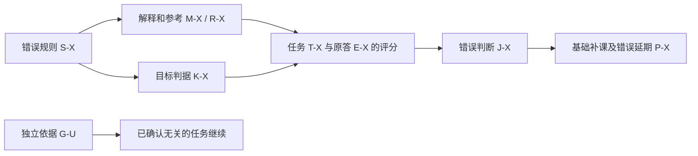

# AI 个人学习系统：工作包 9／跨学科、用户体验与异常场景设计方案 v0

日期：2026-10-01  
整合复核：2026-10-02  
状态：贯通设计基线；案例为纸上演练，未运行真实课程，未取得学习收益或协作净收益数据。  
对应：阶段 E／工作包 9。工作包 10 承接验证、首期范围及设计收口；本包交出可追溯的审查结果和跨包澄清。

配套：[工作包 10 设计方案](<E:/文献资料/学习系统架构设计/docs/designs/AI个人学习系统_工作包10_验证计划与设计收口_设计方案_v0.md>)；[整体架构 v1](<E:/文献资料/学习系统架构设计/docs/architecture/AI个人学习系统_整体学习流程与概念架构_v1.md>)。

**本包的判断是：前序方案已经能够组成一条完整学习路径，没有发现必须重建职责划分才能继续的阻断性原则冲突。需要统一的是这些规则在实际交互、接管和异常传播中的使用条件，尤其是解释安排时不泄露正在检查的判断，以及纠错和删除之后真正改变末端计划。**

这个判断仅限本文检查的情境。规则能够给出不同处理，不等于实现已经可靠，也不等于用户会学得更好。本文保留六项能力、高能力与中等能力协作方向、目标驱动和条件化证据，不新增审签层、固定 Agent 数量、统一掌握分或全量个人画像。

## 一、阅读依据、继承和本轮增量

本轮使用工作包 9、10 的设计分析与设计提示词、设计路线图，以及工作包 1—8 的方案正文。没有读取其他工作包的提示词、顶层设计分析、审阅评估、检查记录或研究原文，也没有沿方案的链接追读这些排除材料。前序对研究的转述作为设计背景继承，不表示本轮重新核验了研究。现实课程、学习者基础、课程期限、时间和费用预算仍未知。

| 简称及文件 | 本轮主要使用的约定 |
|---|---|
| [路线图](<E:/文献资料/学习系统架构设计/docs/architecture/AI个人学习系统_设计流程与工作包.md>)，工作包 9—10及第四至七节 | 四学科、八类基本异常、四类验证与完整而狭窄的首期 |
| [工作包 9 分析](<E:/文献资料/学习系统架构设计/docs/analysis/AI个人学习系统_工作包9_跨学科用户体验与异常场景_顶层设计分析.md>)与[提示词](<E:/文献资料/学习系统架构设计/docs/prompts/AI个人学习系统_工作包9_跨学科用户体验与异常场景_设计提示词.md>) | 完整经历、区分性案例、用户控制、依赖回查和交付边界；分析是问题地图 |
| [工作包 10 分析](<E:/文献资料/学习系统架构设计/docs/analysis/AI个人学习系统_工作包10_验证计划与设计收口_顶层设计分析.md>)与[提示词](<E:/文献资料/学习系统架构设计/docs/prompts/AI个人学习系统_工作包10_验证计划与设计收口_设计提示词.md>) | 验证与架构收口如何承接本包；本包不提前宣称真实收益 |
| [整体架构 v0](<E:/文献资料/学习系统架构设计/docs/architecture/AI个人学习系统_整体学习流程与概念架构_v0.md>)，第二至四节 | 三尺度、六能力、责任、代数锚点和四类验证 |
| [工作包 2／3](<E:/文献资料/学习系统架构设计/docs/designs/AI个人学习系统_工作包2与3_联合设计方案_v0.md>)，第四至十节 | 目标版本、关键操作、帮助条件、证据支持与可用状态、原答重评、当前展开单 |
| [工作包 4](<E:/文献资料/学习系统架构设计/docs/designs/AI个人学习系统_工作包4_设计方案_v0.md>)，第六至十节 | 材料可靠与验收合格分开、潜在帮助与实际呈现、两条纠错链、依赖不完整的限制 |
| [C0](<E:/文献资料/学习系统架构设计/docs/designs/AI个人学习系统_工作包5_C0共同教学框架_设计方案_v0.md>)，第二至八节 | 准备、活动规格、反馈、帮助、局部返回、收束和恢复 |
| [Encoding](<E:/文献资料/学习系统架构设计/docs/designs/AI个人学习系统_工作包5_Encoding_设计方案_v0.md>)，第三至八节 | 高理论上限与动态展开、完整证明与构造、简单目标结束 |
| [Post-Encoding](<E:/文献资料/学习系统架构设计/docs/designs/AI个人学习系统_工作包5_Post-Encoding_设计方案_v0.md>)，第四至九节 | 恢复与重建分流、方法选择、条件化更新、时间与再接触、复杂后续使用 |
| [工作包 6](<E:/文献资料/学习系统架构设计/docs/designs/AI个人学习系统_工作包6_策略使用规则_设计方案_v0.md>)，第二、三、八、十二至十四节 | 方法配置按需参与、适配与退出、需求不重复、解释与方法线索的边界 |
| [工作包 7](<E:/文献资料/学习系统架构设计/docs/designs/AI个人学习系统_工作包7_长期计划与学习连续性_设计方案_v0.md>)，第三至十节 | 需求实质处置、预算竞争、长任务断点、积压与自然使用、唯一有效安排 |
| [工作包 8](<E:/文献资料/学习系统架构设计/docs/designs/AI个人学习系统_工作包8_多Agent协作与共享状态_设计方案_v0.md>)，第二至九节 | 专业决定归属、接责与采用、唯一执行入口、迟到结果、删除和纠错传播 |

本文用“继承”指上述现有规则；“本轮澄清”指为跨包使用消除歧义的规范；“待验证”指必须由运行或真实表现回答的问题。规范性选择及新增案例均为设计推论。工作包 6 中“工作包 7 尚未形成”是写作时的历史状态；当前采用已经存在的 7、8 方案，不再把计划与协作认作空白。

## 二、贯通审查怎样做，结果怎样解释

审查单位是一段有起点、有决定、有结果和返回位置的学习经历。每段只追踪会改变决定的信息：目标版本与要求来源，任务及可靠依据，学习者和 AI 各完成什么，实际帮助和时间，谁采用什么判断，计划因此怎样改变。

审查采用两种互补方式：先顺着完整经历检查正常路径，再只改变一个关键条件，观察设计是否产生不同处理。例如同一答案由用户自主得到还是 AI 提示后得到；同一中断因缩时还是参考争议；同一来源差异是条件变化还是内容错误。没有区分作用的补问和表格不加入日常教学。

| 本包可以给出的结果 | 本包不能给出的结果 |
|---|---|
| 原规则已有处理路径，且所列假设轨迹能够按其贯通 | 已证明真实系统总能执行、四学科都能可靠评分 |
| 某处措辞有条件性歧义，需要统一解释或补充执行要求 | 已发生的产品故障、真实用户误判或实际事故率 |
| 某个关键判断还需要课程实例、技术验证或真实比较 | 用流畅纸上对话证明体验好，或用模拟答对证明学习有效 |

下文所有任务、原答、接收回执、版本和时点均为虚构设计样例，不能写入用户的学习档案。教师参考为了可评审而公开；读过这些题面和答案后，不得再把同一材料当作用户未见的正式验收。正式试用应另备满足目标与暴露条件的任务。

## 三、四学科共用什么，必须分别判断什么

共用的是目标—材料—任务—条件化表现—判断—安排这条关系，以及纠错、用户控制和恢复规则。目标条件、学科正确性和产物核验必须实例化。

| 学科 | 目标中的关键操作与产物 | 正确性与验收依据 | 不能替代它的成功 |
|---|---|---|---|
| 数学 | 保留条件的证明、反例、构造、完整解集；必要时从局部返回整体证明 | 对象域、量词、前提、合法推导、存在性与完整覆盖 | 类比好懂、有限数值成立、会算特例、跟完证明 |
| 人工智能 | 将规格落实为代码，设计检验，记录实验条件并解释结果 | 给定定义、实现行为、测试依据、数据及运行条件；分别检查概念、实现与结论 | 程序运行了、只在一个输入通过、AI 写完后会解释 |
| 金融 | 选择适用模型、对应参数与时点、计算并给条件性解释 | 明示模型假设、量纲、现金流或数据时点、参数口径、缺失信息及不确定性 | 算式正确便称模型适用、历史案例答案被当作当前决策结论 |
| 政治 | 分开事实、因果解释和规范判断，重建论证、比较竞争解释并回应反证 | 可定位材料、证据覆盖、推理是否成立、价值前提与可接受分歧 | 与参考立场一致、措辞漂亮、重复引文数量多 |

下列四段各以一种实质差异为主，同时贯通教学、证据与计划。这里只检查共同框架的表达和决策能力；真实学科参考可得性、评分可靠性和用户负担另交工作包 10。

## 四、数学轨迹 M9：深目标跨会话继续，简单目标及时结束

### 1. 继承的深目标和核验锚点

继承 Encoding 第七节情境 C 与 Post-Encoding 第九节情境 C 的模型：

`F(x) = ||Ax−b||² + λxᵀQx`，`λ>0`，`Q` 为实对称半正定矩阵。

本例 G-M 的要求是论证唯一极小解的条件，并为给定 A 构造合法惩罚、解释选择理由。允许查基础线性代数引理；唯一性连接和构造由学习者完成。本例没有自动加入“对一般 A 证明最低秩”“统计泛化”“任意约束优化”等额外要求。

教师参考来自上述方案，可直接核查：令 `H=AᵀA+λQ`，有 `vᵀHv=||Av||²+λvᵀQv`。在半正定条件下，两项同时为零等价于 `v∈ker(A)∩ker(Q)`。公共核为零时 H 正定，目标严格凸且有唯一极小解；极小解存在性可通过堆叠矩阵的有限维最小二乘表示证明。存在非零公共核方向时，沿该方向函数值不变，因此极小解不唯一。不能仅由“不严格凸”无条件推出所有函数都不唯一；这里使用的是本二次模型的具体不变方向。

给定 `A=[1,0]`，取 `Q=diag(0,1)`，函数为 `(x₁−b)²+λx₂²`，唯一解 `(b,0)`；取 `Q=diag(1,0)` 则 x₂ 不受约束，不唯一。两者都为非零半正定矩阵，故“有正则且 λ>0 就唯一”不成立。这里的构造只是给定 A 的结果，不自动覆盖所有目标外推广。

### 2. 一条具体经历

| 事件 | 判断、决定与学习者工作 | 保存及计划后果 |
|---|---|---|
| M1：只有标准 Q=I 的计算证据；当前准备已能核验完整目标 | 高能力教学责任方交出整体问题、参考及关键分支。执行者给模型和任务，不先给公共核条件 | 引用 G-M、判据与材料版本；计算已有支持，一般论证与构造未知 |
| M2：学习者写“λ>0，所以任意非零 Q 都保证唯一” | 保存初答。执行者核对参考后，请其检验自己选择的具体 Q；这项检验提示已改变后续条件 | 原命题与提示分开；只支持当前错误，不贴“线性代数基础弱”标签 |
| M3：能算两个核，却不能解释与唯一性的关系 | 诊断转向两项代价如何共同限制方向；不再追加同样核计算。必要时提供可靠等式，学习者完成从零二次型到公共方向的连接 | 记录等式由 AI 提供，连接由学习者完成；局部成功不等于完整证明 |
| M4：学习者完成公共核为零的方向，但未完成存在性及反方向；用户临时缩时 | 执行者停止新增问题，保存整份证明。计划责任方收缩本次承诺；G-M 判据不变 | 结束原因为预算，下一连接为存在性与非零公共核分支。构造未检，不能写“唯一性目标通过” |
| M5：换执行者恢复 | 新执行者取得当前有效安排、原证明、帮助和断点，接管同一父任务；已完成连接直接复用 | 旧执行者停止面向用户的此活动。新执行者不把上次等式提示改成自主生成，也不重复整段冷启动 |
| M6：学习者自行利用堆叠最小二乘补存在性，说明沿公共核方向的函数不变，并构造上述合法 Q | 评估责任方按实际帮助、整体产物与原判据评价，接受其他合法路线 | 现有活动可支持相应帮助历史下的整体论证与本构造；若 G-M 还要求无关键提示重建，则该部分仍未知，交计划取舍 |
| M7：若正式目标另有后续使用要求，合格时点到来 | 直接使用合格后续任务，记录相关学习、反馈、期间接触和当次资源；能自行重建可结束 | 当前与延迟结论按实际条件分别成立。已有合格自然产物覆盖要求时，不额外补一次相同测验；没有该要求则不新增延迟义务 |

父任务返回并不要求每个人先失败。若 M1 的首次完整产物已满足全部当前条件，直接评价并收束，跳过 M2—M6 的修复活动。若 M3 提供等式后仍无法连接，不继续以“只缺公式访问”解释；应重审关系障碍或题意，预算内换活动，不能无限向基础下钻。

### 3. 两个关键反事实

**同一算式，不同目标。**若用户的有效目标仅是按给定岭回归公式完成一次计算，提供公式可属于合法输入，计算与条件对应满足后结束。若有效目标仍是一般证明，做对计算仅保留局部支持；不能因本次缩时把“证明”重新解释成“会算”。用户明确改成工具使用目标时，由目标责任方形成新版本，旧证明要求标为替换或延期，而非历史通过。此为 C9-02、C9-07。

**同一未完成，不同停止原因。**M4 因预算停止，下次可以从可信断点继续；若停止原因是存在性参考有争议，则先暂停依赖该参考的确定评价，由材料责任方核验。换 Agent 或预算增加不能解除内容争议。此为 C9-05。

简单目标对照可采用同课程中一条明确的符号约定，例如“本课程 τ 表示任务允许总时长”。目标仅要求在给定课程语境识别其含义时，正确对应即可结束；刚看过映射便说对，只按该条件记录，不宣称持久恢复。课程没有保持要求时，不新增延迟、机制或迁移欠账。

## 五、人工智能轨迹 A9：概念、实现、测试选择与实验解释分开

本例使用自包含教学规格，不描述实际软件库：输入为等长二值序列，正类精确率定义为 `TP/(TP+FP)`；没有预测为正的样本时返回 `None`，空序列也按此处理。G-A 要求据定义实现函数、自主设计普通及边界检验，并解释给定实验结果支持什么。允许查语法文档和运行代码；AI 不能代写核心计数、替用户选择完整测试集后仍记为独立实现或独立测试设计。

| 事件 | 具体观察与决定 | 证据和下一步 |
|---|---|---|
| A1：材料方提供定义、输入域及返回约定；教学方给函数要求，不给实现 | 学习者准确口述定义，但程序分母统计了真实为正样本 | 保留定义解释支持；实现不符合规格，原因可能是集合对应或落实失误，不撤销全部概念证据 |
| A2：执行者提供真实 `[1,1,0]`、预测 `[1,0,0]` 的反例 | TP=1、FP=0，参考结果为1；旧代码返回1/2。学习者据此修正分母 | 反例和测试方向由系统供给；修正可支持该帮助下定位与修复，不支持自主发现此测试 |
| A3：学习者修后程序在给定测试通过，却空输入报错 | 当前缺口是规格中无预测为正的分支；先看代码与任务，不因运行失败重讲全部机器学习 | 若需要系统指出分母为零，记关键帮助；语法帮助与边界选择帮助分别记录 |
| A4：已修复后，安排目标内未展示的规格变式或测试设计工作 | 学习者需自行选能覆盖相应要求的输入，并解释预期；测试参考用于核验，不事先当作测试清单发给用户 | 评估按代码行为、输入选择及解释分别给范围结论，一份产物不重复算多次独立成功 |
| A5：给出两个虚构实验记录，A与B同时改变方法、数据划分与运行配置 | 用户回答“B分数较高，所以方法B普遍更好”时，反馈指向比较条件；合理产物应限制在已观察设置，并提出可区分方法与设置影响的后续比较 | 运行正确不补足实验解释。若完整实验设计属于目标，安排该工作；若仅要求读懂现有记录，到条件性结论即结束 |
| A6：后续接手者只读到“程序通过” | 需回查通过了哪些测试、谁选输入、使用何版规格，原有概念/实现/测试证据分别继承 | 不能跳过尚未得到支持的测试设计或结果解释。必要后续需求由5汇总，7实际处置 |

**反事实 A-a：测试错而程序对。**如果 A3 的失败来自测试器将 `None` 误判为 `0`，应暂停该评分，材料方按给定规格重核，评估方直接重评原代码，计划撤回“补空输入分支”的错误补课。不能要求用户改成错误测试期待值；修好测试器也不会证明所有未观察边界。

**反事实 A-b：允许工具的边界。**语法文档只提供列表遍历用法时，可以仍保留关键计数与测试选择的独立工作；若 AI 工具返回完整函数及测试，用户照用后的运行成功只能按实际帮助解释。独立性按操作归属，不按是否开过文档或用了工具一刀切。

这段轨迹要求真实实现能保存代码版本、输入输出和环境条件；本包尚未运行程序或实验。纸上核验的有限算例只检验规格含义，正式试用前由材料方准备可重复的参考与测试依据。

## 六、金融轨迹 F9：相同公式必须绑定假设、单位与时点

本例为虚构课程模型：在明示确定现金流、同一计价单位、无另行费用且每期有效折现率已给定的条件下，评价时点0的现值。G-F 要求选择对应模型，说明现金流时点和利率口径，完成计算并指出信息不足处。它是课程能力目标；不以课堂数值推断真实投资成效。

材料甲：一期间末支付110，单期有效率10%，模型 `PV=C/(1+r)`。材料乙：两期间末支付121，两期每期有效率均10%，模型 `PV=C/(1+r)²`。二者现值均100，但含义不相同。教师核验为 `110/1.1=100`、`121/1.21=100`。这些数字是假设教学数据，未冒充当前市场数据。

| 事件 | 判断、决定与学习者工作 | 保存及后续 |
|---|---|---|
| F1：用户说“甲乙公式冲突，一个除一次，一个除两次” | 材料责任方先核对时点与口径，确认是情境差异，保留两版适用条件 | 不启动“全面撤销错误来源”；教学改为由学习者把时间线对应到计算 |
| F2：用户算出乙100，却写“因为所有未来款项都折一次” | 数值相同不足以支持模型选择；保留数字产物，记录其理由与目标不符 | 在不增加新金融理论的前提下检查时点映射，不再堆同数值练习 |
| F3：系统给出时间线和逐期折现关系，用户修正说明 | 这是给定关系下修订；不能倒记 F2 已独立识别时期 | 学习者仍需承担后续合格情境中的条件辨认 |
| F4：新任务只说“两期后收121，利率10%”，没有每期或总期间口径 | 正确响应可以是指出信息不足并请求口径；参考不应强迫唯一100 | 材料方补题或将不足作为预定任务；未澄清前暂停唯一数值评分，用户不背负“不会计算”标签 |
| F5：新材料给出两期各自的折现因子，且口径明确 | 按材料说明保留旧模型为常率特例，学习者选择相应连乘关系 | 新材料不自动使 F1 的历史回答变错。只有实际依赖改变的目标、任务、判断重审 |
| F6：用户缩时只愿完成公式使用 | 若仅缩本次时长，保存模型选择未检；若明确把最终目标改为“按已给模型计算”，目标责任方出新版本 | 计算证据可在新目标范围内使用，旧模型选择要求未完成的历史不改写；7只关闭新目标不再需要的需求 |

**反事实 F-a：相同条件下真的冲突。**若两份资料都明确“单期末110、单期有效率10%”，却分别给出现值100和110，则是同条件计算或规则矛盾，不能靠“不同观点”并列。材料方用给定公式重算，隔离错误派生物；按第九节实际依赖决定是否重评。

**反事实 F-b：时间变化还是用户错误。**如果现实课程后续引入新的数据快照，旧结果在旧时点下正确不应被改成当时算错；新任务要求当前输入时，才核验新来源、版本、参数和适用域。课程模板能表达这些差异，不表示本设计已经取得任何当前金融事实。

## 七、政治轨迹 P9：证据、解释和价值前提分别评分

本例为虚构政策材料包，不涉及现实人物或事件。材料甲报告某地指标在政策前为40、政策后为50，并主张改善由政策造成；材料乙接受该观察，但提出同期背景变化也可能解释。材料丙提出规范性理由：“即使平均改善，若负担分配不公平，也不应据此直接认可政策。”现有材料没有能充分区分因果解释的额外证据。

G-P 要求在允许查原文的条件下准确重建事实与解释，说明规范判断的价值前提，比较证据支持范围并提出能区分竞争解释的观察。关键论证由学习者完成；脱离原文背诵不在本目标内。

| 事件 | 判断、决定与学习者工作 | 保存及下一步 |
|---|---|---|
| P1：学习者列出40→50，并直接写“已经证明政策有效，所以公平” | 事实转述、因果归因、规范结论存在不同问题。执行者定位这三个连接，不因立场赞成就通过或反对就扣分 | 保存原句和材料位置。区分缺因果依据与缺规范前提，避免泛化为“政治理解弱” |
| P2：系统只给出三类主张的定义，学习者自行给原文分类 | 若定义供给符合开卷条件，分类与重建仍可形成目标证据；若系统已逐句标好，随后复述不能支持自行分类 | 帮助记录到被代做的操作，保留未代做部分 |
| P3：学习者支持政策，但指出前后变化没有排除背景因素，提出比较其他相近地区及政策前趋势等候选观察 | 评价所提证据能否区分解释，并说明仍需哪些可比性条件；不能因为提出一种比较就宣布因果已经确认 | 可以支持有条件的论证评价，立场本身不决定得分 |
| P4：AI引用“乙已证明政策无效”，用户指出原文没有这句 | 执行者暂停依赖该引用的评分，材料方回原文核对；确认生成错误后撤回引用 | 评估用原答重评，不要求用户改到虚构引用一致；7取消由此误判产生的补读/重写 |
| P5：核验后学习者保留不同规范立场，且事实、推理、价值前提均可追溯 | 当前论证目标可以结束；系统可解释评分依据，无需追问到用户接受参考立场 | 若只有事实来源仍待核，先限制相应事实结论；可继续不依赖其真假的论证结构比较 |
| P6：后来新增可靠材料，支持其中一种解释 | 新判断依据新材料更新；用户先前合理的“尚不能确定”不追认为答错 | 新旧证据时间与版本保留；若目标要求后续更新能力，再观察如何调整论证，否则不新增欠账 |

**反事实 P-a：立场相同，推理仍不成立。**赞成参考结论却没有证据或遗漏必要前提，不能通过论证评价。立场不同但正确陈述事实、揭示不确定性并明确价值取舍，可以通过相应要求。

**反事实 P-b：开放不等于无判据。**伪造引文或把材料未报告的事实写成既定事实，可以按可靠来源判错；因果尚未辨明不等于所有解释同样有支持；规范分歧也不能用事实核验代替其价值论证。材料方核查出处，评估方评价论证，职责不同但相互衔接。

## 八、用户体验：每项控制都改变教学、证据或安排

### 1. 常规视图只回答当前有用的几个问题

进入时展示当前要完成的工作、允许资料、投入边界；变化时解释哪项观察使安排改变；结束时分别说明已完成、证据支持范围、未完成及实际后续去向。用户需要时可展开来源、原答、帮助和修订理由，不默认让用户填写内部交接字段。

示例：“今天完成了给定定义后的关系修订；自主选择还未检查。你要求缩时，当前已结束；该检查已交计划方，尚未排入具体时段。”只有真正有有效安排时，最后一句才能改成具体安排。接收待处理不包装成“已为你安排复习”。

课程覆盖、活动执行和目标能力分别展示。分母变化必须说明，不能通过删除延期项让完成率变高，再当作学习进步。

### 2. 用户操作及其完整后果

| 用户操作 | 当下处理 | 对证据和后续的影响 |
|---|---|---|
| “为什么现在做这个” | 解释用途、工作与已有支持的关系；检查解释本身是否泄露当前目标操作 | 方法选择检查只说“观察你如何处理这类任务”；具体诊断线索可在初答后解释。若用户要求先知道，可转教学并记帮助 |
| “先示范／给答案／多一点帮助” | 在授权内提供足以继续的支持，保存之前原答 | 后续按实际帮助解释；未代做部分仍可有支持，待检项由目标要求决定，不惩罚求助 |
| “少讲一点／换成文字／不用图” | 若形式不是目标的一部分，用同用途合格形式；若构图正是目标，说明少投入将暂不覆盖哪项工作 | 不能用偏好替代必要产物，也不将一次偏好固化为学习类型 |
| “时间更少／先暂停” | 即时停止新增任务，优先保存可恢复位置；已有授权内收缩无需逐条确认 | G及判据不变；计划承诺更新，不自动全顺延；没有收束时间时按已保存事实恢复 |
| “跳过检查，继续下一内容” | 执行其选择的、依据足够且在授权内的活动 | 未取得的能力保持未知。若下一活动必须依赖该结论，只提供不据此作重要跳过的受限路径或先说明限制 |
| “题目／答案／评分不对” | 将异议作为核验入口，定位疑点并暂缓受影响结论 | 不仅再解释原答案；核实后定向重评和改计划。异议暂无法裁定时保留争议，不清空无关证据 |
| “改变最终用途／范围／期限／投入” | 用户决定，目标责任方更新要求，计划方重排 | 新目标与当次缩范围分开；旧证据只按可比部分继承，不倒改历史 |
| “查看／纠正／导出记录” | 按所指范围展示或导出仍允许保留的记录；勘误据原记录处理，解释修订单列 | 导出带帮助、时间、范围与限制。只有摘要时标明不足以独立复核；无法核实的勘误保留异议，不捏造原答 |
| “删除这些记录” | 先停止指定内容继续使用，再清理可控副本与派生引用，通知持有者停止回传 | 按剩余支持保留／收窄／撤销，更新计划；不从旧摘要或验证资料复活，不迫使用户重学来恢复档案 |

依据：2／3 第六、八至十节，4 第八节，C0 第五至八节，7 第十节，8 第九节。

### 3. C9-01：解释安排必须服从当前证据用途

工作包 6 第三节第 3 项的用户说明例“你已能计算，这次只检查人数不同时该怎样合并”，在教学或已经明确条件的练习中可以使用；如果正要观察学习者是否自行注意人数差异，这句话已经提示判别线索。上游并不缺少防泄露原则，这里需补的是该示例的使用条件。

本轮澄清采用两种合格表达：检查前可说“本次看你如何选择并解释处理方式”，保留判断；初答后可以具体说“这次错误发生在合并条件，接下来比较人数变化”。若用户要求提前知道完整依据，满足请求并改变活动用途，不以保护测评为由剥夺控制权。屏幕标题、相邻题、折叠标签、默认工具和恢复摘要也按同一原则检查。

实际体验是否轻便仍待试用。要观察重复索取信息、等待、无增量追问、决策打断和用户主动报告的负担，不能以对话看起来顺畅、点击或响应速度替代。

## 九、内容错误沿实际依赖修到计划：X9完整演练

本演练故意把错误放入虚构记录，用于验证纠错路径，不在真实学习中给用户灌输错误。

### 1. 明确依赖，不把主题相关都当依赖

错误规则 S-X v0：“只要 Q 非零且半正定、λ>0，二次目标就有唯一极小解。”它进入了解释 M-X、参考 R-X和目标判据 K-X。G-X 原本要评价唯一性判断，却将这条错误充分条件写入判据。任务 T-X给出 `A=[1,0]、Q=diag(1,0)`，用户原答 E-X：“x₂不受限制，所以不唯一”，并写出 `(x₁−b)²+λx₁²`。错误评分 J-X认为其未理解正则化，计划 P-X据此安排基础补课，并推迟构造任务。

另有 G-U只要求在给定公式下计算，相关材料与评分未使用 S-X；不能因为同属正则化主题而一并撤销。

### 2. 从异议到可恢复使用

| 次序与承担者 | 实际决定和回报 | 可以恢复什么、仍不可以什么 |
|---|---|---|
| X1：用户指出 x₂方向；当前执行者 | 保存异议、题面和原答，立即停用相关确定评分与错误补课，通知材料、目标、评估及计划责任方 | G-U有明确独立依据且仍获授权可继续；不等新计划才暂停 X |
| X2：材料责任方4 | 根据表达式与不变方向核实反例，更正 S-X；回查解释、图、题目和参考，逐项标注使用的错误条件 | 正确参考可准备教学；多个模型之前赞同不构成反例的反证 |
| X3：目标责任方2 | 确认错误进入 K-X，纠正为有依据的条件，说明此次是修正错误判据，不是后来增加更深要求 | 更正后任务重新匹配；若另项目标未使用错误规则，无需修改其版本 |
| X4：评估责任方3 | 用 E-X及当时帮助直接重评，撤销错误缺口。E-X支持本例反例与方向分析 | 不要求重考以修复历史评分；也不凭这份反例确认未观察的一般证明或全部构造 |
| X5：教学责任方5 | 明确告诉用户原参考遗漏方向条件，指出旧规则仍成立的合法特殊情形；检查错误解释是否实际展示并影响后续产物 | 未展示错误时不强加补救学习；确有误导才用必要纠正和目标内观察处理，不能仅改后台 |
| X6：计划责任方7 | 撤回由 J-X唯一导致的基础补课，恢复有依据的构造进入；原目标仍缺的一般证明保留，重新取舍相应投入 | 原错误补课不改名继续存在；取消不代表原总体目标已经达成，误导修复成本照实记录 |
| X7：发起方与当前计划责任方按8的规则闭环 | 核对各实际依赖分支是否有责任人、处理结果及未决范围；向当前执行者更新有效用途 | 材料恢复、历史判断重评、教学影响处理、计划更新分别可查；任何一项完成不替代其他项 |

### 3. 依赖不完整、原答不足与未受影响部分

若只知道某旧任务可能引用 R-X，却找不到具体版本与帮助条件，标记该任务相关的确定评分/能力用途待复核，指定补查者；不把“未找到引用”当作没有影响。能确认使用独立正确依据的任务继续。首期用内容、目标、任务、事件、判断、计划的少量稳定引用和人工辅助回查即可，不先建通用知识图谱。

若 E-X只有“不唯一”三个字，重评只恢复该判断在本题上的正确性，不能补出独立方向分析。是否取得新证据，取决于目标内尚缺什么及当前决定是否需要；不默认重考全章。

若错误只是页码，命题、任务、评分与实际呈现均未变，修正定位并核查可回查性即可。若新版本只是引入不同可行域，旧结论在旧域有效，应按条件共存处理。以上反事实确保纠错不会演变成全量清零。

## 十、运行异常与连续性演练

### 1. 每类异常都有决定、记录和返回

下表覆盖路线图的八类基本异常，并纳入 7、8 的运行变化。“原负责人”均是启动当前活动时已明确的责任职能，可以由同一 Agent兼任，不新增人员。

| 情境编号与触发 | 谁立即决定、用户做什么 | 保存与下一步／结束条件 |
|---|---|---|
| E9-01 基础不足 | 5核对题目和可用前置；只在能区分安排时作短检查。用户完成必要局部连接 | 记录父任务、依据、帮助及返回条件。局部足够后回父任务；超预算或无新信息收束，不补整门学科。见M3与A3 |
| E9-02 同错反复 | 5重看任务、反馈和诊断反证，3修订解释；用户可反馈困难或暂停 | 同类帮助不再改变表现就换路或停止；换措辞但操作不变不算新方法；局部成功父任务仍失败不自动下钻 |
| E9-03 提示下会、独立不会 | 5保存帮助前后工作，3按操作解释；用户可以继续接受帮助 | 教学进展保留，自主操作仍未获支持。仅目标需要且影响安排时交7相应取证，不永久贴标签 |
| E9-04 材料冲突 | 4先辨同条件真矛盾还是时点、口径和适用域差异；用户可指出具体出处 | 真矛盾暂停依赖用途，条件差异保留合法版本。见F1/F-a、P4、X9 |
| E9-05 用户指出题错 | 当前执行者暂停受影响评分；4核查、2查判据、3重评 | 原答够则直接重评，5修复误导，7取消错误补课；不要求用户重复证明系统错误。见X9 |
| E9-06 临时缩时 | 用户缩时立即生效，5保留收束，7按授权缩范围 | 目标判据不变；恢复点和未做后果可查。仅剩收束时间不再启动必须反馈的新任务。见M4、F6 |
| E9-07 复习积压／连续漏学 | 7核查每项需求的必要性、证据覆盖和使用节点，5检查合并是否相容 | 已覆盖关闭、同源兼容合并、无近期用途暂缓、授权内不再投入；目标缺口仍可见。不能全挪明天或据漏学判能力低 |
| E9-08 中断恢复 | 8规则下取得当前有效安排及限制，5恢复父产物，7重定本次投入 | 有摘要按真实断点继续；无摘要仅用已确认事件，帮助未知只限制相关结论，不重新冷启动整套 |
| E9-09 换Agent／无人接手／高层不可用 | 原责任方跟进未接事项；有权承担者接管，确认唯一教学入口 | 已授权且不依赖争议工作可继续，否则收束。无新条件停止循环委派；用户不负责催所有Agent |
| E9-10 旧版建议／迟到回执／相反评分 | 当前责任方先查删除和停用，再核与当前版本兼容性；3按原答裁定实质评分冲突 | 可保留相容新事实，不能最后写入覆盖；不同资源条件的判断可以并存，同条件矛盾不平均投票 |
| E9-11 答案意外展示 | 执行者记录实际时点，停止把之后的被代做操作称独立；用户可转教学 | 暴露前原答仍可用，未代做部分不清零。另有已核验合格任务才补检查，否则保留未检，不临时凑答案 |
| E9-12 证据勘误／删除／迟到复活 | 原记录维护者按依据勘误或落实删除，3重审剩余支持，7更新计划 | 保留／收窄／撤销分别成立；旧Agent回传已删摘要不得采用或回填；见下一节 |

E9-07 的实际取舍示例：同一条件选择缺口由教学和策略各提交一条，合并为一条需求并附方法；另一项已被合格自然产物覆盖，由3确认后关闭；尚未获得保持证据且近期不用的一项暂缓到下一实际使用前复核；临近使用的必要检查优先竞争可用资源。若这些工作仍超出现有预算，7收缩新内容并报告未覆盖，不能保证全完成。是否放弃最终范围超出授权时由用户决定。此处不虚构用户每周分钟数。

### 2. 无摘要、错帮助记录与接管合并演练

假设突然中断时留下任务T、初答E1、提示H和草稿D，没有结束摘要。旧便笺声称“用户在提示后答对”，但事件记录清楚显示E1早于H。原记录维护者据此勘误，3重评E1支持范围；D是否完成另看产物，不能从“有文件”推定提交成功。

若时间关系无法确认，保留用户异议并标为有争议的帮助条件。接管者可以据D中已核实的连接继续教学，但不能将缺失条件改成无提示；只在缺失会改变下一步时作最小澄清。7确认本次范围，新的执行者接任后旧执行者的面向用户权限结束。旧执行者稍后回传旧评分，须进入当前采用检查，不直接把旧便笺恢复成事实。

没有可用高层时，已授权的草稿整理、可靠输入或其他无关任务可继续；重大跳过、标准变更和争议能力结论保持待处理。没有合格工作就结束本次，并保存真实待接事项，不让用户在线等待无确定进展的委派。

### 3. 删除后的三条路径及用户控制边界

假设J原引用A、B，用户要求删除A及其个人派生摘要；旧执行者之后仍回传含A的“已通过”。先停止A继续使用，清理可控制范围内的原记录及相关副本，通知旧执行者停止回传；接收方拒绝采用含A的结果，并按相同删除范围清理个人副本。

| 剩余依据B | 3的判断与7的安排 | 不应额外发生的事 |
|---|---|---|
| 单独充分覆盖原范围和条件 | 保留J，更新只指向B，原相容安排继续 | 不因删一份就自动补测 |
| 只支持给定方法后的执行 | 收窄J，选择能力未知；取消仅依赖选择支持的重要跳过，必要需求按真实用途取舍 | 不清零执行、不从A的摘要恢复选择支持 |
| 没有可用支持 | 撤销失据判断，未知；停止依赖它的安排，其他工作继续 | 不记为能力下降，不强迫重建学习档案 |

删除运行的完成范围必须按实际控制能力报告；不能仅凭本设计声称所有外部导出和备份已永久擦除。若用户删除范围也包括个人关联索引，不保留可重建个人内容的索引，采用检查改为要求结果指向当前仍存在、获准使用的依据。验证用的个人记录同样受控制，不能另存影子档案。

## 十一、跨包澄清与修订台账

下面区分“已有规则可处理”与“需要统一到v1的澄清”。它们是本包提出的稳定引用，不是七个新模块，也不代表已经发现七处系统故障。原方案保持历史版本；统一采用以架构v1的采纳表为准，未修改旧文件不能写成已经回写。实际实现仍须接受工作包10的验证。

本轮整合结果：下列 C9-01—07 已由工作包 10 第十节及架构 v1 第十二节采纳为概念规范；表中保留提出时的建议及理由，便于追溯。H9-01—06 的效果问题仍待验证，不随规范采纳变成已证实结论。

| ID与性质 | 触发、原约定与本轮处理 | 责任及受影响接口 | 回查结果与状态 |
|---|---|---|---|
| C9-01 条件性措辞澄清 | 6第三节用户解释例可能透露正在测的选择线索；2／3、4、C0已有保留关键工作的规则。将解释细度绑定活动用途，初答前保留选择，用户要完整解释可转教学 | 5执行呈现，4说明潜在帮助，3解释实际影响；6示例复用时继承该限定 | 第八节及F2改变说明时点后，两种证据得到不同解释；建议纳入v1，不追认既有原答 |
| C9-02 范围与目标澄清 | 缩时只改承诺；用户改变最终用途才改目标版本。7已有此区分，本包以同一深目标反事实统一用户文案与版本继承 | 2维护要求，3重审可比支持，7维护承诺，用户决定越界变化 | M4与F6不降标，正式改目标不倒改历史；继承成立，建议v1统一 |
| C9-03 交接闭环澄清 | 提出、消息送达、接手责任、专业采用和有效排期具有不同含义；7／8已有规则，本包明确采用或接手不产生时间承诺 | 原发送方跟进，接收方承担已接范围，专业方采用，7给实质处置；6按需参与不做必经关卡 | E9-07/09及M7都需可查去向；建议v1统一，不新增回执表 |
| C9-04 纠错末端核查 | 双链及三类恢复前序已完整规定。本包要求演练可定位到实际依赖、错误补课/跳过的前后变化及未回报范围 | 4内容，2判据，3重评，5误导修复，7重排，8规则保障接续 | X9完整追到P-X，G-U保留，未知依赖受限；贯通补充，建议v1收纳为执行验收锚点 |
| C9-05 可信恢复澄清 | 记录压缩不能把原答、帮助、时间、父任务与停止原因压成“已懂”。3已有支持与可用双轴，7／8已有无摘要恢复 | 5保存事实，3限定结论，7定范围，接管者核依据；用户无需重复提供已有信息 | 同一中断因预算或争议得到不同路径；未知不强行补测全套；建议v1统一 |
| C9-06 迟到与删除贯通 | 8已规定兼容检查和删除禁止复活。本包将旧执行权限、迟到建议、相反判断、删除结果串成一个采用入口 | 当前专业责任方有权采用，7维护有效安排，旧执行者停止相应教学和已删依赖 | E9-10/12和删除三分支保留可用新信息、拒绝失效依据；建议v1收纳，技术保证待验 |
| C9-07 正常收束与深度澄清 | Encoding／Post／6／7已有简单目标结束和深目标保留规则。首期覆盖不能变成每人固定策略、补课、延迟或异常配额 | 2决定目标要求，5组织完整产物，7分段承诺，10限定验证覆盖 | M首次已会可直接结束；浅目标不扩展，深目标未完不伪通过；建议v1统一 |

**审查结论。**上述差异目前可以用既有职责和语义解释，不需要新增专业裁决层。C9-01需要明确限定一处可被误用的说明示例；C9-02—07主要把分散规则连接为可执行的贯通要求。没有新发现的阻断性原则冲突，不等于不存在遗漏；真实课程题目、评分与实现行为仍未验证。

C9-03 同时澄清：原始事件和专业判断在所属责任处维护；普通授权内的反馈、提示与局部调整不必每次等待计划方重发展开单。只有改变执行范围、资源承诺或使用限制时才同步相应安排。已经发现的失效用途立即限制，不等全量计划更新。

### 待实例化与待解决问题

| 问题 | 当前处理及归属 | 对首期的实际限制 |
|---|---|---|
| 真实课程、近期用途、深度和允许资源未知 | 2／4据用户真实资料形成有限目标；只补会改变当前选择的信息 | 不能把本文四学科案例当用户课程或正式首期名单 |
| 深证明、代码、开放论证的可靠评审资源未知 | 4与高能力教学／评估责任方确认能核验到哪里 | 缺必要参考时限定探索或补资源，不把任务压浅后称高上限已测 |
| 时间、费用、使用期限与负担未知 | 7在承诺前落实当前所需约束；10设计比较时按实际预算收缩 | 不承诺固定日历、价格、题数或最佳间隔 |
| 原答及实际帮助能否被可靠记录 | 5与8在实现中验证呈现和事件记录，再由3检查解释 | 记录未知的证据不能声称满足特定独立/保持条件 |
| 停用是否能到达当前执行者、旧执行入口能否关闭 | 8的实现验收，10安排虚构记录测试 | 规则已定，技术尚未证明；失效依据不得靠文档乐观假设继续执行 |
| 删除的副本、备份和导出控制边界 | 实现阶段明确并向用户准确呈现；验证记录也适用 | 可控范围之外不能虚假承诺清除，也不能以审计需要保留影子作答 |

## 十二、交给工作包10的可检验问题与具体输入

### 1. 稳定待验证编号

| ID | 需要真实证据回答的问题 | 可支持或推翻的观察；可作的修订 |
|---|---|---|
| H9-01 学科判据可靠性 | 同一框架是否能对完整证明、代码、模型条件与开放论证作可靠评价 | 使用实际产物、可靠参考、合法多解及少量独立复核；若经常把数值/立场一致当通过，补任务与参考能力，限定已验证学科和目标范围 |
| H9-02 自适应的增量与深度 | 有区分力的诊断和局部修复是否减少无效活动，并改善父任务；已有支持时是否及时停止 | 对照合格简化教学看目标表现、提示依赖、整体完成和总投入；若分支不改变动作，删诊断；局部通过父任务仍失败则修拆分与连接，不继续加小题 |
| H9-03 用户理解与控制负担 | 用户是否知道当前工作及未证部分，普通操作是否少打断且不泄题 | 从真实交互、用户自述及必要的简短复述了解理解，检查重复确认、跳过/示范/质疑的实际后果；若解释即提示，改呈现时点；若负担高，合并无决策价值记录 |
| H9-04 最小记录的恢复质量 | 换人、跨会话及无摘要时，压缩记录是否足够且不过重 | 检查恢复耗时、重复索答、父任务丢失、帮助或停止原因误读；缺什么补什么，无用字段删减，不以无限保存聊天替代判断 |
| H9-05 异常回查的完整性与成本 | 一处来源、判据或证据变化是否只影响实际依赖，并真正改变计划 | 用X9及删除虚构记录比较预期与实际受影响集、遗漏/误伤、处理时长；遗漏则补引用与责任，成本过重先缩自动化范围，不删必要纠错 |
| H9-06 分层协作净价值 | 高层准备与关键复核是否值得等待、交接和维护 | 保持教学、目标、材料及判据相称，与相容职责合并的简化安排比较质量、总投入和恢复错误；净价值不足则合并责任与调用方式，保留必要专业核验 |

H9-01—06是合并后的候选问题，不要求六场额外实验。一次真实主任务及其必要后续可以提供多种观察；相同原答始终只有一份学习表现。纸上案例只能提供测试情境，不能填入上述假设的实际结果栏。

### 2. 首期范围建议与边界

建议10从一门真实课程的有限主题选取一个完整证明或综合主产物，使其确有需要的后续使用承担延迟环节，再容纳同课程中可及时结束的简单目标。可以由同一主产物承担多项覆盖，这不是三项活动配额。资料、目标、材料、教学、合格独立检查、必要延迟回访和计划修订须在首期路径层面贯通。

若实际材料没有深目标或真实后续使用要求，可以先进行诚实限定的启动试段，但明确尚未覆盖高深度或延迟承诺，后续再补相应真实路径；不能给本不需要的目标硬加保持、迁移与证明。Post→Encoding→父任务返回优先在真实需要时观察；自然过程未触发时，用虚构记录测试行为，不能为了凑覆盖制造用户失败。

四学科本包已经提供设计层面的任务与证据差异；不建议首期同时开发四套课程。由10依据参考可得、任务可评、用户用途和可用资源选择真实范围。高级数学例不因为材料齐全就自动成为用户的首期课程。

### 3. 直接移交的材料

| 移交内容 | 10的用途 |
|---|---|
| M9、A9、F9、P9及关键反事实 | 确定学科覆盖边界，生成合格任务审查用例；真实题目须另行准备并核验 |
| E9-01—12、X9及删除三分支 | 形成实现前/实现后的受控异常演练；不污染真实学习记录 |
| C9-01—07 | 架构v1统一引用的澄清与采用记录；旧方案保留历史版本 |
| H9-01—06 | 对应内容、过程、学习收益与协作价值四类验证；由10选择主观察、比较和停止规则 |
| 尚未实例化表及首期覆盖建议 | 确定启动所需最少输入、人工辅助边界和暂缓范围 |

10的比较应分开教学设计增量与协作组织增量，不同时更换模型、材料、时间、题目和教学方法。简化对照同样保留可靠材料、必要反馈和核验；个人样本、先验、任务差异、顺序和期间接触限制结论。预算停止、资料缺失、退出与未执行也要记录，不只收成功案例。

## 十三、本包交付自查及结论范围

| 要求 | 落点与当前可确认的内容 |
|---|---|
| 四学科具有实质差异 | 第三至七节：证明、实现与实验、模型时点、事实/解释/规范分别进入任务和评分 |
| 深目标与简单目标均有正常收束 | M9的直接通过反事实、跨会话父产物及简单符号目标；不增加固定深度或活动配额 |
| 八类基本异常及协作变化有去向 | E9-01—12；完整纠错X9、无摘要接管和删除迟到分支 |
| 用户控制影响证据与计划 | 第八节逐项说明示范、缩时、跳过、质疑、目标变更、导出与删除 |
| 帮助与时间解释连续 | 四学科轨迹、M7、E9-08/11/12；操作级限制，未知不是无接触，不重复计证 |
| 纠错追到实际计划变化 | X9含被污染判据及任务两链、原答重评、错误补课撤回、未影响G-U继续 |
| 拟议与采用、设计与收益有区别 | 第十一节C9台账与第十二节H9问题；原方案未被本文自动改写，采用以v1为准 |
| 工作包10可直接承接 | 稳定编号、情境、失败信号、首期建议与待实例化项均已给出 |

本包完成的是代表性路径的逻辑贯通与可评审设计，未发现这些路径需要新增职责才能成立。当前仍不能宣布真实跨学科评分可靠、用户负担可接受、学习收益存在或多Agent更划算。下一阶段按工作包10选定的真实有限路径和受控异常演练取得证据，再对这里的假设与澄清作保留、调整或简化。
