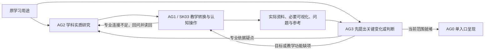

# 学科研究与教学转换协作修订

2026-10-11（Asia/Shanghai）。本次落实 AG2、SK03、AG3 职责与协作流程，依据用户要求、最近两次 WM 备课原件及相关研究／设计。通用维护源为 personal-learning-suite/src；课程入口引用同一规则。

## 已落实的职责与流程

- [AG2 学科实质研究](../../personal-learning-suite/src/agents/AG2-materials.md)：先研究当前专业问题、关键选择、机制／理由、条件变化与证据边界，交出有内容的专业依据；保留材料、参考及纠错核验责任。
- [SK03 专业知识教学转换](../../personal-learning-suite/src/skills/learning-teaching/SKILL.md)：把关键关系变成可学习的解释、案例与任务，明确认知操作和教师／学习者分工，再落实具体资料、必要可视化、题面、支持和参考。
- [AG3 反向专业审查](../../personal-learning-suite/src/agents/AG3-assessment.md)：先从原用途与原始专业条件提出关键变化／判断，再检查目标和实际成品能否支持；保留原答、实际帮助和先定判据下的证据评价。

单一协作依据是 [学科研究与教学转换](../../personal-learning-suite/src/skills/learning-teaching/references/disciplinary-to-teaching.md)。它已接入 AG0／AG1、SK00／SK02／SK03／SK04、design-whole、材料核验、整体评审，以及具身智能的 AGENTS／FRAMEWORK／MODEL_ENTRY。SK03开发任务单和套件入口指向当前规则；旧开发记录仍按历史范围读取。

新单元的主顺序为：原用途与学科研究 → 教学转换与认知操作／师生分工 → 实际资料、可视化和问题 → 反向专业审查。已有可靠研究或安排可以复用。认知设计发现专业前提、机制桥梁、条件或参考不足时回问 AG2；学科修复后实际读回，并检查修改怎样进入成品。问题只在教学表示或任务时局部修成品；目标建议遗漏原用途时交 AG1。

每个环节只在影响当前目标时深入。充分的内容、解释、材料或原作品可以保留；没有增量时确认充分，不虚构回问，不强制新增任务。反向审查问题是审查依据，可由已有解释或连续工作承担，不逐项变成必修题。一次性解释可直接交付，纯讲解无须制造学习者作答。

角色职责与实际子 Agent 调用分别记录。单模型可以按原用途重新立问题并自查，不能称独立代理或盲评；实际委派才记录负责范围、原件／版本、返回、回修和采用。面对学习者仍只有一个 AG0入口，普通反馈接已备主线。

## 最近两次 WM 记录怎样进入修改

两份原件来自 [最新记录索引](../../learning/embodied-intelligence/LATEST_RECORDS.md)，均为备课与审查，没有正式教学或学习者表现。下面是仓库原件中的过程记载；本次未取得旧会话的完整宿主调用转录，故不以角色标签单独认证实际调用。

| 原件 | 具体事实 | 通用规则的采用 |
|---|---|---|
| [第一份交付审查](../../learning/embodied-intelligence/artifacts/preparation-tests/2026-10-10-decision-sufficient/09-preparation-review.md)第一／三节 | DA-1落盘读回后才启动认知设计；认知回问导致DA-2，之后才生成主线材料、任务、参考和支持 | AG2先交实质内容；SK03在其基础上设计操作与分工，再落实成品 |
| [第一份认知设计](../../learning/embodied-intelligence/artifacts/preparation-tests/2026-10-10-decision-sufficient/01-cognitive-design.md)回问段及 [学科稿](../../learning/embodied-intelligence/artifacts/preparation-tests/2026-10-10-decision-sufficient/00-disciplinary-analysis.md)DA-2 | 补抽象条件到多步递推的归纳桥、随机均值到非线性价值的桥，读回后接材料与支持 | 认知分析可反馈学科对象、机制／理由与案例；回修应进入实际成品 |
| [r1范围与过程](../../learning/embodied-intelligence/artifacts/lesson-preparation/2026-10-11-decision-sufficient-r1/00-scope-and-provenance.md)及 [认知设计](../../learning/embodied-intelligence/artifacts/lesson-preparation/2026-10-11-decision-sufficient-r1/03-cognitive-design.md) | 记载三个宿主子Agent及用量中断／恢复，root接讲义／题面／支持，学科方完成参考，审查方恢复检查；T2回问后补有限期望工具与另一个仿射例，T5参考足够则确认保留 | 实际接手与完成如实记录；补必要工具但保留新判断，不把充分内容强行变为新任务 |
| [r1反向审查](../../learning/embodied-intelligence/artifacts/lesson-preparation/2026-10-11-decision-sufficient-r1/07-reverse-review.md) | 先提出奖励、动作、H、历史、风险变化，再看实际成品；修复可见数学符号后回读；风险备用未采用不被强加成主线要求 | AG3先从原用途立问题；检查实际材料而非后台答案；局部修复及重核；范围外候选不成为欠账 |
| [r1讲义](../../learning/embodied-intelligence/questions/visible/decision-sufficient-preparation-r1/materials.md)、[任务](../../learning/embodied-intelligence/questions/visible/decision-sufficient-preparation-r1/tasks.md)、[参考](../../learning/embodied-intelligence/questions/teacher-reference/decision-sufficient-preparation-r1/reference.md)与 [支持](../../learning/embodied-intelligence/questions/backup/decision-sufficient-preparation-r1/support.md) | 图式／表格显露关系，T1限有支持重建，T2/T4/T5仍留新判断，T1–T4接同一技术建议，支持有正文和返回点 | 可视化按关系选用并核成品；教师提供与学习者承担分开；保留同一父产物、合法多解及帮助边界 |

第一份教师侧47项有限检查与r1数值核验都是备课依据，不是学习者表现。两份备课的效果、个体适配和多Agent净收益仍未知；它们提供本次工程转译的具体实例。

## 研究与设计对照

| 依据与位置 | 保留的要求 | 本次落实 |
|---|---|---|
| [学科分析研究](../research/2026-10-10-disciplinary-analysis/研究报告.md)第二节PCK/MER、第三节、第七至八节；[工作底稿](../research/2026-10-10-disciplinary-analysis/单元学科分析工作底稿.md)第五至八节 | 先学科分析再认知设计；专业隐含连接需转成学习输入；具体任务和解释能反向校正上游 | AG2研究交接、SK03转换／分工、认知回问与成品读回 |
| [目标与评估方案](../designs/AI个人学习系统_工作包2与3_联合设计方案_v0.md)第三至五节 | 用途、内容依据和正式要求分别保留；细分服务具体决定 | 研究可校准建议，正式目标由AG1取舍，不因短题方便而窄化用途 |
| [材料方案](../designs/AI个人学习系统_工作包4_设计方案_v0.md)第四至五节 | 原材料可保留、重组、桥接、外补、生成或不新增；图按功能核验 | 实际资料在认知设计后落实；充分内容保留，必要可视化有成品和对应 |
| [C0方案](../designs/AI个人学习系统_工作包5_C0共同教学框架_设计方案_v0.md)第二至四节；[Encoding方案](../designs/AI个人学习系统_工作包5_Encoding_设计方案_v0.md)第五节 | 可靠内容与个体未知可并存；认知操作须有具体对象、师生分工、输入和反馈 | 不强制先诊断；必要解释／示范先提供，关键工作不由题面代选 |
| [Encoding研究](../research/01_Encoding研究报告.md)第7至10节；[Post研究](../research/Post-Encoding-Dynamics-深度增量研究.md)第4至5、13节；[Post方案](../designs/AI个人学习系统_工作包5_Post-Encoding_设计方案_v0.md)第五节 | 表征和操作服务具体关系；恢复、整合、选用、条件更新按功能取舍 | 保留既有SK06／Encoding／Post路径和同一整体产物，不把流程变固定训练套餐 |
| [协作方案](../designs/AI个人学习系统_工作包8_多Agent协作与共享状态_设计方案_v0.md)第三、五节 | 责任按决定归属，角色可合并，单入口执行，回提有依赖 | 研究／设计／审查相互回修，普通反馈不加会签或第二状态库 |
| [验证方案](../designs/AI个人学习系统_工作包10_验证计划与设计收口_设计方案_v0.md)第三节V1–V4 | 内容、执行、学习表现与组织增量分别取证 | 本次只验证规则、工程完整性及有界虚构前向输出，不宣称真实效果 |

固定 AG2／SK03／AG3 名称、责任分配和“先提出问题再看成品”的审查约定属于本次用户授权的工程选择；研究与既有设计提供依据，尚未实证验证这一流程的学习增益。

## 验证与保护范围

本次格式、链接、公共指纹和原件保护结果保存在 [验证目录](../../personal-learning-suite/validation/disciplinary-workflow-2026-10-11/README.md)。独立前向试用使用自拟团队均值案例，输出同样位于该目录，属于维护验证，不进入真实课程记录。

实际结果：7个Skill格式校验通过，B0静态检查32/32通过，19份既有来源相容；119项公共manifest指纹有效，保护基线中1060份原件无变化。两名独立上下文子Agent的 [有界行为试用](../../personal-learning-suite/validation/disciplinary-workflow-2026-10-11/behavior-review.md)完成：AG3先定问题后识别目标覆盖不足，保留正确局部并接受充分文字；SK03生成实际单元、尊重纯解释请求，以及将局部专业回查写进实际解释。结果按原件内容复核，没有以标题或关键词匹配代替执行判断。

保护基线覆盖研究／设计原件、runtime、资源、契约和课程原件；课程仅更新接入规则与公共manifest。用户已有README、LATEST_RECORDS及两份WM备课保持原件。现有路径、角色ID、Skill名称、共享协议和程序接口沿原定义；本次没有安装原生Skill、改schema或发起真实教学。

规则文件在框架manifest登记修订与指纹，方便现有模型或换模型接任按当前入口读取。文件更新不会自动注入已经运行的旧聊天上下文；指纹正确也不证明学科正确或学习有效。
