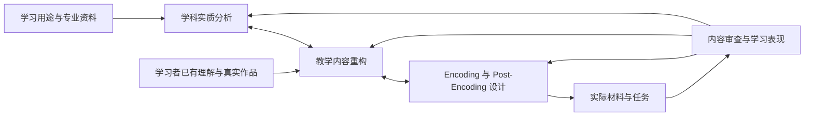

# 学科与单元的深度分析：从专业理解到可教内容

日期：2026-10-10。对象：本项目的个人学习系统，重点是 Encoding／Post-Encoding 之前的内容研究及其教学转化。

本报告综合原始研究、理论原文、作者及研究机构资料，并对照项目当前规则与 RSSM 备课。它是定向深度研究，不是穷尽检索的系统综述。文献的理论主张、局部实证发现、本报告的设计建议，以及对项目的观察分别陈述。来源的实际阅读范围见[证据与来源](证据与来源.md)。另附[单元学科分析工作底稿](单元学科分析工作底稿.md)。本轮交付研究产物，尚未将建议写入运行中的 Agent／Skill。

## 核心结论

你的判断基本成立：认知操作的质量受制于它处理的学科内容。如果上游只提供概念名称、几段定义和一个能算对的例题，下游的比较、自我解释、提取、变式与迁移就缺少足够有价值的对象。

更准确地说，系统需要加强两种相连的工作：

1. **学科实质分析**：明确这一领域或单元在解决什么问题，依靠什么概念、模型、方法与证据，重要关系为什么成立，哪些条件会改变判断。
2. **教学内容重构**：明确上述理解对当前学习者怎样才可获得。专家省略了什么？怎样的例子真正揭示关系？哪些简化保留了结构，哪些简化已经歪曲内容？

然后，Encoding／Post-Encoding 才据此决定怎样呈现、组织、恢复、区分、整合与使用知识。这个过程允许往返：如果设计不出有意义的对照或无法解释一步推理，往往需要回到学科分析继续研究。

**最值得增加的能力，是把“问题—解释—依据—判断—边界”研究清楚，并把其中必要的连接变成学习者实际看得见、用得上的内容。**增加一个名叫“学科专家”的角色，或者建立更大的知识图谱，都不能单独保证这件事。

## 一、项目现在究竟缺在哪里

当前规范已经要求：从理解用途选择内容、保留关系与条件、区分内容正确和教学功能充分，并让局部工作回到整体。材料核验还区分了数学证明、工程实现、AI 模型和开放论证的不同要求。因此，不能把问题概括为“项目完全没有学科分析”。见[整体设计](<E:/文献资料/学习系统架构设计/personal-learning-suite/src/skills/learning-teaching/references/design-whole.md:15>)及[领域核验](<E:/文献资料/学习系统架构设计/personal-learning-suite/src/skills/learning-materials/references/domain-checks.md:30>)。

较明确的缺口是：**规范提出了学科充分性的要求，但如何发现和论证那些关键内容，仍较多依赖模型当次发挥。**“要解释关键关系”已经说清；“哪些关系关键、应解释到哪里、用什么依据与实例把它解释清楚”尚缺少稳定的研究方法和校准案例。

RSSM 材料中可以看到两种具体表现：

- 已列出 RNN 加分布头、纯随机状态空间模型等合法替代，但对同一需求下各结构的性质、可学性与代价，解释还比较简略。列出替代方案和真正比较方案，是不同的内容工作。[当前 M1](<E:/文献资料/学习系统架构设计/learning/embodied-intelligence/prep/rssm-review-20261010/03-learner-materials.md:32>)
- 参数更新示例从给定的旧 recognition／q 分布开始；观测怎样产生这个分布，需要学习者自己连接另一节的公式。局部数学正确，却仍可能没有直接显露“数据为什么推动这次更新”。[当前 M4](<E:/文献资料/学习系统架构设计/learning/embodied-intelligence/prep/rssm-review-20261010/03-learner-materials.md:193>)

现稿已经实质完成一般序列推导、参数更新到未来预测及分布成本到动作选择。这里识别的是观测来源的可见性和更深结构取舍的局部缺口；是否展开后者取决于目标，不能把研究级架构比较倒加成基础解释一律合格所需的条件。

这与项目已有的[研究—设计差距分析](<E:/文献资料/学习系统架构设计/learning/embodied-intelligence/reviews/2026-10-10-rssm-depth-research-design-gap-analysis.md:45>)相符。它支持有针对性的改进判断，尚不能证明这是所有备课质量问题的唯一原因。

## 二、最相关的理论：各自解决什么问题

不存在一个已被验证、能够自动解析所有学科的统一框架。比较有价值的做法，是让不同理论承担明确的分析职责。

| 框架 | 主要贡献 | 可转成什么具体工作 | 单独使用的不足 |
|---|---|---|---|
| Schwab 的学科结构 | 区分组织内容的结构与知识成立的规则 | 同时分析概念／模型和证据／论证标准 | 不能直接生成适合某个学生的教学序列 |
| Klafki 的教学分析 | 分析内容的代表意义、现在与未来价值、结构及可接近性 | 解释为什么选择本单元、用什么入口把一般问题显露出来 | 含教育价值判断，不能只靠经验研究裁定 |
| Chevallard 的教学转置与实践组织分析 | 联系任务、技法、理由、理论；研究知识进入教学时的变化 | 找出“会操作但理由断裂”及“抽象理论无法使用”的位置 | 开放活动不一定存在统一技法，不能机械切碎 |
| PCK／MKT | 区分会做专业工作与能把具体内容教清楚 | 判断陌生解法、解释表示、识别误导类比、分析学生回答 | 分类本身不会替你取得专业内容 |
| 教育重构模型 MER | 将内容澄清、学习者观念与教学设计反复连接 | 形成“专业解释—学习者解释—教学桥梁”的内容设计 | 缺少真实学习者资料时，关于教学桥梁和预期学习过程的判断仍是假设 |
| Decoding the Disciplines／ACTA | 提取专家容易省略的学科操作与判断 | 从具体任务追问线索、决策、理由、例外和困难 | 专家自述并非其心理过程的无误记录 |
| 学科读写／认识实践 | 分析学科怎样读取材料、提出与评价主张 | 把材料类型、处理动作和作品标准连接起来 | 不同学科、子领域、实践情境不能共享一套规则 |
| 变异理论／DeFT | 分析必须辨别的方面，以及表征的功能和理解成本 | 设计真正有区分力的案例与跨表征对应 | 不保证固定的例子数量、变化顺序或图形数量有效 |
| 学习进阶 | 研究理解方式如何发展 | 从真实回答识别不同推理方式及可改变它的任务 | 不是教材目录，也不是每个人必须走的唯一阶梯 |
| UbD／TfU | 围绕有价值的理解与使用组织目标、证据和经历 | 保持单元整体方向，避免活动与理解脱节 | 不能替代具体内容的学科研究 |
| ECD／评估三角／3D-LAP | 连接能力主张、可观察表现及证据解释 | 检查任务是否真正要求目标判断、答对能说明什么 | 目标本身若太窄，对齐得再好仍然太窄 |

下面重点展开与你的问题最贴近的部分。表中的工作产物是本报告的综合建议，不是各理论共有的官方模板。

### 1. Klafki：学科价值需要进入内容选择

Klafki 的五问涉及：这份内容体现什么一般问题；对学习者现在和未来意味着什么；在这些目的下怎样理解其内部结构；什么具体情境能使内容变得可接近。原文也追问内容要素、关系类型、意义层次、前置和更大联系，五问不构成固定的线性顺序。[Klafki 原文扫描，相关部分为印刷页 15–20](https://www.corepractices.education/wp-content/uploads/2025/05/Klafki-Wolfgang-Didaktische-Analyse-als-Kern-der-Unterrichtsvorbereitung-1958-1964.pdf)

**对本系统的建议**：把“价值”写成内容取舍的理由。例如学习 RSSM，不只因为以后会读 Dreamer，而是借此理解：在看不全状态的条件下，怎样把历史、状态推断与未来预测组织起来。这个价值决定单元不能只剩组件名称或 KL 的代入计算。

价值也不只等于实用收益。历史解释中的证据责任、文学阅读中的经验理解、艺术实践中的感受与表达，都可以构成学习理由。哪些价值优先，需结合学习者目的；不应由一个统一的“效率”指标代替。

### 2. 学科结构：同时研究“怎么组织知识”和“凭什么接受结论”

Schwab 的 substantive／syntactic structure 区分，是本问题的重要理论起点。本轮核实其原章书目和内容标引，未读到原章全文，因此仅把它作为理论渊源，不以此宣称完成了原文细读。[正式书目记录](https://stars.library.ucf.edu/cirs/232/)

更具体的一手研究来自 Shanahan 与 Shanahan：通过不同学科专家的阅读和出声思考，研究者观察到数学、化学、历史在关注点与材料处理方式上的差别。[作者提供的论文全文](https://www.shanahanonliteracy.com/upload/publications/38/pdf/ShanahanArticle061909.pdf)

**由此提出的分析动作**：对一个单元同时写出解释结构和论证结构。例如：

| 内容问题 | 论证问题 |
|---|---|
| 这个数学结论关联哪些定义和定理？ | 哪些前提必需？这个证明是否覆盖全部允许情况？ |
| 这个历史事件有哪几种解释？ | 证据怎样支持解释？材料是否独立？结论强度是否过大？ |
| 这个 AI 模型有哪些组成部分？ | 架构理由来自表达能力、优化考虑还是实验？结果排除了什么替代解释？ |

认识实践还包括知识主张如何被提出、交流、评价和确立；其社会与互动特征不能缩成个人阅读策略。[Kelly 与 Licona，2018，作者机构摘要](https://pure.psu.edu/en/publications/epistemic-practices-and-science-education/)

本报告据此建议继续追问：公开的判断标准是什么，反对意见怎样被处理，什么证据会促使人修订结论？相应任务可以要求回应异议、修改作品和说明修订依据，不仅是读懂已有答案。

所谓“理解学科本质”，在工程上可以落实为这种工作：说清研究对象、核心问题、允许的推理和质量标准。对于存在多种研究传统的领域，应保留竞争框架，不能把一个模型写成整个学科的唯一底层真相。

### 3. Chevallard：把任务与其理由重新连起来

Chevallard 用 T、τ、θ、Θ 分析实践组织：任务类型、完成任务的技法、解释或正当化技法的话语，以及支撑这些理由的理论。其中 technology 指解释技法的论述，并不是数字技术。教学转置则要求注意知识在研究、职业实践、课程与课堂等制度情境中的不同形态。[Chevallard 2019，相关部分为页 72–77、86–93](https://www.jasme.jp/hjme/download/05_Yves%20Chevallard.pdf)

分析者因此应检查：哪些限制来自对象本身，哪些只是教材、考试或课程传统的要求？某章只允许一种解法，不代表整个学科仅有这条路径；研究中的同名概念，也可能已经超出课堂版本的条件和用途。

这对系统尤其有用，因为同一个单元可以“会算”而没有“理由”，也可以“讲了原理”却没有真实使用。

**本报告建议用四个连贯问题检查代表任务**：要解决什么类型的问题；可怎样做；为什么这样做；这些理由依赖什么更一般结构。以分数除法为例，不能只给“乘倒数”的步骤，还要能解释该运算所求的量及其单位，并说明它与求解乘法关系的联系。具体案例见后文。

此工具适合分析方法、程序、模型和证明。将它用于文学解释或艺术创作时，应允许多种合法实践及其不同评价标准，不能强制生成唯一操作算法。

### 4. PCK／MKT 与 MER：从专家知识到教学内容，需要再做一次专业工作

PCK 强调特定内容的教学知识；Ball、Thames、Phelps 对数学教学知识的分析进一步说明，解释一种算法、评价非标准解法、分析表征等工作，涉及教学所需的专门内容知识，不能归结为把题做对或学过更高深数学。[Ball 等，2008](https://bpb-us-e1.wpmucdn.com/sites.psu.edu/dist/5/8058/files/2013/12/Ball_Thames_Phelps_2008.pdf)

MER 将内容澄清与教育意义、学习者及教师观念研究、教学设计与评价连接起来。Duit 指出，为了使抽象内容可理解，教学内容有时需要增加情境与联系；它并非学术内容的简单压缩。[Duit，2007，页 6–8](https://www.ejmste.com/download/science-education-researchinternationallyconceptions-research-methodsdomains-of-research-4042.pdf)

MER 的直接研究基础主要来自科学教育。本报告把其内容、学习者与设计相互校准的思路借用于其他领域，是有理论依据、仍待检验的迁移建议。

**本系统应据此增加一种实质检查**：一份专业解释中的每个关键判断，学习者能否从实际提供的内容中获得？“专家一看就能补出来”不等于“材料已经教出来”。

例如，讲概率模型时，专家可能自然区分“观测带来的状态推断变化”和“训练带来的参数变化”；初学者可能把它们都理解为“模型更新了”。教学内容需要把两个对象、两个时间尺度和两种运算明确拆开，再讲清它们如何关联。

所以，“先有学科分析，再做认知设计”是合理的工作重心；但学科初稿需要在学习者解释和教学任务中不断校正，不能等它被宣布彻底完成后才允许下游接触。

### 5. Decoding／ACTA：深入分析可以从实际任务开始

Decoding 从具体学习瓶颈追问专家隐含的思考过程；ACTA 提供任务图、知识审计、情境模拟访谈等提取方法。它们都比“请概述这个学科”更容易得到具体的判断线索。[Indiana University 的方法说明](https://citl.indiana.edu/teaching-resources/course-design/decoding-disciplines/index.html)、[Militello 与 Hutton 原文](https://web.mit.edu/16.459/www/Militello98.pdf)

**建议的实际追问**：

- 你刚才为什么先检查这个条件？材料中哪一处触发了判断？
- 你考虑过哪种看起来同样合理的办法？为什么没有采用？
- 少了哪条信息，你就不能作出现在的判断？
- 哪个结果会使你修改模型、证明路线或解释？
- 新手最可能在哪个具体位置作出另一种选择？有什么实际样本支持？

没有真人专家时，可以分析权威解例、原论文、证明、实现与实验记录。应将结果称为“基于资料的专家实践重建”。LLM 模拟专家的口述可以帮助提出候选，不能冒充已完成专家访谈，也不能据此声称知道真实专家的心理过程。

Decoding 的瓶颈入口适合已有困难的情境；正常新学无需先制造错误。可以先分析代表任务和专业参考，再准备必要的解释与示范。

### 6. 变异理论、表征与学习进阶：补足“怎样把关键关系显露出来”

变异理论有价值的问题是：为获得某种理解，必须辨别什么方面，哪些变化使它可见？相关实验在特定学习任务中检验过内容变化的作用，但不能据此规定所有单元的最优变化顺序。[Marton 与 Pang，2013](https://www.frontlinelearningresearch.org/index.php/journal/article/download/16/99?inline=1)

DeFT 则组织了多表征的设计、功能和学习任务；它提示我们分析每种表征提供什么信息，以及学生是否能理解各表征及其对应关系。[Ainsworth，2006，作者上传原文](https://www.researchgate.net/publication/222410911_DeFT_A_conceptual_framework_for_learning_with_multiple_representations_Learning_and_Instruction_16_183-198)

**本报告的合并用法**：在选图、公式、代码和案例之前，先写出目标区别。例如“同样观察到物体在右边，为什么仍可能需要不同动作”，关键变化可能是此前运动历史，而不是图片颜色。再决定用时间序列、状态示意还是公式来显露这个区别。图文数量不构成理解深度的证据。

学习进阶关注理解方式的变化。有关论述明确提醒，路径可以非线性、存在多条路线，一个学生也可能在不同任务中表现不同水平。[Scott、Wenderoth 与 Doherty，2019](https://pmc.ncbi.nlm.nih.gov/articles/PMC6812577/)

**因此，关系图需要区分三件事**：内容在逻辑上依赖什么；学习某内容通常受益于什么经验；当前课程选择怎样安排。只有后两者的推测时，不应把它写成不可绕过的硬性前置。

### 7. 目标与证据框架有用，但不能承担全部上游研究

UbD 的目标—证据—学习计划，以及 TfU 对生成性主题、理解表现的关注，适合保持单元方向。[UbD 作者白皮书](https://ascd.org/ASCD/pdf/siteASCD/publications/UbD_WhitePaper0312.pdf)、[Project Zero 官方介绍](https://www.pz.harvard.edu/projects/teaching-for-understanding)

评估三角要求认知、观察与解释相互协调；ECD 将评估设计作为证据论证来处理。[NRC，2001，第 2 章](https://www.nationalacademies.org/read/10019/chapter/4)、[Mislevy 等，2003，官方摘要](https://www.ets.org/research/policy_research_reports/publications/report/2003/hsgs.html)

3D-LAP 提供了更贴近本问题的实例：它检查任务是否有潜力引出学科核心观念、科学实践与跨领域概念的使用，而不只按动词标签判断认知层次。作者也明确区分“任务可能引出证据”与“学生实际上产生了怎样的证据”。其开发领域是大学生物、化学和物理，不能原样推广到所有学科。[Laverty 等，2016](https://pmc.ncbi.nlm.nih.gov/articles/PMC5015839/)

对本项目的含义是：先把目标中值得理解的内容研究具体，再检查证据。若先将目标缩成“能计算某一项 KL”，所有活动都能完美对齐，却仍未覆盖“理解模型怎样学习”。

## 三、一套真正做研究的操作流程

以下流程是本报告为本项目提出的综合方案，尚未经本系统的真实学习实验验证。它的核心是完成学科工作，然后留下可追溯结果；不以填满栏目为完成条件。八步是可回跳、可复用的研究问题，已有可靠答案时直接使用，不是每个单元必走的八道程序。

### 第一步：确定有价值的问题及其范围

同时保留学习者用途和学科问题。例如“看懂世界模型论文”过大，需要确定近期单元，但不能直接缩成“记住几个组件”。可以选择“解释一个模型如何根据观测推断状态，并在尚未得到未来观测时预测行动后果”。

先有方向性目标，再通过学科研究校准终点。对于尚不清楚的领域，过早写死所有能力判据，会把尚未发现的核心内容排除在外。

这里还要区分三个尺度：

| 尺度 | 应分析什么 | 复用方式 |
|---|---|---|
| 学科／子领域 | 主要问题、对象、知识标准、常用表征、研究传统 | 建立较稳定的背景说明，按需更新 |
| 主题／单元 | 本次问题、关键关系、代表任务、方法取舍与边界 | 形成当前研究重点，可跨学习者复用 |
| 当前学习者／活动 | 已有理解、可见输入、帮助条件、近期可承担的工作 | 随真实表现调整 |

单元分析需要看见上层背景，但无需每次重建整个学科。

“形成学科图景”本身也需要操作方法。以下是本报告建议的资料分析动作，可按内容选择：

- **反向读目录与导论**：不复制章节顺序，而是为主要内容追问“它在回答什么问题，上一种工具为什么不够”。比对不同教材或研究导论时，关注组织方式的分歧；共同出现的主题可作核心候选，但不能仅凭出现次数判断重要性。
- **重建问题演变**：沿关键成果追查它改变了什么可解释、可证明或可实现的范围。区分研究者当时面临的约束与今天仍成立的约束；历史先后不自动构成最佳教学顺序。
- **比较解释框架**：选同一个对象或现象，看不同框架分别保留哪些变量、使用什么假设、允许什么推论。只有同一问题下的实际比较，才能避免把“联系”写成术语联想。
- **寻找承重的概念变化**：某个新概念引入后，原本无法表达的问题是否变得可以表达，分散现象是否得到统一，原来含混的判断是否获得标准？据此提出核心命题，再用具体案例和专业资料核查。
- **明确研究对象的层次**：同一内容中的实体、过程、关系、模型和表示是否被混在一起？例如物理系统的状态、模型中的潜在状态、神经网络内部向量并非天然同一对象；它们的对应需要额外假设与证据。

这些动作不要求每个主题都写一部学科史；其作用是找到有解释力的结构，并说明为什么当前单元应围绕它组织。

### 第二步：围绕待回答的问题取资料

不建立适用于所有判断的单一“来源等级”。来源价值取决于它能回答什么问题：

| 要确定的事情 | 优先寻找的资料 |
|---|---|
| 定义、证明、模型假设、方法实际行为 | 权威教材、原论文、正式规范、实现及可复核推导 |
| 为什么采用某种结构 | 原始设计论证、可比较的替代、消融或对照、失败案例 |
| 专家怎样判断 | 真实任务、作品及理由、案例访谈、操作记录 |
| 学习者通常在哪些认识上变化或受阻 | 学科教育研究、真实学生回答及访谈 |
| 当前必须达到哪些外部要求 | 与当前课程、考试、资格或工作确实相关的标准 |
| 本学习者当前理解了什么 | 本人的回答、作品与帮助条件，而不是总体研究均值 |

官方标准对于要求范围可能很重要，却不能替代某一证明的依据；一篇原始研究可支持局部结果，也不自动代表全领域共识。自主学习没有对应标准时，仍可以从真实用途和专业任务开始。

### 第三步：让学科整体与代表任务相互校验

先依据独立专业资料形成暂定图景：这一主题有哪些主要问题、解释框架、典型实践和重要贡献，与相邻领域怎样连接。再选择能检验其中关键关系的代表任务，实际写出解答、解释、证明、实现或作品评价，并指出关键选择的依据。

用任务细节纠正空泛概括，也用学科整体检查任务是否过窄。任务选择依据尚不足时保留候选，不把一道任务调用的知识等同于单元全部结构。例如 RSSM 的一次 KL 计算并不自然覆盖状态表示的理由、序列生成或规划中的使用条件。

在适合的主题中，再比较一个改变关键条件的相邻案例。它的作用是辨别方法的适用条件，不是凑“至少两个例子”的数量。

以历史材料为例，需要实际解释哪些证言支持什么主张；以数学为例，需要核对证明每步的前提；以 AI 模型为例，需要沿输入、表示、目标函数和输出走通一条链。

### 第四步：提炼核心命题，并反查覆盖范围

“RSSM、KL、后验”是名词；“当前观测用于更新对当前潜在状态的推断，而未来未获得的观测不能成为在线想象的已知输入”才是一条能改变判断的命题。

可用四种检查来寻找真正核心的关系：

1. **解释检查**：它解释了哪个原本不清楚的现象、步骤或设计？
2. **删除检查**：若去掉它，哪项推理或操作失去依据？
3. **条件变化检查**：什么变化会使原方法不再成立，或使另一方法更合适？
4. **生成检查**：它能否支持一个未见过的判断，而不仅重述原案例？

并非所有核心内容都能压缩为生成性原理。历史背景事实、语言惯例、材料经验等也可能不可省略；应说明它们支持什么理解，避免为了寻找“大观念”而抹掉必要细节。

最后反查：哪些核心问题、重要解释或典型实践未被当前任务覆盖？它们是与本次用途无关、有理由暂缓，还是被分析遗漏？必要时换一个任务或比较另一种专家作品，而不规定统一任务数量。

### 第五步：分析联系的类型与作用

系统容易把“联系多”当成深。更有用的是说明每条联系怎样改变理解。

| 联系类型 | 应明确什么 | 可能产生的教学工作 |
|---|---|---|
| 构成／定义 | 一个对象如何由其他对象界定 | 分解与重建对象，防止概念混同 |
| 推导／理由 | 结论依赖哪些前提和推理 | 补理由、改前提、判断证明是否仍成立 |
| 机制／因果 | 输入怎样经中间过程改变结果 | 追踪链条、比较干预条件、解释异常 |
| 证据支持 | 观察为何支持主张，尚不能排除什么 | 证据权衡、提出替代解释或补充检验 |
| 表征对应 | 图、式、代码指向什么同一对象 | 翻译与核对，指出信息损失 |
| 替代／取舍 | 不同办法各满足什么需求、付出什么代价 | 条件选法、比较模型、拒绝不适用办法 |
| 概括／特例／近似 | 从一般到具体保留和改变什么 | 推广、退化情形、近似误差判断 |
| 跨领域类比 | 哪部分结构相同，哪里不再对应 | 有边界的迁移，防止望文生义 |

学习前置另行标注。概念的互相支持可以形成循环理解，不宜把整个学科强制变成一张 DAG。

### 第六步：研究关键区别与可能的理解困难

先确定正确理解中必须区分什么，再寻找学习者是否混淆的证据。例如：状态与观测、学习与推断、预测精度与行动价值、因果解释与相关关系。

把困难写成可检验的候选解释。例如“可能把 q 当成真实状态标签”，然后说明：如果这个解释成立，在什么新题上会出现什么回答；什么表现会反驳它。

不要从一次错误直接诊断一个稳定误概念。它也可能来自语言、算术、题面歧义、遗忘或帮助条件。上游负责提出有领域意义的区分，下游结合实际证据决定是否需要诊断与修复。

### 第七步：重构教学内容，并记录简化边界

建议针对每个关键关系，完成一次“必要中间连接”检查：对象从哪里来，采用什么规则，经过哪个中间变化，结论为何成立。

若为了初学者采用玩具模型，写明保留了什么、删除了什么，同时记录原用途、课堂用途及课程／考核施加的限制。比如一维高斯例子可以显露观测怎样影响状态推断和局部学习信号，却不能验证高维 RSSM 的训练稳定性或某架构的普遍优势。

材料重构还可能需要增加内容：补充单位、来源元数据、隐含条件、表征对应或连续示例。这些内容不是额外铺陈，而是帮助学习者获得原本只有专家能自行补出的联系。

### 第八步：用具体任务检查研究是否产生了可用结果

先独立回答：经过这轮学科分析，哪些设计决定获得了依据？它可以促成修改、补充、删除，也可以确认现有解释、案例和任务已经足够，或支持有理由地暂缓扩展。只增加报告长度而没有改善任何决定的依据，才说明工作尚未发挥作用。

对于关键能力，写出一个能提供证据的具体任务，并检查捷径：标题是否已经提示方法，题目是否直接给了原本需要判断的量，标准答案是否接受没有理由的正确结果。

没有真实作答之前，只能判断任务设计的潜力。学习者是否按预期思考，仍需要实际观察。

## 四、贯穿示例：RSSM 的信息条件、结构理由与局部学习信号

以下是示范性学科分析与教学建议，不是对现有课件的直接修订，也不是已经完成的试教。

### 1. 单元的中心问题与价值

建议的中心问题是：**环境状态不能被单张观测完全确定时，怎样从历史推断当前状态，并在没有未来观测的情况下比较行动后果？**

这个问题把单元放在部分可观测控制、序列建模和状态推断的交汇处。单元终点可以是：学习者能够追踪一次“观测—状态推断—潜在预测—行动比较”的信息流，并对一种结构变化或结果解释提出有依据的判断。

这不是要求在同一单元掌握整个强化学习。它明确近期主线及邻近联系：历史为什么必要，预测为什么可能是分布，推断与生成怎样协作。

### 2. 先核专业结构及论证范围

PlaNet 原文中的 RSSM 包含确定性递归状态和随机状态，并以带当前观测的编码器参数化近似后验；作者给出了加入确定性路径的记忆与优化动机。论文实验支持其测试设置下的结构效果，不能据此证明所有任务都必须采用 RSSM。[Hafner 等，2019，§3、式 (4)](https://proceedings.mlr.press/v97/hafner19a/hafner19a.pdf)

把原文的随机状态记号改写为 z，可用下式呈现基本信息结构：

\[
h_t=f(h_{t-1},z_{t-1},a_{t-1}),\qquad
p(z_t\mid h_t),\qquad
q(z_t\mid h_t,o_t).
\]

这里的教学重点是：h 的递归输入、先验与近似后验所获得的信息，以及训练或观测阶段和未来想象阶段的信息差异。学习到的潜在状态不自动等于可直接读取的真实物理状态，q 也不应直接称为真实标签。

### 3. 从中心问题导出具体判断

下面是本报告提出的分析与任务设计，而非原论文的教学实验。

| 需要理解的关系 | 可使关系显露的材料 | 应留给学习者的判断 |
|---|---|---|
| 单次观测可能不足以确定行动所需状态 | 当前画面相同、此前运动方向不同的两段历史 | 为什么相同图像不必支持相同动作？还需哪项信息？ |
| 信息输入与分布输出是不同设计问题 | 单帧输入的分布预测器，与能访问历史的预测器 | 增加分布头解决了什么，仍未补回什么？ |
| 推断和生成使用不同信息 | 在时间线上标明已看到与尚未看到的观测 | 哪条路径能用于在线未来预测？哪条路径发生信息泄漏？ |
| 模型结构理由有适用范围 | 具体描述递归模型与 RSSM 的输入、状态与输出 | 哪些差异是结构事实，哪些性能比较还需实验？ |
| 观测影响推断，推断参与学习信号 | 同一旧模型、不同观测的局部数值例子 | 数据为什么改变这次参数更新，而不只是会求导？ |

第二行尤其需要公平比较：单帧模型的限制不能代表所有 RNN。一个有充分历史输入、定义合理的分布输出或随机生成机制的递归模型，是值得认真比较的候选。是否优于 RSSM，需要具体说明模型和实验条件，不能靠名称判定。

以“为什么加入确定性路径”为例，可以把结构取舍实际展开：纯随机转移能够表达不确定性，但若需要将一个早期线索保留很多步，信息必须在反复随机转移中可靠传递。原则上可以让某些维度的方差接近零以保留信息，能否训练得到这种分工仍是问题。RSSM 显式加入递归的 h 路径，为这种信息传递提供结构。这里的“确定性”指给定输入时的更新函数；因为输入含随机状态，h 也不是与随机性绝缘的另一套世界。[PlaNet §3 的设计论证](https://proceedings.mlr.press/v97/hafner19a/hafner19a.pdf)

这个论证解释一种结构选择的动机，并未证明纯随机模型不可能保留长期信息。教学可进一步要求学习者指出：表达能力的可能性、训练能否找到解、某次实验的效果，是三个不同判断。若要比较具体候选的长期记忆或规划表现，还需明确容量、训练条件与评估任务。

### 4. 把“数据怎样推动学习”的一跳展开

下面自拟一个线性高斯模型，只为显露机制。固定 h，令：

\[
z\sim\mathcal N(\theta h,1),\qquad o\mid z\sim\mathcal N(z,1).
\]

给定旧参数 \(\theta_{\rm old}\)，其精确后验为：

\[
q_{\rm old}(z\mid o,h)
=\mathcal N\left(\frac{\theta_{\rm old}h+o}{2},\frac12\right).
\]

这是一维解析后验，用来教学说明；实际 RSSM 的 q 是学习到的近似推断分布，二者不能混同。

只看固定旧 q、固定 h 时的局部项：

\[
L(\theta)=D_{\rm KL}\left(q_{\rm old}\Vert\mathcal N(\theta h,1)\right),
\qquad
\frac{\partial L}{\partial\theta}=h(\theta h-m),
\]

其中 m 是旧 q 的均值。令旧 \(\theta=1,h=2\)，比较两个观测条件：

| 观测 o | 旧 prior 均值 | 后验均值 m | 在旧参数处的局部导数 | 学习率 0.1 更新后的 θ | 更新后 prior 均值 |
|---|---:|---:|---:|---:|---:|
| 0 | 2 | 1 | 2 | 0.8 | 1.6 |
| 2 | 2 | 2 | 0 | 1 | 2 |

现在学习者可以看见完整的局部链条：**旧模型与新观测共同决定推断；推断与原预测的差异进入此局部学习项；参数变化又改变同一 h 条件下重新作出的先验预测。**这张表尚未演示下一时刻的状态转移或多步 rollout。

这里有明确边界：第二行只有这个固定 q／h 的局部项对 θ 的导数为零，不能推出完整训练目标的所有梯度为零；也未包含跨时反向传播及其他参数的学习。这个例子不需要冒充完整神经模型，仍能承担一条有价值的解释。

### 5. 学科分析怎样改变 Encoding／Post-Encoding

上游完成前，教学指令可能只是“比较 prior 和 posterior，做 KL 练习”。完成后，可给下游更明确的依据：

- Encoding 的解释与示范，应让观测、推断分布、局部目标和参数变化在同一条链上出现；是否先给公式、图或数值，由认知设计决定。
- 对照案例应改变实际影响判断的条件，例如当前观测是否可用，或历史是否被输入，而不是只替换变量名称。
- Post 可以要求学习者在未见过的时间线中重建合法信息流，或判断一段解释是否混淆了状态推断与参数学习。
- 若目标包含模型取舍，任务应提供足够明确的候选结构与条件；允许结论是“现有证据不足，需补某项比较”，而不是默认 RSSM 总胜出。

### 6. 一个具体的证据设计

任务：某模型在评估 t+1 至 t+5 的候选行动序列时，使用了实际记录的未来观测来逐步更新状态，然后报告未来奖励预测很好。让学习者判断该结果能支持什么，不能支持什么，并画出可用于在线规划的替代信息流。

可接受的关键判断包括：这种结果可能说明利用观测后的状态估计或预测表现，但不能直接支持“不知道未来观测时的开放式预测同样好”。若研究目的本来就是离线分析，使用未来资料也不自动构成错误；必须对应其声称的用途。

这个任务检验信息条件和证据解释。题面若直接写“这里发生了未来信息泄漏”，就已经代做了部分判断，应按评估目的调整帮助。

## 五、跨学科检验：同一分析问题，不同专业内容

### 数学：分数除法

以 \(\frac34\div\frac12\) 为例，算出 \(\frac32\) 只是一个结果。学科分析还应明确：除法在当前情境下求什么量，为什么可以通过乘法关系求解，图中的单位是什么。

自拟任务可以设为：“有 3/4 升饮料，每份 1/2 升，相当于多少份？”先取出一整份后，剩下 1/4 升，对应的是半份。这里 1/4 的计量单位是升，1/2 的计量单位是份，两者不能直接混说。

进一步用 \(bx=a\) 解释商，说明除数非零；正量测量图可以帮助理解这个情境，但向负数或更一般对象推广时需要额外依据。上游由此交给下游的，是单位关系、运算意义、代数理由和图示边界。

可以分别检查计算、构造情境、画图和解释剩余量。算对图错与图对算错，提供不同证据。这些都是候选诊断任务，没有本地作答前不能声称某位学习者已经存在对应误解。

### 历史：相互冲突的证言

DIG 的“列克星敦之战”公开课程介绍围绕冲突叙述组织来源分析、相互印证与情境化。[官方课程介绍](https://www.inquirygroup.org/history-lessons/battle-lexington)。本轮未读取需登录的完整教案，下面是据公开说明提出的示范设计。

单元不只研究“谁先开枪”，还研究有限材料允许作出怎样的历史判断。应区分事件、留下的材料与后来的叙述；考察作者的观察位置、写作时间、目的、接触信息的机会，以及多份材料是否真正独立。

教学可以缩短文本、提供词汇支持，但影响判断的出处和语境不能一并删掉。学习者产物应是带依据与限制的历史论证；加入一份新证言后，说明结论是否需要改变。评价的是主张与证据的关系，不能只看选择了哪一方。

这里的“深度”体现在证据处理和解释责任上，不要求强行形成数学式证明或唯一机制图。

### 语言与艺术的边界提醒

在语言单元中，同一语法形式还需要放回交际意图、语境与语域；在艺术学习中，同一技法的意义可能依赖媒介、表达意图与作品传统。可以沿“对象、用途、专业判断、材料、作品标准”分析，但不应预设所有领域都以定理、因果模型或唯一正确答案为中心。

这些跨学科建议说明的是分析方式的可迁移性，不等于已经验证同一流程在所有学科都有相同效果。

## 六、对参考报告的评估与增量

你提供的报告已经抓住重要方向：概念之间的关系、学科认识论、专家实践、表征、条件化、误解假设与能力证据，都值得保留。它还明确将 DCM 标成自行综合的工程框架；这个身份应继续保留。

本次研究主要补充和修正以下方面：

| 参考报告的有用部分 | 还需推进的地方 | 本报告的补充 |
|---|---|---|
| 覆盖了广泛的分析维度 | “找核心概念、找重要关系”仍把发现过程留在黑箱里 | 从真实问题和代表任务出发，用理由、替代、条件变化研究结构 |
| 同时考虑知识和学习 | 领域事实、教学假设与个体状态容易混在一份模型中 | 分开保存其证据身份，设计时再组合 |
| 强调价值与情境 | 动机相关性尚不足以说明为什么这份内容具有教育价值 | 引入 Klafki 的内容选择与代表意义分析 |
| 给出学科层到认知层的工作流 | 容易被实现成一次性单向交接 | 用 PCK／MER 支持教学内容重构和反向修订 |
| 提倡图谱、DAG 与机器可读字段 | 容易过早固化颗粒度、依赖和模型猜测 | 先以有内容的论述和案例验证，再决定是否结构化 |
| 强调标准、目标与评估对齐 | 自主学习未必有标准；窄目标仍可能对齐得很好 | 保留原用途，目标随内容研究校准 |
| 广泛引用经典理论与研究 | 附件中的 turn 引用标记无法直接追溯文献 | 重新查核公开来源并记录全文／摘要阅读状态 |

不建议照搬其中固定概念数量、统一建模周期、复杂角色配置或所有单元同一认知顺序。它们属于待验证的设计建议，不是文献已经确立的必需条件。

## 七、怎样接入现有系统

建议先在 AG1 与 AG2 已有职责中加入这项内容研究能力。重点是增加实际专业工作和示范案例，暂不需要据此推导出新增角色、数据库或审批流程。

可使用三种轻量产物：

1. **可复用的学科背景说明**：主要问题、知识标准、代表实践和表征。不要求每次重写。
2. **本单元的实质分析**：核心问题、关系与理由、关键联系、代表任务、替代与边界、必要的教学重构。
3. **面向下游的简短交接**：哪些认识必须建立；有什么可靠输入与参考；学习者需要承担什么判断；什么表现构成证据。

它们可以是现有计划、材料参考中的短段落和引用，不要求另外创建三套文件。

学科分析的交付应包含实际内容，例如“观测怎样产生当前推断，为什么在这个目标项中影响更新”，而不是“这一段请使用精加工”。认知设计也应有权回问：所称关系到底是什么，哪项变化能检验它，材料中哪一步尚缺依据。

深度按目标决定。只需术语对应的任务可以很短；理解机制的任务需要连接链；评价模型的任务需要真正的替代和证据。**缩小本次覆盖范围可以合理，悄悄删去原用途必需的理解则会重复当前问题。**

## 八、如何验收，防止新增一层表面化

### 1. 先检验分析产物是否改变教学

不以篇幅、术语、文献数、图谱节点数或填写率作为主要指标。可对同一用途准备两份都没有明显事实错误的材料，请审查者指出：

- 哪份显露了关键中间联系，哪份仍需专家自行补全？
- 哪项对照支持了声称的区分，哪项只是换外观？
- 哪项结构选择有条件依据，哪项只列了替代名称？
- 哪个任务让学习者承担判断，哪个任务已在题面给出结论？
- 哪条论断是数学结果、经验发现、教学假设或未经验证的猜测？

这是内容质量审查，先要求能定位具体缺口。不要用一个未经校准的“专家级 95 分”掩盖尺度不明确。

### 2. 再检验教学过程与学习表现

在内容通过后，用真实学习者观察：是否能解释关键关系、在条件变化后调整判断、跨表征保持对象一致，以及在必要的延迟或新情境中使用知识。具体选择取决于原目标，不要求每次全部测试。

若比较有无学科分析的备课，尽量保持主题范围、模型条件、资料权限与设计预算可比；否则更多资源带来的收益会与方法收益混合。先比较材料质量，再看学习过程和结果，不能把 AI 模拟作答当成真实学习效果。

个人学习可以先做小规模、可复盘的比较，但单个学习者、少量单元难以支持普遍因果结论。改进方向可以依据这些观察调整，不必虚构统计确定性。

### 3. 保留三类未知

- **专业未知**：某个机制、模型性质或论证尚未查清，需要补资料或专业核查。
- **教学未知**：某个案例是否使关键关系可见，尚需试教。
- **个体未知**：学习者是否已有某种理解或困难，尚无真实证据。

这些未知对应不同下一步。更多通用认知文献不能自动解决专业未知；更多理论推导也不能代替学习者实际表现。

## 九、推荐的采用顺序

对本项目，优先读 MER／PCK 来明确“教学内容重构”的工作，再用 Klafki 和 Chevallard 深化内容价值与任务理由；随后使用 Decoding／ACTA 处理专家隐含步骤。表征、关键区别、学习进阶和证据框架按单元实际问题调用。

第一轮试用宜选一个当前确有内容缺口的单元：围绕原用途，研究清楚少数关键关系，重做必要解释与一项有区分力的任务，再检查成品是否改善。无需先把全学科编码成知识图谱。

本轮研究对“需要学科实质分析与教学重构”的判断有较强理论支持；对上述具体组合能提升本系统多少，有待实际验证。最直接的下一步已经具备：使用[工作底稿](单元学科分析工作底稿.md)，把这项研究落实成一份有专业依据、能驱动具体材料和任务的单元分析。
