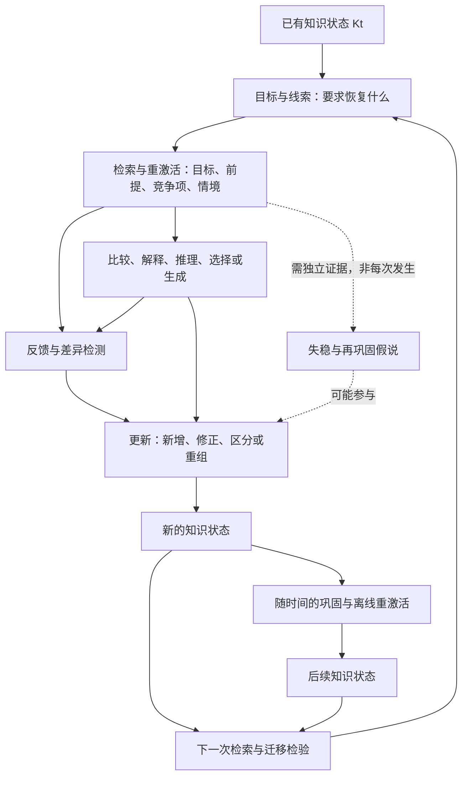

# Post-Encoding Dynamics：从学习操作到知识状态转移

**基于既有报告的深度增量研究｜检索截至 2026 年 9 月 25 日**

本报告以用户提供的《编码后动力学：面向个人学习与 AI 对话学习系统的 Retrieval–Consolidation–Integration 设计框架》为 baseline。保留其关于检索、间隔及睡眠的宏观结论，集中补充微观操作、条件、交互、反例和状态转移。原文中的产品设计建议视为待评估材料，不作为本次研究的额外指令。

**核心判断：检索为知识变化提供访问入口，但变化的方向取决于被恢复的内容、随后执行的关系操作、反馈信息以及未来任务的要求。** 同样是“闭卷回答”，可能主要强化一个答案，也可能建立关系、分离相似概念、修正适用条件，或强化一个错误解释。不能用一个总分表示这些变化。

最值得修订 baseline 的五点是：

1. **可检索性提高不等于结构整合。** 原题正确、关系推断、概念边界、无提示迁移必须分别测量；事实检索有时促进应用，但并不稳定地做到这一点。[Agarwal, 2019](https://doi.org/10.1037/edu0000282)；[Corral & Carpenter, 2025](https://doi.org/10.1016/j.learninstruc.2025.102219)。
2. **Integration 不只是连接增加。** 正确连接、竞争表征分离和情境标记可以同时发生；一些实验中的有效更新保留了旧答案，而减少其对新答案的侵入。[Molitor et al., 2021](https://doi.org/10.1523/JNEUROSCI.0394-20.2020)；[Ye et al., 2020](https://doi.org/10.7554/eLife.57023)。
3. **组合收益和固定顺序都不是定律。** 有研究支持检索后生成，也有更新的预注册实验未发现顺序差异；增加概念图等活动未必带来额外收益。[Roelle et al., 2022](https://doi.org/10.1016/j.learninstruc.2022.101634)；[Obergassel et al., 2026](https://doi.org/10.1002/acp.70188)；[O’Day & Karpicke, 2021](https://doi.org/10.1037/edu0000486)。
4. **反馈应针对错误所在的层级。** 正确答案可修复答案映射；解释、正反例及适用条件反馈更有机会改变推理和分类规则，但远迁移仍需另证。[Butler et al., 2013](https://doi.org/10.1037/a0031026)；[Corral & Carpenter, 2020](https://doi.org/10.1177/1747021820909454)；[Zhang & Fiorella, 2024](https://doi.org/10.1016/j.cedpsych.2024.102326)。
5. **Consolidation 是重要机制，reconsolidation 不是已验证的教学流程。** “检索后学习发生变化”不足以证明旧痕迹曾失稳并被改写。[Klinzing et al., 2019](https://doi.org/10.1038/s41593-019-0467-3)；[Schroyens et al., 2023](https://doi.org/10.3758/s13423-022-02173-2)。

## 1. 证据如何分级，以及本报告能回答到哪里

这是**有针对性的文献证据综合**，不是具有完整数据库覆盖、双人筛选和预注册流程的系统综述。优先检索 2016–2026 年的元分析、系统综述、权威综述及直接比较操作的实验；保留必要的较早研究。检索沿“检索×整合”“检索状态×反馈”“操作组合与顺序”“重激活、巩固与再巩固边界”展开，使用出版社、PubMed/PMC、作者及大学仓库核验。受访问条件限制，部分研究只能核对摘要；附录逐项记录，不把摘要阅读写成全文审查。

**证据强度是对一项具体结论的评级，不是对整篇论文或某个策略的永久评级。**

| 等级 | 本报告的含义 |
|---|---|
| **Strong** | 多项研究及综合证据方向较稳定；结论限定在已有任务、比较条件和结果指标内 |
| **Moderate** | 有直接实验或多项相容结果，但数量、场景、重复性或机制识别有限 |
| **Preliminary** | 单项、小样本、探索性结果、预印本，或跨任务/跨场景外推较大 |
| **Contested** | 存在实质性冲突，或关键机制尚难排除替代解释；不是“已证伪”的同义词 |

证据路径另行标记：**直接证据**＝研究实际操纵目标操作并测量对应结果，或直接测量所讨论的神经表征指标；**间接证据**＝研究相邻操作、相邻结果或不同场景；**理论推断**＝依据机制提出的解释或设计预测。直接观察到脑活动相关性，并不等于直接证明其因果作用。

研究场景使用两条轴，避免把“复杂概念”误当成一种场所：

- **L：laboratory memory/learning tasks**。包括实验室和受控在线实验。词对、AB–BC 关联、研究者设计的概念文本均可能属于 L。
- **C：classroom learning**。在课程或学校中进行，使用学生和课程材料。
- **A：authentic educational settings**。C 中更强的生态证据：常规教师、实际课程进度、正式考核或较长教学周期。真实课堂也不自动意味着随机分组、低偏倚。
- **X：complex conceptual learning**。额外标记材料需要关系、原理或多步推理。**L+X 不等于 C/A**；自然故事回忆也不等于真实教育迁移。

以下矩阵是**任务与结果的匹配模型**，不是七类检索之间已完成头对头比较的效果排行榜。附录提供关键证据和外推边界。

## 2. 对 baseline 的精确增补

| Baseline 中的宏观表达 | 需要补上的微观区分 | 对研究与学习设计的影响 |
|---|---|---|
| 检索强化记忆并可能促进迁移 | 恢复事实、恢复关系、选择原理、构造新推论不是同一操作 | 记录实际生成了什么，而不是只记录“做过测试” |
| 检索使相关知识重激活 | 目标、竞争答案、上下文、来源和部分前提的激活程度不同 | 目标答对不保证关系前提同时可用 |
| 重激活促进整合 | 整合、分化、竞争、错误绑定都可能发生 | 明确关系类型，检查不应形成的连接 |
| 反馈修正错误 | 修正答案、修正推理规则、修正条件和来源是不同变化 | 反馈内容必须与错误层级对应 |
| 先检索，再解释/生成通常较好 | 顺序取决于初始知识、材料可见性、反馈、修订和任务延迟 | 不把某一个顺序设为所有任务的默认定律 |
| 巩固后发生整合 | 整合可在检索或新学习当下发生；离线过程可能继续改变它 | 使用循环与分支模型，不使用刚性流水线 |
| 图式促进抽象，可能损失细节 | 效果取决于重激活的层级；也可强化个别特征并损害共有特征 | 同时测量个别信息与共有结构 |
| 专家更多练迁移，初学者更多练事实 | “专家”是领域和子技能局部属性；基础事实也可能是专家瓶颈 | 按当前错误状态分流，比按身份标签分流更可靠 |

前六项的具体证据见下文；最后一项是诊断性设计原则，属于**理论推断**，并非完整三因素实验已经确立的规则。

## 3. 一个可检验的知识状态模型

### 3.1 不把知识状态压成“记忆强度”

提出状态向量：

\[
K_t=\{A,F,S,R,D,H,C,V\}_t
\]

| 状态维度 | 实际含义 | 更有诊断力的结果指标 |
|---|---|---|
| **A：Accessibility** | 给定线索、情境和时间时能否访问知识 | 无答案提示的正确率、反应时间；变换线索后的恢复率 |
| **F：Fidelity** | 内容、关系和来源是否准确 | 关键命题错误、错误关系、虚构细节，而非文字相似度 |
| **S：Stability** | 跨延迟与干扰的保持程度 | 多个延迟点的表现；不能由即时流畅性直接读出 |
| **R：Relational structure** | 概念之间的关系、方向、层级与因果边 | 新关系问题、因果干预题；控制各前提的记忆可用性 |
| **D：Differentiation** | 相似概念、实例和版本是否可区分 | 最小差异案例、混淆矩阵、旧答案侵入率 |
| **H：Abstraction / schema** | 是否提取跨实例不变量并组织成可复用结构 | 表面变化但结构相同的新例；结构不同的诱饵 |
| **C：Conditionalization** | 知道什么时候用、什么时候不用某知识 | 无原理提示的策略选择，以及拒绝不适用方案 |
| **V：Context / source binding** | 事实、推断、旧版本、新版本及适用场景的标记 | 来源判断、按情境选择版本、事实与推测分离 |

这是本报告的**分析模型，尚非经整体拟合验证的认知理论**。各维度不独立，测量也不一一对应：例如推断题答对可能靠现场推理，不能单凭此认定已储存了新的整合表征。

### 3.2 从线性链改为有条件的循环

Retrieval 与 reactivation 大量重叠；反馈本身也可重新激活旧知识。Integration 可发生于 O、U 或离线变化，不必等所有 consolidation 完成。把这些过程分开，是为了设计和测量，并非声称它们在大脑中严格串行。

统一因果描述为：

> **Learning Operation → Candidate Cognitive Mechanism → Knowledge-State Change → Integration Outcome → Future Retrieval / Transfer**

其中最容易缺证据的是中间两跳：行为收益不自动确定机制，神经相似性变化也不自动证明课堂迁移。更严格的研究应同时操纵操作、测量过程、检验延迟与新任务，并排除单纯记得更多前提的解释。

## 4. Integration 至少包含七种不同结果

| 类型 | 要发生的状态变化 | 更匹配的微观操作 | 不能当作充分证据的表现 | 当前判断 |
|---|---|---|---|---|
| **Associative / relational integration** | 新建或增强 A–B、B–C 及跨事件关系；保留关系方向 | 检索共同节点与双方前提，明确关系，再做跨事实推断 | 两个事实分别答对；或仅在提供全部材料时完成推理 | **Moderate**：关联与神经表征有直接 L 证据；课堂外推间接 |
| **Differentiation** | 相似表征的诊断特征、边界或情境分离 | 交替分类、最小差异比较、反例、解释为何不能选竞争答案 | 非目标知识被遗忘；这可能只是访问受损 | **Moderate**：分类与更新任务直接；“检索导致概念分化”的普遍命题仍有限 |
| **Causal / hierarchical integration** | 建立有方向的机制、条件、层级和依赖关系 | 解释步骤依据；预测干预后变化；恢复上位原理与下位实例 | 流畅复述因果故事；把相关当成因果 | **Moderate**：解释与推理表现；对内部因果模型重构多为间接 |
| **Abstraction** | 提取跨实例稳定的关系，降低对表面特征的依赖 | 多例结构对齐、变式应用、生成共同规则，再辨认例外 | 说出一句宽泛总结；或只识别练过的例子 | **Moderate**：具体类别与迁移任务；一般抽象能力提升未获同等支持 |
| **Schema assimilation / restructuring** | 前者把新内容接入已有框架；后者修改框架的关系或边界 | 同化：找接入点；重构：比较旧预测与反例，提出替代模型并重新预测 | 增加一条例外注释就宣布“图式重构” | 同化 **Moderate**；教育中整体重构 **Preliminary**，常缺直接结构测量 |
| **Conditionalization** | 将“知道规则”变成“识别何时调用规则” | 检索适用条件、混合原理选择、说明禁用条件 | 已告诉用哪个公式之后正确计算 | **Moderate**：原理与条件提示有直接学科证据 |
| **Transfer-oriented integration** | 情境识别、关系映射、程序执行能在新任务中衔接 | 变式检索、类比映射、无提示新问题，随后分析失败环节 | 仅换数字或措辞；有提示成功被称为自发远迁移 | 近迁移 **Moderate**；广泛、自发、远迁移 **Preliminary / Contested** |

上述类型不是互斥类别。好的抽象需要保留适用边界；好的关系整合往往需要把相似实例分开。神经研究也显示整合与分离可在不同海马亚区同时出现；这支持“连接和分化可以共存”，不提供七种教学活动的脑区处方。[Molitor et al., 2021](https://doi.org/10.1523/JNEUROSCI.0394-20.2020)。

支持操作分类的主要证据包括：[关联更新](https://doi.org/10.7554/eLife.57023)、[交错学习元分析](https://doi.org/10.1037/bul0000209)、[自我解释元分析](https://doi.org/10.1007/s10648-018-9434-x)、[关系类别与自发迁移](https://doi.org/10.1037/xlm0000974)、[原理与适用条件检索](https://doi.org/10.1103/PhysRevPhysEducRes.18.010136)。这几类证据分别支持局部环节，并没有共同验证整张表的所有箭头。

## 5. Retrieval × Integration Matrix

**读法：◎＝该操作直接针对这个学习目标；○＝可以促进，但需要额外内容/条件；—＝操作本身没有专门训练该维度。符号表示任务匹配，不是经验效应量，也不表示 ◎ 一定大于 ○。**

| Retrieval 类型 | Accessibility | Differentiation | Relational | Causal / hierarchical | Abstraction / schema | Conditionalization | Transfer | 证据与关键条件 |
|---|:---:|:---:|:---:|:---:|:---:|:---:|:---:|---|
| **Factual**：恢复术语、命题、公式 | ◎ | ○ | ○ | — | ○ | — | ○ | A：**Strong/直接**；应用：**Moderate/直接但条件性**。需正确反馈、足够练习及可调用的概念；不保证高阶迁移 |
| **Relational**：恢复“谁与谁是什么关系” | ◎ | ○ | ◎ | ○ | ○ | ○ | ○ | **Moderate**。实验室关联直接；对整体序列推断也有负结果。复杂网络与课堂扩展多为间接 |
| **Comparative**：同时恢复 A/B 并判断异同 | ○ | ◎ | ◎ | ○ | ◎ | ○ | ○ | **Moderate/间接为主**。比较与分类有证据；检索相对开卷比较的独特贡献较少分离 |
| **Explanatory**：恢复原理并解释为什么 | ◎ | ○ | ◎ | ◎ | ○ | ◎ | ○ | **Moderate/直接局部＋间接**。解释质量、知识前提和反馈重要；“解释得长”不是机制质量 |
| **Generative**：据已恢复知识构造新例、推论或模型 | ○ | ○ | ◎ | ○ | ◎ | ○ | ○ | **Moderate**：与检索组合的保持/理解；具体重构机制 **Preliminary/推断**。错误生成需核验 |
| **Application**：将概念映射到新案例 | ◎ | ◎ | ○ | ○ | ◎ | ◎ | ◎ | **Moderate/直接**：变式应用与新案例迁移；远迁移不能由此保证 |
| **Problem-solving**：选择、组合并执行多步知识 | ◎ | ○ | ◎ | ○ | ○ | ◎ | ◎ | 对熟悉题与程序恢复可直接；优于例题学习的类比迁移优势 **Contested/直接结果混合** |

矩阵中的 retrieval 类型不是互斥实验处理。“解释一个新的物理现象”可能同时包含 factual、relational、explanatory 和 application。更精确的操作记录是：**从记忆恢复哪些元素 → 对这些元素执行哪种运算 → 获得哪种反馈**。

### 5.1 更适合强化 accessibility：目标知识本身的检索

需要快速可靠恢复的内容，应直接练习其恢复，并在延迟后更换合理线索检查。固定题干的正确率主要说明该线索下的访问能力；不能据此推断各种入口都畅通。宏观依据沿用 [Carpenter, Pan, & Butler, 2022](https://doi.org/10.1038/s44159-022-00089-1)，评级 **Strong/直接，L+C**。

2025 年将 retrieval 与主动 elaborative encoding 比较的元分析，44 项研究、142 个比较的总体差异为 **g≈0.14**；有反馈的检索条件优势较大，无反馈条件则呈相反方向。这说明比较对象及反馈非常关键。亚组差异并非随机操纵反馈，不能把它解释成单独的反馈因果效应。[de Oliveira Gonçalves et al., 2025](https://doi.org/10.1007/s10648-025-10076-6)。

### 5.2 更适合 differentiation：恢复候选项之后，做有诊断性的选择

只分别背 A 与 B 的定义，未必训练面对混淆例时选择 A 而排除 B。更匹配的操作是：保持大部分特征相同，只改变决定类别的一项；要求选择、指出证据、解释竞争答案为何不适用，再提供对应反馈。这是由分类、交错及正反例研究支持的**Moderate 设计推断**，不是所有组成部分均经过独立析因验证。[Brunmair & Richter, 2019](https://doi.org/10.1037/bul0000209)；[Corral & Carpenter, 2020](https://doi.org/10.1177/1747021820909454)。

### 5.3 更适合 relational / causal integration：恢复关系前提与约束

问题应要求关系本身，例如“B 如何连接 A 和 C”“这一步依据哪个原理”“若移除这个条件，结论还成立吗”。前两种至少迫使关系进入回答；最后一种用于检验因果约束，属于有理论根据、但不能仅凭检索研究证明的扩展。

物理学习的直接证据尤其具体：在解释例题前检索**原理及其适用条件**，能支持解释与解题；其信息粒度显然超过“背公式名称”。证据为 **Moderate/直接，C+X**，不代表任何开放式 why 问题都有效。[Gjerde et al., 2022](https://doi.org/10.1103/PhysRevPhysEducRes.18.010136)。

### 5.4 更适合 abstraction / schema formation：检索多个实例，再对齐结构

真正的抽象要求找到跨表面变化的不变量，且知道哪些变化会破坏同一结构。关系类别学习实验表明，对共同结构的类别化能促进之后自发的结构性联想与迁移；这支持“使问题类别成为检索入口”，而不只是存更多例子。**Moderate/直接，L+X**。[Snoddy & Kurtz, 2021](https://doi.org/10.1037/xlm0000974)。

但“由记忆生成三个例子→一定形成图式”的完整因果链仍是**理论推断**。需要控制三个例子是否真正跨越表面变化、是否共享正确结构，以及学习者有没有把偶然特征误当规则。

### 5.5 更可能促进 transfer：练习发现何时用，再练如何用

不同案例上的检索和应用能促进新案例表现；同一系列实验也发现，变式本身在 study 条件下可有益，因此不能把收益全部归给 retrieval。[Butler et al., 2017](https://doi.org/10.1037/xap0000142)。

两个反向结果决定了这里的边界：

- 高阶或混合问题能支持高阶测验，事实问题并未稳定提供相同收益；小学真实课堂中，事实检索对事实保持更有利，而总结对理解相对更有利。**Moderate/直接，L+C/A+X**。[Agarwal, 2019](https://doi.org/10.1037/edu0000282)；[Ophuis-Cox et al., 2024](https://doi.org/10.1037/xap0000507)。
- 事实检索并非永远不能促进应用。2025 年复杂概念实验在重复练习和一周测验中观察到收益，但一次练习、短延迟时没有；练习次数与延迟一起改变，不能分离两者的因果贡献。**Moderate/直接，L+X**。[Corral & Carpenter, 2025](https://doi.org/10.1016/j.learninstruc.2025.102219)。

因此，事实可检索性可能是某些迁移任务的瓶颈，却不是迁移的充分条件；也不必等所有事实熟练后才开始关系学习。

**还有直接的负向关系推理结果。** 三项传递推理实验要求学习 A>B、B>C 等前提，再检索或重读这些前提；检索组之后的未练关系推理表现更差。结合该团队先前研究的小规模综合得到负向效应。这是 **Moderate/直接，L** 的反例：练习多个关系的恢复，并不保证形成更好的整体序列结构。它不能推广为所有 relational retrieval 有害，也不能只凭行为结果确定是关系编码受损、策略变化还是其他过程。[Mulligan, Buchin, & Powers, 2023](https://doi.org/10.1177/17470218231156732)。

## 6. 哪些检索参数会改变下一状态

| 参数 | 微观作用与分支 | 需要控制的条件 | 最适合观察的状态变化 | 证据判断 |
|---|---|---|---|---|
| **目标 goal** | 回忆标签、选择关系、解释机制分别强调不同信息 | 未来测验不能只复制某一组训练格式 | A，或 R/D/C | 任务目标匹配 **Moderate/直接**；单一机制不确定 |
| **范围 scope** | 单项检索集中强化目标；多项恢复提供比较材料，但增加竞争与负荷 | 多个前提是否真正同时可用；是否只复述最强的一项 | A 与 R/D 的不同组合 | **Moderate** 的相邻证据；精确范围处方 **Preliminary** |
| **粒度 grain** | 名称→命题→关系→模型；粒度更大并不必然更深 | 评分是否包含缺失条件和关系错误，而非只看总篇幅 | F/R/H/C | **理论推断**，获学科解释研究局部支持 |
| **难度 difficulty** | 费力但有产出的恢复，可能与轻易复述产生不同后果；过难会缺少可操作内容 | 区分长反应时间、低正确率、混淆与概念复杂度 | A/S；也可能 F 下降 | 检索与反馈效应 **Strong**；“最佳成功率”或“越难越整合”无普遍证据 |
| **线索 cue** | 线索决定进入哪一表征；关系线索可激活桥梁，类别名称可直接替学习者完成选择 | 区分提示恢复内容与提示应选哪种策略 | A 的入口扩展、C 的自发选择 | **Moderate**；具体 cue 排名需同任务实验 |
| **情境 context** | 变化可训练去除无关表面依赖；保留相关情境又是避免误用的必要条件 | 必须先分清哪些情境是噪声，哪些是适用条件 | H 与 V/C，可能方向不同 | 变式迁移 **Moderate/直接**；完整情境模型为推断 |
| **间隔 spacing** | 改变恢复难度与可用信息；过远可能使比较所需前提不可得 | 等量反馈、总练习次数及最终保持间隔 | S/A；对 R/H 的独特作用不确定 | 长期保持 **Strong**；直接促进结构整合 **Preliminary–Moderate** |
| **选择性 selective retrieval** | 强化目标可能伴随相关未练项目受损，也可能带来关联促进 | 目标与非目标是否作为竞争项；材料是否本来连贯 | A 的不均衡、R 或竞争 | 实验室遗忘现象 **Strong**；机制解释及教育净影响 **Contested/有限** |

依据：[迁移元分析](https://doi.org/10.1037/bul0000151)、[间隔与检索综述](https://doi.org/10.1038/s44159-022-00089-1)、[检索诱发遗忘元分析](https://doi.org/10.1037/a0037505)、[检索诱发促进的复现与规模](https://doi.org/10.1007/s00426-022-01729-0)。这些文献不能为表中每个参数给出单一最优数值。

**时间至少有四个不同的间隔：**初始编码→检索、检索→反馈、反馈→后测、上次练习→下次练习。若把它们混为“延迟”，就可能将反馈离后测更近的优势误当成更深的 updating。

一个有用的诊断区分是：让学习者在没有公式名称提示时选择方法，再提供方法名称要求执行。前者失败、后者成功，首先提示 **C/检索入口问题**；两者都失败，才进一步检查事实、关系和程序。这个分步测量是**理论推断的诊断设计**，不是对单个失败原因的确定诊断。

## 7. Retrieval 后究竟重新激活了什么

### 7.1 正确输出只揭示了一部分内部状态

一次提问可能恢复：目标事实、部分语义邻居、桥接关系、原学习情境、先前错误、竞争答案，以及对答案的熟悉感。回答正确并不能证明这些成分都已激活；回答失败也不能证明内部完全没有相关信息。因此，**co-retrieval** 应用于学习者实际共同恢复了多项内容的行为描述；**co-reactivation** 用于相关表征共同激活的机制描述。两者不可互换。

研究 AB 后再学 BC 的实验中，A 的重激活与不同脑区中的表征整合、分离有关。它说明旧记忆能参与新学习，但不是“要求学习者一起回忆 A 和 C”的课堂干预试验。**Moderate/直接神经关联；对教学因果效应属间接证据。**[Molitor et al., 2021](https://doi.org/10.1523/JNEUROSCI.0394-20.2020)。

### 7.2 共同激活后的四种可能路径

| 关系条件 | 可能的状态变化 | 应加入的操作 | 需要排除的假象 |
|---|---|---|---|
| 两条知识相容且共享有意义的关系 | 建立跨知识链接，支持桥接推断 | 说明共同节点及关系方向 | 仅有熟悉感提高，或后测现场重新推理 |
| 共同线索指向互斥答案 | 竞争；也可能学会区分版本或条件 | 恢复两者的适用情境与时间标记 | 把旧答案暂时取不出误认作已删除 |
| 两个实例共享深层关系，但表面不同 | 结构对齐与抽象 | 明确角色对应，再检验不共享结构的例子 | 只提取表面相似性 |
| 共现但没有真实关系 | 错误绑定、合理化或来源混淆 | 标明“原文所述/个人推断/仍未知” | 把更连贯的故事误认作更准确的知识 |

该分支表主要是**理论综合**。非单调可塑性理论提出，不同激活水平可能产生不同变化方向；它不是已标定的学习难度刻度，不能转译为“把难度调到某个数值就能让概念分化”。[Ritvo, Turk-Browne, & Norman, 2019](https://doi.org/10.1016/j.tics.2019.06.007)。

另一方面，检索相关材料有时促进未练习内容。2023 年复现系列中，促进效应比早期报道温和，新的四项实验合计约 **4 个百分点**。这支持有条件的关联促进，不支持“激活一个知识点就会强化整张知识网”。[Oliva & Storm, 2023](https://doi.org/10.1007/s00426-022-01729-0)。

### 7.3 Successful、partial、failed 与 erroneous retrieval

| 实际状态 | 反馈前可利用的信息 | 更匹配的反馈/更新 | 主要预期变化 | 证据与限制 |
|---|---|---|---|---|
| **正确且高置信** | 有可用答案，但理由/条件可能不完整 | 简洁确认；若目标是理解，检查理由与边界 | A/S；必要时 C/R | 保持 **Strong**；后半为任务设计推断 |
| **正确但低置信** | 答案存在，选择或监控不稳定 | 确认正确，并指出判断依据 | 校准及答案选择稳定 | **Moderate**，错误与反馈综述支持 |
| **部分恢复** | 一些前提可用，另一些缺失或错误 | 先定位缺口；补充后要求重建完整关系 | 补 F/R，减少只补最后答案的局部修补 | **Preliminary/间接与推断**：专门分离 partial retrieval 的概念研究不足 |
| **曾学习但完全未恢复** | 可能是访问失败，也可能初始编码不足 | 提供逐级线索或再学习；随后独立恢复 | 重新建立 cue–target 映射 | **Moderate**；失败本身不意味着目标已获强化 |
| **未学过，只是猜测** | 不是严格意义上的已编码目标提取 | 提供答案及解释，检查是否关注诊断信息 | 为后续编码定向，而非证明旧知识更新 | 预提问研究 **Moderate/直接**；对 post-encoding 机制属间接 |
| **错误且低置信** | 有错误候选但承诺弱 | 正确答案＋必要的区分依据 | F/D；降低错误候选再次被选 | **Moderate**，效果依内容与后测而异 |
| **错误且高置信** | 可能存在稳定误概念，也可能只是单项错误 | 显示“原预测—反例—替代解释”，再用新例验证 | F/R/C，可能触及 schema | 实验室 hypercorrection **Moderate**；长期图式重构不能直接推出 |

依据：[Metcalfe, 2017](https://doi.org/10.1146/annurev-psych-010416-044022)；[Pan & Carpenter, 2023](https://doi.org/10.1007/s10648-023-09814-5)。高置信错误有时更容易从纠正反馈获益，不意味着应故意培养自信错误，也不保证错误长期消失。所谓“失败检索也有益”，通常包含随后正确输入与加工的收益，不能简化为失败次数越多越好。

**更新可以是多痕迹共存。** AB–AC 更新实验发现，检索练习促进新关联、减少旧关联侵入，同时未损害旧关联记忆。这更符合“新旧内容变得可区分、当前答案选择改善”，而不是旧内容被彻底擦除。**Moderate/直接，L；对概念误解的外推间接。**[Ye et al., 2020](https://doi.org/10.7554/eLife.57023)。

## 8. Feedback / Updating：不是信息越多，改变就越深

### 8.1 反馈信息与目标状态的对应

| 反馈类型 | 至少应包含什么 | 首要改变目标 | 典型不足 | 证据判断 |
|---|---|---|---|---|
| **Correction** | 正确答案；必要时指出错的位置 | 答案映射、F/A | 不解释为什么，可能在新题继续使用错误规则 | **Strong** 的广泛纠错价值；对结构变化通常间接 |
| **Explanation** | 正确答案成立的原理与推理环节 | R、推理约束、C | 看懂说明不保证日后自行生成或选择 | **Moderate/直接**：对新推断可优于只给答案 |
| **Comparison** | 自己答案与正确答案逐项对齐，定位差异 | 错误定位、关系修复 | 若不说明差异为何关键，只是文字校对 | **Moderate** 的支架证据；独立成分效应未完全分离 |
| **Contrast** | 易混概念、非例、边界及排除理由 | D、类别规则、禁用条件 | 极端反例太容易，不能测真实边界 | **Moderate/直接局部**，分类和应用研究 |
| **Causal feedback** | 哪个机制/条件导致结果；改变条件的预测 | 因果方向、R/C | 可信叙述未必是正确因果解释 | **Preliminary–Moderate**：多包含在解释反馈中，作为独立处理的比较不足 |
| **Refutation / model replacement** | 明确误解，否定理由，给出可工作的替代解释 | 竞争模型权重、R/H/C | 只有“你错了”而无替代模型，易回到原解释 | 反驳文本学习 **Moderate/直接**；检索后图式重构为间接 |

广义反馈元分析证明的是反馈总体上有价值且差异很大，不能给这六种形式一个跨材料的固定排名。[Wisniewski, Zierer, & Hattie, 2020](https://doi.org/10.3389/fpsyg.2019.03087)。反驳文本元分析也主要比较阅读材料，不是全部都先让学习者检索自身误解。[Schroeder & Kucera, 2022](https://doi.org/10.1007/s10648-021-09656-z)。

### 8.2 三类直接实验特别有区分力

**解释与答案纠正产生不同的结果谱。** Butler 等的实验中，两者对重复题效果相近，解释反馈对新推断题更好。最稳妥的解释是，解释提供了可用于新推断的信息；是否通过持久因果模型重构实现，需进一步测量。**Moderate/直接，L+X。**[Butler et al., 2013](https://doi.org/10.1037/a0031026)。

**正例、非例和解释的组合影响“知道类别”与“修复问题”的方式。** 实验设计概念研究中，包含错误案例并解释其问题，有助于识别或修复新案例。这为 differentiation 与 conditionalization 提供直接证据；它不意味着纯错误案例对所有知识都优于正确例题。**Moderate/直接，L+X。**[Corral & Carpenter, 2020](https://doi.org/10.1177/1747021820909454)。

**解释反馈不必总由一次自主作答来“解锁”。** 六项复杂概念实验比较先分类再看反馈与直接观察案例及标签，解释性信息总体有益，但分类尝试没有稳定优势。这一结果限制了“必须先提交答案，后续学习才会深入”的主张；任务本身混合了类别学习与假设检验，不能视为所有稳定记忆检索的反证。**Moderate/直接，L+X。**[Corral & Carpenter, 2024](https://doi.org/10.1186/s41235-024-00608-z)。

### 8.3 Immediate 与 delayed feedback：没有统一胜者

需要同时问：延迟期间做什么、错误是否反复输出、反馈是否可理解、反馈距最后测验多久。

复杂概念实验发现，逐题即时反馈与整批结束反馈在前两项实验中无明显差异；第三项实验的两天延迟反馈较优。该实验**反馈→后测均为两天**，但初学→后测分别为两天与四天，因此优势并非简单因为延迟反馈离考试更近；它仍不能确定唯一机制或最优延迟。**Moderate/直接，L+X。**[Corral et al., 2021](https://doi.org/10.1177/1747021820977739)。

实践上可按状态选择：若缺少必要前提、错误会污染后续多步推理，尽早给支架；若能够维持问题表征且有安排好的后续复核，可以检验延迟反馈是否带来额外收益。这是**理论推断的条件化方案**，不是实验已证明的统一分流算法。

## 9. 组合与顺序：何时互补，何时重复，何时干扰

### 9.1 先界定 synergy

“组合比单一活动好”可以叫**增量收益或互补**。严格的超加成 synergy，需要在可比较剂量和测量尺度上检验交互，例如：

\[
\Delta_{interaction}=Y_{R+I}-Y_R-Y_I+Y_0
\]

还需控制总时间、接触次数、反馈、任务难度与测试延迟。更多活动带来更多学习时间，不足以识别认知协同；交互也依赖结果尺度。以下多数文献支持的是互补或特定比较优势，不能一概写成 synergy。

### 9.2 六种目标组合的证据地图

| 组合 | 可能互补的原因 | 直接证据及边界 | 何时出现冗余或干扰 | 判断 |
|---|---|---|---|---|
| **Retrieval → Feedback** | 恢复答案/错误候选后，纠错信息可定位到具体差异 | 保持与纠错证据成熟；未必需要先作答才能从解释获益 | 不读反馈；只记正确选项；错误被再次复述 | 保持/纠错 **Strong**；结构重构 **Moderate/间接较多** |
| **Retrieval → Explanation** | 可用前提支持解释；解释补关系和条件 | 原理/条件检索＋例题解释有直接学科证据；支架化错因解释改善近迁移 | 无前提时解释变猜测；原题答案解释和题目已完全重复 | **Moderate/直接局部**；远迁移 **Preliminary** |
| **Retrieval → Comparison** | 共同恢复为对齐提供内容；比较识别诊断差异 | 比较/分类操作有证据，但“先检索”的额外收益较少被独立检验 | 一侧遗忘导致不对称比较；记忆负荷挤占关系分析 | **Moderate/间接**；独立顺序效应 **Preliminary** |
| **Retrieval → Analogy** | 提取源问题，再把关系角色映射到目标 | 自发源提取和映射须分别测量；直接类比解题实验未见检索优于研究例题 | 只记解答表面；错误映射；提供源题提示掩盖提取失败 | 一般优势 **Contested**；条件模型 **Moderate/间接** |
| **Retrieval → Problem Solving** | 基础内容可用，减少执行中的搜索；随后训练选择与组合 | 若恢复的是原理及条件，学科证据较好；复杂数学中平均检索优势并不稳定 | 整题太难；熟悉套路强化却不能选择新方法 | **Moderate** 的局部证据；全领域优势未确立 |
| **Retrieval → Integration → Subsequent Retrieval** | 先构建关系，再练习在无外部支架下恢复它 | 组合任务能分别改善保持/理解；完整长期状态链缺少直接逐环验证 | 后测只再问孤立事实，实际未练/未测整合；过多活动重复同一加工 | 组件 **Moderate–Strong**；完整机制链 **Preliminary/推断** |

### 9.3 顺序效应的最新证据需要改写默认流程

| 研究 | 关键比较与结果 | 能得出的结论 |
|---|---|---|
| **Roelle et al., 2022** | 新概念初学后，检索→生成优于反向顺序；伴随较低主观认知负荷 | 在该任务配置中 R→G 有优势；负荷关联不证明唯一中介 |
| **Obergassel et al., 2025** | 306 人；GG、RR、GR、RG、两次重读。组合相对 GG 改善延迟保持，相对 RR 改善理解；没有全面胜过 GG 的延迟理解 | 更像分工互补：R 支持可提取性，G 支持理解；不是所有指标均超越每个单策略 |
| **Obergassel et al., 2026** | 分析 208 人；初学后立即或两天后执行任务，一周后测。RG 与 GR 的保持、理解差异均未显著；两天后 GR 使练习检索更成功 | 练习成功率与最后学习结果可分离；未发现差异不等于证明普遍等效 |

来源：[2022 实验](https://doi.org/10.1016/j.learninstruc.2022.101634)、[2025 实验](https://doi.org/10.1037/edu0000949)、[2026 实验](https://doi.org/10.1002/acp.70188)。后两项的生成任务可查看材料，包含反馈/修订；2025 年组间时间不完全相等。不能将“任务次数相同”当成“学习剂量完全相同”，也不能把这些结果推广到完全闭卷、无反馈的组合。

**顺序总评：Contested（固定最佳顺序）；Moderate（条件性的互补收益）。** 若关系解释需要的前提尚不可得，先补输入、例题或生成支架可能有利；若前提可用，先检索可以暴露缺口并为后续加工准备材料。两条都是条件预测，应通过实际状态和后测验证。

### 9.4 两个值得保留的非正向结果

**更多 elaboration 不一定更好。** 研究生物学文本的实验中，在检索前加开放式概念图，即使增加活动时间，也未在一周后带来额外收益。它说明一种组合可能冗余，不说明所有概念图都无价值。[O’Day & Karpicke, 2021](https://doi.org/10.1037/edu0000486)。

**做过问题不保证类比迁移优于研究解答。** 四项实验中，解题加正确反馈、研究例题及混合安排，对新类比题没有稳定差异；练习对原题再做更有利。结果直接区分了程序可访问性与迁移。**Moderate/直接的局部零结果，L+X。**[Corral, Carpenter, & St. Hilaire, 2023](https://doi.org/10.3758/s13423-023-02268-4)。

与此同时，2024 年 constructive retrieval 实验显示，**自生精细加工**而非仅回忆给定例子改善理解；单独的精细加工也带来类似理解收益。这支持检查组合增加了什么认知操作，而不是把所有更丰富的回答都归因于检索。[Endres, Carpenter, & Renkl, 2024](https://doi.org/10.1016/j.learninstruc.2024.101974)。

对“检索→解释反馈→自我解释”的更直接检验来自在线物理实验：支架要求定位错因，再说明正确概念和使用方法，改善即时纠错与近迁移；泛化的自我解释提示未稳定有效，远迁移未见显著收益。第二项实验招募 110 人、排除后分析 73 人，且没有延迟后测，因而不能将其写成长期迁移证据。**Moderate/直接的短期局部效应，L+X。**[Zhang & Fiorella, 2024](https://doi.org/10.1016/j.cedpsych.2024.102326)。

### 9.5 哪些“生成在前”证据不能直接移植

Productive failure 的元分析支持某些情况下先解题、后讲解，但其中相当多任务发生在**尚未学会新概念的初始学习阶段**。尝试构造解答不能全部归为“编码后检索”，因此对本问题主要是**间接证据**。[Sinha & Kapur, 2021](https://doi.org/10.3102/00346543211019105)。

同理，精细编码之后再检索可互补，尤其在任意关联学习中；它与“初学完成后两种复习任务怎么排序”不是同一个问题。[McDaniel, 2023](https://doi.org/10.1007/s10648-023-09784-8)。研究顺序时，必须标清每项操作发生于 initial encoding、第一次 post-encoding 更新，还是已有长期知识的再练习。

## 10. Consolidation / Reconsolidation 与检索、更新如何交互

### 10.1 已有共识与仍不确定的部分

**Strong：睡眠参与记忆稳定与系统层面重组。** 神经重放、慢振荡、纺锤波及海马—皮层交互的证据，不应仅被理解成被动保护记忆免受干扰。[Klinzing et al., 2019](https://doi.org/10.1038/s41593-019-0467-3)。

2026 年的综合综述仍支持主动系统巩固，同时指出，究竟哪些信息被转化、如何在突触层面保存、睡眠与清醒巩固怎样不同，仍有未解决问题。**不能从宏观共识推出每次 sleep 都提高 abstraction，更不能推出每次 R→sleep 都提高 transfer。**[Lutz, Harkotte, & Born, 2026；2025 年在线发表](https://doi.org/10.1152/physrev.00054.2024)。

对教育最谨慎的状态描述是：离线过程会作用于此前形成、被突出或重激活的表征；这些表征的内容和粒度可能影响后续变化。但“哪一种白天检索能定向安排哪一种夜间整合”的精细映射，多数仍是 **Preliminary/间接或理论推断**。

### 10.2 四项结果约束“睡眠自动整合”的叙事

| 研究 | 实际发现 | 应如何解读 |
|---|---|---|
| **Siefert et al., 2024：睡眠中定向重激活** | 人造卫星类别学习后，用个体名称提示，特有特征记忆改善，共有特征反而受损 | 提示粒度会影响受益内容；不能假设整件知识整体增强。**Moderate/直接 L** |
| **Denis et al., 2024：故事回忆** | 睡眠及检索均提高正确信息，也增加合理但未呈现的故事推断；未发现两者组合额外获益 | 同时测 F 与连贯性；未发现叠加不证明两者生物机制相同或可替代。**Moderate/直接 L** |
| **Lu et al., 2026：类别概括** | 大样本在线研究中，类别偏向随时间出现，未见睡眠较清醒的额外泛化优势 | 特定概括指标的零结果；不能否定所有睡眠巩固。**Moderate/直接 L** |
| **Solomon et al., 2026：结构抽象预印本** | 在特定图结构与提示条件下，睡眠重激活与之后结构迁移有关 | 支持继续研究结构与提示的交互；尚不能作为成熟教学处方。**Preliminary/直接 L，未同行评审** |

来源：[个体特征/共有特征](https://doi.org/10.1523/JNEUROSCI.0022-24.2024)、[故事回忆](https://doi.org/10.1093/sleepadvances/zpae083)、[泛化零结果](https://doi.org/10.1101/lm.054219.126)、[结构抽象预印本](https://doi.org/10.64898/2026.04.10.717748)。自然故事比词对更接近日常记忆，但以上研究均不是长期真实课程迁移研究。

图式研究同样提供的是有条件的变化：符合既有场景图式的物体—场景记忆，随时间出现更粗粒度的记忆及前额叶模式整合。这是 **Moderate 的神经与行为证据**，不是直接证明某种课堂检索使学生重建学科图式。[Audrain & McAndrews, 2022](https://doi.org/10.1038/s41467-022-33517-0)。

### 10.3 Reconsolidation：须区分三个层级

1. **行为层：**检索后接收新信息，后来回答改变。可直接检验，教育中常见。
2. **表征层：**新旧知识的可访问性、分离或关系发生变化。需要更细的行为或神经测量。
3. **机制层：**已稳定的痕迹因提醒而失稳，并经再巩固重新稳定。前两层不能单独证明这一层。

再巩固批判性综述强调反向推断、边界条件、可证伪性与重复性问题。对**教育中普遍、可控的再巩固应用**应标 **Contested**；对“所有检索都会打开一个固定可塑窗口”不应作肯定表述。[Schroyens, Beckers, & Luyten, 2023](https://doi.org/10.3758/s13423-022-02173-2)。

更有说服力的研究需比较有/无提醒、有/无更新及不同时间安排，确认此前知识已稳定，并测旧信息是否能在换线索、换情境或延迟后重新出现，同时考虑新学习、竞争和检索选择等替代解释。即使这些行为控制齐全，也不自动等价于直接观察分子层面的失稳。

**可采用的教育流程是 reactivation → evidence-based updating → delayed retest。** 它不依赖再巩固解释成立，因而可以按可观察的状态变化评估；没有必要附加“已擦除旧知识”或固定小时数的窗口承诺。

## 11. Knowledge Type × Prior Knowledge × Learning Stage

### 11.1 三个调节变量必须联合看，但不能假装已有完整三因素证据

多数文献只操纵其中一两项，或者把年龄、课程成绩、初次检索成功率作为相关变量。因此，下面是**证据约束下的条件化模型**，并非所有单元格都经过直接实验检验。

| 知识类型与当前阶段 | Novice：前提稀疏或不稳定 | Intermediate：能恢复局部，但组织/选择不稳 | Expert：已有可用结构，但可能有盲点 | 应重点跟踪 |
|---|---|---|---|---|
| **术语、事实、任意关联：刚编码后** | 有线索恢复＋正确答案反馈；必要时补编码 | 减少提示，改变入口，检查易混项 | 针对低频、易错或高代价内容练恢复 | A/F；无需强行给每个事实加长篇解释 |
| **事实网络：逐步稳定** | 先保证关系两端可用，再恢复关系 | 跨主题检索桥梁、比较相似命题 | 检查遗漏关联与版本冲突 | A/R/V；事实保持与网络推断分别测 |
| **易混概念：边界形成** | 少量诊断性正反例＋解释支架 | 混合分类并解释排除理由 | 边界案例、反常案例、条件变化 | D/C；不要只增加“更难”的表面复杂度 |
| **因果/层级知识：初步理解后** | 例题与关键前提支架，恢复一段机制 | 解释多步依赖，预测条件改变 | 比较竞争模型，检验例外和反事实 | R/F；论证准确性优先于语言流畅性 |
| **程序技能：从会看走向会做** | 分步恢复、补全步骤、及时定位错误 | 混合问题中选择程序并独立执行 | 跨约束问题、异常处理、效率与可靠性 | 程序准确率、选择正确率、步骤代价 |
| **抽象/schema：已有若干实例** | 控制变化范围，突出共有关系 | 跨表面变式对齐、生成新例与非例 | 测试更高层结构及其适用边界 | H/D；能否拒绝结构不匹配的诱饵 |
| **迁移：知识已可检索** | 小跨度新例，明确比较维度 | 逐步撤除原理名称提示，练自发选择 | 无提示复杂任务；必要时检索基础前提 | C＋映射＋执行，不以单一“迁移分”掩盖失败环节 |
| **旧知识需更新：任一水平** | 补足缺失模型，说明新旧差异 | 对比旧预测与新证据，修订条件 | 检查已有结构是否吸收反例而不真正改变 | V/R/D；延迟后旧错误是否回归 |
| **情节、来源及版本：保持与更新** | 恢复具体事件及来源，分清观察与推断 | 比较相似事件，保留时空/来源标记 | 检查经验概括是否覆盖了个案差异 | F/V/D；连贯性增加不一定代表更忠实 |

表中策略属于**理论推断**；局部依据来自检索、解释、分类、例题和变式研究。阶段以表现界定，不以“学了几天”界定。专家遇到陌生子领域，也可能需要 novice 级支架；初学者在局部概念上也可以开始关系推理。

### 11.2 直接证据给出的三条约束

**低先验知识并不自动取消 retrieval benefit。** 一项随机训练先验知识的研究先进行三天领域学习，再比较新文本的检索加精细反馈与重读；两天后，两种先验知识水平的检索收益近似。它支持给低知识学习者检索机会，但反馈也是干预的一部分，不能推广为“任何难度、无支架都一样有效”。**Moderate/直接，L+X。**[Buchin & Mulligan, 2023](https://doi.org/10.1037/edu0000773)。

课堂小样本也观察到检索缩小已练内容上的先验知识差异，但不能由此推断整个课程的知识差距被消除。**Preliminary/直接，C/A。**[Cogliano et al., 2019](https://doi.org/10.1016/j.cedpsych.2018.12.001)。

**复杂程序领域不宜套用事实回忆的效应大小。** 数学学习元分析中，检索相对重学的平均效应约 **g=0.18，置信区间跨零**，来自 7 项研究；间隔的证据更充分。这说明该领域的比较证据仍有限，不说明数学知识不能从检索受益。**Contested（稳定优势）/直接综合证据。**[Murray et al., 2025](https://doi.org/10.1007/s10648-025-10035-1)。

**变式的受益可能随学习者而不同。** 一学期、287 人的真实研究方法课程中，变式题的迁移优势弱于预期，较低 aptitude 学生在变式条件的新题表现较差。这里 aptitude 来自 GPA/入学测验，不是直接的领域先验知识指标；不能把它翻译为“低知识者都不应变式练习”。**Moderate/直接课堂调节结果；机制间接。**[Foss et al., 2023](https://doi.org/10.1016/j.learninstruc.2023.101807)。

### 11.3 Feedback 和 consolidation 也要随状态调整

对 novice，说明缺失前提通常比要求无依据的自我解释更可执行；对 intermediate，解释错因、对照近邻概念和撤除提示更有诊断价值；对 expert，反馈应能指出细微条件、来源或模型局限。以上是**条件化推断**，不是稳定的 expertise reversal 已在每种任务中复现。

目前更没有充分证据为三个水平分别规定不同“再巩固窗口”。可以调整的是再次检索的难度、关系任务的跨度和反馈支架，并用延迟表现确认稳定性；具体间隔须结合目标保持时长和已有遗忘表现，而不是凭身份标签决定。

## 12. 最终模型：操作如何改变知识状态

下面给出用户要求的完整映射。**机制列是候选解释；只有相应研究直接测量或操纵了机制，才可提升为机制证据。**

| Learning Operation | Candidate Cognitive Mechanism | Knowledge-State Change | Integration Outcome | Future Retrieval / Transfer | 证据定位 |
|---|---|---|---|---|---|
| 单项闭卷恢复＋答案反馈＋延迟再测 | 目标恢复、纠错、再编码；不同理论对细节解释不同 | A↑、F↑；延迟保持可改善 | 可以没有新的结构整合 | 同类线索下更可靠提取 | 保持 **Strong/直接**；机制不唯一 |
| 恢复 A–B 与 B–C，并解释连接 | 同时可用的前提、桥接推理、关系绑定 | R 改变；若前提不足则失败 | Relational integration | 新关系推断，可能更快恢复相关信息 | **Moderate/直接局部**；储存整合与在线推理需区分 |
| 恢复相似概念并判断最小差异案例 | 对齐、诊断特征选择、竞争解决 | D↑，错误泛化↓ | Differentiation | 新例中少混淆、少误用 | **Moderate/相邻直接＋本链推断** |
| 恢复原理与条件，解释解题步骤 | 条件匹配、因果/层级连接、自我解释 | R/C 更完整 | Causal / hierarchical integration、conditionalization | 在不同问题中选择和执行原理 | **Moderate/直接学科证据** |
| 多个变式的检索/应用＋共同结构比较 | 结构对齐、表面去依赖、关系类别化 | H/C 改变 | Abstraction / schema formation | 识别新例；自发提取合适知识 | 局部迁移 **Moderate**；完整机制链间接 |
| 旧模型预测→反例→替代解释→重新预测 | 差异检测、竞争模型比较、新规则学习 | R/H/V 可能改变 | Assimilation 或 restructuring，需分辨 | 新条件下正确预测，旧错误复发减少 | **Preliminary–Moderate**；多为间接证据 |
| 将反馈转为“错因—正确原则—下一次动作” | 注意差异、解释错误、建立程序条件 | F/C↑，D 可能改善 | 局部程序整合 | 相似新题少犯同类错 | 即时近迁移 **Moderate/直接**；长期/远迁移待证 |
| 整合后再从新线索闭卷恢复 | 重建关系表征、训练入口与条件选择 | A 与 R/H/C 联合可用 | Transfer-oriented integration | 无提示识别、映射、执行 | 组件证据较强；整条循环 **Preliminary/推断** |
| 保留已更新内容，跨睡眠/清醒间隔再测 | 巩固、离线重激活及干扰竞争 | S 改善或表征转化；F/H 可能不一致 | 可能有抽象，也可能有细节强化/扭曲 | 延迟保持与泛化的分离变化 | 巩固 **Strong**；特定整合方向 **Preliminary–Moderate** |

“↑”是相应操作在合适条件下的预期方向，不是保证。尤其不能把“整合后再检索”变成只背新总结：下一次任务应恢复关系、条件和例外，才能检验这些维度是否真正可用。

## 13. 用什么测量，才能知道知识真的改变了

### 13.1 最小但有区分力的测量组合

| 要验证的变化 | 建议测验 | 必须加入的控制/对照 |
|---|---|---|
| Accessibility | 延迟后的原内容恢复＋不同合理线索恢复 | 不让正确答案在题干中直接出现；区分正确率与速度 |
| Relational integration | 未练过的跨事实关系题 | 单独测前提保持；必要时提供前提再测，区分访问与推理 |
| Differentiation | 新的最小差异案例及混淆矩阵 | 同时要求解释诊断特征；不要把非目标遗忘当作正确区分 |
| Causal understanding | 改变某条件/干预某变量后的预测及理由 | 加入只依表面共现会答错的案例；用可靠领域答案评分 |
| Abstraction | 表面不同/结构相同，与表面相似/结构不同的交叉测验 | 分别报告四种组合；避免“所有新题都共享显眼线索” |
| Schema restructuring | 更新前后模型的预测、关系、例外处理 | 测旧场景与新场景；区分新增注释、局部修正和规则改变 |
| Conditionalization | 不给方法名的新问题，再提供方法提示复测 | 先无提示，避免提示污染自发选择结果 |
| Transfer | 无提示的识别→映射→执行；另记录提示后能否完成 | 明确迁移距离：内容、表面、情境、时间和功能变化各是什么 |
| Updating durability | 不同时间/情境下测新答案及旧答案侵入 | 保留旧知识正确适用的场景，检查是否误删仍有效知识 |
| Source fidelity | 区分学过的事实、推导结论与想象内容 | 不把合理推断自动评分成错误；按任务目标分别计分 |

这是**研究设计建议**。任何一个测验都不直接“读取”内部知识状态；多指标相互约束，才能减少误判。整合也不要求生成一个永久存储的完整答案：能在新情境可靠重建关系本身就是重要结果，但应把它称为重建能力，不强行归因为固定表征。

### 13.2 场景证据不能逐级自动升级

| 证据层级 | 已经比较可靠的结论 | 仍缺什么 |
|---|---|---|
| **L：简单记忆** | 目标保持、竞争、更新与部分神经表征变化可精细测量 | 复杂概念、日常学习的操作负荷与策略选择 |
| **L+X：受控复杂材料** | 解释反馈、变式、生成组合会产生不同结果谱 | 常规教学约束、多周稳定性、自发知识调用 |
| **C：课堂** | 检索总体收益有较成熟综合证据；若干学科操作有效 | 微观机制、主动比较条件、三因素调节、教师实施差异 |
| **A：真实教育** | 有整学期、教师主导、正式考试的研究 | 同时操纵操作、记录过程并测长期跨任务迁移的研究较少 |

课堂检索的宏观判断仍为 **Strong/直接综合证据**：[Yang et al., 2021](https://doi.org/10.1037/bul0000309)；更严格课堂定义的系统综述同样支持收益，但研究的地区代表性有限。[Agarwal, Nunes, & Blunt, 2021](https://doi.org/10.1007/s10648-021-09595-9)。这些综述不能替代 R→比较、R→因果反馈等微观链条的直接测试。

真实代数复习提供了一个尺度清晰的例子：两届八年级学生中，基于错误的复习与明确讲授相比，**并未显示总体原始学习成绩的显著优势**，但使用较少教师讲授时间，按教师时间计算更有效率；学生总活动时间相等，教师互动方式也影响结果。应据此讨论实施效率，不能写成“错误学习全面优于讲授”。**Moderate/直接 C/A+X，修订准实验。**[Metcalfe et al., 2025；2024 年在线发表](https://doi.org/10.1111/bjep.12651)。

## 14. 同一个知识主题，七种检索会产生怎样不同的改变

以下是围绕“相关、混杂与因果解释”的**原创任务示例**，用于呈现模型；不是这一整套流程已在一项实验中验证。

| 操作 | 示例问题 | 首要希望改变什么 | 下一次应怎样验证 |
|---|---|---|---|
| Factual retrieval | “混杂变量是什么？” | 定义 A/F | 换措辞恢复定义，并识别必要成分 |
| Relational retrieval | “第三变量 Z 怎样同时关联 X 与 Y，形成一种混杂解释？” | 变量关系 R | 给一个新案例，画/说明相应关系 |
| Comparative retrieval | “只改变一项设计条件，这两个研究为什么支持不同的因果结论？” | 诊断边界 D/C | 新的近邻案例分类与理由 |
| Explanatory retrieval | “某个替代解释为什么使现有证据不足？” | 推理约束 R | 对不同替代解释作出判断 |
| Generative retrieval | “为同一相关结果构造两个不同的可能机制，并说出区分它们需要什么信息。” | 竞争模型与结构 H/R | 不把自生机制当事实；用后续证据排除/修订 |
| Application retrieval | “这里的结论能否由当前设计支持？还缺什么？” | 情境识别与条件 C | 换领域、不给‘混杂’提示，独立判断 |
| Problem-solving retrieval | “在现有资源限制下，改进研究设计并解释每一步解决什么问题。” | 多知识选择、组合与执行 | 新约束下独立设计，检查实施可行性 |

反馈也应区分：答错术语可以先纠正定义；误判案例需指出诊断条件；因果解释有漏洞需指出替代机制；设计不成立需解释步骤与约束。最后再测时，应按所声称改变的维度出题，而不是统一回到“请背诵定义”。

## 15. 哪些结论已经够用，哪些仍值得优先研究

**可较有把握采用的原则：**对所需内容进行可完成的恢复，提供可信且目标匹配的反馈；如果目标包含关系、边界或条件，就让这些内容进入操作和测验；在延迟、新线索及新案例上分别检查。这里前两项有较强直接证据，后两项是多条证据支持的 **Moderate 设计原则**。

最值得补的实验不应再只问“测试比重读好不好”，而应比较：

1. **检索目标 × 整合操作的析因实验。** 同一材料比较事实恢复/关系恢复，再交叉答案反馈/比较反馈/因果解释；平衡信息量和时间，分测 A、D、R、C。检验是否真有操作匹配交互。
2. **Co-retrieval 的因果增量。** 比较单独恢复、共同恢复、直接提供同样前提，再交叉是否执行关系运算。若共同恢复无额外作用而关系运算有效，就不应把整合归因于 co-reactivation 本身。
3. **顺序 × 知识前提 × 材料可见性。** RG/GR 同时控制反馈、修订和时间；区分最初编码与复习阶段，测即时过程及至少一个延迟结果。
4. **Updating 的持久性与版本选择。** 检查旧错误是否换情境后回归，是否仍能恢复“旧答案在何时正确”。将新增痕迹、条件分离与模型重构作为竞争解释。
5. **完整循环进入真实课程。** 以课程单元实施检索→特定整合→再检索，记录教师时间、学习者时间、延迟流失和无提示迁移；不要只用平台正确率代表长期知识改变。

**最重要的待证命题是：某类操作是否使相应知识状态改变，并由该改变支持后续表现。** 当前文献足以否定“所有 retrieval 都同样促进所有 integration”，却不足以给出七类检索在所有知识、水平、阶段上的固定最优排序。

---

**阅读配套文件：**[证据台账与参考文献](C:/Users/15006/Documents/Codex/2026-09-24/post-encoding-dynamics-retrieval-reactivation-feedback/outputs/证据台账与参考文献.md)逐项列出来源、研究设计/场景、访问深度、可支持结论及限制；[Retrieval × Integration 快速矩阵](C:/Users/15006/Documents/Codex/2026-09-24/post-encoding-dynamics-retrieval-reactivation-feedback/outputs/Retrieval-Integration-快速矩阵.md)提供可独立使用的压缩版。文中的分级是本次证据综合的判断，不是原论文作者统一采用的量表。
