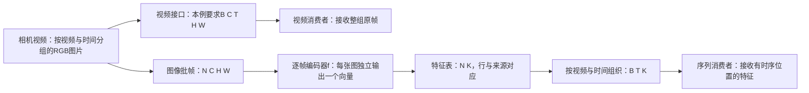

# 视频接口单元 · 完整备课审查版

2026-10-09 · prepared_for_review · 同模型多 Agent 分工。仅交备课成品，第一教学回复为待发送草稿，此时无需作答；没有正式教学、能力裁定或真实进度更新。未读取其他对比备课或聊天。

认知设计先确定目标关系与完整策略，材料据此制作；证据与成品审查据原件核对。重点结果：必要对象可具体指认，布局/合并/逐帧表示与信息/来源/时间/用途分开；从完整保序示范经一个接口的部分承担返回原整体作品，再单独改变行调度。实际教学负担与效果尚未检验。

阅读顺序：认知设计 → 实际材料 → 具体工作与Post → 教师参考 → 支持分支 → 第一回复草稿 → 审查 → 依据。分件及验证记录见同目录README.md；所有来源锚点均保留在分件中。

---

# 视频接口单元：认知设计定案

版本：2。日期：2026-10-09。性质：本次同模型、多子 Agent 备课候选；未正式教学、未新增学习表现、未采用新目标，不修改真实进度。认知设计先定，后续材料据此实例化；内容核验与备课审查不能冒称多模型盲评或真实教学收益。

## 1. 承接什么、最终要做什么

承接 `goals/M0-video-interface-first-20261006-02.md` revision1 的 R1/R2/R3 和同一父单元 EMB-U-M0-VIDEO-20261006-02。最终产物是一份连续的视频接口说明：同一相机输入怎样合法交给给定视频消费者，以及怎样逐帧送入图像编码器、把每帧结果接回给定的序列消费者；说明形状、对象身份、保持项、改变项、恢复条件和不能推断的内容。允许查定义、材料和示范，不要求闭卷、独立实现、用户运行或真实模型效果。

本次重备增加的是原目标所需的解释与支架，不改正式判据。特征、序列消费者是解释原 R3 的自然后续用途；不另立训练视频模型、语义理解、一般可逆编码、远迁移或长期保持验收。

最新真实原件依据：

| 原件 | 可保留的有限支持 | 对本次设计的作用 |
|---|---|---|
| `sessions/2026-10-06-02/raw/M0-video-interface-001-initial.txt` | 已能在给定对照下辨认形状相容、像素身份违例与信息不足 | 不冷启动成轴号/计数微测验 |
| 同会话 `M0-video-interface-002-initial.txt`、`M0-video-interface-002-revision-001.txt` | 有轴交换/B-T 合并认识；曾说合并后“里面的元素也变了” | 明确合并索引与改变内容是两项操作 |
| `sessions/2026-10-07-01/raw/M0-feature-sequence-001-initial.txt` | 行0定位与改写到 `(1,2,d)`，shape不够及需归属条件的局部判断有支持 | 不重复全行帧号定位题；把正确局部放回整体 |
| 同会话 `M0-feature-sequence-001-help-request.txt` | 明确不懂恢复依据、两条路线、组织方式和帧身份保持的含义 | 必须先解释对象和用途，不能继续用未知术语出题 |
| 同会话 `M0-feature-sequence-001-revision-001.txt` | 视频输入按视频/帧顺序、布局整理保持原数值有支持；逐帧与打乱、特征与数值/信息不变混绑 | 先给保序编码轨迹，再单独改变行调度；用同特征不同来源的合法例消除混绑 |

不从短答推断原理/整体已理解，不使用被重置旧轮成绩。状态中 2026-10-08 保序 toy 编码材料仅 `prepared_for_final`；不能据文件存在认定用户已看过。

## 2. 六项分开核对的认知工作

六项是教师组织内容与核对原产物的维度，不是六个必答小测。

| 维度 | 本单元须建立的准确关系 | 可观察的学习者贡献 | 不能与之混绑 |
|---|---|---|---|
| 轴布局 | 轴名是数据坐标角色；改变轴位置时，值随同一对象位置正确对应 | 在接口说明里使轴语义、shape 与一条坐标对应一致 | shape吻合不保证像素身份吻合 |
| B/T 合并为批帧 N | 合并是把 `(b,t)` 重新索引为 `n`，在明确枚举规则下可逆追溯 | 给出对应规则和合法成立条件；说明仍是一帧一行 | 合并本身不计算特征、不打乱、不改像素 |
| 逐帧表示与信息 | 每帧经函数 `f` 产生该帧的一条表示；函数可改变数值、维度、信息 | 说明本例 toy 保留 R/G、丢弃 B；据条件拒绝恢复整张原图 | 有来源标签不等于信息可逆；特征不是帧号 |
| 来源身份 | 问“这个结果来自哪段哪帧”，靠可信生成对应/来源记录回答 | 区分顺序依据和随结果移动的可信 `(b,t)` 标签，并指出缺条件 | 相同/不同特征数值不能可靠识别来源；shape不含来源事实 |
| 时间组织 | 时间位置 `t` 是同一视频内的先后关系；扁平批帧可以暂时不显式分成序列 | 在送序列消费者前按同一视频与正确 `t` 组织；知道 reshape 不读标签 | 来源标签可恢复时间位置，但不自动完成重排；逐帧处理不是打乱 |
| 消费者用途 | 输入契约决定需要整段视频，还是单帧图像，还是逐帧特征序列 | 根据给定消费者要求组织链，解释每处输入为何相容 | 所有视频模型都用 BCTHW、图像编码器自己理解时序、对齐就等于效果好 |

必要语义须在第一次工作前说清：视频片段、帧、通道、空间位置、张量、轴/shape、模型输入、消费者、编码器、特征向量、特征序列、行、来源身份、保序、标签、恢复。采用“恢复来源/分组/顺序”和“恢复原像素”两个完整说法，避免单独说“恢复”让人误会。

对象关系：一段视频含按时间排列的帧；一帧含各空间位置的通道数值；张量用坐标组织这些值。图像编码器 `f` 的输入是一帧，输出该帧的特征。把许多帧排成批只是方便一次处理；若题面规定每帧独立且输出保序，则输出第 n 行对应输入第 n 帧。后续序列消费者收到的是按视频/时间组织的特征；它如何建模内部机制本单元作为黑箱。

## 3. 必须固定的技术契约

原主作品仍为两段视频、每段四帧，每帧2×2位置、三通道；材料负责者回查原件已确认，相机输入 `BTHWC=[2,4,2,2,3]`。不能用解释用小图替换。相机给 `x[b,t,h,w,c]`，形状 `[B,T,H,W,C]`。本例视频消费者明确要求 `[B,C,T,H,W]`，不是所有视频模型的通用事实。

视频线：`y[b,c,t,h,w]=x[b,t,h,w,c]`。值、帧、通道、空间位置保持；改变坐标的书写位置。

图像线：先按语义形成 `[B,T,C,H,W]`，再以 `n=b*T+t`（b在外、t在内、从0编号）形成 `[N,C,H,W]`，N=B*T。于是 `z[n,c,h,w]=x[b,t,h,w,c]`。合并 B/T 不加入图像运算。合法等价路线可接受，不把某段API代码当唯一答案。

编码接口：题面规定 `f` 对每帧独立处理，一帧对应一行，并维持输入行顺序；给输出 `[N,K]`。所有本次主材料统一用 K 表特征长度，避免与 Conv3d 的 D/深度混用；原学习记录的 `[N,D]` 中 D 可在对照说明里注明等同此处 K，不倒改原件。真实模型可有不同批行为，本题契约不是所有模型事实。解释小输入与原作品使用同一 toy 选择规则 `f(I)=[I[0,0,R],I[0,0,G]]`，故原作品除B通道外，其余空间位置也没有进入该特征；这些内容信息与来源身份仍分别判断。

序列接口：消费者要求 `[B,T,K]`，并且位置 `[b,t,:]` 来自该视频的该时间帧。保序、原枚举规则已知、B/T已知、没有缺帧/混合/重复时，可按该规则恢复组织。标签路线要求 `(b,t)` 真实可信、与整行一起移动、完整且唯一；随后按标签组织，而非只换shape。

缺标签并不一定不能恢复：若顺序契约完整可信，可按顺序。缺顺序也不一定不能恢复：可信完整标签可替代。两者都不足时，不能从shape/数值补造来源。两者冲突时先核生成记录，不默认信任某一个。

本单元要保留一般坐标映射说明，不以单个像素检查冒称整批证明。有限代码验证可支持演示行为，不证明所有模型、所有输入或学习者能力。

## 4. 可走通的主线与跨度控制

**E0：用途定位与词义输入。** 说明“同一摄像机资料，要交给两种不同接口；每一步既要排对，也要说清数值和来源发生什么”。直接给对象定义、输入契约和有限路线地图。这里不让学习者猜“帧归属”是什么。

**E1：完整保序示范。** 用另设的解释小输入 B=2、T=2、H=W=1、C=3。明确它是原作品的缩小演示，不是替换原2×4空间数据。让每帧有一组三通道值，例如甲0 `[10,20,30]`、甲1 `[40,50,60]`、乙0 `[10,20,90]`、乙1 `[70,80,100]`。toy `f([R,G,B])=[R,G]`；全部保持行顺序，不在本段加行打乱。连续展示相机组织→视频布局；同一原帧→批帧→特征行→按原枚举恢复为特征序列。每一步只标“输入是什么/操作是什么/输出是什么/保持和改变什么/为何交得给下一处”。甲0和乙0特征相同，来源仍不同；B被丢弃，说明内容恢复与来源恢复分开。toy不是训练模型，也不是语义识别模型。

**E2：桥接到原作品的部分承担。** 从两帧示范回原两段×四帧，保留同样对象、同样接口、同样保序契约和允许资源。AI给各模块输入/输出规格与一个已填示例，给shape查阅，不给所有连接理由。学习者在同一接口说明上补：批帧→逐帧结果→序列消费者之间需要哪项对应与组织，为什么仅 `[8,K]→[2,4,K]` 不是充分理由；指出内容改变与来源保持可同时成立。这里增加规模/综合范围，不同时更换编码函数、打乱规则或新领域。可自然跳过已有支持的轴号操作。

**P1：整体说明。** 对原相机输入与给定两消费者，提供空白接口说明骨架（模块、输入/输出、保持/改变、成立条件），不给转换路线和全套答案；允许引用示范/定义。学习者连续完成两路，不以六个答案数量收束。关键观察是上游输出能否合法进下游、原帧身份是否一路可追溯、内容变化是否被解释。若 E2 已给出这些工作，不另复制一份“整体题”。

**P2：只改变行调度。** 在同一作品明确新增一项：编码后行被重新排列，可信完整 `(b,t)` 标签随整行移动。其他条件保持。学习者修订受影响的组织步骤，保留轴布局/编码内容等未受影响部分；解释何时还能恢复正确序列。随后给局部“标签缺失且顺序未知”的记录缺项，让其在同一说明上标不可确定范围与需要的记录，不额外全行定位微测。可接受不依赖标签的合法替代生成映射。

**收束。** 教师按连续作品核 R1/R2/R3 的实际贡献和帮助条件；讲解已交付与目标支持分开。如果只进行讲解或用户要求暂停，保留同一作品未完成连接；本次备课审查不触发正式教学、评分或进度更新。

这一跨度的控制点是 E2：完整示范与最终作品之间，先撤“连接理由”这一组件，保留定义、规格和数据。不能从一张2帧图片直接跳到自由设计视频模型；也不能把每一步拆成逐题等“继续”。普通原答后必要反馈直接接同一主线，真正需要学习者贡献时才等待。

## 5. Encoding 实际选法与约束映射

已按 SK06 索引定位并读取所选完整包的两载体全文、研究摘录、共同约束、前置/排除、操作、反馈、停止/返回与证据限制。资源统一 `pl-strategies/0.1.0`，卡库来源2.0。R02/R03是同一库两载体，不计两份独立证据。

| 实际采用 | 本题实例化 | 前置/保留的工作 | 限制、替代与返回 |
|---|---|---|---|
| `encoding/S05` 正确范例追踪 | E1完整状态转换，E2只补关键连接的输入、操作、结果及理由 | 教师给可靠路线；词义/接口先可用；学习者实际承担未填连接 | 观看流畅不等执行；当前只借追踪/部分承担，不强制遮住材料和闭卷；已有完整作品可直接审查 |
| `encoding/S09` 局部关系到全局组装 | 先追清布局线和逐帧线，然后核批帧→特征→序列接口，P1端到端说明 | 模块输入输出、成立条件、不变量可用；留下全局连接 | 局部正确不合成整体通过；黑箱仅因接口不足再展开；失败回连接/组织，不无限下钻 |
| `encoding/R04` 条件与替代路径分离 | 保序依据与可信标签是条件化替代路径；shape单独不足；来源保持不推出内容可逆 | 在有限确定模型里比较，仅改变相关条件；信息不足合法 | 不讲概率/因果促进理论作为额外课；条件未知留未知；先补记录而非逼猜答案 |
| `encoding/S08` 组件渐隐，条件分支 | 若新局部工作已正确解释某连接，再移除该处填写示例；其他定义/接口保留 | 必须有该组件的新表现与理由；不能凭旧局部短答或答题轮数撤全部支架 | 失败恢复最相关提示；当前设计不预判已达撤架门槛；目标允许查阅故无强制全撤 |

没有采用“先预测错误→冲突→更新”作为首入口，因为用户明确请求对象解释且当前必要语义要先补齐。直接可靠讲解是必要输入。也没有为“深度”加概念图、压缩稿、额外编码卡；静态状态表和坐标关系足以处理本工作。S07/X02未另外配置，E2一次有理由补全已有S05范围，不凑卡或重复原答。

必要共用条件逐项落地：目标/用途用原Goal；材料由后续材料负责者核验实际值/映射；参考/反馈必须齐备后方可正式开教；学习者剩余操作定位在E2/P1/P2；自主观察仅按真实提示条件解释；未知预算不填分钟；每处允许中断并回同一作品；材料争议先停受影响用途。卡的研究证据只支持邻近方法家族或设计启发，不证明本单元更优或已有效。

## 6. Post 功能按工作落实

三个完整包的前置/排除、必要操作、源正文、`evidence_refs`、帮助、停止、时间和证据限制已读；重复的D07组合/实例化与D06时间段稳定复用，不为相互引用循环重读。

| 实际借用 | 本单元工作与输入 | 观察、反馈与先补输入条件 |
|---|---|---|
| `post/retrieve-relation` | E2/P1连接轴角色、批帧索引、来源、内容和序列消费；对象定义和契约允许开卷 | 补合法中间连接，核两端可用。忘定义先直接给定义；给前提后能连接就继续，恢复本身不属Goal故无闭卷债务。仍不理解关系则最小回E1对应那一段，够用回原接口说明 |
| `post/select-method`，限定借用 | P1据已给消费者契约组织合适转换；P2接受标签重组或拒用无条件reshape/指出信息不足 | 只观察给定接口、候选和近端材料条件下的条件选择/映射/执行，不称广泛无提示选法或远迁移。题面不以“请用标签排序/请reshape”代选拟观察操作；给方法后只保留剩余贡献 |
| `post/conditional-update` | 据E1保序编码与丢B例，修订“逐帧就打乱/数值信息都不变”这一过宽说法；P2行调度改动后只改受影响连接 | 保留“单纯布局整理不改数值”合法旧域；区分新输入相容接入、条件改变和旧规则过概括。不以即时修订声称旧错被擦除/持久更新；参考疑误先核教师内容，不默认学习者错 |

Post与Encoding共用一份作品、一份原答与帮助历史。E2/P1可以合并，P2是原作品条件修订，不能据三个包造三次独立成功。没有加载组合顺序包：本次输入→连接→条件变化的实际顺序已有工作理由，未产生需要比较的检索/生成顺序问题。

## 7. 必要支持分支与返回点

| 实际表现/请求 | 现在给的具体支持 | 局部够用与回同一作品的位置 |
|---|---|---|
| 不知道特征、消费者、来源等说的什么 | 用甲0原帧→toy输出一行→标注“来自甲0”的对象表，直接解释词义及用途 | 能在对象表指清输入/结果/来源后回E2的编码输出接口；不测全词典 |
| 认为逐帧等于打乱 | 先展示E1四帧保序行，直接给“逐帧处理可以维持输入顺序”的反例，确认逐帧运算与行调度是两项独立动作；仅进入P2时再看行调度改动与随行标签 | 能说明“可以逐帧且保序，调度打乱是另加条件”后回E2保序接口；到P2再修组织步骤 |
| 认为特征不同/相同就识别来源 | 用甲0/乙0同RG不同B、不同标签的碰撞例 | 不凭数值定来源；回P1来源依据栏 |
| 认为编码数值和信息都不变 | 对同一帧并排原RGB与toy RG，问能否从RG确定B，给两个合法原输入 | 能说明内容不可逆但来源仍可记录后回P1保持/改变栏 |
| 只写shape或直接按标签reshape | 先展示一个错误顺序下shape仍吻合的已知记录，以及reshape不读标签的具体含义 | 能说出要先确认/组织目标行序再成组后回同一序列接口，不退回Python基础 |
| 局部能说对，整条链接不上 | 只对照最后已填作品中的相邻模块输入输出/条件，找第一处不相容 | 修该接口后继续整条说明；不堆同类局部题 |
| 求完整示范/答案 | 给该处足够完整解释，并注明替代了哪些操作 | 回原作品的尚未完成连接；不机械要求立即复述原答案 |
| 用户少讲/不用图/缩时/暂停 | 保留静态文字对象与必要规格，缩当次覆盖或停在同一作品位置 | 说明实际未做连接，不降Goal、不设逐题继续门 |

所有分支可由一教学入口执行，后台只做准备/核验。正式教学时才按实际展示记录帮助与原答；备课候选不能预写已展示、已答或通过。

## 8. 第一份教学回复的范围规格

本次最终交付另放第一回复成文稿，标“供审查，尚未正式发送”。成文应：简短说目的/同一最终作品/允许查阅；给够用定义；完整展开E1保序示范；实际说明“编码可变内容而来源可保持”“逐帧不要求打乱”；末尾只留一处自然接口承担，例如在仍可看示范时解释哪种信息让序列消费者知道结果来自哪段哪帧，以及为什么这不能恢复B通道。此处是学习者贡献入口，不问“要不要继续”。

第一回复不同时倾倒P2打乱/缺标签/冲突分支及全套教师答案；后续路径已完整备好。若该回复已包含E2关键连接答案，后续观察须限定实际剩余工作，不能把第一回复的讲解倒记为学习者贡献。

## 9. 读取定位与版本

规则已取：本目录AGENTS、state/control当前revision11、state/current当前revision22、MODEL_ENTRY、FRAMEWORK；共享契约；AG0/AG1；SK01入口/goal-design；SK03入口/design-whole/encoding/post-encoding；SK06入口/selection-adaptation。设计与研究相关原段已通过完整资源里的 `source_excerpts` / `research_excerpts` 取得：D05§五实例化、D06恢复/整合/选择/更新/时间、D07组合/实例化；R01 OS07/08/09/10/12、RR09；R04矩阵使用边界；R05§5.3/5.5/7.3/8.1/9.4/10.3/13.1；R06 E11/12/13/15/18/25/35/38/49。未重新核外部论文，不引用为本次效果验证。

实际资源路径均在 `../../personal-learning-suite/resources/strategies/`，SHA256：

| 资源 | SHA256 |
|---|---|
| encoding/S05.json | `75BE952E8BC57AE87FE6D228CF1097F7DCF8DB591987794578324C757FBECA36` |
| encoding/S09.json | `F844542D840596A094784E21C26CF92C03FEFBE0601AAA3816D775C469DEA0E3` |
| encoding/S08.json | `9E4B899AC7AC0D3C5ED0ECD8C00CF17F344A5D5D88E9ECF8920B2E2806D20910` |
| encoding/R04.json | `24606C5326153AFB271A0280CD4FE1439DAE34796AF44D1C8EB667DD027FDDE9` |
| post/retrieve-relation.json | `9A40C98A6EDDEDC06CAB02155AED54480C242F3F7BD2BBF70E116A0C87EC2DBC` |
| post/select-method.json | `B33844944758174619F882A3131A60F3367782FCF88A94E3F2CB00EAB2D022B8` |
| post/conditional-update.json | `DD9FF6021B01147AF7E8D51D610F1E5BA3174CCF7D0061903462F4EC2F4E9874` |
| common-constraints.json | `E217A01AC8E71EAE367CD4132CBC084C5C25D1F2A866341B05CACBA6D15F3026` |

下游交付前需把本规格变成实际题面、连续示范、全部教师参考和备用支持，并核原主作品尺寸、可接受合法多解、各阶段未被代做的工作以及代码/图实际行为；本设计不替代这些材料验收。

---

# 实际材料与连贯示范

版本1；2026-10-09。`prepared / not_displayed`。本文件属于备课测试候选，所有数值是AI为教学构造的数据；不是新采样、用户作品、已发生教学或成绩。按[认知定案](01-cognitive-design.md)实例化S05/S09/R04，不另定认知目标。

## 1. 用途与够用词义

这次的最终作品仍是一份接口说明：同一批相机视频，怎样交给本例视频消费者；怎样拆成单帧交给图像编码器，再把每帧结果交给序列消费者。**消费者**指接收上一模块输出的下一模块；它要求什么对象、坐标和排列，就是它的输入契约。这里用接口看懂连接，不要求学完模型内部或写程序。

| 词与符号 | 本次准确含义 | 在材料中怎样看见 |
|---|---|---|
| 视频片段、帧 | 一段视频由按时间先后排列的图片组成；一张图片是一帧 | 甲0是视频甲在时间位置0的图片；甲1是其下一帧 |
| 通道、空间位置 | 一个RGB像素有R/G/B三个通道值；`(h,w)`定位图内一个像素 | `[11,12,13]`表示同一位置的红11、绿12、蓝13 |
| 张量、轴、布局、shape | 张量是按多坐标组织的数值数组；轴是坐标角色；布局列出轴的顺序；shape列出各轴长度 | `[B,T,H,W,C]`是布局，`[2,4,2,2,3]`是对应长度 |
| 模型输入、接口 | 实际交给模块的数据及其要求的对象/坐标/形状/条件 | 同一个相机输出，要按消费者契约组织后才能交给它 |
| 批帧、行 | 把多段视频的帧列为一个图像批次，帧数记N；特征表的一行对应一帧的结果 | 本题规定先列甲全部帧，再列乙全部帧 |
| 编码器、特征向量 | 编码器是把输入图片变成另一种表示的函数；特征向量是该帧输出的一串数 | 玩具函数仅留下左上像素的R/G，输出两个数 |
| 特征序列 | 属于同一视频的各帧特征按时间位置排成一组 | 序列位置`[b,t,:]`必须来自视频b的帧t |
| 来源身份 | “由哪段视频的哪帧产生”，即本例`(b,t)` | 相同的两个向量仍可分别来自甲0和乙0 |
| 保序 | 输出第i行仍对应输入第i帧；是明确保证，不从“逐帧”一词自动推出 | E1与B都有这一契约 |
| 可信标签 | 单独维护的来源记录`(b,t)`；真实性有生成记录保证，且与整行结果一起移动 | 标签不属于玩具函数输出的两个特征数 |
| 恢复组织与恢复像素 | 前者是把结果放回正确视频/时间位置；后者是重新获得原图的所有通道值 | 仅有乙0的特征和来源记录、未保留原图时，不能补回其蓝值99 |

符号固定：B是视频数，T是每段帧数，C是通道数，H/W是图高/宽，N=B×T是图像批帧数，**K是每帧特征长度**。原材料常用D表示特征长度，本备课统一改名K；角色不变。这里K=2，和某例T=2碰巧相等，不是同一个轴。

所有索引从0开始。`:`表示取该位置的整串特征/通道。`n=b×T+t`是原批帧枚举编号；`i`是当前行的位置。保序时i=n，行被重新调度后两者未必相等。

## 2. 两种用途与三种输入对象

视频消费者这一路接收原图片及其时间组织；逐帧图像编码器接收一张张图片；序列消费者接收的是每帧的**特征**及其时间组织。图像输入`[N,C,H,W]`与编码输出`[N,K]`是两种对象，不能互换。把帧列成N张图像只改变索引组织，不自动计算特征；特征由f计算。逐帧处理可以保序，也可以由系统另加行调度，后者是另一个条件。

本例指定视频接口BCTHW，不声称所有视频模型都使用它。给定接口相容也不证明模型学会动作、能判断杯子运动或具有实际视觉效果。

## 3. E1：另设的小输入，完整保序示范

**缩小输入仅用于看清连接。**它有两段视频、每段两帧、每帧只有一个RGB像素，即B=2、T=2、H=W=1、C=3。原父作品仍为两段×四帧、2×2像素；后面的B恢复原规格。

甲为b=0，乙为b=1。相机布局BTHWC，shape为`[2,2,1,1,3]`。

| 来源 `(b,t)` | 日常名称 | 该帧唯一像素的RGB | 原批帧编号n |
|---|---|---|---:|
| `(0,0)` | 甲0 | `[11,12,13]` | 0 |
| `(0,1)` | 甲1 | `[21,22,23]` | 1 |
| `(1,0)` | 乙0 | `[11,12,99]` | 2 |
| `(1,1)` | 乙1 | `[31,32,33]` | 3 |

**视频线，完整转换。**按消费者契约，将相机BTHWC排成BCTHW，得到`[2,3,2,1,1]`。坐标关系为：

`y[b,c,t,h,w] = x[b,t,h,w,c]`。

例如乙0的蓝值满足`y[1,2,0,0,0] = x[1,0,0,0,2] = 99`。这是同一个像素通道值换一个坐标写法。帧/通道/位置和原值都保持；只改变轴位置。一般映射适用于本批所有合法坐标，这一数值只用于看清它。

**逐帧线，完整转换。**先把相机BTHWC排成BTCHW，shape为`[2,2,3,1,1]`；再按“先甲两帧、后乙两帧”的已知顺序合并B/T，得到NCHW=`[4,3,1,1]`。其对应为：

`z[b×2+t,c,h,w] = x[b,t,h,w,c]`。

合并没有修改RGB，也没有打乱；它只是把`(b,t)`改用一个编号n书写。

本例玩具编码器规定：**每张图独立处理，输出与输入行次序相同**。函数只取该帧左上像素的R/G；因为此处只有一个像素，可直接写`f([R,G,B])=[R,G]`。K=2。

| 当前行i=原编号n | 输入帧 | f的实际输出 `[R,G]` | 独立来源记录，非f输出 |
|---:|---|---|---|
| 0 | 甲0 `[11,12,13]` | `[11,12]` | `(0,0)` |
| 1 | 甲1 `[21,22,23]` | `[21,22]` | `(0,1)` |
| 2 | 乙0 `[11,12,99]` | `[11,12]` | `(1,0)` |
| 3 | 乙1 `[31,32,33]` | `[31,32]` | `(1,1)` |

特征表F的shape为`[4,2]`。由于B/T已知、原枚举规则已知、每帧恰有一行、无混合/缺失/重复且输出保序，序列消费者需要的`[2,2,2]`可以由以下对应得到：

`S[b,t,:] = F[b×2+t,:]`。

| 视频b | 时间0的特征 | 时间1的特征 |
|---|---|---|
| 视频甲，b=0 | `[11,12]`，来自甲0 | `[21,22]`，来自甲1 |
| 视频乙，b=1 | `[11,12]`，来自乙0 | `[31,32]`，来自乙1 |

这里组织回视频，不需要从特征值猜帧号。第2行与第0行输出相同，但顺序对应/来源记录明确指出它们分别来自乙0与甲0。**特征数值不是来源标签。**

另一方面，蓝值13和99都没有进入输出。`[11,12]`既可能来自`[11,12,13]`，也可能来自`[11,12,99]`，因此仅凭该向量与来源标签、未保留原图时，不能确定原来的蓝值。查本示范的输入表可以读到蓝值，那是回查另外保留的原图信息，不是f输出可逆。**来源身份保持和图像信息减少可以同时发生。**本函数恰好复制R/G，真实编码器也可能重新计算这些数值；不得推广成编码总是保值或总是丢信息。

## 4. 同一轨迹的保持/改变表

| 操作 | 对象从什么变成什么 | 保持的内容 | 改变的内容 | 连接成立的条件 |
|---|---|---|---|---|
| BTHWC→BCTHW | 视频图片张量→视频图片张量 | 每个帧/通道/空间位置的像素值 | 坐标书写顺序 | 按轴含义对应；不是只改长度 |
| BTHWC→BTCHW→NCHW | 视频图片→图像批帧 | 图片内容及帧来源 | B/T换为N的索引组织 | 先有合法布局；枚举规则n=bT+t明确 |
| 逐帧f | 图片→特征向量 | 一帧产生哪一行的生成关系 | 本例删除蓝；B中还删除其他像素信息 | 明确逐帧、输出一帧一行及保序契约 |
| NK→BTK | 特征表→特征序列 | 向量本身及其来源对应 | 分组和时间位置显式化 | B/T及保序/来源依据充分；输出接口要求正确位置 |

“元素总数一样”“shape正确”“有标签”分别只说明相应事实，都不能包办整条接口。图像批帧与原图元素数相同；特征表在本例元素数更少；恢复特征分组不补回被f丢弃的像素。

## 5. B：回原父作品的完整数据和契约

原Goal revision1及原第二段题面确认：相机BTHWC=`[2,4,2,2,3]`，B=2、T=4、H=W=2、RGB。以下是为本次备课构造的完整数值实例，不冒充学习者原数据。

每帧是2×2像素：其左上`(h,w)=(0,0)`值如下；其余三个像素在**每一帧**均为右上`(0,1)=[81,82,83]`、左下`(1,0)=[91,92,93]`、右下`(1,1)=[101,102,103]`。这两条信息完整确定本批所有像素。

| 来源 `(b,t)` | 名称 | 左上RGB | n=b×4+t |
|---|---|---|---:|
| `(0,0)` | 甲0 | `[11,12,13]` | 0 |
| `(0,1)` | 甲1 | `[21,22,23]` | 1 |
| `(0,2)` | 甲2 | `[31,32,33]` | 2 |
| `(0,3)` | 甲3 | `[41,42,43]` | 3 |
| `(1,0)` | 乙0 | `[11,12,99]` | 4 |
| `(1,1)` | 乙1 | `[51,52,53]` | 5 |
| `(1,2)` | 乙2 | `[61,62,63]` | 6 |
| `(1,3)` | 乙3 | `[71,72,73]` | 7 |

编码规则不另换：f仍只取每帧左上R/G。A的H=W=1使“左上”就是唯一像素；B回到原2×2时，f忽略另外三个像素，并忽略左上B。逐帧、一帧一行、输出保序、无跨帧混合的契约不变。

| 模块 | 本例给定接口 | 本批shape，允许直接查阅 |
|---|---|---|
| 相机 | BTHWC原RGB图片 | `[2,4,2,2,3]` |
| 视频消费者 | BCTHW原RGB视频 | `[2,3,4,2,2]` |
| 图像编码器输入 | NCHW，一行一张图片 | `[8,3,2,2]` |
| 图像编码器输出 | NK，一行两个特征数 | `[8,2]` |
| 序列消费者 | BTK，位置`[b,t,:]`来自该视频的该帧 | `[2,4,2]` |

这里给shape是支架；学习者主要承担相邻接口的理由、不变量和来源对应，而不是再计算一次2×4。完整B题面、C变化数据及待承担操作见[任务与Post](03-tasks-and-post.md)，完整教师解另见[教师参考](04-teacher-reference.md)。

## 6. 内容依据、核验与未核范围

父规格：`goals/M0-video-interface-first-20261006-02.md` revision1与`questions/visible/M0-video-interface-20261006-02-002-v1.md`。近期原答按01与00证据基础定位；本文件不把旧短答扩为整体支持。

材料依据为明示数组坐标定义、玩具f及消费者契约；一般映射依这些定义推导，所有表项按同一规则核对。完整E1/B/C数据、合法路线、反例和缺项参考可由04审查。静态表/图承担对象与接口连接，没有需要动画的增量。本次没有可执行学习代码、安装或运行；不继承旧教师运行作为本次新运行。

本材料只保证限定接口解释与纸面核验所需内容；不证明用户理解、模型效果、全部真实编码器性质或一般可逆性。备课审查后如正式使用，实际展示、帮助和原答须另按真实发生记录。

---

# Encoding承担、实际题面与Post工作

版本1；2026-10-09；`prepared / not_sent / no_learner_event`。只供备课审查。活动共用一份“视频接口说明”，不另开真实问题编号、目标、进度或成绩。

## 1. 正式使用时的顺序与暴露边界

| 阶段 | 实际给的输入 | 学习者实际承担 | 后续推进 |
|---|---|---|---|
| E0/E1，S05 | 02的词义、用途图、完整四帧保序示范与保持/改变表 | 不以听懂示范计成绩；第一承担直接接B1 | 不另出轴号/帧号小测 |
| B1，S05/S09、关系Post | 原规格、完整B特征表、已填视频模块、允许资料 | 先补“特征表→序列消费者”的一般对应和充分条件；用它说明同特征不同来源 | 原答保留后简短反馈，直接展示B2；不问“要不要继续” |
| B2，E2/P1合并、S09 | 同一份已填作品，补相机/批帧/f输入输出规格 | 只补未完成的上游接口理由、保持/改变与整链说明 | B1结果保留；已同时做完B2则直接进入C |
| C1，R04、限定选用Post | 同一B数据；只改编码后的行调度；可信标签与整行同行移动 | 修订受影响的序列组织步骤，解释采用何依据及其他步骤为何保留 | 先保存再反馈；充分后接同一作品C2缺项栏 |
| C2，条件更新Post | 明确为另一份孤立记录，不保证来自同一批；已知同一f逐帧生成及NK形状 | 保留布局整理的合法规则，限制来源/时间与像素恢复的结论，指出必要记录 | 按整体作品收束，不以题数或三包成功数收束 |

查阅/短说明/完整示范都是允许资源。**查资料不是失败，形状表不用默写，程序不必写或运行。**学习者可用自然语言、表格、公式；只写卡住的连接也可。若请求纯讲解、缩时或暂停，按05支持返回，不硬加“证明自己会”的任务。

S08只在新原答准确说明某个组件后，撤该组件填写样例；不凭轮数撤去所有支架。B2复用B1原产物，后续修订保留先后及实际帮助。

## 2. B1题面：在原作品先接好一个接口

仍是原父作品：两段视频、每段四帧、每帧2×2的RGB图，相机BTHWC=`[2,4,2,2,3]`。数据见02§5完整表。f只取每帧左上R/G，每帧独立、一帧对应一行、输出与输入保序。帧输入按“甲0、甲1、甲2、甲3、乙0、乙1、乙2、乙3”排列，没有跨帧混合、缺行或重复。

编码完成后得到F，NK=`[8,2]`：

| 当前行i | F该行的两个数 |
|---:|---|
| 0 | `[11,12]` |
| 1 | `[21,22]` |
| 2 | `[31,32]` |
| 3 | `[41,42]` |
| 4 | `[11,12]` |
| 5 | `[51,52]` |
| 6 | `[61,62]` |
| 7 | `[71,72]` |

下一序列消费者要求BTK=`[2,4,2]`，且位置`[b,t,:]`来自视频b的时间帧t。甲为b=0，乙为b=1，所有索引从0开始。

先在同一作品填这一行，不必从头重写：

| 已给/待补模块 | 输入→输出 | 操作/对应 | 保持与改变 | 成立条件 |
|---|---|---|---|---|
| AI已填：视频接口 | x BTHWC `[2,4,2,2,3]`→y BCTHW `[2,3,4,2,2]` | `y[b,c,t,h,w]=x[b,t,h,w,c]` | 保持原帧/通道/位置/像素值，改变轴位置 | 本例消费者要求BCTHW；按轴意义重排 |
| 待补：特征表→特征序列 | F NK `[8,2]`→S BTK `[2,4,2]` | **写出适用于所有b/t的对应，或同义文字规则** | **说明向量与来源怎样保持、组织怎样改变** | **写清这条对应依据；shape本身够不够** |

甲0与乙0都输出`[11,12]`。请把这件事放进你的接口理由：你的组织依据怎样使两行各回其来源；该依据为什么不能从`[11,12]`补出每帧原来的蓝值。这是一处连续接口承担，不要求再逐帧报八个行号。

可查完整E1示范与定义；可以直接说不确定哪一处。提交后若还在等待，可在这份接口行旁圈出你依赖的记录或保证；做完即可停，回复到达后回到这里。

## 3. B2题面：补同一作品的上游，连接整链

保留刚才已经写好的视频接口与F→S这一行。现在把下面两行补入**同一份接口说明**，无需重复原答案：

| 待补模块 | 已给输入→输出 | 学习者要补的连接 |
|---|---|---|
| 相机→图像批帧 | x BTHWC `[2,4,2,2,3]`→z NCHW `[8,3,2,2]` | 写一条合法组织路线；说明哪一步重排轴，哪一步合并B/T，以及每张图怎样追溯来源；用一般对应或同义规则覆盖全批 |
| 图像批帧→特征表 | z NCHW `[8,3,2,2]`→F NK `[8,2]` | 说明f做什么、逐帧与行次序的关系、内容保持/改变和来源对应；解释此箭头为什么不是一次纯shape重组 |

最后沿已有四行核对：相机→视频消费者，以及相机→图像批帧→特征→序列消费者。用一段连贯说明让读者知道**每个模块接收什么对象、上游输出为何够给下游、来源一路依据什么**。可以引用已填视频模块和B1，不要求再算shape或抄表。

在这份说明中保留这条合法规则：“按正确坐标做布局整理或合法B/T合并，可以保持原像素值。”将“逐帧就会打乱，数值和信息都不变”改为适合本例的有限说法；用你已完成的连接解释即可，不另交一篇概念短文。

可查02所有材料、B1自己的作品和可靠资料；代码可选，不作为当前验收。提交后若还在等待，可沿已有箭头圈出第一处自己不能解释的连接；做完即可停，回复到达后回到这里。

## 4. C1题面：只改变编码后的行调度

沿用完整B作品，所有图片、f、B/T/K、消费者接口与逐帧独立生成均不变。**现在新增一件事：编码完成后，结果整行重新排列。**可信来源标签由生成过程独立维护，与该整行一起移动；它不是f输出的两个特征数。标签完整唯一，覆盖本批每个`(b,t)`各一次，没有丢行、跨帧混合或伪标签。

| 当前行i | 单独维护的可信来源 `(b,t)` | 该行特征 |
|---:|---|---|
| 0 | `(0,3)` | `[41,42]` |
| 1 | `(1,2)` | `[61,62]` |
| 2 | `(0,1)` | `[21,22]` |
| 3 | `(1,0)` | `[11,12]` |
| 4 | `(0,0)` | `[11,12]` |
| 5 | `(1,3)` | `[71,72]` |
| 6 | `(0,2)` | `[31,32]` |
| 7 | `(1,1)` | `[51,52]` |

序列消费者仍要求BTK=`[2,4,2]`，其中`[b,t,:]`来自该视频的该帧。**修订同一作品的受影响步骤**：你将怎样把这份记录交给序列消费者，依据是什么；原先哪些连接仍可保留，哪些条件不再能沿用？用文字、映射、表格或合法实现均可。只把`[8,2]`改成`[2,4,2]`能保证要求吗？说明一个具体对应作为核查，整体理由仍须适用于全表。

不要逐个重做八道行号题。可查02定义和你自己的B作品；题面不指定排序/赋值/API，让你在给定条件下选择组织方法。提交后若还在等待，可在原作品上标记你实际改动的箭头；做完即可停，回复到达后回到这里。

## 5. C2题面：来源记录不足时，限制结论

另有一份孤立特征记录，**不保证来自B那批视频，也没有可与原输入匹配的生成记录**。已知仍由本例f逐帧、一帧一行产生，shape为NK=`[8,2]`；不知道B/T及逐视频长度，没有来源标签、输入枚举规则或输出保序保证，也没有图像原件与特征到来源的字典。

把它放进同一作品的“信息不足”栏：目前能确定什么；能否唯一确定所属视频和时间位置并交出正确BTK；还缺哪些记录或保证。若之后只补充“B=2、T=4”，结论是否已经足够？在已知由本例f产生的条件下，若想恢复原图片的全部RGB，f还带来什么不同限制？

不要从八行、两个特征或教学例子里某种数字规律猜帧号，也不要将B的数据默认当这份记录的来源。指出无法确定的范围本身是合格工作。

可查已给定义和自己作品。提交后若还在等待，可把“组织未知”与“像素被f删除”分别标到同一说明里；做完即可停，回复到达后回到这里。

## 6. Post用途与结束规则

关系Post在B1/B2借助允许材料把输入/输出、索引、来源和信息变化连接起来；不把忘一个符号设为闭卷缺陷。限定选用Post在C1看条件下的组织与拒用；方法若由支持分支直接给出，后续只评价仍由学习者承担的部分。条件更新Post在B2/C保留布局保值的合法范围，修订其外的过宽陈述；不声称即时修订已形成长期保持。

教师依据同一连续作品、原答、实际帮助和修订顺序核对R1/R2/R3；只答B1、观看E1、运行AI代码或完成C行号定位，都不自动完成整条理解。整体解释够用即可收束，不再另加一份重复大题。暂停/缩时则留同一作品未完成接口，不安排额外复习日期或新负担。当前备课没有执行任何这些教学或评价动作。

---

# 教师参考、合法多解与反馈边界

版本1；2026-10-09；`prepared / teacher_reference / not_displayed`。本文件供教师与备课审查者使用，不能整份作为B/C初始输入。B/C完整题面见03；输入/f/图表见02。所有结论只核本题明示契约，不构成当前学习者评价。

## 1. 共同参考边界

一般坐标推导负责覆盖全批；一个数值坐标是示例与反例，不替代整体证明。shape正确是必要相容项，完整对应与条件还须成立。所有索引从0，甲b=0、乙b=1；原T=4，N=8，K=2。

f本题为每帧左上R/G选择器，没有训练，也没有语义识别。保序是题面另给保证；标签来自独立的生成/来源记录，不是f的两个输出数。合法替代来源依据可以是可信映射表、稳定ID及其生成关联、原枚举规则等；必须足够定位该批的每条结果，不能从数值猜标签。

只凭输出特征与来源标签不能补回未保留的原RGB；本材料另保存完整输入，当然可以回查原图。教师不将“无法从特征逆推”和“无法从所有已有资料获得”混为一谈。T轴显式化使序列消费者有合约要求的时间位置，不证明它实际会利用时序或效果良好。

## 2. E1完整示范核验

相机shape `[2,2,1,1,3]`，共12个通道数。视频接口 `[2,3,2,1,1]`与批帧 `[4,3,1,1]`均仍12个数；像素映射分别为02的y与z规则。f输出四行`[11,12]、[21,22]、[11,12]、[31,32]`，shape `[4,2]`，共8个数。序列 `[2,2,2]`仍是这些8个特征数，按视频甲/乙分组，不恢复蓝值。

甲0与乙0输出相同，但来源分别`(0,0)`与`(1,0)`；反推蓝值存在多个合法输入，f非一一对应。该反例确实证明这个f不能由其输出唯一恢复所有原RGB；不能据此证明所有编码器必然有损。

E1已提供全路线、枚举、编码操作和保持/改变解释。复述或照做只能支持这些输入条件下追踪，不记为此前独立发现。第一回复在原T=4上开启B1，属于近端接口应用，不声称广泛无提示选法。

## 3. B1参考：F→S的来源与组织

原行次序等于原枚举n=b×4+t，所以：

`S[b,t,:] = F[b×4+t,:]`，b取0/1，t取0/1/2/3。

| 目标视频 | t=0 | t=1 | t=2 | t=3 |
|---|---|---|---|---|
| 甲，b=0 | `[11,12]` | `[21,22]` | `[31,32]` | `[41,42]` |
| 乙，b=1 | `[11,12]` | `[51,52]` | `[61,62]` | `[71,72]` |

对应充分依据是：已知本批B=2/T=4，输入确按该枚举，一帧一行，无跨帧混合/缺行/重复，输出保序，而且消费者要求位置`[b,t,:]`对应该帧。该条件下，将前四行成甲、后四行成乙，在各组保留次序，reshape式重组相容。**合法重组来自这些依据，不能单由8×2=2×4×2推出。**

特征数不变，只使B/T组和时间位置显式。第0行与第4行虽然都是`[11,12]`，前者按规则来自甲0，后者来自乙0；无需辨别数值来定来源。来源记录不能将f删除的蓝与其他像素变回来；查原输入表是使用另外保存的信息。

合法多解：两层视频/时间循环的赋位描述；先分成前/后四行再组内保序；明示同一映射的表格；合法语言实现；先保留显式可信来源记录再放入每个目标位置。一般公式不是必写形式，文字只要覆盖所有行和条件即可。B1题已给保序保证，不强求加标签或采用特定API。

有限判断与反馈：

| 原产物情况 | 必要反馈 | 下一动作与边界 |
|---|---|---|
| 一般对应、保序条件、内容/来源边界均相容 | 确认“这段接口按保序依据接上，向量相同仍按来源位置分开” | 直接接B2上游未完成行；不再帧号微测 |
| 只写shape或“reshape就行” | 指明“尺寸能装下；还要写结果第n行来自谁，才能给时间位置” | 补原枚举/保序条件后回同一行；不诊断基础全不会 |
| 通过向量相同断定两帧同来源 | 用甲0/乙0碰撞指出来源不能由数值判定 | 调用05来源分支，回来源依据栏 |
| 认为保住来源就能逆推蓝 | 区分回查原输入与由F/标签逆推 | 调用05信息分支，回保持/改变栏 |

## 4. B2/P1完整整体参考

两条合法数据流为：

**视频线**：x BTHWC `[2,4,2,2,3]`→y BCTHW `[2,3,4,2,2]`，关系`y[b,c,t,h,w]=x[b,t,h,w,c]`。C轴移到T前，值仍对应原视频、原帧、原通道与原空间位置。

**逐帧线**：x BTHWC→u BTCHW `[2,4,3,2,2]`→z NCHW `[8,3,2,2]`→F NK `[8,2]`→S BTK `[2,4,2]`。

| 模块连接 | 一般参考对应与理由 | 保持/改变与成立条件 |
|---|---|---|
| x→u | `u[b,t,c,h,w]=x[b,t,h,w,c]` | 按轴角色重排；保持原像素对应和值 |
| u→z | `z[b×4+t,c,h,w]=u[b,t,c,h,w]` | B/T已相邻；按b在外、t在内合并为N，内容不计算、不打乱 |
| z→F | `F[n,:]=[z[n,0,0,0],z[n,1,0,0]]` | 每张图独立选左上R/G；输出行对应输入帧n；蓝及其他位置未进入输出 |
| F→S | `S[b,t,:]=F[b×4+t,:]` | 用B1充分依据恢复特征分组/时间，保留向量而非恢复原图 |

联立图像支线可得：

`S[b,t,:] = [x[b,t,0,0,0], x[b,t,0,0,1]]`。

这是一条从原帧到序列位置的全批对应。视频支线仍保留同一原帧的全部RGB和空间位置；特征支线每个位置只收到同一原帧的两个特征数，两者的表示对象不同，来源可同样可追溯。

原输入共有2×4×2×2×3=96个通道数。视频与批帧仍96个；f只输出8×2=16个。这里不仅丢左上B，还丢另外三个像素的所有通道。元素数的改变来自本f，而不是B/T合并。K与C也不是可直接互换的轴：C是原颜色通道，K是选择器输出的特征坐标。

合法等价路线：先将BTHWC按枚举合并成NHWC=`[8,2,2,3]`，再按颜色/空间角色重排成NCHW=`[8,3,2,2]`。其总体映射仍是`z[b×4+t,c,h,w]=x[b,t,h,w,c]`，应接受。逐帧直接遍历x并产生特征，只要交给图像输入时符合NCHW契约、覆盖完整来源映射，也可作为等价描述；不能因教师先重排再合并而拒绝。

不能接受：直接把BTHWC按当前逻辑元素次序换成NCHW尺寸，却没有通道/位置映射依据；把视频接口BCTHW中的B/T当作相邻轴无条件合并；用NK特征表当NCHW图片输入；把合并叫做f；说图像编码器自己知道时序；因shape对就声称实际视觉性能。

条件更新的够用陈述示例：“单纯布局重排/合法合并保持像素值；逐帧只说明每张图单独处理，是否打乱另看调度。本题编码保序但取R/G，改变表示并删除其他信息。来源靠输入与输出对应继续维护，不靠向量内容识别。”措辞无需一致；保留规则的合法旧域、修订过宽域即可。

若B1已形成正确F→S，B2不再要求重答该行。若B2一次完整覆盖两路线与f/来源关系，即可直接接C。完整AI示范若应请求展示，其替代的实现/组织理由不归为学习者独立贡献；可保留尚未被代做的比较与条件修订。

## 5. C1参考：行调度变化后的局部修订

C只新增“编码后整行置换，可信完整标签同行移动”。原图片→批帧、f逐帧生成及f丢弃信息等仍成立。**失效的是当前行i等于原枚举n的保证**，不是所有原接口。

可信标签给出`p(i)=(b_i,t_i)`。合法组织方法为：

对每个当前行i，将它的整个向量放入`目标序列[b_i,t_i,:]`。

或者先按标签中的b、t组织成原枚举次序，再成BTK。两种路线在本题完整唯一标签条件下等价。标签不可信/不完整/冲突时不能默认执行完整恢复；本题C1已经保证这些条件，不另造异常考试。

若用“目标枚举次序读取当前哪行”表示，甲0、甲1、甲2、甲3、乙0、乙1、乙2、乙3应读取当前行：

`[4,2,6,0,3,7,1,5]`。

恢复的S与B1参考表相同。例：当前行1标签`(1,2)`，特征`[61,62]`，应去`S[1,2,:]`。当前行3与4虽然都`[11,12]`，标签分别`(1,0)`与`(0,0)`，分别去乙0与甲0；这些标签不是从向量计算出来的。

直接按当前行次序reshape会把当前行0的`[41,42]`放进`S[0,0,:]`，但标签明示它来自甲3；shape仍为`[2,4,2]`，来源/时间位置已经错了。此具体违例足够反驳这个方法在此记录上的正确性；完整合法方案再由上面的全行映射及完整唯一标签条件保证。

接受的替代：可信行置换逆映射、记录稳定ID并可信查表到`(b,t)`、利用明确生成次序记录复原，而不限“按标签排序”。不同实现/文字形式需说明来源依据覆盖每行。若有人说原先明示的置换可以逆转，属于合法路线；若只是根据特征大小排序，则数据没有保证该大小与时序相同，拒绝其一般正确性。

简短反馈边界：若只给一个行定位正确，保留局部支持但整体还需组织规则，不继续同类定位题。若全行规则正确而原作品上游未解释，回首个缺的接口；不能据C恢复成功扩判两条路线整体通过。若教师已明示“按标签放入”，后续是应用支持，不再称自行选择此方法。

## 6. C2参考：孤立记录与信息不足

已知本例f逐帧、一帧一行生成且NK=`[8,2]`，可确定：有8个单帧输出，每行两个左上R/G特征数；N=8、K=2。不能确定来源批、B/T、每段长度、各行归属、时间位置、生成对应或是否保序。可能组织有2×4、4×2、1×8或不等长序列，不能从N唯一分解语义。

即使补B=2/T=4，也只是确定了目标的组数/长度；没有行到帧的可信对应，多个行组织仍相容，不能据此唯一交出正确序列。需要确认同一批身份与来源映射；这可由B/T和可靠原枚举+保序生成契约提供，或由可信完整唯一标签/等价来源记录提供。不是机械要求同时补齐所有替代依据。

题面明确不是保证同一B输入且无原图/字典，不能拿B的特征数字或大小人为匹配帧名。若以后取得可核同批原输入、确定f和足够生成/输出对应，可重新讨论它能恢复哪一部分；当前没有这些条件。存在相同输出时，单凭向量仍不能唯一识别来源；即使某些输出偶然唯一，未建立对应规则也不能推广为通用识别方法。

像素恢复是另一个问题：即使来源与顺序补齐，本f也未输出蓝/其他像素，单靠向量与标签无法唯一恢复原图；另保留的原图可回查，不是f逆变换。

判断与反馈：明确“不能确定”并给关键缺项/替代充分条件是合格判断，不诊断成没有理解任何知识。不要求罗列所有可能B/T组合或全称证明。若把标签缺失一概说不可恢复，给“仍有可信保序和枚举”的合法域；若说shape足够，给“组数/长度与行归属是不同信息”一句必要反馈，回同一不足栏。

## 7. 整体核对与合法结束

核对同一作品四项连续事实：原相机到两种输入接口相容；批帧到每帧结果的对象和条件清楚；特征来源到时间位置有充分依据；保持/改变、信息不足和条件变化界限准确。各项必须按真实贡献与帮助解释，不能以“六维全部说到”“做完四题”或多个Agent同意设新通过门槛。

R1/R2/R3沿原Goal有限判据。视频模块本次已经由AI填，引用它不记为自主路线发现；B1/B2/C不同工作也不造多次独立成功。充分可有限收束；暂停时记录未完成连接；纯讲解结束时不虚构新表现。G0、独立代码实现、用户运行、训练、视觉效果、延迟保持与远迁移都不由本作业裁定。

本次核验是同模型内子Agent分工审查，不是多模型盲评。材料代回/全坐标推导支持本题正确性；无PyTorch/教师程序新运行，不说测试已通过。

---

# 必要支持分支：触发、实际解释、够用与回整体

版本1；2026-10-09；`prepared / backup / not_displayed`。只供备课审查；未观测到新原答，不预先调用。每条分支返回同一B/C接口作品；当前材料问题先修教师材料，不默认学习者错。

## 1. 词义仍不可用

**触发：**明确说不懂“编码器、消费者、来源、序列”具体指什么，或把输入图片/输出向量当同一个对象。

**可直接给的替代解释：**“看甲0这一张图，左上RGB是`[11,12,13]`。f是处理这张图的模块；它输出`[11,12]`，这两个数叫本例的特征向量。下一模块若只接收图像，要给它原图NCHW；若它接收各帧特征随时间排成的一组，要给它BTK。‘来源’只是在说这行结果由甲0产生，不是这两个数的含义；‘消费者’就是接收这些数据的下一模块。”

**够用/返回：**能在当前对象表中指清“原图→f→一行结果→来源甲0→下一输入”即可回B1/B2当前缺的箭头，不问全词典，也不另测轴数。支持已给输入/结果名称和关系，后续只能观察仍由学习者补的连接。

## 2. 逐帧仍被说成打乱

**触发：**“逐帧就是先打乱”“图像模型这一路必定靠乱序标签”；或根据多帧独立处理推断次序变化。

**B阶段直接给的反例：**“这里f依次处理甲0、甲1、乙0、乙1；输出依次是甲0的`[11,12]`、甲1的`[21,22]`、乙0的`[11,12]`、乙1的`[31,32]`。每张图单独处理，同时顺序一直保持。‘单独处理每张图’与‘调换结果行的位置’是两项动作，前者不要求后者。”

**够用/返回：**能解释本例逐帧且保序就回B2的f/来源条件；不在B阶段提前给C的标签排序答案。若已到C，只补“当前是编码完成后另做调度；f原生成关系保留，当前位置不再等于原编号”，再回C修订的箭头。

## 3. 特征值被用作帧号或来源身份证

**触发：**相同特征被断为同一帧、不同特征被断为不同视频；用数值大小猜顺序；说“特征向量识别出是哪帧”。

**可直接给的碰撞例：**“甲0原RGB`[11,12,13]`，乙0原RGB`[11,12,99]`。本f都输出`[11,12]`。它们来自不同视频，但向量相同。来源要由生成时哪个输入产生哪行、可靠顺序或独立来源记录说明；这两个数没有帧号字段。”

**够用/返回：**不凭向量内容定来源，并能说当前可用哪项依据，就回B1来源栏/C1映射。不追加多个同构碰撞题。若用户提出某真实模型可能输出ID，说明那需要另给可信ID/生成映射契约，本例没有；不擅自扩大领域。

## 4. 编码被认为信息不变或标签可补像素

**触发：**说纯布局整理与f都“只是改形状”；把来源保持解释为图像内容可逆；把记录来源当保存全部RGB。

**可直接给的解释：**“甲0输入`[11,12,13]`，乙0输入`[11,12,99]`，f的输出都只有`[11,12]`。没保留原图时，两个输出数不能告诉你蓝是13还是99。来源记录可以告诉你‘来自甲0’或‘来自乙0’，但记录这句话没有保存蓝数值。本材料还能查输入表，是因为原输入另有保存，不是f把蓝还原了。B回到2×2图后，还忽略了另外三个像素。”

**够用/返回：**能分清像素变化/信息删减与来源对应后，回B2保持/改变栏或C2限制栏。若用户已经准确给出此区别，直接沿主线，不要求重述全例。不推广“所有编码器都丢信息”或“所有编码器都改变每个数值”。

## 5. 只按shape或标签换shape

**触发：**只写`[8,2]→[2,4,2]`；认为reshape会读取标签；缺来源条件却肯定顺序正确。

**B阶段够用解释：**“shape说明装成两组、每组四个向量是可行的。但要说明第一组为何真是甲、组内位置为何对应时间。当前题面给了输入枚举与输出保序，写出这个对应才是理由。”

**C阶段的具体反例：**“当前行0贴的是甲3标签，向量`[41,42]`。只按现行行次序成两组，第一行会落到甲0位置；尺寸对了，来源错了。shape重组不读取‘甲3’这个外部标签。你需要先使目标位置与可信来源相符，再交给序列消费者；你可以选排序、直接放到目标格子或可信逆映射。”

**够用/返回：**B能补全行对应及条件；C能给全行组织规则，且知道标签/当前位置不同，即回当前序列接口。这里最后一句已给组织候选，调用后选用证据限定为这些帮助下的采用/执行，不称此前自主选择。无需回Python的import、循环基础或把每行拆成题。

## 6. 局部正确，整链仍接不上

**触发：**能解释碰撞/丢蓝，但接口说明中把NK送给图像输入；或缺一个箭头、保持/改变混在错误阶段。

**具体支持方式：**只看当前作品的相邻两行：“上一行现在输出的对象是什么？下一模块要求图片还是特征？这里已有`[8,3,2,2]`图片批，经过f才成为`[8,2]`特征表。把这两个接口分开，再沿你已正确写出的F→S继续。”若问题发生在相机→批帧，只给“原BTHWC先使C在每帧内的通道位置，再按已知b/t枚举合并”，不重新讲整章。

**够用/返回：**修正首个不相容接口，并使前后相接，就回整链末端；不追加整套基础测验。不强求某个API序列；合法等价路线按04接受。

## 7. 标签缺失被一概判不可恢复，或缺依据被硬猜

**触发：**“没标签就一定不行”；“既有8行所以2×4”；保序与标签冲突时仍盲选一个。

**可直接给的条件解释：**“若这批确按甲四帧→乙四帧生成，输出也保证保序，即使没有标签，也能按该规则组织。若次序未知但来源标签真实完整，就能按来源组织。若两种依据都不足，只有8行不能告诉你每行归属。若两种记录冲突，先查生成/调度记录，不把冲突硬当一种正常情况。”

**够用/返回：**说清当前是充分顺序依据、充分标签依据还是不足/冲突，回C相应条件栏。冲突说明是备用语义支持，不新增必须通过的异常情境。C2另记录已知同f生成与未知来源，不将全部属性都判未知。

## 8. 求完整答案、少讲、换形式、缩时或暂停

**触发：**直接请求示范/答案；不想看图；只想听讲；时间不足或暂停。

**实际替代：**需要完整示范时展示04相应行的完整解释；说明“这个组织操作现在已由示范给出，后续只保留你还未完成的连接”。不用图时给同一文字路线：“相机原图片→符合图像接口的批帧→f逐帧特征→按来源与时间组织→序列消费者”，并保留02数值表及坐标依据。缩时优先只完成当前有价值的接口，再说明尚未完成的上游/条件修订；暂停停在最后可信作品，不另发待答小题。

**够用/返回：**纯讲解可以可靠结束，不强迫立即复述。若继续同一作品，接上实际未完成行；不以新基础题补偿暂停，不改原Goal或新增复习队列。预算与设备未知保留未知。

正式教学才记录本次实际用过哪条帮助、原答和修订；所有备用文本当前只是prepared。普通原答保存读回后，必要反馈直接接已备下一工作；真正需要用户贡献时才等待，不设置逐题“继续”开关。

---

# 第一份教学回复草稿

版本1；2026-10-09；`prepared / not_sent / not_formal_teaching`。下文是若以后正式采用时的第一回复成文稿，只供本次备课审查；本次没有向学习者发起其末尾任务，没有新原答、评分或进度更新。标记后的正文可作为完整第一回复，不将教师参考或C分支同时展示。

---

这段接着同一份视频接口说明，先把**图片怎样成为每帧特征、来源怎样继续对应**连起来。可以看着材料用文字或式子回答，不需要写程序。

一段视频包含按时间排列的一张张图片，一张图片就是一帧。RGB图片每个像素有红、绿、蓝三个值。“模型输入”是实际交给一个模块的数据；“消费者”是接收上一模块输出的下一模块。它要求图片还是特征、怎样分组和排列，决定我们要怎样接这份数据。

同一相机资料可以走两路：

- 本例视频消费者接收一组组原图片，要求`[B,C,T,H,W]`。B是视频数，T是每段帧数，C是RGB通道，H/W是高/宽。
- 本例图像编码器接收一张张图片，要求`[N,C,H,W]`，N是总帧数。它对每帧输出一串数，叫该帧的特征向量。把这些向量按所属视频和时间位置排成组，才成为后面的特征序列`[B,T,K]`；K是一个向量有几个数。

图像输入和特征输出是两种对象。这里的接口由题目给定；视频模型并不都固定使用同一种布局。

先看一个完整小示范：**两段视频、每段两帧，每帧只有一个像素**。它是缩小解释，原作品的两段×四帧、2×2像素规格保留。甲记b=0，乙记b=1，索引从0开始。

| 来源 `(b,t)` | 帧 | 唯一像素RGB |
|---|---|---|
| `(0,0)` | 甲0 | `[11,12,13]` |
| `(0,1)` | 甲1 | `[21,22,23]` |
| `(1,0)` | 乙0 | `[11,12,99]` |
| `(1,1)` | 乙1 | `[31,32,33]` |

字母列表写的是各轴的排列顺序，shape数字写的是各轴的长度。把相机数组记为x，给视频消费者的数组记为y：相机按`[B,T,H,W,C]`组织，shape为`[2,2,1,1,3]`；视频接口按轴含义排成`[B,C,T,H,W]=[2,3,2,1,1]`：

`y[b,c,t,h,w]=x[b,t,h,w,c]`。

例如乙0蓝值仍是99，只是坐标换成`y[1,2,0,0,0]`。原图片的值、来源、颜色和空间位置保持。

另一条路线先排成`[B,T,C,H,W]=[2,2,3,1,1]`，再把B/T按“甲0、甲1、乙0、乙1”合成图像批帧`[N,C,H,W]=[4,3,1,1]`。原编号为`n=b×2+t`。**这一步只是重新编号和组织图片，还没有计算特征，也没有打乱。**

现在给一个简单的玩具编码器f：每张图分别取左上像素的红、绿，输出`[R,G]`；本小图只有一个像素，所以`f([R,G,B])=[R,G]`。题目另保证输出与输入保序，一帧恰有一行，不跨帧混合。

| 当前行i=原编号n | 输入来源 | 输出特征F | 来源记录，非特征数 |
|---:|---|---|---|
| 0 | 甲0 | `[11,12]` | `(0,0)` |
| 1 | 甲1 | `[21,22]` | `(0,1)` |
| 2 | 乙0 | `[11,12]` | `(1,0)` |
| 3 | 乙1 | `[31,32]` | `(1,1)` |

把编码后的特征表记为F，把按视频与时间排好的特征序列记为S；冒号`:`表示取该位置的整串特征。编码输出现在是`[N,K]=[4,2]`。知道输入枚举、B/T和输出保序，就能用`S[b,t,:]=F[b×2+t,:]`给序列消费者：甲收到`[[11,12],[21,22]]`，乙收到`[[11,12],[31,32]]`，shape为`[2,2,2]`。最后一个2是特征长度K，不是时间T；这里长度碰巧相等。

“来源身份”问的是结果由哪段视频的哪帧产生。甲0与乙0特征相同，来源仍不同；上述生成对应能区分它们，**向量本身没有帧号字段**。标签若使用，是另外维护的来源记录，不由这两个特征数自动产生。

“恢复特征组织”是把结果放到正确视频/时间位置；“恢复原像素”是得到原RGB，两者不同。这个f没有输出蓝值：只凭向量与来源记录、未保留原图时，不能确定蓝是13还是99。这里查表可以读到蓝，是因为我们另外保留了原输入。**本例一直逐帧且保序，同时图像信息已经减少。**

现在把这条连接回到原作品，先只补其中一段：原相机仍是`[B,T,H,W,C]=[2,4,2,2,3]`。f规则仍取左上R/G。输入按“甲0、甲1、甲2、甲3、乙0、乙1、乙2、乙3”排列，输出保序、每帧一行，没有缺行或混合。编码后的F为：

| 当前行i | 特征 |
|---:|---|
| 0 | `[11,12]` |
| 1 | `[21,22]` |
| 2 | `[31,32]` |
| 3 | `[41,42]` |
| 4 | `[11,12]` |
| 5 | `[51,52]` |
| 6 | `[61,62]` |
| 7 | `[71,72]` |

同一作品的视频接口已经有这一行：`y[b,c,t,h,w]=x[b,t,h,w,c]`，`[2,4,2,2,3]→[2,3,4,2,2]`，按轴对应保持原像素。现在序列消费者要求`[B,T,K]=[2,4,2]`，位置`[b,t,:]`必须来自该视频的该帧。

请在这份接口说明先补**“F `[8,2]`→S `[2,4,2]`”**这一段：写出适用于所有b/t的对应或同义组织规则，说明它依据哪些记录/保证；把甲0与乙0的相同向量各放回来源，并在理由里区分“来源能对应”与“只凭特征不能补原蓝值”。shape可直接查，不必逐帧报八个行号或重述全部示范。

可以只写卡住的连接。提交后若还在等待，可在这段说明旁圈出你依赖的记录或保证；做完即可停，回复到达后回到这里。

---

# 本次视频接口备课的语义与任务审查

日期：2026-10-09。审查报告版本1，状态：修后回查完成。**结论：本次00—06在原Goal范围内作为备课候选可用；没有尚未修复的P1/P2主线阻塞。**必要语义、完整示范、原作品承担、条件变化、教师参考和支持返回已经落成。当前仍是prepared，不触发正式教学、进度或能力结论。

审查者为同一默认模型的分工子 Agent；已读历史事件和备课设计，非多模型、非盲评。本审查核材料正确性及用途资格，不证明实际教学收益，不增加学习事件、能力支持、进度或排期。只写本文件；未读其他 preparation-tests 目录或另外两个同提示词聊天。

## 1. 取得的依据与当前范围

已读取本目录入口、control revision11、current revision22、MODEL_ENTRY、FRAMEWORK；共享契约、SK00/session-entry、AG0、AG3、SK04/evidence-rules/product-review、design-whole、Post 功能入口和 INTERACTION。相关入口／专业规则的框架指纹逐项与 manifest 相符。

原目标为 `goals/M0-video-interface-first-20261006-02.md` revision1，父单元为 `EMB-U-M0-VIDEO-20261006-02`。回查 2026-10-06-02 的三份原答、2026-10-07-01 的初答／求助／修订原文，及后者 event revision3、checkpoint revision4。当前允许看定义、示范和可靠资料；不要求闭卷、编程、运行、真实模型效果、长期保持或远迁移。

初审对象为本目录 `00-evidence-basis.md` 与 `01-cognitive-design.md`；材料在制时没有将不存在的02—06判为最终失败。现已读00版本1、01版本2，以及02—06成文版1的修后全文；对照认知负责人定案审查，不另增目标。

## 2. 按严重度排序的发现与处置

| 严重度／状态 | 具体缺口与位置 | 修法及修后回查 |
|---|---|---|
| P2，已修 | 02初稿§3序列表以“甲0/乙1”指视频，与前文帧名同名异义 | 改为“视频甲，b=0／视频乙，b=1”，删去二次释义；02及06现均明确视频与帧身份 |
| P3，已修 | 02初稿§1“来源已知不能补蓝”没有在同一句限定未保存原图，易与允许回看输入表冲突 | 02、04、05、06均限定只凭特征／来源且未保留原图；原图回查是另外保存的信息。碰撞例只证明本f不可唯一逆推 |
| P3，已修 | 03初稿C2说“只知道NK”，末问却使用本例f的信息限制，编码函数条件未明示 | 03现明确同f逐帧一帧一行已知，来源批/B/T/次序未知；04§6同期分开可确定与不可确定，05§7不再把所有属性都判未知 |
| 核实项，已闭合 | 01初稿§3尚待核空间尺寸，不能把旧轮8×8猜入主作品 | 回原visible及teacher-reference确认H=W=2；01版本2、02—06均沿`[2,4,2,2,3]` |

这些发现已及时发送主Agent和材料制作方，由制作方修复；本审查者没有改其材料。修后逐文件回查，未通过多数投票或同模型反复赞同来裁定正确性。

## 3. 初审与回查轨迹

| 次序 | 发现／核验 | 位置与处理 |
|---|---|---|
| 1 | 需核原主作品空间尺寸；设计中的“若原件为8×8”不是已核事实 | 回 `questions/visible/M0-video-interface-20261006-02-002-v1.md` 和原 teacher-reference 确认主作品是 `[2,4,2,2,3]`，H=W=2；00 规格正确。已通知主 Agent 和材料制作方，最终材料须明确沿 2×2，不移入旧轮尺寸 |
| 2 | 最新原答确有“逐帧=打乱”“特征识别来源”“数值和信息都不变”的混绑，但不能诊断稳定误概念 | 00§2、01§1 对 raw 的定位准确；视频分组、布局保持像素及局部行0/缺信息判断的有限支持保留 |
| 3 | 01 在设计层已分开布局、B/T合并、逐帧编码、来源、时间组织和消费者用途 | 尚须在02—06实际题面、参考和支持分支中核对；卡号和设计声明不能替代成品 |
| 4 | E1完整示范→E2只撤连接理由→原2×4整体说明→P2只改行调度的跨度安排有明确控制点 | 最终资格取决于实际题面是否真的留下接口理由／条件应用，是否泄露正在观察的选用，是否重复索要已给答案 |
| 5 | **P2，词义歧义。** 02初稿的E1最终序列表在“视频b”列使用“甲0/乙1”，与前文帧名重名，随后再解释不是帧编号 | 已发制作方与主Agent；修后改“视频甲，b=0／视频乙，b=1”，删除临时第二义，已回查 |
| 6 | **P3，信息断言的边界。** 02初稿词义表“知道来自乙0，并不能补回蓝99”应限定只保留特征和来源记录，而未保存原图 | 已发制作方；修后02词义表及02/04/05/06正文均明确逆推与原输入回查的区别，已回查 |
| 7 | **P3，C2编码条件口径。** 03初稿C2先说“只知道NK”，末尾再问“本例f”的原图恢复限制；不同来源记录未明确仍由本f生成 | 已发制作方；修后03明示f已知，04§6按同条件作答，05§7沿同样边界，已回查 |
| 8 | 03/04的B/C实际题面、全部数值及一般对应相容；已见路线与shape作为允许支架，不要求忘掉或重新隐藏 | B1只补h→s对应／充分条件，B2复用它并完成上游与整链，C1仅改编码后行调度；04接受合法替代路线，且把教师已填视频模块与学习者的新关系使用分开 |
| 9 | 制作方按主Agent意见统一符号，避免特征表h与空间坐标h重名 | 修后特征表为F、序列为S、原批帧编号为n；空间h保留。02—06全部重读，映射/表值不变，正文相互一致；上表早期h/s记录保留初审时措辞 |
| 10 | 05/06交付后核支持与首入口 | 05各分支有触发、可直接给的解释、够用条件和原作品返回；06给完整输入和原2×4的一处F→S承担，标明只是草稿，无当前学习事件 |

### 已核数值与一般关系

E1有12个原通道数，合法布局与批帧重组保留12个；toy f给出8个数，按视频/时间组织仍8个。原主作品输入96个通道数，布局/批帧保留96个，f输出16个数。视频数、时间轴、通道和特征长度没有互相冒名。

B全链联立结果为 `S[b,t,:]=[x[b,t,0,0,0],x[b,t,0,0,1]]`，适用于本批所有b/t；视频线保留原全部帧/通道/空间位置。C1表完整覆盖八个(b,t)且各一次，与B的特征值逐行相容。按目标原枚举读取C当前行的索引是 `[4,2,6,0,3,7,1,5]`，重建后与B序列表一致。若直接按当前顺序reshape，当前行0 `[41,42]`被放入目标甲0，实际标签却是甲3，这是确切反例；一个反例用于驳错误方案，全域映射加完整唯一标签条件才支持正确方案。

“恢复像素”的断言按只保留f输出与来源记录来审；本材料保存的完整原图另可回查。其差别在04§1已明示，不能把不可唯一逆推扩大成不能从任何已有资料获得。

### 三项重点的实质核对（修后02—06）

| 审查重点 | 成品中的实际依据 | 判断与边界 |
|---|---|---|
| 必要语义 | 02§1词义表、§2用途图、§3输入→视频/批帧→f→特征→序列的完整轨迹；06成文入口 | 帧/空间/通道、消费者契约、f输出、来源记录、原时间位置与当前行号均可具体指认；视频与帧称呼已消歧 |
| 独立维度 | 02§3—4每步保持/改变；03 C1另加整行调度；04明确特征值不是标签，信息逆推与原图回查不同 | 逐帧≠打乱、轴布局≠行调度、像素/特征表示≠可逆性≠来源成立；K为特征轴而非颜色C或时间T |
| 示范到整体的跨度 | E1采用T=2/H=W=1；B回原T=4/H=W=2；03/06 B1先补F→S，B2复用B1再补上游 | T和空间规模均变，不能描述成只换一个数；但数据、shape、契约与f全部给定，仅撤连接理由，新增负担受限。实际认知负担仍待真实实施观察 |
| 任务剩余价值 | 03 B1要求全b/t对应与充分条件、碰撞解释；B2要求上游映射和整链；C只修受影响步骤；04接受等价文字/映射 | 已给shape、枚举和全示范没有把所有后续关系使用代做；允许引用它们。视频模块AI已填、历史两路线已见，不能称后续为无提示路线发现，也不应强制重新隐藏这些资料 |
| Post实际操作 | B1/B2连接索引、来源、内容和消费者；C1按条件选组织/拒无依据reshape；B2/C2保留合法规则并限制过宽域 | 三包共用同一作品，不新增三个事件或三次成功。当前是给定条件与近端材料下的关系使用/限定选用，非广泛迁移、闭卷恢复或持久更新 |
| 条件与多解 | 04 B1允许保序分组或赋位、无需标签；C1允许标签/可信逆映射；C2未知组织有多个相容解释 | 保序与标签是可替代依据；shape不是来源记录；信息不足是合法结果。一般坐标关系负责全批，有限坐标只作示例/反例 |

后续若展示完整参考，需按被替代的具体操作缩小贡献解释；“可查阅”本身不使其余真实关系使用失去资格。审查不添加原Goal没有的独立发现、实现、运行或未来时间条件。

## 4. 支持分支和第一教学回复的最终资格

05§1—8均已核，不只是列策略名称：词义请求给甲0原图→f→结果→来源；逐帧混同先给保序反例；来源混同给碰撞；信息误用区分逆推/原图回查；shape误用区分B的保序理由与C的确切错位；局部会而整链失败只修首个不相容接口；标签误概括保留可信保序的合法域；纯讲解/答案/缩时/暂停允许有限结束。每条都有明确够用和B/C返回，不形成额外微测队列。B阶段的支持没有提前交C的标签排序；C若提供候选方法，05明确后续只能解释为这些帮助下的采用/执行。

06已经真实写出可呈现的首输入：说明目的/允许资料，给帧/消费者/编码输出含义，完整走四帧保序示范，展示相同特征不同来源和蓝不可逆的确切含义，再给原两段×四帧F表及一个F→S一般接口承担。它不是“备好了”或课程目录，也没有同时倾倒C分支/整份04答案。首末工作的条件和局部参考已备，遇到卡点可直接说；等待动作只圈当前使用的依据，不新增必交工作。该文件显式标记“草稿、not_formal_teaching”，本次不启动末尾任务，不保存新的学习原答或判断。

E1全路线、B的shape、已填视频映射和历史完整两路线都属于实际可引用支架。未来若学习者完成B/C，可支持原Goal允许资源条件下的对应、理由、条件选用和整体关系使用；不能称无帮助恢复、无提示发现路线、自主实现或长期更新。反过来，已有AI路线并不取消尚由学习者完成的真实解释/整合资格。

## 5. 可用范围与限制

当前材料和参考足以供唯一教学入口在原R1/R2/R3范围内采用这份备课候选，无需再补主线对象或常规参考。仍保留实际实施时对范围、控制和帮助的处理；当前备课请求仅交成品，不据此执行教学或修改学习记录。本审查只写本文件。

未检验的是真实教学执行、学习者新贡献、实际认知负担/用时、效果改善及多Agent协作增益。逻辑推导核的是明示的toy、数组与消费者契约；没有新PyTorch运行，也不保证任意真实编码器/消费者性质。修后可用不表示无可能缺陷，更不表示R3或G0已通过；同模型分工与意见一致不提供独立性或实际教学效果证据。

---

# 本次重备课的真实证据与材料依据

日期：2026-10-09；用途：仅供本次备课设计与审查。负责人：证据与材料依据子 Agent；同一底层模型的分工核对，已见历史事件判断，非盲评。本文不新增学习事件、通过结论、学习进度或正式排期。

本次仅读取本学习目录有效轮次、共享框架及相关研究／设计原件；未读取另外两个同提示词聊天，也未读取其他 preparation-tests 成品。当前控制 revision11、状态 revision22，父单元 `EMB-U-M0-VIDEO-20261006-02`，Goal revision1。本轮以用户“先交备课成品，不正式教学或修改真实学习进度”为上限；历史入口的教学授权不触发本次正式执行。

## 1. 当前目标与可信断点

规范目标：[M0-video-interface-first-20261006-02.md](../../../goals/M0-video-interface-first-20261006-02.md) revision1。R1 对应轴含义／shape；R2 按帧、颜色、位置对应辨相容／违例／信息不足；R3 组织相机到两消费者的连续转换，说明轴重排、合法合并和追溯规则，接受等价路线。整体义务是同一输入的轴、尺寸、像素来源关系连续相容。允许看讲解、表、可靠文档和请求示范；不要求闭卷、用户编程、运行、延迟保持或远迁移。

真实最后贡献：[2026-10-07-01/raw/M0-feature-sequence-001-revision-001.txt](../../../sessions/2026-10-07-01/raw/M0-feature-sequence-001-revision-001.txt)，发生于 2026-10-08 接续。最新可信断点：[checkpoint.md](../../../sessions/2026-10-07-01/checkpoint.md) revision4；事件：[event-M0-feature-sequence-001.md](../../../sessions/2026-10-07-01/event-M0-feature-sequence-001.md) revision3。

2026-10-06-02 是当前有效第一次学习；2026-10-07-01 延续第二次学习。更早轮次原件没有作为本次能力证据；不会因此声称既往接触事实不存在。预算、设备、外部接触未知，不能采用旧 60 分钟／260 小时或默认已装 PyTorch。

## 2. 原答、帮助与证据范围

| 顺序与可回查原件 | 原答短句／实际事件 | 合理保留的支持 | 不能扩推的部分 |
|---|---|---|---|
| 10-06 第一段：[001 initial](../../../sessions/2026-10-06-02/raw/M0-video-interface-001-initial.txt)，事件001 revision1 | “甲…绿色通道…对应的”“乙…绿色通道…搞错了”“丙…信息不足” | 已给五轴定义、T/C 示范及 permute/reshape 释义之后，能区分所给像素检查的相容、违例与缺依据 | 甲的单个位置不能保证整批；乙结果不唯一证明使用了哪种算法；丙没给方法不等于没转换；没有用户运行 |
| 10-06 第二段：[002 initial](../../../sessions/2026-10-06-02/raw/M0-video-interface-002-initial.txt)，事件002 revision2 | “把第二个和第三个轴调换”“把B和T合并为N” | 有合并 B/T 的思路 | 本題起点从 BTCHW 换成 BTHWC；所说交换与最终 BTCHW 不满足 BCTHW，直接合并仍为 NHWC；不诊断一般基础或语音转写能力 |
| AI 纠正实际展示，见同一事件002 revision2 | 两条完整路线、具体 shape、合法替代路线和 k 映射由 AI 给出 | 作为以后允许引用的可靠输入 | 不是学习者自主构造；不能再次换题名包装为未知暴露 |
| 同题修订：[002 revision](../../../sessions/2026-10-06-02/raw/M0-video-interface-002-revision-001.txt) | “改变了轴的位置…保留…要素”；逐帧线“C的位置变了…B和7…合并…里面的元素也变了” | 帮助后的视频轴重排、逐帧 C 位置与 B/T 合并方向 | “元素变了”可能指组织或数值，不能凭措辞确诊稳定误概念；逆映射及像素数值不变后由 AI 补足 |
| 10-06 末解释实际展示，见 checkpoint revision5 | 数值／总数保持、两级编号变一级编号、逆映射 | 已展示输入可复用 | 没有末解释之后的新用户贡献；AI 理由不记为用户掌握 |
| 第二次：[feature initial](../../../sessions/2026-10-07-01/raw/M0-feature-sequence-001-initial.txt) | “位于行号：0…改为 1,2,d”；“光改变形状，不恢复帧归属…没有意义”；“不能确定…B和T…帧标签和行顺序…重要” | 在已给 D、编码短例、保序范例、明确标签条件下，目标行和去向正确；认识仅 shape 不能确定来源；接受正确信息不足 | 未给全 8 行重排、两相机接口连续解释、实现或运行；短答正确不能说明理解全部术语 |
| 同作品：[help request](../../../sessions/2026-10-07-01/raw/M0-feature-sequence-001-help-request.txt) | “两种恢复依据…没看懂什么意思”；“两条路线…没看懂”；“组织方式…帧身份保持…不懂” | 真正卡点包括对象指称、消费者契约、任务意义；需可靠解释 | 不由求助撤销此前有限定位／缺信息判断；不归为永久不会、一般基础弱或固定心理特征。教师先前压缩对象与关系是合理替代解释 |
| 照片小例已实际展示：[plain backup](../../../questions/backup/M0-frame-identity-plain-20261007-v1.md)，见事件 revision3 | 两段各两帧，定义帧／输入／归属／恢复；示范保序与标签；两消费者用途 | 已知实际帮助，可继续用同一语义 | 原主任务仍两段各四帧；两帧只是局部解释，不能替换规格 |
| 10-08 同作品：[feature revision](../../../sessions/2026-10-07-01/raw/M0-feature-sequence-001-revision-001.txt) | 视频线“按照原本的视频和帧顺序，数值和信息…没改变”；逐帧线“通过特征向量识别…组织方式就是打乱顺序看标签，数值和信息没有改变” | 视频输入分组、原帧顺序及准备布局时的数值保持有有限支持 | 第二线混绑逐帧运算、打乱、特征编码、信息保持和来源识别；自述“看懂了”不增加整体支持 |
| 下一轨迹：[order backup](../../../questions/backup/M0-frame-encoding-order-20261008-v1.md) revision1 | 甲1/甲2 保序取红绿：RGB→两值，蓝丢弃，来源仍可对应 | 本次可以采用或重组的已准备材料 | 当前事件／状态／checkpoint 均仅标 prepared_for_final；没有展示确认，不能先假定用户看过 |

这里共有相关事件与其修订，而不是把初答、帮助后修订、重复评分或子 Agent 引用算成新独立样本。“相对于本轮已给帮助之后仍由学习者完成的操作”与“完全无帮助”不同；外部接触未知。

## 3. 领域语义及核验锚点

本例符号：B 为视频段数、T 为每段等长帧数、H/W 为图像高宽、C 为 RGB 颜色通道数；N 为拆开后的图像张数；D 为编码输出向量长度。轴标签说明约定，shape 只说明长度。B 轴与颜色 Blue 的字母 B 不同，材料宜直接写蓝或 Blue。

| 对象／步骤 | 必要定义与可直接核验的关系 | 容易误导之处与边界 |
|---|---|---|
| 相机输入 BTHWC | `x[b,t,h,w,c]`；本例 `[2,4,2,2,3]`。每个 `(b,t)` 确定一帧，再用 `(h,w,c)` 定位标量 | 布局为本题给定，不能声称全部相机通用 |
| 视频输入 BCTHW | `y[b,c,t,h,w]=x[b,t,h,w,c]`；shape `[2,3,4,2,2]`，轴序 `(0,4,1,2,3)` | 本例消费者接收按视频分组的时间序列；不从输入形式保证其已学会时序或输出正确 |
| 中间 BTCHW | `p[b,t,c,h,w]=x[b,t,h,w,c]`；shape `[2,4,3,2,2]`，轴序 `(0,1,4,2,3)` | 与 BCTHW 含有同一批数据，但不同轴契约，不能互换名称 |
| merge B/T→NCHW | 规定枚举先视频、再帧：`n=b*T+t`，`z[n,c,h,w]=x[b,t,h,w,c]`；N=BT=8，shape `[8,3,2,2]`。同一规则反解 `b=floor(n/T)`、`t=n mod T` | 合并改的是索引／分组，不处理图像、不改变像素值；从 BTHWC 只合并得 NHWC，还需 C 重排。合法等价路线是先合并为 NHWC 再重排为 NCHW |
| 逐帧处理 | 给定 E 每次取一帧，产生对应一行；本例逐帧独立、不跨帧混合 | 一批处理可以保持原行序。逐帧不意味着打乱；并行实现是否保序要看实际返回契约，不凭“逐帧”二字假定 |
| 特征编码 | `F[n,:]=E(z[n,:,:,:])`，shape `[N,D]`。toy 只取左上角 R/G，D=2；`[11,12,13]` 与 `[11,12,99]` 都产生 `[11,12]` | toy 不可恢复蓝及其余像素。真实编码器是否丢失信息须看具体函数，不能断言所有向量必然丢失；D 不等于颜色 C |
| 信息与身份 | “信息”此处指能否由输出重建输入图像；“来源身份”指输出由哪个 `(视频,帧)` 产生。这是两种关系 | 信息减少时来源仍可保留；特征数值不自动附有来源。两个不同帧可能产生相同向量，不能凭值唯一认来源 |
| 保序组织 BTD | 已知 B/T 和原枚举规则、每帧恰一行且无丢失／跨帧混合、输出保持原行序时，`S[b,t,d]=F[b*T+t,d]` | 这里 reshape 可落实已知对应；B/T 和顺序是外部已保留条件，reshape 没有发现来源的能力 |
| 行置换及可信标签 | 若当前行 `r` 来自 `(b,t)`，将整行 `F_current[r,:]` 放入 `S[b,t,:]`。标签与行共同移动且来源可信；本题整批恢复需范围合法、唯一、完整 | 轴重排 permute 与行置换 permutation 不是同一步。仅移动标签或仅移动值都会破坏对应；重复／缺失标签不支持全序列恢复 |
| 时间顺序 | t 是原视频中的时间位置；当前存放行号 r 不是 t。标签恢复要求按视频分组、再按原时间位置组织 | 处理先后、当前行序、原拍摄时间次序不同；标签保留时乱序处理仍可重建时间次序 |
| reshape 的能力 | 改 shape 的操作没有读取可信标签或推断原 `(b,t)` 的功能。行已经乱且未先恢复时，直接 `[8,D]→[2,4,D]` 只是按当前行位置成组 | 同元素数不证明语义相容；copy/view 是实现属性，不决定身份是否正确。元素数核对是必要检查，非充分证明 |

布局两路线都保留原 96 个像素标量：`2*4*2*2*3=2*3*4*2*2=8*3*2*2=96`。上表的等式是全指定索引域上的坐标映射，独立于一个局部像素算例；编码后的 16 个数不是这 96 个数的可逆重排。

本次实际浏览的官方正文（2026-10-09；stable 入口重定向 2.14；不推断用户本地版本）：

- [torch.permute](https://docs.pytorch.org/docs/2.14/generated/torch.permute.html)：正文 Returns、dims 与 shape 例子支持轴按给定次序重排。
- [torch.reshape](https://docs.pytorch.org/docs/2.14/generated/torch.reshape.html)：正文支持保持数据／元素数而改 shape，可能 view 或 copy，不能依赖两者之一。身份不能自动恢复的结论来自本题映射与反例，不是伪装成该文档逐字主张。
- [Conv2d](https://docs.pytorch.org/docs/2.14/generated/torch.nn.Conv2d.html)：Shape 段支持 NCHW 是此官方模块的一种批输入契约；没有用其内部卷积计算作为本轮前置。
- [Conv3d](https://docs.pytorch.org/docs/2.14/generated/torch.nn.Conv3d.html)：Shape 段为 NCDHW；本例可把时间映射到其深度轴作为一种输入解释，但不能据此称所有视频模型要求 BCTHW。官方 D 表示 depth，本题 D 表示 feature length，教学中勿把二者混用。

本次未安装、未新增可执行代码、未运行 PyTorch。历史教师标准库核验定位在 [materials/M0-video-feature-sequence-20261007-sources.md](../../../materials/M0-video-feature-sequence-20261007-sources.md)，其 9 项通过／PyTorch 缺库是历史教师记录，不能归为用户实现、当前重新运行或真实视觉效果。本次内容核对由明示规格与坐标推导承担。

## 4. 研究／设计材料的支持范围

当前框架原规则已取得 AG2、SK02、materials-workflow、domain-checks、SK04／evidence-rules，以及共享契约、SK00／session-entry、AG0。以下是按当前用途回查的研究／设计段落；未把本地报告引用的每篇原论文重新审计，也未把其建议转为本轮固定指令。

| 本地原件与读取片段 | 本轮可借用的设计依据 | 不成立的扩大解释 |
|---|---|---|
| [Encoding 研究报告](../../../../../docs/research/01_Encoding研究报告.md) §3—5、§7—8、§11；尤其结构属性、黑箱模块接口、多表征信息／推断权限及维度分别记录 | 先显现对象、消费者输入／输出和必要对应；把来源、图像信息、行顺序、运算粒度分开；不要求先诊断才提供必要解释 | 六动作不是全都要用；2—3 是启发式而非门槛；研究中的延迟／无 AI 测验建议不新增原 Goal 的要求 |
| [Encoding 设计方案](../../../../../docs/designs/AI个人学习系统_工作包5_Encoding_设计方案_v0.md) §2、§4—6，尤其“局部能做，整体不能”、帮助代做与返回父任务 | 当前卡点先查接口／选择／顺序和整体组织，已有正确局部保留；完整示范显示子目标，后接有界的剩余关系工作 | 不能以局部题数量替代连续整体义务；不能把教师示范当用户自主；不将术语求助无限下钻成基础微测 |
| [Post-Encoding 设计方案](../../../../../docs/designs/AI个人学习系统_工作包5_Post-Encoding_设计方案_v0.md) §1—4、§10—11 的相关读取段 | 已给内容可直接供给再看关系能否继续；访问、准确性、关系使用、条件选择、整体协调分开，局部 Encoding 后回同一作品 | 不默认检索先行；不因写了 Post 就声明 Encoding 已毕业；不新增独立复习队列或保持债務；多 Agent 不保证正确或效果 |

这些段落支持本次设计选择的理由；不能证明新备课已改善真实学习。当前审查能核的是必要语义、材料／参考正确性、维度拆分、支架与整体接口跨度。正式实施后，才能据真实贡献和实际帮助评价效果。

## 5. 给后续设计／审查的约束

1. 可复用已支持的视频分组、布局整理保持像素，以及明确标签条件下的局部定位；不冷启动重测轴号。
2. 必需补足“谁接收什么、输出一行由哪帧产生、为什么以后要分组按时序使用”的具体意义，再谈恢复；不能只换抽象词。
3. 同一条连贯轨迹分别注明布局调整、B/T 合并、逐帧 E、行置换／恢复，允许观察每一步的信息和来源对应。对照时一次改清一种条件，其他条件保持已知，避免把编码=乱序=标签路线教成联想。
4. 标签与保序是可替代依据，不能要求两者同时都有；信息不足应接受有理由的拒绝，不通过猜原数据获得唯一答案。
5. toy 编码信息变化必须落实到明确函数；源身份靠顺序／标签，不靠数字外观。消费者的真实效果及内部结构保持未知。
6. 完整两路布局与 shape 已由教师提供，后续允许引用；应观察尚未支持的接口理由、条件选用及整体连接，而不是再次把已给形状当自主生成测验。
7. 本备课成品全部是 prepared。第一份教学回复的草稿可以供用户审查，不能因此更新真实 displayed、sessions、state、goals 或 judgment。

