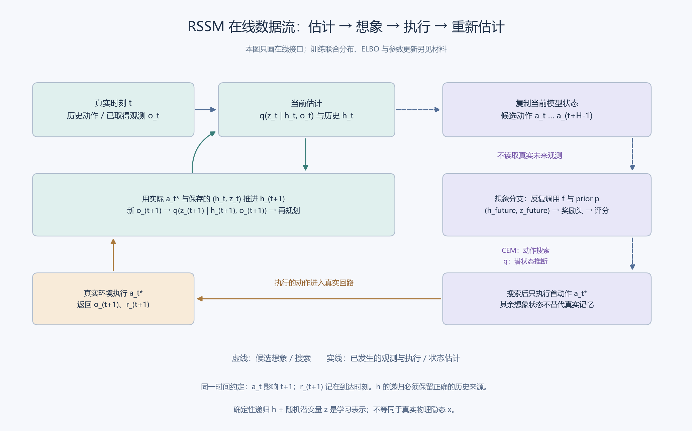

# 备课审查短读本

revision1；2026-10-09。只供审查；未开展正式教学或修改真实学习进度。

这份单元用同一份“RSSM训练、预测与行动审计”连接：**历史信息不足 → 学习表示(h,z) → joint与因果q → 序列ELBO → 当前观测过滤 → 无未来观测的动作条件prior展开 → 预测收益 → 首动作 → 新观测 → 再规划**。

先读 [03 核心材料](03-materials-and-demo.md) 可看到实际教学内容，再读 [04 工作页](04-task-workbook.md) 看学习者剩余承担；[05](05-teacher-reference.md) 是完整参考，[06](06-support-branches.md) 是必要帮助，[07](07-first-teaching-reply.md) 是第一份拟用回复。完整认知依据在 [01](01-cognitive-design.md)，核验与修复在 [08](08-audit.md)、[09](09-integration-check.md)。

## 必要语义是否充分

已落实到正文与题目：物理隐态与模型表示；确定递归在随机历史下的含义；生成与推断；joint、likelihood和full-posterior gap；KL方向和外层history期望；初始化、奖励到达轴与reset mask；训练loss与现场信息边界；一步校正与多步prior；内部固定候选与外部重规划；状态不确定性、模型误差及采样／搜索误差。不是只有书目或待制清单。

精确两状态桥展示完整回路：红后belief为4/5，H=2先选SS；执行首S，真实蓝使belief成为37/89，重规划改选FS。材料随后返回神经RSSM，明确桥不等于h或z、不含奖励训练数据，不替代ELBO或模型训练。

## 不同维度是否混绑

学科层面明确分开训练、估计、预测和控制。教学层面分别处理概念覆盖、形式严谨、整体整合、自主承担、表征方式和本次工作量。给定义、算术或公式只改变相应帮助条件；闭卷、题量、图更大和更长公式都没有成为理解等级。

实际选用的Encoding是S05连贯范例追踪、D02单条件对照、R06时序传播；Post借用关系包的整体接口整合和选择包的限定条件选用／拒用。01记录完整资源读取、版本、借用操作与不采用部分，不把全部包排成固定阶段，也不强制检索先行或追加延迟任务。

## 从示范到整体工作的跨度

完整示范之后，不只换数字，而是让学习者补理由、映射角色、组织连续推导、处理信息快照，再修复含合法训练／smoothing与非法在线步骤的混合日志。每段回同一W1，必要支持有具体内容、够用条件和返回位置，最终仍是完整端到端审计。

首轮问题的线索已经提供，它承担可见范例追踪，不能证明独立选法或整体理解。后续04 D—G承担核心理由、条件判断与组织。实际教学时可以跳过重复追踪或给更多支持，保持帮助边界，不临时改成全章前测或从空白训练世界模型。

## 本次审查的限制

初步与最终核查均针对备课可用性；实际学习效果、持续保持、真实闭环表现和多agent净收益未测。另一agent直接审成品，仍属同模型体系审查，不称盲评。完整教师参考在本次审查可见，未来不能把这一接触改称无提示条件。

图只画在线接口。训练ELBO另有连续推导，不把两种工作压成同一数据流。
