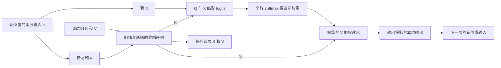
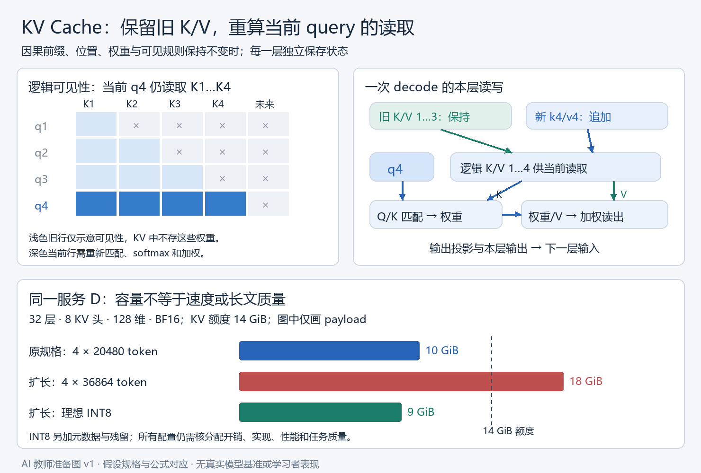

# 实际材料与连贯示范 v1

这是教师已写好的教学材料，当前作为备课成品审查。后续教学可沿下面顺序分段呈现，不要求现在作答。来源定位见 05；数值是假设的 attention／服务规格，不是训练模型的性能结果。

## 从一次读取开始：缓存保存了什么

我们要为长文档问答服务逐 token 生成回答。当前输入位置为 t：第 ℓ 层收到这个位置的表示 h_t^(ℓ−1)，投影出 q_t、k_t、v_t。q 是当前读取请求，k 参与匹配，v 提供被加权的内容；它们都是数值向量，不是文字标签或现成答案。每一层有自己的投影和自己的缓存。

单个 query head 的计算是：

\[
z_t^\ell=\operatorname{softmax}\left(\frac{q_t^\ell(K_{1:t}^\ell)^\top}{\sqrt{d_h}}+M_t\right)V_{1:t}^\ell.
\]

M 对合法连接取 0，对禁止连接取 −∞。softmax 是对当前这一行的所有合法位置共同归一化。这里采用加性 mask；不能把任意 0/1 乘法 mask 当成同一公式。原始定义见 [Transformer §3.1–3.3](https://arxiv.org/html/1706.03762v7)。

先隔离一个维度的读取，取 d_h=1，两个历史槽：

| 槽位 | k | v |
|---|---:|---:|
| 1 | 1 | 9 |
| 2 | 0 | 0 |

q=0 时 logits=[0,0]，权重=[0.5,0.5]，z=4.5。q=ln(3) 时 logits=[ln(3),0]，权重=[0.75,0.25]，z=6.75。**K、V 完全相同，当前读出仍会变化。**这是一个隔离 attention 读取的算例；完整 self-attention 处理新 token 时通常还会生成它自己的 k_t、v_t 并追加。

这解释了为什么通常不缓存旧 attention 权重来回答未来 query：那些权重是“旧 q 与当时可见 K”算出来的。旧 Q 也不是下一步所需的那一行。旧 K/V 可复用与当前 attention 权重重算，同时成立。

再做一个有用的反例。q=−10 时，槽 1 的权重约为 0.0000454；q=10 时约为 0.9999546。假如因为过去权重低而删除槽 1，后一次读出从约 8.99959 变成 0。历史低权重可以是驱逐算法的经验线索，却不是对未知未来 query 的无损证明。驱逐方法需要任务检验和适用条件，[H₂O §3–4](https://arxiv.org/html/2306.14048v1)提供一种具体路线。

## 追加 token 的时间线

假设 prompt 是 x₁…x_P。Prefill 计算已知 prompt 的各层表示及 K/V；最后位置的输出用于预测第一个回答 token。选出 x_(P+1) 后，把它输入模型；每层计算新位置 q/k/v，将新 k/v 接入缓存，用新 q 读取整个允许的缓存，再预测 x_(P+2)。因此“刚采样到的 token”与“已送入模型并生成 KV 的位置”要分开。

| 时刻 | 本轮输入 | 进入 attention 的 KV | 本轮预测 |
|---|---|---|---|
| Prefill | prompt 全部 P 个位置 | 每层 K/V₁…P | 第一个回答 token x_(P+1) |
| 第一轮 decode | x_(P+1) | 旧 P 个槽＋新槽 P+1 | x_(P+2) |
| 第二轮 decode | x_(P+2) | 旧 P+1 个槽＋新槽 P+2 | x_(P+3) |

缓存中的长度是已处理的位置数。容量规划用 P+G 作为生成 G 个 token 时的保守上界；最后一个生成 token 是否再送入模型取决于循环结束位置，不能混为逐步精确计数。

下面的读写图对应每一层同一轮 decode；新 q 用完即可释放，新 k/v 要保留供后续 query 读取。

图中的“逻辑序列”可以由连续数组或分页块实现，不要求每次物理复制整段。逐层更新机制见 [HF 官方缓存解释](https://huggingface.co/docs/transformers/main/cache_explanation)。图也有同用途文字／表格回退。

下面的静态图把因果可见性、一次读写和稍后服务 D 的容量分账放在一起。左侧浅色格只表示旧 query 当时可见哪些位置，并不表示 KV 中保存了旧权重。

## 为什么旧 K/V 可以保持不变

先把条件讲足：使用确定性的因果推理；旧 token 的前缀、位置编号、可见性规则、模型权重及相关配置不变；没有新增跨时间的随机变化或序列全局操作影响旧位置。普通逐 token LayerNorm、FFN 和残差保持这种前缀依赖。

归纳链如下：旧位置的初始输入不变；若上一层旧位置的表示不变，因果 mask 让它仍然只读取原来的合法前缀，所以本层旧位置的输出不变；逐层重复，各层旧 k/v 都仍正确。缓存是复用这个不变量，不能仅说“过去的事情不会变”。

合法近例是向完全相同的前缀追加 token。近邻非例是修改前缀早先的 token：后续位置在高层吸收的上下文可能变化。第一层若直接投影逐位置 embedding，则未修改位置的 k/v 可以恰好不变；高层同位置的 k/v 通常需要重算。结论是**旧整段缓存不能直接当成编辑后模型的正确缓存**，而不是“每层每个数必然全部变化”。

双向 self-attention 中，旧位置追加后可以读取新 token，上述归纳缺了一项前提。不同权重／LoRA、不同位置映射或 mask 也不能凭 token 相同复用。前缀缓存应匹配计算身份与整段前缀；语义相似、文档标题相同或某个中间句相同都不足。[vLLM 的前缀缓存设计](https://docs.vllm.ai/en/latest/design/prefix_caching/)用父块身份、token 与附加身份管理这种依赖。

教师 CPU toy 将这个理由接到数值轨迹：两层、固定投影、单头、无位置编码；比较逐前缀缓存与全前缀重算，并给编辑前缀／双向追加反例。它保留因果依赖和逐层状态，删除训练、语言语义、真实模型多头与位置扩展。代码与实测有限范围见 07；不把 toy 运行替代理论条件或模型质量。

## 从时间线转到成本：省掉什么，仍做什么

在“每一步重新把完整前缀送入模型”这条无缓存基线中，会反复计算旧位置投影、FFN 和 attention。缓存 decode 只计算新位置经过各层的表示，仍要匹配并读取该层允许的旧 K/V。

固定层数 L、query 头数 H_q、头维 d_h，dense attention 项：prefill 约 O(L H_q P² d_h)，单 token decode 约 O(L H_q T d_h)。投影、FFN、权重读取、临时空间和调度另外计算。这是工作量模型，不是实测延迟公式。

生成 G 个 token 的 attention 工作量包含 P²、PG 和 G² 项。缓存改善重复计算，并没有让任意长文本的总体工作变成常数。Prefill 可以较充分地利用矩阵计算；小批量 decode 经常受数据搬运限制，但实际瓶颈要依硬件、长度、batch 和 kernel 判断。[PagedAttention §2–3](https://arxiv.org/html/2309.06180v1)

要分三种“长”：模型允许输入的最大长度、服务实际能处理的长度、任务中能可靠使用证据的长度。显存增加只能直接改善其中的资源条件。位置扩展改变模型的位置信息；长上下文任务仍需检验，不能用一个长度配置覆盖三种结论。[Position Interpolation](https://arxiv.org/html/2306.15595v2)、[RULER](https://arxiv.org/html/2404.06654v3)

## 内存分账与一个可计算的服务

同一层 K/V 头数和维度相同、没有共享前缀、按实际 token 保存时：

\[
M_{KV}=2L H_{kv}d_hs\sum_b T_b.
\]

2 表示 K 和 V，s 是每元素字节。请求同长时和式变成 BT。混合局部／全局层应按层求和；量化 metadata、全精度残留、padding、分页块尾和静态预留要另算。前缀共享应数物理唯一槽，而不是盲目乘 B。

完整分账：设备总显存 = 权重＋其他常驻状态＋临时工作区＋实际 KV 分配＋安全余量。减少 attention score 中间量与减少持久 KV 是不同项；也别把权重量化直接当成 KV 量化。

教学服务 D 的假设：48 GiB GPU；权重和已预算的其他占用 30 GiB；保留 4 GiB；给 KV 的额度 14 GiB。固定检查点为 L=32、H_q=32、H_kv=8、d_h=128，BF16 的 s=2。GiB=2³⁰ bytes。“其他占用 30”仅是教学假设，不是实际机器测量。

每个 token 全层 KV 为 2×32×8×128×2=131072 bytes=128 KiB。四个请求各有 P=16384、最多 G=4096，则按最终 T≤20480：每请求 2.5 GiB，总 payload 10 GiB。它在 payload 层面有 4 GiB 余地，仍需确认分配开销和其他占用的假设。

| 情境 | 总 token 上界／请求 | B | BF16 payload | 判断 |
|---|---:|---:|---:|---|
| 原规格 | 20480 | 4 | 10 GiB | payload 可容纳；实际分配待核 |
| prompt 扩到 32768，输出仍 4096 | 36864 | 4 | 18 GiB | 超 14 GiB，当前基线不可容纳 |
| 扩长后限制三个并行请求 | 36864 | 3 | 13.5 GiB | 仅 0.5 GiB 余地，不能忽略开销 |
| 扩长且理想 INT8 KV | 36864 | 4 | 9 GiB | 另加元数据与残留；误差和速度待核 |

把可支持的 prompt 翻倍与把总缓存 T 翻倍也不同，因为输出预留仍占空间。不能用“prefill 没 OOM”就答应整个生成过程可完成。

## 识别选择：每条路线实际改变哪里

| 路线 | 改变的对象 | 当前模型上能否直接选 | 与当前基线的关系／必要检查 |
|---|---|---|---|
| 开启正确 KV Cache | 旧层状态的复用 | 因果模型与实现支持时 | 数学计算相同；检查位置、mask 与更新逻辑 |
| batch／准入／输出上限 | 同时存活 token 与调度 | 可在服务规格内调整 | 改变服务覆盖、等待或吞吐；不能悄悄改用户任务 |
| 分页、动态／静态分配 | 物理布局与预留 | 依实现支持 | 保存相同逻辑数据；有块尾、预留和 kernel 开销 |
| 前缀复用 | 重复 prefill 与共享物理前缀 | 有可复用身份及实现时 | 省重算／物理重复；新 query 仍读取有效前缀 |
| FlashAttention 等 exact kernel | attention 的 IO／计算组织 | 依设备、dtype、实现 | 不直接减少持久 KV；dense 算术仍二次 |
| KV 量化 | 数值精度与表示 | 依支持和误差许可 | 对原浮点模型为近似；K/V误差与反量化成本 |
| CPU offload | KV 的驻留位置 | 有内存及实现时 | 无量化传输可保留数值；交换带宽／重叠成本 |
| 驱逐／对 full attention 强加滑窗 | 当前可见 token 集 | 可实现但改变原计算 | 可能丢任务所需信息；不能称原模型无损 |
| 原生窗口模型的 rolling cache | 其 mask 不再读取的槽 | 检查点原本就是该结构时 | 对该模型可精确；不保证直接读取任意远处原文 |
| MHA→GQA／MQA | KV head 结构和权重 | 不是任意服务开关 | 要合法检查点／转换与适配；缓存按 H_kv 计 |
| RoPE 插值／位置扩展 | 位置映射及模型适配 | 按检查点和方法条件 | 旧缓存可能失配；长短任务都要核质量 |
| 检索、分段、摘要后再问 | 模型接到的信息与任务流程 | 用户用途允许时 | 能减输入，但证据覆盖／跨段组合须另检验 |

GQA 的 query heads 仍有 H_q 个，多个 query head 共用一个 KV head。H_kv 从 32 降到 8 会把同规格缓存 payload 降为四分之一，QK/AV 的 query 数不会同时变成四分之一。MHA/GQA/MQA 对各自检查点可以正常推理，转换结构不等于保留原模型行为。[GQA §2–3](https://aclanthology.org/2023.emnlp-main.298.pdf)

KV 量化中，K 误差先影响 logits，再影响 softmax；V 误差进入加权结果。KIVI 的具体设计含分组尺度、不同 K/V 量化方向和全精度近期残留；“2 bit”不能直接变成全缓存恰好 1/8，也不能推出任务无损。[KIVI §3–4](https://arxiv.org/html/2402.02750v1)

分页关注持久缓存块的分配／共享；FlashAttention 关注 attention 中间量与 IO，并正确协调分块 softmax。二者作用项不同，可在兼容实现中组合。exact 是相对同一数学计算，不承诺浮点 bitwise 相同或所有 workload 更快。[PagedAttention](https://arxiv.org/html/2309.06180v1)、[FlashAttention](https://arxiv.org/html/2205.14135v2)

## 交互：不能把单项收益直接相加

D 的扩长目标使原 BF16 四并发失效。INT8 payload 9 GiB 是容量候选，但若为了吞吐再把 batch 从 4 提到 8，payload 回到 18 GiB；减少位宽后增加并发，可能用掉刚释放的空间。收益要在同一个最终规格里算。

再取一个与 D 参数不同的示范，固定 L、d_h，只看比率：H_kv 从 32→8、s 从 2→1、T×2、B×4。最终 payload 比率是 (1/4)×(1/2)×2×4=1。每一项压缩都有效，组合后的总容量却没有比原来变小。由于模型和误差路线改变，还不能把这个比率当成等价质量或等比速度。

其他联动也有具体失效路径：

- 扩长后 offload 容量足够，但每轮要搬更多旧 KV；若一次轮回需传 D bytes、有效链路速率 β，未重叠搬运时间至少 D/β。教学票据 D=8 GiB、β=32 GiB/s 时为 0.25 s；实际能重叠多少必须测，不能当真实模型延迟。
- 分页加前缀共享能减少物理重复，四请求共用 S 个前缀位置、各有 U 个私有位置时，理想物理 payload ∝ S+4U；逻辑序列仍各长 S+U。共享的冷启动命中为零时，要重审时间和容量条件。
- full-attention 模型被改成窗口后，full-history 精确计算与“直接读最前面原文”的原假设已失效。原生 SWA 的多层传播不等于任意远处原文可以无损取回。[Mistral §2](https://arxiv.org/html/2310.06825v1)
- 扩大位置范围若改了 RoPE 映射，旧 K 坐标及上层 hidden state 都可能按旧规则生成。只重新旋转旧 K 不能普遍恢复整个新计算；应重建相容缓存。位置适配也没有减少 T 对容量／工作量的影响。
- 两项在数学上可以组合，当前软件版本未必支持。量化×offload×滑窗要查确切实现版本；缺实现支持不能被“理论比例很好”补上。[HF v5.15.0 缓存策略表](https://huggingface.co/docs/transformers/v5.15.0/kv_cache)

## 完整决策示范：把未知写进方案而不是补成答案

D 的目标是扩到 P=32768、保留 G≤4096、尽量保持四并发，完成从文档任意位置取证并组合的问答。任务允许损失、长文正确率门槛、前缀命中分布、实际 kernel 支持和到达负载尚未给定。

第一步保留基线与硬约束。四并发 BF16 payload 18 GiB 超额度，应拒绝原方案；这是容量判断。改 FlashAttention 不能直接把 18 GiB 的持久 payload 消掉。

第二步提出可反驳的候选。A 保留 BF16，降低同时存活请求或增资源；B 在误差许可与实现支持时使用 KV 量化；C 若有相同前缀使用共享，并保留冷启动路径；D 在用户允许信息重组时检索／分段。offload 另检查链路。原检查点已经是 GQA，不能凭空把 H_kv 改成 1；未经验证的驱逐不承担任意位置取证的原目标。

第三步先找会改变决定的缺项：如果逐位置数值等价是硬约束，量化／驱逐不合格；如果只是任务质量门槛，量化可以进入候选。若前缀经常被编辑，共享收益会下降。若瓶颈在 cold prefill，单纯增 decode 并发未必解决首 token 等待。

第四步准备区分性验证。固定检查点、输入和生成规格，分别记录 KV payload／实际分配、OOM 点、TTFT（请求到首 token）、TPOT（生成阶段每 token 时间）、吞吐与尾延迟。区分纯模型计时和包含排队的服务计时；质量按长度、证据在开头／中间／末尾、单点取证／多段组合分层。先建立 exact BF16 基线，再做单项与关键组合对照。测试要回答哪个竞争解释，而不是只产一个总分。

第五步写有条件的采用与回退。例如“INT8 在明确质量门槛及实现条件下可采用；若远距组合退化而重构误差仍小，不能用后者否定前者，应回 BF16 或改变量化配置再测”。多种方案可以合法，没有数据时不宣布唯一最优。后续工作纸会交付新票据，让学习者在同一方案里修订；该动作是 Post 的选用和条件更新。
