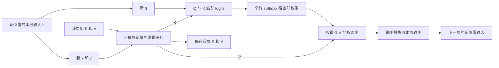

# Transformer Attention：KV Cache 与长上下文推理——备课成品 v1

2026-10-11 · prepared_for_review · 仅供用户审查，未开展正式教学。

本次根据当前学习系统入口、原始学科资料和完整所选策略独立制作；未读取同单元既有备课／测试记录，未修改真实学习进度。教师示范、服务规格和新证据票据均已注明来源或教学假设。

连续作品是《长文档问答服务推理方案》。四层主线贯穿同一工作：识别可改变选择 → 说明条件和后果 → 审计联动及失效 → 在未知约束下构造、验证、调整方案。

Encoding从实际读取、状态与因果关系推进到分账和选择；Post在同作品中整合关系、选用方法、据证据修订。未预期解释先定位对象、区别竞争解释，再改解释／表示／对照并返回原工作。以下包含完整教师材料、连续工作纸、参考与支持，现在不要求用户作答。

审查顺序可沿全文阅读；分文件入口与教师代码见[目录](README.md)。部分教师参考在实际教学时待原答保留后再呈现，本次审查全部开放。

## 实际材料与连贯示范 v1

这是教师已写好的教学材料，当前作为备课成品审查。后续教学可沿下面顺序分段呈现，不要求现在作答。来源定位见 05；数值是假设的 attention／服务规格，不是训练模型的性能结果。

### 从一次读取开始：缓存保存了什么

我们要为长文档问答服务逐 token 生成回答。当前输入位置为 t：第 ℓ 层收到这个位置的表示 h_t^(ℓ−1)，投影出 q_t、k_t、v_t。q 是当前读取请求，k 参与匹配，v 提供被加权的内容；它们都是数值向量，不是文字标签或现成答案。每一层有自己的投影和自己的缓存。

单个 query head 的计算是：

\[
z_t^\ell=\operatorname{softmax}\left(\frac{q_t^\ell(K_{1:t}^\ell)^\top}{\sqrt{d_h}}+M_t\right)V_{1:t}^\ell.
\]

M 对合法连接取 0，对禁止连接取 −∞。softmax 是对当前这一行的所有合法位置共同归一化。这里采用加性 mask；不能把任意 0/1 乘法 mask 当成同一公式。原始定义见 [Transformer §3.1–3.3](https://arxiv.org/html/1706.03762v7)。

先隔离一个维度的读取，取 d_h=1，两个历史槽：

| 槽位 | k | v |
|---|---:|---:|
| 1 | 1 | 9 |
| 2 | 0 | 0 |

q=0 时 logits=[0,0]，权重=[0.5,0.5]，z=4.5。q=ln(3) 时 logits=[ln(3),0]，权重=[0.75,0.25]，z=6.75。**K、V 完全相同，当前读出仍会变化。**这是一个隔离 attention 读取的算例；完整 self-attention 处理新 token 时通常还会生成它自己的 k_t、v_t 并追加。

这解释了为什么通常不缓存旧 attention 权重来回答未来 query：那些权重是“旧 q 与当时可见 K”算出来的。旧 Q 也不是下一步所需的那一行。旧 K/V 可复用与当前 attention 权重重算，同时成立。

再做一个有用的反例。q=−10 时，槽 1 的权重约为 0.0000454；q=10 时约为 0.9999546。假如因为过去权重低而删除槽 1，后一次读出从约 8.99959 变成 0。历史低权重可以是驱逐算法的经验线索，却不是对未知未来 query 的无损证明。驱逐方法需要任务检验和适用条件，[H₂O §3–4](https://arxiv.org/html/2306.14048v1)提供一种具体路线。

### 追加 token 的时间线

假设 prompt 是 x₁…x_P。Prefill 计算已知 prompt 的各层表示及 K/V；最后位置的输出用于预测第一个回答 token。选出 x_(P+1) 后，把它输入模型；每层计算新位置 q/k/v，将新 k/v 接入缓存，用新 q 读取整个允许的缓存，再预测 x_(P+2)。因此“刚采样到的 token”与“已送入模型并生成 KV 的位置”要分开。

| 时刻 | 本轮输入 | 进入 attention 的 KV | 本轮预测 |
|---|---|---|---|
| Prefill | prompt 全部 P 个位置 | 每层 K/V₁…P | 第一个回答 token x_(P+1) |
| 第一轮 decode | x_(P+1) | 旧 P 个槽＋新槽 P+1 | x_(P+2) |
| 第二轮 decode | x_(P+2) | 旧 P+1 个槽＋新槽 P+2 | x_(P+3) |

缓存中的长度是已处理的位置数。容量规划用 P+G 作为生成 G 个 token 时的保守上界；最后一个生成 token 是否再送入模型取决于循环结束位置，不能混为逐步精确计数。

下面的读写图对应每一层同一轮 decode；新 q 用完即可释放，新 k/v 要保留供后续 query 读取。

图中的“逻辑序列”可以由连续数组或分页块实现，不要求每次物理复制整段。逐层更新机制见 [HF 官方缓存解释](https://huggingface.co/docs/transformers/main/cache_explanation)。图也有同用途文字／表格回退。

下面的静态图把因果可见性、一次读写和稍后服务 D 的容量分账放在一起。左侧浅色格只表示旧 query 当时可见哪些位置，并不表示 KV 中保存了旧权重。

### 为什么旧 K/V 可以保持不变

先把条件讲足：使用确定性的因果推理；旧 token 的前缀、位置编号、可见性规则、模型权重及相关配置不变；没有新增跨时间的随机变化或序列全局操作影响旧位置。普通逐 token LayerNorm、FFN 和残差保持这种前缀依赖。

归纳链如下：旧位置的初始输入不变；若上一层旧位置的表示不变，因果 mask 让它仍然只读取原来的合法前缀，所以本层旧位置的输出不变；逐层重复，各层旧 k/v 都仍正确。缓存是复用这个不变量，不能仅说“过去的事情不会变”。

合法近例是向完全相同的前缀追加 token。近邻非例是修改前缀早先的 token：后续位置在高层吸收的上下文可能变化。第一层若直接投影逐位置 embedding，则未修改位置的 k/v 可以恰好不变；高层同位置的 k/v 通常需要重算。结论是**旧整段缓存不能直接当成编辑后模型的正确缓存**，而不是“每层每个数必然全部变化”。

双向 self-attention 中，旧位置追加后可以读取新 token，上述归纳缺了一项前提。不同权重／LoRA、不同位置映射或 mask 也不能凭 token 相同复用。前缀缓存应匹配计算身份与整段前缀；语义相似、文档标题相同或某个中间句相同都不足。[vLLM 的前缀缓存设计](https://docs.vllm.ai/en/latest/design/prefix_caching/)用父块身份、token 与附加身份管理这种依赖。

教师 CPU toy 将这个理由接到数值轨迹：两层、固定投影、单头、无位置编码；比较逐前缀缓存与全前缀重算，并给编辑前缀／双向追加反例。它保留因果依赖和逐层状态，删除训练、语言语义、真实模型多头与位置扩展。代码与实测有限范围见 07；不把 toy 运行替代理论条件或模型质量。

### 从时间线转到成本：省掉什么，仍做什么

在“每一步重新把完整前缀送入模型”这条无缓存基线中，会反复计算旧位置投影、FFN 和 attention。缓存 decode 只计算新位置经过各层的表示，仍要匹配并读取该层允许的旧 K/V。

固定层数 L、query 头数 H_q、头维 d_h，dense attention 项：prefill 约 O(L H_q P² d_h)，单 token decode 约 O(L H_q T d_h)。投影、FFN、权重读取、临时空间和调度另外计算。这是工作量模型，不是实测延迟公式。

生成 G 个 token 的 attention 工作量包含 P²、PG 和 G² 项。缓存改善重复计算，并没有让任意长文本的总体工作变成常数。Prefill 可以较充分地利用矩阵计算；小批量 decode 经常受数据搬运限制，但实际瓶颈要依硬件、长度、batch 和 kernel 判断。[PagedAttention §2–3](https://arxiv.org/html/2309.06180v1)

要分三种“长”：模型允许输入的最大长度、服务实际能处理的长度、任务中能可靠使用证据的长度。显存增加只能直接改善其中的资源条件。位置扩展改变模型的位置信息；长上下文任务仍需检验，不能用一个长度配置覆盖三种结论。[Position Interpolation](https://arxiv.org/html/2306.15595v2)、[RULER](https://arxiv.org/html/2404.06654v3)

### 内存分账与一个可计算的服务

同一层 K/V 头数和维度相同、没有共享前缀、按实际 token 保存时：

\[
M_{KV}=2L H_{kv}d_hs\sum_b T_b.
\]

2 表示 K 和 V，s 是每元素字节。请求同长时和式变成 BT。混合局部／全局层应按层求和；量化 metadata、全精度残留、padding、分页块尾和静态预留要另算。前缀共享应数物理唯一槽，而不是盲目乘 B。

完整分账：设备总显存 = 权重＋其他常驻状态＋临时工作区＋实际 KV 分配＋安全余量。减少 attention score 中间量与减少持久 KV 是不同项；也别把权重量化直接当成 KV 量化。

教学服务 D 的假设：48 GiB GPU；权重和已预算的其他占用 30 GiB；保留 4 GiB；给 KV 的额度 14 GiB。固定检查点为 L=32、H_q=32、H_kv=8、d_h=128，BF16 的 s=2。GiB=2³⁰ bytes。“其他占用 30”仅是教学假设，不是实际机器测量。

每个 token 全层 KV 为 2×32×8×128×2=131072 bytes=128 KiB。四个请求各有 P=16384、最多 G=4096，则按最终 T≤20480：每请求 2.5 GiB，总 payload 10 GiB。它在 payload 层面有 4 GiB 余地，仍需确认分配开销和其他占用的假设。

| 情境 | 总 token 上界／请求 | B | BF16 payload | 判断 |
|---|---:|---:|---:|---|
| 原规格 | 20480 | 4 | 10 GiB | payload 可容纳；实际分配待核 |
| prompt 扩到 32768，输出仍 4096 | 36864 | 4 | 18 GiB | 超 14 GiB，当前基线不可容纳 |
| 扩长后限制三个并行请求 | 36864 | 3 | 13.5 GiB | 仅 0.5 GiB 余地，不能忽略开销 |
| 扩长且理想 INT8 KV | 36864 | 4 | 9 GiB | 另加元数据与残留；误差和速度待核 |

把可支持的 prompt 翻倍与把总缓存 T 翻倍也不同，因为输出预留仍占空间。不能用“prefill 没 OOM”就答应整个生成过程可完成。

### 识别选择：每条路线实际改变哪里

| 路线 | 改变的对象 | 当前模型上能否直接选 | 与当前基线的关系／必要检查 |
|---|---|---|---|
| 开启正确 KV Cache | 旧层状态的复用 | 因果模型与实现支持时 | 数学计算相同；检查位置、mask 与更新逻辑 |
| batch／准入／输出上限 | 同时存活 token 与调度 | 可在服务规格内调整 | 改变服务覆盖、等待或吞吐；不能悄悄改用户任务 |
| 分页、动态／静态分配 | 物理布局与预留 | 依实现支持 | 保存相同逻辑数据；有块尾、预留和 kernel 开销 |
| 前缀复用 | 重复 prefill 与共享物理前缀 | 有可复用身份及实现时 | 省重算／物理重复；新 query 仍读取有效前缀 |
| FlashAttention 等 exact kernel | attention 的 IO／计算组织 | 依设备、dtype、实现 | 不直接减少持久 KV；dense 算术仍二次 |
| KV 量化 | 数值精度与表示 | 依支持和误差许可 | 对原浮点模型为近似；K/V误差与反量化成本 |
| CPU offload | KV 的驻留位置 | 有内存及实现时 | 无量化传输可保留数值；交换带宽／重叠成本 |
| 驱逐／对 full attention 强加滑窗 | 当前可见 token 集 | 可实现但改变原计算 | 可能丢任务所需信息；不能称原模型无损 |
| 原生窗口模型的 rolling cache | 其 mask 不再读取的槽 | 检查点原本就是该结构时 | 对该模型可精确；不保证直接读取任意远处原文 |
| MHA→GQA／MQA | KV head 结构和权重 | 不是任意服务开关 | 要合法检查点／转换与适配；缓存按 H_kv 计 |
| RoPE 插值／位置扩展 | 位置映射及模型适配 | 按检查点和方法条件 | 旧缓存可能失配；长短任务都要核质量 |
| 检索、分段、摘要后再问 | 模型接到的信息与任务流程 | 用户用途允许时 | 能减输入，但证据覆盖／跨段组合须另检验 |

GQA 的 query heads 仍有 H_q 个，多个 query head 共用一个 KV head。H_kv 从 32 降到 8 会把同规格缓存 payload 降为四分之一，QK/AV 的 query 数不会同时变成四分之一。MHA/GQA/MQA 对各自检查点可以正常推理，转换结构不等于保留原模型行为。[GQA §2–3](https://aclanthology.org/2023.emnlp-main.298.pdf)

KV 量化中，K 误差先影响 logits，再影响 softmax；V 误差进入加权结果。KIVI 的具体设计含分组尺度、不同 K/V 量化方向和全精度近期残留；“2 bit”不能直接变成全缓存恰好 1/8，也不能推出任务无损。[KIVI §3–4](https://arxiv.org/html/2402.02750v1)

分页关注持久缓存块的分配／共享；FlashAttention 关注 attention 中间量与 IO，并正确协调分块 softmax。二者作用项不同，可在兼容实现中组合。exact 是相对同一数学计算，不承诺浮点 bitwise 相同或所有 workload 更快。[PagedAttention](https://arxiv.org/html/2309.06180v1)、[FlashAttention](https://arxiv.org/html/2205.14135v2)

### 交互：不能把单项收益直接相加

D 的扩长目标使原 BF16 四并发失效。INT8 payload 9 GiB 是容量候选，但若为了吞吐再把 batch 从 4 提到 8，payload 回到 18 GiB；减少位宽后增加并发，可能用掉刚释放的空间。收益要在同一个最终规格里算。

再取一个与 D 参数不同的示范，固定 L、d_h，只看比率：H_kv 从 32→8、s 从 2→1、T×2、B×4。最终 payload 比率是 (1/4)×(1/2)×2×4=1。每一项压缩都有效，组合后的总容量却没有比原来变小。由于模型和误差路线改变，还不能把这个比率当成等价质量或等比速度。

其他联动也有具体失效路径：

- 扩长后 offload 容量足够，但每轮要搬更多旧 KV；若一次轮回需传 D bytes、有效链路速率 β，未重叠搬运时间至少 D/β。教学票据 D=8 GiB、β=32 GiB/s 时为 0.25 s；实际能重叠多少必须测，不能当真实模型延迟。
- 分页加前缀共享能减少物理重复，四请求共用 S 个前缀位置、各有 U 个私有位置时，理想物理 payload ∝ S+4U；逻辑序列仍各长 S+U。共享的冷启动命中为零时，要重审时间和容量条件。
- full-attention 模型被改成窗口后，full-history 精确计算与“直接读最前面原文”的原假设已失效。原生 SWA 的多层传播不等于任意远处原文可以无损取回。[Mistral §2](https://arxiv.org/html/2310.06825v1)
- 扩大位置范围若改了 RoPE 映射，旧 K 坐标及上层 hidden state 都可能按旧规则生成。只重新旋转旧 K 不能普遍恢复整个新计算；应重建相容缓存。位置适配也没有减少 T 对容量／工作量的影响。
- 两项在数学上可以组合，当前软件版本未必支持。量化×offload×滑窗要查确切实现版本；缺实现支持不能被“理论比例很好”补上。[HF v5.15.0 缓存策略表](https://huggingface.co/docs/transformers/v5.15.0/kv_cache)

### 完整决策示范：把未知写进方案而不是补成答案

D 的目标是扩到 P=32768、保留 G≤4096、尽量保持四并发，完成从文档任意位置取证并组合的问答。任务允许损失、长文正确率门槛、前缀命中分布、实际 kernel 支持和到达负载尚未给定。

第一步保留基线与硬约束。四并发 BF16 payload 18 GiB 超额度，应拒绝原方案；这是容量判断。改 FlashAttention 不能直接把 18 GiB 的持久 payload 消掉。

第二步提出可反驳的候选。A 保留 BF16，降低同时存活请求或增资源；B 在误差许可与实现支持时使用 KV 量化；C 若有相同前缀使用共享，并保留冷启动路径；D 在用户允许信息重组时检索／分段。offload 另检查链路。原检查点已经是 GQA，不能凭空把 H_kv 改成 1；未经验证的驱逐不承担任意位置取证的原目标。

第三步先找会改变决定的缺项：如果逐位置数值等价是硬约束，量化／驱逐不合格；如果只是任务质量门槛，量化可以进入候选。若前缀经常被编辑，共享收益会下降。若瓶颈在 cold prefill，单纯增 decode 并发未必解决首 token 等待。

第四步准备区分性验证。固定检查点、输入和生成规格，分别记录 KV payload／实际分配、OOM 点、TTFT（请求到首 token）、TPOT（生成阶段每 token 时间）、吞吐与尾延迟。区分纯模型计时和包含排队的服务计时；质量按长度、证据在开头／中间／末尾、单点取证／多段组合分层。先建立 exact BF16 基线，再做单项与关键组合对照。测试要回答哪个竞争解释，而不是只产一个总分。

第五步写有条件的采用与回退。例如“INT8 在明确质量门槛及实现条件下可采用；若远距组合退化而重构误差仍小，不能用后者否定前者，应回 BF16 或改变量化配置再测”。多种方案可以合法，没有数据时不宣布唯一最优。后续工作纸会交付新票据，让学习者在同一方案里修订；该动作是 Post 的选用和条件更新。

---

## 连续工作纸 v1

当前仅供备课审查，不要求用户现在作答。正式教学时分段交出；以下四组都写入同一份《长文档问答服务推理方案》，不是四张独立测验。材料 01、可靠文档、公式、计算器均可查阅。可用文字、表格或图，形式本身不评分；可随时提前交卡点。

教师已给对象、计算规则与完整示范，学习者剩余工作是新情境中的理由、条件判断、联动、构造与证据更新。单位中的 GiB 均为 2³⁰ bytes。数据若非 01 来源结论，均为本包生成的教学假设。

### E：建立可用解释与选择空间

给定确定性因果模型 A，参数与位置规则固定。Prompt 长 P=5；prefill 已完成并预测、选出了第一个回答 token x₆。接下来送入 x₆。

将下面工作作为一份连贯解释提交：

1. 描述某一层在这轮实际计算、读取、保存什么，输出用于预测哪个位置。可以引用已给的 attention 公式，但要解释它与缓存时间线的关系。
2. 比较“向相同前缀追加 x₆”“编辑 x₂ 后从新前缀继续”“同 token 但更换位置映射”。哪些复用主张能成立，哪些需重建或更多信息？避免把第一层特例误写成全部层的规则。
3. 产品要求把长文档放进去并连续回答。列出你认为值得比较的可改变选择，按改变的对象组织：计算组织、缓存表示／布局／驻留、可见信息、模型结构、服务规格。指出本检查点不能直接任意调的项，并说明为什么。

足够时直接接下面 C 的情境辨别；不另要求背术语或重算 01 的旧范例。此组观察四层中的识别选择，并建立后续条件判断所需对象。

提交后若还在等待，可在自己的解释中圈出最不确定的一条条件；做完即可停，回复到达后回到这里。这是可选动作，不新增必交物。

### C：把选择连接到成立条件与后果

现有服务使用 full-attention 因果检查点：L=24、H_q=24、H_kv=6、d_h=128；所有请求没有共享前缀。每个 prompt 为 24576 token，最多生成 8192 token，同时存活 B=3。KV 额度为 8 GiB。BF16 为 2 bytes/元素；可用 INT8 实现除 payload 外需要 0.6 GiB 固定量化开销（这是本题给定假设）。其他分配开销先保留为未知。

团队有五条主张，请在同一方案中对每条写“支持／拒绝／信息不足”，附一个决定性条件或理由：

- C1：“当前三并发 BF16 可以完成整个规定长度，所以不必预留输出增长。”
- C2：“切换 exact FlashAttention 会直接把持久 KV 降到额度内。”
- C3：“INT8 的 payload 加给定开销在额度内，因此速度与答案质量也已证实合格。”
- C4：“只保留最后 4096 个 token，模型仍是原 full-attention 计算；因为上层 V 已经包含历史，所以任意原文证据都能恢复。”
- C5：“两请求包含相同的一段文字，无论前面的 token、位置或 LoRA 是否相同，都可以直接复用这段高层 KV。”

说明容量、性能、质量、复用资格各由哪些现有信息支持，还缺什么。无需编写量化 kernel、证明长文任务的全部理论或安装软件。

此组调用条件后果；教师参考核“中间理由＋范围”，不要求固定措辞。提交后可选地标出一个你不会用现有数字作结论的量；做完即可停。

### I：同时改变选择，审计整条方案

保持 L、d_h 不变，一组可用候选检查点把 H_kv 从 24 改为 6；其长文质量尚未提供。你还计划把 BF16 改为理想 INT8，prompt 的总缓存长度 T 翻倍，B 从 2 提到 8。先暂不计元数据。

产品经理说：“头数少四倍，字节少两倍，总缓存只剩原来的八分之一。”在同一作品里：

1. 推出最终 payload 与原方案的比率，并解释为什么容量收益会被其他选择消耗；指出剩余的质量／实现前提。
2. 加入前缀共享：8 请求共享 16384 个完整前缀 token，各有 4096 个私有已处理位置，无分叉可变块及块尾浪费。用物理唯一槽与逻辑槽分别计数。共享减少了哪种重复，哪些读取仍存在？
3. 运维再修改这段共享前缀最早的 token，并采用新位置映射。指出哪些已有承诺需要重审，哪些材料中的合法结论仍可保留。不要只说“全部优化失效”，也不要默认所有软件都能组合。

这一组从局部参数走到联动／失效，并用 Post 关系整合接回连续方案。已会算局部但整体失败时，教师查接口、物理／逻辑计数与最终规格；不继续出十道容量题。

提交后可选地给自己的方案标一个“保持条件”与一个“实际改变”；做完即可停。

### D：在不充分证据下构造、验证、调整

工作场景是一台假设的 48 GiB GPU。当前合法检查点为 L=32、H_q=32、H_kv=8、d_h=128、BF16。权重与其他已预算占用 28 GiB，安全余量 4 GiB，因此给 KV 实际分配的额度是 16 GiB。需求为 P≤32768、G≤8192，尽量保持四个并发请求；需要文档任意位置取证及两处证据组合。

产品的教学门槛是：TTFT p95≤2.0 s、TPOT p95≤60 ms；远距组合题≥36/40。尽量提高吞吐，但到达率、长度分布和排队尚未知。门槛只属于本题，不是用户实际服务的目标。

现有信息：BF16 非 payload 分配开销在所述 B 范围内为 0.5 GiB；INT8 的额外开销初步估计为 1.0 GiB，实际分配待测，误差许可需要满足任务门槛。系统可能存在相同文档前缀，命中率未知。未确认当前库对量化、分页、offload 的组合支持。没有合法 MQA 检查点或已核质量的检索器。

**D0 初始方案。**请先提出有条件的设计，而非猜唯一最优：

- 算出四并发 BF16 的容量结论；给出至少一条有理由的候选与一条拒用／暂不采用的路线，允许提出额外候选，数量本身不评分。
- 分开硬约束、优化目标和未知，写明方案依赖的条件，以及失效时如何回退。
- 选最值得先获得的信息或一次区分性验证，写比较对象、保持项、观测量、什么结果会改变你哪项决定。可以暂缓部署并说明还缺什么。

教师只在 D0 原答保留后给出 D1 票据，以便看到真实更新；本备课审查可在 03 查看全部票据。它们是虚构工程观察卡，不是本次教师或用户实测。

**D1 新依据后的修订。**收到票据后，在同一方案上修订：保留仍成立的原判断；指出证据改变了什么；说明目前较可支持的方案、实际服务仍未解决的条件及下一验证。若你的原方案本来与票据相容，允许有依据地保持它，不强迫为“更新”改变答案。

这一组调用 Post 的方法选用与条件更新。初始设计、检验选择和修订分别看；教师提供候选或完整方案后，后续成功按实际帮助解释。材料已围绕本单元组织，只能支持已给路线内的设计与选用，不能称广泛无提示远迁移。

提交后若仍在等待，可写下最担心的一个失败条件；做完即可停，不必另跑实验。

### 教师连续推进及完成条件

E 的必要对象补足后直接进入 C；C 的条件可用后接 I；I 的整体接口可用后进入 D，不把每题反馈当作单元结束。学习者要求讲解／答案时可给足，并保留哪些操作由教师代做。已有支持可减少支架或跳过重复工作；四组可以合并提交、按卡点分段或直接审完整作品。

本单元目标内完成条件：连续作品中能追踪缓存机制与复用边界，区分可改变对象，推导条件后果，重审关键联动，并提出与证据相容的有条件方案及有效验证／回退。不按答题数量、字数、图的外观或 toy 跑通判整体完成。

学习者暂停、可用投入实际结束、资料争议或支持反复无增量时停止新增工作。保留同一作品当前未完成连接及下一已备入口；不新增复习队列。延迟保持、真实 GPU 性能、广泛迁移和独立 kernel 实现未纳入本次近期目标。

---

## 教师参考 v1

本文件供备课审查及后续教师反馈使用，不随任务自动展示。现在无真实原答，所有“可能回答”均为教学候选，不作个人诊断。参考接 01 的专业依据与 02 完整题面；合法不同方案按条件和证据核查，不能机械比对模板。

### E 的关键连接

输入 x₆ 时，第 ℓ 层取 x₆ 在上一层的表示，算当前 q₆/k₆/v₆；读取本层旧 k/v₁…₅ 和当前槽，算当前行的 logits／softmax／加权结果；保存该层新 k₆/v₆，输出传下一层，最后用于预测 x₇。不要把预测出的 x₇ 已有 KV、K/V 是 logits、过去 Q 不存在，或旧 attention 权重可用于任何未来 query 当正确。

复用理由要有中间连接：前缀、位置、权重与可见性保持→上一层旧表示保持→因果 mask 不引入未来依赖→本层旧输出与 KV 保持。追加近例成立。编辑 x₂ 时，x₁ 的前缀不受影响；从编辑位置开始的高层后缀可能改变。第一层未编辑位置投影可保持，是合法局部特例，不恢复整段旧缓存资格。位置映射变更需按新计算核，不能默认复用，也不必断言每个数必变。

选择空间应能区别改变的对象，例如准入／batch、精度、分配与共享、驻留、kernel、保留集合、模型／位置路线、信息重组。不是必须背全表。关键是能指出“本检查点已经固定的头结构不能任意改”“量化与驱逐改变的因素不同”“分页／exact kernel不主动删逻辑信息”。识别路线只是第一层支持，不能由此宣布已会优化。

常规反馈范例：若对象与时间线正确，只补一个影响后续的边界，并接 C。若把当前 K/V 与旧 Q 混同，给 04 的最小读写表后回 E 原解释，不新开术语测验。对只写“因果所以不变”，可直接补归纳理由作为输入；后续证据不补算学习者自主论证。

### C 的参考与信息边界

每 token 全层 BF16 payload：2×24×6×128×2=73728 bytes=72 KiB。最终缓存长度保守上界是 24576+8192=32768；单请求 2.25 GiB，三请求 6.75 GiB。

- C1 的容量 payload 在 8 GiB 内，但整条“可以完成，所以不必预留增长”不能接受：计算必须包含输出增长；6.75 GiB 只是 payload，上限是否覆盖实际分配尚需其他开销。只按 prompt 会得到 5.0625 GiB，少计 1.6875 GiB。支持可容纳的 payload 子结论，保留实际运行资格未知。
- C2 拒绝直接因果关系。Exact FlashAttention 可减少 attention 中间 IO／空间，不把持久 6.75 GiB KV 直接缩小。这里 BF16 payload本来已经低于8 GiB，仍可因其他瓶颈选择 kernel；不能因为题目主张错就全面禁用 FlashAttention。
- C3 INT8 payload 3.375 GiB，加 0.6 为 3.975 GiB；这支持给定项的容量估计，未核其他开销、速度与任务质量。K/V量化误差会影响不同环节，反量化和 kernel 条件要检查；不能从节省字节推出加速倍数。
- C4 对原 full-attention 计算的无损主张应拒绝。删除旧槽改变可见集合；当前 V 是上下文相关表示，可以传播部分历史信息，但不保证它是全部原文的可逆无损摘要。原生窗口模型相对于自身mask的rolling cache则可以精确，两个合法域都保留。
- C5 条件不充分，作为普遍复用规则应拒绝。要检验整段 token 前缀、位置、mask、模型／LoRA等计算身份。只有相同文字片段并无资格保证；未指定条件时可答“信息不足，需核前缀与配置”，不把未知当已不同。局部低层特例不能支持普遍高层复用。

参考接受“复合主张拆分”：计算支持一部分而后续结论不成立，比笼统判全错更准确。不给无依据的固定分数；若只是算术失误，给正确数后看能否继续条件判断，不诊断一般数学基础。

### I 的整体审计

H_kv 比率 1/4，s 比率 1/2，T 比率 2，B 比率 4，最终 payload 比率为1。产品经理只算压缩因素，漏掉长和并发；若加量化开销，实际分配甚至可能略增。新检查点质量、量化配置与组合实现仍需证据；query 头数并未自动同比减少，不应宣称计算或速度比率也是1。

共享计数：理想物理唯一槽=16384+8×4096=49152；逻辑槽总数=8×(16384+4096)=163840；理想 payload 比例=49152/163840=0.3，节省70%。这里槽是“每请求一个位置的全层KV”，不是把head维或层数删掉。块尾、可变块、共享引用／分叉、缓存保留的冷对象若加入，物理分配要重新计；这一题已明确排除它们。

共享避免重复存前缀／重复prefill；每个请求的新 q 仍需要读取自己的允许逻辑上下文，不能用0.3推成每轮decode仅剩30%的工作或延迟。实现可能在批次调度或硬件缓存中复用读取，这需要具体测量，不属于本计数的必然结果。

改最早前缀 token 使后续高层表示及父块身份不再默认相同；位置映射变更使旧缓存计算条件失配。应重建相容缓存并重新检查命中／性能。分页作为合法布局、KV容量计算规则、原始因果推理的复用条件仍有效；不是全面否定缓存。新RoPE计算不等于只旋转旧K即可修复高层所有表示。

反馈先定位被漏掉的接口：是否漏最终T/B、混逻辑／物理、把条件变化当字节变化或把理论可组合当库支持。接口修好就回原方案，不重复局部算式。

### D0：完整开放方案的参考范围

每 token BF16为128 KiB；P+G≤40960，每请求payload5 GiB。B4：20+0.5=20.5 GiB，超16，拒当前四并发BF16。B3：15+0.5=15.5，按题设容量可行，但只余0.5且实际高水位、到达负载／延迟尚未核。B2：10+0.5=10.5。理想INT8 B4 payload为10 GiB，加初估额外开销1 GiB得到11 GiB；这是容量候选，实际分配、质量／实现仍待核。

合法初始路线包括：

- 把BF16并发上限设为3或2，保持原信息和数值域，检查延迟与吞吐／排队。容量成立不代表SLO成立。
- 将INT8作为待测候选，先核实现组合与长距质量，再核完整负载延迟。给出不合格回BF16的回退，不先承诺四并发。
- 为真实相同前缀提供共享，但保留冷启动预算与路径；命中未知不能把共享收益当硬保底。
- 提出增加设备／资源或优化exact kernel，作为需额外条件的候选，不能视为现有设备可立即实现。
- 若用途允许，检索／分段后组合证据可以研究；目前没有已核质量的检索器，不能直接替代需求并声称完成。

有依据暂不采用 full-attention 驱逐／强滑窗、没有检查点的 MQA、未知链路的offload等，都可接受；也可以把它们列为条件化研究路线，只要没有宣称当前已合格。拒用不等于技术永远无用。

最值得先查的未知因方案不同：量化路线先查兼容性和长距任务误差；共享路线先查前缀identity、冷热命中分布；BF16减并发先测实际TTFT/TPOT与队列压力；offload先查链路／传输量／可重叠时间。参考不规定唯一“第一问”，要核这条信息是否真会改变所提出的决定。

一个有效验证要有对照、保持项、观测量和决定规则。例如固定同检查点、同token输入、相同采样／输出限制及并发，比较BF16与INT8；分别记录每层或最终logit差异作为数值诊断，另测按证据位置分层的任务质量，记录显存高水位和TTFT/TPOT。不用logit接近替代任务合格，也不用生成语义差异单独解释量化因果（要控制采样）。

整体参考核容量＋复用条件＋候选适用域＋质量／性能证据＋验证能改变的决定＋回退之间是否连续。一个漂亮方案表或很多局部正确数不能弥补关键失配。

### D1：实际已备好的新证据票据

以下全部是**教学假设、非实测工程结果**。它们表示未来教学时交给学习者的新依据；本次教师仅核题目内部一致性，不称已在GPU验证。测试使用相同输入集与固定生成规格；延迟为模型推理请求内计时，不含生产到达排队。各方案单独跑并发，不是同一混合调度器。

| 票据 | 配置 | KV实际分配 | TTFT p95 | TPOT p95 | 一般问答200题 | 远距组合40题 |
|---|---|---:|---:|---:|---:|---:|
| A | BF16，B=4 | 超16 GiB，未完成 | 未取得 | 未取得 | 未取得 | 未取得 |
| B | BF16，B=3 | 15.5 GiB | 1.9 s | 78 ms | 196/200 | 38/40 |
| C | INT8，B=4，冷前缀 | 11.4 GiB | 2.1 s | 54 ms | 196/200 | 32/40 |
| D | 与C同量化，B=4，完全命中有效前缀 | 7.4 GiB | 1.4 s | 54 ms | 196/200 | 32/40 |
| E | BF16，B=2 | 10.5 GiB | 1.7 s | 51 ms | 196/200 | 38/40 |

补充票据：生产前缀命中70%，其余为冷请求；暂无混合负载p95、到达率、平均输出长度或吞吐。现有INT8实现与分页兼容，但不支持offload组合；没有新检查点质量结果。分层质量票据中失败主要落在远距组合，不能由“一般问答总分相同”抹去。

教学票据C的11.4相较D0的11初步估计多0.4，是实际分配与初估额外开销的差异；更新内存估计同时保留容量仍在额度内的结论，不把数值变更当自动不可行。

### D1 的合法修订与反馈

B容量与质量合格，但TPOT超60；C容量合格且TPOT合格，却TTFT超2且远距质量低于36；D的warm路径TTFT合格，但质量仍失败，不能靠前缀共享恢复被量化损害的任务门槛。70%命中率不足以证明生产p95由warm值代表，也不可把p95直接按70/30加权。

E在已给单独测试范围满足三个门槛及容量，是当前较有依据的保守候选；它不是生产唯一最优，也没有支持尽量吞吐的最优性或排队p95。合法方案可以先采用受限BF16 B2以保护任务，补混合到达负载／排队测试；或暂不部署，先优化exact路径／量化配置后再测。可研究不同请求类型分流，但须核混合调度、KV预算、识别资格与最坏路径，不能把各独立测试拼成已通过的组合。

保留量化在别的目标／短文任务上的可能用途，不把本配置远距失败推成所有量化必失败。也保留共享对合法前缀的省prefill作用，不因质量失败而否定其机制。若学习者初始已选E或要求等价BF16，可正确维持方案并说明新证据加强了什么、仍缺什么。

一个可执行下一验证：对E在实际冷热比例、长度分布与到达负载下测端到端TTFT／排队、TPOT、吞吐与显存高水位；将超标归因分成排队、prefill、decode，决定调准入、资源或kernel。若研究INT8，则保持场景，换配置后重新测远距组合门槛和关键资源，不以旧一般问答高分替代。

反馈示例：“你保留了容量结论，并据远距票据撤回质量合格承诺，这个更新有依据；吞吐与生产p95仍未取得。现在把方案的运行边界、回退和下一验证接成同一段。”普通反馈接原作品，若只是引用指标口径含糊，先补口径再继续，勿重新测整章。

### 贡献与准备判断的边界

01 全部示范、02 候选环境、03 答案与票据由AI提供。后续工作若先看完整参考，相应选择／推理已被示范；仍可以有效学习和完成新的连接，但不能回写为帮助前自主发现。原答、帮助、修订保持先后；同作品修订不增加独立样本。

此参考可审完整当前作品，不能证明未来学习者成功、延迟保持、GPU实际性能、量化普遍无损或四层能力都达成。本次不产生分数、通过记录或复习需求。

---

## 动态 Encoding 与必要支持 v1

本文件准备条件化支持，不诊断实际用户。当前没有学习原答。支持服务同一份推理方案；每次只修影响当前连接的最小范围，够用就返回。需要符号／对象时可以直接给，不必先让学习者猜错。下面分支都是候选，不是按关键词运行的自动分类器。

### 对未预期解释的实际处理

收到解释后，先在后续正式学习的学习目录保存原话／作品版本并读回，再给反馈。分清它谈哪个对象、层、阶段和改变：缓存槽位的数值、临时attention权重、模型参数、物理布局，还是文档语义。检查题面／教师参考是否有误，保留合法解释；表达省略不能直接当作错误模型。

对会导致不同支持选择的两种或更多解释，写各自预测，找一个最小有区分力的观察。允许“现有话语还不能辨别”。辨别可以来自已有作品、直接指称澄清或一个小对照，不一律新增测试。若两种解释都对应同样的可靠补充，就直接补，不为诊断而拖长。

观察后调整的是实际材料：对象标注、状态时间线、局部数值、保持条件、反例、接口或证据对照。保留哪些工作已由教师代做，不把支持后的改答回写为原来独立完成。若局部已可用但原作品仍失败，重查整体接口、任务理解、证据口径和先前诊断，停止向基础无限下钻。

一个简短执行记录足够：原解释位置→当前卡点→竞争解释与反证→选择的支持及代做范围→局部够用依据→原作品返回位置。无新的安排变化不改全套目标／状态。

### 必要支架：材料已经写出

| 当前观察与尚需区别的解释 | 直接可给的支持 | 局部够用与返回 |
|---|---|---|
| “每次生成旧KV也变化”：可能把追加、编辑或物理重排混在一起 | 并列三行：①相同前缀追加：旧计算条件不变，通常只追加新槽；②修改x₂：高层后缀可能变化，需重建相容缓存；③从连续数组搬到分页块：数值逻辑可以保持，只改地址。再指明“你刚才说的变化是哪一种” | 能在原E解释中限定其主张的对象，直接回C；不要求复述全部归纳 |
| “同 token 就是同 KV”：可能只谈第一层特例，也可能过度推广全部层 | 本层输入→投影→本层KV；上一层输出受前缀影响→高层输入受影响。给教师toy编辑轨迹：L1未编辑K差0，L2下游K差约0.040617／0.041951。两项可同时成立 | 修订复用资格的一句理由，回E或I的前缀承诺；不用更多token编号微题 |
| “q会修改缓存”：可能把加权读出误叫缓存，也可能说量化／驱逐软件真实更新 | 给两个历史槽k=[1,0]、v=[9,0]。q=0读出4.5，q=ln3读出6.75；两次槽内容相同，改变的是读取权重。若原话指量化／驱逐，则另列该实际算法的状态更新，不否定合法主张 | 在原公式里指出变化项，并回原方案对应路线；完整数值由教师提供，不称自主推导 |
| “长度双倍，显存／时间都双倍”：可能只指KV payload，也可能指端到端 | 分账：KV∝T；dense prefill attention∝P²；单token decode attention∝T；完整服务还有权重、工作区、排队。单位与比较范围相同才算比例 | 原C或D中能把支持的容量子结论与未知延迟分开；回方案验证项 |
| “FlashAttention把缓存变小”：可能泛称总内存，也可能特指持久KV | 给两栏：持久KV 由L/H_kv/T/s计；attention中间score/probability由执行组织影响。FlashAttention的主要直接作用在后一栏。它可帮助总峰值内存，但前栏未因此消失 | 在原C2保留总内存优化可能，撤回错误直接关系；接I |
| “删旧token没事，V已经总结”：可能提出经验可容忍，也可能声称无损可逆 | 先接受上下文表示可传播部分信息；给q=−10与q=10的同槽对照，展示历史低权重未来可高。区分“此任务允许近似”与“任意未来查询无损”；原生SWA与full-attention强删的基线不同 | 修订原C4／D拒用条件，不全面禁用摘要或窗口；回任务质量验证 |
| “量化少一半字节就快两倍”：可能是在明确带宽模型里推论，也可能泛化全部延迟 | 给条件模型t≈D/β（其余开销可忽略、β不变且瓶颈就在该搬运）；再加t_total=t_transfer+t_compute+t_decode_quant+t_queue，哪些未知标出来 | 若学习者已限定纯搬运，保留其正确结论；在原方案补实际瓶颈检验，不重讲量化全章 |
| 局部全部算对，最终方案仍超额／失效 | 使用同一最终规格表：checkpoint、实际B、P+G、dtype、物理唯一槽、额外开销、可见信息、版本。将原方案每一项放回这一行，查看接口不相容 | 最终约束可追踪即回I/D；不增加局部算题 |
| “一般QA相同，所以长推理也没变” | 并列D1一般QA196/200与远距组合BF16 38/40、INT8 32/40。目标门槛取远距≥36；总分与目标分层不是同一判断 | 在D1据目标相关票据更新承诺，并保留一般QA支持；回整体方案 |
| 只是不熟术语、单位或系统阶段 | 给就地释义：H_q读取头，H_kv保存头；GiB=2³⁰；TTFT到首token，TPOT生成阶段；说明是否含排队 | 能继续使用即回原位置；不扩成词典背诵 |

这些支架均有实际文本／数据，不是“必要时讲讲”。个体是否需要、是否有效，仍须实际观察。未预期技术解释若超出已核范围，应核来源或给可靠有限范围，不能拿现成分支强行匹配。

### 一次完整的未预期解释处理示范

假设在I的共享讨论里，学习者说：“缓存保存的是前缀的可能性地图，未来的问题进来就重新校正这张地图，所以保留较新的几格就能找回老证据。”这是虚构原话，仅用于检验教师的适配能力。

先保留这段原话，不立刻贴“基础差”的标签。至少有三种解释：A 把临时attention分布称为缓存；B 认为高层V是可无损恢复全部历史的摘要；C 在描述某种真的会更新／压缩状态的另一算法。它们需要不同材料。

教师先用一句对象澄清：“这里的‘地图’是每层保存的K/V向量、当前query的attention权重，还是一个额外的摘要模块？若换query，原来保存的槽内数值是否按你说的改变？”已有答案足以区分时，不追加试题。若它指C，问实际算法接口与更新规则并核来源；不能套普通KV机制判错。

若回答指A，给同K/V、不同q的4.5／6.75对照，分三栏：保存的槽（不变）、当前读取权重（改变）、输出（改变）。这修的是对象绑定，先不讲驱逐理论。学习者能在原共享说明中改清后，直接返回I中“每个请求仍读哪些逻辑槽”。

若回答已正确区分K/V和权重，但仍指B，承认高层表示带有历史影响，给历史q=−10到未来q=10的反例。它否定“过去低权重保证未来无用”，并没有证明任何压缩必定失败。接着对齐其无损承诺：没有全部历史可逆编码和未来任务保证，不能从传播部分信息推出任意原文可恢复。返回D的原任务，改为近似方案＋分层质量验证，或保留full-history路线。

若仍不能辨别A/B，教师把当前结论限定为“表达尚未清楚”，可以直接解释这两项必要区别，随后看同一作品能否使用；不虚称已经读出脑内结构。若澄清后原话其实是“近似压缩在允许任务上可测试”，保留其合法设想，只要求方案不提前承诺无损。

局部够用条件是原方案能明确缓存对象、query依赖和压缩的证据边界；不是必须逐字复述教师稿。足够则回I或D，失败则查整体条件；用户只要解释、要求答案、暂停或投入结束时可以止于可靠输入交付，未观察的操作不补记通过。

### 支持与 Post 的交替

访问失败但允许查阅：提供可靠公式／条件后继续整合，不能自动记关系结构丢失。方法已经给出后才执行成功：保留映射／执行表现，自主选用按原答解释。新票据与原方案相容：允许维持原方案；新证据指出特定量化配置失败：保留合法旧域，不全量禁用量化。

当前只有准备判断。后续若实际教学，原答先保存、读回、必要反馈、接已备主线；支架不变时不逐次重读策略库，不把等待包装成新作业。延迟保持与真实模型实验没有在本次排程。

---

## 学科依据、认知转换与方法采用 v1

本文件保留备课根据，不是学习者成绩、正式目标采用或外部部署记录。用户要求四层能力与完整备课，是要求来源；以下专业资料是内容依据。当前作者只将它们用于这份审查候选，不改用户原学习目标。

### AG2交接及实际采用

实际学科研究辅助先取得AG2与disciplinary-to-teaching原规则，再查原始论文／官方文档；没有先拿现成题解当全部研究。其交接提供的实质链为：因果依赖允许状态复用→复用产生随T增长的缓存→容量与读取压力→每种优化改变不同对象→精确性／实现／任务质量决定检验→能输入长序列仍不等于能完成长距任务。

主作者取得这份研究后，将其转换成01的数值读取、因果归纳、层级编辑反例、内存分账和参数／服务联动；02保留新的判断与构造；03能核合法多解；04使用实际对照来区别解释。专业事实、由公式推导的结论、假设服务数据、关于学习者的候选解释分别标明。

特别保留四个容易被不当简化的专业条件：H_q与H_kv分开；第一层局部特例与高层前缀依赖并存；exact相对于既定模型/mask；物理存储共享与逻辑读取需求分开。玩具示范不训练语言，也不含RoPE，位置失配依据另由位置算法与层级依赖解释，不虚称toy覆盖它。

### 实际原始资料与已读范围

核验时间为2026-10-11。论文采用明确历史版本；官方main页面可变，只按本次阅读范围用，不把它当本机安装版本。没有下载或重跑所有论文实验。下列正文由主作者或学科辅助实际读取；部分PDF图只按正文／图注关系读取，未宣称逐图视觉核验。

| 原始资料 | 本次取得的范围及用途 | 仍未支持什么 |
|---|---|---|
| [Attention Is All You Need v7](https://arxiv.org/html/1706.03762v7) | 主作者读§3.1–3.3、attention公式、因果mask、逐位置FFN；作为01数学定义及前缀归纳依据 | 未把该翻译模型当当前服务检查点；未复现训练 |
| [HF How caching works，main](https://huggingface.co/docs/transformers/main/cache_explanation) | 主作者读Attention matrices、Cache class/storage与生成循环，核每层更新和未处理token时间线 | 本机库版本未知；页面mask展示不直接复制，采用原论文加性mask |
| [PagedAttention v1](https://arxiv.org/html/2309.06180v1) | 辅助读§2.1–4.2的机制、分配、共享、成本；用于持久KV和逻辑/物理分离 | 本服务吞吐增益和GPU高水位未实测 |
| [GQA 原论文](https://aclanthology.org/2023.emnlp-main.298.pdf) | 辅助读§2、§3.3、表1、图1–2关系说明；核头共享和转换/继续训练 | 图的视觉排版未单独复核；不承诺任意改配置保持原模型 |
| [FlashAttention v2](https://arxiv.org/html/2205.14135v2) | 辅助读§3.1–3.2、§4.3及相关附录；核分块IO和exact dense范围 | 未运行当前硬件kernel，不给普遍加速倍数 |
| [KIVI v1](https://arxiv.org/html/2402.02750v1) | 辅助读§3.1–3.3、§4.2.3–4；核K/V不同误差路径、分组与残留 | 不把研究平均结果当本题任务无损或2bit全缓存理想比例 |
| [H₂O v1](https://arxiv.org/html/2306.14048v1) | 辅助读§3.2、§4.1–4.2、附录B.2；核驱逐路线与理论条件 | 对任意未来query无损没有保证；01反例是作者自行推导 |
| [Mistral 7B v1](https://arxiv.org/html/2310.06825v1) | 辅助读§2、表1，核原生SWA与rolling cache/多层传播 | 理论路径长度不等于任意远处检索质量 |
| [vLLM Prefix caching](https://docs.vllm.ai/en/latest/design/prefix_caching/) | 辅助读hash、父块、附加身份和全块缓存正文；用于复用资格 | 不代表本机已安装支持；未测命中率 |
| [Position Interpolation v2](https://arxiv.org/html/2306.15595v2) | 辅助读§2.1–2.3、§3.1–3.4；核位置映射和适配 | 不能只转旧K就普遍恢复高层新模型计算；这是层级推导 |
| [HF Cache strategies v5.15.0](https://huggingface.co/docs/transformers/v5.15.0/kv_cache) | 辅助读实现兼容表与量化/offload条件 | 版本局限不可推广为数学不可组合，也不推定为本机版本 |
| [Lost in the Middle v3](https://arxiv.org/html/2307.03172v3) | 辅助读§1–2、§4，核受控证据位置/长度的历史结果 | 不称所有当前模型都具有同样中间弱点 |
| [RULER v3](https://arxiv.org/html/2404.06654v3) | 辅助读§1、§3、§8，核检索/多跳/聚合/QA与proxy限制 | 不用代理测验代替实际产品任务 |

数学模型与所有本题数字由公式重新计算；因果复用有归纳理由；教师toy有有限数值检查。没有以模型共识、资料标题或单次运行证明全称／学习效果。

### 从专业关系到四层认知工作

| 用户指定层次 | 必须建立或使用的关系 | 教师已提供 | 学习者在连续作品中仍承担 | 对应参考 |
|---|---|---|---|---|
| 识别选择 | 路线→实际改变对象→检查点／运行条件 | 01对象、路线和合法域 | E组织选择、解释不能任意调的项；D提出有条件候选 | 03 E/D0 |
| 条件与后果 | 参数/信息变化→容量、计算、质量与成立条件 | 01公式、时间线及精确/近似边界 | C拆主张、限定推论、指出未定 | 03 C |
| 交互与联动 | 最终规格、物理/逻辑与依赖→其他选择的有效域 | 01联动示范与接口 | I多参数比率、共享计数、编辑/位置变化的重审 | 03 I |
| 决策与优化 | 约束/目标/未知→候选→区分性证据→调整与回退 | 01完整决策示范、02有界新规格 | D0构造/验证选择，D1据新证据修订或保留 | 03 D0/D1 |

示范后的新工作是有支持的判断／设计，不宣称自主发现基础原理；给定本单元的候选库与标题也限制了更广的方法发现证据。没有把教师参考比题面更深的内容补算为学习者工作。

### SK06完整正文读取及本题实例化

框架资源版本均为 `pl-strategies/0.1.0`；Encoding原库版本2.0。已读共享约束和S05/R06/D04/R10两载体全文、目的/前置、风险、source_body_sections、反馈/停止与研究边界；Post三个包已取得顶层全部条件和完整source_excerpts/evidence_refs。相同正文按指纹复用，不重复加载；Post包本身不含common_rules，另沿已读公共约束执行。源文摘里保留D05/D06/D07设计、R01/R04/R05/R06研究范围，不把方法研究当KV答案依据。

| 实际资源正文位置 | 借用操作及实际材料 | 前提、反馈、替代与返回 |
|---|---|---|
| [Encoding S05](../../../../../personal-learning-suite/resources/strategies/encoding/S05.json) | 正确范例追踪：01读取→更新→跨层→容量→决策连贯示范 | 必要对象先给足；E/C/I/D承担新的连接，不机械紧接改数字；追踪不能冒称独立实现 |
| [Encoding R06](../../../../../personal-learning-suite/resources/strategies/encoding/R06.json) | 局部改变的传播：01 query变化／追加／前缀编辑，I对选择同时变化 | 有明确规则才给数值；未知性能不外推；必要时用状态表替长图，回原方案 |
| [Encoding D04](../../../../../personal-learning-suite/resources/strategies/encoding/D04.json) | 正/非/信息不足：追加vs编辑、full attentionvs原生SWA、C复合主张 | 条件未知不当满足或违反；用合法近例；够用进入I而非追加分类题 |
| [Encoding R10](../../../../../personal-learning-suite/resources/strategies/encoding/R10.json) | 跨层接口：层状态→缓存→容量／读取→服务指标→任务目标 | 局部前提可给；检查单位、阶段与全局约束；不展开所有kernel内部，失败先修接口 |
| [Post retrieve-relation](../../../../../personal-learning-suite/resources/strategies/post/retrieve-relation.json) | 借关系整合：I把容量、共享、复用资格与原方案协调 | 开卷前提可用，不强制闭卷恢复；给前提后可继续就返回；不算过去访问自主成功 |
| [Post select-method](../../../../../personal-learning-suite/resources/strategies/post/select-method.json) | D0比较、拒用、条件化选择与执行／验证设计 | 本单元候选线索已给，不能称广泛无提示选法；帮助按代做位置限定；可接受有据暂不决定 |
| [Post conditional-update](../../../../../personal-learning-suite/resources/strategies/post/conditional-update.json) | D1据新票据更新容量估计、质量/性能承诺及回退 | 可靠新旧依据与合法域保留；相容方案可不改变；反驳总量化或总共享不是目标 |

上表路径从本包目录解析到项目根；完整文件指纹另见07。只借用当前所述操作，不声称执行原卡全部训练。未采用固定检索先行、卡数、撤全部提示、固定失败次数或延迟后测；学习投入、等待和系统成本分开，实际用户预算保持未知。

Post前提不足时供给可靠对象／公式继续；仍有关系障碍才04局部Encoding。它们共用同一父作品，不重置帮助、不新增独立样本或第二条复习队列。必要 supports 的作用已写明，未预期解释可以触发专业回核；当前预备分支不能证明实际适配有效。

### 当前范围与继续边界

理论上保留足以解释因果复用与层级条件的理由，实际方案保留完整约束／证据链。证明FlashAttention算法全部性质、实现生产kernel、量化算法复现、训练GQA检查点、GPU部署、长期保持等暂不属于本次近期认知目标；它们如成为用户后续用途再细化，不当欠账。

主作者履行AG1设计与AG0统一入口、采用AG2辅助结果，并由实际辅助从原用途先定问题后审成品；不是四个正式部署的独立教学模型，也不以多数赞同判正确。代码辅助负责新code子目录；任何辅助均未面向学习者开课。最终只有本聊天交付。

本包准备完成只支持供审查／有边界的后续试教资格。真实执行、学习者工作、个体适配、延迟保持及多Agent净收益没有证据。本次没有新PlanCommitment、LearningNeed或PerformanceEvent。

---

## 从原用途反向审查 v1

日期：2026-10-11。审查对象仅为本次新成品及新教师代码。用途是判断备课是否完整、专业连接是否可靠、是否保留学习者工作；没有真实原答，不形成学习效果、个人能力或个体适配结论。

本次实际委派审查先取得AG3与公共规则，依据用户原用途先定十个问题，再读取01–05及指定新代码／核验记录；未读取旧同单元备课。最终主作者采用意见并修复。它是有可追踪责任的内容审查，不是盲评、正式独立教学模型认证或全部外链的第二次独立查证。

### 问题与实际支撑链

| 先定审查问题 | 成品中的具体支撑 | 准备判断 |
|---|---|---|
| 缓存为什么正确，条件变化会怎样？ | 01的数值读取、逐层归纳、追加／编辑／位置反例；02 E与03 E；新两层toy的逐前缀及编辑对照 | 有理由及反例，避免“旧KV永远不变”和第一层特例泛化 |
| 是否识别真正可改变的设计选择？ | 01路线表按对象和检查点条件组织；02 E3要求新的组织与不能任意调的理由 | 覆盖运行调整、结构、表示、可见信息；不以背表替能力 |
| 条件和后果是否连接？ | 01阶段成本、完整分账及服务D；02 C拆复合主张；03 C给中间量及信息不足 | 容量、性能、质量和复用资格分开，计算可核 |
| 多项选择是否真正联动，是否重审失效？ | 01比例消耗、共享／offload／位置变化；02 I与03 I审最终规格、物理／逻辑、有效域 | 既保留有效压缩，也说明整体收益被消耗；不全量否定旧域 |
| 未知条件下是否设计、验证、调整？ | 01完整决策示范；02 D0/D1；03候选、拒用、区分性验证、质量分层、回退与相容时维持 | 有条件方案和证据更新；不宣布容量足够就是唯一最优 |
| 是否有实际材料与连贯示范？ | 01按读出→读写→因果→成本→选择→联动→决策连续展开；新toy参数与数值轨迹可定位 | 已有可交付文本、数据、公式、图与代码；有限toy不代替真实模型 |
| 教师代做后，学习者还承担什么？ | 02新题面中的条件判断、接口连接、构造和修订；03贡献边界；05分工表 | 保留连续作品；I1只是示范结构上的有支持应用，不能单称广泛迁移 |
| 未预期解释是否改变实际Encoding？ | 04先定位对象和阶段，竞争解释及预测、最小辨别、不同材料、代做范围、返回／停止；“可能性地图”A/B/C完整示范 | 有可执行适配流程；也允许表达不清、合法其他算法和诊断不足 |
| Post是否沿原作品继续？ | 02 I关系整合、D0选用、D1条件更新；05所选完整Post资源；04局部Encoding后返回 | 连续、不强制闭卷检索／延迟测验／另开复习队列 |
| 测试是否守住授权与证据边界？ | README用途、02当前不作答、03假设票据、05贡献与范围、07核验 | 未开课、未生成真实学习事件；不能推断学习效果或真实GPU结果 |

### 已采用的修复

1. D0题面把INT8的1.0 GiB额外开销明确为初步估计、实际分配待测；03同步标明11 GiB是初估。D1的11.4 GiB因而支持估计更新，不与固定题设矛盾。
2. 05的策略资源路径改为从本包向上五级，解析到共享框架；成品核验检查本地链接实际存在。
3. 01读写图显式分出Q/K匹配、全行softmax及权重/V加权，避免将K和V的作用藏在单一连线里；静态图提供同用途可读回退。

### 当前收口

四层认知主线、实际材料、连续工作、教师参考、动态支持和所需Post已备齐，可提交用户审查。没有发现须靠扩展必修范围才能弥补的实质缺项；实际试教仍需学习者作品，实际优化仍需明确模型、硬件、负载和任务质量证据。本次的完整准备不代表已验证系统教学有效、四层能力达成、长期保持或多Agent净收益。

---

## 成品核验与范围 v1

日期：2026-10-11。代码由AI编写并运行，全部放在本学习目录code/；无学习者实现或运行。原件与实际输出保留，不使用fixtures、examples数据库或synthetic标志伪装学习记录。下述数值验证仅核机制示范和备课内部数据。

### 框架与真实状态

本次接入已按MODEL_ENTRY核framework-manifest.json：生成日期2026-10-11，119项文件指纹匹配，无不一致。匹配证明取得当前规则版本，不证明学科正确或教学有效；按用途实际读取所选原规则，不宣称已执行所有规则。

备课开始与交付前核对真实状态，SHA-256保持：

| 文件 | SHA-256 |
|---|---|
| state/control.md | `d7ba0aa3bf5c84b0a6888bbcccb48da66ddb7c3dbdc623daf31ff99b44692d87` |
| state/current.md | `0cdb6c945d41f929f66c9d1752403bb47b516e10ddd6fb763e160f84e3719977` |

本次只新增本包与专属code子目录，未写state、goals、plan、assessment或真实学习会话；未读取同单元既有备课／测试记录。当前单元未被登记成真实目标承诺、学习表现或复习需求。

### 实际教师toy检查

原件：[kv_cache_demo.py](../../../code/attention-kv-preptest-20261011/kv_cache_demo.py)；参数与轨迹说明：[代码README](../../../code/attention-kv-preptest-20261011/README.md)；实际JSON：[verification.json](../../../code/attention-kv-preptest-20261011/verification.json)。代码SHA-256：`de7fb5181ceef1b348507cc948c31daafd883e2c5283019701eea4ff5b14b38e`，与JSON记录一致。

解释器E:\anaconda\python.exe，Python 3.12.3，Windows 11；示范自身只用标准库、CPU、固定参数。两层、单头、d=2，每层K/V从本层输入投影；输出包含残差。无RoPE、多头训练、FFN、LayerNorm或语言预测头，不把它称完整语言模型。

| 有限检查 | 实际结果及范围 |
|---|---|
| 五个固定前缀：缓存追加 vs 全前缀重算 | 各历史输出及逐层K/V最大误差0；容差1e−12 |
| 旧K/V固定，新Q改变 | 隔离旧前缀读取的输出差0.102572；排除当前token槽，不冒称完整self-attention单变量实验 |
| 删除旧位置0的KV | 同读出最大差0.299386，示范可见集合改变 |
| 编辑早期token及失效／重建 | 第一层未编辑位置K差0；第二层下游K差0.040617／0.041951。错用旧缓存输出误差0.046408；重建误差0 |
| 双向attention追加 | 旧输出差0.247796；第二层旧K差0.096266，因果前提不能省掉 |
| 容量算术 | 32层、8KV头、128维：BF16 B=1在16k／32k／64k位置为2／4／8 GiB；异长[16384,32768]为6 GiB，填充到同长为8 GiB；均仅payload |

六项有限检查通过。它们支持这些固定参数与输入下的轨迹、层级反例和实现一致性；一般复用资格由01的因果归纳与条件支撑，不由五个前缀外推。没有真实模型精度、任务质量或GPU速度实测。

### 题面、链接与图

成品构建与算术核验原件：[build_review.py](../../../code/attention-kv-preptest-20261011/build_review.py)。它只读取本次新成品、指定策略资源和新toy报告；用Pillow 10.3.0绘静态图。程序图是数值／逻辑呈现，无真实模拟测量。

重新计算服务D的10／18 GiB、工作纸C的6.75 GiB与prompt-only 5.0625 GiB及INT8 3.975 GiB、D0的20.5／15.5／10.5 GiB、I的物理共享比例0.3；题面与教师参考口径一致。D1全部票据是虚构教学材料，不能由这项核验改称实测。

交付前检查本包Markdown本地链接存在，策略正文链接可解析，代码hash与报告相同，六项检查标志均通过；图实际打开检查文字及流程。完整构建核验输出保留于[build-verification.json](build-verification.json)。外部URL实际查阅范围见05，不把本地存在性检查当再次核全网事实。

### 实际采用策略文件指纹

资源版本`pl-strategies/0.1.0`；Encoding原库2.0。具体完整正文读取范围、实例化、反馈／替代／停止及限制见05；下表指纹用于版本定位，不表示已执行整卡训练。

| 文件 | SHA-256 |
|---|---|
| encoding/S05.json | `75be952e8bc57ae87fe6d228cf1097f7dcf8db591987794578324c757fbeca36` |
| encoding/R06.json | `bf99f2ad28c2871ea3ea20d63fc9adb41f85ccef326488da9ac405d3a645b1bf` |
| encoding/D04.json | `c8757b56e85a06e45d62e6c70e9acbf7393756364eca737cfd7470d899ffd832` |
| encoding/R10.json | `16612c0a90f4a9fafe9f8e2e1da6f27d055ce0feed55cd56155433c4a147e597` |
| post/retrieve-relation.json | `9a40c98a6eddedc06cab02155aed54480c242f3f7bd2bbf70e116a0c87ec2dbc` |
| post/select-method.json | `b33844944758174619f882a3131a60f3367782fcf88a94e3f2cb00eab2d022b8` |
| post/conditional-update.json | `dd9ff6021b01147af7e8d51d610f1e5ba3174ccf7d0061903462f4ec2f4e9874` |

尚未执行正式教学、真实原答保存、实际GPU基准、生产混合负载、学习者个体适配或延迟后测。所备材料与支持可供审查，效果与实际工程采用仍没有对应证据。
