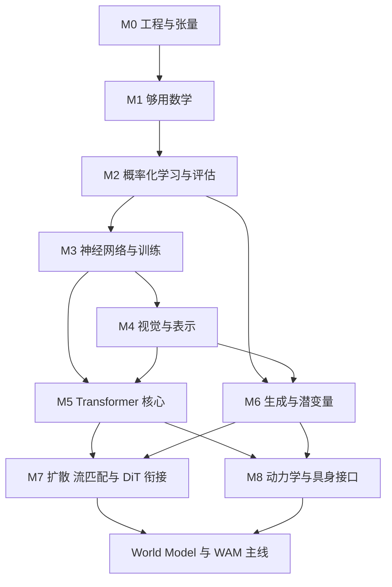

# 面向具身 World Model 与 WAM 的基础课程体系

调研与课程设计日期：2026 年 10 月 4 日。适用目标：World Model、World Action Model、VLA、生成式策略及相关理论。适用起点：AI 与深度学习基础较弱，愿意学习必要数学并亲自编写小规模模型。

本课程的终点是能够读懂代表性论文的方法、将关键公式对应到张量与代码、设计有基线的小实验，并进入具身世界模型主线。它不要求先成为传统机器学习全科研究者，也不要求复现大规模预训练结果。

建议将共同基础控制在约 192 小时，随后用约 68 小时直接进入生成建模与具身研究的衔接项目。总计 260 小时，含阅读、推导、编码、实验和验收。按每周 10–13 小时，约 20–26 周；如果 Python 几乎从零开始，额外预留 20–40 小时。时间是课程设计估算，不是课程官方工时，也不保证每个人都在同一时长达标。通过验收即可提前进入下一阶段。

## 1 原材料审计与课程定位修正

原材料证据来自《具身入门.docx》当前正文，共两页。原文没有详细章节、学时、数学范围和考核体系；下面的 syllabus、学习深度和毕业标准均为本次新增设计。引用编号对应文末可核验的官方课程、作者论文、项目页与官方代码。

| 原材料明确提出的内容 | 核验与判断 | 本课程的处理 |
|---|---|---|
| 善用社区，关注前沿论文和讲座 | 合理，但观看讲座不能替代基础训练 | 作为每周有限时间的方向导航；以论文方法、实验及代码核验理解 |
| 了解 OpenVLA、OpenVLA-OFT、RDT、π 系列及 GR 系列 | 有研究脉络价值，但不同模型不能视为同一生成范式 | 按动作回归、自回归、扩散、流匹配及世界预测分类阅读 [R5–R10] |
| CS229 或李宏毅机器学习课程二选一，快速过一遍 | 作为概览合理；把整门课看完既不是充分条件，也不是必要条件 | 基础较弱优先李宏毅的指定主题，数学推导用 CS229 指定小节；无需双修全课 [C1–C2] |
| 掌握 Python、Conda、Linux、tmux | 工程方向正确 | 增加 NumPy/PyTorch 张量、训练循环、数据划分、复现记录、Git；tmux 可在远程训练时补 |
| CS231n 主要针对深度强化学习 | 明确错误。官方定位是 Deep Learning for Computer Vision；2025 版仅 Lecture 17 涉及机器人学习与深度 RL | 用其讲授反向传播、优化、CNN、Attention、视觉表征及生成模型 [C3] |
| CS336 更重要，看不懂不用死磕 | 对 Transformer 实现有价值，但它是语言模型全流程与系统课程，官方要求 Python、DL、PyTorch 与系统基础 | 放在基础之后，重点选 Architecture、PyTorch、Inference 和 Assignment 1 的模型部分；不要求完成全课 [C4] |
| 学完上面，再逐个学 Transformer、diffusion、flow matching、causal、world model | 过度串行会推迟进入主线；Transformer 应提前成为核心 | M5 系统学习 Transformer，M6–M8 以生成目标与具身小项目衔接；研究阅读逐步提前 |

原文写的“π0.6star”可对应到真实的 π*₀.₆ 与 RECAP，论文于 2025 年 11 月公开，不应因为命名不规范便判定为虚构。[R8] 但截至本次调研日期，官方已经列出 2026 年 4 月的 π₀.₇，固定在 π₀.₅、π*₀.₆ 的清单并不代表完整当前脉络。[R9] 这不意味着基础课要追完每个新版本；应掌握变化发生在哪个接口、损失与数据流程。

“TikTok GR 系列”建议在笔记中记录论文标题、作者与机构；这里关注的是 ByteDance 研究脉络中的 GR-1、GR-2 等方法，避免与同名机器人硬件混淆。GR-1 与 GR-2 对视频—动作联合学习有直接价值；GR-RL 属于策略强化与后训练延伸，不必先完成其全套 RL 理论才能开始世界模型学习。[R10–R12]

“causal”有至少三种含义：因果注意力屏蔽、时序预测中的过去到未来约束、统计因果推断。前两项属于本课程核心；第三项暂不作为入门门槛。因果 mask 或 action-conditioned prediction 本身都不自动证明模型识别了可干预的因果结构。

## 2 从研究任务反推真实基础要求

以下是根据代表性方法反推的课程建议，不是原材料原有规定，也不是对所有未来架构的预言。调研使用稳定的经典论文与已公开的 2025–2026 方法作为锚点，而非只看模型发布时间。

| 研究路线 | 模型实际要学习什么 | 直接依赖的基础 | 支撑证据 |
|---|---|---|---|
| 生成式策略 | 给定观测、语言或目标，产生未来动作序列的条件分布 | 条件概率、连续回归、多峰分布、action chunk、扩散/流匹配、条件注入 | Diffusion Policy、π₀ [R5,R7] |
| VLA | 将视觉、语言、本体状态与动作接口连接起来 | ViT/视觉 encoder、embedding、Transformer、跨模态融合、动作表示、训练/部署差异 | OpenVLA 与 OpenVLA-OFT [R6] |
| 视频生成模型 | 在压缩视频表示中建模时空内容分布，按条件采样 | AE/VAE、latent patch、时空 token、DiT、条件生成、计算复杂度 | DiT、Wan、Sora 技术报告 [R3,R13,R14] |
| 潜在动力学世界模型 | 用历史和动作预测未来表示，用于想象、规划或策略学习 | latent、条件转移、序列记忆、多步 rollout、后验/先验、KL、目标/奖励 | DreamerV3 [R15] |
| 预测式表征世界模型 | 在特征空间预测未来，与动作和规划对接 | 自监督、目标 encoder、stop-gradient/EMA、block-causal mask、latent dynamics | V-JEPA 2 与 2-AC [R16] |
| World Action Model | 将未来世界预测与可执行动作生成耦合 | 上述共享基础、视频—动作时间对齐、联合建模、反向动力学、闭环执行与推理延迟 | DreamZero [R17] |

关键区别：

1. Transformer 是架构组件；自回归、扩散、流匹配是建模/训练/采样范式。选择 Transformer 不意味着一定使用 next-token prediction。
2. 原始 OpenVLA 与 OFT 的动作输出机制不同；OFT 包含连续动作表示、并行解码与 L1 回归。VLA 不必统一为离散动作 token 自回归。[R6]
3. π₀ 的动作专家采用流匹配；Diffusion Policy 建模动作分布。它们是策略，不因使用生成模型就自动成为显式世界模型。[R5,R7]
4. Dreamer 的潜在动力学与 JEPA 的特征预测没有“必须先生成高清像素视频”的共同要求；JEPA 表征也不要求自动拥有可用的像素 decoder。[R15,R16]
5. DreamZero 用一个模型联合预测未来视频和动作，是 WAM 的具体实例。WAM 的命名和边界仍需按论文自身定义阅读，不能用一个实例定义整个领域。[R17]
6. 视频视觉质量、动力学预测准确性和控制成功率是不同评价维度。高质量视频不等于可靠、可干预的机器人模拟器。[R14,R16]

因此最值得深入的共享能力是：**张量与梯度、概率化损失、潜在表示、Attention 与条件注入、时空序列表示、动作条件预测、多步误差和实验评价。** 强化学习全套算法、传统分类器全集、GPU 内核开发都不是所有路线共同的第一道门槛。

## 3 学习等级与停止规则

| 等级 | 意义 | 完成证据 |
|---|---|---|
| A 必学深入 | 后续论文反复直接依赖；要能解释、推导关键步骤、实现最小版本并验证 | 不看模板推导或重建核心操作；标出张量形状；用针对性实验验证 |
| B 必学够用 | 会解释与正确使用；不要求穷尽证明或历史变体 | 能回答输入输出、关键假设、失效情况；使用已有模块并读懂接口 |
| C 选学了解 | 有助比较方法或后续分支 | 一页解释或一张结构图即可 |
| D 暂缓 | 当前路径收益低；出现具体研究依赖后再补 | 不作为阶段毕业条件 |

“深入”不等于背所有公式：例如 Attention 要能实现和检查信息流，但不要求手写高性能 CUDA；Gaussian 要能采样与解释条件分布，但不要求先完成测度论。每个模块只使用一套主资源，其他资源用于解决特定卡点。

遇到障碍时先定位是哪条依赖缺失。若一个非核心证明连续占用两个学习单元仍没有帮助公式转代码，将它记入待补清单，继续当前模块。若张量形状、链式法则、概率条件方向或 mask 信息流仍错，必须针对性补课；不能用“看懂大意”替代这些验收。

## 4 知识依赖与推荐顺序

数学随任务推进，不需要先完整学完数学、再开始编码。M1 的线性代数和微积分在 M2–M5 中复用；KL 在 M6 中加深；ODE 在 M7 中即时补齐。

这不是唯一路径。偏 latent dynamics 的学习者可以在 M5 后先进入 M8，再完成 M7；本课程默认用户同时关注视频生成与 WAM，因此先学 M7。深入 Dreamer 策略优化时再加 RL 分支；不需让 RL 分支阻塞所有世界模型阅读。

### 后续方向的直接前置知识

| 后续方向 | 进入方法阅读前的最低基础 | 首次实验前需要补齐 | 可在研究时继续深化 |
|---|---|---|---|
| Diffusion | M1 的 Gaussian/条件概率、M2 的损失、M3 的训练、M6 的生成分布 | M7 加噪、噪声预测、采样与时间条件 | score-SDE、完整 ELBO、采样器理论 |
| Flow Matching | M1 梯度/期望、M3 回归、M6 条件分布 | M7 概率路径、向量场、ODE 与 Euler | 连续性方程、OT 耦合、随机插值理论 |
| DiT | M4 patch/latent、M5 block/条件注入、M6 表示 | M7 将噪声或速度损失接到 Transformer | 训练尺度、初始化、架构与 sampler 消融 |
| Video Model | M4 编码/压缩、M5 时空 token/位置/mask、M6 生成 | 视频与 latent 时间轴、条件帧、rollout | 3D VAE、长视频缓存、多视角一致性 |
| Latent World Model | M4 encoder/representation、M5 序列、M6 先验/后验 | M8 动作条件转移、多步预测、状态/观测区分 | RSSM、随机性、目标表征与 planning |
| VLA | M2 监督学习、M4 视觉、M5 多模态接口 | M8 动作单位/归一化/chunk、闭环评价；生成动作头再接 M7 | 预训练、LoRA、数据混合与后训练 |
| WAM | 视频或 latent world model 与策略共享基础 | M7–M8 联合预测、对齐、损失权重、闭环与延迟 | 长时记忆、跨 embodiment、模型与控制协同 |

## 5 完整 syllabus

表中学时已包含该章相应推导、实践与验收，不另外叠加后文项目时间。带 C 的附加内容可以不做；D 内容不计入 260 小时。每章列出的 A/B 内容按总学时执行。资源用法见第 8 节，公式详见第 6 节。

| 模块与章节 | 子章节和范围 | 学时 | 等级 | 学习成果 | 依赖 |
|---|---|---:|---|---|---|
| M0.1 Python 最小基础 | 变量、循环、函数、容器、类、import、异常、路径和文件读写 | 3 | A | 将 notebook 中一个数据处理函数移入脚本 | 无；零基础另补练习 |
| M0.2 张量操作 | NumPy/PyTorch、shape、索引、broadcast、reshape、permute、矩阵乘、einsum | 5 | A | 图像/视频/序列三种张量变换练习 | M0.1 |
| M0.3 PyTorch 工作流 | nn.Module、Parameter、Dataset/DataLoader、forward、autograd、optimizer | 4 | A | 跑通简易回归训练循环并解释每步 | M0.2；与 M2 联动 |
| M0.4 环境和命令行 | 虚拟环境、Conda 或 venv、依赖记录、Linux 路径、进程、日志；tmux 够用 | 3 | B | 从终端启动和恢复脚本；确认 VSCode interpreter | M0.1 |
| M0.5 实验记录 | Git 基本使用、config、随机种子、checkpoint、数据与版本记录 | 3 | B | 给出可复现说明和一个保存/载入案例 | M0.3–4 |
| **M0 小计** | 工程是贯穿课程的能力 | **18** | | | |
| M1.1 线性代数 | 向量、点积、范数、矩阵乘、转置、线性映射、秩/投影；协方差矩阵 | 8 | A/B | 手算 QKᵀ 的小例子，解释 shape 和点积 | M0.2 |
| M1.2 微积分 | 导数、偏导、梯度、链式法则、Jacobian 与向量-Jacobian 积；积分含义 | 8 | A/B | 推导线性层与复合函数的梯度 | M1.1 |
| M1.3 概率 | 随机变量、PMF/PDF、联合/条件/边缘、Bayes、独立性、期望、方差、Gaussian、Monte Carlo | 10 | A | 从联合分布正确分解序列概率；采样估计均值 | M1.1 |
| M1.4 数值与优化预备 | Taylor 一阶近似、梯度下降几何、log/exp、稳定 softmax、基础凸性 | 4 | B | 解释溢出与减最大值；理解局部线性化 | M1.2–3 |
| **M1 小计** | 特征值/SVD 的解释为 C，不要求证明 | **30** | | | |
| M2.1 学习问题 | 数据、模型、参数、目标、ERM、回归/分类、训练验证测试 | 6 | A | 写清一个预测任务与数据切分策略 | M0、M1 |
| M2.2 概率化损失 | 线性/逻辑/softmax 回归、MSE、L1、CE、MLE/MAP | 6 | A | 推导 Gaussian NLL 与 MSE 的关系 | M2.1、M1.3 |
| M2.3 泛化与实验 | 过拟合、正则、数据泄漏、distribution shift、baseline、ablation、学习曲线 | 6 | A | 用正则与数据量实验区分训练/验证问题 | M2.2 |
| M2.4 方法地图 | 监督/自监督/生成/RL、PCA 直觉；kNN/树/SVM/聚类只做定位 | 4 | B/C | 用一页说明为何无需先精通传统算法 | M2.1 |
| **M2 小计** | 非深度 ML 仅保留服务后续模型的部分 | **22** | | | |
| M3.1 MLP 与非线性 | Linear、ReLU、GELU、SiLU、sigmoid/tanh、表达能力、logits | 8 | A | 实现两层 MLP，解释无非线性时的退化 | M1–M2 |
| M3.2 反向传播 | 计算图、链式法则、向量化梯度、梯度累积、detach、requires_grad | 10 | A | 手推小网络，和 autograd/数值梯度交叉验证 | M3.1 |
| M3.3 训练优化 | mini-batch SGD、momentum、Adam/AdamW、学习率、warmup、weight decay、初始化、梯度裁剪 | 10 | A/B | 排查学习率与梯度问题；生成诊断记录 | M3.2 |
| M3.4 深层网络组件 | residual、Dropout、BatchNorm/LayerNorm 区别、train/eval、梯度消失/爆炸 | 6 | A/B | 比较残差/非残差，解释归一化轴 | M3.2–3 |
| M3.5 训练工程补充 | device/dtype、no_grad、混合精度概念、吞吐/显存、保存恢复 | 4 | B | 记录参数量、峰值显存或内存与配置 | M0.5、M3.3 |
| **M3 小计** | 不要求学习神经网络逼近定理的完整证明 | **38** | | | |
| M4.1 CNN 基础 | 通道、卷积核、stride/padding、输出尺寸、感受野、pool、卷积 encoder | 7 | A/B | 实现小 CNN，逐层标出尺寸 | M3 |
| M4.2 Representation 与 latent | 表征、embedding、encoder/decoder、bottleneck、AE 重建、冻结/微调 | 6 | A | 训练小 AE；说明“latent”不保证物理语义 | M4.1 |
| M4.3 ViT 与视觉 token | patchify、线性投影、位置、CLS/mean pooling、ResNet 直觉、预训练迁移 | 6 | A/B | patchify/unpatchify；M5 后完成 ViT block 接线 | M4.2；与 M5 联动 |
| M4.4 自监督与多模态 | contrastive learning、masked prediction、EMA/stop-gradient、CLIP/VLM 结构直觉 | 5 | B | 比较重建、对比、预测目标；画视觉语言接口 | M2–M4.3 |
| **M4 小计** | 不深入检测分割全谱；AE 可复用后续视频数据 | **24** | | | |
| M5.1 Token 与序列 | 离散/连续 token、embedding、batch/sequence/feature、基本 tokenization | 5 | A/B | 给文字、图像、动作分别定义 token 和 shape | M0、M4 |
| M5.2 Attention 与 QKV | 线性投影、scaled dot product、softmax、attention map、缩放与复杂度 | 10 | A | 从头实现单头 Attention，手算与程序对照 | M1–M3 |
| M5.3 多头与完整 block | split/merge heads、output projection、residual、LayerNorm、MLP、Pre-LN/Post-LN；RMSNorm/SwiGLU 够用 | 8 | A/B | 实现 pre-norm block，逐层标形状 | M5.2、M3.4 |
| M5.4 位置与 mask | learned/sinusoidal position、RoPE、padding/causal/block-causal、label shift、泄漏检查 | 8 | A | 写 RoPE 和 mask；扰动未来 token 验证不可见性 | M5.3、M1.1 |
| M5.5 架构与训练推理 | encoder、decoder、encoder-decoder、decoder-only、teacher forcing、autoregressive rollout、KV cache 原理 | 9 | A/B | 训练小 decoder-only 模型；对照三种结构 | M5.4、M2.2 |
| M5.6 Cross-Attention 与条件 | Q/KV 来源、不同 token 数、投影、拼接条件、cross-attn、FiLM/adaLN、条件 drop | 8 | A/B | 用动作 query 读取视觉/语言条件；构建条件 block | M5.2–5 |
| M5.7 视觉与时空 token | ViT 接线、视频 tubelet、时间/空间位置、全局/分解时空注意力、视频—动作对齐 | 7 | A/B | 对视频和 action chunk 画含时间轴的 token 图 | M4.3、M5.6 |
| M5.8 成本与综合验收 | 参数/激活/KV cache、N² 注意力成本、长序列、官方 SDPA 对照、一个消融 | 5 | A/B | 通过数值、信息流、学习曲线与消融验收 | M5.1–7 |
| **M5 小计** | 本课程最长且最核心的基础模块 | **60** | | | |
| M6.1 生成建模地图 | p(x)、p(x\|c)、likelihood、采样、多峰；区分架构/目标/采样器 | 4 | A | 用同一任务比较均值回归与分布生成 | M1、M2 |
| M6.2 信息论 | entropy、cross-entropy、KL、NLL、支持集、方向与非对称 | 6 | A | 推导 H(p,q)=H(p)+KL(p\|\|q)，解释条件限制 | M1.3、M2.2 |
| M6.3 潜变量模型 | prior/posterior、AE/VAE、reparameterization、ELBO 关键两步、重建/正则 | 8 | A/B | 标出 q 与 p 的方向；实现重参数化和 Gaussian KL | M4.2、M6.2 |
| M6.4 生成序列与条件 | 自回归分解、encoder latent 与预测 latent 区分、训练与采样、条件失效 | 4 | A/B | 比较视频与动作建模的条件变量 | M5、M6.1–3 |
| **M6 小计** | VAE 完整大规模项目不作为门槛 | **22** | | | |
| M7.1 Diffusion 桥接 | Gaussian 加噪、noise level、噪声预测、去噪采样、DDPM 训练/采样框图、score 含义 | 10 | A/B | 2D 或低维序列去噪模型；说明训练为何无需展开全部步 | M3、M6 |
| M7.2 Flow Matching 桥接 | 噪声到数据路径、条件向量场、期望回归、ODE/Euler、时间方向 | 10 | A/B | 2D conditional FM；改变步数比较采样误差/成本 | M1.2–3、M3、M6 |
| M7.3 DiT 与视频桥接 | patch/latent、时间 embedding、adaLN、预测头、视频轴；看网络与损失如何独立组合 | 6 | A/B | 阅读 DiT block；构建极小条件 Transformer 生成头 | M4、M5、M7.1–2 |
| **M7 小计** | 已进入目标模型的方法学习，不是继续泛泛打基础 | **26** | | | |
| M8.1 Dynamics 与世界模型 | state/observation、Markov/POMDP 直觉、forward/inverse dynamics、action-conditioned rollout、MPC 概念 | 6 | A/B | 比较一步预测与开环多步预测 | M4–M6 |
| M8.2 具身策略接口 | BC、动作单位、absolute/delta、proprioception、归一化、chunk、控制频率、history 与部署闭环 | 6 | A/B | 写清数据时间轴与动作接口；动作头基线 | M2、M5；生成头依赖 M7 |
| M8.3 综合项目与论文映射 | 小世界模型、动作预测头、两个消融、误差与闭环评价、代表论文对照 | 8 | A | 交付实验报告并选定第一条研究分支 | M8.1–2、M7 |
| **M8 小计** | 若这里无法达标，补具体缺口，不重学所有 ML | **20** | | | |
| **总计** | M0–M5 共同基础 192h；M6–M8 衔接 68h | **260** | | | |

## 6 各模块的核心公式与掌握深度

符号约定：B 为 batch，N 为 token 数，D 为 hidden dimension，h 为 head 数，d_h=D/h。k 表示环境时间；τ 表示生成过程的连续时间；n 表示离散扩散步。区分这三种时间是视频和动作模型阅读中的基本要求。

后续阅读反复使用的七个公式集中列在这里；各模块下面解释其变量、用途、深度和完成标准。

$$
\mathcal L_{\mathrm{NLL}}(\theta)=-\mathbb E_{(x,y)\sim p_{\mathrm{data}}}\log p_\theta(y\mid x)
$$

$$
\operatorname{Attention}(Q,K,V)=\operatorname{softmax}_{\mathrm{key}}\!\left(\frac{QK^\top}{\sqrt{d_h}}+M\right)V
$$

$$
p_\theta(x_{1:N}\mid c)=\prod_{i=1}^N p_\theta(x_i\mid x_{<i},c)
$$

$$
D_{\mathrm{KL}}(p\Vert q)=\mathbb E_{x\sim p}\!\left[\log\frac{p(x)}{q(x)}\right]
$$

$$
\log p_\theta(x)\geq\mathbb E_{q_\phi(z\mid x)}\log p_\theta(x\mid z)-D_{\mathrm{KL}}\!\left(q_\phi(z\mid x)\Vert p(z)\right)
$$

$$
x_n=\sqrt{\bar\alpha_n}\,x_0+\sqrt{1-\bar\alpha_n}\,\epsilon,\qquad
\mathcal L_{\mathrm{DDPM}}=\mathbb E\|\epsilon-\epsilon_\theta(x_n,n,c)\|_2^2
$$

$$
x_\tau=(1-\tau)\epsilon+\tau x,\qquad
\mathcal L_{\mathrm{FM}}=\mathbb E\|v_\theta(x_\tau,\tau,c)-(x-\epsilon)\|_2^2,\qquad
\frac{dx_\tau}{d\tau}=v_\theta(x_\tau,\tau,c)
$$

### M0–M1 张量 数学与概率

矩阵乘：X∈R^(B×N×D)，W∈R^(D×D′)，Y=XW∈R^(B×N×D′)。理解批量矩阵乘与逐元素乘的区别，实际完成矩阵与张量的转置、维度重排和广播。

点积与范数：xᵀy=Σᵢxᵢyᵢ，||x||₂=√Σᵢxᵢ²。A：几何解释与计算。投影、rank、协方差为 B；特征分解/SVD 的用途为 C，不要求手解复杂矩阵。

链式法则：z=f(u)，u=g(θ)，则 ∇θz=Jg(θ)ᵀ∇u f。A：理解反向传播如何按计算图累计梯度；B：Jacobian 的形状与向量-Jacobian 积，不要求构造整个巨型 Jacobian。

联合与条件：p(x,y)=p(y|x)p(x)，p(x)=∫p(x,y)dy；p(x|y)=p(y|x)p(x)/p(y)。A：能区分“给定动作预测未来”与“给定未来推断动作”。连续变量的 p 是密度，单点密度值不等于事件概率。

期望：Eₚ[f(x)]=∫f(x)p(x)dx≈(1/m)Σᵢf(xᵢ)，xᵢ~p。A：能说明训练损失里期望对哪些随机变量取，并以 mini-batch/Monte Carlo 实现。

Gaussian：x~N(μ,Σ)，可写 x=μ+Lε，ε~N(0,I)，LLᵀ=Σ。对角形式 x=μ+σ⊙ε。A：均值、标准差、方差、独立维度采样；B：一般协方差与线性变换。不能把 σ 与 σ² 混用。

### M2 概率化学习

经验风险：L(θ)=(1/m)Σᵢℓ(fθ(xᵢ),yᵢ)+λR(θ)。A：指出训练样本、预测目标、正则项和可优化参数。

MLE：θ*=argminθ −Σᵢlog pθ(yᵢ|xᵢ)。若 y|x~N(fθ(x),σ²I) 且 σ 固定，NLL 除常数外正比于 MSE。固定尺度 Laplace 对应 L1。A：推导两者关系；理解 MSE/L1 在多峰条件分布中可能产生不合适的单一输出，不能以此断言回归在所有策略任务都失败。

softmax：pᵢ=exp(zᵢ−zmax)/Σⱼexp(zⱼ−zmax)。分类 CE：−Σᵢyᵢlog pᵢ。A：logits/概率区别、稳定计算与 label 对齐。MAP 与正则化关系为 B。

### M3 反向传播与优化

两层网络：a=φ(XW₁+b₁)，ŷ=aW₂+b₂。A：对 MSE 推导 W₂、b₂、W₁、b₁ 梯度，理解 batch 求平均的系数；将推导对应到 autograd。

SGD：θ←θ−ηg。Adam：m←β₁m+(1−β₁)g，v←β₂v+(1−β₂)g²；用偏差修正后的 m̂、v̂ 更新。A：SGD、momentum、学习率与梯度诊断；B：Adam 的状态与各项意义。AdamW 将权重衰减与自适应梯度更新解耦，不把所有 L2 正则实现直接当成 AdamW。

Residual：y=x+f(x)。A：维度相容、梯度直通路径与 block 信息流；不要求证明深层优化收敛。

### M4 表征

AE：z=Eφ(x)，x̂=Dψ(z)，Lrec=E[||x−x̂||²]。A：encoder、decoder、bottleneck 和重建损失的数据流；知道低重建误差不保证 z 适合控制。B：冻结 backbone、微调、迁移与自监督目标。

卷积输出（dilation=1）：Hout=⌊(H+2p−k)/s⌋+1。B：用公式追踪维度；A：正确实现通道与批轴。ResNet 历史架构不需逐个背诵。

### M5 Transformer 核心

Q=XWQ，K=XWK，V=XWV；A(Q,K,V)=softmax(QKᵀ/√d_h+M)V。QKᵀ 形状为 [B,h,Nq,Nk]，softmax 沿 key 轴。A：推导 weighted sum、缩放理由、mask 和反向传播途径，并正确实现。Q/K/V 不是固定的人类语义槽位；“提问/索引/内容”只是辅助比喻。[R1]

多头：MHA(X)=Concat(head₁,…,head_h)WO。A：投影、拆头、合头与输出映射。固定 D 时增加 head 数不等于任意增加容量，各 head 的维度也变小。

Pre-LN 示例：u=x+MHA(LN(x))；y=u+MLP(LN(u))。LN(x)=γ⊙(x−μ)/√(σ²+ε)+β，μ、σ² 通常沿每个 token 的 feature 轴计算。A：LN 轴、Residual 和 MLP 作用；B：原始 Transformer 的 Post-LN 与现代 Pre-LN 差别。RMSNorm/SwiGLU 以能读懂接口为止。[R1,C4]

MLP(x)=W₂φ(W₁x+b₁)+b₂（列向量写法）。它通常逐 token 作用，对 feature 做非线性变换；attention 混合不同 token，二者不能互相当作等价操作。

位置：正弦 PE 的 sin/cos 不同频率为 B；RoPE 成对旋转为 A：q̃ₖ=R(kω)qₖ，k̃ⱼ=R(jω)kⱼ；内积涉及相对位置 j−k。实现一个二维旋转对，验证旋转不改变范数，再扩展到多维。多轴视频 RoPE 的实现和布局为 B，不要求研究所有外推方案。[R2]

Causal mask：Mᵢⱼ=0（j≤i），否则 −∞。A：结合 next-token 的输入/目标 shift 验证无未来信息泄漏。padding mask、block-causal mask 同样需显式画信息流。不同 PyTorch API 的布尔 mask 约定可能不同，使用时查当前文档并用小矩阵确认。[E1]

Cross-Attention：Q=XqueryWQ，K=CWK，V=CWV。A：Q 与 K/V 可以来自不同模态、不同长度；K 和 V 的 token 轴需相互匹配。无需将 query token 数强行改成 condition token 数。

自回归：p(x₁:N|c)=∏ᵢp(xᵢ|x<ᵢ,c)。A：teacher forcing、训练并行、推理递归，以及训练 rollout 与部署 rollout 的差别。KV cache 原理为 B，不要求第一轮写生产级缓存。

视觉 patch：N=(H/P)(W/P)（尺寸整除时）；视频 tubelet：N=(T/Pt)(H/Ph)(W/Pw)。A：patchify/unpatchify 与轴顺序；B：3D patch/2D 帧 patch、空间和时间位置。若先经 VAE 压缩，公式中的 T/H/W 应用 latent 尺寸。

Dense attention 交互部分计算量约 O(N²D)，直接存 score 的内存约 O(BhN²)；线性投影和 MLP 还有 O(ND²) 成本。A：能估算 token 数增长的后果；B：FlashAttention 改善访存和中间显存，并不将 dense attention 的数学运算变成线性复杂度。以当前实现实际 profiling 为准。

FiLM/adaLN 预备：modulate(z,c)=(1+s(c))⊙LN(z)+b(c)。A：条件在哪里进入 block；B：门控、零初始化和 adaLN-Zero。该写法只是常见约定，不把所有 adaptive normalization 视为同一细节。[R3]

### M6 信息论与潜变量

H(p)=−Eₚlog p，H(p,q)=−Eₚlog q，DKL(p||q)=Eₚlog[p/q]。在相应积分有限且 q 覆盖 p 的支持集等条件下，H(p,q)=H(p)+DKL(p||q)。A：非对称、期望在哪个分布下、类别 CE 与 KL 的联系；B：Jensen 关键一步与连续熵可为负。KL 非负，但不是对称距离。[M2]

ELBO：log pθ(x)≥E_qφ(z|x)[log pθ(x|z)]−DKL(qφ(z|x)||p(z))。A：由 log p(x)=log E_q[p(x,z)/q(z)] 经 Jensen 得到下界，再拆成重建与 KL；B：变分推断更完整理论。对角 Gaussian 重参数化：z=μ+σ⊙ε；相对于 N(0,I) 的 KL 为 ½Σᵢ(μᵢ²+σᵢ²−1−log σᵢ²)。A：将 μ/log-variance 输出对应到采样与梯度。[M2]

这里学习 VAE 是为了理解潜变量概率化、latent diffusion 与随机 dynamics，而不是规定所有世界模型都必须是 VAE。AE decoder、Transformer decoder、生成采样器和 policy action head 是不同概念，笔记中必须分别命名。

### M7 生成模型衔接

DDPM 加噪：x_n=√ᾱ_n x₀+√(1−ᾱ_n)ε，ε~N(0,I)。简化训练目标：E||ε−εθ(x_n,n,c)||²。A：可一次采样噪声等级构造训练对；训练目标与推理的递归去噪流程分开理解。B：完整变分界与反向后验，放到正式 Diffusion 课程深化。[R4]

本课程 FM 采用明确约定：τ=0 为噪声，τ=1 为数据。x_τ=(1−τ)ε+τx，u=x−ε；L=E||vθ(x_τ,τ,c)−u||²。A：推导路径导数和目标；理解 MSE 最优回归器对应条件期望，而非把每个样本端点差当成已经得到的边缘场。独立采样 ε 与 x 得到直线路径，不自动等于最优输运耦合。[R18]

ODE 采样：dx_τ/dτ=vθ(x_τ,τ,c)，Euler：x_(τ+Δ)=x_τ+Δvθ(x_τ,τ,c)。A：实现、时间方向与步长；B：解的存在唯一性直觉、数值误差；C：高阶方法与严格理论。部分论文采用数据到噪声的反向时间约定，公式不能原样混用。[C6]

score：sτ(x)=∇x log pτ(x)。B：方向与去噪关系；SDE 的 drift/noise 直觉为 B；Ito calculus、Fokker–Planck 的完整推导为 C/后续分支。本阶段不必先完整学习随机过程。

CFG 常见约定：f_guided=f_uncond+w(f_cond−f_uncond)，w=1 对应条件预测。B：训练时条件 drop、推理时两支组合，以及 guidance 的质量/多样性权衡；ε/score/velocity 参数化需用各模型相应形式。

### M8 Dynamics 与动作接口

Forward dynamics：p(z_(k+1)|z_≤k,a_≤k)，或简化 ẑ_(k+1)=Fθ(z_k,a_k)；inverse dynamics：p(a_k|z_k,z_(k+1))。A：两个条件方向不同，且 inverse mapping 可能多解。观测 o 不等于完整 state s，单帧表征 z 也未必满足 Markov 性。

多步预测：ẑ_(k+j+1)=Fθ(ẑ_(k+j),a_(k+j))。A：对比训练给真实 history 与部署递归使用预测 history，报告误差随 horizon 的变化。B：RSSM 中确定性记忆与随机状态、推断后验/预测先验；正式 Dreamer 阅读再加深。

BC：minθ E[ℓ(πθ(o_≤k,l,q_k),a_(k:k+H−1))]。A：observation、language l、proprioception q、chunk horizon H 与 action 维度；区分预测 H 步和执行多少步。闭环每次重新观察，不能把离线动作误差下降等同于任务成功。

联合世界—动作目标的教学示例：L=λz Lpred+λa Lact。A：目标张量对齐、量纲/归一化、各项权重与训练信息泄漏。此式用于课程小实验，不是 DreamZero 官方完整损失，也不能证明一个简单双头模型等价于研究级 WAM。[R17]

MPC 概念：选择一段动作，使模型 rollout 的预计代价 Σ_j c(ẑ_(k+j),a_(k+j)) 较小，实际只执行前一部分，再重新观察规划。B：会解释即可；C：CEM、LQR 和可微规划实现按分支选学。

## 7 每阶段输出与毕业标准

验收对象是解释、推导、实现和实验判断，不是视频观看量。以下验收属于课程设计要求，非论文作者声称的标准。实验通过后就进入下一阶段；不为取得更漂亮的指标反复重做整门基础课程。

### G0 工程入口 对应 M0

必须能够：从 VSCode/终端启动脚本；确认使用的解释器和环境；读取小数据集；解释 [B,T,C,H,W] 与 [B,N,D]；保存/载入模型和日志。完成一组改变轴顺序和广播的练习，不能只靠反复试 reshape 的数值碰巧跑通。

交付：一份运行说明、一个数据和张量练习 notebook、一个最小 PyTorch 训练脚本。若 Python 仍不会函数、import 和列表操作，先补 20–40 小时练习；不先研究复杂工程框架。

### G1 可训练模型 对应 M1–M3

必须能够：

- 不看答案推导线性回归梯度；解释 MSE/CE 与预测对象的关系；对一个两层网络说明每条梯度路径。
- 自己写 nn.Module 和训练/验证循环，正确处理 zero_grad、backward、step、train/eval 与 no_grad。
- 在可拟合的小数据上实现小样本过拟合检查；若做不到，定位容量、梯度、标签、学习率或代码问题。
- 对平滑小计算图，用 float64 的数值梯度与 autograd 对照；在合理步长下误差应很小，接近零的梯度用绝对误差判断，避开 ReLU 拐点。
- 按 train/validation/test 划分数据；对轨迹数据按 episode 切分，不能把同一轨迹的近邻帧分入两侧冒充泛化。

交付：线性/softmax 回归推导、MLP 训练曲线、一个过拟合/正则对照、一次真实 debugging 记录和 README。这里不要求把所有传统 ML 算法重新实现。

### G2 表征入口 对应 M4

必须能够：逐层追踪小 CNN 的空间和通道维度；区分 encoder、decoder 与 prediction head；训练小 AE 并解释重建的局限；说明视觉 patch 如何形成 token。能画出“图像→视觉表征→投影→Transformer”的接口，不需要先做完整目标检测系统。

交付：CNN/AE notebook、patchify/unpatchify 的往返验证、一页表征目标比较。ViT 完整 block 接线可以在 M5 后补完，不能因为此处还没学 Attention 而阻塞。

### G3 Transformer 基础毕业 对应 M5

核心实现可使用 Linear、LayerNorm 和 autograd 等基础组件，但不能只调用 nn.Transformer 后声称已实现 Transformer。

必须通过：

1. 从头写单头、多头、pre-norm block、causal mask；能追踪 QKV、attention matrix、head 合并的形状。
2. 在无 dropout、相同缩放、相同 mask 的小输入下，对照手算或官方 SDPA；控制随机性并用容差比较数值。
3. 改变未来 token，过去位置的 causal 输出保持不变。新增 padding 后，有效位置结果符合预期。
4. 改变视觉或语言条件，Cross-Attention 的条件路径正常传递。可用合成任务验证，不能只观察一个随机初始化输出就断言条件学会了。
5. 实现 RoPE 并验证旋转保范数；解释相对位置进入 QK 的方式。
6. 训练一个小 decoder-only 序列模型，记录训练/验证损失与 rollout。模型可以是字符序列或可预测的合成轨迹，无需训练大型语言模型。
7. 画出 encoder-only、encoder-decoder、decoder-only，以及条件 DiT block 的差别。理解架构与生成目标是两层选择。
8. 为给定视频尺寸与 patch 大小计算 token 数；说明 action chunk 与视频帧时间轴怎样对齐。

交付：一个可读的小 Transformer、含 shape 的结构图、mask 验证、训练曲线、一个去位置/去条件等消融。复杂度估算须同时考虑 N²D 和 ND² 两部分。

**停止条件：通过 G3，即可开始 DiT、π₀、视频模型与世界模型的方法阅读。** M6–M8 是定向补课与首次研究练习，不需要再次先“完整学一遍 CS336”。G3 不代表已具备大规模训练能力。

### G4 生成模型入口 对应 M6–M7

必须能够：

- 解释 conditional distribution 与单值预测的区别；正确区分 NLL、KL 和重建损失。
- 从关键两步推导 ELBO，写出对角 Gaussian 重参数化并理解梯度去向。
- 写出 DDPM 的训练数据构造和简化损失；画出训练与迭代采样两套流程。
- 在 2D toy data 或低维动作序列上实现 FM 和 Euler sampler；解释噪声到数据方向，比较步数、成本和生成分布。
- 读懂 DiT 中时间 embedding、patchify、adaLN/门控、预测头的位置，说明换成 Transformer backbone 并不自动改变训练目标。

交付：2D FM notebook、加噪/去噪练习、采样步数对照、公式到代码映射表。可以只训练一个主生成模型，另一个用最小练习验证核心流程；不要求在此阶段训练高分辨率图像或视频。若准备以 Diffusion 为第一研究方向，再在后续主线完成小 DDPM 的完整采样实现。

### G5 进入具身 World Model 主线 对应 M8

使用同一个简单环境，交付世界预测和策略的接口实验，并做到：

- 数据包含 episode、观测、动作与时间；记录动作单位、方向、归一化及观测/执行时点。
- 比较不看动作的 predictor 与 action-conditioned predictor，比较单步预测与多步 rollout。
- 至少使用 persistence 或线性预测作为动力学基线，使用简单 BC/动作回归作为策略基线。预先规定指标和数据 split。
- 报告 held-out 轨迹误差随 horizon 的变化；若训练分布外测试失败，明确这是在哪些状态/动作范围发生。
- 若做闭环环境，报告固定测试集合的任务表现和延迟/执行频率；明确哪些结果只有离线预测证据。
- 能解释 Dreamer、V-JEPA 2-AC、视频生成模型和 DreamZero 分别预测哪个变量、条件是什么、如何连接动作。

交付：综合小项目、一份 2–4 页实验报告、两张代表论文结构图、一页下一阶段问题清单。报告允许记录失败，但代码必须通过核心形状/信息流/数据划分验证，结果必须诚实可重现。关键基线无法被超过时，要有有证据的诊断和修复尝试；不能只有“效果不好”的一句话。

**通过 G5 后，停止通用基础补课，进入选定主线。** 下一阶段的具体瓶颈决定补哪一块：例如 stochastic latent 不懂就补变分推断，planning 不懂就补 MPC，视频扩展卡住就补时空表示和生成采样，而不是重新完成全部 ML 课程。

## 8 资源及具体使用方法

以下是定制选读建议，不能误当成官方课程对自学者的完成要求。固定课程年份避免不同版本的讲次错位；若网站更新，按标题定位。中文 D2L 与英文版章节号可能不同，以主题名称为准。

### 默认主资源组合

**中文概念入口：李宏毅指定讲次。公式与代码主教材：D2L PyTorch 版。Transformer 实现补强：CS336 2025 指定部分。生成衔接：MIT 2025 课程指定部分。** CS229、MML 与 Deep Learning 用作定点推导工具。不要同时把七套资源全部从第一章读到最后一章。

| 资源 | 建议学习部分 | 可以跳过或延后 | 在本课程如何使用 |
|---|---|---|---|
| 李宏毅 ML 2021 官方课程与中文视频 [C2] | Introduction；Deep Learning 中 General Guidance、Batch/Momentum、Adaptive LR、Classification Loss；CNN、Self-Attention；Normalization、Transformer | PAC 完整推导、GAN/WGAN 证明、语音任务细节、完整机器翻译项目、全课全部作业 | M2–M5 的概念入口，每个主题先看一遍后马上做指定推导/代码；HW1–4 仅取有关训练组件，HW5 不需整套完成 |
| D2L 英文 1.0.3 PyTorch 版及官方中文版 [C5] | Ch2 的张量/线代/微积分/autograd/概率；Ch3–5 的回归/分类/泛化/MLP/backprop/初始化；Ch6 模块/参数/文件/GPU；Ch7 卷积，Ch8 中 BN/ResNet；Ch11 的 QKV/MHA/位置/Transformer/ViT | 房价竞赛、AlexNet/VGG/GoogLeNet/DenseNet 逐个完整实现；大量 RNN/翻译/beam search；推荐系统与检测分割全章 | M0–M5 的主要代码练习来源；从“逐操作版本”过渡到 nn.Module；减少 d2l helper 的黑盒依赖。Ch12 中 SGD/momentum/Adam 做补查，凸优化证明暂缓 |
| CS229 2022 Lecture Notes [C1] | Ch1 §1.1、§1.3；Ch2 §2.1；Ch3 §3.2.3 softmax；Ch7 网络/backprop；Ch8 §8.1 的 bias-variance 解释；Ch9 正则/模型选择 | 局部加权回归、Newton 细节、SVM 对偶/SMO、核方法证明、完整 GDA/Naive Bayes/EM/ICA | 只在 M2–M3 对损失/梯度不牢时补看；Ch11 §11.5 VAE 在 M6 选读；Ch15 的 MDP/model 和 Ch17 policy gradient 在 RL 分支再读 |
| CS231n 2025 官方 slides/notes [C3] | L2–4 线性分类、优化、backprop；L5 CNN；L6 的 BN/ResNet/transfer；L8 Attention/ViT；L12 self-supervision；L13 的 AE/VAE/AR；L14 diffusion；L16 vision-language | L9 检测分割细节、L11 分布式实现、L15 3D 全谱、GAN 全部证明；L7 仅 RNN/GRU 直觉 | 以主线不足时补查为主，不和 D2L 重复听全课；L10 video、L17 robot learning 在 M8 做方向概览。2025 页面的视频入口可能需校内权限，公开学习可用同页 slides/notes 和下述公开视频 |
| CS336 2025 [C4] | L2 PyTorch/resource accounting；L3 architectures/hyperparameters；L10 inference；L12 evaluation 概览；A1 的 linear/RMSNorm/RoPE/attention/FFN/Transformer/训练部分 | A1 完整 BPE tokenizer 可选；L4 MoE、L5–8 GPU/kernel/parallelism、A2 Triton/FlashAttention、A3 scaling law 全任务、A4 Common Crawl、A5 LLM alignment/RL | M5 的实现补强。用课程 A1 挑组件验收或参考 handout，**选做并不等于完成官方 A1**。不把其系统工程负担加入当前门槛 |
| Mathematics for Machine Learning [M1] | Ch2 矩阵/线性映射；Ch3 点积/范数/投影；Ch5 偏导/链式法则；Ch6 概率/Gaussian/条件；Ch7 梯度下降 | Ch4 分解证明只查用途；Ch10–12 PCA/GMM/SVM 算法训练可跳；复杂积分技巧不必先做全 | M1 的定点数学参考；每次用实际模型表达式作为题目，不以读完数学教材为目标 |
| Deep Learning 2016 官方在线版 [M2] | Ch3 条件概率、Gaussian、期望、信息论；Ch6 的 backprop；Ch8 优化选节；Ch14 AE；Ch15 表征；Ch20 的 variational autoencoder 选节 | Ch16–19 全套图模型/Monte Carlo/partition function 不作为基础要求；旧式能量模型全谱延后 | M1/M3/M6 的原理补强。它不覆盖现代 Transformer/DiT，不作为当前模型架构大全 |
| PyTorch Learn the Basics [E2] | Tensors、Dataset/DataLoader、Transforms、Build Model、Autograd、Optimization、Save/Load 全部基础单元 | ONNX、部署、C++、分布式、量化、compile 内核优化均暂缓 | M0/M3 的操作入口；使用与安装版本一致的文档；每次改数据/模型后自己跑通训练和保存载入 |
| MIT Introduction to Flow Matching and Diffusion Models 2025 [C6] | L1 的 ODE/采样；L2 的条件/边缘路径解释；L3 FM/score training；L4 conditioning/architecture；Lab1 的 ODE 练习、Lab2 的 toy FM、Lab3 的条件生成选做 | 初次不强求连续性/Fokker–Planck 证明、所有 SDE 理论、protein design；完整 lab 超预算时只做当前目标 | M7 的正式衔接。官网先修条件比本 syllabus 更强；这里是定制选学，不宣称完整达到其 real analysis 要求。Generative Robotics 讲座作为 M8 方向辅助 |

公开的视频使用方式：李宏毅课程页直接链接中文主题视频；CS336 2025 官方公开视频 [V1,V2] 与官网讲次一起用；MIT 官网每讲提供公开录像；Karpathy 的官方 Neural Networks Zero to Hero 仓库链接“micrograd”与“Let's build GPT”视频 [V3]。micrograd 用于 M3 理解计算图，GPT 视频用于 M5 对照实现。makemore 全系列和从零做复杂 tokenizer 可跳过。先独立做核心组件，再用示例对照；完整复制视频代码不能替代 G3。

### 论文与代码选读路线

| 阶段 | 必选锚点与阅读范围 | 代码使用与停止点 |
|---|---|---|
| M5 | Attention Is All You Need：§3.1–3.5，§4 的结构/复杂度比较；RoFormer：旋转位置构造与相对内积；ViT：§3 的 patch/encoder 图 [R1,R2,R19] | 对照自己的 Attention/RoPE/patchify；无需复现机器翻译或 ImageNet 大规模训练 |
| M6–M7 | DDPM：§2–3、训练/采样算法；Flow Matching：probability path、vector field 与 conditional FM；DiT：architecture、conditioning、block 与关键消融 [R3,R4,R18] | DiT 官方 models.py 看 TimestepEmbedder、DiTBlock、FinalLayer、forward [K1]。原库已归档，适合学习经典实现；不要要求按旧依赖原封不动运行大规模训练 |
| M8 策略接口 | Diffusion Policy：动作序列、条件、receding horizon；OpenVLA：视觉/语言/动作通路；OFT：动作输出与 loss；π₀：architecture 与 flow loss [R5–R7] | Diffusion Policy 官方 low_dim 示例优先 [K2]；OpenVLA/OFT 从 README 定位 data transform、action head、loss 与推理 [K3,K4]；openpi 从当前 README 选择 PyTorch 路线，顺 forward/训练目标/采样动作读 [K5] |
| M8 世界模型 | DreamerV3：world model/representation/dynamics 与 imagination 主图；V-JEPA 2：§2 表征预训练，§3 2-AC，§4 planning；DreamZero：§3.1 architecture，§3.2 execution [R15–R17] | 看 tensor 路径和预测条件，画自己的结构图；Dreamer 官方代码是另一套工程栈，先读方法，暂不要求转写整个系统 [K6,K7] |
| 进入视频主线后 | Wan 技术报告中 VAE、DiT、时空与条件部分；RDT 的 action encoding 与 diffusion transformer [R13,R20] | 官方仓库沿 VAE encode/decode、Transformer forward、conditioning、sampler 追踪一个样本 [K8,K9]。第一轮以代码阅读和缩小版组件验证为主，不下载/训练全量模型 |
| 脉络选读 | GR-1/GR-2 的视频预训练与视频/动作联合结构；π₀.₅、π*₀.₆、GR-RL 的变化点 [R8,R10–R12,R21] | 每篇一页差异卡：数据、目标、backbone、动作表示、部署方式、证据；不把读遍所有论文列为基础毕业条件 |

论文初读方法统一：先记录“输入变量→表示→交互机制→预测对象→损失→采样/rollout→评价”，再补关键公式。实验段至少区分作者在哪个 benchmark 的结果，不能把项目展示视频当成泛化能力的充分证据。

## 9 理论与实践安排

建议总时间分配约为：概念/课程 30%，推导与闭卷解释 20%，代码实验 40%，复盘/论文映射 10%。不要求每周严格相同，但应避免连续数周只有观看视频。

每个核心知识点执行一个短循环：

1. 解释它要解决的具体问题，例如为什么仅逐 token 的 MLP 不能完成 token 间的信息聚合。
2. 写关键公式与张量形状，标出输入、可训练参数和随机变量。
3. 写或修改最小实现，在小样本上验证。
4. 做一个有针对性的改变，例如去位置、错 mask、删条件、改采样步数，并预测结果。
5. 写 5–10 行说明该操作在后续哪篇论文中出现，有什么边界。

不要每节课都生成一份冗长文档。每模块保留一页概念图、一份推导/实验 notebook 和简短复盘即可。核心验收亲自完成；AI 可用于解释报错、检查形状、提问和审阅推导。若它生成了核心代码，先遮住答案重新实现关键操作，再做独立变化实验。基础学习的证据不能只是“AI 帮我运行成功”。

### 建议的连续项目

| 项目 | 对应模块 | 必须亲自完成的部分 | 控制范围 |
|---|---|---|---|
| P1 概率化回归与 MLP | M0–M3 | 数据 split、梯度推导、训练/验证循环、正则比较、保存恢复 | 合成回归与一个小分类任务，不做竞赛排名 |
| P2 视觉编码与压缩 | M4 | CNN shape、AE bottleneck、重建、patch 往返 | 小图像或自己生成的简单二维场景；无需高清图像 |
| P3 小 Transformer | M5 | QKV/MHA、block、RoPE/mask、cross-attention 小例、训练/rollout、消融 | 2–4 层、较小 D、短序列；数据和模型按设备缩小 |
| P4 条件分布生成 | M6–M7 | Gaussian 采样、FM target、Euler、条件作用与步数对照 | 2D 多峰数据或低维 action chunk；只需一个主要生成训练项目 |
| P5 小世界预测与动作接口 | M8 | 时序对齐、action-conditioned dynamics、BC 基线、联合头对照、rollout 评价 | 用同一个二维环境，观察可以直接用状态，视觉编码作为扩展；不等价于真实 WAM 复现 |

P5 的可执行环境例子：二维质点位置/速度作为 state，带限幅的二维控制作为 action，可渲染成 32×32 图像；收集多个起点与目标的独立 episode。先学习状态转移与动作回归，后将 P2 的视觉 encoder 接入。选用确定性已知转移，便于核验模型预测和闭环行为。课程不要求从零搭建高保真机器人仿真。

P5 基础版本：状态与动作→小网络/Transformer→下一状态；观测历史与目标→action chunk。扩展版本：图像→latent→动作条件 latent dynamics，并增加世界/动作双头。比较有动作/无动作、单头/双头两个消融；先把简单基线跑通，不应第一次就尝试大规模端到端 video WAM。

P3 的字符序列任务可改为合成序列，但至少一次正确使用 CE 和 label shift；若主项目全是连续状态回归，用很小的独立例子验证离散自回归路径即可，不额外做完整 NLP 项目。

### 设备与工程深度

CPU 足够做张量、梯度、attention、2D FM 和小数据 correctness 练习；小 GPU 可加速 CNN/AE/小 Transformer。这里的范围控制不是性能承诺，具体训练时间取决于序列长度、实现和硬件。无 GPU 时优先减小数据和模型，在 CPU 上完成结构与数值验收；不把下载大 checkpoint 当作学习前提。

所有实验记录环境版本、数据生成方式、split、seed、参数量、训练设置与指标。不要求硬件间逐位相同。AMP、profiling、gradient checkpointing、DDP/FSDP 属于后续放大实验时按需补充；基础阶段只需知道 dtype/device、显存来源和训练状态。

## 10 学习节奏与进度控制

以下是每周约 10 小时的 26 周参考安排。有的两周块需要 11–12 小时/周，可与邻近块灵活调整；按累计学时和毕业证据推进，而非强行按日历结束。

| 周次 | 内容 | 学时预算 | 阶段结果 |
|---|---|---:|---|
| 1–2 | M0 环境、Python 补查、张量、训练入口 | 18 | G0 |
| 3–5 | M1 数学；继续在张量代码中使用 | 30 | 概率/梯度练习；开始回归 |
| 6–7 | M2 ML 核心与评估 | 22 | 回归损失推导、data split |
| 8–11 | M3 DL 与训练；完成 P1 | 38 | G1 |
| 12–13 | M4 CNN、AE、视觉接口 | 24 | G2；ViT 接线留到 M5 |
| 14–19 | M5 Transformer 主线 | 60 | G3；开始选定论文的方法阅读 |
| 20–21 | M6 概率生成与潜变量 | 22 | 可读 VAE/latent dynamics 的目标 |
| 22–24 | M7 Diffusion、FM、DiT 衔接 | 26 | G4；进入目标模型的小实验 |
| 25–26 | M8 世界动力学、动作接口、综合报告 | 20 | G5；选定下一研究分支 |

按每周 13 小时，可压缩至约 20 周；按每周 6 小时约需 43–44 周。没有必要删掉核心 Attention/梯度/概率验收来追日历。Python 从零的额外 20–40 小时和修复长期卡点的时间不在 260 小时内；选学分支时间也不在总计内。

一周参考分配：两次 90 分钟概念与推导、两次 90 分钟编码、一次 2 小时项目、一次 1 小时闭卷解释与复盘、1 小时机动。每日可以拆成 30–50 分钟单元。每次只设一个可检验结果，如“今晚写对并验证 causal mask”，而不是“今晚学习 Transformer”。

从 M3 开始，每周拿约 20–30 分钟看一张目标论文的架构图，时间从复盘预算中出，不追加长时间追前沿。早期只识别已学组件和未知项；M5 后再读 method 与公式。这样方向感始终存在，论文难点也不会提前拖垮基础阶段。

### 防止无限补基础的规则

- 学习“是否通过验收”，而不是“是否感到完全自信”。能解释、实现和通过关键验证，比看过所有相关课程更有用。
- A 内容不过，只补造成失败的 1–2 条依赖；B 内容能读懂和使用即可；C 内容不阻塞进度。
- 每个模块最多保留三项待补问题，区分“下一阶段马上用”和“研究时再用”。
- 已通过的模块不因新论文采用某个变体而重学。理解新组件的位置与动机，再做局部补充。
- 第二次验收仍失败时，缩小任务并追踪错误链，不再增加第四套教材或更多视频。

## 11 哪些内容现在不必深入

| 内容 | 当前等级 | 什么时候再补 |
|---|---|---|
| kNN、决策树、随机森林、boosting、SVM 与核方法 | C；复杂推导 D | 需要 tabular 基线或特定统计方法时 |
| EM/GMM 完整推导、ICA、传统特征工程全集 | D | 具体 latent inference 或数据建模依赖出现时 |
| PAC/VC 理论、泛化界证明、深度网络表达定理 | D | 研究主题是理论泛化或证明时 |
| CNN 架构历史全集、完整检测分割课程 | D | 研究具体视觉 backbone 或感知模块时 |
| RNN/GRU | B 结构直觉，C 最小实现 | 深入 RSSM/Dreamer 时提高为 A/B |
| LSTM 全推导、机器翻译/beam search 工程 | C/D | 对照序列方法或特定任务需要时 |
| GAN/WGAN、能量模型全谱 | C/D | 实际模型采用这些目标时 |
| 完整随机分析、Ito 推导、Fokker–Planck 证明 | C/D | score-SDE、FM 理论成为研究主题时 |
| 最优输运严格理论、测度论 | D | 研究概率路径、耦合或理论性质时 |
| PPO/SAC/DQN 等算法全集 | D | Dreamer 策略优化、RECAP/GR-RL 后训练分支 |
| LQR、控制理论完整课程、刚体运动学与 ROS 全体系 | D；动作单位/坐标/闭环概念 B | 真机、规划、控制与安全部署分支；不阻塞当前理论主线 |
| 分布式训练、CUDA/Triton、FlashAttention 内核 | D；显存/复杂度 B | 模型规模或实际性能瓶颈明确时 |
| BPE 从零实现、语言数据清洗、RLHF/DPO 全流程 | C/D | 研究 LLM/VLM 预训练或对齐时 |

这些不是“永远不重要”，而是当前最短路径中的优先级。尤其 RL：需要立即知道 state、action、policy、return、value 和 MDP 的基本关系；但无需先完整掌握所有深度 RL 算法才能读视频世界模型、BC 或 WAM。

## 12 下一阶段分支与选择

| 主线 | 基础毕业后的第一组任务 | 有条件才补的理论 |
|---|---|---|
| 视频 World Model / WAM 默认方向 | 深读 DiT→Wan 的 VAE/时空/条件接口→DreamZero 架构与执行；将 P5 转为短视频/latent 联合预测；先复现局部组件或小设定 | 完整视频压缩、长序列 mask/cache、时间对齐、采样成本；再加入跨 embodiment 与长时记忆 |
| 生成式策略 / VLA | Diffusion Policy 与 π₀ 的生成动作头对比；理解 OpenVLA-OFT 回归基线；先做小数据 action chunk 实验 | 多峰动作、动作空间/坐标、数据混合、频率/延迟；再学 π*₀.₆ 等 RL 后训练 |
| Latent Dynamics / Planning | V-JEPA 2-AC 的冻结 encoder 与 action predictor；Dreamer 的 stochastic/deterministic state；比较 multi-step rollout 和 planning | 变分推断、RSSM、MDP/POMDP、Bellman、actor-critic；规划需要时补 MPC/CEM |

用户同时关注 World Model、WAM、VLA 与生成策略，推荐默认以“视频/latent 世界预测 + 条件动作生成”作为主轴，VLA 作为重要对照。不要同时复现三套大模型；先选择一个有设备和数据条件的研究问题，例如动作条件对预测误差的影响、mask 信息流、latent 压缩和规划指标的关系，或联合目标是否改善闭环行为。

第一份论文阅读成果应该能回答：该模型预测什么？已知哪些条件？哪些 encoder 冻结？动作如何表示与采样？未来信息是否只在训练标签中出现？论文评价的是视频、离线动作误差还是实际任务？哪个消融最支持作者的机制解释？这比背诵每篇论文的指标更接近研究能力。

## 13 证据与资源索引

以下链接均用于本次调研的核验或学习资源定位。作者报告的能力与指标只适用于各自的实验设置；本 syllabus 的学时、分级、顺序、选读与验收均为本次课程设计。网页可更新，正式实验应记录使用版本或 commit。课程选用 2025/2022 等固定版本是为了章节和材料稳定，不声称它们是网站最新年份。

### 官方课程与教材

- [C1] [CS229 2022 官方课程](https://cs229.stanford.edu/syllabus-spring2022.html)；[2022 Lecture Notes](https://cs229.stanford.edu/notes2022fall/main_notes.pdf)。按教材印刷章节号定位，不混用其他年份 PDF 页码。
- [C2] [李宏毅 ML 2021 官方课程与中英文视频](https://speech.ee.ntu.edu.tw/~hylee/ml/2021-spring.php)。采用已核验、主题明确的固定版本；现代生成衔接另用 C6。
- [C3] [CS231n 2025 官方 schedule/slides](https://cs231n.stanford.edu/2025/schedule.html)；[官方课程 notes](https://cs231n.github.io/)。
- [C4] [CS336 Spring 2025 课程与作业](https://cs336.stanford.edu/spring2025/index.html)。官方主页已有后续年份，但本课程的讲次编号对应此归档版。
- [C5] [D2L 英文 PyTorch 版](https://d2l.ai/)；[官方中文版](https://zh.d2l.ai/)。通过主题标题定位，注意不同版本编号。
- [C6] [MIT Flow Matching and Diffusion 2025](https://diffusion.csail.mit.edu/2025/)；[作者讲义论文](https://arxiv.org/abs/2506.02070)。官网有 notes、slides、recordings、labs。
- [M1] [Mathematics for Machine Learning 作者官网与免费 PDF](https://mml-book.github.io/)。
- [M2] [Deep Learning 官方在线书](https://www.deeplearningbook.org/)；[Ch3 Probability and Information Theory](https://www.deeplearningbook.org/contents/prob.html)。
- [E1] [PyTorch scaled dot product attention API](https://docs.pytorch.org/docs/stable/generated/torch.nn.functional.scaled_dot_product_attention.html)。查自己安装版本对应文档。
- [E2] [PyTorch Learn the Basics](https://docs.pytorch.org/tutorials/beginner/basics/intro.html)。
- [V1] [CS336 2025 官方 Lecture 1 公开视频](https://www.youtube.com/watch?v=SQ3fZ1sAqXI)。
- [V2] [CS336 2025 官方 Lecture 3 公开视频](https://www.youtube.com/watch?v=ptFiH_bHnJw)。
- [V3] [Karpathy 官方 Neural Networks Zero to Hero 课程及视频链接](https://github.com/karpathy/nn-zero-to-hero)。

### 研究论文与项目

- [R1] [Attention Is All You Need](https://arxiv.org/abs/1706.03762)。
- [R2] [RoFormer 与 RoPE](https://arxiv.org/abs/2104.09864)。
- [R3] [Scalable Diffusion Models with Transformers](https://arxiv.org/abs/2212.09748)。
- [R4] [Denoising Diffusion Probabilistic Models](https://arxiv.org/abs/2006.11239)。
- [R5] [Diffusion Policy 官方项目](https://diffusion-policy.cs.columbia.edu/)；[论文](https://arxiv.org/abs/2303.04137)。
- [R6] [OpenVLA](https://arxiv.org/abs/2406.09246)；[OpenVLA-OFT](https://arxiv.org/abs/2502.19645)；[OFT 官方项目](https://openvla-oft.github.io/)。
- [R7] [π₀ A Vision-Language-Action Flow Model](https://arxiv.org/abs/2410.24164)。
- [R8] [π*₀.₆ 与 RECAP](https://arxiv.org/abs/2511.14759)。
- [R9] [Physical Intelligence 官方研究索引](https://www.pi.website/)。本次检索看到 π₀.₇ 公告日期为 2026-04-16；本报告仅用来核验原清单并非完整当前索引，不推断尚未细读的方法细节。
- [R10] [GR-1 Unleashing Large-Scale Video Generative Pre-training](https://arxiv.org/abs/2312.13139)。
- [R11] [GR-2 A Generative Video-Language-Action Model](https://arxiv.org/abs/2410.06158)。
- [R12] [GR-RL Going Dexterous and Precise](https://arxiv.org/abs/2512.01801)。
- [R13] [Wan 技术报告](https://arxiv.org/abs/2503.20314)。作为可检查实现的基础锚点，非最新视频模型排名。
- [R14] [Video generation models as world simulators 作者技术报告](https://openai.com/index/video-generation-models-as-world-simulators/)。用于时空 latent patch 和物理模拟限制的背景。
- [R15] [DreamerV3 Nature 论文](https://www.nature.com/articles/s41586-025-08744-2)；[开放全文](https://pmc.ncbi.nlm.nih.gov/articles/PMC12003158/)。
- [R16] [V-JEPA 2 原论文](https://arxiv.org/abs/2506.09985)；[2026 V-JEPA 2.1](https://arxiv.org/abs/2603.14482)。课程先用 2/2-AC 理解表征与动作条件预测；2.1 用于后续配方比较，不要求入门追完版本。
- [R17] [DreamZero World Action Models are Zero-shot Policies](https://arxiv.org/abs/2602.15922)；[作者项目页](https://dreamzero0.github.io/)。
- [R18] [Flow Matching for Generative Modeling](https://arxiv.org/abs/2210.02747)。
- [R19] [ViT An Image is Worth 16x16 Words](https://arxiv.org/abs/2010.11929)。
- [R20] [RDT-1B](https://arxiv.org/abs/2410.07864)；[作者项目页](https://rdt-robotics.github.io/rdt-robotics/)。
- [R21] [π₀.₅ 官方介绍](https://www.pi.website/blog/pi05)。

### 官方代码

- [K1] [DiT models.py](https://github.com/facebookresearch/DiT/blob/main/models.py)。
- [K2] [Diffusion Policy](https://github.com/real-stanford/diffusion_policy)。
- [K3] [OpenVLA](https://github.com/openvla/openvla)。
- [K4] [OpenVLA-OFT](https://github.com/moojink/openvla-oft)。
- [K5] [openpi](https://github.com/Physical-Intelligence/openpi)。本次核验 README 已有 PyTorch 路线；不要再把只学 JAX 当作必要前置。
- [K6] [DreamerV3](https://github.com/danijar/dreamerv3)。
- [K7] [V-JEPA 2](https://github.com/facebookresearch/vjepa2)。
- [K8] [Wan2.1](https://github.com/Wan-Video/Wan2.1)。
- [K9] [RoboticsDiffusionTransformer](https://github.com/thu-ml/RoboticsDiffusionTransformer)。
