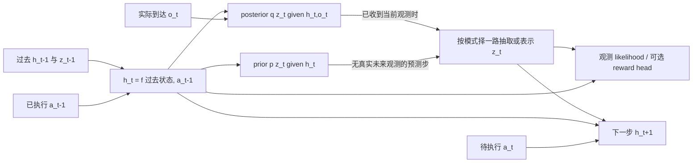

# 实际核心读料与连贯示范

修订1，2026-10-09。供备课审查；prepared，未作为正式教学展示，未索取原答或改变真实进度。认知目标与方法采用见 `01-cognitive-design.md`；公开学科来源及读取边界见 `02-source-notes.md`。本文件的雾中小车和全部参数为 AI 自拟教学对象，不是论文实验或真实机器人数据。它按同一对象承担 S05 范例追踪、R06 动态传播、R10 接口连接与 R04 条件分离；学习者的剩余工作在 `04-learner-work.md`。

## M1：雾中小车，先对齐对象与时间

小车驶向一条雾带。两次摄像头都拍到“车在同一标记附近”，但第一次车正向右滑，第二次正向左滑。单张图像可相同，下一时刻位置却不同。历史有助于推断运动；它未必消除遮挡和传感器噪声。

实际时间顺序是：**收到 o_t → 用已发生历史更新表示 → 选择并执行 a_t → 收到 o_{t+1}**。动作 a_t 影响从 t 到 t+1 的转移，不能解释此前已经收到的 o_t。小车在本稿只是一个可理解的外部对象；下面模型 latent 的数值没有被证明等于小车物理位置。

| 符号 | 对象、可用信息与用途 |
|---|---|
| x_t | 环境隐藏真状态，例如位置、速度；本次不能直接读取 |
| o_t / a_t | 当前观测／观测后执行的控制输入；标量 toy 的单位是归一化单位 |
| H_t=(o_{1:t},a_{1:t-1}) | 当时已经发生的历史，不是概率分布 |
| b_t(x)=P_env(x_t=x\mid H_t) | 理想环境 belief，是对真状态的条件分布；本稿没有假定知道环境生成规律 |
| h_t | 模型确定性记忆；给定初态、过去 z 与动作路径后由函数决定 |
| z_t | 模型随机 latent；一次抽样、均值、整个分布要分别命名 |
| m_t=(h_t,z_t) | 模型内部状态。其路径分布可作为预测接口，不自动等于 b_t |
| p_θ / q_φ | 本稿分别指生成模型／变分推断；字母本身不决定角色 |

如果真实环境转移 T(x'∣x,a) 和观测规律 O(o∣x') 已知，belief 更新会先预测再用新观测归一化：
\[
\bar b_{t+1}(x')=\int T(x'\mid x,a_t)b_t(x)dx,\quad
b_{t+1}(x')=\frac{O(o_{t+1}\mid x')\bar b_{t+1}(x')}{\int O(o_{t+1}\mid y)\bar b_{t+1}(y)dy}.
\]
有限状态时积分换求和。这说明 belief 处理的是环境真状态的所有可能性；本单元没有给真实 T/O，而是学习预测模型。历史可压缩到 RSSM state 是否足够，是表示与数据条件的假设／待检结论，不能由“单张观测不足”推出“任何 RNN state 都是充分 belief”。

“h 是确定性的”只说明其更新无新增随机抽样。过去 z 随机时，h 也有跨路径分布。h 不等于“全部已知”，z 不等于“全部未知”。学到的 latent 可把历史压缩成可用于预测的表示；表示充分性、模型失配和数据动作覆盖仍需证据。

## M2：同一 RSSM 的观测与无观测接口

固定 h_1=h_init，不假设真实执行过 a_0。先收到 o_1 后形成 q(z_1\mid h_1,o_1)。对 t≥2：

\[
h_t=f_θ(h_{t-1},z_{t-1},a_{t-1}),\quad
p_θ(z_t\mid h_t),\quad q_φ(z_t\mid h_t,o_t),\quad
p_θ(o_t\mid h_t,z_t).
\]

每条 latent 路径用同一个 h_t 产生 prior 和 posterior：prior 尚未读 o_t；posterior 在 o_t 到达后用它修正分布。训练可从 posterior 抽 z_t，下一 h 使用这个 z_t。部署在实际观测到来时也可用 q；未来无观测的预测步则用 p。

图中箭头是模型依赖：已观测步选择 q 的入口，无真实未来观测的预测步选择 p 的入口，不同时从二者抽两份 z 混用。当前动作节点不是用于当前观测推断的未来信息。生成观测头既能给训练 likelihood，也能生成未来观测预测；规划可直接在 latent 上计算 reward/cost，不要求每步渲染图像。

**过滤与平滑的近邻对照。** 过滤族 q(z_t\mid h_t,o_t) 只使用到 t 的信息。离线平滑族可使用 o_{t+1:T}；它可能更准确，但在线 t 时这些数据尚未到来。训练时拥有完整序列，仍可选择只用当前观测的过滤因子；“训练”与“平滑”不是同一个维度。

**论文记号映射。** PlaNet stochastic s_t 对应本文 z_t，其 deterministic h_t 对应本文 h_t。Dreamer v1 的整体 s_t 对应本文 m_t；论文 Eq.(1) 的 representation **p** 对应本文 **q_φ**，transition/observation/reward **q** 对应本文 **p_θ**。引用时按输入输出与功能映射。[PlaNet](https://proceedings.mlr.press/v97/hafner19a/hafner19a-supp.pdf)、[Dreamer v1](https://arxiv.org/pdf/1912.01603)。

## M3：从动作条件 joint 到序列 ELBO

这里把 a_{1:T-1} 视为外部指定控制输入，p_θ(o∣a) 是模型的受控输入序列 likelihood；不拟合收集数据时的行为策略。若动作由观测依赖政策生成，完整数据分布还需政策项；本式不是已证明等于该闭环行为数据的普通 observational conditional，也不自动证明干预识别或离线外推可靠。

令 h_t=h_t(z_{<t},a_{<t})。消去共享确定性递推后，模型与过滤变分路径族为：

\[
p_θ(o_{1:T},z_{1:T}\mid a)=\prod_{t=1}^T p_θ(z_t\mid h_t)p_θ(o_t\mid h_t,z_t),\qquad
q(z_{1:T}\mid o,a)=\prod_{t=1}^T q_φ(z_t\mid h_t,o_t).
\]

q 的乘积不是互相独立的时间边际：h_t 依赖此前从 q 抽出的 z。严格写 q_{θ,φ} 可提醒 h 使用 θ；后文仍简写 q。无需给 h 再拟一个独立 Gaussian 并加 KL；若保留 h 为显式变量，它受两边共用递推上的 Dirac 约束。

所需密度与可积性成立，并且 q 覆盖积分所需支撑时，把同一个积分改写为 q 下的期望，再用 log 的凹性（Jensen）：

\[
\begin{aligned}
\log p_θ(o\mid a)
&=\log\int q(z\mid o,a)\frac{p_θ(o,z\mid a)}{q(z\mid o,a)}\,dz\\
&=\log\mathbb E_q\!\left[\frac{p_θ(o,z\mid a)}{q(z\mid o,a)}\right]\\
&\ge\mathbb E_q[\log p_θ(o,z\mid a)-\log q(z\mid o,a)]\equiv\mathcal L.
\end{aligned}
\]

第一步没有改变模型；第二步只是期望定义；第三步把 log 移入期望会得到下界。展开两个乘积的 log：

\[
\mathcal L=\sum_t\mathbb E_{q_{≤t}}[\log p_θ(o_t\mid h_t,z_t)+\log p_θ(z_t\mid h_t)-\log q_φ(z_t\mid h_t,o_t)].
\]

现在固定过去路径 z_{<t}，h_t 就固定了。内层的 prior/posterior 两项满足：

\[
\mathbb E_{q_φ(z_t\mid h_t,o_t)}[\log p_θ(z_t\mid h_t)-\log q_φ(z_t\mid h_t,o_t)]
=-D_{KL}(q_φ(z_t\mid h_t,o_t)\Vert p_θ(z_t\mid h_t)).
\]

再把过去路径的外层期望补回，得到：

\[
\boxed{\mathcal L=\sum_{t=1}^T\left[\mathbb E_{q_{≤t}}\log p_θ(o_t\mid h_t,z_t)-\mathbb E_{q_{<t}}D_{KL}(q_φ(z_t\mid h_t,o_t)\Vert p_θ(z_t\mid h_t))\right].}
\]

重建项问“观测条件下抽出的状态，能多好解释实际观测”。KL 项问“当前观测修正后的分布，与只依据过去和动作预测的分布相差多少”。方向是 q∥p，因为期望在 q 下。t=1 的历史期望退化为空历史；t≥2 不能因为单步 Gaussian KL 可解析，就删除使 h_t 改变的外层历史期望。

完整序列恒等式为：

\[
\log p_θ(o_{1:T}\mid a)-\mathcal L
=D_{KL}\big(q(z_{1:T}\mid o,a)\Vert p_θ(z_{1:T}\mid o_{1:T},a)\big)\ge0.
\]

右侧是到**完整序列模型 posterior**的 gap，不是每时刻“真实过滤误差之和”。过滤 q 是合法限制族；它未使用未来观测，不意味着目标 posterior 也不使用未来。即使求到精确模型 posterior，也未证明模型符合真实环境。

训练最大化 L 或最小化 −L。β≠1、free-nats clipping、KL balancing 或额外辅助项是工程目标修改，不能不加说明地继续称为同一模型原 likelihood 的标准 ELBO。高斯重参数化 z=μ+σε、ε∼N(0,I) 可估计梯度，不保证找全局解。[一般 ELBO 与重参数化依据](https://arxiv.org/pdf/1312.6114)。

可选 reward head 采用到达下标 r_t：加 p_θ(r_t\mid h_t,z_t) 则加对应期望 log likelihood，并将 gap 目标改为 p(z\mid o,r,a)。API 的 step(a_t) 若返回名为 reward_t 的转移奖励，在本稿重命名为 r_{t+1}。下面 toy 直接提供 cost，不声称其已由观测 ELBO 学出。

## M4：整条可核路线——前缀、训练、预测、行动、题设环境反馈

### 4.1 透明模型与前缀

模型参数固定：

\[
h_1=0,\quad h_t=.5h_{t-1}+.5z_{t-1}+a_{t-1},\quad
p(z_t\mid h_t)=N(h_t,1),\quad p(o_t\mid z_t)=N(z_t,.25),\quad
q(z_t\mid h_t,o_t)=N(.2h_t+.8o_t,.2).
\]

N 的第二参数全部是**方差**。此 q 恰是给定 h 的单步局部条件 Gaussian，但不是对所有历史不确定性积分后的完整精确 filter，也不是环境 belief。用 o=(1,1.5,.7)、已执行 a=(.5,−.5)。为显示依赖，教师选“每一步取该条件 q 均值作为 z”的**代表性历史锚点**：

| 时刻 | 更新 h 的已知输入 | h | prior | 到达 o | q | 传给下步的代表值 z |
|---|---|---:|---|---:|---|---:|
| 1 | 固定初始化 | 0 | N(0,1) | 1 | N(.8,.2) | .8 |
| 2 | .5×0+.5×.8+.5；a_1=.5 | .9 | N(.9,1) | 1.5 | N(1.38,.2) | 1.38 |
| 3 | .5×.9+.5×1.38−.5；a_2=−.5 | .64 | N(.64,1) | .7 | N(.688,.2) | .688 |

例如把 a_1 从 .5 单独改为 0，且固定首个 z_1=.8，则 h_2 从 .9 变为 .4，prior 均值也下降 .5；同一个 o_2=1.5 会使 q 均值从 1.38 变为 1.28。若随后仍选择 q 均值，且 a_2=−.5，h_3 变为 .34。该对照只改变动作输入，清楚显示“一跳变化→观测修正→后续传播”；不把不同采样噪声混进动作效果。

这张表只追踪代表路径。在线 controller 也可以保留多条粒子或完整 joint 近似；本稿未替它完成。此线性 toy 的代表 h/z 均值恰与完整 q 路径均值相同，但平方项和方差不能由均值代替。

### 4.2 在同一 toy 上检验完整 q 的 ELBO

Gaussian KL 规则（方差 v）：
\[
KL(N(μ_q,v_q)\Vert N(μ_p,v_p))=\tfrac12[\log(v_p/v_q)+(v_q+(μ_q-μ_p)^2)/v_p-1].
\]
完整路径期望的锚点为：

| t | E_q h_t | Var_q h_t | E_q z_t | Var_q z_t | E log p(o_t∣z_t) | E_{q过去} KL |
|---|---:|---:|---:|---:|---:|---:|
| 1 | 0 | 0 | .8 | .2 | −.705791353 | .724718956 |
| 2 | .9 | .05 | 1.38 | .202 | −.658591353 | .535918956 |
| 3 | .64 | .068 | .688 | .20272 | −.631519353 | .427630956 |

因此 L=−3.684170927；独立 Kalman 计算的模型 log evidence 为 −3.676634594，gap=.007536333≥0。t=3 的 Cov(h,z)=.0136；不是独立状态分量。完整解析核验见 `09-numerical-check.json` 与原件 `code/rssm-test-20261009/verify_toy.py`。数值是推导的检查锚点；无需学习者先实现 Kalman 才能使用主线。

### 4.3 截止时刻后只用 prior，保留预测方差

为了手算规划，现明确采用**代表性历史控制器近似**：在 t=3 固定 h_3=.64，根节点 z_3∼N(.688,.2)。这保留该根的随机 z 和转移噪声，暂不保留完整历史导致的 h_3 分布与 h/z 协方差。它不等于精确 belief-MPC。完整版本的根是 q_τ(h_τ,z_τ∣H_τ)：由前缀 q 路径经 h 递推 pushforward 得到的联合分布，不是 E_q(h,z) 这个均值。应先从联合根取样，再按每条样本的动作条件 prior 推进，目标写成
\[
J(u)=\mathbb E_{q_τ(h_τ,z_τ\mid H_τ),\ p_θ\text{ rollout}}\!\left[\sum_{k=1}^{H}c(m_{τ+k},u_{τ+k-1})\right].
\]
也可解析积分；本题只要求理解这个接口，不追加完整 joint-root 数值计算。

对候选 u_3,u_4，未来数据不可用：
\[
h_4=.5h_3+.5z_3+u_3,\ z_4\sim p(z_4\mid h_4);\quad
h_5=.5h_4+.5z_4+u_4,\ z_5\sim p(z_5\mid h_5).
\]
这里没有 q(z_4∣h_4,o_4)。可用 decoder 预测 o_4，但不能拿真实 o_4 输入预测。在这个条件根下：
\[
E z_4=.664+u_3,\ Var(z_4)=1.05,\quad
E z_5=.664+u_3+u_4,\ Var(z_5)=1.30.
\]
理由：Var(h_4)=.25×.2=.05；z_4=h_4+ε_4 故 Var z_4=1.05、Cov(h_4,z_4)=.05；下一 Var h_5=.25(.05+1.05+2×.05)=.30，再加转移方差1。忽略协方差会算错第二步。

### 4.4 评分、选首动作，再用题设环境反馈重规划

任务提供人工 cost：目标 latent 坐标 g=1，两个到达时刻成本
\[
C(u_3,u_4)=\mathbb E[(z_4-1)^2+.1u_3^2+(z_5-1)^2+.1u_4^2],\quad u_k∈\{−.5,0,.5\}.
\]
它是 toy 的指定目标，不是已识别的物理安全约束。平方误差期望=(μ−1)^2+v，必须计入 v。此 toy 的方差对所有候选相同，所以忽略它恰不改变排序，但会把期望成本低报2.35；在方差依动作的模型中排序也可能改变。

| (u_3,u_4) | C | (u_3,u_4) | C | (u_3,u_4) | C |
|---|---:|---|---:|---|---:|
| (−.5,−.5) | 4.883792 | (0,−.5) | 3.186792 | (.5,−.5) | 2.539792 |
| (−.5,0) | 3.772792 | (0,0) | 2.575792 | (.5,0) | **2.428792** |
| (−.5,.5) | 3.211792 | (0,.5) | 2.514792 | (.5,.5) | 2.867792 |

选择 (.5,0)，在教学情境中假设执行 **a_3=.5**。第二个动作0只是当前计划的后缀。之后读取该情境给定的环境反馈 o_4=−.5，不能以想象均值1.164替代它。该教学控制器按代表值 z_3=.688 更新确定性锚点 h_4=1.164，再计算 q(z_4∣h_4,o_4)=N(−.1672,.2)。这一步也沿代表性历史近似，而不是对预测 joint(h_4,z_4) 自动做精确 Bayesian conditioning。

新的条件根中心为 .5(1.164−.1672)=.4984。重新两步评分时，候选 (.5,0) 成本2.37500512；(0,.5) 为2.62660512；(0,0) 为2.85320512；完整九候选见核验文件。下一执行 a_4=.5，**不同于旧计划后缀0**。不是因为“闭环必须改动作”，而是新观测改变根分布，重新比较后此候选最低。其他新观测完全可能使动作不变。

一次规划内部优化的是开环动作序列；部署反复接入真实反馈形成闭环。有限候选、短时域和代表性根都限制结论；这没有求完整未来观测分支策略树，也没有证明一般 POMDP 最优性。PlaNet 采用 CEM/MPC；Dreamer v1 在想象上训练 actor/value，部署可直接调用 actor。它们共享世界模型接口而控制选法不同。[PlaNet](https://proceedings.mlr.press/v97/hafner19a/hafner19a-supp.pdf)、[Dreamer v1](https://arxiv.org/pdf/1912.01603)。

## M5：什么证据支持什么用途

| 实际测量 | 直接支持 | 仍缺的连接 |
|---|---|---|
| 每时刻用真实 o 的 posterior 重建 likelihood/MSE | 在该数据上，状态能解释当前观测 | 不证明不看中间真实 o 的 prior 多步预测好 |
| 固定截止历史，未来只用 prior，比较真实未来轨迹 | 指定视界、动作分布和数据范围的开环预测 | 不证明优化器会选可靠动作，或部署真实收益／约束满足 |
| 控制器真实执行首动作并重规划，测收益和约束 | 指定环境与控制预算下的闭环表现 | 不证明 OOD 稳健性、belief 最优性或所有安全条件 |

最小条件对照：两种模型当前重建同样好，其中一个 prior 不读动作，另一个 prior 读动作且在 held-out 动作条件轨迹上多步误差更低。重建指标不能区分这项动作传播能力。反过来，某模型图像重建一般却保留与目标有关的速度表示，也可能控制更好；仍需实际控制证据，不能由这个可能性反推它一定好。

单 Gaussian 的 latent 随机性不自动覆盖参数不确定性或数据外风险。ELBO 改善、toy 算对、作者代码可读分别有用途，不能串成实际图像控制有效性的证明。latent overshooting 是可选多步一致性辅助，不是本单元成立或 rollout 可执行的前提；需要时见支持分支。

使用顺序：M1/M2给对象和接口；M3给完整合法推导；M4沿同一对象贯通；M5提供用途条件。当前没有要求每段回一句“继续”。下一份已有具体题面；正式启动后，真正需要学习者作品时才等待。
