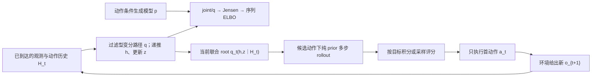

# 动作条件 RSSM：完整备课审查包

2026-10-09，完整审查稿 v1。状态：已完成制作、数值核验与成品审查，供用户审查；未开展正式教学、未改真实学习进度。

可一次阅读[完整备课成品](完整备课成品.md)，也可按下表分开查看。[第一份教学回复草稿](07-first-teaching-reply.md)单独保存；本次不要求回答其中题目。

近期单元的终点是一份连续作品《雾中小车 RSSM 系统论证与规划审计》。学习者应能把对象、信息条件、变分推导、预测和行动反馈接成合法系统，并判断给定证据支持到哪里。整体作品允许查阅定义和概率规则，不要求从零训练神经网络、实现 Dreamer 或复现论文分数。

认知设计先明确目标与具体加工，再将材料和问题填实。四个实际子 agent 分别承担认知设计、原始来源核验、材料制作和成品审查；主 agent 组织、运行数值核验并整合修订。这是分工审查，非盲评或学习收益实验。

## 一、成品导航

| 用户所需交付 | 实际文件 | 审查时看什么 |
|---|---|---|
| 完整认知主线与目标 | [01-cognitive-design.md](01-cognitive-design.md) | G1–G5、整体义务、材料功能、AI已提供与学习者剩余工作 |
| 研究、设计与学科依据 | [02-source-notes.md](02-source-notes.md)、[08-audit.md](08-audit.md) | 原始论文定位、实际读清范围、独立数学推导、框架研究与正式设计约束 |
| 实际材料与连贯完整示范 | [03-core-materials.md](03-core-materials.md) | 遮挡语境、语义表、时间图、序列 ELBO、数值过滤、prior rollout、评分与重规划 |
| Encoding / Post 工作、具体问题 | [04-learner-work.md](04-learner-work.md)、01第4节 | 同对象接口承担、竞争用途、连续整体作品；完整策略正文、版本、借用与未采用范围 |
| 教师参考 | [05-teacher-reference.md](05-teacher-reference.md) | 完整数值、合法推导、不同合法表达、拒用/信息不足、反馈与证据条件 |
| 必要支持分支 | [06-support-branches.md](06-support-branches.md) | 触发现象、实际备用输入、局部够用与回到同一作品的位置 |
| 第一份教学回复 | [07-first-teaching-reply.md](07-first-teaching-reply.md) | 可直接使用的正文草稿；此刻供审查，不要求提交学习答案 |
| 实际数值核验与代码 | [09-numerical-check.json](09-numerical-check.json)、[教师核验代码](../../code/rssm-test-20261009/verify_toy.py) | 范例及W1/W3轨迹、完整q ELBO、独立Kalman evidence、九候选和二轮规划 |
| 范围、角色与版本 | [00-scope-and-provenance.md](00-scope-and-provenance.md) | 仅备课授权、未读旧原答、未改真实状态、接入指纹与验证边界 |

建议先读01第1–3及第6节确认“认知目标是否合理”，再看03–05确认“材料是否足以承担目标”，最后看08与07确认“问题已修到哪里、第一回复如何开始”。完整教师参考在本次审查可见；未来教学若检验选法，须另按实际展示保留帮助条件，不能把本次查看记录清零。[主agent交付核验](10-verification.md)补实际运行与状态文件检查。

## 二、贯通的认知关系

这张图表达接口。ELBO 是训练目标，不直接输出最优控制器；候选轨迹在一次计划内开环推进，实际新观测进入回路后才形成闭环控制。Mermaid图是辅助表示，文字、公式与轨迹表独立可用；依赖语义已核，未声称实际渲染的视觉检查已完成。

| 工作 | 需要承担的认知操作 | 完整作品中的连接 |
|---|---|---|
| G1 对象与信息 | 区分真状态、历史、belief、模型状态、分布及样本 | 用同一信息集约束后续推断与预测 |
| G2 RSSM 时序 | 对齐h/z、p/q、动作下标、过滤/平滑 | 已观测前缀切换到没有未来观测的预测 |
| G3 序列变分推断 | 从给定joint/q合法推到ELBO并解释期望与gap | 说明训练怎样联系posterior与prior，以及它未保证什么 |
| G4 多步预测 | 保持state与动作接口，拒绝未来观测泄漏 | 形成可供规划评分的预测分布 |
| G5 闭环规划与审计 | 给定条件选用、执行首动作、重新过滤/规划、限制结论 | 连接数学、算法和三类评价证据 |

## 三、三项重点审查如何落实

**必要语义充分性。** 正文包含joint与过滤q的完整分解、初态约定、Jensen步骤、KL方向、过去q历史外层期望，以及整条q到全序列模型posterior的gap。h在给定路径上确定，边际上仍可不确定；不再为它单造高斯KL。模型latent与环境真belief分别定义。PlaNet和Dreamer v1记号按角色映射。

**不同维度分开。** prior/posterior的信息条件、过滤/平滑、训练/部署、一步/多步、一次候选轨迹开环/实际执行闭环分别说明。教学输入完成、学习者操作、允许资料、自主选法、时间条件和模型经验性能也分别表达。Post的知识关系加工不与控制器接收新观测的Bayes更新混称同一过程。

**示范到整体工作的跨度。** 完整示范先提供可靠路线；W1仍沿相同对象、相同参数、相同动作索引补关键接口；W2/W3增加给定候选的条件选用、整体组织和证据审计。基础定义、模型规格及概率规则始终允许查阅；撤去的只是已可承担的现成连线和结论。数据变化承担检验接口的功能，不能单靠换数字判已形成整体理解。

## 四、数值示范的精确使用边界

示范是自拟Gaussian RSSM，不是论文实验。为了使首次路线可追踪，控制示范固定代表性h历史，以条件q(z｜h,o)为规划root；新观测后再次用均值锚点固定下一h。候选评分仍保留条件root和prior噪声。完整q的ELBO则独立对所有历史路径取解析期望，二者不混用。

一般规划root是由q前缀路径推送得到的联合分布q_t(h,z｜H_t)，目标须对它与未来prior路径联合积分或抽样。正文给出这一完整接口，整体任务要求解释恢复联合root后哪里需要修改；不额外要求手算完整Gaussian控制器。

此线性同方差toy中，各候选共享未来方差项；计入方差会改变绝对期望成本，计划排序仍相同。它能说明期望成本不能以均值代回替代，不能示范“处理风险必然改变动作”。给定新观测后动作可以改变，也可以不变；重规划的依据是更新状态与重新评分。

## 五、审查结果与未发生事项

08已完成对01–07的实质审查并记录A01–A10修订，当前候选范围内没有尚未处理且阻止本次备课交付的P0/P1缺项。重点修正包括完整联合root与固定h教学近似、样本与均值、档案未来与候选反事实、有限样本指标的用途，以及首回复的真实贡献停点。首回复给足第一跳后留下Q0有限接口工作；普通反馈同轮接完整推导/贯通示范，不追加同类微测或等待“继续”。

本包的理论推导、教学数值和接口支持限定的内容与用途；代码只运行教师核验。未运行论文神经模型、图像环境或真实机器人；未开展正式教学，未取得学习者原答，也没有掌握、保持、迁移或方法收益结论。学习时间与设备未知，没有采用排期。真实控制/当前状态文件与写入前SHA-256一致；最终文件版本见[manifest.json](manifest.json)。
