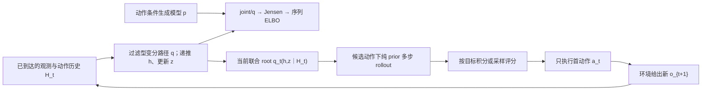
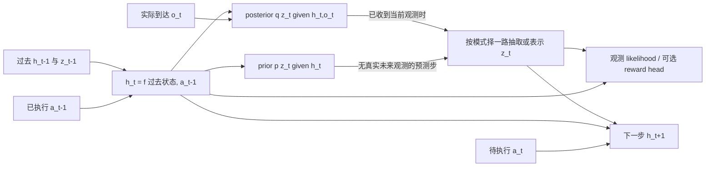

# 动作条件 RSSM——完整备课成品（单文件审查版）

---

2026-10-09，Asia/Shanghai，v1。仅供备课审查，文中学习任务均为草稿，不要求本轮作答。规范章节与代码原件另存，版本以 manifest.json 定位。

---

# 动作条件 RSSM：完整备课审查包

2026-10-09，完整审查稿 v1。状态：已完成制作、数值核验与成品审查，供用户审查；未开展正式教学、未改真实学习进度。

可一次阅读[完整备课成品](完整备课成品.md)，也可按下表分开查看。[第一份教学回复草稿](07-first-teaching-reply.md)单独保存；本次不要求回答其中题目。

近期单元的终点是一份连续作品《雾中小车 RSSM 系统论证与规划审计》。学习者应能把对象、信息条件、变分推导、预测和行动反馈接成合法系统，并判断给定证据支持到哪里。整体作品允许查阅定义和概率规则，不要求从零训练神经网络、实现 Dreamer 或复现论文分数。

认知设计先明确目标与具体加工，再将材料和问题填实。四个实际子 agent 分别承担认知设计、原始来源核验、材料制作和成品审查；主 agent 组织、运行数值核验并整合修订。这是分工审查，非盲评或学习收益实验。

## 一、成品导航

| 用户所需交付 | 实际文件 | 审查时看什么 |
|---|---|---|
| 完整认知主线与目标 | [01-cognitive-design.md](01-cognitive-design.md) | G1–G5、整体义务、材料功能、AI已提供与学习者剩余工作 |
| 研究、设计与学科依据 | [02-source-notes.md](02-source-notes.md)、[08-audit.md](08-audit.md) | 原始论文定位、实际读清范围、独立数学推导、框架研究与正式设计约束 |
| 实际材料与连贯完整示范 | [03-core-materials.md](03-core-materials.md) | 遮挡语境、语义表、时间图、序列 ELBO、数值过滤、prior rollout、评分与重规划 |
| Encoding / Post 工作、具体问题 | [04-learner-work.md](04-learner-work.md)、01第4节 | 同对象接口承担、竞争用途、连续整体作品；完整策略正文、版本、借用与未采用范围 |
| 教师参考 | [05-teacher-reference.md](05-teacher-reference.md) | 完整数值、合法推导、不同合法表达、拒用/信息不足、反馈与证据条件 |
| 必要支持分支 | [06-support-branches.md](06-support-branches.md) | 触发现象、实际备用输入、局部够用与回到同一作品的位置 |
| 第一份教学回复 | [07-first-teaching-reply.md](07-first-teaching-reply.md) | 可直接使用的正文草稿；此刻供审查，不要求提交学习答案 |
| 实际数值核验与代码 | [09-numerical-check.json](09-numerical-check.json)、[教师核验代码](../../code/rssm-test-20261009/verify_toy.py) | 范例及W1/W3轨迹、完整q ELBO、独立Kalman evidence、九候选和二轮规划 |
| 范围、角色与版本 | [00-scope-and-provenance.md](00-scope-and-provenance.md) | 仅备课授权、未读旧原答、未改真实状态、接入指纹与验证边界 |

建议先读01第1–3及第6节确认“认知目标是否合理”，再看03–05确认“材料是否足以承担目标”，最后看08与07确认“问题已修到哪里、第一回复如何开始”。完整教师参考在本次审查可见；未来教学若检验选法，须另按实际展示保留帮助条件，不能把本次查看记录清零。[主agent交付核验](10-verification.md)补实际运行与状态文件检查。

## 二、贯通的认知关系



这张图表达接口。ELBO 是训练目标，不直接输出最优控制器；候选轨迹在一次计划内开环推进，实际新观测进入回路后才形成闭环控制。Mermaid图是辅助表示，文字、公式与轨迹表独立可用；依赖语义已核，未声称实际渲染的视觉检查已完成。

| 工作 | 需要承担的认知操作 | 完整作品中的连接 |
|---|---|---|
| G1 对象与信息 | 区分真状态、历史、belief、模型状态、分布及样本 | 用同一信息集约束后续推断与预测 |
| G2 RSSM 时序 | 对齐h/z、p/q、动作下标、过滤/平滑 | 已观测前缀切换到没有未来观测的预测 |
| G3 序列变分推断 | 从给定joint/q合法推到ELBO并解释期望与gap | 说明训练怎样联系posterior与prior，以及它未保证什么 |
| G4 多步预测 | 保持state与动作接口，拒绝未来观测泄漏 | 形成可供规划评分的预测分布 |
| G5 闭环规划与审计 | 给定条件选用、执行首动作、重新过滤/规划、限制结论 | 连接数学、算法和三类评价证据 |

## 三、三项重点审查如何落实

**必要语义充分性。** 正文包含joint与过滤q的完整分解、初态约定、Jensen步骤、KL方向、过去q历史外层期望，以及整条q到全序列模型posterior的gap。h在给定路径上确定，边际上仍可不确定；不再为它单造高斯KL。模型latent与环境真belief分别定义。PlaNet和Dreamer v1记号按角色映射。

**不同维度分开。** prior/posterior的信息条件、过滤/平滑、训练/部署、一步/多步、一次候选轨迹开环/实际执行闭环分别说明。教学输入完成、学习者操作、允许资料、自主选法、时间条件和模型经验性能也分别表达。Post的知识关系加工不与控制器接收新观测的Bayes更新混称同一过程。

**示范到整体工作的跨度。** 完整示范先提供可靠路线；W1仍沿相同对象、相同参数、相同动作索引补关键接口；W2/W3增加给定候选的条件选用、整体组织和证据审计。基础定义、模型规格及概率规则始终允许查阅；撤去的只是已可承担的现成连线和结论。数据变化承担检验接口的功能，不能单靠换数字判已形成整体理解。

## 四、数值示范的精确使用边界

示范是自拟Gaussian RSSM，不是论文实验。为了使首次路线可追踪，控制示范固定代表性h历史，以条件q(z｜h,o)为规划root；新观测后再次用均值锚点固定下一h。候选评分仍保留条件root和prior噪声。完整q的ELBO则独立对所有历史路径取解析期望，二者不混用。

一般规划root是由q前缀路径推送得到的联合分布q_t(h,z｜H_t)，目标须对它与未来prior路径联合积分或抽样。正文给出这一完整接口，整体任务要求解释恢复联合root后哪里需要修改；不额外要求手算完整Gaussian控制器。

此线性同方差toy中，各候选共享未来方差项；计入方差会改变绝对期望成本，计划排序仍相同。它能说明期望成本不能以均值代回替代，不能示范“处理风险必然改变动作”。给定新观测后动作可以改变，也可以不变；重规划的依据是更新状态与重新评分。

## 五、审查结果与未发生事项

08已完成对01–07的实质审查并记录A01–A10修订，当前候选范围内没有尚未处理且阻止本次备课交付的P0/P1缺项。重点修正包括完整联合root与固定h教学近似、样本与均值、档案未来与候选反事实、有限样本指标的用途，以及首回复的真实贡献停点。首回复给足第一跳后留下Q0有限接口工作；普通反馈同轮接完整推导/贯通示范，不追加同类微测或等待“继续”。

本包的理论推导、教学数值和接口支持限定的内容与用途；代码只运行教师核验。未运行论文神经模型、图像环境或真实机器人；未开展正式教学，未取得学习者原答，也没有掌握、保持、迁移或方法收益结论。学习时间与设备未知，没有采用排期。真实控制/当前状态文件与写入前SHA-256一致；最终文件版本见[manifest.json](manifest.json)。


---

章节原件：00-scope-and-provenance.md

---

# RSSM 测试备课：范围与来源

日期：2026-10-09（Asia/Shanghai）。版本：审查稿 v1。

本包按本聊天用户请求制作，主题为“部分可观测环境中的动作条件 RSSM——从序列变分推断到多步预测与闭环规划”。用户明确要求先交备课成品、使用多个 agent、认知设计先行，然后设计材料并审查。本包是 AI 生成的准备材料；其中题目、答案、范例和第一份回复草稿均不是学习者原答、正式教学记录或能力证据。

本次请求覆盖认知主线、实际材料、连贯示范、Encoding/Post 工作、具体问题、教师参考、支持分支和第一份教学回复草稿。未开展正式教学，未采用学习排期，未创建真实表现、评分、复习需求或学习进度。

启动时取得必需入口 AGENTS.md、state/control.md、state/current.md、MODEL_ENTRY.md、FRAMEWORK.md、INTERACTION.md、START_PROMPT.md。控制与状态只用于确认边界，本次内容设计不继承其中旧学习表现。未沿其中引用读取其他会话原答、checkpoint、旧活动或学习者作品。共享规则、非个人的研究与设计资料，以及学科原始论文按当前用途读取。

## 分工与制作顺序

1. 主 agent 读取入口，确定仅备课范围并组织交付。
2. cognitive_design 先明确整体作品、语义目标、认知操作、Encoding/Post 配置、材料需求和跨度；source_research 同时核学科来源；design_audit 同时取得研究与设计审查依据。
3. 认知设计接口稳定并形成原件后，材料 agent 才据此制作实际材料、示范、题面、教师参考和回复草稿。
4. source_research 核数学及论文角色映射；design_audit 审实际成品；主 agent 核连接、数值和最终交付。

这是实际子 agent 分工；不是 AG0–AG3 的正式程序部署、模型身份认证、文件隔离或盲评。审查者知道设计背景；不同 agent 的一致意见不当成独立实验或方法效果证明。面向用户的入口只有本聊天。

## 框架接入核验

framework-manifest.json 登记的 117 个入口/规则/策略文件均与登记 SHA-256 相符（本次读入时核验）。指纹仅证明读取版本相符，不证明学科内容正确。所选策略正文的实际读取和借用范围另见认知设计，不能由本项替代。

本次写入前取得真实状态文件基线：

| 文件 | SHA-256 |
|---|---|
| state/control.md | d7ba0aa3bf5c84b0a6888bbcccb48da66ddb7c3dbdc623daf31ff99b44692d87 |
| state/current.md | 0cdb6c945d41f929f66c9d1752403bb47b516e10ddd6fb763e160f84e3719977 |

真实记录目录和这些文件均不作为本包写入位置。本包放在 prep/rssm-test-20261009/；如需可执行核验，代码放在 code/rssm-test-20261009/，明确 AI 来源和版本，结果归本备课包，不登记为用户实验。

## 验证界限

本轮可核内容与当前用途（V1），可审拟教学路径和实际回复草稿。正式教学执行（V2）、真实学习（V3）和与其他方法的可比收益（V4）尚未发生或未验证。基础、设备、可用学习时间未知；材料声明的前置只是使用条件，不是个人判断。教师计算或教师运行不算学习者计算、实现、运行或掌握。

所有章节默认 prepared_for_review。若以后用户授权教学，应从实际展示及真实原答起记，不把本次备课回填为已学。


---

章节原件：01-cognitive-design.md

---

# 动作条件 RSSM 测试备课：认知设计

修订：2；日期：2026-10-09。性质：供审查的备课候选，未开展正式教学、未采用为真实学习目标。本文件不产生 PerformanceEvent、Judgment、LearningNeed 或学习进度。认知设计由单独的子 agent 承担，后续审查知道其设计背景；所用角色指导对应 AG1，宿主多 agent 并不等于套件已部署角色、真实认证或盲评。修订2由主 agent 根据实际材料与审查统一路径称谓、候选编号和首回复停点。

## 1. 先确定要完成的工作

本单元的整体作品为《雾中小车 RSSM 系统论证与规划审计》：面对一份部分可观测小车的模型规格、短序列和给定候选预测／规划实现，学习者形成一份连续作品，连接“什么信息可用→潜状态怎样产生→训练目标怎样成立→没有未来观测时怎样预测→怎样执行首动作并更新重规划→现有证据支持什么”。式子、状态表、流程图、文字均可；不要求固定版式。

该作品要求：

1. 对齐环境真状态、观测动作历史、理想 belief 与 RSSM 学到的 latent state；保留观察不到的量和模型假设。
2. 从给定 RSSM 生成分解、给定过滤式变分族推导序列 ELBO，解释 KL 项和期望所在的分布；区分下界与工程修改。
3. 跟踪已观测前缀的 h→prior→posterior，并从当前 posterior state 接纯 prior 的多步预测；保持动作和时间索引。
4. 按给定短视界目标比较候选动作序列，执行首动作，取得新观测后再次过滤和重规划；审查未来信息泄漏与遗漏接口。
5. 分别评议重建、开环预测、闭环控制证据，提出与所声称结论相称的一项补充观察。

这些属于用户给定主题下的备课候选范围，不是从课程目录推出的正式必修要求。整体工作不要求自主训练 Dreamer、从头实现神经网络、证明一般 POMDP 最优控制、复现论文成绩或拥有 GPU。计算可用给定算术表或计算器；概率规则和符号定义可查阅。近期关系应用、推导与系统审计在允许资料下由学习者承担，闭卷恢复、长期保持、广泛远迁移均为 not_required。

材料适用假设是“读者接触过基础概率、期望、KL 与线性代数”；这不是用户能力判断。没有读取其他学习记录。若具体作答显示只缺 Jensen 或 KL 的意义，只提供必要规则后回原推导，不将其解释为整体基础不足。

## 2. 粗地图及近期 GoalSpec 的人工视图

粗地图：部分可观测性与 belief → 动作条件状态空间模型 → RSSM 的确定性与随机性 → 序列变分推断 → 多步生成 → 有反馈的行动选择。远期可接模型训练、分布偏移、风险控制、Dreamer actor/value imagination，均未纳入本次候选验收；触发为用户另行选择实现或论文复现用途。

| 候选要求（修订1） | 要形成或使用的关系 | 学习者关键操作与可检查位置 | 必要正确性条件 | 整体义务 |
|---|---|---|---|---|
| G1 对象与信息 | 真状态 x_t、H_t、b_t 与(h_t,z_t)的对象层次 | 在作品开头对齐对象、信息集、能观察／能推断之处；用遮挡解释相同当前图像可能对应不同动态 | H_t是历史，b_t是对x_t的条件分布，latent不是自动等于真状态／精确belief；一份sample也不是完整分布 | 与后续过滤、预测的条件集一致 |
| G2 RSSM时序 | 固定h_1；t≥2时h_t=fθ(h_{t−1},z_{t−1},a_{t−1}); pθ(z_t\|h_t); qφ(z_t\|h_t,o_t) | 画一段时间展开／填状态轨迹，标各节点输入、是否使用当前观测；辨认在线过滤与离线平滑的可用信息 | a_{t−1}导致到t的转移；h_t在给定过去latent sample轨迹时确定，但不意味全局无不确定性；q是限制变分族，并非精确后验 | prefix→rollout切换保留同一h,z和动作边界 |
| G3 变分推断 | joint/q→Jensen→ELBO→逐时刻预测匹配 | 写合法连续推导，逐项说明生成／推断角色和条件；给工程损失改动定位 | q支撑和条件合法；先有定义再展开；逐步KL外层对过去q轨迹取期望；KL方向q\|\|p；过滤族不使用未来o | 从训练语义解释纯prior rollout为何仍需检验 |
| G4 多步预测 | posterior前缀起点与prior自主推进 | 从截止时刻τ写到τ+2，标明每步用哪个z和动作，分析给future o的版本 | τ之后不存在真实future observation作为输入；posterior重建不等于open-loop预测；单样本不等于预测期望 | 输出适合给规划消费者，预测不确定性处理显式 |
| G5 规划与证据 | prediction→reward/constraint score→first action→new o→filter→replan | 比较给定竞争方案，完成两轮控制的连续记录，并审计“重建好所以控制好”的断言 | 目标与时域明确；执行首动作后用实际新观测；不把open-loop优化等同belief-optimal策略；reward头、约束、数据覆盖与模型误差影响用途 | end-to-end接口连贯且结论不越过证据 |

要求来源均为本次用户主题、完整备课与三项检查请求。内容依据由材料核验方给出原论文与本次合法推导／toy参数定位；本设计不以方法文献替代 RSSM 学科来源。每项前置和判据依赖分别为：G1需要条件概率语义；G2需要函数递推与时间索引；G3需要联合分解、期望、Jensen、KL；G4需要G2可用输出；G5需要G4预测接口和明确目标。后两项不因前面几道局部题正确自动满足。

## 3. 必要语义的独立维度

以下表不是词汇测验清单，而是整条范例和作品不能丢失的语义契约。

| 维度 | 必须明确的内容 | 不能混绑为 |
|---|---|---|
| 现实／模型对象 | x_t为环境状态；o_t为观测；H_t=(o_{1:t},a_{1:t−1})；理想b_t=p(x_t\|H_t)；(h_t,z_t)为模型内部状态 | “模型latent就是物理真状态”或“latent向量就是精确belief” |
| 分布／样本／统计量 | p,q是分布；z_t是样本；均值是统计量；规划时可以Monte Carlo估计 | “一个z／均值包含完整不确定性” |
| 确定性／随机性 | 给定输入轨迹h按函数更新；p或q给z的分布；随机z影响后续h | “h确定所以环境确定”或“h没有不确定性传播” |
| 生成／推断 | pθ描述模型生成与预测，qφ是在观测条件下的变分推断；二者参数训练后固定并非意味着q移除 | “训练用q、测试一定全程只用p” |
| 信息时间 | 在线q只用已到达o；平滑可用整段future o；训练能看完整序列不强迫每个q因子用未来 | “ELBO只可能配平滑”或“posterior总是过滤” |
| 行动时间 | o_t到达→更新状态→选择a_t→产生到t+1的后果；递推输入a_{t−1} | “a_t影响已观测的o_t” |
| 数学／工程 | 标准ELBO、负ELBO优化、β/free nats/KL balancing/辅助reward等分别定位 | “任意重加权的loss仍是该同一生成模型的ELBO” |
| 测量／预测／控制 | posterior重建、纯prior多步预测、在真实反馈循环中的收益／约束各有证据条件 | “像素重建好→多步好→控制好” |
| 架构／可辨识性 | RSSM是表示与预测架构；训练数据动作覆盖、观测歧义、模型失配影响可信度 | “带动作输入便证明因果或离线外推可靠” |
| 规划／反馈 | 每次计划可对候选序列开环模拟；真实执行后重规划形成闭环 | “闭环MPC已经求出了完整观测分支策略树／belief最优解” |

统一采用本文件的pθ生成/qφ变分记号；Dreamer v1原文Eq.1的representation posterior记为p、transition记为q，与此相反。材料必须给“本文角色↔论文记号”映射，不能按字母机械判正误。PlaNet的latent overshooting属可选扩展，不设为RSSM或多步预测的必经步骤。

统一初始化采用固定h_1，不设置真实a_0。先到达o_1，抽取z_1；随后选择a_1，t≥2才使用递推。初始pθ(z_1|h_1)及qφ(z_1|h_1,o_1)显式保留。H_1只有o_1，不能暗塞前段轨迹。若教师toy或论文另用h_0/z_0重编号，应给等价映射而不在同一范例中来回换索引。

ELBO核对必须保留三种期望层次：重建项E_{q(z_{1:t})}[log pθ(o_t|h_t,z_t)]，逐步KL项的外层E_{q(z_{1:t−1})}[KL(qφ(z_t|h_t,o_t)||pθ(z_t|h_t))]，以及整体gap为KL(qφ(z_{1:T}|o_{1:T},a_{1:T−1})||pθ(z_{1:T}|o_{1:T},a_{1:T−1}))。gap比较整条限制变分路径分布与完整序列真实模型posterior，不是“各时刻filter posterior误差之和”。h_t在各期望中来自相应过去latent路径；给定完整序列求似然的ELBO仍可使用过滤因子的q，不意味着该q等于平滑posterior。

## 4. Encoding 与 Post 的实际选法

完整读取范围：AG1；SK01及goal-design、goal-worked-design；design-whole、encoding、post-encoding；SK06及selection-adaptation；strategy-index相关条目；common-constraints；S05/S08/R04/R06/R10完整JSON（两载体、条件、风险、操作、反馈、停止、研究摘录及证据）；retrieve-relation与select-method完整JSON（包括全部source_excerpts和evidence_refs，截断处另行读取）。不以compiled状态代替正文读取。资源共用pl-strategies/0.1.0，Encoding原卡正文2.0，Post为套件新增方法说明。

| 采用资源与借用操作 | 本次实例化 | 前置／排除与反馈 | 不等效及未采用内容 |
|---|---|---|---|
| encoding/S05 正确范例追踪 | 同一小车从o前缀、h/z,p/q、ELBO到rollout和两轮重规划；每段写输入、目的、合法规则、输出 | 必须有完整可核路线；先示范，不让读者逐项猜新程序；观看流畅不判独立能力 | 不借“所有人紧接一题／统一遮答案”处方；可见追踪不能算自主推导 |
| encoding/R04 条件分离 | 比较posterior重建低误差与prior多步低误差；辨认模型控制可用还缺哪些条件；过滤与平滑只改变可用信息时作近邻对照 | 固定同一任务背景；接受不足以判断；概率趋势不强制二值必要充分判断 | 不声称重建是控制的普遍必要或充分条件；不把相邻研究当RSSM教学有效性证明 |
| encoding/R06 动态传播 | 固定参数和既定latent样本，改变一个a_t，逐步追踪h_{t+1}、p(z)、后续h；另追新o对posterior及下一决策的影响 | 方程或数据必须支持数值；噪声样本与期望分开；反馈检查一跳再后续 | 不要求长期稳定性分析；无参数不编精确幅度；采样改变时说明保持量 |
| encoding/R10 跨层接口 | prefix state→rollout→reward score→a_t→实际o_{t+1}→posterior，写每接口输入输出、条件、保留性质 | 相关局部输入已经由解释提供；先查时间、变量、信息可得性；失败时只展开失配黑箱 | 不强迫网络内层、优化器、CEM、actor/value全部打开；多个正确子图不判整体通过 |
| encoding/S08 按组件渐隐 | 已能在变式对齐行动后，只撤该处索引提示；ELBO理由或rollout切换未可用处保留支持；最后整体任务保留定义/公式资源，撤现成连线和结论 | 渐隐由具体表现触发，错误可恢复；备课尚无表现所以当前只备条件分支 | 不按固定题数、总分或轮数全撤；使用提供toy参数不等于自主选模型 |
| post/retrieve-relation 关系整合/分化/整体协调 | 给定可查p/q端点后，让学习者在新数据的同一作品中合法补齐推导、接口和证据边界；不要求先闭卷术语 | 两端可用，参考有依据；供给后成功仅支持剩余关系工作；困难先区分符号、访问、关系、题意 | 只借开卷关系整合，不宣称独立恢复或持久更新；不固定retrieval先于generation |
| post/select-method 条件选用/拒用 | 在无“正确算法”标注的A/B/C候选中决定当前部署可用者、不可用者或证据不足者；解释过滤/平滑、posterior/prior和比较指标的用途 | 候选方法与条件先教清；初始判断不展示答案或直接代选；当前主题本身有近端线索 | 只支持给定候选范围内选用，不称广泛自发方法发现/远迁移；提示后执行不倒算初始选法 |

组合以认知工作合并：完整范例同时承担R06追踪和R10接口，不重复为每卡造一道题。后续新操作必须增加尚未完成的连接：从“看见路线”到“承担某一接口”，再到“组织端到端审计”；换数字本身无增量时跳过。S07/X02未采用，避免同一补全重复计证。conditional-update未采用为必经Post包：真实系统反馈的新o是模型过滤，不等同学习者知识结构更新；若正式教学出现过度概括可就地修条件，当前不预造误概念。retrieve-generate-order不单独采用：允许开卷关系加工已足够，无需为顺序再新增活动。X05不另采用：式子语言映射已在S05的必要标注完成。无需凑齐任何固定卡数或六家族。

成本为未知，未虚构学习分钟数或方法效果；备课已包含参考、反馈、核验、支持和收束责任。正式启动可按整体作品接口分段，停止时记录父作品具体位置，不能把预算未知变成逐题等待“继续”。

## 5. 材料功能与连贯范例接口

材料作者应按下列功能交实际成品；只有目录和待制作清单不满足备课就绪。

| 输入 | 功能与必须具备的实际内容 | 尚留给学习者的工作 |
|---|---|---|
| M1 语义入口 | 遮挡小车的同观测异历史；x/o/a/H/b/h/z/p/q表；明确o_t→a_t→o_{t+1}顺序；模型是预测性表示 | 根据给定信息判断可获得什么；将同一索引用于后续作品 |
| M2 RSSM核心 | h=f、prior、posterior、observation/reward head的输入输出；固定h1且无真实a0的初始化；过滤/平滑对照；论文记号映射 | 跟踪变量与可用信息，辨认泄漏分支 |
| M3 变分推导 | joint、过滤q全分解、Jensen、log p/log q展开、条件KL+外层期望；固定行为数据动作条件；标准ELBO到工程loss的范围 | 新序列的同结构推导与解释，不要求从空白猜生成族 |
| M4 贯通完整范例 | 明示toy参数的实际h/zRSSM trace（先h→prior→posterior），选定样本路径或代表均值路径并标明实际采用者，接到两步prior rollout，再reward评分与教学给定的new-o更新 | 可见追踪与理由；不能只看有限Bayes而以为已跟踪RSSM，也不能把代表均值路径说成抽样或完整期望 |
| M5 近邻／整体作品资料 | 同一系统的部分完成工作页→新的prefix数据、候选预测/规划版本、日志与三类证据；允许定义和概率引理 | 补留空接口、筛选不合法实现、组织整份审计与证据限度 |

精确finite-state Bayes可作oracle，专为显出部分可观测性和校验闭环动作；必须标清这不是神经RSSM表示的同义定义。若使用oracle评分，另给实际RSSM预测函数的对应路径与预测假设，不能把oracle效果自动记到learned RSSM。h/z轨迹中的均值递推若仅为教学近似须明确，不能冒充精确belief或完整预测期望。单条选定sample路径只说明依赖和顺序；需要数值期望时用可精确枚举的分布或透明采样估计。

整个示范应保留相同对象和同一动作索引：遮挡观测→可用历史→h/z过滤→目标训练→截止时刻状态→没有未来o的两步生成→目标评分→执行首动作→实际新o→重新过滤→下一轮计划。一次完整路线可以分展示段，但后一段不能换模型而不说明映射／假设。

## 6. 示范到整体作品的跨度

跨度不是“看一条ELBO等式→自主设计RSSM”。用同一父作品的三种承担程度，按表现可跳过或合并：

1. **完整示范（教学输入）**：教师给完整模型、参数、推导与两轮轨迹，指出关键输入/规则/输出。新操作已先获得可靠路线。纯讲解时不设每段验收停点。
2. **接口承担（有界工作）**：给新prefix和同一模型，保留符号表及第一步状态，只留“下一h和分布、序列ELBO的KL外层条件、rollout切换、新o之后是否仍执行旧第二动作”的关键连接。不是每项另立一道题；组成一段工作。
3. **整体审计（整合工作）**：给新的prefix、A/B/C候选实现、有限候选plan的数据，以及重建/预测/控制摘要；不标注“哪个错误”，不直接给部署结论。学习者从信息可得性和目的出发组织连续作品。基础公式可查，但条件集、选择、连接、结论边界不由题干代做。

由2到3新增的是整体组织、受条件约束的选择和证据审计；没有新增另一个领域、神经网络训练或整套编码实现。失败不能直接归因为基础概率薄弱：先检查新增接口的数量、图式转换、候选说明及材料本身。支架渐隐的对象分别是索引、KL理由、state切换、plan更新、证据结论，不混为统一“难度”。

首回复的自然停点采用04/07中的Q0：M1/M2和第一跳已经给足输入后，只改变a_1且o_2尚未到，让学习者承担下一h及当时可用分布的一个接口判断。它属于G2/R06同对象工作，不是完整作品的替代，也不是人人必经的微测；有合格作品可跳过。收到这一贡献后，必要反馈同轮接M3完整推导和M4贯通示范，不追加同类动作算术题或等待“继续”。此修改由实际首回复的节奏审查提出，避免在没有学习者贡献的中途强制结束一轮；其余整体义务、材料与跨度不变。

## 7. 具体工作和教师核对接口

题面必须由材料成品填具体数据，以下内容是不可删掉的学习者操作，而非“以后按情况出题”。

**W1 有界接口任务**：在同一小车、同一动作时间约定和给定新prefix中完成一段缺失轨迹：上一posterior给z，算下一h，写p与q各自条件；用给定joint与q补一条从期望log比值到逐步KL的合法连接；从截止时刻接两步rollout；执行首动作并读取给定new-o后，写下一轮state和行动解释。允许看符号表、模型定义及Jensen/KL规则，不看完整新数据答案。教师核对：索引和信息集必须贯穿；sample与分布不得混；KL方向及外层期望不能掉；future-o分支只作重建，不能列作部署预测；得到new-o后重新过滤，后续action可以不变也可以改变，理由必须基于更新目标评分而非必须改变的模板。

**W2 竞争用途任务**：给三个行为描述或伪代码片段及其输入日志，要求判断哪段能在当前线上环境执行、哪段适于离线平滑／重建、哪段存在信息泄漏或不足以判断；标出最早失配位置，给最小合法修订。候选编号仅标识流程，必要时可重排；标题不含推荐答案，重排不能消除已经发生的暴露。教师接受：过滤+prior rollout合法；离线平滑不因此错误，但不能在相同线上时间预算/信息集执行；缺reward/constraints时可回答不足以规划；改全部模型并非唯一正确。不能凭p/q字母判错，要按角色。

**W3 整体作品**：将W1/W2连接到完整《系统论证与规划审计》，含（a）语义和假设，（b）给定族的序列ELBO连续推导，（c）prefix→rollout→score→首动作→new-o→replan的轨迹，（d）重建、开环预测、闭环收益各支持何种断言，（e）一项相称的补充观察及其仍未支持的结论。教师对连续原件逐义务检查；公式复述、局部正确率、漂亮图、toy运行、AI完整稿照抄均不能代替整体连接。

允许合法多解：等价时间重编号；用sum或expectation等价表示；对给定候选有理由拒用；使用可靠重建而非记示范顺序；若数据不足，保留多个解释并指出最小鉴别信息。ELBO仅对所给生成族和变分族成立，本次不要求证明所有RSSM族、最小latent维度或控制最优性。教师评分不得以参考版式、表达长度或原卡深化任务作为额外标准。

## 8. 必要支持分支与返回点

| 出现的具体表现 | 最小支持 | 够用条件及返回 |
|---|---|---|
| 用自然语言能追踪，符号/索引版失败 | 给o_t→a_t→o_{t+1}三格及本文角色↔论文记号表；圈出一个时间边界 | 能正确定位下一h的输入后回W1该格，保留其他正确工作 |
| 把h当物理状态或把单z当belief | 给同一历史下不同z样本影响未来h的最小trace；对照x/H/b/latent各对象 | 能说明模型state是表示/分布接口而非物理真值后回prefix→rollout连接 |
| KL方向、条件或外层期望不清 | 提供KL定义及一条E_q[log q−log p]恒等式；不代给整段推导 | 能在指定q族合法写KL及过去轨迹外期望后回完整ELBO |
| posterior重建与prior预测混用 | 只给信息集表和同一t处两条分支，标future-o实际不可得 | 能把截止时刻前后分开并修最早泄漏处后回W2候选审计 |
| 会算两步却不会闭环更新 | 提供消费者接口：首动作→实际new-o→posterior，而非沿旧forecast当真 | 能恢复正确更新入口后回W3二轮轨迹；不从头重讲训练 |
| 数值轨迹正确却说“所以控制可靠” | 给三类指标的测量条件；保留同一数据，问哪个额外结论缺对应证据 | 能限制断言并提出相称观察后回W3证据段 |
| 各局部正确，整体时间/变量不兼容 | 合并已写正确片段，逐接口核输入/输出/时间/条件；提供空接口栏 | 接成同一合法路径后审整体；不继续追加孤立术语题 |
| 用户已有合格整体作品或要求推进 | 直接审该原件或跳过可见追踪；尚未观察连接在同一后续自然工作承担 | 不制造固定小测序列；已被给出的帮助保留为实际条件 |

正式教学若需要原答，先按宿主规则保留和读回再反馈；备课本身没有学习者原答。普通反馈后直接提供已备下一段，真正需要作品、判断或用户选项时才等待。可选等待动作是“回看当前三格时间轴或先标有疑问的一个接口”，不是额外作业，不纳入评分。

当前备课结束条件：主要材料、范例、具体新数据、可靠教师参考、合法多解、必要支持与第一回复都已交付并被审查；不是学习者通过。正式学习结束条件为整体候选义务内工作足够、用户暂停、实际预算结束、没有新增有效进展或依据争议。中断保留父作品位置和已给帮助，后续接未完成连接。材料错误时先撤受影响用途并回核，不能先要求学习者修改正确原答。

## 9. 方法来源定位、版本与指纹

以下SHA256是实际文件字节指纹，作用仅为资源版本兼容核对，不证明方法效果或学科正确性。根为 `E:/文献资料/学习系统架构设计/personal-learning-suite/`。两Encoding载体来自同一卡库，不算两份独立研究；Post证据中E编号是文献而非卡号；D06的P编号是覆盖号。论文学习收益外部引用本次未重新核验，不在交付中声称已验证RSSM教学收益。

| 文件（相对根） | 修订/正文 | SHA256 |
|---|---|---|
| src/agents/AG1-design-planning.md | 2026-10-05；pl-contracts/0.1.0 | 3A2E6FCFE09FAAC4964CBF007367E88C1C25F092F61828ED4B2C4A0870903BEE |
| src/skills/learning-goals/SKILL.md | SK01 | 145DC58E2E68A012D38FB6346CF49766C96BCAC983DA0DC518F5450E5C8C3540 |
| src/skills/learning-goals/references/goal-design.md | pl-goals/0.1.0 | 914560121CE958255E3D84441D3749A83FA64AC0D8C64EBA8B820430164FF9DA |
| src/skills/learning-goals/references/goal-worked-design.md | 当前正文 | 6EEA5375CBE2D3FFD7F46108703A8B2D9DCEC25252ACAE3B8490E75E574187BF |
| src/skills/learning-teaching/references/design-whole.md | 当前正文 | 606124BE68A585AFA27D3AE8FBAA70E551C5F0133E82AA065DD5C5D5F2615D92 |
| src/skills/learning-teaching/references/encoding.md | 当前正文 | 0A177D2C59FCA8427875A473234FAE1FDB795ED0A5A4E1EC052385C2513085E1 |
| src/skills/learning-teaching/references/post-encoding.md | 当前正文 | 6284082D0B294171FD91D1C35B614CEAE664AC5704F56CFEF0C91B30C64BC596 |
| src/skills/learning-strategies/SKILL.md | SK06 | 60C61E24F057B942AE9F20DBAF3707E6D60B4D256250544AAF1DAC720DDCDBDB |
| src/skills/learning-strategies/references/selection-adaptation.md | 当前正文 | 18066B1623B5F2F5BEA1B68DBB61CC90975FAEF2637631F3742CEC82A4C1BB8E |
| resources/strategies/strategy-index.json | pl-strategies/0.1.0；source2.0 | 59A70C5DA52E89F0DA3E52C8E42267881168B99F4C864F5E86D11030BE33685D |
| resources/strategies/common-constraints.json | pl-strategies/0.1.0 | E217A01AC8E71EAE367CD4132CBC084C5C25D1F2A866341B05CACBA6D15F3026 |
| resources/strategies/encoding/S05.json | pl-strategies/0.1.0；source2.0；R02§S05/R03 operations14 | 75BE952E8BC57AE87FE6D228CF1097F7DCF8DB591987794578324C757FBECA36 |
| resources/strategies/encoding/S08.json | 同上；R02§S08/R03 operations17 | 9E4B899AC7AC0D3C5ED0ECD8C00CF17F344A5D5D88E9ECF8920B2E2806D20910 |
| resources/strategies/encoding/R04.json | 同上；R02§R04/R03对应select id=R04 | 24606C5326153AFB271A0280CD4FE1439DAE34796AF44D1C8EB667DD027FDDE9 |
| resources/strategies/encoding/R06.json | 同上；R02§R06/R03对应select id=R06 | BF99F2AD28C2871EA3EA20D63FC9ADB41F85CCEF326488DA9AC405D3A645B1BF |
| resources/strategies/encoding/R10.json | 同上；R02§R10/R03对应select id=R10 | 16612C0A90F4A9FAFE9F8E2E1DA6F27D055CE0FEED55CD56155433C4A147E597 |
| resources/strategies/post/retrieve-relation.json | pl-strategies/0.1.0；套件新增；D06恢复/整合/最小返回及全部源摘录 | 9A40C98A6EDDEDC06CAB02155AED54480C242F3F7BD2BBF70E116A0C87EC2DBC |
| resources/strategies/post/select-method.json | 同上；D06自主选用/目标相称检查及全部源摘录 | B33844944758174619F882A3131A60F3367782FCF88A94E3F2CB00EAB2D022B8 |

共享契约 `contracts/shared-contracts.md`（pl-contracts/0.1.0，2026-10-02）亦已完整读取；本文件是人工候选视图，不冒充运行数据库提交、身份绑定或权限授予。


---

章节原件：02-source-notes.md

---

# RSSM 学科依据与教师核验笔记

备课测试稿；2026-10-09。不是学习者接触、作答、能力或进度记录。只读本次委派所需框架规则与公开原始来源；未读取其他学习记录。责任范围为学科与来源核验，认知目标与选法由认知设计稿决定。

## 1. 来源身份、位置、已读与未读范围

| 来源 | 固定定位 | 实际读取范围 | 允许支持的用途与限制 |
|---|---|---|---|
| Hafner et al., *Learning Latent Dynamics for Planning from Pixels*, ICML 2019，arXiv:1811.04551v5（2019-06-04） | [PMLR 主文](https://proceedings.mlr.press/v97/hafner19a/hafner19a.pdf)；[含附录版](https://proceedings.mlr.press/v97/hafner19a/hafner19a-supp.pdf)；[版本页](https://arxiv.org/abs/1811.04551v5) | §2 pp.2–3、§3 pp.3–4 Eq.(2)–(4)、§4 pp.4–6 Eq.(5)–(7)；Figure 2、3 captions；附录 A、B p.12 Algorithm 2；D p.14 Figure 8 caption；F p.16 Eq.(8)–(10)。读清文本与这些公式的文字抽取；公式另做下文独立推导。 | RSSM 定义、过滤推断、CEM/MPC、overshooting 的用途及最终 RSSM 版本的选择。未逐点核实验曲线、未复现实验、未核全篇参考文献。web screenshot 返回的是引用字符串，未取得图像可见内容，因此不声称逐箭头视觉核过原图。 |
| Hafner et al., *Dream to Control: Learning Behaviors by Latent Imagination*, ICLR 2020，arXiv:1912.01603 | [论文](https://arxiv.org/pdf/1912.01603)；[版本入口](https://arxiv.org/abs/1912.01603) | §2 Eq.(1)、§3 pp.3–5 Algorithm 1、Eq.(2)–(8)、Figure 3 caption；§4 pp.5–6 Eq.(9)–(10)。 | 对照 Dreamer v1 的行为学习与部署接口。未核 Dreamer v2/v3，未核 Atari 分支、对比学习分支、附录推导或性能曲线。 |
| Kingma & Welling, *Auto-Encoding Variational Bayes*, arXiv:1312.6114 | [论文](https://arxiv.org/pdf/1312.6114) | §2.2 p.3 Eq.(1)–(3)、§2.3 p.3 Eq.(4)–(5)、§2.4 的高斯重参数化段落。 | ELBO 恒等式、Jensen、重参数化的一般锚点。下文动作条件序列推导是本备课稿逐步推导，不冒充该论文的 RSSM 教材。 |
| 作者代码：PlaNet | [rssm.py](https://raw.githubusercontent.com/google-research/planet/master/planet/models/rssm.py) | 完整 132 行文本；重点 `_transition`、`_posterior`、`divergence_from_states`、`features_from_state`。 | 实现与符号映射：prior/posterior 共用更新后的 deterministic state；KL 在随机分布之间。只读 master 于本次检索的快照，未锁 commit、未安装 TensorFlow、未执行原代码；不是运行验证。 |
| 作者代码：Dreamer v1 | [models.py](https://raw.githubusercontent.com/danijar/dreamer/master/models.py) | `RSSM` 类（第 9–74 行），包括 observe/imagine、obs_step/img_step。 | 显示观测更新与无观测想象两个接口。只读 master 快照，未锁 commit、未运行；不能由此推出历史所有 release 的行为。 |

### 可直接采用的来源结论

PlaNet 的 Eq.(4) 将 latent 拆为确定性记忆与随机变量，过滤 encoder 在当前观测到来后更新随机变量。其在线控制用 CEM 搜索动作序列并执行首动作；下一观测到来后重规划。§4 与附录 A/D 明确最终 RSSM agent 无需 latent overshooting；d>1 的 posterior 目标停止梯度。[PlaNet 论文及附录](https://proceedings.mlr.press/v97/hafner19a/hafner19a-supp.pdf)

Dreamer v1 在模型想象轨迹上训练 actor/value，部署时从观测推断状态后调用 actor；其论文的 representation 分布写 **p**，imagined transition 写 **q**，与本稿常规变分符号相反。[Dreamer v1，§2–4](https://arxiv.org/pdf/1912.01603)

一般 ELBO 是联合模型对数密度减近似后验对数密度的期望，其与 log evidence 的差是近似后验到模型后验的 KL；高斯可用重参数化估计梯度。[AEVB，§2.2–2.4](https://arxiv.org/pdf/1312.6114)

## 2. 备课稿统一符号与最小语义

以下是为教学一致性选定的模型规格与推导，不把它称为上述论文的逐字原式。

| 对象 | 本稿符号与含义 | 不得混同 |
|---|---|---|
| 真实环境隐藏状态 | `x_t`，环境未完全暴露的状态 | 不是模型的 `z_t` 或 `h_t` |
| 观测与动作 | `o_t` 到来后选 `a_t`；`a_{t-1}` 影响 `o_t` | `a_t` 不可提前进入已发生的 `o_t` 推断 |
| 模型确定性记忆 | `h_t`，给定初态与过去 latent/action 路径后确定 | 路径未知时 `h_t` 的分布仍会变化；“deterministic”不等于“没有不确定性” |
| 模型随机 latent | `z_t` | 一个样本不等于分布；latent 坐标不保证是真状态坐标 |
| 生成 prior / transition | `p_θ(z_t|h_t)` | 当时还未使用 `o_t` |
| 近似过滤 posterior | `q_φ(z_t|h_t,o_t)` | 不声称等于真实环境 belief；也不自动等于模型精确 posterior |
| 完整模型状态 | `m_t=(h_t,z_t)` | 状态、该状态的分布、网络输出的分布参数是三个对象 |
| observation likelihood | `p_θ(o_t|h_t,z_t)` | decoder 提供训练信号；规划可以不生成未来图像 |

本稿统一 `p_θ=生成模型`、`q_φ=变分推断`。PlaNet 原文 stochastic `s_t` 映射为本稿 `z_t`；Dreamer v1 简写 `s_t` 是整体模型状态，其 `p(representation)` 映射为本稿 `q_φ`，其 `q(transition/observation/reward)` 映射为本稿 `p_θ`。引用时依据功能，不能只依据字母。

真实 belief 的定义可写 `b_t(x)=P_env(x_t=x|o_{≤t},a_{<t})`。RSSM 提供一个学习到的历史表示和近似 latent 分布；没有从该表示到环境真状态的已证明等价性时，只称“近似状态表示／latent belief”。POMDP 的 belief-MDP 与模型中的 Markov latent 也不能据同一术语认定相同。

## 3. 动作条件 RSSM 的过滤型序列 ELBO：完整独立推导

### 3.1 模型、时间与初态约定

取固定输入动作 `a_{1:T-1}`，模型在这些控制输入下生成序列；不拟合数据收集策略。`h_1=h_init` 固定。对 `t≥2`：

\[
h_t=f_θ(h_{t-1},z_{t-1},a_{t-1}).
\]

因此每条 `z_{<t}` 路径都有自己的 `h_t(z_{<t},a_{<t})`。首时刻不用虚构环境动作 `a_0`。等价实现也可固定 `(h_0,z_0)` 并用显式 dummy `a_0=0` 做一次初始化更新，但须说明它不是环境中执行过的动作。

生成模型与过滤变分族为：

\[
p_θ(o_{1:T},z_{1:T}\mid a_{1:T-1})
=\prod_{t=1}^{T}p_θ(z_t\mid h_t)\,p_θ(o_t\mid h_t,z_t),
\]

\[
q_{θ,φ}(z_{1:T}\mid o_{1:T},a_{1:T-1})
=\prod_{t=1}^{T}q_φ(z_t\mid h_t,o_t).
\]

`q` 写下标 `θ,φ` 是提醒 `h` 用到了 `f_θ`；常见简写仍写 `q_φ`。这不是独立的时间边际乘积：每个因子通过 `h_t` 依赖先前抽出的 `z_{<t}`。不用把 deterministic `h` 另拟一个高斯后再加入 KL。若增广为 `(h,z)` 联合过程，`h` 是共享递推上的 Dirac 约束；直接消去 `h` 最清楚。

### 3.2 从 evidence 到 Jensen

在所需密度与可积条件下，选 `q` 覆盖积分所需支撑，得：

\[
\begin{aligned}
\log p_θ(o_{1:T}\mid a)
&=\log\int q(z\mid o,a)\frac{p_θ(o,z\mid a)}{q(z\mid o,a)}\,dz\\
&=\log\mathbb E_q\left[\frac{p_θ(o,z\mid a)}{q(z\mid o,a)}\right]\\
&\ge\mathbb E_q\left[\log p_θ(o,z\mid a)-\log q(z\mid o,a)\right]
=\mathcal L.
\end{aligned}
\]

代入两个乘积的因子：

\[
\mathcal L=\sum_{t=1}^{T}\mathbb E_{q_{≤t}}
\left[\log p_θ(o_t\mid h_t,z_t)+\log p_θ(z_t\mid h_t)-\log q_φ(z_t\mid h_t,o_t)\right].
\]

令 `q_{<t}` 是前 `t−1` 个过滤因子组成的路径分布。先固定过去路径，内层对 `q_φ(z_t|h_t,o_t)` 积分，得到可逐步计算的形式：

\[
\boxed{
\mathcal L=
\sum_{t=1}^{T}\left\{
\mathbb E_{q_{≤t}}\left[\log p_θ(o_t\mid h_t,z_t)\right]
-\mathbb E_{q_{<t}}\left[
D_{\mathrm{KL}}\!\left(q_φ(z_t\mid h_t,o_t)\Vert p_θ(z_t\mid h_t)\right)
\right]\right\}.
}
\]

在 `t=1`，外层历史期望退化为空历史上的常数。`t≥2` 的 KL 即使能解析计算，也仍要对会改变 `h_t` 的历史路径取期望；不能拿一个平均 `h_t` 代入后声称与该期望等价。

差距恒等式是：

\[
\log p_θ(o_{1:T}\mid a)-\mathcal L
=D_{\mathrm{KL}}\left(q(z_{1:T}\mid o,a)\Vert p_θ(z_{1:T}\mid o_{1:T},a)\right)\ge0.
\]

这里右侧的目标是**完整序列的模型 posterior**。`q` 的因子不使用未来观测，是过滤型近似族；这不把右侧目标变成“每步真实过滤分布”。只有族包含模型 posterior 且找到它时 equality 才成立。模型 posterior 即便精确，也只是此模型中的后验，不等于真实环境 belief。

### 3.3 可选 reward 项与优化方向

本稿若需要 reward，统一选 `r_t` 为到达时刻 `t` 的 reward，并声明 `r_{t+1}` 与 `a_t` 引发的转移对齐。增加 `p_θ(r_t|h_t,z_t)` 时，在重建期望内再加 `log p_θ(r_t|h_t,z_t)`。`q` 仍可只读 `o`；它是合法但可能较受限的变分族，gap 目标需变成 `p_θ(z_{1:T}|o_{1:T},r_{1:T},a)`。

若材料用 API 的 `env.step(a_t) -> (o_{t+1},reward_t)`，把 API `reward_t` 明确重命名为本稿 `r_{t+1}`，或全稿改另一套 reward 下标。两套都合法，禁止静默切换。

训练可最大化 `L` 或最小化 `−L`。一般 `β≠1`、free-nats clipping、额外 overshooting 项属于改造目标；不自动称其就是上式原数据 likelihood 的标准 ELBO。高斯 `z=μ+σ⊙ε`、`ε∼N(0,I)` 支持采样路径的重参数化梯度；不证明优化能找到全局解。

## 4. 从过滤训练到多步预测及闭环控制的接口核验

训练路径在每时刻使用真实当前观测形成 `q` 样本，并用该样本更新下一步记忆。此时 prior 与 posterior 共用由同一过去路径得到的 `h_t`，可计算逐步 KL。

从当前时刻 `t` 预测未来时，先依据实际历史得到初始 latent 分布。对候选动作 `u_{t:t+H-1}`：

\[
m_t\sim q_t,\qquad
h_{t+k}=f(h_{t+k-1},z_{t+k-1},u_{t+k-1}),\quad
z_{t+k}\sim p_θ(z_{t+k}\mid h_{t+k}),\quad k=1,\ldots,H.
\]

未来 `o_{t+1:t+H}` 不存在于执行时输入里；可以由 decoder **预测**，但不能用数据集未来观测做 posterior 校正后仍称 free rollout。中间随机路径应积分或 Monte Carlo 抽样；均值轨迹只是特定近似，一般非线性模型里 `f(E[z])≠E[f(z)]`，奖励在均值处也不一般等于期望奖励。

例如用到达 reward 下标的候选目标：

\[
J(u)=\mathbb E_{q_t,\,p_θ\ \mathrm{rollout}}
\left[\sum_{k=1}^{H}\gamma^{k-1}\bar r_θ(m_{t+k})\right].
\]

候选得分、选择动作、观察环境、重新推断是不同接口。有限预算的候选优化不保证全局最优；模型期望 reward 不保证真实 reward。闭环 MPC 为：当前 posterior → 评估候选 rollout → 执行首动作 → 实际新观测 → 当前 posterior 更新 → 重规划。普通 MPC 的候选是开环动作序列，而整个部署控制回路是闭环；二者不矛盾。

### latent overshooting 的安全讲法

本稿仅将它作为可选支持分支：从较早 posterior 初始化，跳过中间真实观测，沿 prior 预测到更晚时刻，与该时刻依完整已知训练历史得到的 posterior 做 latent 一致性约束。终点 posterior 可作为训练目标；它不是候选 rollout 的输入。

不可把“KL 到混合后的多步 marginal”与“对 intermediate prior 路径取期望的条件 Gaussian KL”当作同一表达。原文 Eq.(6)–(9) 还使用了将 log 移入多步 prior 期望的 Jensen 步骤；若教学只给路径近似的一致性损失，就明确称 auxiliary regularizer。原文对多步 predictive distribution 的 bound 与原始 one-step likelihood 的关系使用 conjecture；不得升级成不加条件的已证定理。

## 5. 必须分开的维度与教师检查点

| 维度 A | 维度 B | 最小检查 |
|---|---|---|
| 真环境 state/belief | 学到的 latent state/distribution | 同一观测不等于同一真状态；latent 精确推断也不证明世界模型正确 |
| `h` 条件确定性 | `z` 条件随机性 | 不能直接命名成“h=已知，z=未知”；过去 z 变化也改变未来 h |
| prior / posterior 的信息条件 | one-step / multi-step 的预测距离 | 一步 posterior 不是一步生成 transition；多步 prior 也不使用中间真实 o |
| filtering / smoothing 近似族 | train / deploy | 训练可用 smoothing，但在线输入限制仍是过滤；本次选 filtering，须解释其序列 joint |
| latent stochasticity | epistemic model uncertainty | 单个 Gaussian RSSM 的方差不自动覆盖参数不确定性或 OOD 风险 |
| 生成模型训练 | 行为／规划优化 | ELBO 不直接优化控制回报；CEM、actor/value 是不同控制选法 |
| 单次规划内部的开环 rollout | 实际控制的闭环重规划 | 候选长序列只实施第一动作，然后用真实观测刷新 |
| 数值代回、代码运行 | 一般数学正确性、经验性能 | 彼此分别给证据；不能用 toy 算对证明实际图像系统性能 |

## 6. 可用于材料核验的数值锚点（自拟，非论文实验）

下面只是检查公式、符号和期望的独立锚点，不替认知设计者指定活动。

1. 一维高斯：`q=N(1,0.25)`、`p=N(0,1)`（第二参数为**方差**），应有
   `KL(q||p)=0.5[log(1/0.25)+(0.25+1)/1−1]=0.818147...`。
   `KL(q||q)=0`；写反 `KL(p||q)` 通常不同。
2. 设 decoder `o|z∼N(z,0.25)`、当前 `o=1`，上面的 q 有
   `E_q log p(o|z)=−0.5[log(2π·0.25)+(0.25+(1−1)^2)/0.25]=−0.725791...`。
   忽略 q 方差、仅在均值处评价，错误地高估重建项 0.5。
3. 此单步边界模型 `p(o)=N(0,1.25)`，因此 `log p(o=1)=−1.430510...`；`L=−1.543938...`，差 `0.113428...` 等于到精确 posterior `N(0.8,0.2)` 的 KL。它核的是 ELBO 下界及 gap，不证明 RSSM 多步性能。
4. 数值 RSSM 若 `h_{t+1}=αh_t+z_t+a_t`，要分别报告 conditioning-on-one-history 的 prior 参数与对所有 q 历史混合后的 marginal；把两者都叫 `prior variance` 会掩盖条件差异。多步 reward 若含平方，例如 `−z²`，用 `−(μ²+σ²)`，不能只用 `−μ²`。

上述算术已手工逐项重算；未声称执行代码验证。若材料产物采用不同 toy 参数，必须重新核它实际参数、轨迹、reward 和问题参考。

## 7. 来源阶段的可采用范围与剩余边界（后续成品审查见 8–9）

可用于本次备课的完整主线：动作时序 → 部分可观测与历史表示 → RSSM 两路径和信息条件 → 过滤型联合变分族 → Jensen/逐步 ELBO → 观测驱动训练与无未来观测 rollout 的区别 → 候选回报 → 单动作执行与重规划。教师需依据具体材料逐题检查，而不是凭来源核验清单宣布本次问题合格。

仍未核：实际材料文件的算例、图／可视化成品、问题充分性与合法多解、Encoding/Post-Encoding 暴露边界；由材料制作与审查阶段完成。未运行作者神经模型或图像环境，也不提交学习进度、目标通过或掌握结论。

## 8. 已完成的教师 toy 数学审查

审查对象为 [verify_toy.py](../../code/rssm-test-20261009/verify_toy.py)，AI 编写的 `teacher-toy-v1`。本责任者实际回读完整代码并用 Python 3.12.3 执行，exit code 0；源码 SHA256 为 `EF50F8FE14F804A30404A38D897FAEEC9D89A800BC224E77B3503B33823F0432`。代码变动后此定位须重核，不能把本结果自动贴给其他版本。本次审查未改该代码。

### 8.1 规格与解析 ELBO

代码采用 `h_1=0`、`h_t=.5h_{t-1}+.5z_{t-1}+a_{t-1}`，`p(z_t|h_t)=N(h_t,1)`，`p(o_t|z_t)=N(z_t,.25)`，`q(z_t|h_t,o_t)=N(.2h_t+.8o_t,.2)`；观测 `(1,1.5,.7)`、历史动作 `(.5,−.5)`，高斯第二参数均为方差。

令 `M_h,V_h,M_z,V_z,C_hz` 为 q 路径下的均值、方差与协方差。代码的 q 历史传播符合：

\[
M'_h=.5M_h+.5M_z+a,\qquad
V'_h=.25(V_h+2C_{hz}+V_z),
\]

\[
M'_z=.2M'_h+.8o,\quad V'_z=.04V'_h+.2,\quad C'_{hz}=.2V'_h.
\]

对 `h` 的条件高斯 KL 内部，`μ_q−μ_p=.8(o−h)`，所以外层期望中应出现 `.64[(o−M_h)²+V_h]`。`exact_variational_elbo` 正确保留该项和重建的 `V_z`，没有将完整 q 期望替换成均值轨迹代入。

| t | E_q h | Var_q h | E_q z | Var_q z | E_q log p(o_t|z_t) | E_q KL |
|---|---:|---:|---:|---:|---:|---:|
| 1 | 0 | 0 | .8 | .2 | −.705791352645 | .724718956217 |
| 2 | .9 | .05 | 1.38 | .202 | −.658591352645 | .535918956217 |
| 3 | .64 | .068 | .688 | .20272 | −.631519352645 | .427630956217 |

总 `L=−3.684170926585333`。t=3 的 `Cov_q(h,z)=.0136`；t=2 为 `.01`。

### 8.2 独立 generative likelihood 路线

`exact_log_evidence` 不使用 q 网络的 `.2h+.8o` 规则，而把 `(h,z)` 作为二维线性高斯状态。转移矩阵与过程噪声为：

\[
A=\begin{bmatrix}.5&.5\\.5&.5\end{bmatrix},\quad
b(a)=\begin{bmatrix}a\\a\end{bmatrix},\quad
Q=\begin{bmatrix}0&0\\0&1\end{bmatrix},\quad
o=[0\ 1](h,z)^\top+\nu,\quad Var(\nu)=.25.
\]

代码的 prediction covariance 是 `AΣAᵀ+Q`。innovation variance 是 `V_z+.25`；`K_h=C_hz/S`、`K_z=V_z/S`；三个 covariance 更新用同一步的旧值同步赋值，符合 Kalman 更新。初态 `h_1=0,z_1∼N(0,1)` 与模型一致。

故此线性 toy 的精确 log evidence 为 `−3.6766345938409453`，与解析 q ELBO 差 `0.007536332744387586≥0`。这检查了完整序列的下界；不是神经 RSSM 参数拟合或现实经验性能的证明。精确模型过滤可以用当前观测更新对 `h` 的不确定性认识；此 q 族的 `h` 仅由过去抽样路径递推，不能因某一步条件 q 为局部 conjugate posterior 就称它等于全序列精确 posterior。

### 8.3 条件 root 规划与再次锚定的边界

规划代码采用**固定 `h_3=.64` 的条件 root**：`z_3∼N(.688,.2)`。完整 q 的 root 则有 `Var(h_3)=.068,Var(z_3)=.20272,Cov=.0136`。二者均值相同，联合不确定性不同，必须在题面和教师参考中明说。

`rollout` 不接收未来观测；每步使用 `AΣAᵀ+Q` 保留 root 随机性、transition noise 及 h/z covariance。两步 `Var(z)=1.05,1.3` 正确，`E[(z−1)²]=[E(z)−1]²+Var(z)` 的 cost 实现正确。离散候选域 `{−.5,0,.5}²` 上最小 expected cost 为 `2.428792`，唯一最优序列 `(.5,0)`；这叫枚举候选 MPC，不称执行 CEM 或连续动作全局最优。

闭环示范另取 `z_3=.688` 的**均值路径锚点**更新 `h_4=1.164`，作为新观测的教学给定输入为 `o_4=−.5`，在固定 `h_4` 下条件 q 为 `N(−.1672,.2)`；重新两步枚举最优仍为 `(.5,0)`，因此当前首动作 `.5` 与先前未执行的后缀 `0` 不同。它正确展示了“只实施首动作，再根据新观测重规划”的接口。

这次 `h_4` 再次固定，是示范选择的支架。若连续传播上一步的条件 root，不重新锚定 h，`Var(h_4)=.05`，该 q 更新后的 marginal `Var(z_4)=.202,Cov(h_4,z_4)=.01`，而非表中的条件 `.2`。因此不能把 `.2` 声称为完整历史 posterior 的边际方差，或把 `h_4` 均值锚点声称为实际观察到的 latent。一般 `(h,z)` root 的规划目标须对联合分布积分／抽样。

此支架不妨碍入门用途，条件是：先明确条件 root；把代表性路径、整条 q 期望、候选 rollout 三种运算分开；整体工作再要求指出恢复联合 root 后要改哪些期望／抽样接口。它能证明本 toy 的数值与接口自洽，不能单独提供“完整 belief-MPC 已会做”的证据。`representative_trace` 的 h/z 均值在这个线性 toy 恰等于 E_q；一般非线性 RSSM 不具有这一便利。

代码中的 variance/下界/改动作断言已通过。实际材料展示与题目语义仍需材料成品审查；没有把脚本通过等同于教学设计通过。

## 9. 核心材料与 W1/W3 情境核验

已实际读取 `03-core-materials.md`、`04-learner-work.md` 修订1全文，以及更新后脚本完整文本与 `09-numerical-check.json` 的本次输出。脚本新增 `work_scenario` 后当前 SHA256 为 `562123DD23CDCE0CE11F8426A27091847004A592600FA8A4175383DED1A8CBE9`；重新以 Python 3.12.3 执行成功。§8 的原 hash 保留为前次审查定位，当前两份工作情境按本段 hash。

### 已核公式与信息条件

- M3 的 controlled-input 约定、joint 因子、过滤路径 q、Jensen、KL 方向及外层路径期望、完整序列 posterior gap 与 reward 下标符合 §3 的独立推导。行为策略项与控制输入 likelihood 已区分，未以数据里的 action conditioning 保证任意离线外推。
- M4.2 的完整 q 期望与表中均值／方差／KL／log evidence 全部符合实际计算；M4.3 与规格页明确区分完整 joint root 和固定 h 的条件 root，未把 `.2` 当作完整 q 的边际 z 方差。
- M4.4 明确 `h_4` 再次锚定、真实新观测输入与想象均值分离；这份手算控制器的近似已经显示，不称精确 belief-MPC。W1/W3 使用同一近似，接口连续。
- 指定 cost 由任务提供，未宣称从 observation ELBO 学出。枚举候选控制没有冒充 CEM，实现 root 与抽样路径之别没有冒充真状态 belief。

### 新情境逐项结果

下表结果已对照四张完整九候选表，所有单元格吻合至题面舍入精度；再分别以平方期望公式手核最优候选。

| 项目 | W1 | W3 |
|---|---|---|
| 前缀 o；历史 a | `(.5,0,−.2)`；`(0,.5)` | `(.2,.9,−.4)`；`(−.5,.5)` |
| 代表性 `h_2,z_2` | `.2,.04` | `−.42,.636` |
| 条件 root `h_3；μ(z_3),v(z_3)` | `.62；−.036,.2` | `.608；−.1984,.2` |
| 首轮唯一最优序列；cost | `(.5,0)`；`2.461528` | `(.5,.5)`；`2.52908608` |
| 教学给定 `o_4`；再次锚定 `h_4` | `−1；.792` | `−.8；.7048` |
| 当前条件 q_4 的均值、方差 | `−.6416,.2` | `−.49904,.2` |
| 第二轮唯一最优序列；cost | `(.5,.5)`；`2.58611008` | `(.5,.5)`；`2.5682885888` |
| 新首动作 vs 旧未执行后缀 | `.5 ≠ 0` | `.5 = .5` |
| 完整 q ELBO | `−3.5236909265853327` | `−4.258116526585333` |
| 精确模型 log evidence | `−3.505101747125617` | `−4.232838973402989` |
| gap | `.0185891794597155` | `.025277553182343482` |

例如 W1 首轮 `(.5,0)` 的两步均值都是 `.792`，期望成本 `2(.792−1)²+1.05+1.30+.1(.5)²=2.461528`。W3 首轮 `(.5,.5)` 的两步均值 `.7048,1.2048`，成本 `(.7048−1)²+(1.2048−1)²+1.05+1.30+.1[(.5)²+(.5)²]=2.52908608`。第二轮 W1 均值 `.5752,1.0752`，W3 `.60288,1.10288`，对应上表 cost。W3 特别支持“重新规划不必改动作”的条件辨认，不能将“动作变化”设为闭环本身的必要证据。

### 定位并已核更正

M4.1 前缀表原先用 `...+a_1=.5`、`...+a_2=−.5` 将动作赋值和整个 h 表达式绑定，容易读成相互矛盾的 h 等式。材料责任者收到定位后已改为完整数值运算并独立标注动作；本责任者实际读回确认了第 139–140 行更正。演示执行与新观测已标为教学情境中的假设执行和给定反馈，避免冒充实际环境实验。

M2 当前 Mermaid 画的是有观测更新分支，prior 节点没有直接抽样到 z 的边；已建议材料责任者在图前补充该边的文字接口说明，或标出无观测时改用 prior，避免读者把 q 视为唯一 z 来源。M4 无观测公式本身正确。

### 仍需下一阶段审查

本段不将以下工作标为完成：05 教师参考的多解与条件分支、06 支持调用的潜在代做、07 首回复与题面的暴露边界、Mermaid 实际渲染效果。04 的 A/B/C 对照在定义层面可辨：B 线上读到尚未来的 archive o；C 可有离线平滑用途而无权作为 t=3 线上根，具体误差因平滑族未给而无法数值判断。教师参考还应说明档案未来观测绑定对应已执行动作，不能把同一未来观测拿来给不同候选做 counterfactual 打分。没有从这些检查形成任何真实学习进度或能力结论。


---

章节原件：03-core-materials.md

---

# 实际核心读料与连贯示范

修订1，2026-10-09。供备课审查；prepared，未作为正式教学展示，未索取原答或改变真实进度。认知目标与方法采用见 `01-cognitive-design.md`；公开学科来源及读取边界见 `02-source-notes.md`。本文件的雾中小车和全部参数为 AI 自拟教学对象，不是论文实验或真实机器人数据。它按同一对象承担 S05 范例追踪、R06 动态传播、R10 接口连接与 R04 条件分离；学习者的剩余工作在 `04-learner-work.md`。

## M1：雾中小车，先对齐对象与时间

小车驶向一条雾带。两次摄像头都拍到“车在同一标记附近”，但第一次车正向右滑，第二次正向左滑。单张图像可相同，下一时刻位置却不同。历史有助于推断运动；它未必消除遮挡和传感器噪声。

实际时间顺序是：**收到 o_t → 用已发生历史更新表示 → 选择并执行 a_t → 收到 o_{t+1}**。动作 a_t 影响从 t 到 t+1 的转移，不能解释此前已经收到的 o_t。小车在本稿只是一个可理解的外部对象；下面模型 latent 的数值没有被证明等于小车物理位置。

| 符号 | 对象、可用信息与用途 |
|---|---|
| x_t | 环境隐藏真状态，例如位置、速度；本次不能直接读取 |
| o_t / a_t | 当前观测／观测后执行的控制输入；标量 toy 的单位是归一化单位 |
| H_t=(o_{1:t},a_{1:t-1}) | 当时已经发生的历史，不是概率分布 |
| b_t(x)=P_env(x_t=x\mid H_t) | 理想环境 belief，是对真状态的条件分布；本稿没有假定知道环境生成规律 |
| h_t | 模型确定性记忆；给定初态、过去 z 与动作路径后由函数决定 |
| z_t | 模型随机 latent；一次抽样、均值、整个分布要分别命名 |
| m_t=(h_t,z_t) | 模型内部状态。其路径分布可作为预测接口，不自动等于 b_t |
| p_θ / q_φ | 本稿分别指生成模型／变分推断；字母本身不决定角色 |

如果真实环境转移 T(x'∣x,a) 和观测规律 O(o∣x') 已知，belief 更新会先预测再用新观测归一化：
\[
\bar b_{t+1}(x')=\int T(x'\mid x,a_t)b_t(x)dx,\quad
b_{t+1}(x')=\frac{O(o_{t+1}\mid x')\bar b_{t+1}(x')}{\int O(o_{t+1}\mid y)\bar b_{t+1}(y)dy}.
\]
有限状态时积分换求和。这说明 belief 处理的是环境真状态的所有可能性；本单元没有给真实 T/O，而是学习预测模型。历史可压缩到 RSSM state 是否足够，是表示与数据条件的假设／待检结论，不能由“单张观测不足”推出“任何 RNN state 都是充分 belief”。

“h 是确定性的”只说明其更新无新增随机抽样。过去 z 随机时，h 也有跨路径分布。h 不等于“全部已知”，z 不等于“全部未知”。学到的 latent 可把历史压缩成可用于预测的表示；表示充分性、模型失配和数据动作覆盖仍需证据。

## M2：同一 RSSM 的观测与无观测接口

固定 h_1=h_init，不假设真实执行过 a_0。先收到 o_1 后形成 q(z_1\mid h_1,o_1)。对 t≥2：

\[
h_t=f_θ(h_{t-1},z_{t-1},a_{t-1}),\quad
p_θ(z_t\mid h_t),\quad q_φ(z_t\mid h_t,o_t),\quad
p_θ(o_t\mid h_t,z_t).
\]

每条 latent 路径用同一个 h_t 产生 prior 和 posterior：prior 尚未读 o_t；posterior 在 o_t 到达后用它修正分布。训练可从 posterior 抽 z_t，下一 h 使用这个 z_t。部署在实际观测到来时也可用 q；未来无观测的预测步则用 p。



图中箭头是模型依赖：已观测步选择 q 的入口，无真实未来观测的预测步选择 p 的入口，不同时从二者抽两份 z 混用。当前动作节点不是用于当前观测推断的未来信息。生成观测头既能给训练 likelihood，也能生成未来观测预测；规划可直接在 latent 上计算 reward/cost，不要求每步渲染图像。

**过滤与平滑的近邻对照。** 过滤族 q(z_t\mid h_t,o_t) 只使用到 t 的信息。离线平滑族可使用 o_{t+1:T}；它可能更准确，但在线 t 时这些数据尚未到来。训练时拥有完整序列，仍可选择只用当前观测的过滤因子；“训练”与“平滑”不是同一个维度。

**论文记号映射。** PlaNet stochastic s_t 对应本文 z_t，其 deterministic h_t 对应本文 h_t。Dreamer v1 的整体 s_t 对应本文 m_t；论文 Eq.(1) 的 representation **p** 对应本文 **q_φ**，transition/observation/reward **q** 对应本文 **p_θ**。引用时按输入输出与功能映射。[PlaNet](https://proceedings.mlr.press/v97/hafner19a/hafner19a-supp.pdf)、[Dreamer v1](https://arxiv.org/pdf/1912.01603)。

## M3：从动作条件 joint 到序列 ELBO

这里把 a_{1:T-1} 视为外部指定控制输入，p_θ(o∣a) 是模型的受控输入序列 likelihood；不拟合收集数据时的行为策略。若动作由观测依赖政策生成，完整数据分布还需政策项；本式不是已证明等于该闭环行为数据的普通 observational conditional，也不自动证明干预识别或离线外推可靠。

令 h_t=h_t(z_{<t},a_{<t})。消去共享确定性递推后，模型与过滤变分路径族为：

\[
p_θ(o_{1:T},z_{1:T}\mid a)=\prod_{t=1}^T p_θ(z_t\mid h_t)p_θ(o_t\mid h_t,z_t),\qquad
q(z_{1:T}\mid o,a)=\prod_{t=1}^T q_φ(z_t\mid h_t,o_t).
\]

q 的乘积不是互相独立的时间边际：h_t 依赖此前从 q 抽出的 z。严格写 q_{θ,φ} 可提醒 h 使用 θ；后文仍简写 q。无需给 h 再拟一个独立 Gaussian 并加 KL；若保留 h 为显式变量，它受两边共用递推上的 Dirac 约束。

所需密度与可积性成立，并且 q 覆盖积分所需支撑时，把同一个积分改写为 q 下的期望，再用 log 的凹性（Jensen）：

\[
\begin{aligned}
\log p_θ(o\mid a)
&=\log\int q(z\mid o,a)\frac{p_θ(o,z\mid a)}{q(z\mid o,a)}\,dz\\
&=\log\mathbb E_q\!\left[\frac{p_θ(o,z\mid a)}{q(z\mid o,a)}\right]\\
&\ge\mathbb E_q[\log p_θ(o,z\mid a)-\log q(z\mid o,a)]\equiv\mathcal L.
\end{aligned}
\]

第一步没有改变模型；第二步只是期望定义；第三步把 log 移入期望会得到下界。展开两个乘积的 log：

\[
\mathcal L=\sum_t\mathbb E_{q_{≤t}}[\log p_θ(o_t\mid h_t,z_t)+\log p_θ(z_t\mid h_t)-\log q_φ(z_t\mid h_t,o_t)].
\]

现在固定过去路径 z_{<t}，h_t 就固定了。内层的 prior/posterior 两项满足：

\[
\mathbb E_{q_φ(z_t\mid h_t,o_t)}[\log p_θ(z_t\mid h_t)-\log q_φ(z_t\mid h_t,o_t)]
=-D_{KL}(q_φ(z_t\mid h_t,o_t)\Vert p_θ(z_t\mid h_t)).
\]

再把过去路径的外层期望补回，得到：

\[
\boxed{\mathcal L=\sum_{t=1}^T\left[\mathbb E_{q_{≤t}}\log p_θ(o_t\mid h_t,z_t)-\mathbb E_{q_{<t}}D_{KL}(q_φ(z_t\mid h_t,o_t)\Vert p_θ(z_t\mid h_t))\right].}
\]

重建项问“观测条件下抽出的状态，能多好解释实际观测”。KL 项问“当前观测修正后的分布，与只依据过去和动作预测的分布相差多少”。方向是 q∥p，因为期望在 q 下。t=1 的历史期望退化为空历史；t≥2 不能因为单步 Gaussian KL 可解析，就删除使 h_t 改变的外层历史期望。

完整序列恒等式为：

\[
\log p_θ(o_{1:T}\mid a)-\mathcal L
=D_{KL}\big(q(z_{1:T}\mid o,a)\Vert p_θ(z_{1:T}\mid o_{1:T},a)\big)\ge0.
\]

右侧是到**完整序列模型 posterior**的 gap，不是每时刻“真实过滤误差之和”。过滤 q 是合法限制族；它未使用未来观测，不意味着目标 posterior 也不使用未来。即使求到精确模型 posterior，也未证明模型符合真实环境。

训练最大化 L 或最小化 −L。β≠1、free-nats clipping、KL balancing 或额外辅助项是工程目标修改，不能不加说明地继续称为同一模型原 likelihood 的标准 ELBO。高斯重参数化 z=μ+σε、ε∼N(0,I) 可估计梯度，不保证找全局解。[一般 ELBO 与重参数化依据](https://arxiv.org/pdf/1312.6114)。

可选 reward head 采用到达下标 r_t：加 p_θ(r_t\mid h_t,z_t) 则加对应期望 log likelihood，并将 gap 目标改为 p(z\mid o,r,a)。API 的 step(a_t) 若返回名为 reward_t 的转移奖励，在本稿重命名为 r_{t+1}。下面 toy 直接提供 cost，不声称其已由观测 ELBO 学出。

## M4：整条可核路线——前缀、训练、预测、行动、题设环境反馈

### 4.1 透明模型与前缀

模型参数固定：

\[
h_1=0,\quad h_t=.5h_{t-1}+.5z_{t-1}+a_{t-1},\quad
p(z_t\mid h_t)=N(h_t,1),\quad p(o_t\mid z_t)=N(z_t,.25),\quad
q(z_t\mid h_t,o_t)=N(.2h_t+.8o_t,.2).
\]

N 的第二参数全部是**方差**。此 q 恰是给定 h 的单步局部条件 Gaussian，但不是对所有历史不确定性积分后的完整精确 filter，也不是环境 belief。用 o=(1,1.5,.7)、已执行 a=(.5,−.5)。为显示依赖，教师选“每一步取该条件 q 均值作为 z”的**代表性历史锚点**：

| 时刻 | 更新 h 的已知输入 | h | prior | 到达 o | q | 传给下步的代表值 z |
|---|---|---:|---|---:|---|---:|
| 1 | 固定初始化 | 0 | N(0,1) | 1 | N(.8,.2) | .8 |
| 2 | .5×0+.5×.8+.5；a_1=.5 | .9 | N(.9,1) | 1.5 | N(1.38,.2) | 1.38 |
| 3 | .5×.9+.5×1.38−.5；a_2=−.5 | .64 | N(.64,1) | .7 | N(.688,.2) | .688 |

例如把 a_1 从 .5 单独改为 0，且固定首个 z_1=.8，则 h_2 从 .9 变为 .4，prior 均值也下降 .5；同一个 o_2=1.5 会使 q 均值从 1.38 变为 1.28。若随后仍选择 q 均值，且 a_2=−.5，h_3 变为 .34。该对照只改变动作输入，清楚显示“一跳变化→观测修正→后续传播”；不把不同采样噪声混进动作效果。

这张表只追踪代表路径。在线 controller 也可以保留多条粒子或完整 joint 近似；本稿未替它完成。此线性 toy 的代表 h/z 均值恰与完整 q 路径均值相同，但平方项和方差不能由均值代替。

### 4.2 在同一 toy 上检验完整 q 的 ELBO

Gaussian KL 规则（方差 v）：
\[
KL(N(μ_q,v_q)\Vert N(μ_p,v_p))=\tfrac12[\log(v_p/v_q)+(v_q+(μ_q-μ_p)^2)/v_p-1].
\]
完整路径期望的锚点为：

| t | E_q h_t | Var_q h_t | E_q z_t | Var_q z_t | E log p(o_t∣z_t) | E_{q过去} KL |
|---|---:|---:|---:|---:|---:|---:|
| 1 | 0 | 0 | .8 | .2 | −.705791353 | .724718956 |
| 2 | .9 | .05 | 1.38 | .202 | −.658591353 | .535918956 |
| 3 | .64 | .068 | .688 | .20272 | −.631519353 | .427630956 |

因此 L=−3.684170927；独立 Kalman 计算的模型 log evidence 为 −3.676634594，gap=.007536333≥0。t=3 的 Cov(h,z)=.0136；不是独立状态分量。完整解析核验见 `09-numerical-check.json` 与原件 `code/rssm-test-20261009/verify_toy.py`。数值是推导的检查锚点；无需学习者先实现 Kalman 才能使用主线。

### 4.3 截止时刻后只用 prior，保留预测方差

为了手算规划，现明确采用**代表性历史控制器近似**：在 t=3 固定 h_3=.64，根节点 z_3∼N(.688,.2)。这保留该根的随机 z 和转移噪声，暂不保留完整历史导致的 h_3 分布与 h/z 协方差。它不等于精确 belief-MPC。完整版本的根是 q_τ(h_τ,z_τ∣H_τ)：由前缀 q 路径经 h 递推 pushforward 得到的联合分布，不是 E_q(h,z) 这个均值。应先从联合根取样，再按每条样本的动作条件 prior 推进，目标写成
\[
J(u)=\mathbb E_{q_τ(h_τ,z_τ\mid H_τ),\ p_θ\text{ rollout}}\!\left[\sum_{k=1}^{H}c(m_{τ+k},u_{τ+k-1})\right].
\]
也可解析积分；本题只要求理解这个接口，不追加完整 joint-root 数值计算。

对候选 u_3,u_4，未来数据不可用：
\[
h_4=.5h_3+.5z_3+u_3,\ z_4\sim p(z_4\mid h_4);\quad
h_5=.5h_4+.5z_4+u_4,\ z_5\sim p(z_5\mid h_5).
\]
这里没有 q(z_4∣h_4,o_4)。可用 decoder 预测 o_4，但不能拿真实 o_4 输入预测。在这个条件根下：
\[
E z_4=.664+u_3,\ Var(z_4)=1.05,\quad
E z_5=.664+u_3+u_4,\ Var(z_5)=1.30.
\]
理由：Var(h_4)=.25×.2=.05；z_4=h_4+ε_4 故 Var z_4=1.05、Cov(h_4,z_4)=.05；下一 Var h_5=.25(.05+1.05+2×.05)=.30，再加转移方差1。忽略协方差会算错第二步。

### 4.4 评分、选首动作，再用题设环境反馈重规划

任务提供人工 cost：目标 latent 坐标 g=1，两个到达时刻成本
\[
C(u_3,u_4)=\mathbb E[(z_4-1)^2+.1u_3^2+(z_5-1)^2+.1u_4^2],\quad u_k∈\{−.5,0,.5\}.
\]
它是 toy 的指定目标，不是已识别的物理安全约束。平方误差期望=(μ−1)^2+v，必须计入 v。此 toy 的方差对所有候选相同，所以忽略它恰不改变排序，但会把期望成本低报2.35；在方差依动作的模型中排序也可能改变。

| (u_3,u_4) | C | (u_3,u_4) | C | (u_3,u_4) | C |
|---|---:|---|---:|---|---:|
| (−.5,−.5) | 4.883792 | (0,−.5) | 3.186792 | (.5,−.5) | 2.539792 |
| (−.5,0) | 3.772792 | (0,0) | 2.575792 | (.5,0) | **2.428792** |
| (−.5,.5) | 3.211792 | (0,.5) | 2.514792 | (.5,.5) | 2.867792 |

选择 (.5,0)，在教学情境中假设执行 **a_3=.5**。第二个动作0只是当前计划的后缀。之后读取该情境给定的环境反馈 o_4=−.5，不能以想象均值1.164替代它。该教学控制器按代表值 z_3=.688 更新确定性锚点 h_4=1.164，再计算 q(z_4∣h_4,o_4)=N(−.1672,.2)。这一步也沿代表性历史近似，而不是对预测 joint(h_4,z_4) 自动做精确 Bayesian conditioning。

新的条件根中心为 .5(1.164−.1672)=.4984。重新两步评分时，候选 (.5,0) 成本2.37500512；(0,.5) 为2.62660512；(0,0) 为2.85320512；完整九候选见核验文件。下一执行 a_4=.5，**不同于旧计划后缀0**。不是因为“闭环必须改动作”，而是新观测改变根分布，重新比较后此候选最低。其他新观测完全可能使动作不变。


一次规划内部优化的是开环动作序列；部署反复接入真实反馈形成闭环。有限候选、短时域和代表性根都限制结论；这没有求完整未来观测分支策略树，也没有证明一般 POMDP 最优性。PlaNet 采用 CEM/MPC；Dreamer v1 在想象上训练 actor/value，部署可直接调用 actor。它们共享世界模型接口而控制选法不同。[PlaNet](https://proceedings.mlr.press/v97/hafner19a/hafner19a-supp.pdf)、[Dreamer v1](https://arxiv.org/pdf/1912.01603)。

## M5：什么证据支持什么用途

| 实际测量 | 直接支持 | 仍缺的连接 |
|---|---|---|
| 每时刻用真实 o 的 posterior 重建 likelihood/MSE | 在该数据上，状态能解释当前观测 | 不证明不看中间真实 o 的 prior 多步预测好 |
| 固定截止历史，未来只用 prior，比较真实未来轨迹 | 指定视界、动作分布和数据范围的开环预测 | 不证明优化器会选可靠动作，或部署真实收益／约束满足 |
| 控制器真实执行首动作并重规划，测收益和约束 | 指定环境与控制预算下的闭环表现 | 不证明 OOD 稳健性、belief 最优性或所有安全条件 |

最小条件对照：两种模型当前重建同样好，其中一个 prior 不读动作，另一个 prior 读动作且在 held-out 动作条件轨迹上多步误差更低。重建指标不能区分这项动作传播能力。反过来，某模型图像重建一般却保留与目标有关的速度表示，也可能控制更好；仍需实际控制证据，不能由这个可能性反推它一定好。

单 Gaussian 的 latent 随机性不自动覆盖参数不确定性或数据外风险。ELBO 改善、toy 算对、作者代码可读分别有用途，不能串成实际图像控制有效性的证明。latent overshooting 是可选多步一致性辅助，不是本单元成立或 rollout 可执行的前提；需要时见支持分支。

使用顺序：M1/M2给对象和接口；M3给完整合法推导；M4沿同一对象贯通；M5提供用途条件。当前没有要求每段回一句“继续”。下一份已有具体题面；正式启动后，真正需要学习者作品时才等待。


---

章节原件：04-learner-work.md

---

# 具体学习工作：同一父作品的接口承担与整体审计

修订1，2026-10-09。审查用题面，当前不发布作答请求、不产生学习事件。允许资料为 `03-core-materials.md` 的定义、模型、概率规则、完整旧数据示范及计算器。`05-teacher-reference.md` 是参考，正式执行时不随题面自动展示；本次用户审查已可阅读全部参考，后续若用同一题评价须说明暴露条件，不能宣称盲测。

父作品始终为《雾中小车 RSSM 系统论证与规划审计》。可以用连续文字、式子、状态表或流程图组织，不按版式或字数验收。不要求训练神经模型、写新代码或复现 PlaNet。已有合格整体作品时可直接审原件；下面的接口任务是可用桥接，不是固定必须先做的小测序列。

## 允许随时查的规格页

时间为 o_t→更新→a_t→o_{t+1}；固定 h_1=0。toy 为 h_t=.5h_{t-1}+.5z_{t-1}+a_{t-1}；p(z_t∣h_t)=N(h_t,1)，p(o_t∣z_t)=N(z_t,.25)，q(z_t∣h_t,o_t)=N(.2h_t+.8o_t,.2)。全部第二参数是方差。

本题的手算控制器采用“各时刻 q 均值作为过去 z 的代表历史，规划时固定当前 h、保留当前条件 q(z) 与未来转移随机性”的近似。它不是完整环境 belief，不是完整 q 前缀分布。完整联合根 q_τ(h_τ,z_τ∣H_τ) 可由 q 前缀路径经 h 递推推送得到；任务只需说明积分或采样接口，不要求算完新的完整 Gaussian-MPC。

候选动作集为 {−.5,0,.5}，视界2，指定成本 C=E[(z_{τ+1}−1)^2+.1u_τ²+(z_{τ+2}−1)^2+.1u_{τ+1}²]。下列候选表均是这项条件根近似的核验输出，不是神经网络训练或真实机器人实验。

可查规则：log E X≥E log X（X>0，所需可积条件）；KL(q∥p)=E_q log(q/p)；E(Z−g)²=(EZ−g)²+VarZ；Gaussian KL 见 M4。动作是模型外部输入，不拟合收集策略。

## Q0：首份输入后的一个有界接口贡献

这是G2同对象入口的一段工作，不是新目标或必须先过的微测；已有可审整体作品时可跳过。它与07首回复使用同一题面：固定h_1=0、代表z_1=.8，只把a_1从.5改成0；o_2尚未到来。请给出下一h_2、此刻用于预测z_2的分布，并说明依据用了哪些已给信息、哪项信息仍未到达。可以查递推式与符号定义。

正式执行时只在需要这一贡献处等待；原答保存读回、给必要反馈后，同轮直接接03-M3/M4完整推导和贯通示范，不追加同类小题、不等待“继续”。可选等待动作是标出这一边界的已给输入与未到信息，不另交作业。

## W1：接管一段连续工作

换一条前缀：o_{1:3}=(.5,0,−.2)，已执行 a_{1:2}=(0,.5)。第一行已给：h_1=0，p(z_1∣h_1)=N(0,1)，q(z_1∣h_1,o_1)=N(.4,.2)，代表 z_1=.4。

请在同一份工作中补齐以下连接。可保留规格页；先不撤时间下标、概率规则和成本定义。

1. 接出时刻2、3的 h→prior→观测→q，并标明每次 h 用的动作。给出一句区分“代表 z 值”和“q 分布”的说明。不要给 h 额外加入独立随机分布或把 h 当物理真状态。
2. 已给 joint=∏_t p(z_t∣h_t)p(o_t∣h_t,z_t)，q=∏_t q(z_t∣h_t,o_t)。从 E_q log[p(o,z∣a)/q(z∣o,a)] 接到逐步重建−KL形式，说明为何 t≥2 的 KL 外面还有历史期望；说明相应 gap 比较哪两个**序列**分布。允许复用旧示范的合法框架，关键是把每一步条件与本模型路径连接。
3. 从时刻3接两步候选 u_3,u_4=(.5,0)。写出输入输出及两步 z 均值、方差。标明两步预测是否读任何真实未来 o；解释本题 root 舍弃了哪类跨历史信息。
4. 下表是本题同一条件根的候选评分；选首动作，用一个候选手算说明为何不能仅把 z 均值代平方成本。

| u_3\u_4 | −.5 | 0 | .5 |
|---|---:|---:|---:|
| −.5 | 6.776528 | 5.293528 | 4.360528 |
| 0 | 4.335528 | 3.352528 | 2.919528 |
| .5 | 2.944528 | 2.461528 | 2.528528 |

5. 执行所选首动作后，本题提供的仿作环境反馈为 o_4=−1。依同一代表性历史控制器更新 h_4 与 q(z_4)，再用新根评分。新两步候选表如下；写下一实际动作，并解释旧计划第二动作的地位。

| u_4\u_5 | −.5 | 0 | .5 |
|---|---:|---:|---:|
| −.5 | 8.13491008 | 6.43511008 | 5.28531008 |
| 0 | 5.26031008 | 4.06051008 | 3.41071008 |
| .5 | 3.43571008 | 2.73591008 | 2.58611008 |

这是一段工作，不需每小项等待“继续”。正式执行时，原答保存读回后给简短必要反馈；若新接口仍需作品，才等待。可选等待动作是回看三格时间轴或标记一个存疑接口，不是额外作业。

### 从 W1 移交到整体作品的条件

本次备课没有实际表现，以下只备路径：行动索引已可用时可撤对应格的公式提示；KL理由未可用时保留规则卡；prefix→rollout已可用时撤现成切换箭头；证据条件未可用时保留指标定义。支架分别控制，不以总分、做完题数或统一轮次全部撤去。若 W1只是换数字且没有新增连接，可合并或跳过；不把重复算术计为新的能力证据。

## W2/W3：整体《系统论证与规划审计》资料包

使用同一模型规格，但新前缀为 o_{1:3}=(.2,.9,−.4)，已执行 a_{1:2}=(−.5,.5)。截止时刻为3。线上系统此刻能访问的日志只有这三个观测、两个已执行动作及模型参数；仿作测试档案另保存了后来到达的 o_4=−.8、o_5=.3、o_6=.6，档案用于离线审计。o_4 只有执行 a_3 后才交给线上控制器。o_5、o_6 不用于本题两轮线上决策。

### 资料A：三个待审候选流程

编号仅识别流程，没有“推荐”标签。`sample` 也可由积分近似替代；本题用前述代表性历史近似作数值对照。每段都有固定模型与同一成本规格。下列为规范伪代码原件 `code/rssm-test-20261009/workflow-specs.txt`（AI编写，v2）的题面引用，非已运行控制器；可执行核验原件另见 `verify_toy.py`。

接口约定：`fold_observe`/`observe_step`返回同一state容器中的h、当前条件分布q_z及代表(h,z)；`make_conditional_root`固定其中h、保留q_z，落实题设规划近似。`transition(prefix,u)`读取此前缀的最后代表state，三个参数的形式读取显式(h,z,u)；`rollout_prior`的输入只有root、候选动作和随机数/积分规则，不接收未来观测。伪代码省略抽样批次与数组包装，不要求写编程实现。

**流程 A**

```text
state = fold_observe(o[1:3], executed_a[1:2])
root = make_conditional_root(state.h, state.q_z)
for u in nine_two_step_sequences:
    futures = rollout_prior(root, u)
    score[u] = average_specified_cost(futures, u)
chosen = argmin(score)
executed_action = chosen.first_action
execute(executed_action)
new_o = read_observation_from_environment()
state = observe_step(state.representative_state, executed_action, new_o)
root = make_conditional_root(state.h, state.q_z)
repeat candidate scoring from the updated root
```

**流程 B**

```text
prefix = fold_observe(o[1:3], executed_a[1:2])
for u in nine_two_step_sequences:
    h4 = transition(prefix, u[0])
    z4 = sample(q(z4 | h4, archive_o[4]))
    h5 = transition(h4, z4, u[1])
    z5 = sample(q(z5 | h5, archive_o[5]))
    score[u] = average_specified_cost(z4, z5, u)
execute(argmin(score).first_action)
```

**流程 C**

```text
root3 = offline_smoother(o[1:6], executed_archive_a[1:5]).state_at(3)
for u in nine_two_step_sequences:
    futures = rollout_prior(root3, u)
    score[u] = average_specified_cost(futures, u)
save retrospective_score_and_state_estimates()
```

C 的档案动作被假定完整可读，平滑族的具体参数不供本题数值评分；本题不要求判其误差大小。三个流程可以有合法用途、拒用条件或信息不足；不要按 p/q 字母本身决定角色。

### 资料B：控制候选输出

这是时刻3固定代表 h、当前条件 q(z) 下的完整九候选成本。允许使用表格选序列；需自行把 root、预测接口、成本与执行记录连起来，并至少展开一个候选的均值/方差/平方成本核对。

| u_3\u_4 | −.5 | 0 | .5 |
|---|---:|---:|---:|
| −.5 | 7.30028608 | 5.73008608 | 4.70988608 |
| 0 | 4.68488608 | 3.61468608 | 3.09448608 |
| .5 | 3.11948608 | 2.54928608 | 2.52908608 |

执行首动作后读取 o_4=−.8。新根对应的候选输出为：

| u_4\u_5 | −.5 | 0 | .5 |
|---|---:|---:|---:|
| −.5 | 7.9510085888 | 6.2788885888 | 5.1567685888 |
| 0 | 5.1317685888 | 3.9596485888 | 3.3375285888 |
| .5 | 3.3625285888 | 2.6904085888 | 2.5682885888 |

### 资料C：用途证据档案与待审断言

以下是**自拟的审计情境数据**，不是从本次固定 Gaussian toy 训练或真实实验取得，也不是学习者记录。两套候选 RSSM U/V 服务同一雾中小车任务；参数与上述 hand-computable toy 不同。数字仅供判断证据逻辑。两者用相同 held-out 观测/动作集、相同两步候选优化器与100个相同测试起点；测试只覆盖观测归一化范围[−1,1]、动作{−.5,0,.5}。闭环指标是仿作环境中可测的跟踪成本，不能把内部 latent 坐标未经标定直接当成真位置。

| 档案指标，越小越好 | U | V | 测量条件 |
|---|---:|---:|---|
| posterior 观测重建 MSE | .02 | .06 | 每时刻读当前真实 o |
| 两步 prior 观测预测 MSE | .70 | .18 | 固定观测前缀；中间不读真实未来 o；执行档案给定动作 |
| 闭环跟踪成本的100次样本均值 | 3.9 | 2.8 | 每次只执行首动作，读新 o 后重规划；相同控制预算 |
| 出界／碰撞计数 | 未收集 | 未收集 | 档案没有约束事件或 OOD 试验 |

待审断言：

1. “U重建最准确，所以它的多步动力学和闭环控制必定最好。”
2. “V在这100个共同测试起点的闭环平均跟踪成本更低，所以它在更大速度和不同雾强度下也安全。”
3. “流程C用了未来观测，因此它连离线状态估计都不能用。”

### 提交一份连续作品，承担以下整体义务

1. 交代 x/o/H/b/h/z 的对象关系、可用信息和本 toy 的近似；说明至少一个不同当前物理状态可以给相同当前观测的原因。
2. 给所给生成族与过滤 q 的序列 ELBO 连续推导；解释 q 路径依赖、Jensen、KL方向/外层期望、完整序列gap。无需给数值 evidence 或训练新网络。
3. 完成新前缀→两步 prior→期望成本→首动作→新观测→新root→第二轮行动的连续记录。检查输入输出、行动时间和不确定性；指出完整 joint-root推广应在何处积分/抽样。
4. 对 A/B/C 各自说明当前线上可执行用途或离线用途、最早不满足的条件、可用的最小修订／需要的额外信息；可以有理由拒用或回答不足以判断数值性能。
5. 审查三项断言，分别说明重建、预测、控制档案实际支持什么；提出一项与准备声称的用途相称的补充观察，并说明该观察仍不支持什么。

可以用等价时间重编号、等价期望表达和合法替代算法；必须显式映射而维持一条同对象时间线。不以流程A的名字作为答案；如果指出它的代表性根近似不够部署要求，并提出联合root粒子接口，是可接受的进一步限制。仅给几个正确公式、把候选最低数圈出或照抄完整旧示范，都不足以证明这一新作品的整体连接。

正式执行中的局部修复返回这份作品已有位置：符号修复回对象表或时刻边界；KL修复回推导；rollout修复回第三项连接；证据修复回第五项断言。不要求重写已正确部分或追加无关基础课。


---

章节原件：05-teacher-reference.md

---

# 教师参考、合法多解与反馈条件

修订1，2026-10-09；备课审查用，未作真实评分。适用于 `04-learner-work.md` 修订1。完整旧数据示范见03；数值原始输出见09的 `work_scenarios.W1/W3`，代码原件在 `code/rssm-test-20261009/verify_toy.py`。教师参考当前与题面分开；本次用户能审全部文件，不得在后续同题上假称未接触答案。下列是可核答案与判断条件，不要求学习者复刻参考表述。

## Q0参考：首入口有限贡献

固定代表z_1=.8、h_1=0、a_1=0，得h_2=.5×0+.5×.8+0=.4。此刻可用条件prior p(z_2∣h_2)=N(.4,1)。它只用已给过去代表state与动作；o_2尚未到，不能给出已由真实o_2更新的q_2数值。可以写q_2=N(.08+.8o_2,.2)作为未实例化规则，但不得称它已更新的posterior。

若学习者另保留整个q_1=N(.8,.2)，则跨root积分的边际预测为N(.4,1.05)；只有说明这是另一信息条件下的边际预测、区别于题设固定代表路径的条件prior时接受，不能把1.05静默放到p(z_2∣h_2)内。只核索引、条件与这一连接，不把算对一跳判为G2整体通过。原答保存读回后简短反馈，直接接完整M3/M4，不追加同类微测；已有作品可跳过Q0。

## 共同数学参考：W1第2项与W3第2项

1. h_1固定；t≥2，h_t=f(h_{t−1},z_{t−1},a_{t−1})。联合模型与q为题设两项乘积，q通过h依赖过去z，所以不是独立边际乘积。
2. 在密度支撑与可积条件满足时，log p(o∣a)=log∫q(z∣o,a)[p(o,z∣a)/q(z∣o,a)]dz=log E_q[p/q]≥E_q log[p/q]=L。使用的是log的凹性；优化方向为最大化L或最小化−L。
3. 展开log乘积：L=Σ_t E_{q≤t}[log p(o_t∣h_t,z_t)+log p(z_t∣h_t)−log q(z_t∣h_t,o_t)]。
4. 先固定过去z路径，对q(z_t∣h_t,o_t)作内层期望，后两项变成−KL(q(z_t∣h_t,o_t)∥p(z_t∣h_t))；再对过去路径q<t作期望。因此L=Σ_t{E_{q≤t}log p(o_t∣h_t,z_t)−E_{q<t}KL(q_t∥p_t)}。t=1历史期望退化；其余不消失。
5. log evidence−L=KL(q(z_{1:T}∣o,a)∥p(z_{1:T}∣o_{1:T},a))。目标是完整模型序列posterior，不是环境belief，也不是各时刻真实filter误差相加。过滤型q合法但限制其可表达的后验；没有未来输入并不使完整posterior不含未来信息。

以上用模型受控输入likelihood，不拟合behavior policy，不能由有动作输入推出因果识别。给h额外Gaussian KL、把KL方向反转、把所有期望换单条均值代入，均会改变题设目标。KL的可解析计算不删除其历史外层期望。等价的熵/交叉熵展开、路径联合期望或有映射的时间重编号均可接受；必须能对回题设信息条件。

## W1参考：每一步都接回同一轨迹

### 前缀与分布（第1项）

| t | h的计算 | h | prior | 当前q | 代表z |
|---|---|---:|---|---|---:|
| 1 | 初始化 | 0 | N(0,1) | N(.4,.2) | .4 |
| 2 | .5×0+.5×.4+a_1，a_1=0 | .2 | N(.2,1) | N(.04,.2) | .04 |
| 3 | .5×.2+.5×.04+a_2，a_2=.5 | .62 | N(.62,1) | N(−.036,.2) | −.036 |

代表z是沿给定controller近似选的q均值，不是q整个分布，也不是精确belief；h按此轨迹确定，但完整q路径间仍有h不确定性。可接受抽样轨迹替代只在学习者明确改变controller近似并重算相应成本时；不能保留原表成本却静默换root。

第2项按共同推导参考核查。无需算numeric ELBO；如作为额外校验，完整q L=−3.523690927，exact模型log evidence=−3.505101747，不可用代表均值路径代它。

### 预测、成本与两轮行动（第3至5项）

条件root为h_3=.62、z_3∼N(−.036,.2)，c=.5(h_3+E z_3)=.292。候选(.5,0)沿prior得到：

| 预测到达时刻 | E h = E z | Var h | Var z | 成本 |
|---|---:|---:|---:|---:|
| 4 | .792 | .05 | 1.05 | (.792−1)²+1.05+.025=1.118264 |
| 5 | .792 | .30 | 1.30 | (.792−1)²+1.30=1.343264 |

两步总成本2.461528。第二步h的方差需Cov(h_4,z_4)=.05；随机z影响后续h。未来输入只有root、候选动作、转移分布（以及积分/随机数），不用真实未来o；若用decoder生成预测o，不再把它称真实环境反馈。

原九候选最低(.5,0)，故先执行a_3=.5。题设新观测o_4=−1到来后，沿代表历史更新h_4=.792，q均值=.2×.792+.8×(−1)=−.6416，方差.2。新root中心c'=.0752；新最优候选(.5,.5)成本2.58611008，下一执行a_4=.5。它不同于旧后缀0；来源是已到达新o影响q，再由新目标评分选择，不能提前以o_4给首轮plan校正。

本条件root只保留固定h下的q(z)与未来噪声；丢掉完整q前缀导致的h分布/h-z协方差。完整版本先从q_3(h_3,z_3∣H_3)联合取样或积分，再沿prior滚动并评价E_{q_3,p未来}成本。**不要求学习者计算完整joint-root的新数值**；说明接口足够。

所有candidate方差相同，合计2.35，忽略它将低报每个期望成本但此例不改排序。若学习者说“算了方差所以选法与均值法不同”，应限制这项断言；动作改变来源于新观测后的均值更新。

## W2流程用途参考：用途有条件，字母不定角色

| 流程 | 当前用途判断 | 最早条件失配／缺项 | 最小修订或合法保留 |
|---|---|---|---|
| A | 在题设toy、root近似、指定cost、有限候选下可作线上MPC流程 | 若提升为真实环境可靠控制，尚缺模型误差、latent目标标定、动作覆盖和约束证据 | 保留当前合法在线接口；需更完整root时以q前缀joint粒子替固定h root。可有理由暂拒实际部署而不判时间接口错误 |
| B | 当前候选评分不能在截止t=3线上执行，也不是同一条件下的free-rollout score | 首次读取archive_o[4]时尚未获得未来观测；此外档案o_4/o_5属于其实际档案动作，不是每个候选u的counterfactual未来 | 对各候选改用p(z_4∣h_4)、p(z_5∣h_5)，执行首动作后才用实际新o；离线沿对应实际档案动作的posterior重建/模型训练可保留，但这不使原来“同一o评分所有候选”的计算合法化 |
| C | 可作为档案齐全条件下的离线平滑状态估计/回顾分析；不能直接当t=3在线root | `offline_smoother(o[1:6],...)`首先读未来o；未给平滑参数，所以其数值准确性不足以判断 | 离线用途不需撤未来数据；线上改为到3的过滤前缀、之后prior。不能仅因用了未来观测就判其离线无效 |

另一个合法答案是“B在完全已知观测下计算某种teacher-forced条件诊断，但该统计量不等于部署期望成本”；必须说明真实档案动作匹配与用途。C回顾评分即使可算，也不证明当时可执行政策的效果。若学生指出A的短视界、固定root或不含安全约束，接受有依据的拒用／限用；不要强迫“能在线运行”与“足以真实部署”同成一个是非标签。

## W3完整作品的可核参考

### 对象、假设与训练义务（第1、2项）

x是不可完全观察的小车环境状态；相同位置图像可伴不同速度；H是历史；b是由环境规律定义的真状态条件分布；h/z是学习模型内部表示。确定性h与随机z均可有跨路径不确定性；分布、样本、均值不混用。是否充分预测真实过程需覆盖和模型证据。Toy的observation head规定o|z的关系，不证明z就是物理位置；latent g=1成本是指定教学目标。

可写真实belief先按T预测、再按O乘 likelihood归一化；未要求推导真实T/O或数值belief。训练推导按共同参考全链核；允许查范例，评价的是在该模型上关系、条件和序列义务，而非闭卷恢复。

### 同对象两轮controller轨迹（第3项）

| t | 代表h | 当前o | prior | 当前q | 代表z |
|---|---:|---:|---|---|---:|
| 1 | 0 | .2 | N(0,1) | N(.16,.2) | .16 |
| 2 | −.42 | .9 | N(−.42,1) | N(.636,.2) | .636 |
| 3 | .608 | −.4 | N(.608,1) | N(−.1984,.2) | −.1984 |

h_2=.5×0+.5×.16−.5=−.42；h_3=.5×(−.42)+.5×.636+.5=.608。前缀结束root为固定h_3=.608、z_3∼N(−.1984,.2)，c=.2048。

九候选最小(.5,.5)成本2.52908608。对这一候选：第一步μ=.7048,v=1.05，成本1.16214304；第二步μ=1.2048,v=1.30，成本1.36694304。仅执行a_3=.5后，题设o_4=−.8到达；representative h_4=.7048，q均值=.2×.7048+.8×(−.8)=−.49904，v=.2。新中心=.10288；重新候选最低(.5,.5)成本2.5682885888，两步均值(.60288,1.10288)。下一实际a_4=.5，恰与旧后缀同值，但新root与重新评分不同；照旧执行而没有刷新root的记录仍未完成闭环义务。

完整root推广与W1相同：从q前缀pushforward的joint(h,z)抽样/积分，随后只用prior。教师可用额外锚点限制示范：旧示范完整root Varh=.068、Varz=.20272、Cov=.0136时未来Varz=1.07448/1.32448，最优仍(.5,0)、cost2.477752。此数值不是W3新必做要求，也不表示toy足以证明真正belief最优。

如学生想核ELBO数值，W3完整q L=−4.258116527、exact模型log evidence=−4.232838973；只是额外锚点。不能以它替代执行/预测接口的论证。

第4项按W2参考，最早失配与最小修订需写回整体信息时间线；逐片段各自正确但接不上同一root或换了动作时间，整体义务仍未完成。

### 档案断言与相称观察（第5项）

1. U重建在该档案更好；两步prior预测和共同起点闭环样本均值恰是V更好。因此“重建好必然另两类最好”在这份档案里不成立，也不具有普遍充分性。可说明posterior读当前o，而prior必须独自推进；控制还依赖cost、优化器、模型误差与反馈。
2. 档案支持“V在100个共同测试起点、给定动作集/控制预算下的闭环平均跟踪成本较低”。只有样本均值，不宣称总体显著性、误差界、广泛最优；未收集出界/碰撞，也未测更大速度/不同雾强，安全断言无对应证据。
3. C允许用于离线平滑/回顾状态估计。未来信息使其当前线上可用性受限，不使所有离线用途错误；参数和验证数据未给，不能宣布其估计一定准确。

可接受的补充观察不是固定唯一答案：

- 若准备声称数据外安全，进行明确扩展速度/雾强范围、记录每次出界/碰撞和置信区间的闭环测试；有限试验仍不证明所有环境安全。
- 若只准备声称当前范围内平均控制更好，保留共同起点配对逐次成本、变异度/失败分布，再以合适不确定性估计比较；仍不推到OOD或安全约束。
- 若准备使用更多动作，采集覆盖新增动作的held-out多步prior和闭环结果，区分预测误差与选法失败；仍不能仅凭预测误差证明总体控制最优。

只回答“再多训练”“更多数据”不足以与断言匹配；说明测量对象、条件和剩余限制即可，不要求另学完整统计检验。若学生指出这只是自拟档案，不能作现实性能证据，完全正确；本题检验的是在给定情境下的证据逻辑。

## 反馈与整体审查，按具体义务而非总分

| 可定位的表现 | 必要短反馈例 | 下一动作／返回 |
|---|---|---|
| a_3进入h_3 | “这一边界已收到o_3；h_3使用的是之前执行的a_2。” | 给三格时间轴，修这一格后接原rollout，不重做整个前缀 |
| 以q均值代整个q或称z真位置 | “你算的是代表值；请保留它所在分布和模型对象。” | 给对象支持分支，回原root说明 |
| KL方向或历史期望错 | “固定过去路径后先在q_t下积分；现在缺的是把过去随机路径补回。” | 支持B3，回原推导该行，保留其余正确段 |
| future q当prior | “这一步在计划时还没有该o；需要改无观测入口。” | 支持B4，修最早失配后接评分 |
| 下一动作正确但没有new-o更新 | “动作同值可以成立；当前记录还缺新root与重新评分的依据。” | 回二轮接口，不强迫改动作 |
| 从样本均值宣称安全/显著性 | “这份表只测了当前范围的平均成本；缺的是所声称条件下的失败或不确定性测量。” | 支持B6，回证据段并限断言 |
| 局部全对但整体变量断裂 | “先把已有正确片段接成同一个root、时间和动作序列。” | 支持B7的接口表，不新增孤立术语题 |

普通原答须先保存读回，再给上述必要反馈并接已备主线；仅真正需要学习者补充作品时等待。AI补全的连接不能倒算学习者独立完成。可见示范、查公式、局部提示、完整参考接触分别限制结论；本次不主张闭卷、长期保持或远迁移。

作品足够的必要条件是所有候选G1–G5义务在**同一连续原件**内成立；可先逐义务定位，但局部通过率、算术表正确、运行toy或漂亮图均不能替代整体协调。无实际作品时不能给“掌握”“通过”结论。暂停、预算或资料争议时保留父作品具体未完接口和已给帮助；材料错误先修材料，不能责令学习者修改正确原答。


---

章节原件：06-support-branches.md

---

# 必要支持分支：实际内容、够用条件与父作品返回

修订1，2026-10-09，备课候选。未观察学习者表现，以下触发均是条件计划，不是已存在的能力缺口。不把分支另排成必修小课；仅取会改变当前连接的最小内容。父作品为04的《系统论证与规划审计》；原答先保留，支持实际展示后限定其证据用途。支持可能代做的操作在各项末尾标明。

## B1 时间或记号卡点

**触发：**自然语言能解释，但把a_t放进h_t，或按论文p/q字母判错。

可直接给这三格：

| 已到达时刻t | 随后控制 | 下一到达时刻t+1 |
|---|---|---|
| 已知o_t，h_t从过去状态/a_{t−1}更新；q_t读o_t | 从当前root选并执行a_t | h_{t+1}=f(h_t,z_t,a_t)；o_{t+1}现在才到；q_{t+1}可读它 |

在W1的具体边界，已知o_2=0、已执行a_1=0；因此h_2从h_1与z_1用a_1更新。a_2=.5要进入h_3。只先圈这一处边界，不替学习者重写整张轨迹。

| 功能 | 本稿 | Dreamer v1论文Eq.(1) |
|---|---|---|
| 当前观测驱动的representation | q_φ(z_t∣h_t,o_t) | p(s_t∣s_{t−1},a_{t−1},o_t) |
| 没有当前观测的transition | p_θ(z_t∣h_t) | q(s_t∣s_{t−1},a_{t−1}) |
| 观测／reward head | p_θ | q |

映射只按角色，论文s简写整体state，本稿拆h/z；不能逐字把s认成仅z。**够用：**能说明下一h用哪次动作和q用哪次到达观测。**返回：**Q0当前边界／W1轨迹该格／W3最早时间失配；其他正确部分保留。该帮助提供了这一边界与论文映射，之后不声称独立恢复它。

## B2 h、latent与belief混同

**触发：**说“h固定所以没有不确定性”“一个z就是belief”“z就是小车真位置”。

给同一模型、h_1=0、a_1=.5，比较两条可能latent路径：

| 给定z_1样本 | h_2=.5h_1+.5z_1+a_1 | p(z_2∣h_2) |
|---:|---:|---|
| .4 | .7 | N(.7,1) |
| 1.2 | 1.1 | N(1.1,1) |

函数本身无新随机数，输入样本不同仍改变h。q(z_1)=N(.8,.2)容纳许多可能z_1；均值.8只有一个统计量。h/z随机性也不自动包括模型参数不确定性。

再给外部对象对照：摄像头读当前位置“0”，真实速度可能+1或−1；若真实T/O已知，环境belief可以给这两个真状态各.5权重。该finite belief是说明对象的oracle，**不是本稿Gaussian RSSM、不是神经表示的同义定义**。Gaussian latent坐标是模型内部规定，未经标定不等于真实速度或位置。

完整root可理解为“保留多条前缀latent样本，每条有自己的h与z；从这些成对状态出发预测”。不要把独立重抽h、z误称保留joint。**够用：**能区别真状态/历史/belief/modelstate/分布/均值，并指出h受过去z影响。**返回：**原prefix→rollout的root说明。帮助已给了对象对照与joint取样思想，不再把该解释算初始独立作答。

## B3 Jensen、KL或历史外层期望卡点

**触发：**跳过log与期望的合法连接、KL写反、对单个均值h算KL称全q期望。

先给仅需的一条概率规则：log凹，故log E X≥E log X。为看方向，若正随机变量X以各.5概率取1与3，则log E X=log2≈.693，E log X=.5log3≈.549。它解释不等号方向，不是RSSM性能证据。

给两步最小展开（不改原模型）：

\[
q(z_1,z_2)=q_1(z_1\mid h_1,o_1)q_2(z_2\mid h_2(z_1,a_1),o_2),
\]
\[
\int q_1(z_1)\left\{\int q_2(z_2\mid h_2,o_2)\log\frac{p(z_2\mid h_2)}{q_2(z_2\mid h_2,o_2)}dz_2\right\}dz_1
=-\mathbb E_{q_1}KL(q_2\Vert p_2).
\]

内层在q_2下求期望，所以方向q_2∥p_2；外层z_1改变h_2，所以外层还在。t1没有随机过去，但t2有。无需给h另一项独立KL。

若困惑仍只在“均值h能否代替”：旧示范t3的KL包含.5×.64×E[(.7−h_3)²]，而E[(.7−h_3)²]=(.7−E h_3)²+Varh_3。Varh_3=.068，使完整期望比直接代h=.64多.02176。这个差是同一已给参数的局部核验，不另开新考题。

**够用：**能在原推导中注明固定过去后的内层q_t、KL方向和补回的外层q<t，并认出整体gap到完整序列modelposterior。**返回：**W1第2项／W3推导缺的那行。若只缺Jensen，不把所有概率基础诊断为不够。此帮助直接展示一条推导连接，其后只能判断剩余连接。

## B4 把posterior重建当未来预测

**触发：**给候选计划读取未来真实o，或说“测试时永远不能用q”。

给截止时刻3的信息盒：左盒H_3={o_1,o_2,o_3,a_1,a_2}已可用；右盒o_4/o_5尚未到来。现在可以用q_3形成root。候选预测的下一步只能做h_4=f(h_3,z_3,u_3)→p(z_4∣h_4)→z_4；再h_5=f(h_4,z_4,u_4)→p(z_5∣h_5)。未来观测头可输出预测值，但没有把预测值变成真实新证据。

执行u_3后环境盒才开放o_4；现在可以用q_4。所以“部署时可用q更新当前实际状态”与“规划未来步用prior”同时成立。

流程B的archive_o_4/5不仅当时不可用，也对应档案实际动作。把同一档案未来喂给九个不同候选，不能制造各候选的counterfactual结果。离线沿对应实际档案动作做posterior重建可保留；其他候选评分应改prior。

**够用：**能定位第一个不可用o、换正确分布入口，并说明实际新o到来后才切回q。**返回：**Q0此刻可用分布／W1第3项／W3流程审计和原rollout；不从头重讲ELBO。帮助给了预测入口，后续不称自主选出它。

## B5 第二轮仍照旧计划

**触发：**不刷新root就执行旧后缀；或以“闭环”强制动作必须变化。

给旧示范局部对照：首轮计划(.5,0)；执行首动作后题设反馈o_4=−.5。沿代表历史h_4=1.164，q均值变为−.1672。新计划(.5,0)，下一执行.5而非旧后缀0。这不是把想象均值1.164当观测。

再对照W3：新root与成本改变，但新最优首动作仍.5，恰等旧后缀.5。**重规划的判据是依据新root重做评价，不是输出动作是否变化。**

可给空的原记录栏，不直接填W3数值：

| 已执行首动作 | 新到达o | 更新h/q的输入 | 新root | 重新比较的候选与得分 | 下一实际动作 |
|---|---|---|---|---|---|
|  |  |  |  |  |  |

**够用：**能说明新观测的入口及下一行动依据，允许动作相同。**返回：**同一作品的二轮记录；第一轮正确段保留。此支持直接解释了闭环判据，不倒算初始独立判断。

## B6 指标跨用途过度推断

**触发：**重建好推出控制可靠；从100次均值推出OOD安全或总体显著。

给三个测量问句：重建测“当前真实o已用于q后，decoder解释它的误差”；prior预测测“截止历史固定，不读中间真实o，指定动作下未来误差”；闭环测“实际执行首动作、真实反馈后重规划，在指定环境里测目标/约束”。三个对象、信息条件与评价结果分别成立。

同档案 U/V：U重建.02<V的.06；V多步.18<U的.70、闭环样本均值2.8<U的3.9。可以写V在给定100个起点平均成本较低；没有逐次分布，不能从此宣布总体显著。碰撞/出界未收集，不能从成本均值推安全；数据范围[−1,1]也不是更多速度/雾强的测试。

最小补充观察按当前想声称的结论选：当前范围平均差→逐次配对成本与不确定性；扩展雾强安全→明确条件下的约束失败记录和覆盖。有限试验仍不证明所有环境安全。不是让学习者新增所有评测。

**够用：**能限制一句越界断言，并提出一个对应的测量及剩余限制。**返回：**W3第5项证据段。帮助已给了三种指标条件，不把再次复述当独立发现。

## B7 局部正确但整体接口不连贯

**触发：**局部公式与计划表各对，但h/z来自不同轨迹，执行动作时刻不一致或root被静默换成真state。

取学习者已写正确片段放进下面一张接口表；先核最早不匹配边界，不要求另画更漂亮的图：

| 接口 | 输入时间/对象 | 输出时间/对象 | 实际可用信息 | 原作品位置 |
|---|---|---|---|---|
| prefix filter |  |  |  |  |
| prior rollout |  |  |  |  |
| cost/plan |  |  |  |  |
| 首动作→新o |  |  |  |  |
| update→replan |  |  |  |  |

例如rollout的输入必须是同一截止时刻的root，输出给cost的是对应同一候选动作的未来分布；新o只能在首动作之后进入update，不能回流首轮评分。训练ELBO说明模型训练语义，不是cost优化器本身。

**够用：**已有片段接成同一合法时间线且近似/信息条件一致。**返回：**原整体作品；不追加孤立术语题。表只提供接口栏，连接由学习者承担；若教师直接填接线，应记录代做范围。

## B8 已有合格作品或请求推进

**触发：**学习者已有可审完整作品或明确要求直接进入整体审计。

可直接说明：“沿你现有原件核五项整体义务；已成立的连接保留，尚未观察的预测/二轮反馈/证据边界就在原作品补齐。”不再固定先追旧示范、做W1、背名词。**够用：**原件定位与帮助条件明确，剩余工作可用。**返回：**W3具体未完成接口；用户请求纯解释时继续给已备输入，不人为制造答题等待。

## 可选扩展：仅在overshooting问题实际出现时

不是必做分支。可直接解释：训练档案中，从较早posterior root初始化，不读中间真实观测，沿prior推进到更晚时刻；终点与用该档案已知历史形成的posterior作latent一致性约束。终点posterior是训练目标，不是预测rollout的输入。路径条件Gaussian KL的期望与到混合后多步marginal的KL一般不同；若只提供这一一致性项，称auxiliary regularizer。PlaNet最终RSSM版本不把overshooting作为必需。[PlaNet论文及附录](https://proceedings.mlr.press/v97/hafner19a/hafner19a-supp.pdf)。

**够用／返回：**能说明多步目标端在哪里、不喂回预测输入后，回原prior rollout接口。此扩展不改变当前验收，不额外要求证明原论文multi-step bound或实现训练代码。

若任何分支内容/数字被指出有误，先停用该片段，保留原答并回模型与09重核；其余独立正确工作继续。当前没有已执行帮助、停点或待补原答，不伪造学习记录。


---

章节原件：07-first-teaching-reply.md

---

# 第一份教学回复成品（审查用草稿）

修订1，2026-10-09。下面引文是**若正式启动后可直接展示**的首份教学内容。本次只审查备课，不向用户索答、不启动正式学习、不改真实进度；其余主线、题面、教师答案与支持已经在03–06备齐。

---

这次我们沿一辆雾中小车，把“部分可观测环境中的动作条件 RSSM”接成一条完整路线：历史怎样形成模型状态，序列 ELBO 怎样成立，未来没有观测时怎样多步预测，以及怎样选首动作、读新观测、重规划。最后会形成一份《系统论证与规划审计》，把数学、预测接口、两轮行动与证据边界写在同一作品里。可以查定义和概率公式，不需要从头训练神经网络。

先看小车刚到雾带的时刻：摄像头拍到“在同一标记附近”。这张图像可以对应向右滑或向左滑的小车，下一位置却不同。当前图像相同，不代表环境真状态相同；历史能帮助推断，但也可能剩下不确定性。

我们统一时间顺序：

**收到 o_t → 更新模型表示 → 选并执行 a_t → 收到 o_{t+1}。**

这里 x_t 是小车隐藏的环境真状态；H_t=(o_{1:t},a_{1:t−1})是已经发生的历史；理想belief b_t是基于历史对x_t的条件分布。RSSM内部用(h_t,z_t)表示历史：h_t是给定过去latent与动作后由函数更新的记忆，z_t是随机latent。它们是模型表示，尚未被证明等于环境真状态或精确belief；一个z样本或均值也不是整个分布。

RSSM每步有两个入口：

\[
h_t=f(h_{t−1},z_{t−1},a_{t−1})\ (t\ge2),\quad
\underbrace{p(z_t\mid h_t)}_{\text{未读当前观测的prior}},\quad
\underbrace{q(z_t\mid h_t,o_t)}_{\text{当前观测到来后的posterior}}.
\]

固定初始h_1，不需要虚构真实a_0。已到达的观测步用q更新；预测还没到达的未来步用p推进。训练也可以用只读当前观测的过滤q；“训练／部署”和“过滤／平滑”是两组不同条件。

先用一个透明模型看到第一跳。以下数字是自拟教学模型，Gaussian第二参数是方差：h_1=0，h_{t+1}=.5h_t+.5z_t+a_t；prior为N(h_t,1)，posterior为N(.2h_t+.8o_t,.2)。收到o_1=1后，q_1=N(.8,.2)。为了追踪先取均值z_1=.8作为代表历史，再执行a_1=.5，于是h_2=.9，prior_2=N(.9,1)。此时还没有o_2；如果后来收到o_2=1.5，才改成q_2=N(1.38,.2)。

这第一跳给出了三个接口：过去latent与动作决定下一h；prior在当前观测前可用；posterior在当前观测到来后才修正状态。接下来的完整示范沿同一组变量推导序列ELBO，再从第三时刻接两步prior预测和两轮规划。我们会把代表均值路径和完整分布期望分开，避免把看起来顺畅的轨迹当成完整不确定性。

先接管这一条边界：**固定h_1=0、代表z_1=.8，只把a_1改成0，o_2尚未到来。请写下一h_2、此刻用于预测z_2的分布，并说明依据用了哪些已给信息、哪项还没到。** 可以查递推式和符号定义；这是同一主线的一段接口工作，不要求猜下一章。已有完整作品时也可以直接交那份原件，我们沿它审查。

等待时可先标出用于这一边界的输入和未到信息；这不是额外作业。收到这段工作后，会给必要反馈并直接接完整ELBO推导与贯通规划示范，不另等一句“继续”。

---

执行备注：首回复给M1/M2入口及toy第一跳，末尾在实际需要Q0有限接口贡献处等待；题面与参考已分别备在04/05，不把W2候选结论或W3答案混入首份输入。普通原答保存读回后给必要反馈，同轮接03-M3完整推导与M4贯通示范，无需学习者回复“继续”，不追加Q0同类题。之后W1/W3只在真正需要作品处等待；已有合格作品可按B8直接审。Q0不是新的正式目标、固定微测序列或已完成学习事件。本次没有学习者原答，也不产生展示/通过记录。


---

章节原件：08-audit.md

---

# 备课内容与设计审查

版本：审查 v2，2026-10-09。已实读并核查01–07及教师toy/数值输出的必要连接，读回涉及修订。成品可交付用户作本次备课审查，适用范围是允许资料下的RSSM推导、有限toy预测接口与整体规划审计。必要语义已有实际材料承载，各维度已分开；示范→接口工作→整体作品的跨度可作为候选安排。没有学习者表现，因此不声称该安排已对用户验证有效或适合。

图式的实际Mermaid正文依赖语义已核；浏览器/应用渲染尚未视觉检查。正式教学执行（V2）、真实学习结果（V3）及方法成本收益（V4）未发生。本文件前两轮内容保留修订定位，最终范围及已读回状态见末节。

本次审查仅服务“动作条件 RSSM：从序列变分推断到多步预测与闭环规划”的备课可用性。没有学习者原答，因此不形成能力、保持、迁移或学习收益结论；不读取其他真实学习记录，不写入真实进度。子 Agent 的分工审查不是盲评，不具备技术隔离，也不是方法有效性验证。

## 判定方法与依据

分别检查学科内容、任务资格和证据用途。三个判断不能互相替代：教师参考可靠，不自动说明题面没有代做关键选择；活动覆盖充分，不自动说明学习者完成；若干程序运行正确，不证明模型已能可靠规划。

已读的实际依据：AG3-assessment、SK04及 evidence-rules/product-review/diagnosis-review；design-whole；Encoding设计方案第2–6节；Post-Encoding设计方案第2–7节；策略使用规则设计方案第2–8节；Encoding研究第4–11节；Post-Encoding研究第3–5、7–9、12–13节。以上读取供审查规则使用，不把设计外推当实验确证，不凭卡号或字段声明给通过。

严重度含义：

- P0：核心语义错误或事实伪称，会直接误导本单元；停用依赖该项的教学与评价。
- P1：目标中的关键工作、材料或接口缺失，或拟结论明显越界；整体备课不能据此声称就绪，可靠局部可以保留。
- P2：局部表达、可执行性或支持安排需要修订；标明受限用途后可继续审查其他部分。
- P3：不会改变主要内容判断的呈现改进。

## 必要语义的实质检查

| 应检查的连接 | 足以接受的实际依据 | 常见致命缺项 |
|---|---|---|
| 部分可观测性 → 历史/状态估计 | 具体说明同一观测可能对应不同潜在状态，以及过去动作/观测怎样改变当前推断 | 将图像或单帧embedding称为完整状态；把 learned latent、环境真状态与精确belief混为一物 |
| 动作条件 → 时间索引 | 约定动作何时执行、影响哪个观测；生成与推断式使用同一索引 | a_t/a_{t-1}在图、式、代码中偷偷切换；动作只在标题中存在 |
| 生成模型 → 近似推断 | 给连续序列的合法因子分解、确定性递推、先验和后验各自信息集及初值 | 把 posterior 网络放入生成过程；把仅依赖当前观测的近似filter称为一般精确后验 |
| 序列变分推断 → 训练目标 | Jensen/ELBO的合法连接，期望与KL所在分布、沿序列的依赖和正负号清楚 | 仅给“重构+KL”口号；漏依赖历史导致公式和示范实际不同；把任意加权目标都直接称为原始ELBO |
| 训练时推断 → 多步预测 | 从当前已估状态出发，未来只给候选动作/模型随机性，使用prior递推与输出分布 | 偷看未来观测继续posterior纠正，仍称open-loop预测；把单步重构好直接当多步好 |
| 预测 → 候选动作评价 | 说明预测什么、如何转为目标/成本、怎样处理终止/约束和有限时域 | 只展示漂亮未来帧，未给可执行的选择准则；把预测分布当保证 |
| 候选计划 → 闭环执行 | 实际动作只执行约定部分，取得新观测、posterior更新、重规划，解释误差为何仍需限制 | 将想象轨迹当真实新证据；一次规划到底却称闭环；更新和执行接口断开 |
| 不确定性 → 合法结论 | 分清观测噪声、过程随机性、近似推断误差、模型未知与支持域；说明本例可/不可支持何结论 | 单一latent采样方差自动等同完整epistemic uncertainty；训练数据关联自动支持域外动作干预 |

此表只给检查入口。正式审查必须回到完整正文、公式、轨迹、代码或教师参考，在具体连接处重算/核查；条目全写出来仍不等于内容成立。

## 不混绑维度的检查

内容要求分别看对象语义、关系精确性、推导完整性、条件边界、多步动态、表征映射、选法和整体组织。允许资源/帮助、陌生程度/迁移变化、时间/保持、实现/工具成本另列，不能压成统一“深度”分数。

对每个主要任务检查改变与保持：若目的是辨析，应尽量隔离决定结论的条件；若原目标就是综合适应，可以多项变化，但不得把失败直接归因某一个缺口。符号帮助可以保留推导工作；给方法名会代做选择；给完整因子分解会代做结构构造，却可能仍留下合法ELBO推导。不同操作须分别说明。

同时分开以下学科轴：环境状态与学习表示；确定性记忆与随机潜变量；先验与后验；信息条件与随机来源；观测条件预测与动作条件rollout；数学模型推论与实际环境因果；拟合效果、预测效果与控制效果。轴之间有连接，不可按名称相近合并。

## 连贯示范到整体工作的跨度

完整示范须覆盖同一对象中的关键链，而不是给一个公式小例就要求学习者完成整套规划。审查将定位示范已提供和下一任务要求新增的工作：符号解释、因子分解、推导理由、状态递推、rollout接口、成本选择和闭环组织。

如果下一任务同时撤掉多项支架，且没有实际桥接产物，判为跨度问题。修订应恢复与本次新增认知工作无关的支持，在自然整体任务中逐步交回关键连接。渐隐随表现，不按固定题数或“必须先失败”运行；已有充分表现可以跳过中间活动。局部补全完成后须回到连续父产物，局部通过数量不能代替整体合法性。

## 成品与执行资格

认知设计须说明学完能作哪些具体判断、如何连接成整体；实际核心输入、连贯范例、问题、条件、允许资源、教师参考、反馈和必要分支都须就绪。书目、待制作清单、卡号、空白模板不算可用材料。

第一份教学回复作为供审查的草案：说明目的与终点后，实际呈现有限输入/示范，再停在需要学习者贡献的位置；不在本次备课审查中执行，也不虚构已展示、已作答或已保存学习记录。

备用支持只准备会改变下一步的分支，写清父任务卡点、局部修复范围、何时足够及返回位置。无新信息时停止追加；材料有错先修材料，不记为学习者欠缺。教师推导、示范、代码、运行和学习者执行分别解释。

## 待实际成品的审查输出

每条实际问题将包含文件位置/段落、原问题、为何影响本次目标、严重度、可直接实施的修订、修订后的核查依据、仍可使用范围。审查完成后区分：已实质核查、仅结构覆盖、尚未核验及不在本次范围的项目；不以模型共同赞同、文件齐全或清单勾完作为整体通过依据。

## 第一轮：已取得实际成品的实质检查

读取原件：01-cognitive-design.md修订1后重读修订2影响位置；02-source-notes.md完整正文；code/rssm-test-20261009/verify_toy.py完整算法；09-numerical-check.json的示范及W1/W3输入和输出。后者是教师核验数据，不是学习者原答。我检查了公式和递推，没有把其他Agent的赞同计成额外证据，也没有在此重复作者神经模型实验。

### 内容已核的连接与范围

1. 01第2–3节与02第3节的生成分解和限制过滤变分族相容：h_t由过去z路径和动作确定，q因子通过h_t依赖过去latent；不是相互独立的时刻边际。02第3.2节从log evidence经Jensen到ELBO、逐步KL方向及过去q路径外期望、全序列gap的连接合法。完整模型posterior可含未来观测，限制过滤族本身不含未来观测，两者没有被合并。
2. 01第3节、02第2/5节分开现实状态、模型latent、分布/样本/均值、h的条件确定性与边际不确定性、生成/推断、filter/smooth及train/deploy。Dreamer v1的p/q角色反向已给映射。数学标准ELBO与工程损失分开，未把β/free nats等直接写成同一标准下界。
3. 01第1/4/6–8节把允许查阅、近端选择线索和本次不要求闭卷/保持/远迁移写明；完整示范→接口承担→整体审计的跨度是设计上合适的候选。后一步新增整体组织、用途选择与证据限制，没有顺带要求新领域、神经训练或从空白写整个RSSM。不过这只是认知设计已充分，须等实际W1/W3题面和教师参考核查后才能判备课可执行。
4. toy的完整q期望递推与固定h root rollout分别检查。前者以Var(h)、Var(z)、Cov(h,z)递推得到重建与KL期望；后者在固定h、随机z root上合法传播协方差，未来函数没有接收future-o。候选cost使用(μ−goal)²+Var(z)+0.1a²，未把平方均值当平方期望。

### 定位问题、修订及复核状态

| 编号/严重度 | 实际定位及影响 | 可实施修订 | 当前状态/可用范围 |
|---|---|---|---|
| A01/P1 | 01修订1第5节M4要求“指定latent样本路径”，实际教师toy使用代表条件均值递推；若照此展示会混同sample和统计量 | 让材料明确选择样本或代表均值，并准确标实际用法；不能称mean trace为抽样或完整积分 | 01修订2第5节M4已读回，认知层已修；实际03–07须复核 |
| A02/P1 | verify_toy.py的rollout初始化Var(h)=Cov(h,z)=0，只保留z条件方差；main新o更新又以代表z均值锚定h。不能接成完整q-root的belief-MPC而不解释 | 给一般root分布qτ(hτ,zτ\|Hτ)，说明它是前缀q路径推前分布；一般J对该joint root和future prior积分。数值部分明确固定h近似、代表均值history及新o锚点更新，不将两种积分范围混用 | 代码自身docstring已有固定h说明；材料实施待核。固定h toy分布递推与候选比较可用，完整latent belief/最优控制结论不可用 |
| A03/P2 | 所有toy候选具有相同future方差1.05/1.30；平方期望中的方差项改变绝对cost，但本例不改变候选排序 | 在示范说明：本例训练“期望与均值不同”和不确定性传播；不声称它展示了风险处理如何改变选动作。闭环动作变化来自新o改变状态估计后的评分 | 需实际示范落实；现数值可用于该有限用途 |
| A04/P1（若未标来源） | main的new_observation=-0.5及W1/W3后续o是教师自拟输入，不是实测环境/学习者操作。用“实际新o”时容易让读者误认为已运行实验 | 明确“教学给定的、仿作来自环境的反馈观测”；它在概念上占据environment-feedback接口，来源仍是AI备课 | 01修订2M4已改“教学给定的new-o”；实际材料须逐处一致 |
| A05/P2 | 01修订1开头“认知设计子agent独立于其他…”可能被读成盲评/方法独立性 | 改成实际分工；说明审查知道设计背景，未技术隔离和未验证学习效果 | 01修订2开头已读回并修正；本审查限制亦已明确 |

关于A02的可核差异：本示范时刻3完整q前缀joint的均值仍是h=.64、z=.688（这与代表均值trace相同，是本线性affine toy的特例），但Var(h)=.068、Var(z)=.20272、Cov(h,z)=.0136。若保留该joint root，多步Var(z)为1.07448/1.32448，而固定h root为1.05/1.30；相同候选的总cost差.04896，首优候选仍(.5,0)。这些数字检查的是积分范围，不能从差异很小推出真实神经RSSM省略不确定性安全。

### 当前判断

认知主线及学科推导可以作为材料制作依据；相关toy算术可用于教师示范和有限接口任务。A01/A05已在认知稿修订，A02–A04须在实际材料中明示并保持一致。03–07未读前，不称整包已审查，不称第一教学回复可执行，不称学习者能力或本方法收益已有支持。

## 第二轮：实际材料、任务与教师参考

已完整读取03/04/05/06/07；03语义修订处再次读回；04的规范伪代码另回code/workflow-specs.txt定位；02第8–9节的实际toy数学核查及10-verification作为责任记录读取。以下判断依据实际正文和数学连接，不仅依据这些记录里的“已核”声明。

### 用户所关心的三项质量

| 检查面 | 实际依据与判断 | 当前可用范围 |
|---|---|---|
| 必要语义充分性 | 03-M1给出真状态/belief/历史/latent及环境T预测→O更新归一化；M2给当前q与未来p两接口；M3完整joint→Jensen→ELBO→gap；M4同一toy接prefix/完整q训练期望/固定h规划/首动作/给定反馈/重规划；M5区分三类指标。05逐义务给教师核对及合法拒用/不足判断 | 本次允许资料下的入门推导、预测接口与两轮有限候选审计已具备实际内容。不能据此称神经模型性能或一般belief最优性已验证 |
| 维度未被混绑 | 03/04/05分别标出均值路径、完整q期望、固定h root、joint root；给动作/观测时间、生成/推断、过滤/平滑、训练/部署、标准目标/工程修改、重建/预测/控制。资料B的数值表和资料C的自拟U/V性能档案是不同参数/不同用途，已明示来源 | 可据内容做相应有限关系判断；不将内latent成本、外部跟踪指标、模型参数不确定性、未来保持或无资料选法混为一个通过轴 |
| 示范到整体跨度 | 03完整示范先交完整路线；04-W1保留符号/模型、Jensen/KL规则、旧推导、第一行与候选成本表，仍留信息条件、历史期望、root切换和反馈接口。W3保留同模型与资料，新增整体组织/候选用途/证据审计，未添加神经训练、统计检验或新领域要求；06按卡点回父作品 | 跨度适合作为候选安排，按实际表现可跳过、合并或恢复单项支持。备课没有学习者表现，不能宣布该跨度已对用户验证合适 |

W1/W3的所有候选表值经教师核验源逐项核算；我另核了最优候选的平方期望连接、root近似与后续动作的含义。W1首轮(.5,0)、新root后(.5,.5)，下一首动作改变；W3前后均为(.5,.5)，但新root与评价改变，适当防止把“动作改变”当成闭环定义。

### 任务资格、帮助与贡献范围

04明确允许查03完整旧示范与概率规则、用计算器；05明确因此评价开卷关系解释与整合。旧ELBO结构已经可见，不能称自主恢复或从空白设计变分族。候选动作成本表提供算术与优化搜索结果，学习者仍承担root/预测/执行/反馈连接，但不提供自主设计cost、优化器或选候选的证据。

A/B/C没有推荐标签，仍有当前主题、刚发生讲解和候选范围的近端线索；只支持给定候选的用途审计。新prefix是数值变化，不独自支持远迁移。01/04关于编号的文字已改为标识/可重排，不再假称已经随机；重排也不能消除本次整包审查已经可能造成的参考暴露。

06每个支持有实际内容、具体触发、够用条件、父作品返回及代做限制，未将分支排为统一必修。Jensen、KL、方差差额及状态对照数值合法；B3的额外KL期望为.5×.64×.068=.02176。B5/B6可直接提供判据和结论线索，帮助后成功不倒算初始自主判断；B7只给接口栏时仍保留实际连接工作。没有新信息时不继续拆出更底层无限补课。

### 已落实的修订与有限用途

| 编号 | 定位与实际处理 | 已复核的结果 |
|---|---|---|
| A01/A02/A03/A04 | 03-M4、04规格页、05-W1/W3及06-B2分别标代表均值、完整q/root及固定h近似；给一般joint-root积分式；M4.4标教学假设执行/给定环境反馈，并说明常方差只改绝对cost；05给完整root额外锚点，未把它加为新必做要求 | 原样本/统计量、完整/条件root、给定/实际事件的潜在混同已消除。固定h/root再锚定仍是透明教学近似，未改造成精确belief-MPC |
| A05 | 01开头改真实分工和非盲评，08与10保留方法验证边界 | 不把并行Agent共同赞同计作方法有效、独立实验或学习者新表现 |
| A06/P2：M2图漏prior入口 | 03-M2实际Mermaid增加prior→z和posterior→z的条件标签，文字说明按已观测/未来预测模式择一路，不同时抽两份z | 图式依赖语义已读回相容；浏览器/应用实际渲染尚未视觉检查 |
| A07/P1（若按原评分越界）：B档案对各候选错配 | 05-W2、06-B4明确：B不仅线上读取future-o，而且相同档案观测绑定实际档案动作，不代表九候选的反事实未来；仅沿匹配实际动作做离线重建/训练可保留 | 不能只改名offline就允许原candidate评分；C合法离线平滑/回顾但不证明当时在线政策效果或数值准确 |
| A08/P1（若按原断言越界）：样本成本冒安全/显著性 | 04资料C明示自拟审计档案、共同100起点及有限覆盖；05/06只支持该样本均值，未收碰撞/OOD或逐次变异数据 | 可教证据逻辑；不能作现实性能证据、总体显著优越或数据外安全结论 |

07首回复原本只有输入，结束于“先读，不需回答”，虽有下一段备注却会产生无实际贡献的停点（A09/P2）；规范伪代码A原有prefix/root与代表state命名未显式绑定（A10/P2）。主agent已采用首跳有限接口Q0与显式state→root→observe更新修订；最终实际读回与整包范围在下一节确认。

## 最终读回、可用范围与未验证项

已实际读回04/05/06/07的Q0与流程A修改，而非仅接受回报：

- A09/P2已处理：07在已给第一跳后，固定h_1=0、代表z_1=.8，只改变a_1=0、o_2未到，留下h_2、此刻分布及信息依据的有限贡献；04有同一题面，05给h_2=.4与条件prior N(.4,1)，并接受明确区分信息条件的边际N(.4,1.05)。一跳不算G2整体通过。普通反馈后同轮接完整M3/M4，不追加同类微测、不等“继续”；已有整体作品可跳过。06返回点也接回Q0或原作品。
- A10/P2已处理：04流程A把state输出、条件root、chosen/实际动作、新观测、observe更新state及新root显式连接；已对照code/workflow-specs.txt v2原件，最后读回确认题面原件版本为v2、两处均用new_o。规范伪代码明确非运行控制器，不能给其执行成功结论。
- A01–A08的修订与限定已在实际内容中核查；没有尚未处理、会阻止交付本次审查成品的P0/P1内容缺项。这个判断针对给定候选范围，不等于全领域可靠性保证。

| 验证面 | 本轮可使用的结论 | 未核或不可推出的结论 |
|---|---|---|
| V1 内容及用途 | 生成/过滤族→ELBO的连续数学连接；给定toy完整q期望、固定h规划、两轮反馈接口；实际问题与教师多解/支持的认知工作；Mermaid模型依赖语义 | 原论文图逐箭头视觉核验、实际Mermaid显示效果、原作者神经代码运行、训练/真实环境/机器人经验性能 |
| V2 教学执行 | 首回复及后续材料已经写出；自然贡献停点和反馈后连续推进路径已经准备 | 已向用户正式展示、已经按学习者表现调用分支、已经执行教学反馈闭环 |
| V3 学习证据 | 无学习者原答，本次不形成能力判断 | 掌握、独立恢复ELBO、自发广泛选法、远迁移、延迟保持或完整belief-MPC实现能力 |
| V4 方法与复杂度 | 真实分工、卡/包读取与实例化可追溯；可按用户审查修订 | 多Agent优于单Agent、卡组合最优、该跨度的真实学习收益、方法成本收益 |

03/04是允许资料与既有讲解后的目标工作，05/06/07同属本次审查包。用户可能读取全部参考后，同题仍可作教学与审计，但不能隐藏文件就恢复成“未暴露测验”。如果以后要作目标范围内更少帮助的观察，应先说明已有暴露并只对真正留给学习者的新连接解释；本次不擅自新增测验或复习债务。

当前交付没有学习者原答、实际学习事件或进度修改。多Agent的材料、认知和核验责任是实际分工，审查已经看过其设计背景；不是盲评、技术隔离或学习方法有效性实验。最终交付版本以主agent冻结的文件清单/指纹定位，指纹只识别文件，不代替本次实质审查。


---

章节原件：10-verification.md

---

# 主 agent 交付核验

2026-10-09；备课审查范围。状态：最终内容、引用、原件版本与真实状态文件核查完成；数值运行已完成。正式教学未执行。

## 已实际核验

- 入口框架登记117项SHA-256均相符；按任务实际读取规则。完整策略正文读取与实例化由认知设计agent记录，主agent核其材料/工作接口；指纹不当成方法效果证明。
- 学科核验agent读原始论文与作者代码，保留文字/公式范围、原图未完成视觉核验和代码未运行等限制；其ELBO推导与实际材料中的推导已逐连接检查。
- 教师脚本实际在Python 3.12.3运行。解析过滤q的ELBO与生成模型Kalman log evidence是两条计算路线；范例及W1/W3下界均成立。完整q历史期望和固定h规划root分开。
- 实际运行核了prior协方差、九个候选的期望平方成本、给定新观测后的重新规划；材料的W1/W3四张候选表与JSON逐值一致。W3新首动作与旧后缀相同，仍完成状态更新及重新评分。
- 认知设计、数值实现和用途审查各有实际子agent责任；审查知道背景，不称盲评或独立学习实验。

## 数值结果锚点

| 情境 | 完整q的ELBO | 模型log evidence | 首轮最佳序列/成本 | 重规划最佳序列/成本 |
|---|---:|---:|---|---|
| 完整示范 | −3.6841709266 | −3.6766345938 | (.5,0) / 2.428792 | (.5,0) / 2.37500512 |
| W1 | −3.5236909266 | −3.5051017471 | (.5,0) / 2.461528 | (.5,.5) / 2.58611008 |
| W3 | −4.2581165266 | −4.2328389734 | (.5,.5) / 2.52908608 | (.5,.5) / 2.5682885888 |

重规划序列的第一动作，与旧序列的第二动作比较。表中的成本均属正文明确的代表历史/固定h条件root，不是完整q历史的belief-MPC成本。完整一般root及积分接口已在正文给出；未由该表证明闭环经验性能。

## 验证层次与未执行范围

| 层次 | 本轮实际范围 | 不可据此声称 |
|---|---|---|
| V1 内容与当前用途 | 来源角色、给定族ELBO、toy算术、题面/参考/支持的接口审查 | 论文复现、真实世界模型正确或全部方法对所有读者有效 |
| V2 教学执行 | 第一回复与后续材料是审查草稿 | 已正式教学、分支按真实表现执行或反馈闭环完成 |
| V3 真实学习 | 未执行；无学习者原答或作品 | 掌握、无帮助推导、保持、迁移 |
| V4 复杂度与收益 | 无可比观察；未验证 | 多agent优于单agent、固定卡组合最优或成本收益已证明 |

本包只写prep/rssm-test-20261009及code/rssm-test-20261009。最终状态文件哈希与写入前基线的复核、文件链接/存在性和交付版本见最终manifest；它是备课文件清单，不是学习记录或评分数据库。教师运行耗时不算学习者主动学习时间；投入和费用未计量，不填零。

最终读回确认：03–07均有实际内容，04与代码原件workflow-specs.txt v2的三段规范伪代码一致；Q0题面/教师参考/首回复/返回点相容；成品审查08已收口。state/control.md、state/current.md SHA-256与00的写入前基线逐项相同。没有新增sessions、真实assessment、plan或goals记录。

Mermaid模型依赖语义已核；实际渲染未视觉检查。文字、公式和表格同时承担所需内容，故当前交付有完整文本路径，不依赖图像渲染或安装新软件。
