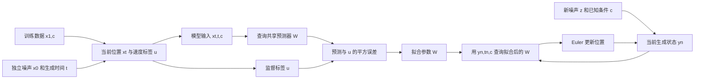

# M7.2：从训练样本到生成分布

2026-10-10，revision 1。备课审查版：这是已写出的学习输入，不代表已开展教学或取得学习表现。完整问题、教师参考、备用支持分区保存；可以按需要查阅。本稿没有设定你的学习时长，也不假定你已经学过 M1–M6。

本单元要把一件事解释完整：**训练时可以看到数据端点，生成时不知道端点；怎样仍能从噪声生成所需条件分布？**我们先跟踪一条训练记录，再解释共享回归器学什么，最后把它接到采样、实验和动作接口。最终工作是一份连续的系统说明与比较，见 [整体任务](04-main-work.md)，可以分段完成同一作品。

## 1. 先分清训练和生成各有什么

设每条数据包含二维点 \(x_1\) 和类标 \(c\)。这里的下标 1 表示数据端点，下标 0 表示噪声端点。生成时间 \(t\) 从 0 走到 1，是人为设置的路径参数。

我们使用同一个小数据模型贯穿全部主例：

\[
c\in\{0,1\},\quad P(c=0)=P(c=1)=\tfrac12,
\quad \mu_0=(-2,0),\ \mu_1=(2,0),
\]
\[
X_1\mid c\sim\mathcal N(\mu_c,.25I_2),\qquad
X_0\sim\mathcal N(0,I_2).
\]

给定 c 后，噪声与数据独立抽取。\(I_2\) 是二维单位矩阵，\(.25\) 是每个坐标的方差，因此数据标准差为 .5。每一类的点都有变化，并非只有一个均值点。类标是推理时已知的任务条件，本例暂不涉及图像编码器。

| 阶段 | 可以获得的量 | 要完成的工作 |
|---|---|---|
| 训练 | 数据对 \((x_1,c)\)、独立噪声 \(x_0\)、随机 \(t\) | 构造当前位置和速度标签，更新共享参数 |
| 生成 | 新噪声 \(z\)、用户给定的 c、当前状态、当前生成时间 | 反复查询已学的速度，把状态从 0 推到 1 |

训练的数据端点是监督来源。生成一个新样本时，这个待生成的端点不存在于输入中。已知的目标位置可以合法作为任务条件；是否合法，要看该任务推理时是否真的可获得它，不能仅凭变量里含有“目标”二字判定。

下面两条流使用同一组参数 \(W\)：

图中的速度是“当前状态应该怎样变化”，不是已生成的终点。生成循环每次读取更新后的状态；训练端点只参与训练流。

## 2. 一条数据怎样推动一次更新

固定这次抽出的端点，构造线性路径：

\[
x_t=(1-t)x_0+tx_1,\qquad u=\frac{dx_t}{dt}=x_1-x_0.
\]

求导时端点固定。改变 t 只改变这对端点之间的插值位置；训练中的下一条记录可以重新抽端点与 t。

取 \(c=1,x_0=(-1,1),x_1=(3,-1),t=.25\)。逐项算得：

\[
x_t=.75(-1,1)+.25(3,-1)=(0,.5),\qquad u=(4,-2).
\]

预测器输入为 \((x_t,t,c)\)，标签为 u。为了看清一次更新的来源，先用一个局部可训练输出 \(b=(2,0)\) 代替共享模型：

\[
\ell(b)=\frac12\|b-u\|^2
=\frac12[(-2)^2+2^2]=4,
\qquad \nabla_b\ell=b-u=(-2,2).
\]
\[
b'=b-.1\nabla_b\ell=(2.2,-.2),\qquad \ell(b')=3.24.
\]

这里按两个坐标取平均平方误差，所以有 \(1/2\)。梯度指出旧输出与标签的差，更新使这个查询的输出接近标签。数据决定标签，标签与旧预测的差决定此次学习信号，参数变化再改变预测。这不是由“训练目标叫 MSE”就能省略的连接。

单条记录的损失下降，只说明这次局部计算。它尚未证明整体风险下降、学得正确场或生成得正确分布。局部 b 也不是完整模型的一组独立查询记忆。

教师实现随后改用共享回归器。设 \(h_j(t)\) 为 17 个节点 \(j/16\) 上的分段线性帽函数：在节点取 1，离开相邻节点区间取 0；任一 t 处相邻两个帽函数相加为 1。在每个时间节点使用四个特征：

\[
h_j(t)[1,x^{(0)},x^{(1)},2c-1].
\]

括号中的 \(x^{(0)},x^{(1)}\) 是当前位置 x 的两个坐标，**不是噪声端点和数据端点**。拼接后得到 \(\Phi(x,t,c)\in\mathbb R^{68}\)，预测为 \(v_W=\Phi W\)，其中 \(W\in\mathbb R^{68\times2}\)。

在上面的查询 t=.25，只有第 4 个时间节点的块非零，该块为 \([1,0,.5,1]\)。另一个查询仍使用同一个 W，但特征不同。参数变化对任意查询的影响为 \(\Delta v=\Phi\Delta W\)。这就是“许多样本训练一个共享预测器”的具体接口。

批量损失及梯度为：

\[
L(W)=\frac1{2B}\sum_{b=1}^B\|\Phi_bW-u_b\|^2,
\qquad \nabla_WL=\frac1B\Phi^\top(\Phi W-U).
\]

教师代码用 NumPy 最小二乘求这个有限经验平方问题的解；它是实际参数拟合，没有执行本稿局部 b 的梯度步作为完整训练。监督来自独立抽样的端点差，解析场只用于评价。这个回归器在固定 t,c 时对 x 是仿射函数，适合本课每类 Gaussian 主例；后面的同 c 双峰需要非线性局部场，不能由这个模型的训练证明。

这次教师实际使用 100000 条训练记录拟合 68×2 个参数，并用另一 seed 的 25000 条记录评价。共享 W 从全零开始，上述查询的输出从 (0,0) 变成 (2.615566,−.556257)。这是完整 W 拟合的结果，与前面局部 b 从 (2,0) 做一次更新是两个明确区分的演示。

训练 coordinate-MSE 从 3.252074 变成 .788215，held-out CFM coordinate-MSE 为 .784192，held-out field coordinate-MSE 为 .000557859。非零 CFM 风险并不说明必须继续降到零：令 \(Q(t)=(1-t)^2+.25t^2\)，本例的总体不可约 coordinate 风险为 \(\int_0^1 .25/Q(t)\,dt=\pi/4\approx.785398\)。有限评价样本的值不必精确等于总体常数，仍可含场误差与样本交叉项。教师原输出见 [summary-r1.json](../../../../artifacts/preparation-tests/2026-10-10-M7-2-flow-matching/teacher-run/summary-r1.json)；这些是教师结果，不是你的训练或理解证据。

## 3. 为什么一个合法标签仍不是正确生成场

同一个 \((x,t,c)\) 可以由许多噪声—数据配对产生。预测器只看到这个查询，不能每次根据未知的配对输出不同标签。因此它要对兼容这个查询的标签作条件平均：

\[
S=(X_t,t,c),\qquad m(S)=E[U\mid S].
\]

“条件平均”表示固定当前位置、生成时间和任务条件，再按兼容样本的概率加权。它不是把所有位置和条件的标签一起平均。

一个只用于说明加权的局部有限例子：固定 \(t=.5,c\)，两对端点均产生 \(x_t=(.5,0)\)。在这个自拟离散例中，两对出现的概率分别为 .75 与 .25：

| \(x_0\) | \(x_1\) | \(x_t\) | \(u=x_1-x_0\) | 权重 |
|---|---|---|---|---:|
| (−1,1) | (2,−1) | (.5,0) | (3,−2) | .75 |
| (1,−1) | (0,1) | (.5,0) | (−1,2) | .25 |

这处的均值是 \(.75(3,-2)+.25(-1,2)=(2,-1)\)，不同于其中任一标签。它使用另一个明确给定的离散配对分布，只说明局部条件平均；这些权重不是主例独立 Gaussian 的条件概率，也不用于证明离散端点的光滑 ODE 性质。

回到主例 Gaussian，在之前的 \((x,t,c)=((0,.5),.25,1)\) 处，解析场为 \((96/37,-22/37)\approx(2.594595,-.594595)\)，而单条标签为 (4,−2)。两者不同是正常现象，下面的理由说明为什么平方风险仍把样本标签连到解析场。

设候选预测 f 只依赖 S。写成：

\[
f-U=(f-m)+(m-U).
\]

固定 S 后，f−m 已是确定向量。条件期望满足“已知的量可以提出期望”，且：

\[
E[m-U\mid S]=m-E[U\mid S]=0.
\]

因此平方展开中的交叉项为零：

\[
E[(f-m)^\top(m-U)\mid S]=0.
\]

对所有 S 再取平均：

\[
\boxed{E\|f-U\|^2=E\|f-m\|^2+E\|U-m\|^2.}
\]

后一项是标签的条件方差总量，与预测参数无关。左边是可用样本标签训练的 CFM 风险，右边第一项是同一路径的边缘场 FM 风险。两者相差参数无关常数，所以总体最优目标相同；在微分与期望可交换的条件下，总体参数梯度也相同。

这段理由需要有限二阶矩、同一抽样分布、固定且不依赖当前参数的路径与配对、同一种平方损失。按坐标平均只会把整式同时除 2。**它没有说每条样本的 loss 或随机梯度相同。**标签仍有方差，所以 CFM 风险不必趋于零；非零风险还可能混有有限数据、表示能力或优化误差。

这个总体结论也不保证某次训练收敛。它先回答“理想回归器应该学什么”，实际拟合是否接近它需要另测。

## 4. 局部均值怎样成为生成分布

样本路径组成中间分布 \(p_t(x\mid c)\)。对合适的光滑函数 \(\varphi\)，链式法则给出：

\[
\frac d{dt}E[\varphi(X_t)\mid c]
=E[\nabla\varphi(X_t)^\top U\mid c]
=E[\nabla\varphi(X_t)^\top m(X_t,t,c)\mid c].
\]

第二个等号把当前状态处的标签换成条件均值。因此这些中间分布按场 m 满足质量守恒；有密度时可写为连续性方程 \(\partial_t p_t=-\nabla\cdot(p_tm)\)。在相应 ODE 和输运问题的存在、唯一性及正则条件成立时，从同一先验解 \(dY_t/dt=m(Y_t,t,c)\)，其各时刻分布与 \(X_t\) 相同。

这里相同的是分布，不是原训练配对中的逐点身份。采样无需找出某一条训练线再重走它。

Gaussian 主例可以直接把这个结论核到端点。记：

\[
Q(t)=(1-t)^2+.25t^2,\quad A(t)=\frac{1.25t-1}{Q(t)},
\]
\[
v^*(x,t,c)=\mu_c+A(t)(x-t\mu_c),\qquad
Y_t=t\mu_c+\sqrt{Q(t)}z.
\]

\(X_t\mid c\) 的均值是 \(t\mu_c\)、协方差是 \(Q(t)I\)。联合 Gaussian 的条件均值规则给出上述场；对 Y 求导也得到相同速度。初值为 z，终点为 \(Y_1=\mu_c+.5z\)，因而恰好有目标分布。这个解析答案尚未进行训练。

取 c=1、z=(−1,1)，完整轨迹为：

| t | 0 | .25 | .5 | .75 | 1 |
|---|---:|---:|---:|---:|---:|
| \(Y^{(0)}\) | −1 | −.260345 | .440983 | 1.049306 | 1.5 |
| \(Y^{(1)}\) | 1 | .760345 | .559017 | .450694 | .5 |

初末点的直线中点是 (.25,.75)，与 t=.5 的真实位置不同。训练插值是直线，不推出共享边缘场的 ODE 轨迹是直线，也不推出一步 Euler 精确。

图中在同一坐标内标明了这两条轨迹和生成时间，见 [轨迹图](../../../../artifacts/preparation-tests/2026-10-10-M7-2-flow-matching/figures/01-trajectories.png)。横纵轴均为 x 的坐标，t 只标注路径进度。

## 5. 同一条件下有两种合法结果时

为了区分终点均值与局部速度均值，这一段固定同一个 c，将其数据改为等权双 Gaussian：

\[
X_1\mid c\sim\tfrac12\mathcal N((-2,0),.25I)+\tfrac12\mathcal N((2,0),.25I).
\]

这是改变了数据分布的相邻案例。每个分量在时刻 t 的均值是 \(t\mu_-\) 或 \(t\mu_+\)，方差仍为 Q(t)。给定 x,t，兼容分量的权重为：

\[
w_\pm\propto\exp\left[-\frac{\|x-t\mu_\pm\|^2}{2Q(t)}\right],\quad
w_-+w_+=1.
\]

边缘场是两分量速度的加权平均。在 \(t=.5,x=(.5,0)\) 处，当前位置更可能来自右侧分量：

\[
w_+\approx.960834,\quad v_+=(2.6,0),\quad v_-=(-3.8,0),
\quad v^*\approx(2.349339,0).
\]

该 c 的终点全局均值却是 (0,0)。直接输入 c、用 MSE 输出单个终点，会得到这个均值；输入当前位置和时间、回归局部速度，得到的是位置相关的场。不同初始噪声走到不同位置，接受不同局部速度，理想运输能够保留多峰。对称点 x=0 的速度为零，只说明这个点，不能推出所有轨迹都聚到它。

这是解析结构对照。本课的仿射回归器未在此训练，也不能充分表达这些非线性权重。两类 c 混合后看上去有两个团，不能代替“固定同一 c 有两峰”的证据。

## 6. 采样器如何把速度变成位置

生成时初始化 \(y_0=z\)，固定 c 与已拟合参数。设正整数 N，步长 \(h=1/N\)：

\[
t_n=n/N,\quad
y_{n+1}=y_n+h\,v_W(y_n,t_n,c),\quad n=0,\ldots,N-1.
\]

总共更新 N 次，输出位于 t=1。n 是积分步编号，t 是生成时间，y 是当前状态。当前速度要乘步长才成为位置增量；不能把速度直接当终点。

用解析场取 N=2，c=1、z=(−1,1)：

| 查询时刻 | 当前状态 | 场给出的速度 | h | 更新后状态 |
|---:|---|---|---:|---|
| 0 | (−1,1) | (3,−1) | .5 | (.5,.5) |
| .5 | (.5,.5) | (2.6,−.6) | .5 | (1.8,.2) |

第二步必须查询新状态 (.5,.5)，而不是再查询初值 z。终点 (1.8,.2) 不等于解析终点 (1.5,.5)，是有限步积分带来的差异。

若只做一次解析 Euler，则 \(v^*(z,0,c)=\mu_c-z\)，得到 \(y_1=\mu_c\)：所有噪声都被送到类均值，方差为零。**正确场也能因过粗积分出现分布失真。**

本例 oracle Euler 可写成 \(y_N=\mu_c+R_Nz\)。由每步递推可算出理论方差：

| N／每样本场求值数 | 1 | 4 | 16 | 64 | 128 | exact |
|---|---:|---:|---:|---:|---:|---:|
| 每坐标方差 | 0 | .11596786 | .20764708 | .23868628 | .24427822 | .25 |

这是本例的有限计算，不是所有场上误差必单调下降的定理。合适平滑与稳定条件下，Euler 在固定时间区间的全局误差为 \(O(1/N)\)；它描述积分误差，不描述训练误差。

端点条件速度的写法 \((x_1-x)/(1-t)\) 只在 t<1 使用，不能直接代入 t=1。本课代码使用 u 的样本公式与平滑的边缘场；Euler 只在 t=0,…,(N−1)/N 查询。

若另一份材料用 \(r=1-t\)，则 \(Z_r=Y_{1-r}\) 满足 \(dZ_r/dr=-v(Z_r,1-r,c)\)。此时 r=1 是噪声、r=0 是数据；生成要从 1 积到 0，步长为负。场符号与步长、初值必须一起转换，只把时间变量改名或只反转循环会混用两个约定。

## 7. 实验要分开回答什么

teacher-run 保存的是教师实际拟合与核验。你可以从这些原输出解释结果；那仍不是你的代码运行。本课用一次拟合的 W，固定同一批新噪声和类标，再改变 N，按 c 分开报告。

| 比较／指标 | 可以回答 | 尚不能推出 |
|---|---|---|
| held-out CFM coordinate-MSE：预测对新样本 u | 带标签方差的预测风险 | 非零就说明失败；网络已学得精确场 |
| held-out field coordinate-MSE：预测对解析 v* | 本例已知场上的学习误差 | 高维未知场上的普遍误差 |
| oracle Euler 对 oracle exact，同 z,c | 纯积分近似造成的终点偏差 | 参数学习质量 |
| learned Euler 对同 W 的高步 reference | 当前已学场的近似积分误差 | 高步 reference 是精确解 |
| learned Euler 对 oracle exact | 终点总偏差，混有场与积分差异 | 可以直接把全部差别叫模型误差 |

reference 需要用加倍步数看是否近似稳定；若仍明显变化，先保留误差分离的限制。向量 RMS 定义为 \(\sqrt{\operatorname{mean}\|\Delta y\|^2}\)，coordinate-RMSE 定义为 \(\sqrt{\operatorname{mean}(\Delta y^2)}\)，二维时前者是后者的 \(\sqrt2\) 倍，不能混比较。

均值与协方差可以揭示本 Gaussian 主例的错误，但一般分布不能由两个矩确定。按 c 检查能避免把错误条件输出混在一起后看似有两个团。成本可先用每样本场求值次数 N 比较；墙钟时间另外记环境和批大小。

增加 N 不改变 W。若场不正确，更多步可以更准确地解这个错误场；如果积分误差较大，更多步才可能有相应收益。真实表和图见 [代码与运行核验](../../../../artifacts/preparation-tests/2026-10-10-M7-2-flow-matching/07-code-and-run-review.md)，[采样比较图](../../../../artifacts/preparation-tests/2026-10-10-M7-2-flow-matching/figures/02-sampling-comparison.png)。

需要选择模型时也保留公平替代：只需均值可直接回归；已知 Gaussian 或少量混合分量时可直接抽样，可能比 ODE 更便宜；复杂分布可以考虑 FM、diffusion、自回归或其他生成模型，但性能取舍需要各自明确的模型、训练与评价。FM 训练可直接抽 t 构造监督，无需把采样 ODE 全展开，仍不意味着没有训练成本。

独立配对也不能因每条线很直就称为 OT。主例 c=1 的独立端点位移平方期望为 6.5；合法配对 \(X_1=\mu_c+.5X_0\) 保留相同端点分布，成本只有 4.5。有更低成本的合法耦合足以否定独立配对已经最优，尚不等于完成全部 OT 理论。

## 8. 把生成对象换成动作 chunk

这个映射只给离线接口，不执行机器人。假设一条数据是 8 个物理时刻、每步两维平面位移的动作块：\(a_1[B,8,2]\)，单位为米。给定每维正尺度 \(s_0,s_1\)，它们的单位同为米；归一化 \(x_1^{(j)}=a_1^{(j)}/s_j\)，因此 x 无量纲。噪声 x₀ 与速度输出均为 [B,8,2]。

| 对象 | shape／作用 | 与其他轴的关系 |
|---|---|---|
| 物理时刻 k | 动作块中的 8 个位置 | 表示未来执行序列，控制周期此处未指定 |
| 生成时间 t | 每样本 [B,1,1]，广播到整个块 | 表示噪声到动作数据的路径进度 |
| 积分步 n | 例如 N=16 次循环 | 每次更新整个 8×2 块，输出仍是 8 个动作时刻 |
| 条件 c | 当前可得观测／已知目标的编码 | 需要另外定义编码器接口与信息时点 |
| 速度 v | [B,8,2]，归一化动作量／单位生成 t | 不是机器人物理速度；反归一化后输出的动作量为米 |

也可可逆展平为 [B,16]，但要保留原 k、动作维度和单位。N=16 不表示执行 16 个动作，不改变动作块 horizon=8。生成多个块还需由实际控制器规定执行多少步、何时重新观察。

本 toy 的 c 是类标；真实视觉或语言条件编码、动作标定、时间对齐、可行性以及闭环评价尚未实现。论文公式、toy 拟合、用户实现与真实机器人成功是分别需要依据的工作。

上述输入已经把主要桥梁备好。下一工作回到 [同一份整体作品](04-main-work.md)：在允许这些资料的条件下，组织训练到采样的链，承担新的记录计算、合法理由、参照选择和实验解释。遇到具体卡点时按 [备用支持](../backup/06-support-branches.md)补一处，再回原作品；不用逐项猜尚未解释的定义。

## 教师与审查者可定位的依据

本稿依 [学科分析](../../../../artifacts/preparation-tests/2026-10-10-M7-2-flow-matching/00-disciplinary-analysis.md)与 [认知设计](../../../../artifacts/preparation-tests/2026-10-10-M7-2-flow-matching/01-cognitive-design.md)重组，损失归一化、特例条件及限制已保留。局部离散加权表是本稿另构的定义性示例，独立可算，不作主 Gaussian 的概率或训练证据。

主源：[Flow Matching for Generative Modeling v2，§3、§4、Appendix A](https://arxiv.org/html/2210.02747v2)；[MIT 作者讲义 v2，§2.1、§3.2、§4.1、§5.1.1](https://arxiv.org/html/2506.02070v2)。原论文线性条件路径保留 \(\sigma_{min}>0\)，本课使用零端点残余噪声简化；端点条件密度因此可退化，不能忽略 t<1 的限制。完整来源读取范围见 [来源审计](../../../../artifacts/preparation-tests/2026-10-10-M7-2-flow-matching/00-source-audit.md)。
