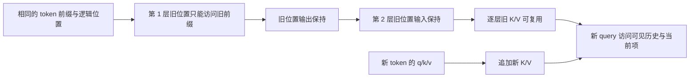
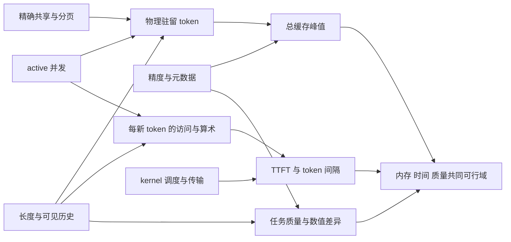

# 可直接使用的输入与连贯示范

版本 B1 / 2026-10-11；prepared_for_review。以下是教师将来可呈现的材料正文，今天只交备课供审查。完整范例由 AI 提供，不是学习者作品。

## 1. 缓存到底保存哪项工作

考虑只看当前位置及过去的 decoder。第 l 层，位置 i 的输入状态是 h_i^(l-1)。经投影得到 q_i、k_i、v_i；query 用来与可见 key 计算权重，再按权重合并 value。单头写作：

\[
q_i=h_iW_Q,\quad k_j=h_jW_K,\quad v_j=h_jW_V,
\]
\[
a_i=\operatorname{softmax}(q_iK_{\leq i}^{\mathsf T}/\sqrt{d_h}+M_i)V_{\leq i}.
\]

M_i 在允许位置为 0、屏蔽位置为负无穷。屏蔽要发生在 softmax 前，不能只把被屏蔽分数乘成 0。各层还有输出投影、残差和逐位置前馈；以下数值例先只打开 attention 这个局部。

为使权重容易读，设 d_h=1，新位置 q=1，四个 key 为 [0, ln2, 0, ln3]，value 为 [2,4,10,6]。四个位置都允许访问，则 exp 分数为 [1,2,1,3]，权重为 [1,2,1,3]/7，输出为 (2+8+10+18)/7=38/7≈5.428571。

处理前三个位置后，已有 K=[0,ln2,0]、V=[2,4,10]。第四个位置只须求自己的 q/k/v，把 k=ln3、v=6 追加，再用新的 q 访问全部四项。旧 K/V 无需重新投影。新 q 与历史 K 的匹配、softmax 和 V 加权仍要完成，历史并没有被“免读”。

旧 query 不存入通常的生成 KV cache，因为在标准下一 token decode 中，不再重新输出旧位置的 attention 结果。若任务要求重新求旧位置输出、双向修改或另有算法，不能仅靠这项理由套用。

prefill 一次处理提示词，通常并行生成各层提示词 K/V，并由最后位置 logits 得到第一个生成 token；随后将已生成 token 喂入模型，decode 逐步追加缓存。这里按“处理了哪个 token”的边界计数，避免把第一个输出 token 与第一次追加的输入 token混作一步。

图的前提还包括同一权重/adapter、同一 mask、同一位置编码规则及确定性的推理计算。若只换物理内存页而保持逻辑 token、位置和 mask，图的理由仍成立；若改了旧前缀或位置规则，第一条边已失去前提。

## 2. 为什么多层也能复用

从底层向上归纳。相同 token 前缀和位置规则给出相同的旧位置 embedding。假设某层旧位置的输入相同：因果 attention 在旧位置 i 只访问 j≤i 的输入，追加的未来位置不能进入它的可见集合，因此旧输出相同。残差、归一化及前馈若逐位置且推理条件相同，也保持相同，于是下一层旧输入相同。每层由这些输入投影得到的旧 K/V 都相同。

所以缓存不是用第一层的线性投影“猜”高层也不变。归纳需要各层因果依赖和兼容条件。数学模型下相同；不同浮点 kernel 的求和顺序可能带来微小差异，不能普遍承诺 bitwise 相等或采样生成文本始终一致。

RoPE 通常旋转 q/k，使位置关系进入分数；缓存常保存已旋转的 key。逻辑位置与物理缓存槽是不同对象。环形缓冲槽可回绕，逻辑 position 不能因此随意从 0 重新编号。若改变 RoPE 配置、旧 token 内容、权重/adapter 或可见 mask，须重算受影响的缓存或证明兼容。语义相似的两个前缀不构成 exact cache 复用依据。

教师代码 [demo.py](../../../code/kv-cache/test-prep-20261011-b/demo.py) 打开两层 toy decoder，用完整重算与增量计算逐前缀对比，另给出错误位置、旧前缀改变和直接截断的反例。它只核这份 toy 规格，不输出真实硬件性能结论。

## 3. 从每层缓存接到整项资源

设层数 L，query 头数 H_q，KV 头数 H_kv，头维度 d_h，每元素 s 字节。没有共享、每层全注意力且 K/V 同类型时，B 条各 T 个有效驻留 token 的载荷是：

\[
M_{KV}=2LBTH_{kv}d_hs.
\]

2 来自 key 与 value。不同长度可把 BT 换成各请求长度之和；共享时要数真正存了一份的物理 token；不同层窗口或 dtype 时按层求和。公式不含页尾空位、量化 scale/zero、高精度 residual、权重、工作区和运行时其他占用。1 GiB=2^30 字节，1 Ki token=1024 token；单位不能混用。

使用同一假设 GQA 模型：L=32，H_q=32，H_kv=8，d_h=128，BF16 s=2。每 token 每层 K+V 是 4096 字节，32 层为 131072 字节=128 KiB。T=32768（提示词28672+最多生成4096）时，每请求最大载荷4 GiB，B=4共16 GiB。

GQA 让多个 query 头共享 KV 头。这份 checkpoint 已具有 H_kv=8；不能把它当固定模型中可以随手从 8 改成 1 的运行开关。与 H_kv=32 的另一架构相比，缓存小4倍，但 H_q 仍为32，新 query 的 attention 算术不会因此自动小4倍。MQA/GQA 的训练或模型更换另有质量条件。[GQA 原始论文](https://arxiv.org/abs/2305.13245)

提示词长度 P，全注意力 prefill 的 attention 算术量级为 O(LH_qP²d_h)。固定一个历史长度 T，单新 token attention 为 O(LH_qTd_h)，KV 持续增长；线性投影及前馈另计。若从 P 继续生成 G 个 token，缓存后的 attention 总量级为 O(P²+GP+G²)，省略固定模型因子。朴素每次重算全前缀则累加 O((P+g)²)，为 O(GP²+PG²+G³)。这些是假设算法的量级，不是实测秒数；某些无 cache 优化不属于这个朴素基线。

TTFT 是请求进入服务到首个输出 token 的延迟，含排队、prefill 等；TPOT 或 inter-token latency 要明确统计口径，常用于首 token 后生成间隔。本单元题面指定 p95 实测间隔口径。prefill 算术、decode KV 读量、权重读取、调度和传输可能分别成为限制；仅看 FLOPs 或显存是否装下无法推出 p95。

## 4. 连贯的联动示范

现在使用上面的 T=32768 模型，缓存分配预算18 GiB，另计1 GiB缓存开销，教师先演示如何逐条件判断。

BF16、B=4 时载荷16 GiB，总计17 GiB，容量模型内可装下。把 KV 变为1字节并把 B增至8，理想载荷仍为16 GiB，因为 s减半而 B翻倍；不能只报“省50%”。量化元数据和支持后端还要另核，速度和质量也没有由这笔内存计算证明。

若每条请求都有精确相同且兼容的8192 token前缀，并且后端实际只存一份共享前缀，则 B=4、BF16 的物理 token 数是8192+4×(32768−8192)=106496，对应13 GiB；再加1 GiB为14 GiB。B=8则载荷25 GiB，超18 GiB；即使有共享，也不能从 B=4 可行推出 B=8 可行。1字节载荷在同一共享条件下是12.5 GiB，但总峰值还取决于量化与分页开销。

共享减少前缀存储和可跳过的 prefill；新 query 依然需要前缀内容参与 attention。对每请求逻辑计算，8条不同 query 不会合成一个 query。物理共享可能影响调度与读复用，但不能按存储13/16的比例直接缩 decode 时间。[PagedAttention 原始论文](https://arxiv.org/abs/2309.06180)、[vLLM 前缀复用说明](https://docs.vllm.ai/en/latest/features/automatic_prefix_caching.html)

| 改动 | 直接改变什么 | 与其他选择怎样联动 | 要保留的边界 |
|---|---|---|---|
| KV cache | 省去旧位置状态及K/V的重复计算 | 上下文增长仍增加读取与驻留；复用受前缀/位置/模型条件限制 | 通常保持同一因果模型语义 |
| FlashAttention | attention 分块计算与中间量 IO | 可能使prefill更快；仍要存所需KV；后端兼容影响量化等组合 | 不把避免P²中间矩阵等同消除常驻KV |
| PagedAttention | KV物理分配、页表、共享 | 降碎片/支持共享；允许更多active请求后可能增加读取和调度压力 | 不改变每token的未量化逻辑载荷 |
| KV量化 | 每元素表示及额外元数据/转换 | 与并发、head布局、kernel、residual长度联动 | 不默认精确同输出或单请求更快 |
| 滑窗/淘汰 | 实际可访问的历史集合 | 限容量和读取；可能使远证据不可用；影响prefix保留与共享 | 全注意力模型直接截断会改函数；原生滑窗可对其既定mask保持等价 |
| CPU offload | 数据驻留层级及传输 | 可放下更长序列；传输/重叠与decode阶段联动 | 容量可行不证明间隔SLO可行 |
| prefix reuse | 精确兼容前缀的计算与存储复用 | 命中率、租户/adapter/位置、共享页生命周期改变实际收益 | 相似文本或相同可见文字而不同tokenization不够 |
| 换GQA/MQA或位置扩展模型 | checkpoint/位置规则与能力假设 | 旧cache、质量基线及kernel条件需重新审查 | 不是固定checkpoint的免费运行旋钮 |

FlashAttention 依据是 IO-aware exact attention 算法，分页依据是 KV 内存管理；二者可相容组合，收益要测对应实现，不能把各自论文加速比相乘。[FlashAttention 原始论文](https://arxiv.org/abs/2205.14135)

图里“影响”不保证固定方向或比例；共享/精度都有兼容条件，量化质量与速度须有证据。硬约束的交集才是可行域，某一指标变好不能补偿另一项硬约束失败。

## 5. 长上下文能访问什么，与能推出什么

给模型一个完整短材料，之后可以把证据搬到长输入的不同位置：

“本季度Z项目允许结算，需要批次合格且温度记录不超过30°C。记录A：本季度批次R17合格，R18不合格，R19合格。记录B：本季度最高温度R17为31°C，R18为28°C，R19为29°C。干扰记录C：上季度R17为27°C、R19为33°C。问题：本季度哪一批允许结算？请分别指出两条依据；资料缺失则说明缺什么。”

可靠答案是只有R19允许：合格且本季度29°C，两份记录必须绑定到同一批次和季度才能确认联合条件。R17合格但温度31超限，R18温度28达标但批次不合格；否决可以由单个必要条件失败短路成立。若删掉本季度温度记录B，不能拿上季度记录补足，R17/R19温度条件未知，结算资格未定；R18仍可由不合格直接排除。这个旧结论保留与新未知并存的分支有明确参考。

把A放在前部、B放在中部，加入足量无关记录，再比较完整历史与只保留尾部窗口。窗口若使A/B不可访问，不能承诺相同结论；保留全文也不保证模型成功连接季度、批次和联合条件。测试应区分读到了证据、绑定到正确对象、两项条件联合推理与缺证据时拒答。

宣称支持64Ki token、程序没有OOM或一次needle定位正确，只覆盖各自条件。实际推理至少要按长度、证据位置、干扰及单/多证据任务分开观察，记录同一checkpoint、tokenization、prompt和生成设置。无需把所有组合做成学习者作业；它们是服务验证怎样取有代表样本的依据。[Lost in the Middle](https://arxiv.org/abs/2307.03172)、[RULER 原始论文](https://arxiv.org/abs/2404.06654)

接下来使用同一套关系完成工程变更审查与服务决策备忘录，问题正文见 questions.md。此处只是备课材料，当前不要求用户作答。
