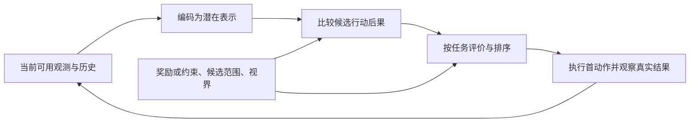

# 面向决策的潜在世界模型：学习材料与连贯示范

版本 r1；状态 `prepared_for_review`。这是备课送审正文，尚未作为正式教学展示。例子、模型与数值由 AI 为本单元构造，不是学习者作品或论文实测数据。拟教学时按认知设计分段呈现；题目与教师参考另存，允许查阅本讲义。正式学习时间和先验未知，不作预设。

## M0：我们要支持哪一种决策

本单元要形成的工作是一份技术决策建议：给定任务、模型和证据，判断应保留的信息、重要误差、修正方案与检验办法。问题不是只问模型能否画出未来，而是它给出的未来能否支撑当前决策。

真实状态 $s_t$ 是描述环境的对象；观测 $o_t$ 是传感器当时提供的信息，两者不必相同。历史 $h_t=(o_{0:t},a_{0:t-1})$ 包括此前观测和行动。潜在表示 $z_t=\phi(h_t)$ 是模型的内部输入，可压缩历史；它不自动等于完整状态，也不因叫“latent”就已充分。

箭头表示决策流程，不是模型正确性的证明。检查“预测准”时，要先问预测的是什么量；检查“充分”时，要说明针对什么任务、行动范围、视界和可用信息。

## M1：从预测到候选评分

考虑一个有 $H$ 次动作的候选序列 $a_{0:H-1}$。模型从当前 $z_0$ 想象后续状态、各步奖励，再给序列评分：

\[
\widehat G(a_{0:H-1})=
\mathbb E\left[\sum_{i=0}^{H-1}\gamma^i\widehat r_i+
\gamma^H\widehat V(z_H)\right].
\]

$i=0$ 是当前候选的第一动作；$\widehat r_i$ 是该动作产生的奖励；$\gamma$ 是折扣，当前例子用 0.9；$z_H$ 是做完这 $H$ 次动作后的潜在状态；$V$ 评价从那里继续的收益。确定性例子不必求平均；随机例子的期望工具见 M4。有限任务可以用 $\gamma=1$，本讲义统一用 0.9 以保持记号一致。

若一步后就终止，$H=1,V=0$，评分只有第一步奖励。若环境仍有未来收益，把终端值设零是一种截断选择，不能自动当成真实总价值。MPC 通常只执行选中序列的第一动作，取得新观测后重新规划；模型内一条轨迹的分数与真实闭环回报应分别测量。

这里分开两个问题：模型怎样给已有候选评分，以及搜索有没有提出足够好的候选。即使所有已评分候选都精确，搜索漏掉一个好动作，决策仍可能差。

对固定且相同的有限候选集，若所有评分的误差都满足 $|\widehat G(c)-G(c)|\le\epsilon$，真实最优候选与所有其他候选的最小间隔为 $\Delta$，那么 $\Delta>2\epsilon$ 足以保持唯一最优：

\[
\widehat G(c^*)\ge G(c^*)-\epsilon
>G(c)+\epsilon\ge\widehat G(c).
\]

即便排序改变，模型最优候选 $\hat c$ 的真实损失也不超过 $2\epsilon$：

\[
G(c^*)-G(\hat c)
\le [G(c^*)-\widehat G(c^*)]+[\widehat G(\hat c)-G(\hat c)]
\le2\epsilon.
\]

中间用了 $\widehat G(\hat c)\ge\widehat G(c^*)$。这些结论要求统一的候选评价误差界；观测 MSE 不能直接提供该界，单步拟合误差也不自动成为整条 rollout 的误差界。这里是给定条件下的代数结论，没有证明训练会获得这样的误差。

## M2：同一环境中的完整决策链

状态 $s=(x,c)$：位置 $x\in\{0,1,2\}$，可观察标志 $c\in\{0,1\}$。动作 L 表示 −1，R 表示 +1；下一位置为 $x'=\operatorname{clip}(x+a,0,2)$，超出边界就截在 0 或 2；标志不变 $c'=c$。动作后给奖励，一步后终止，$H=1,\gamma=.9,V=0$。所有候选都被穷举，不存在搜索漏项。

原任务要接近位置 2，奖励为 $r_0=-(x'-2)^2$。当前位置 $x=1$：

| 真实状态 | 动作 | 下一状态 | 奖励／评分 |
|---|---|---|---:|
| (1,0) | L | (0,0) | −4 |
| (1,0) | R | (2,0) | 0 |
| (1,1) | L | (0,1) | −4 |
| (1,1) | R | (2,1) | 0 |

两种标志都选 R。用 $z=x$ 丢掉 $c$ 仍能正确预测潜在转移和奖励，因为它们在**整个规定的状态／动作域**都只依赖 $x,a$。这比只看到两个状态动作相同更强。在保持原奖励与 L/R 时，多步过程也可以在 $x$ 上闭合；这并不涵盖所有新任务。

现在比较两种预测误差。把观测写成 102 维数值向量 $I=(x,c,b_1,\ldots,b_{100})$，其中外观位 $b_i$ 不影响位置或奖励。在当前 $c=0$ 的比较情境中，真实下一观测有 50 个外观位为 1。采用每坐标等权的 MSE；这个数值向量是观测代理，没有把真实图片的尺度或感知误差建模进来。

P 模型精确预测外观和标志，却把 L 的下一位置预测成 2、R 预测成 0。D 模型精确预测位置；为了比较同一指标，给它附一个把标志／外观解码为零的解码器。两模型把各自预测的位置代入同一个正确奖励函数。

| 模型 | 每候选的观测 MSE | 模型评分 L／R | 选择 | 执行后的真实奖励 |
|---|---:|---:|---|---:|
| P | $4/102\approx0.0392$ | 0／−4 | L | −4 |
| D | $50/102\approx0.4902$ | −4／0 | R | 0 |

P 的两个位置错误都是相差 2，平方为 4，被许多正确外观坐标稀释；但这个错误恰好把奖励排序反转。D 的较大外观误差没有改变这项任务的排序。D 做决策并不需要外观解码器，它在这里只帮助比较观测指标。由此只能推出总观测 MSE 的排名不必等于决策质量排名；观测重建在其他用途仍可能有价值。

保持环境、可见信息、动作、时点和视界，改变任务：到位置 2 且 $c=1$ 时再损失 6。

\[
r_1=-(x'-2)^2-6c\,\mathbf1\{x'=2\}.
\]

指示符在大括号条件成立时为 1，否则为 0。

| 真实状态 | L 的评分 | R 的评分 | 唯一最优 |
|---|---:|---:|---|
| (1,0) | −4 | 0 | R |
| (1,1) | −4 | −6 | L |

现在两状态仍编码为同一个 $z=1$。只接收 $(z,a)$ 的奖励头，对相同输入 $(1,R)$ 只能输出一个数，却分别需要 0 和 −6；只接收这个 z 的策略也不能在两个状态分别必然选择不同的唯一最优动作。这是接口表达不可能，增加训练轮数不能解决已丢信息。

可行修正有：保留 $(x,c)$，另把当前 c 输入评价器，或用在线可得历史恢复 c。只给奖励头一个“正在做 r1 任务”的标签仍没有告诉它当前 c。若真实网络其实保留了 c，只是奖励头未学到，这是训练问题；本例明确规定 z=x，不能混称。

原任务中的合法结论仍保留；换奖励也不必总使旧表示失效。例如把原奖励乘一个正数，在同候选下仍保持排序。是否失效要检查新评价确实需要哪个被丢的区别。

拟教学先接 M3，补齐充分性与等价的边界，再交 T1（案例 A）。T1 借已给示范重建理由、限定结论，不声称自主发现这个反例。

## M3：“充分”有不同层次

| 主张 | 所需关系 | 边界 |
|---|---|---|
| 当前动作选对 | 当前候选上的最优选择得到保持 | 其他候选值可能错，新目标可能失败 |
| 候选评价保持 | 明确动作／序列上的真实评价相同或有足够误差界 | 没查询的范围尚未获保证 |
| 对 $\Pi,\mathcal V$ 价值等价 | 指定策略、价值函数的 Bellman 更新一致 | 不能省略集合限制 |
| 任务相关 Markov 信息 | 当前 z,a 足以确定相关奖励和下一 z 的分布 | 不必能重建所有观测，也不保证已训练得到 |
| 历史信息够用 | z 保留当前任务需要的历史区别 | 当前画面相同不等于控制状态相同 |

为解释价值等价，另设**持续**折扣 MDP，$\gamma=.9$，不采用 M2 的一步终止条件。两个模型在相同状态空间 $s=(x,c)$ 上定义。Bellman 更新是：

\[
T_m^\pi v(s)=\sum_a\pi(a\mid s)
\left[r_m(s,a)+\gamma\mathbb E_m[v(s')\mid s,a]\right].
\]

$\pi(a|s)$ 是当前策略的动作概率；$v(s')$ 是要传播回来的下一状态评价。对全部指定 $\pi\in\Pi,v\in\mathcal V$，两模型的更新相同，才叫对此集合价值等价。扩大集合通常会加强要求。[原论文 Definition 1、§4.1](https://arxiv.org/pdf/2011.03506)

真实模型保留 x 转移、c 不变；辅助模型保留同样 x 转移与 r0，却把下一 c 设为零。若 $v(x,c)=f(x)$，两模型的下一价值一致，故使用相同当前策略时一次更新一致。若加入 $v_c(x,c)=c$，在 c=1 时真实下一值为 1，辅助为零，更新差为 .9。

这是同状态空间的辅助模型例；真正的编码 z=x 不能表达任意依赖 c 的策略。即使一次更新等价，也不能默认函数集合对所有后续更新闭合：一个依赖 c 的策略可通过不同动作使新价值依赖 c。因此它不是任意编码器的万能充分性定理，也不是“当前选对动作”的另一个名字。

具体看闭合性：从初始函数 v=0 出发，设策略在 c=0 选 L、c=1 选 R。当前位置 x=1 的一次更新分别为 −4、0，已经依赖 c，不再属于只依赖 x 的函数集合。后续迭代需重新检查这个新增函数；不能把第一轮的等价直接用于所有轮次。拟教学至此交 T1。

## M4：随机结果的可用计算工具

随机量 Y 的可能结果是 $y_i$，概率 $p_i\ge0,\sum_i p_i=1$。任务用函数 $f(y)$ 给每种结果定义收益或成本：

\[
\mathbb E[Y]=\sum_i p_i y_i,\qquad
\mathbb E[f(Y)]=\sum_i p_i f(y_i).
\]

评价平均收益时，先给每种结果评价，再按其概率加权。平均值不意味着一次运行会恰好得到它。

工具示范：Y 取 2 的概率 .25，取 6 的概率 .75；收益 $g(y)=3y+1$。

| 结果 | 概率 | g 值 | 对平均结果的贡献 | 对平均收益的贡献 |
|---:|---:|---:|---:|---:|
| 2 | .25 | 7 | .5 | 1.75 |
| 6 | .75 | 19 | 4.5 | 14.25 |

所以 $\mathbb E[Y]=5,\mathbb E[g(Y)]=16$。$g(5)=16$ 也一样，因为这个 g 是仿射函数：加权和保持 $\alpha y+\beta$。不能据此推出对所有收益规则都可以先求平均结果再评价；判断新规则须对应它真正需要的量。

拟教学接 T2（案例 B），使用新目标与候选数据检验模型输出是否回答部署问题。本段没有给出那道题的评价或修正答案。

## M5：真实方法的接口、训练与查询范围

MuZero 与 TD-MPC2 都提供了不要求观测重建的设计，但它们保留和使用的对象并不相同。以下用统一 z 记号解释接口，没有把两个论文的符号强行等同。

| 方法 | 实际组件与数据流 | 怎样服务规划 | 原资料支持的范围 |
|---|---|---|---|
| MuZero | 表示：观测历史→z；动力学：z,a→下一 z 与奖励预测；预测：z→策略先验与价值 | MCTS 查询潜在后果与价值；想象时不需取得真实未来观测 | 奖励、价值、搜索策略目标；原文确定性潜在动力学；没有观测重建目标。经验结果不等于精确满足形式价值等价 |
| TD-MPC2 | 编码、潜在动力学、奖励、Q(z,a)、策略 prior；latent rollout 接奖励与后续价值 | 连续动作的采样轨迹优化，使用末端 bootstrap，执行首动作后重规划 | joint-embedding prediction、reward、TD value 目标；decoder-free 仍预测 latent。新任务的信息与数据覆盖须另查 |

[MuZero §1–3](https://arxiv.org/pdf/1911.08265)，[TD-MPC2 §3.1–3.3](https://arxiv.org/html/2310.16828v2)。实际读取范围及未核部分见来源登记；未复现训练与 benchmark。

M1 的 $V(z_H)$ 是统一教学接口；TD-MPC2 用 Q 和末端动作构成继续评价，Q(z,a) 不能不加说明就当成同一个无动作 V。规划方法还受候选搜索、计算量、模型误差和 value 误差影响。

训练时，实际轨迹给出观测、动作与奖励；下一观测的编码为潜在预测提供训练目标，实际奖励给 reward 预测目标，奖励加后续估值构成 TD 目标。MuZero 还以搜索得到的策略分布作为训练目标。损失推动参数改变，参数又改变下一次预测。**目标约束什么、网络是否保留必要信息、优化是否学到、规划是否正确使用、闭环是否有效是五个不同判断。**没有重建目标不保证只学到相关因素，也不证明丢掉的因素永远无用。

旧数据只覆盖一部分动作时，旧损失不能检验新动作的预测。规划器可能主动查询不同于数据行为策略的行动。新动作即使沿用旧奖励，也可能改变下一状态对隐藏因素的依赖；这需用新查询范围检验。

历史的完整小例：已知 $v_{t+1}=v_t+a_t,\ x_{t+1}=x_t+v_{t+1}$，当前只观测位置，上一动作已知为 0。动作 −1 或 +1，一步后终止，奖励 $-x_{t+1}^2$。

| 位置历史 | 当前速度（由规格推出） | a=−1 的下一位置／奖励 | a=+1 的下一位置／奖励 | 应选 |
|---|---:|---|---|---|
| −1→0 | +1 | 0／0 | 2／−4 | −1 |
| +1→0 | −1 | −2／−4 | 0／0 | +1 |

同当前位置 z=0 需要不同动作；在这个确定性已知模型中，历史补回速度能解决区别。若有噪声或模型未知，可能需要信念或滤波，不能宣布任意两帧总够用。给单帧模型加随机输出可表达混合结果，却不能补回本来可用但已经丢失的历史线索。

拟教学接 T3、T4：前者提供新行动规格，后者给规划配置数据。讲义尚未解出这两个案例的评分表，学习者负责组织计算和专业判断。

## M6：从判断到检验

一份可用检验需说明：保持什么、改变什么、测量什么、哪个结果支持或限制哪个主张。对 M2，保持同奖励、同候选与同初态，把观测误差和真实决策奖励分别记录，才看见两指标没有按同一顺序变化。只展示一次预测曲线不够回答这项比较。

模型诊断可检查某种必要区别是否在表示／输出中可用；候选评价检查是否按任务正确排序；真实闭环测试检查执行、更新观测与重规划后的实际表现。这三类证据彼此补充，不能互相冒充。旧闭环结果可以支持旧任务和其已测范围，不能独自回答新条件。

当现有数据不足以确定架构，建议仍可有内容：提出一个有理由优先检验的主张，给可执行对照，说明可能结果怎样改变方案，并保留未区分的原因。拟教学接 T5，学习者自行组织最终技术建议；本段只提供实验接口，没有替其选出优先实验。

本讲义依据本次01学科分析与02来源登记；数值程序仅作教师侧核验，规范代码位于 code/decision-sufficient/preparation-r1/，不要求学习者安装或运行。
