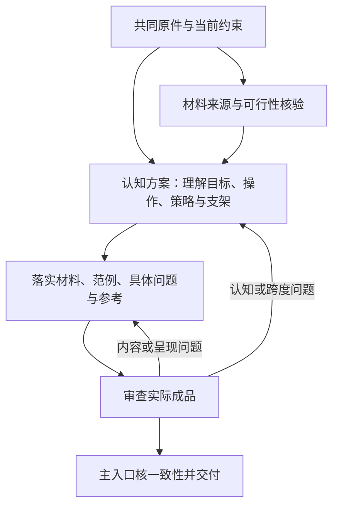

# 多Agent备课与单Agent备课：实际协作及用户流程评审

2026-10-09，Asia/Shanghai。对象是最新“重备视频接口单元”（01a11c65-e272-7fd2-bb04-d2a40368c4e0）的备课和流程追问，以及认知、材料、审查三个子线程与最终成品。对照此前 [三份单Agent比较](2026-10-08-three-preparations-comparison.md)，重点参考当前入口较集中的新增xhigh与应用较强的ultra单Agent。只评估架构执行、备课内容及依赖关系，没有修改原准备或学习进度。

## 结论

这次确实执行了三个子Agent，并非仅有角色名称。主Agent和三个子Agent均是GPT-6.1 Sol、ultra，没有模型／effort覆盖。三方分别承担认知主线、材料示范与语义审查，主Agent整合；读取子线程、原生日志设置／委派元数据和成品纠偏记录互相相容。

多Agent带来可定位的互查和纠偏：规格漂移、符号冲突、像素与标量混称、恢复对象含糊、首次工作跨度过大均得到修正。但起稿本身也出现较多需要协调的失配，不能把纠正这些失配的条数全部算成相对单Agent的净收益。最终材料在具身场景与空间信息损失上更具体，尚未全面优于最好的单Agent备课；新xhigh的当前入口仍更集中，ultra单Agent的明确下游用途更强。

用户提出的“认知设计先行→材料／问题依认知方案落实→审查→主Agent整合”在依赖关系上比本次并行起稿更合理，建议用作复杂备课的主干。应保留早期材料可行性反馈和制作后的回改，不能变成认知方案必须闭门完美完成后才接触素材的单向流程。该理想流程还未实际运行，判断是由本次返工与现有设计约束支持的设计推论，不是已验证的学习效果优势。

## 一、真正执行了怎样的架构

原请求沿用了“单模型备课”的文字，但最后明确要求多Agent；实际以最后具体指令执行。元数据与活动定位见 [核查记录](2026-10-09-multiagent-workflow-provenance.json)，不复制加密消息正文或本地完整历史。

| 承担者 | 实际线程 | 主要产物 |
|---|---|---|
| 主Agent | 01a11c65-e272-7fd2-bb04-d2a40368c4e0 | 04题面／参考、05支持、06首回复，核验及合稿 |
| cognitive_design | 01a11c67-0fe7-7fe3-921a-c7d4d27282da | 01认知方案、03策略及Encoding／Post实例化 |
| materials_demo | 01a11c67-64c5-7d00-91fc-8cd9ca5a279d | 02材料、完整网格、代码与数值核查 |
| semantic_audit | 01a11c67-9f84-72f1-a028-8cd62eadf83e | 00原学习依据、07审查与修复核回 |

当地时间约00:44:38启动认知、00:45:00启动材料、00:45:15启动审查；三个任务均继承全部当时上下文。随后有回传、主Agent消息、跨稿修改及最终审查。材料、认知子线程分别完成后，审查线程还继续核最终稿，主入口再合并。原生活学习记录没有被这些子线程当作新的独立表现样本。

这证明发生了任务分派、不同上下文工作和整合，不证明统计独立性或盲评。同模型的不同上下文仍可能共享假设；本次所有审阅者知道原记录及草稿，不能把他们换角色／换线程等同多个独立学习实验。

## 二、协作带来的实质工作

审查发现及核回见原 [07-audit](../artifacts/preparation-tests/2026-10-09-video-interface-multiagent-model-one/07-audit.md)，最终数字与成品再经本轮核对。最重要的是：

1. **回原件纠正规格。**初始分派／草稿使用2×3、全空间红绿D12，认知与审查回到原单元2×2、左上红绿D2，最终全部对齐。新规格可以作为明确变式，但不能悄悄替换当前任务前提。
2. **改变学习者工作移交。**早期首项要求整条双路线及编码／身份说明；反馈后改为先接A→S一处连接，再回整体。这是教学跨度的实质修正，超出文字格式检查。
3. **核内容和对象单位。**96是通道标量而不是像素数；原图32个RGB像素、特征16个分量。审阅也修正了D12残留、零基t=2与自然第3帧的表述。
4. **补准确的信息损失范围。**函数不仅丢左上蓝，也未取另外三个位置。完整网格与相同特征的对照把这一点具体呈现。

这些回传确实改变了最后交付。仍无相同起稿条件下“没有审阅者将会怎样”的反事实，所以不能据纠错数量估计多Agent净收益。已有单Agent成品也包含全面参考、自查、合法不同解及帮助边界，不能先把单Agent定义成没有审查。

## 三、最终成品相对单Agent的优缺点

| 比较项 | 多Agent最终稿 | 最好的已有单Agent表现 | 本次判断 |
|---|---|---|---|
| 对象与具身语义 | 夹爪／方块2×2网格；位置变而左上红绿输出相同 | 单Agent多数使用人工RGB数；ultra单Agent用明确S/K计算接用途 | 多Agent的空间信息损失更直观，优势来自这份素材选择，不能单由此归因架构 |
| 首次移交 | 给词义、两消费者、轴表路径、两完整图片，再留F→S一桥 | 新xhigh只看三帧保序轨迹，修订当前错误连接 | 两者可教；多Agent入口更全面，新xhigh对当前混淆更聚焦，实际负担尚未观察 |
| Encoding与Post | S05/S09完整轨迹与接口连接；关系、条件选用、新依据更新接同一作品 | 单Agent也已有完整示范、对照、条件选择和返回 | 多Agent有实质设计，但不是补齐单Agent不存在的认知功能 |
| 来源与内容边界 | 非单射反例、元数据真假／覆盖、无记录与补记录 | 新xhigh细分数值重建与现有行来源；ultra单Agent同来源改蓝而任务答案变化 | 各有细度，多Agent没有在所有边界上更强 |
| 接实际用途 | 场景与序列接口清楚；不声称真实动力学 | ultra单Agent给首末差正确／错误结果，以及特征对不同任务是否充分 | 单Agent的明确下游计算更强；多Agent场景更亲近具身，但尚未设计同样具体的下游运算 |
| 纠错与一致性 | 不同上下文审閱有实质纠偏；初始存在较大跨稿漂移 | 单Agent较易维持同一示例／命名，仍可能漏看自己的假设 | 合理分工有价值；先给共同认知依据能减少不必要的失配 |

本次教师代码复跑16项相容，先前单Agent的13／20／21项目口径不同，数量不作为质量排名。首桥显著给了分组顺序及来源理由，只能观察有支架的连接；后续未知来源／新增可信记录才增加条件判断与更新工作。不能以三方同意、完整讲解或代码通过判学习者已理解。

## 四、本次流程为什么需要改

主入口在流程追问中明确重建了本次做法：三个子Agent并行起稿，材料先根据根分派制作，未先取得认知定稿；主Agent也另写题面与支持。随后才对齐规格、符号和跨度。这与活动开始、子稿和修复记录一致。

**主要问题是依赖没有成为制作依据。**目标内要形成哪些联系、哪些语义先给、哪些操作留给学习者尚未共同确定，就开始下游生产。材料和主入口各自补出教学意图后，再由认知／审查收束。根的2×3误差也被早期材料沿用，显示共同原件基线没有优先落实。

明确文件分工已避免把所有人安排为同一文件的作者，这点值得保留；跨文件的目标、示例和符号一致性仍需共同方案，文件ownership本身不能保证教案一致。

最终还留有可读性事项：02把V、S定义为视频输入／特征序列数组，04／06又写“视频模块V”“模块S”，并继续用V[...]/S[...]索引。数学映射不受影响，对曾经分不清模块与输入的学习者，这种双用宜改为“视频模块读取V、序列模块读取S”，或分开模块名与数组名。05缩时脚本“保序编码也能丢B”也宜直接写“丢蓝色／空间像素信息”，避免批次B与蓝色简称的歧义。此项不认定整份材料不合格，但说明最终一致性审閱仍不能由通过标记包办。

## 五、怎样落实用户的流程

建议沿现有AG1／AG2／AG3／AG0职责处理，不新增更多常驻角色，也不增加用户逐轮审批。

1. **统一当前依据。**主入口引用同一Goal、真实原答与帮助、已确认展示／停止点、原规格和允许资源。规格回原件取得，避免凭记忆抄给团队。不同Agent可以先独立核来源，但制作须采用同一当前基线。
2. **认知设计先形成可制作的方案。**AG1明确对象、关系、条件、所需理解、必要输入与前置、整体作品、学习者操作、允许帮助、策略的借用及返回。问题要调用什么操作由这里规定；实际素材可影响策略适配，不把卡号先写死。
3. **材料方回可行性，再正式制作。**AG2早期可以并行查资料与核工具／素材，指出缺项或新增前置。主要方案够用后，依它制作阅读片段、讲解、完整范例、图／表／代码、实际题面和可靠参考。发现不能实现的地方回AG1，不自行改变目标和判据。
4. **审查实际方案和成品。**先核关键假设与任务跨度，之后回到真实输入、题面和参考；审“材料能否支持认知工作、是否误绑定、帮助代做了什么、整体能否合法连接”。认知要求有问题返AG1；内容、题面或表达问题返AG2；交接不一致由主入口协调。
5. **主入口整合并核首回复。**统一对象、数据、符号、目标范围和实际版本。主入口可生成等价呈现，新的认知要求／问题变更须回原方案，不再平行起第四套未经对齐的教学设计。最终是能够开始的材料和可继续的完整主线。

用户主干在依赖方向上更合理，仍保留材料可行性的早期反馈，不等认知方案穷尽所有细节才接材料。[C0材料与活动共同准备](../../../docs/designs/AI个人学习系统_工作包5_C0共同教学框架_设计方案_v0.md)§二／3本来规定教学意图→材料可行性→必要取舍→安排，并允许材料提出用途建议；当前 [AG1](../../../personal-learning-suite/src/agents/AG1-design-planning.md)、[AG2](../../../personal-learning-suite/src/agents/AG2-materials.md)也已有相容责任。因此这主要是把现有责任落实为可执行交接，而非重造新审批系统。

官方多Agent文档也把独立、有界工作与每步依赖前一步的工作分别处理；对本案例，认知→制作→最终审阅不能当成全独立并行任务。将其转为上述备课流程是结合实际返工的设计判断，不是官方文档证明的人类学习收益。[官方分工说明](https://developers.openai.com/api/docs/guides/responses-multi-agent)

## 六、如何判断多Agent是否值得

当前证据支持：复杂备课可以保留不同上下文的专业审閱；正式教学仍由一个入口连续执行；小范围且已有可靠材料的准备可由高推理单Agent完成。用户这条认知先行的流程同样适用于单Agent，流程清楚与实际有几个Agent是两个决定。

若下一次比较用户流程，需实际采用“认知方案先行并指导制作”的多Agent组；本次还只是并行起稿组。比较应保持原目标、资料、交付和评价标准，核下游是否确实收到／采用认知方案，再看最终缺项、合法不同解、首回复与工作移交。先前ultra单Agent可作为同effort成品参考；新增xhigh是另一种设置，不能把它与ultra多Agent的一次差异全归于架构。

本次未计等待时间、不评价未测token成本；协作纠偏、准备完整度、实际教师执行、学习者结果分别看。仅一份真实多Agent测试、若干单Agent候选，无真实试教对照；不能宣称多Agent普遍更好，或认知先行流程已验证学习效果。

## 七、核查与文件边界

已读根两轮与三个子线程、01—07等成品、保护／核验原件及代码；现有单Agent依据沿先前原件评审，未让任何旧结果变成新学习表现。主、子所有设置一致，3次spawn有活动记录与子线程回传，消息内容加密的部分不复制或尝试解码。

本轮使用不带--check-output的命令重跑原教师代码16项，通过并与原报告代码指纹相同。结果见 [运行记录](2026-10-09-multiagent-reference-rerun.json)；不是新的独立实现、PyTorch运行或学习者执行。只新增本评审，不修改本次测试文件、旧教案、框架或学习状态。保护及链接／指纹核查见 [检查汇总](2026-10-09-multiagent-workflow-review-checks.json)。
