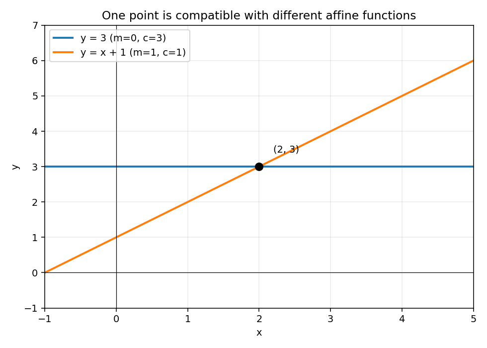

# R3 原答重评、可靠更正材料与图式功能

你的原答正确，错误来自参考把“仿射直线”擅自缩成“过原点的正比例直线”。只给点(2,3)时，能确定的是y=m(x-2)+3这一族，不能唯一确定m。原答已经给出一般表达式、两个合法不同例子和缺少条件的理由，这次文字目标可以直接重评通过，不需要为修系统错误重考。另有的自主绘图目标本次没有原图证据，保持未覆盖；它不妨碍本次原答重评。

## 目标、资料与起点的实质分析

要求来源为FIX-R3-REQUIREMENT rev1。内容依据FIX-R3-BODY rev1明确m,c是独立实常数，允许m=0，未说经过原点；“信息不足且理由正确”就是可接受结果。当前任务只给一个点，实际要观察的是条件充分性、表达式族和验证。目标另有图式产物，但这道题没有要求画图，文字原件不能支持自主绘图，也不能因没有图就给此次任务记失败。

原件先于错误参考出现，帮助顺序明确。错误答案的后续显示不会撤销原答先前的条件判断支持；它也没有制造一个新样本。起点为完整可重评的原答，无需重新诊断“是否基础薄弱”。

## 内容核验与允许的合法解

点条件是3=2m+c，所以c=3-2m；代入得到y=mx+3-2m=m(x-2)+3。对每个实数m，x=2时都得到3。这覆盖全部仿射直线解；m=0与m=1给y=3、y=x+1两条不同直线，足以否定唯一性。y=1.5x也是其中m=1.5的一个合法成员，错误是把它当唯一，不是这条线本身不经过给定点。

若另给(x2,y2)且x2≠2，则m=(y2-3)/(x2-2)能唯一确定。若另给的只是同一点，不增独立条件；若给x2=2,y2≠3，则不再有函数图同时满足，不应称“已唯一确定”。这些分支解释原答“额外条件”的含义，属于更正教学材料，不事后追加为原答必须列全的判据。

## 现在可看的材料：一式、两例与实图

读这一句即可定位区别：“一般仿射函数有两个参数m,c，一个点给一个关系；额外的c=0才把它限制为正比例形式。原题没有给c=0。”

| 函数 | 参数 | (2,3)验证 | 原点情况 |
|---|---|---|---|
| y=3 | m=0,c=3 | x=2时y=3 | 不过原点 |
| y=x+1 | m=1,c=1 | x=2时y=3 | 不过原点 |
| y=1.5x | m=1.5,c=0 | x=2时y=3 | 过原点，只是一种附加选取 |

链接维护说明（2026-10-06）：上方链接转指本审计当时保存的图件副本；原输出的临时路径保留在下段原文，临时目录现已失效。本次仅修链接，没有重新绘图或重写当时的核验结论。

实际可查看文件为C:/Users/15006/AppData/Local/Temp/learning-suite-audit-20261005/design-assessment-fresh/artifacts/R3-affine-comparison.png。图由y=3与y=x+1两条精确公式绘制，已打开成品检查：水平线在y=3，另一条在x=0时y=1、x=5时y=6，二者在(2,3)相交；轴、刻度、图例与公式一致。窗口x∈[-1,5]、y∈[-1,7]是显示范围，函数定义域仍为实数。图只是直观显示“两条不同但都相容”；全部解族的完整性由上述代数推导支持，图不能代替它。

这里式子、表和图描述同一组内容，却承担参数条件、对照和空间对应的不同工作，不能仅因信息等价删除图。此次图用来更正参考和支持观察，没有让作者画新图，不新增自主构图证据。备用支持只在混淆“直线”与“正比例”时展开两参数定义；原答已经说明得足够时可以不继续这段材料。

## 具体重评与两链四面处理

| 当前要求 | 判断 | 依据与条件 |
|---|---|---|
| 是否可唯一确定 | supported／usable于本题 | 原答用两个合法不同例子否定唯一，且给出参数自由度 |
| 表达式或全相容族 | supported／usable于本题 | m任意、c=3-2m覆盖全部给定仿射函数族 |
| 验证与所缺条件解释 | supported／usable于本题 | 代入点成立，原答明确需另一独立条件 |
| 自主画出式子对应图 | unknown／未用于图式通过 | 请求没有原图；审查者绘图不是作者绘图 |

先停用FIX-R3-BAD-REFERENCE rev1的确定评分和“直线必过原点”事实讲授。当前已知内容链为错误参考→本题错误评分；要求链核查发现正式正文和判据允许信息不足，当前已知目标本身未被污染，无需为了纠错修订它。未提供的旧任务、旧图或其他使用范围没有被检查，保留“未知依赖待查”，不写零影响。

材料面：更正推导和所示图已各自核查，可以用于当前说明。历史判断面：按当时原任务、原答、帮助顺序和正确判据直接重评；撤回对该原答的错误负面评价。教学面：此文件已经生成更正说明，是否由真实入口实际展示、作者是否受到或已修复误导尚未发生，不能写修复完成。计划面：撤销因这次错误评分而建议的重复考试；当前请求未给其他实际补课承诺，不能假称已改整个日历。图式要求保留未覆盖，用户本次只要复核，不自动追加作业。

这是新虚构请求的人工案例；没有改变真实记录、正式目标或授权，没有伪造后续作答。

