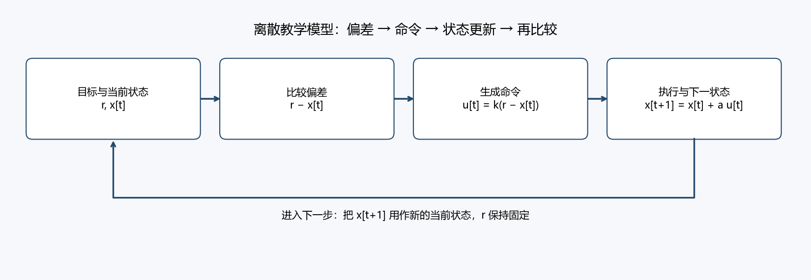
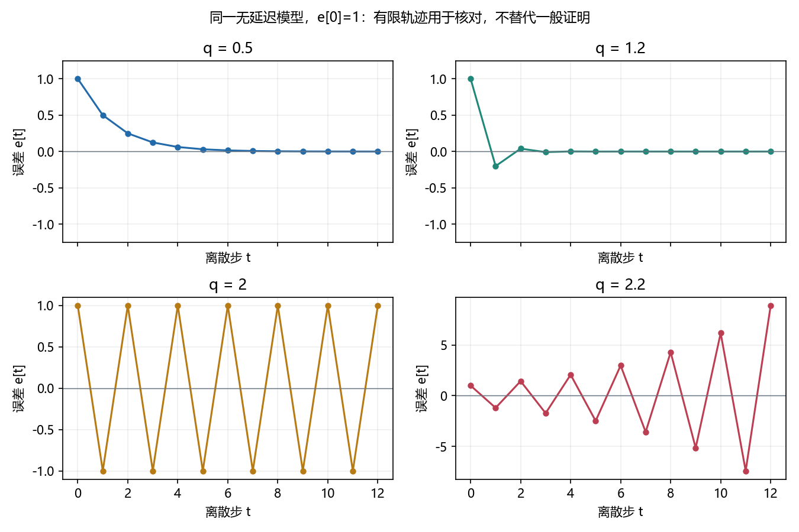

# 本次核心输入 / prepared / revision 1

虚构材料，仅用于维护验证。M1—M5在首次教学展示前已准备；按 [教师安排](teacher-plan.md)分段显示，不一次倾倒全部内容。没有真实学习者展示记录。

## M1 对象、条件与闭环

这是一个离散时间的教学模型，每步时长固定。状态x[t]是第t步的数值，目标r固定；命令u[t]决定本步改变量，a>0表示命令到状态改变量的比例，k>=0表示偏差到命令的比例。x与r同单位，a单位为状态／命令，k单位为命令／状态，q=ak无量纲。

`u[t] = k*(r-x[t])`

`x[t+1] = x[t] + a*u[t]`

图的箭头是此模型的计算／时间依赖，回路中的x在下一步更新后重新比较；没有声称真实系统满足这两个方程。目标固定、无延迟、无饱和、常参数是当前条件。

## M2 连贯两步示范

取r=10、a=1、k=0.5、x[0]=0。

| 步t | 当前x[t] | r-x[t] | 命令u[t] | a*u[t] | 下一步x[t+1] |
|---|---:|---:|---:|---:|---:|
| 0 | 0 | 10 | 5 | 5 | 5 |
| 1 | 5 | 5 | 2.5 | 2.5 | 7.5 |

第一步偏差10产生命令5，执行后状态从0变成5；下一步重新比较，此时偏差5，命令降为2.5，状态变为7.5。命令与状态不是同一个变量；刚产生命令也不等于已经到达目标。这是q=0.5的一个范例，尚未给出所有参数的长期结论。

## M3 允许查阅的数学工具

定义e[t]=x[t]-r，它与控制式中的r-x[t]符号相反。q=ak只是乘积的简写。

可引用引理：对固定实数c和非零e[0]，若e[t+1]=c*e[t]，则e[t]=c^t*e[0]。当|c|<1时趋零；c=1时保持，c=-1时等幅交替；|c|>1时绝对值无界。c=0时从下一步开始为零。引理不是本次需自主证明的对象，模型中的c仍由学习者推得。

## M4 动态对照图：相应预测后显示

横轴为离散步t，纵轴e[t]；所有曲线e[0]=1，常参数、固定目标、无延迟。图显示q=0.5、1.2、2、2.2下的有限轨迹，供核对公式与行为；有限图不能代替一般证明。图中轨迹和图例会支持相应判断，实际提前展示须计作帮助。

## M5 模型条件变化

现在只将命令改为 `u[t]=k*(r-x[t-1])`。执行仍为 `x[t+1]=x[t]+a*u[t]`，r、a、k仍固定，a>0、k>=0；开始前必须给出前一步和当前步状态。令e[-1]=e[0]=1、q=1.2。

比较原模型和新模型的计算依赖；新增历史状态不是原模型换个符号。首两个新值可帮助发现不同，但不能用它们单独证明最终行为。所需特征方程引理及合法反例已备在 [支持H3](support.md) 和 [教师参考](teacher-reference.md)，按困难或用户请求显示，不预先把它们当学习者自行发现。
